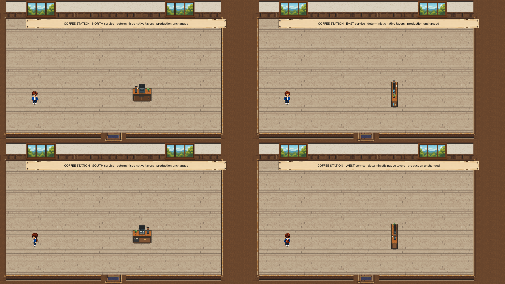
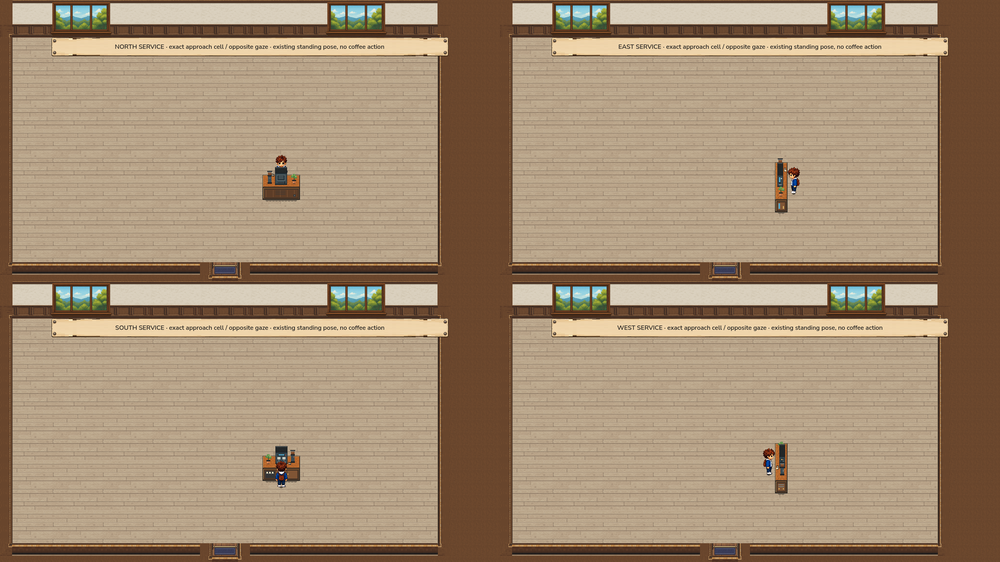

# Coffee station: deterministic four-service-side candidate

2026-09-04. **Complete native/runtime-format candidate, not production registration or a new coffee action.** The East/West ImageGen batches remain exhausted. This pass made no provider request, semantic raster edit, source mask, mirror, rotation, catalogue mutation, save access, worker call, commit, or push.

## Outcome and recommendation

The coffee family now has an exact N/E/S/W alternative built from typed GDScript geometry. It directly reuses the reviewed `modular_cabinet_geometry.gd` counter and existing 32×32 soft-oak/powdercoat tiles. The espresso machine, grinder, two-mug cluster, plant, service panel, and binary floor shadow are new deterministic pixel rectangles; no pixels from a failed East/West source or retained North/South kit are sampled. The valid North/South kits remain untouched as readability/identity evidence.

All four views use one **192×256 canvas and floor pivot (96,192)**. Forty semantic layers plus four registered wholes were exported. Each view's ordered layers reconstruct its whole byte-for-byte. The imported layers then pass the actual `OfficeLayout` service gate under owner-scoped calibration admission and render through the ordinary `TownRoom` Sprite2D path at offset `(0,-64)`, scale1, rotation0, no flips, nearest filtering.





**Recommendation: accept this as the four-view art/geometry candidate and advance it to the coordinator's production-copy/catalogue decision.** Bounded visual scores are **pixel coherence3, perspective3, silhouette/readability2, layering/anchors3, direction consistency3, placement2; mean2.67**. Every category meets the documented minimum2 and the mean exceeds2.5. Placement remains2 because the current product intentionally does not make coffee clickable and no new use animation exists; the real AStar path reaches every declared service socket, but that proof is not a coffee interaction.

## Honest directional construction

Directions name the **service side**, not actor gaze. The approach gaze is always opposite. South shows actual controls, twin group heads/spouts, drip tray, cup cubby, and doors. North shows a true rear hatch, vents, cable/grommet, and calm rear counter panel. East exposes a narrow reservoir-gauge end; West exposes the opposite vent/fastener end. East/West controls are explicitly marked edge-on instead of putting front pixels on a side face.

| Service side | Floor / top | Interaction / gaze | Whole local ink bounds | Machine camera face | Whole opaque pixels / colors |
|---|---|---|---|---|---:|
| North | `(-48,-16,96,32)` / `(-48,-48,96,32)` | `(0,-1)` / South | `(-48,-68,96,88)` | rear | 7,186 / 26 |
| East | `(-16,-48,32,96)` / `(-16,-80,32,96)` | `(1,0)` / West | `(-16,-90,32,142)` | reservoir end | 4,264 / 28 |
| South | `(-48,-16,96,32)` / `(-48,-48,96,32)` | `(0,1)` / North | `(-48,-73,96,93)` | service controls | 7,390 / 30 |
| West | `(-16,-48,32,96)` / `(-16,-80,32,96)` | `(-1,0)` / East | `(-16,-84,32,136)` | vent end | 4,194 / 24 |

Every physical support lies inside the counter's actual raised-rim interior. These rectangles are explicit code geometry rather than inferred alpha/collision bounds:

| Side | Espresso | Grinder | Two mugs | Plant |
|---|---|---|---|---|
| North | `(-16,-37,31,15)` | `(-35,-35,11,11)` | `(-25,-44,7,5)` | `(27,-37,12,12)` |
| East | `(-10,-48,15,31)` | `(-8,-67,11,11)` | `(7,-57,5,7)` | `(-7,-5,12,12)` |
| South | `(-15,-42,31,15)` | `(24,-40,11,11)` | `(18,-25,7,5)` | `(-39,-39,12,12)` |
| West | `(-5,-47,15,31)` | `(-3,-8,11,11)` | `(-12,-14,5,7)` | `(-5,-71,12,12)` |

The E/W 15×31 machine footprint is independently drawn for that axis; the N/S footprint is31×15. Code coordinates deliberately express the physical quarter-turn, but no rendered image is transformed. Loose-object layers are declared in per-side far-to-near contact order while the solid assembly remains at its host floor depth.

## Registered layers and runtime-format profile

Each facing exports these ten nonempty full canvases plus `whole`: `FloorShadow`, `CounterCarcass`, `CounterTop`, `CounterFront`, `CounterPlinth`, `ServicePanel`, `Espresso`, `Grinder`, `Serviceware`, `Plant`. Shadow depth is-1; all solid counter/tool layers share depth0. This preserves physical actor sorting and avoids lowering an entire opaque station to reveal a rear actor.

The candidate fixture produces all mandatory service fields: `profile_kind`, `service_side`, `approach_gaze`, `approach_visual_bounds`, `occupied`, `clearance`, `interaction`, `anchor_offset`, exact measured `visual_bounds`, tighter non-shadow `hit_bounds`, `render_layers`, and empty direction-specific `ambient_overlays`. Review booleans remain false and status remains `calibration_candidate`; admission is tied to the live fixture owner and cannot leak into an ordinary `OfficeLayout`.

At the four true service cells, the existing founder pose is only a scale/depth reference. North correctly hides848 of1,542 opaque founder pixels behind the counter/appliances. East/South/West hide zero. All5,603 checked actor pixels match expected depth, and all23,034 opaque candidate pixels in the empty room match the imported registered layers with zero mismatches.

Native details:

- [North rear](../../game/tests/output/coffee-station-candidate/north-room-4x.png)
- [East reservoir end](../../game/tests/output/coffee-station-candidate/east-room-4x.png)
- [South controls/cubby](../../game/tests/output/coffee-station-candidate/south-room-4x.png)
- [West vent end](../../game/tests/output/coffee-station-candidate/west-room-4x.png)

## Files and verification

Implementation:

- `game/tools/coffee_station_geometry.gd` — deterministic geometry/material assembly.
- `game/tools/export_coffee_station_candidate.gd` — exact registered layer exporter.
- `game/tools/coffee_station_candidate_fixture.gd` — null-worker owner-scoped actual-runtime profile fixture.
- `game/tools/capture_coffee_station_room.gd` — actual GameMain/TownRoom native/depth evidence.
- `game/tests/test_coffee_station_geometry.gd` — **310 checks,0 failures**.
- `game/tests/test_coffee_station_candidate.gd` — **924 checks,0 failures**, including400 actual founder physics ticks over four AStar service routes.
- `game/tests/fixtures/furniture-calibration/coffee-station-code-v1/` — **44 PNGs**, their Godot imports, and manifest. Export run: **305 checks,0 failures**.
- `game/tests/output/coffee-station-candidate/` — **25 PNGs and four JSON manifests**. Room run: **58 checks,0 failures;18 capture records**.

Source hashes for the geometry helper, modular counter, and three reused native tiles are frozen in the export manifest and rechecked after rendering. Every source PNG has binary alpha, zero hidden RGB padding, and a transparent canvas gutter. Godot's lossless importer may synthesize RGB beneath alpha0 for filtering; tests correctly distinguish that cache behavior from the source PNG contract.

Reproduce from repository root with the project-pinned Godot binary (or equivalent Godot4.7.2):

```sh
STARTUP_VALLEY_NO_WORKER=1 godot --headless --path game --script res://tests/test_coffee_station_geometry.gd
STARTUP_VALLEY_NO_WORKER=1 godot --path game --script res://tools/export_coffee_station_candidate.gd
STARTUP_VALLEY_NO_WORKER=1 godot --headless --path game --import
STARTUP_VALLEY_NO_WORKER=1 godot --headless --fixed-fps 30 --path game --script res://tests/test_coffee_station_candidate.gd
STARTUP_VALLEY_NO_WORKER=1 godot --path game --script res://tools/capture_coffee_station_room.gd
```

## Remaining production decision

No file under `game/data/` or `game/assets/runtime/office/` changed. A later authorized promotion would copy the forty registered layers into a runtime-owned directory, set exact four-facing recipes/review flags in the production catalogue, and rerun normal-office migration/placement suites. It should keep the current product behavior: coffee is noninteractive until a separate decision defines an action and feedback. Do not infer reaching, pouring, drinking, worker activity, or persistence from the service sockets.
