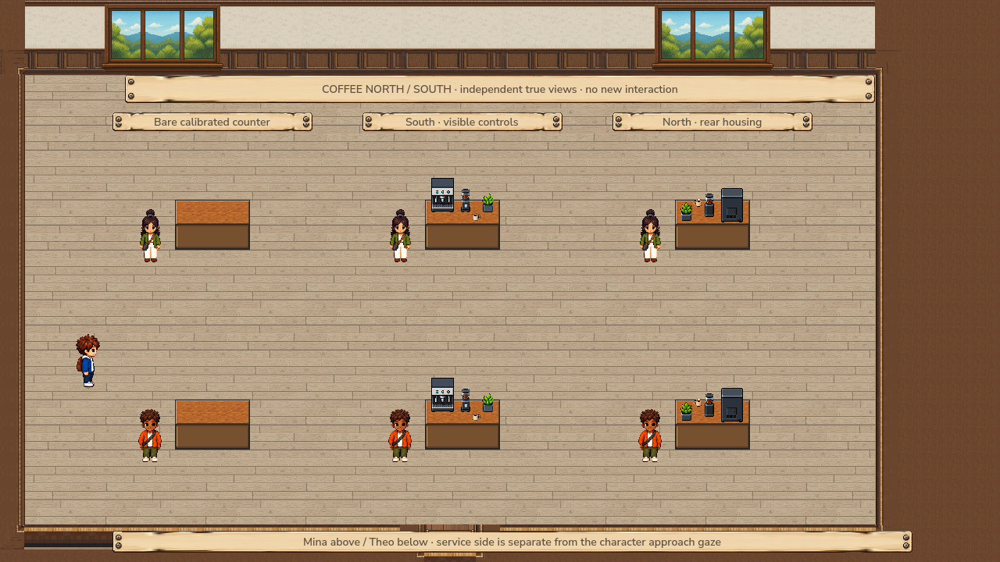
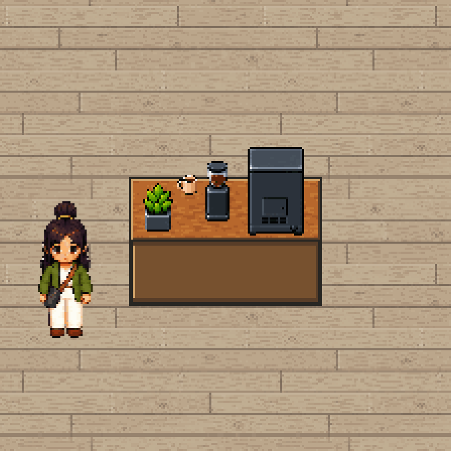

# Coffee service north: native export and south comparison

Reviewed **2026-09-04 08:42 UTC**. **Staged north candidate; not a runtime-approved station.** This task reviewed and mechanically rebuilt existing ImageGen outputs. It made no new image requests and changed no production assets, registry, gameplay, worker or save data. The original south kit and its review remain unchanged.

## Result

The independently drawn north kit survives uniform native export and actual-room rendering with genuine alpha, coherent registration and correct floor sorting. The espresso machine has a rear hatch/vent instead of front controls, the grinder rear omits the white button, and the mug handle is on the opposite side. No bitmap was rotated or mirrored to create this view.

The N/S pair supports a useful **front-versus-rear identity comparison**, but does not prove the hidden appliance depth or establish a complete four-direction set. The counter front is still an intentionally blank geometry specimen. No reaching, pouring, drinking or coffee interaction exists. The centered service point is under the grinder rather than the espresso machine; the separate machine-aligned proposal is visually better aligned, but has not been validated through canonical navigation and exposes less of a north-side actor, correctly.



## Retained source and deterministic export

- Source: [`coffee-service-north-v2.png`](../../game/assets/source/overnight-20260904/kits/coffee-service-north-v2.png), **1774×887 RGBA**, genuine alpha.
- SHA-256: `a81dacc9933a2d9d08996b778922f7fa096abf803525505f044a5f99d856e9c8`.
- Preserved initial prompt/source: [`coffee-service-north-v1.md`](../../game/assets/source/overnight-20260904/kits/coffee-service-north-v1.md). It returned an **opaque checkerboard**, not acceptable alpha.
- Preserved successful **first targeted alpha-extraction retry**: [`coffee-service-north-v2.md`](../../game/assets/source/overnight-20260904/kits/coffee-service-north-v2.md), built-in output `exec-1feff8cd-fa3f-4a1f-887b-3bfe701d9a50.png`. This is not an initial-attempt success; the failed source remains preserved.
- Existing builder, unmodified: [`build_coffee_service_north_kit.sh`](../tools/build_coffee_service_north_kit.sh).
- Four independent source crops, uniform nearest-neighbor normalization, shared 48-color source palette and binary alpha. No nonuniform stretch, source repaint, rotation, mirroring or independent runtime recentering.
- All components retain the same **192×256 canvas**, floor pivot **(96,192)**. A component's alpha extent is not its padded canvas or inferred physical footprint.

| Part | Source crop `(x,y,w,h)` | Uniform normalization | Native alpha bounds `(x,y,w,h)` | Opaque pixels |
|---|---|---|---|---:|
| Espresso | `(197,155,355,555)` | height44 | `(107,129,28,44)` | 1,209 |
| Grinder | `(702,202,195,474)` | height30 | `(86,136,12,30)` | 323 |
| Mug | `(1009,440,208,206)` | width10 | `(72,143,10,10)` | 79 |
| Plant | `(1330,253,246,403)` | height24 | `(55,147,15,24)` | 272 |

Exports: [`coffee-service-north-v2.png`](../../game/tests/fixtures/furniture-calibration/kits/coffee-service-north-v2.png) and `-espresso`, `-grinder`, `-mug`, `-plant` partners in the same directory. The union has **80×44 ink at(55,129), 1,883 opaque pixels, 47,269 transparent pixels and 41 opaque colors**. Tests found **zero partial alpha, hidden-RGB padding, inter-part opaque overlaps or omitted source pixels with alpha≥128 outside the four crop regions**. Registered parts reconstruct the union with exact RGBA equality.

The existing builder reproduced the source and all six declared outputs **byte-for-byte**. Rebuild evidence is [`rebuild-results.json`](../../game/tests/output/coffee-north-kit/rebuild-results.json); the checker does not authorize semantic editing.

## Physical contact hypotheses and side semantics

The unchanged counter has floor **Rect(-48,-16,96,32)**, rise32 and top **Rect(-48,-48,96,32)**. Its actual raised-rim wood interior is **Rect(-46,-46,92,28)**, not the padded source canvas. The north assembly's total ink is **96×79 at(48,129)**, host-local **Rect(-48,-63,96,79)**, ending at the intended floor contact **Y+16**.

These are **proposed 2D support envelopes**, not recovered 3D measurements, automatically extracted physical footprints or collision masks:

| Part | South contact, host-local `(x,y,w,h)` | North contact, host-local `(x,y,w,h)` | Interpretation |
|---|---|---|---|
| Espresso | `(-40,-45,29,13)` | `(11,-32,28,13)` | Full base; independently normalized north body is1px narrower |
| Grinder | `(-2,-38,12,6)` | `(-10,-32,12,6)` | Base, not the raised hopper lid |
| Mug | `(14,-25,7,4)` | `(-21,-43,7,4)` | Cup base only, excluding handle |
| Plant | `(26,-43,14,11)` | `(-40,-32,14,11)` | Pot base, not projecting leaves |

All north contacts are contained by both the actual wood interior and their own object bounds. Comparison first removes the counter's32px vertical rise from the south support location, turns that **logical floor-plane rectangle** by180° around the floor pivot, then restores the elevation. Every north position matches that hypothesis; only the independently normalized espresso width differs by1px. This rotates proposed coordinates, **never rendered pixels**.

The south espresso remains29×44 and north28×44; the south plant16×24 and north15×24. Preserving each source's aspect produces those differences. The south assembly is92px high versus north79px because the appliances occupy opposite portions of the raised top, not because the44px machine was shrunk.

Service **north** means physical approach cell **(0,-1)** with gaze **south**. Service **south** means **(0,+1)** with gaze **north**. These are not workstation gaze names, and introduce no seat/work-pose metadata.

## Actual-room depth and native visual review

[`capture_coffee_north_kit.gd`](../../game/tools/capture_coffee_north_kit.gd) uses the approved `TownRoom`, unchanged modular counter and real48×80 Founder/Mina/Theo locomotion sources. All world textures are native and nearest filtered. Top row is Mina, bottom row Theo. Columns are bare, frozen Southv4 and new Northv2. Actor movement is explicitly labeled **scripted visual motion**, not GameMain navigation or input acceptance.

Counter and appliances share their host's physical floor depth. Solid appliances legitimately hide nearby rear actors; the test does not lower the whole cabinet or its machine to reveal hands artificially. At the north center service foot **(0,-32)**, the assembly hides **359/1,315 Mina pixels** and **400/1,467 Theo pixels**. At the proposed machine-aligned foot **(+32,-32)**, this rises to **538/1,315** and **588/1,467**. Source-derived expected pixel layering agrees with the actual viewport across **143,706 opaque actor/assembly pixel comparisons**, with **zero mismatches**.



The final native comparison, service approach, support guides, close-behind, in-front, final service and machine-aligned proposal were inspected. The walk's start and all four segment midpoints (`walk-0-16` through `walk-3-16`) were also inspected at native1280×720. Enlarged source/native and north Mina/Theo detail crops were reviewed. These sampled views show no checkerboard, matte, detached appliance, registration seam, source clipping or unexpected actor depth. No claim is made that every movie frame was watched continuously or every saved detail crop was individually inspected.

## Findings, preference and remaining gates

| Priority | Native evidence / coordinates | Finding | Disposition |
|---|---|---|---|
| P1 | `native-comparison.png`, north front `(866,288,92,28)` and lower-row counterpart | Plain brown front still reads as unfinished geometry. | Keep staged. Finish the appropriate independent front/back/end surfaces without regenerating or moving the appliance kit. Do not reuse south service doors on the north rear face. |
| P1 | `service-approach.png`, north employee around `(912,272)` | Center service aligns to grinder, not machine. No authored hand-to-control or drinking pose. | Prefer the separate **north(+1,-1) / south(-1,+1)** machine-aligned cells for the next real navigation study; retain current behavior until validated. These cells are within the existing3-cell clearance strip but this script is not the canonical collision/path proof. |
| P1 | `machine-aligned-proposal.png`, machine `(923,241,28,44)` in upper north station | Better target alignment necessarily hides more of the north actor. Rear housing correctly hides hands. | Reuse honest floor sorting. Future interaction feedback/pose must solve legibility without drawing hands through the machine or inventing a pouring animation. |
| P1 | `native-comparison.png`, north machine `(923,241,28,44)`, south `(552,228,29,44)` | Back vents and no front controls read correctly, but front/back artwork alone does not certify hidden appliance depth or the complete camera-consistent family. | Keep both independent views as reviewed candidates. E/W are not covered or approved by this review. No fake rotated substitute. |
| P2 | `support-guides.png`, proposed base boxes | Every inferred contact fits the wood, but a box fitting a silhouette is not recovered physical geometry. | Retain explicitly named contact hypotheses and verify against any later side views before runtime admission. |
| P2 | `native-comparison.png`, north mug `(888,255,10,10)` | Small cream cup/left handle reads at native size; fine details remain tiny. | Reuse as decor at native size. If made clickable, add a real interaction target rather than runtime enlargement. |

**Preference:** keep the native Northv2 export and its exact contact placement for the next canonical N/S service fixture. The rear housing is calmer and readable; no additional generation is warranted for an alpha or scale problem. Prefer the machine-aligned approach hypothesis for evaluation, not as an already implemented behavior.

Provisional full-family score: **pixel coherence3, perspective2, silhouette/readability2, layering/anchors3, direction consistency1, placement2**, mean **2.17**. Direction1 records only an independently authored N/S comparison, not four accepted directions. Placement2 records native support containment and scripted radius/depth checks, not actual GameMain/AStar/editor/input acceptance. This is **not a production pass** or user aesthetic approval.

## Verification and reproduction

- [`test_coffee_north_kit.gd`](../../game/tests/test_coffee_north_kit.gd): **49 checks,0 failures**, rerun08:42UTC.
- Unchanged [`test_coffee_south_kit.gd`](../../game/tests/test_coffee_south_kit.gd): **54 checks,0 failures**, rerun08:42UTC.
- [`check_coffee_north_kit_rebuild.mjs`](../tools/check_coffee_north_kit_rebuild.mjs): **8 checks,0 failures**; source and six outputs retain identical hashes.
- Final native capture: **9,030 checks,0 failures**, **58 PNGs**:19 native scenes,36 nearest4× detail crops and3 registered assembly images. [`manifest.json`](../../game/tests/output/coffee-north-kit/manifest.json) records all captures, source hashes, contacts and per-state depth observations.
- [`room-comparison.avi`](../../game/tests/output/coffee-north-kit/room-comparison.avi): ffprobe confirmed **1280×720,30FPS,199 frames**. Script accounts for198 frames plus the recorder's final lifecycle frame.
- Final renderer exited0 and was released to the canonical-service task. No renderer remains owned by this task. The only correction after the first render shortened two diagnostic captions; source, placement and geometry stayed unchanged.

From the repository root:

```sh
node dev/tools/check_coffee_north_kit_rebuild.mjs
STARTUP_VALLEY_NO_WORKER=1 godot --headless --path game --script res://tests/test_coffee_north_kit.gd
STARTUP_VALLEY_NO_WORKER=1 godot --headless --path game --script res://tests/test_coffee_south_kit.gd
STARTUP_VALLEY_NO_WORKER=1 godot --path game --fixed-fps 30 --write-movie res://tests/output/coffee-north-kit/room-comparison.avi --script res://tools/capture_coffee_north_kit.gd
```

**Source and evidence frozen.** Actual coffee service navigation, cabinet finishing, hand/control interaction, missing directional review and production catalogue admission remain separate gates. No live worker, save access, paid call, image generation, production activation, commit or push occurred in this review.
