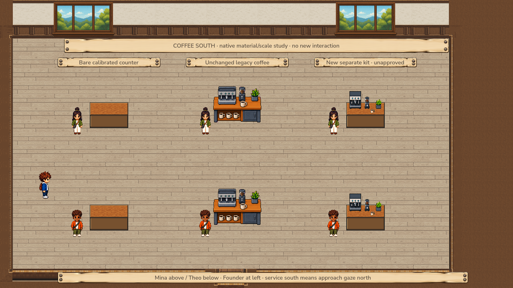
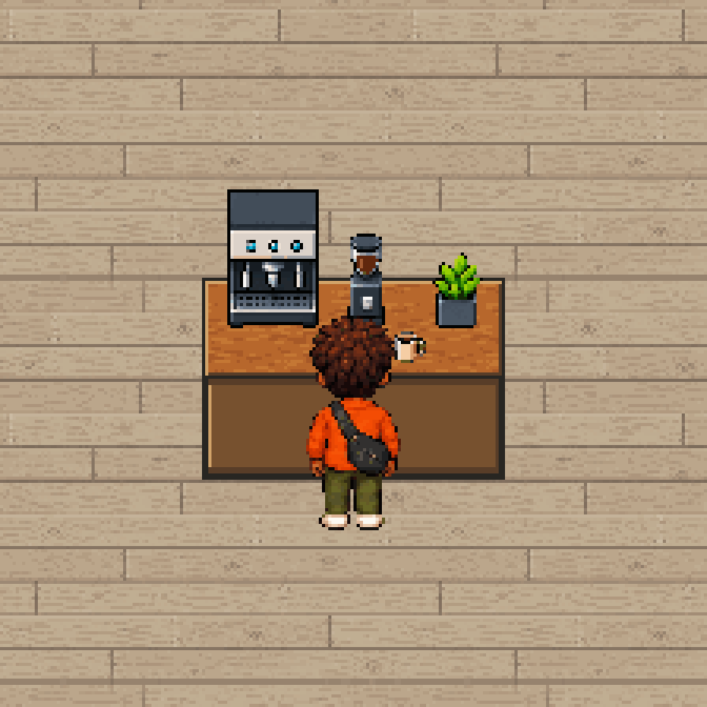

# Coffee service south: native export and room review

Reviewed **2026-09-04 08:19 UTC**. This is a **south-only native candidate**, not an approved replacement or a newly functional coffee station. No ImageGen calls were made in this task. The retained v4 source is the last allowed source attempt in the parent's initial-plus-three-retries batch; do not silently retry it.

## Result

The separate kit is mechanically sound and can sit on the calibrated 96×32 counter top without extending its support estimates beyond the rim. At actual game scale the espresso machine, grinder, mug and plant remain distinguishable. Genuine transparent padding and exact registered layers survive rendering. Front actors remain in front; nearby rear actors are correctly hidden by the solid counter and appliances.

The **complete station is not finished**. Its counter front is still the intentionally plain geometry specimen, no pouring/reaching/drinking pose or coffee action was implemented, the current center approach aligns with the grinder rather than the main machine, and there are no matching N/E/W appliance views. The appliance drawing is relatively frontal, especially the machine's large dark upper face; its hidden depth cannot be certified from this image alone. Keep the current production coffee station until these decisions are resolved.



## Exact retained inputs and reproducible exports

- Source: [`coffee-service-south-v4.png`](../../game/assets/source/overnight-20260904/kits/coffee-service-south-v4.png), **1774×887 RGBA**, genuine alpha.
- Prompt: [`coffee-service-south-v4.md`](../../game/assets/source/overnight-20260904/kits/coffee-service-south-v4.md).
- Existing builder, unchanged: [`build_coffee_service_south_kit.sh`](../tools/build_coffee_service_south_kit.sh).
- Common native canvas **192×256**, floor pivot **(96,192)**. Every component keeps this full transparent canvas; none is independently recentered in the room.
- Independent crop and **uniform nearest-neighbor normalization**, binary alpha and one shared 48-color palette. No rotation, mirror, aspect stretch, new pixels or semantic repaint.
- Rebuilding preserved the source, all four parts, union and paper4× file **byte-for-byte**. Source SHA-256: `05169e5073bb987dd2563dea6059a684f742ea22f17c5a728c3143a2d65a68a3`.

| Part | Native path suffix after `kits/coffee-service-south-v4` | Actual alpha bounds `(x,y,w,h)` | Opaque pixels | Proposed base contact, host-local `(x,y,w,h)` |
|---|---|---|---:|---|
| Espresso | `-espresso.png` | `(56,116,29,44)` | 1,255 | `(-40,-45,29,13)` |
| Grinder | `-grinder.png` | `(94,130,12,30)` | 297 | `(-2,-38,12,6)` |
| Mug | `-mug.png` | `(109,161,10,10)` | 80 | `(14,-25,7,4)` |
| Plant | `-plant.png` | `(121,136,16,24)` | 266 | `(26,-43,14,11)` |

All native paths are under [`game/tests/fixtures/furniture-calibration/kits/`](../../game/tests/fixtures/furniture-calibration/kits/). The union is [`coffee-service-south-v4.png`](../../game/tests/fixtures/furniture-calibration/kits/coffee-service-south-v4.png): **81×55 actual ink at (56,116)**, **1,898 opaque pixels**, **44 opaque colors plus transparency**. There are **zero partial-alpha pixels**, **zero hidden-RGB padding pixels**, no overlap between parts, and no thresholded opaque source pixels outside the declared four crop regions. The four padded parts reconstruct the union with exact RGBA equality.

The contact rectangles above are deliberately named **hypotheses**, not extracted 3D measurements or collision masks. The plant's leaves are not its pot footprint; the grinder hopper's elliptical lid does not imply a circular full-height footprint. Mug contact excludes its handle. Each proposed contact is within the native counter's raised-rim interior, **Rect(-46,-46,92,28)**, and within its own object's bounds.

## Geometry, sorting, and side semantics

The comparison uses the approved `TownRoom` architecture, the real 32px grid and production Founder/Mina/Theo locomotion sources at **48×80**, feet anchored at row72. It deliberately does **not** instantiate GameMain, WorkerClient or personal state.

- Bare/new counter geometry comes unchanged from [`modular_cabinet_geometry.gd`](../../game/tools/modular_cabinet_geometry.gd): floor `(-48,-16,96,32)`, rise32, top `(-48,-48,96,32)` and nearest floor-contact boundary `+16`.
- New actual assembly ink is **96×92 at (48,116)** on the common canvas, or host-local **(-48,-76,96,92)**. Bare ink is96×64 at(48,144).
- The legacy comparison uses the actual current [`coffee-station.png`](../../game/assets/runtime/office/coffee-station.png) and its unchanged centered `(0,-45)` sprite offset. Its rendered actual ink is **120×90 at (36,104)** on the diagnostic canvas, ending at hostY+2; this is different from the new calibrated boundary+16. No rescaling or registration correction was applied to make the comparison look better.
- Service **south** means a customer stands at physical cell **(0,+1)** and looks **north**. This is not the workstation convention in which facing names the seated employee's gaze. No work-pose or seat metadata is introduced.
- Counter and its appliances remain one opaque floor-sorted assembly. Parent depth equals its physical floor pivot; components use relative depth0. No whole-cabinet lowering makes a rear person artificially visible.

At the close-rear physical foot `(0,-32)`, the new counter hides **403/1,315 Mina pixels** and **459/1,467 Theo pixels**. Those are intended overlaps. The unchanged legacy station hides968 and1,010 respectively. At the south service point `(0,+32)`, the new assembly hides **zero actor pixels**. Across all sampled states, **135,360 actual rendered actor/assembly pixel comparisons found no depth mismatch**.



## Findings and disposition

| Priority | Evidence at native1280×720 | Finding | Disposition |
|---|---|---|---|
| P1 | `native-comparison.png`, new front `(866,288,92,28)` and corresponding lower-row front | Plain brown front has no cabinet/storage character and does not yet read as finished furniture. It is the existing geometry placeholder, not missing source alpha. | Create/reuse a **flat native88×24 south front insert** in the existing socket, preserving structural edges. Do not regenerate the entire appliance station. |
| P1 | `service-approach.png`, upper new station around `(900,258)` | Center service position puts the employee under the grinder. There is no authored reaching, pouring, holding-cup or drinking action. | Decide future interaction target. The already-clear left service cell `(-1,+1)` would put the foot in front of the machine; validate it through real navigation before changing behavior. Keep this review's center point unchanged. |
| P1 | `native-comparison-new-mira-4x.png`, machine native `(872,228,29,44)` | Machine upper section is a flat, dark rectangular face; appliance top-depth cues are weaker than the calibrated counter's. The grinder lid has some overhead ellipse depth, but one view cannot prove hidden body depth. | Retain as a provisional front view; do not call it a four-direction camera-consistent set or approve from contact boxes alone. No further v4 source retries in this batch. |
| P1 | Catalogue coverage; no N/E/W source in this task | Only south appliance art exists. | Missing directions stay missing. Independently draw them later; no bitmap rotations/mirrors. |
| P2 | `close-behind.png` and corresponding4× crop | Appliances naturally hide a rear actor's hands/body. Revealing the actor by lowering the counter would create a real depth bug. | Reuse existing honest whole-assembly depth. A future service interaction requires a supported pose, not a depth cheat. |
| P2 | `native-comparison.png`, mug around `(925,273,10,10)` | Mug is readable as a small cup but its tiny handle/coffee detail is low-detail at100%, as expected for10px. | Reuse for decor. Reassess only if it becomes an interactive target; do not enlarge the whole kit at runtime. |

Provisional score on the six goal categories: **pixel coherence3, perspective2, silhouette/readability2, layering/anchors3, direction consistency0 (other views absent), placement2**; mean **2.0**. The score is not a production pass. Placement2 means native source/contact containment and scripted physical-radius checks, **not** canonical AStar/editor/input integration. No score implies user aesthetic approval.

## Evidence and verification

- [`test_coffee_south_kit.gd`](../../game/tests/test_coffee_south_kit.gd): **54 checks,0 failures**. Source alpha/crop completeness, exact native bounds, shared palette, binary-alpha/padding, independent part ownership, exact recombination, contact containment, service-side semantics and native transforms.
- [`check_coffee_south_kit_rebuild.mjs`](../tools/check_coffee_south_kit_rebuild.mjs): **8 checks,0 failures**. Existing builder succeeded; source and six declared outputs retained identical SHA-256 values. Results: [`rebuild-results.json`](../../game/tests/output/coffee-south-kit/rebuild-results.json).
- [`capture_coffee_south_kit.gd`](../../game/tools/capture_coffee_south_kit.gd): **8,921 checks,0 failures**, **51 PNGs** (18 native scenes,30 nearest4× details,3 registered assembly exports). Actual scene/native transform, actor-radius/room containment, caption-vs-art boundaries, source-based rendered depth and exact bare+kit assembly equality.
- [`manifest.json`](../../game/tests/output/coffee-south-kit/manifest.json) records sources, part hashes, observations and explicit limitations. [`results-headless.json`](../../game/tests/output/coffee-south-kit/results-headless.json) records native measurements.
- [`room-comparison.avi`](../../game/tests/output/coffee-south-kit/room-comparison.avi): ffprobe confirmed **1280×720,30FPS,196 frames,6.533s**. Harness accounts for195 scripted frames; the recorder includes its final lifecycle frame. Native representative states, every walking-segment midpoint, a start checkpoint and final return were visually inspected; no claim of continuous video playback is made.
- Project validation passed. New capture script passed headless parse and scoped diff whitespace checks.

Reproduce from the repo root:

```sh
node dev/tools/check_coffee_south_kit_rebuild.mjs
godot --headless --path game --script res://tests/test_coffee_south_kit.gd
godot --path game --fixed-fps 30 --write-movie res://tests/output/coffee-south-kit/room-comparison.avi --script res://tools/capture_coffee_south_kit.gd
```

**Source frozen; renderer exited0 and released.** No production registry/catalogue/worker/protocol/save mutation, new gameplay functionality, asset approval, commit or push was performed.
