# Furniture art gallery

<!-- Generated by dev/tools/validate_art_catalogue.mjs --write-gallery. Do not edit by hand. -->

Catalogue: [furniture.json](furniture.json), SHA-256 `6de983570a595813991ad186be6714a378c0f171ed72c7ac00d6aac7ab292555`.

42 families · 168 directional slots · 168 approved · 0 planned · 7 existing legacy references.

This is a navigation index, not native-size visual approval. Thumbnails below link to real local files only; missing art is never filled with a reference from another direction. Image embeds use portable repository-relative paths.

Frozen checkpoint: **2026-09-08T19:07:17.615Z**. Later in-flight generations are intentionally excluded. The [measured source/master index](../../game/assets/source/overnight-20260904/README.md) preserves originals and failed attempts through this checkpoint.

Directions are employee gaze for workstations/host kits, but explicitly named **service side** for shared-service objects. Their approach gaze is opposite; legacy South service bindings are preserved. Read each family’s semantic label. A retained misdirected source is not a second correctly authored view.

Native desk/computer canvases are **192×224**, pivot **[96,160]**; chairs **96×160**, pivot **[48,112]**; coffee **192×256**, pivot **[96,192]**; archives **192×288**, pivot **[96,224]**. Small flat archive-face textures are material inserts, not floor-anchored whole furniture. The legacy **128×112** desk cell remains separate. Native dimensions, component exports and material alternatives do not establish finished directional approval.

| Family | Priority | Assembly | North | East | South | West | Legacy source |
| --- | --- | --- | --- | --- | --- | --- | --- | --- |
| [Shared workstation](#desk) | P0 | Base | [runtime integrated](../../game/tests/fixtures/furniture-calibration/modular-desk-grain-v2/north-rear.png) | [runtime integrated](../../game/tests/fixtures/furniture-calibration/modular-desk-grain-v2/east-rear.png) | [runtime integrated](../../game/tests/fixtures/furniture-calibration/modular-desk-grain-v2/south-rear.png) | [runtime integrated](../../game/tests/fixtures/furniture-calibration/modular-desk-grain-v2/west-rear.png) | [South reference only](#legacy-desk) |
| [Coffee station](#coffee_station) | P1 | Base | [runtime integrated](../../game/tests/fixtures/furniture-calibration/coffee-station-code-v1/north-whole.png) | [runtime integrated](../../game/tests/fixtures/furniture-calibration/coffee-station-code-v1/east-whole.png) | [runtime integrated](../../game/tests/fixtures/furniture-calibration/coffee-station-code-v1/south-whole.png) | [runtime integrated](../../game/tests/fixtures/furniture-calibration/coffee-station-code-v1/west-whole.png) | [South reference only](#legacy-coffee_station) |
| [Collaboration table](#collaboration_cluster) | P1 | Base | [runtime integrated](../../game/tests/fixtures/furniture-calibration/collaboration-cluster-v2/north-whole.png) | [runtime integrated](../../game/tests/fixtures/furniture-calibration/collaboration-cluster-v2/east-whole.png) | [runtime integrated](../../game/tests/fixtures/furniture-calibration/collaboration-cluster-v2/south-whole.png) | [runtime integrated](../../game/tests/fixtures/furniture-calibration/collaboration-cluster-v2/west-whole.png) | [South reference only](#legacy-collaboration_cluster) |
| [Artifact archive](#artifact_archive) | P1 | Base | [runtime integrated](../../game/tests/fixtures/furniture-calibration/modular-archive-v1/north-whole.png) | [runtime integrated](../../game/tests/fixtures/furniture-calibration/modular-archive-v1/east-whole.png) | [runtime integrated](../../game/tests/fixtures/furniture-calibration/modular-archive-v1/south-whole.png) | [runtime integrated](../../game/tests/fixtures/furniture-calibration/modular-archive-v1/west-whole.png) | [South reference only](#legacy-artifact_archive) |
| [Research bench](#research_table) | P0 | Base | [runtime integrated](../../game/tests/fixtures/furniture-calibration/research-bench-v1/north-whole.png) | [runtime integrated](../../game/tests/fixtures/furniture-calibration/research-bench-v1/east-whole.png) | [runtime integrated](../../game/tests/fixtures/furniture-calibration/research-bench-v1/south-whole.png) | [runtime integrated](../../game/tests/fixtures/furniture-calibration/research-bench-v1/west-whole.png) | [South reference only](#legacy-research_table) |
| [Decision console](#approval_console) | P1 | Base | [runtime integrated](../../game/tests/fixtures/furniture-calibration/decision-console-v1/north-rear_structure.png) | [runtime integrated](../../game/tests/fixtures/furniture-calibration/decision-console-v1/east-rear_structure.png) | [runtime integrated](../../game/tests/fixtures/furniture-calibration/decision-console-v1/south-rear_structure.png) | [runtime integrated](../../game/tests/fixtures/furniture-calibration/decision-console-v1/west-rear_structure.png) | [South reference only](#legacy-approval_console) |
| [Prototype bench](#prototype_bench) | P1 | Base | [runtime integrated](../../game/tests/fixtures/furniture-calibration/prototype-bench-v1/north-rear_structure.png) | [runtime integrated](../../game/tests/fixtures/furniture-calibration/prototype-bench-v1/east-rear_structure.png) | [runtime integrated](../../game/tests/fixtures/furniture-calibration/prototype-bench-v1/south-rear_structure.png) | [runtime integrated](../../game/tests/fixtures/furniture-calibration/prototype-bench-v1/west-rear_structure.png) | [South reference only](#legacy-prototype_bench) |
| [Compact starter desk](#compact_desk) | P0 | Base | [approved](../../game/tests/fixtures/furniture-calibration/compact-desk-v2/north-whole.png) | [approved](../../game/tests/fixtures/furniture-calibration/compact-desk-v2/east-whole.png) | [approved](../../game/tests/fixtures/furniture-calibration/compact-desk-v2/south-whole.png) | [approved](../../game/tests/fixtures/furniture-calibration/compact-desk-v2/west-whole.png) | None recorded |
| [Two-person workbench](#shared_workbench) | P2 | Base | [approved](../../game/tests/fixtures/furniture-calibration/shared-workbench-v2/north-whole.png) | [approved](../../game/tests/fixtures/furniture-calibration/shared-workbench-v2/east-whole.png) | [approved](../../game/tests/fixtures/furniture-calibration/shared-workbench-v2/south-whole.png) | [approved](../../game/tests/fixtures/furniture-calibration/shared-workbench-v2/west-whole.png) | None recorded |
| [Task chair](#ergonomic_chair) | P0 | Base | [runtime integrated](../../game/tests/fixtures/furniture-calibration/chair-north-v1.png) | [runtime integrated](../../game/tests/fixtures/furniture-calibration/chair-layers-v1/east-rear.png) | [runtime integrated](../../game/tests/fixtures/furniture-calibration/chair-south-v3.png) | [runtime integrated](../../game/tests/fixtures/furniture-calibration/chair-layers-v1/west-rear.png) | None recorded |
| [Visitor chair](#visitor_chair) | P1 | Base | [approved](../../game/tests/fixtures/furniture-calibration/visitor-chair-v2/north-whole.png) | [approved](../../game/tests/fixtures/furniture-calibration/visitor-chair-v2/east-whole.png) | [approved](../../game/tests/fixtures/furniture-calibration/visitor-chair-v2/south-whole.png) | [approved](../../game/tests/fixtures/furniture-calibration/visitor-chair-v2/west-whole.png) | None recorded |
| [Two-seat sofa](#two_seat_sofa) | P1 | Base | [approved](../../game/tests/fixtures/furniture-calibration/two-seat-sofa-v3/north-whole.png) | [approved](../../game/tests/fixtures/furniture-calibration/two-seat-sofa-v3/east-whole.png) | [approved](../../game/tests/fixtures/furniture-calibration/two-seat-sofa-v3/south-whole.png) | [approved](../../game/tests/fixtures/furniture-calibration/two-seat-sofa-v3/west-whole.png) | None recorded |
| [Lounge armchair](#lounge_armchair) | P2 | Base | [approved](../../game/tests/fixtures/furniture-calibration/lounge-armchair-v3/north-whole.png) | [approved](../../game/tests/fixtures/furniture-calibration/lounge-armchair-v3/east-whole.png) | [approved](../../game/tests/fixtures/furniture-calibration/lounge-armchair-v3/south-whole.png) | [approved](../../game/tests/fixtures/furniture-calibration/lounge-armchair-v3/west-whole.png) | None recorded |
| [Low lounge table](#low_coffee_table) | P2 | Base | [approved](../../game/tests/fixtures/furniture-calibration/low-coffee-table-v1/north-whole.png) | [approved](../../game/tests/fixtures/furniture-calibration/low-coffee-table-v1/east-whole.png) | [approved](../../game/tests/fixtures/furniture-calibration/low-coffee-table-v1/south-whole.png) | [approved](../../game/tests/fixtures/furniture-calibration/low-coffee-table-v1/west-whole.png) | None recorded |
| [Small round meeting table](#round_meeting_table) | P1 | Base | [approved](../../game/tests/fixtures/furniture-calibration/round-meeting-table-v1/north-whole.png) | [approved](../../game/tests/fixtures/furniture-calibration/round-meeting-table-v1/east-whole.png) | [approved](../../game/tests/fixtures/furniture-calibration/round-meeting-table-v1/south-whole.png) | [approved](../../game/tests/fixtures/furniture-calibration/round-meeting-table-v1/west-whole.png) | None recorded |
| [Mobile planning board](#mobile_whiteboard) | P1 | Base | [approved](../../game/tests/fixtures/furniture-calibration/mobile-whiteboard-v1/north-whole.png) | [approved](../../game/tests/fixtures/furniture-calibration/mobile-whiteboard-v1/east-whole.png) | [approved](../../game/tests/fixtures/furniture-calibration/mobile-whiteboard-v1/south-whole.png) | [approved](../../game/tests/fixtures/furniture-calibration/mobile-whiteboard-v1/west-whole.png) | None recorded |
| [Rolling storage pedestal](#rolling_storage_pedestal) | P2 | Base | [runtime integrated](../../game/tests/fixtures/furniture-calibration/pedestal-v1/north-whole.png) | [runtime integrated](../../game/tests/fixtures/furniture-calibration/pedestal-v1/east-whole.png) | [runtime integrated](../../game/tests/fixtures/furniture-calibration/pedestal-v1/south-whole.png) | [runtime integrated](../../game/tests/fixtures/furniture-calibration/pedestal-v1/west-whole.png) | None recorded |
| [Low resource shelf](#low_bookshelf) | P1 | Base | [approved](../../game/tests/fixtures/furniture-calibration/low-bookshelf-v1/north-whole.png) | [approved](../../game/tests/fixtures/furniture-calibration/low-bookshelf-v1/east-whole.png) | [approved](../../game/tests/fixtures/furniture-calibration/low-bookshelf-v1/south-whole.png) | [approved](../../game/tests/fixtures/furniture-calibration/low-bookshelf-v1/west-whole.png) | None recorded |
| [Tall supply cabinet](#tall_storage_cabinet) | P2 | Base | [approved](../../game/tests/fixtures/furniture-calibration/tall-storage-cabinet-v2/north-whole.png) | [approved](../../game/tests/fixtures/furniture-calibration/tall-storage-cabinet-v2/east-whole.png) | [approved](../../game/tests/fixtures/furniture-calibration/tall-storage-cabinet-v2/south-whole.png) | [approved](../../game/tests/fixtures/furniture-calibration/tall-storage-cabinet-v2/west-whole.png) | None recorded |
| [Freestanding acoustic divider](#acoustic_divider) | P2 | Base | [approved](../../game/tests/fixtures/furniture-calibration/acoustic-divider-v1/north-whole.png) | [approved](../../game/tests/fixtures/furniture-calibration/acoustic-divider-v1/east-whole.png) | [approved](../../game/tests/fixtures/furniture-calibration/acoustic-divider-v1/south-whole.png) | [approved](../../game/tests/fixtures/furniture-calibration/acoustic-divider-v1/west-whole.png) | None recorded |
| [Broadleaf floor planter](#broadleaf_planter) | P1 | Base | [runtime integrated](../../game/tests/fixtures/furniture-calibration/broadleaf-planter-v1/north-whole.png) | [runtime integrated](../../game/tests/fixtures/furniture-calibration/broadleaf-planter-v1/east-whole.png) | [runtime integrated](../../game/tests/fixtures/furniture-calibration/broadleaf-planter-v1/south-whole.png) | [runtime integrated](../../game/tests/fixtures/furniture-calibration/broadleaf-planter-v1/west-whole.png) | None recorded |
| [Reading floor lamp](#task_floor_lamp) | P2 | Base | [runtime integrated](../../game/tests/fixtures/furniture-calibration/task-floor-lamp-v2/north-whole.png) | [runtime integrated](../../game/tests/fixtures/furniture-calibration/task-floor-lamp-v2/east-whole.png) | [runtime integrated](../../game/tests/fixtures/furniture-calibration/task-floor-lamp-v2/south-whole.png) | [runtime integrated](../../game/tests/fixtures/furniture-calibration/task-floor-lamp-v2/west-whole.png) | None recorded |
| [Water and tea station](#water_station) | P2 | Base | [approved](../../game/tests/fixtures/furniture-calibration/water-station-v2/north-whole.png) | [approved](../../game/tests/fixtures/furniture-calibration/water-station-v2/east-whole.png) | [approved](../../game/tests/fixtures/furniture-calibration/water-station-v2/south-whole.png) | [approved](../../game/tests/fixtures/furniture-calibration/water-station-v2/west-whole.png) | None recorded |
| [Coat and bag stand](#coat_bag_stand) | P2 | Base | [approved](../../game/tests/fixtures/furniture-calibration/coat-bag-stand-v3/north-whole.png) | [approved](../../game/tests/fixtures/furniture-calibration/coat-bag-stand-v3/east-whole.png) | [approved](../../game/tests/fixtures/furniture-calibration/coat-bag-stand-v3/south-whole.png) | [approved](../../game/tests/fixtures/furniture-calibration/coat-bag-stand-v3/west-whole.png) | None recorded |
| [Printer and scanner station](#printer_scanner_station) | P1 | Base | [approved](../../game/tests/fixtures/furniture-calibration/printer-scanner-station-v1/north-whole.png) | [approved](../../game/tests/fixtures/furniture-calibration/printer-scanner-station-v1/east-whole.png) | [approved](../../game/tests/fixtures/furniture-calibration/printer-scanner-station-v1/south-whole.png) | [approved](../../game/tests/fixtures/furniture-calibration/printer-scanner-station-v1/west-whole.png) | None recorded |
| [Recycling sorter](#recycling_sorter) | P2 | Base | [approved](../../game/tests/fixtures/furniture-calibration/recycling-sorter-v2/north-whole.png) | [approved](../../game/tests/fixtures/furniture-calibration/recycling-sorter-v2/east-whole.png) | [approved](../../game/tests/fixtures/furniture-calibration/recycling-sorter-v2/south-whole.png) | [approved](../../game/tests/fixtures/furniture-calibration/recycling-sorter-v2/west-whole.png) | None recorded |
| [Compact server cabinet](#server_cabinet) | P2 | Base | [approved](../../game/tests/fixtures/furniture-calibration/server-cabinet-v2/north-whole.png) | [approved](../../game/tests/fixtures/furniture-calibration/server-cabinet-v2/east-whole.png) | [approved](../../game/tests/fixtures/furniture-calibration/server-cabinet-v2/south-whole.png) | [approved](../../game/tests/fixtures/furniture-calibration/server-cabinet-v2/west-whole.png) | None recorded |
| [Quiet call booth](#phone_booth) | P2 | Base | [approved](../../game/tests/fixtures/furniture-calibration/phone-booth-v3/north-whole.png) | [approved](../../game/tests/fixtures/furniture-calibration/phone-booth-v3/east-whole.png) | [approved](../../game/tests/fixtures/furniture-calibration/phone-booth-v3/south-whole.png) | [approved](../../game/tests/fixtures/furniture-calibration/phone-booth-v3/west-whole.png) | None recorded |
| [Founder strategy kit](#founder_strategy_kit) | P0 | Kit → desk | [approved](../../game/tests/fixtures/furniture-calibration/founder-strategy-kit-v1/north-whole.png) | [approved](../../game/tests/fixtures/furniture-calibration/founder-strategy-kit-v1/east-whole.png) | [approved](../../game/tests/fixtures/furniture-calibration/founder-strategy-kit-v1/south-whole.png) | [approved](../../game/tests/fixtures/furniture-calibration/founder-strategy-kit-v1/west-whole.png) | None recorded |
| [Mina discovery kit](#mina_discovery_kit) | P0 | Kit → desk | [runtime integrated](../../game/tests/fixtures/furniture-calibration/mina-product-kit-v1/north-whole.png) | [runtime integrated](../../game/tests/fixtures/furniture-calibration/mina-product-kit-v1/east-whole.png) | [runtime integrated](../../game/tests/fixtures/furniture-calibration/mina-product-kit-v1/south-whole.png) | [runtime integrated](../../game/tests/fixtures/furniture-calibration/mina-product-kit-v1/west-whole.png) | None recorded |
| [Product prototyping kit](#product_prototype_kit) | P1 | Kit → research_table | [approved](../../game/tests/fixtures/furniture-calibration/product-prototype-kit-v1/north-whole.png) | [approved](../../game/tests/fixtures/furniture-calibration/product-prototype-kit-v1/east-whole.png) | [approved](../../game/tests/fixtures/furniture-calibration/product-prototype-kit-v1/south-whole.png) | [approved](../../game/tests/fixtures/furniture-calibration/product-prototype-kit-v1/west-whole.png) | None recorded |
| [Theo campaign kit](#theo_campaign_kit) | P0 | Kit → desk | [runtime integrated](../../game/tests/fixtures/furniture-calibration/theo-campaign-kit-v1/north-whole.png) | [runtime integrated](../../game/tests/fixtures/furniture-calibration/theo-campaign-kit-v1/east-whole.png) | [runtime integrated](../../game/tests/fixtures/furniture-calibration/theo-campaign-kit-v1/south-whole.png) | [runtime integrated](../../game/tests/fixtures/furniture-calibration/theo-campaign-kit-v1/west-whole.png) | None recorded |
| [Growth analytics kit](#growth_analytics_kit) | P1 | Kit → desk | [approved](../../game/tests/fixtures/furniture-calibration/growth-analytics-kit-v1/north-whole.png) | [approved](../../game/tests/fixtures/furniture-calibration/growth-analytics-kit-v1/east-whole.png) | [approved](../../game/tests/fixtures/furniture-calibration/growth-analytics-kit-v1/south-whole.png) | [approved](../../game/tests/fixtures/furniture-calibration/growth-analytics-kit-v1/west-whole.png) | None recorded |
| [Legal planning kit](#lawyer_contract_kit) | P1 | Kit → desk | [approved](../../game/tests/fixtures/furniture-calibration/lawyer-contract-kit-v2/north-whole.png) | [approved](../../game/tests/fixtures/furniture-calibration/lawyer-contract-kit-v2/east-whole.png) | [approved](../../game/tests/fixtures/furniture-calibration/lawyer-contract-kit-v2/south-whole.png) | [approved](../../game/tests/fixtures/furniture-calibration/lawyer-contract-kit-v2/west-whole.png) | None recorded |
| [Creative design kit](#creative_design_kit) | P1 | Kit → desk | [approved](../../game/tests/fixtures/furniture-calibration/creative-design-kit-v1/north-whole.png) | [approved](../../game/tests/fixtures/furniture-calibration/creative-design-kit-v1/east-whole.png) | [approved](../../game/tests/fixtures/furniture-calibration/creative-design-kit-v1/south-whole.png) | [approved](../../game/tests/fixtures/furniture-calibration/creative-design-kit-v1/west-whole.png) | None recorded |
| [Engineering build kit](#engineer_build_kit) | P1 | Kit → desk | [approved](../../game/tests/fixtures/furniture-calibration/engineer-build-kit-v2/north-whole.png) | [approved](../../game/tests/fixtures/furniture-calibration/engineer-build-kit-v2/east-whole.png) | [approved](../../game/tests/fixtures/furniture-calibration/engineer-build-kit-v2/south-whole.png) | [approved](../../game/tests/fixtures/furniture-calibration/engineer-build-kit-v2/west-whole.png) | None recorded |
| [Finance planning kit](#finance_accounts_kit) | P1 | Kit → desk | [approved](../../game/tests/fixtures/furniture-calibration/finance-accounts-kit-v1/north-whole.png) | [approved](../../game/tests/fixtures/furniture-calibration/finance-accounts-kit-v1/east-whole.png) | [approved](../../game/tests/fixtures/furniture-calibration/finance-accounts-kit-v1/south-whole.png) | [approved](../../game/tests/fixtures/furniture-calibration/finance-accounts-kit-v1/west-whole.png) | None recorded |
| [Customer success kit](#customer_success_kit) | P1 | Kit → desk | [approved](../../game/tests/fixtures/furniture-calibration/customer-success-kit-v1/north-whole.png) | [approved](../../game/tests/fixtures/furniture-calibration/customer-success-kit-v1/east-whole.png) | [approved](../../game/tests/fixtures/furniture-calibration/customer-success-kit-v1/south-whole.png) | [approved](../../game/tests/fixtures/furniture-calibration/customer-success-kit-v1/west-whole.png) | None recorded |
| [Shared computer kit](#shared_computer_kit) | P0 | Kit → desk | [runtime integrated](../../game/tests/fixtures/furniture-calibration/kits/computer-north-v2-monitor.png) | [runtime integrated](../../game/tests/fixtures/furniture-calibration/kits/computer-east-v4-monitor.png) | [runtime integrated](../../game/tests/fixtures/furniture-calibration/kits/computer-south-v3.png) | [runtime integrated](../../game/tests/fixtures/furniture-calibration/kits/computer-west-v2-monitor.png) | None recorded |
| [Desk task-light kit](#desk_lamp_kit) | P2 | Kit → desk | [approved](../../game/tests/fixtures/furniture-calibration/desk-lamp-kit-v2/north-whole.png) | [approved](../../game/tests/fixtures/furniture-calibration/desk-lamp-kit-v2/east-whole.png) | [approved](../../game/tests/fixtures/furniture-calibration/desk-lamp-kit-v2/south-whole.png) | [approved](../../game/tests/fixtures/furniture-calibration/desk-lamp-kit-v2/west-whole.png) | None recorded |
| [Two-person break table](#cafe_table) | P2 | Base | [approved](../../game/tests/fixtures/furniture-calibration/cafe-table-v2/north-whole.png) | [approved](../../game/tests/fixtures/furniture-calibration/cafe-table-v2/east-whole.png) | [approved](../../game/tests/fixtures/furniture-calibration/cafe-table-v2/south-whole.png) | [approved](../../game/tests/fixtures/furniture-calibration/cafe-table-v2/west-whole.png) | None recorded |
| [Rolling resource cart](#resource_cart) | P2 | Base | [approved](../../game/tests/fixtures/furniture-calibration/resource-cart-v1/north-whole.png) | [approved](../../game/tests/fixtures/furniture-calibration/resource-cart-v1/east-whole.png) | [approved](../../game/tests/fixtures/furniture-calibration/resource-cart-v1/south-whole.png) | [approved](../../game/tests/fixtures/furniture-calibration/resource-cart-v1/west-whole.png) | None recorded |

## Existing legacy references — not new approvals

These seven source registrations are separate from the new N/E/S/W status columns. Atlas previews show complete source sheets, not invented cropped final sprites.

### Shared workstation — legacy south only

256×112 historical texture; 128×112 atlas cell. New directional approval: **not established**.

### Coffee station — legacy south only

142×94 historical texture. Retired as the active rendering source; approved current profiles are listed separately below.

[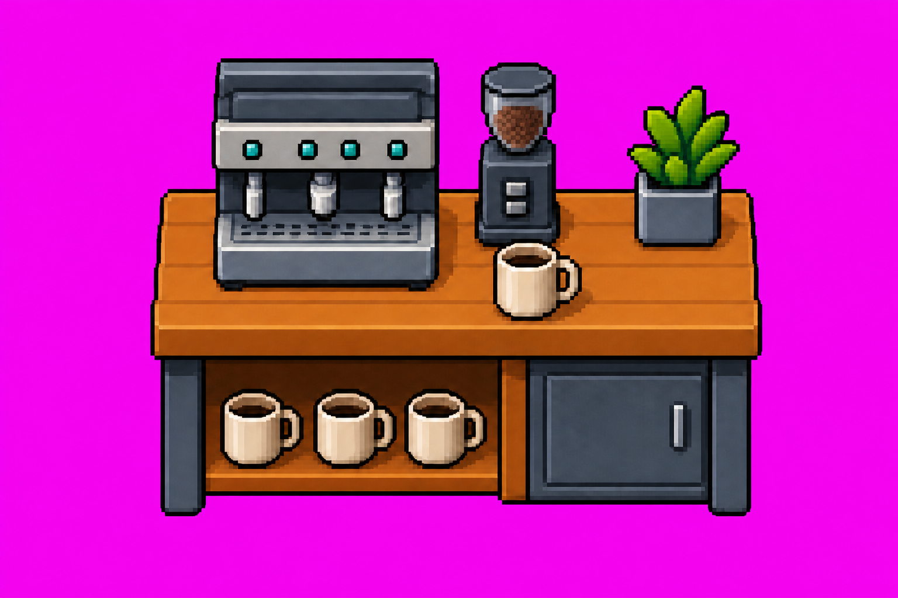](../../game/assets/runtime/office/coffee-station.png)

### Collaboration table — legacy south only

138×92 historical texture. Retired as the active rendering source; approved current profiles are listed separately below.

[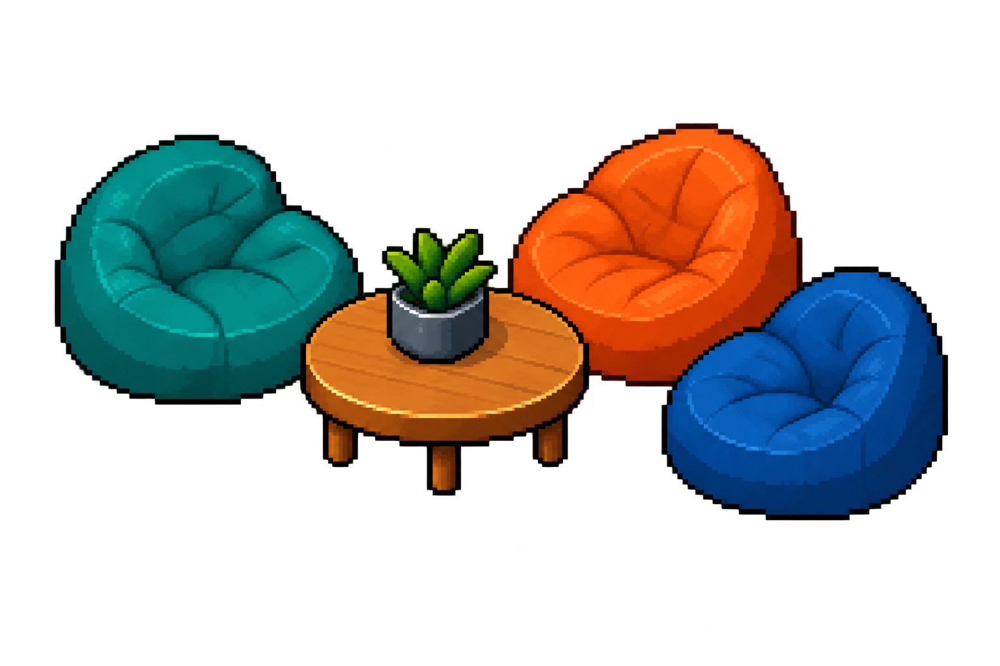](../../game/assets/runtime/office/collaboration-cluster.png)

### Artifact archive — legacy south only

136×90 historical texture. Retired as the active rendering source; approved current profiles are listed separately below.

[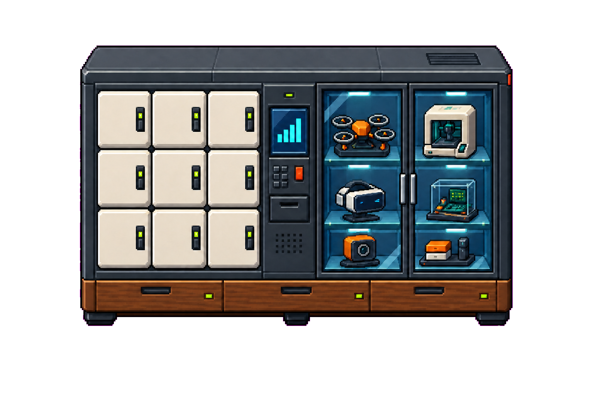](../../game/assets/runtime/office/artifact-archive.png)

### Research bench — legacy south only

256×192 historical texture; 128×96 atlas cell, row 1. Retired as the active rendering source; approved current profiles are listed separately below.

[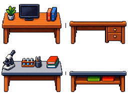](../../game/assets/runtime/office/layered-furniture.png)

### Decision console — legacy south only

132×88 historical texture. New directional approval: **not established**.

### Prototype bench — legacy south only

140×140 historical texture. New directional approval: **not established**.

[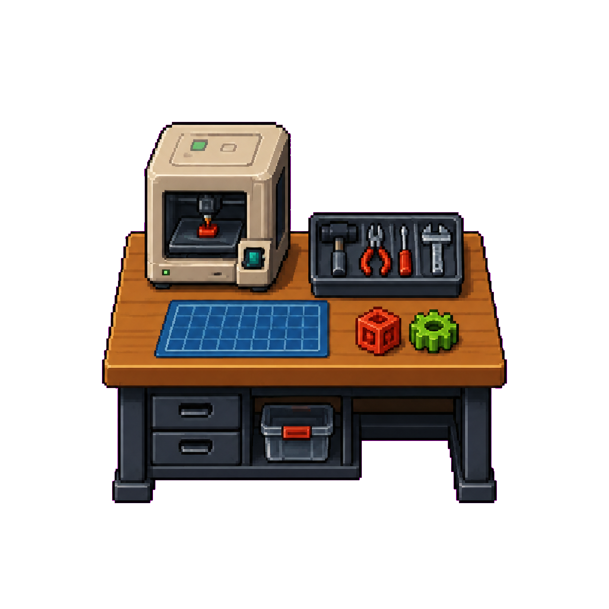](../../game/assets/runtime/office/prototype-bench.png)

## Family briefs and production outputs

### Shared workstation

`desk` · P0 · founder, Mina, Theo, all future specialists.

Direction semantics: **workstation gaze**.

Reusable clean desk carcass; the actor and standalone task-chair family remain separate. Never bake a specialist or a second chair into the desk.

Proposed envelope **192×224**, fixed floor anchor **[96, 160]**. N/E footprints: **3×1 / 1×3 cells**.

Tools: laptop or monitor supplied by shared_computer_kit; task surface. Layers: `floor_shadow` (optional), `rear_structure`, `front_structure`.

**north: runtime integrated.** Accepted as the shared north workstation desk at native scale. Complete lifecycle review meets the visual threshold and ordinary GameMain production evidence hash-locks both layers.

[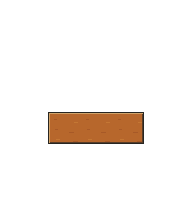](../../game/tests/fixtures/furniture-calibration/modular-desk-grain-v2/north-rear.png)

Source / prompt: [desk-north-v2.png](../../game/assets/source/overnight-20260904/calibration/desk-north-v2.png) · [south-workstation.png](../../game/assets/runtime/office/south-workstation.png) · [calibration-desk-north-v2.md](prompts/calibration-desk-north-v2.md)

Review: [NORTH_SOCKET_REVIEW.md](NORTH_SOCKET_REVIEW.md) · [MODULAR_DESK_EXPORT_REVIEW.md](MODULAR_DESK_EXPORT_REVIEW.md) · [COMPLETE_NORTH_WORKSTATION_REVIEW.md](COMPLETE_NORTH_WORKSTATION_REVIEW.md) · [FOUR_FACING_WORKSTATION_PRODUCTION_REVIEW.md](FOUR_FACING_WORKSTATION_PRODUCTION_REVIEW.md)

Native evidence: [six-poses-review-native.png](../../game/tests/output/complete-north-workstation/six-poses-review-native.png) · [assembled-native.png](../../game/tests/output/modular-desk-export/assembled-native.png) · [results-headless.json](../../game/tests/output/modular-desk-export/results-headless.json) · [production-four-facing-contact-sheet.png](../../game/tests/output/reviewed-workstations-production/production-four-facing-contact-sheet.png)

**Declared native layers (not automatically approved)**

| Export | Canvas / pivot | Actual opaque bounds | Derivation / limits |
| --- | --- | --- | --- |
| [north-rear.png](../../game/tests/fixtures/furniture-calibration/modular-desk-grain-v2/north-rear.png) | 192×224 / [96, 160] | Not measured here | Reviewed code-native soft-oak desk layer on the registered transparent canvas. |
| [north-front.png](../../game/tests/fixtures/furniture-calibration/modular-desk-grain-v2/north-front.png) | 192×224 / [96, 160] | Not measured here | Reviewed code-native soft-oak desk layer on the registered transparent canvas. |

north-rear.png references: [COMPLETE_NORTH_WORKSTATION_REVIEW.md](COMPLETE_NORTH_WORKSTATION_REVIEW.md)

north-front.png references: [COMPLETE_NORTH_WORKSTATION_REVIEW.md](COMPLETE_NORTH_WORKSTATION_REVIEW.md)

**Installed runtime layers — explicit integration evidence required**

| Export | Canvas / pivot | Actual opaque bounds | Derivation / limits |
| --- | --- | --- | --- |
| [desk-north-rear.png](../../game/assets/runtime/office/workstations-v2/desk-north-rear.png) | 192×224 / [96, 160] | Not measured here | Exact hash-locked production copy of the reviewed native component; native scale 1 and no raster rotation. |
| [desk-north-front.png](../../game/assets/runtime/office/workstations-v2/desk-north-front.png) | 192×224 / [96, 160] | Not measured here | Exact hash-locked production copy of the reviewed native component; native scale 1 and no raster rotation. |

desk-north-rear.png references: [north-rear.png](../../game/tests/fixtures/furniture-calibration/modular-desk-grain-v2/north-rear.png)

desk-north-front.png references: [north-front.png](../../game/tests/fixtures/furniture-calibration/modular-desk-grain-v2/north-front.png)

Runtime whole reference / integration evidence: [FOUR_FACING_WORKSTATION_PRODUCTION_REVIEW.md](FOUR_FACING_WORKSTATION_PRODUCTION_REVIEW.md)

**east: runtime integrated.** Accepted as the shared east workstation desk at native scale. Complete lifecycle review meets the visual threshold and ordinary GameMain production evidence hash-locks both layers.

Source / prompt: [desk-east-v3.png](../../game/assets/source/overnight-20260904/calibration/desk-east-v3.png) · [south-workstation.png](../../game/assets/runtime/office/south-workstation.png) · [calibration-desk-east-v3.md](prompts/calibration-desk-east-v3.md)

Review: [NORTH_SOCKET_REVIEW.md](NORTH_SOCKET_REVIEW.md) · [MODULAR_DESK_EXPORT_REVIEW.md](MODULAR_DESK_EXPORT_REVIEW.md) · [COMPLETE_EAST_WORKSTATION_REVIEW.md](COMPLETE_EAST_WORKSTATION_REVIEW.md) · [FOUR_FACING_WORKSTATION_PRODUCTION_REVIEW.md](FOUR_FACING_WORKSTATION_PRODUCTION_REVIEW.md)

Native evidence: [six-poses-review-native.png](../../game/tests/output/complete-east-workstation/six-poses-review-native.png) · [assembled-native.png](../../game/tests/output/modular-desk-export/assembled-native.png) · [results-headless.json](../../game/tests/output/modular-desk-export/results-headless.json) · [production-four-facing-contact-sheet.png](../../game/tests/output/reviewed-workstations-production/production-four-facing-contact-sheet.png)

**Declared native layers (not automatically approved)**

| Export | Canvas / pivot | Actual opaque bounds | Derivation / limits |
| --- | --- | --- | --- |
| [east-rear.png](../../game/tests/fixtures/furniture-calibration/modular-desk-grain-v2/east-rear.png) | 192×224 / [96, 160] | Not measured here | Reviewed code-native soft-oak desk layer on the registered transparent canvas. |
| [east-front.png](../../game/tests/fixtures/furniture-calibration/modular-desk-grain-v2/east-front.png) | 192×224 / [96, 160] | Not measured here | Reviewed code-native soft-oak desk layer on the registered transparent canvas. |

east-rear.png references: [COMPLETE_EAST_WORKSTATION_REVIEW.md](COMPLETE_EAST_WORKSTATION_REVIEW.md)

east-front.png references: [COMPLETE_EAST_WORKSTATION_REVIEW.md](COMPLETE_EAST_WORKSTATION_REVIEW.md)

**Installed runtime layers — explicit integration evidence required**

| Export | Canvas / pivot | Actual opaque bounds | Derivation / limits |
| --- | --- | --- | --- |
| [desk-east-rear.png](../../game/assets/runtime/office/workstations-v2/desk-east-rear.png) | 192×224 / [96, 160] | Not measured here | Exact hash-locked production copy of the reviewed native component; native scale 1 and no raster rotation. |
| [desk-east-front.png](../../game/assets/runtime/office/workstations-v2/desk-east-front.png) | 192×224 / [96, 160] | Not measured here | Exact hash-locked production copy of the reviewed native component; native scale 1 and no raster rotation. |

desk-east-rear.png references: [east-rear.png](../../game/tests/fixtures/furniture-calibration/modular-desk-grain-v2/east-rear.png)

desk-east-front.png references: [east-front.png](../../game/tests/fixtures/furniture-calibration/modular-desk-grain-v2/east-front.png)

Runtime whole reference / integration evidence: [FOUR_FACING_WORKSTATION_PRODUCTION_REVIEW.md](FOUR_FACING_WORKSTATION_PRODUCTION_REVIEW.md)

**south: runtime integrated.** Accepted as the shared south workstation desk at native scale. Complete lifecycle review meets the visual threshold and ordinary GameMain production evidence hash-locks both layers.

[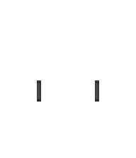](../../game/tests/fixtures/furniture-calibration/modular-desk-grain-v2/south-rear.png)

Source / prompt: [desk-south-v2.png](../../game/assets/source/overnight-20260904/calibration/desk-south-v2.png) · [south-workstation.png](../../game/assets/runtime/office/south-workstation.png) · [calibration-desk-south-v2.md](prompts/calibration-desk-south-v2.md)

Review: [NORTH_SOCKET_REVIEW.md](NORTH_SOCKET_REVIEW.md) · [MODULAR_DESK_EXPORT_REVIEW.md](MODULAR_DESK_EXPORT_REVIEW.md) · [COMPLETE_SOUTH_HANDOFF_REVIEW.md](COMPLETE_SOUTH_HANDOFF_REVIEW.md) · [FOUR_FACING_WORKSTATION_PRODUCTION_REVIEW.md](FOUR_FACING_WORKSTATION_PRODUCTION_REVIEW.md)

Native evidence: [six-poses-review-native.png](../../game/tests/output/complete-south-workstation-after-handoff/six-poses-review-native.png) · [assembled-native.png](../../game/tests/output/modular-desk-export/assembled-native.png) · [results-headless.json](../../game/tests/output/modular-desk-export/results-headless.json) · [production-four-facing-contact-sheet.png](../../game/tests/output/reviewed-workstations-production/production-four-facing-contact-sheet.png)

**Declared native layers (not automatically approved)**

| Export | Canvas / pivot | Actual opaque bounds | Derivation / limits |
| --- | --- | --- | --- |
| [south-rear.png](../../game/tests/fixtures/furniture-calibration/modular-desk-grain-v2/south-rear.png) | 192×224 / [96, 160] | Not measured here | Reviewed code-native soft-oak desk layer on the registered transparent canvas. |
| [south-front.png](../../game/tests/fixtures/furniture-calibration/modular-desk-grain-v2/south-front.png) | 192×224 / [96, 160] | Not measured here | Reviewed code-native soft-oak desk layer on the registered transparent canvas. |

south-rear.png references: [COMPLETE_SOUTH_HANDOFF_REVIEW.md](COMPLETE_SOUTH_HANDOFF_REVIEW.md)

south-front.png references: [COMPLETE_SOUTH_HANDOFF_REVIEW.md](COMPLETE_SOUTH_HANDOFF_REVIEW.md)

**Installed runtime layers — explicit integration evidence required**

| Export | Canvas / pivot | Actual opaque bounds | Derivation / limits |
| --- | --- | --- | --- |
| [desk-south-rear.png](../../game/assets/runtime/office/workstations-v2/desk-south-rear.png) | 192×224 / [96, 160] | Not measured here | Exact hash-locked production copy of the reviewed native component; native scale 1 and no raster rotation. |
| [desk-south-front.png](../../game/assets/runtime/office/workstations-v2/desk-south-front.png) | 192×224 / [96, 160] | Not measured here | Exact hash-locked production copy of the reviewed native component; native scale 1 and no raster rotation. |

desk-south-rear.png references: [south-rear.png](../../game/tests/fixtures/furniture-calibration/modular-desk-grain-v2/south-rear.png)

desk-south-front.png references: [south-front.png](../../game/tests/fixtures/furniture-calibration/modular-desk-grain-v2/south-front.png)

Runtime whole reference / integration evidence: [FOUR_FACING_WORKSTATION_PRODUCTION_REVIEW.md](FOUR_FACING_WORKSTATION_PRODUCTION_REVIEW.md)

**west: runtime integrated.** Accepted as the shared west workstation desk at native scale. Complete lifecycle review meets the visual threshold and ordinary GameMain production evidence hash-locks both layers.

[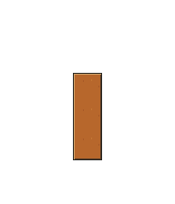](../../game/tests/fixtures/furniture-calibration/modular-desk-grain-v2/west-rear.png)

Source / prompt: [desk-west-v3.png](../../game/assets/source/overnight-20260904/calibration/desk-west-v3.png) · [south-workstation.png](../../game/assets/runtime/office/south-workstation.png) · [calibration-desk-west-v3.md](prompts/calibration-desk-west-v3.md)

Review: [NORTH_SOCKET_REVIEW.md](NORTH_SOCKET_REVIEW.md) · [MODULAR_DESK_EXPORT_REVIEW.md](MODULAR_DESK_EXPORT_REVIEW.md) · [COMPLETE_WEST_WORKSTATION_REVIEW.md](COMPLETE_WEST_WORKSTATION_REVIEW.md) · [FOUR_FACING_WORKSTATION_PRODUCTION_REVIEW.md](FOUR_FACING_WORKSTATION_PRODUCTION_REVIEW.md)

Native evidence: [six-poses-review-native.png](../../game/tests/output/complete-west-workstation/six-poses-review-native.png) · [assembled-native.png](../../game/tests/output/modular-desk-export/assembled-native.png) · [results-headless.json](../../game/tests/output/modular-desk-export/results-headless.json) · [production-four-facing-contact-sheet.png](../../game/tests/output/reviewed-workstations-production/production-four-facing-contact-sheet.png)

**Declared native layers (not automatically approved)**

| Export | Canvas / pivot | Actual opaque bounds | Derivation / limits |
| --- | --- | --- | --- |
| [west-rear.png](../../game/tests/fixtures/furniture-calibration/modular-desk-grain-v2/west-rear.png) | 192×224 / [96, 160] | Not measured here | Reviewed code-native soft-oak desk layer on the registered transparent canvas. |
| [west-front.png](../../game/tests/fixtures/furniture-calibration/modular-desk-grain-v2/west-front.png) | 192×224 / [96, 160] | Not measured here | Reviewed code-native soft-oak desk layer on the registered transparent canvas. |

west-rear.png references: [COMPLETE_WEST_WORKSTATION_REVIEW.md](COMPLETE_WEST_WORKSTATION_REVIEW.md)

west-front.png references: [COMPLETE_WEST_WORKSTATION_REVIEW.md](COMPLETE_WEST_WORKSTATION_REVIEW.md)

**Installed runtime layers — explicit integration evidence required**

| Export | Canvas / pivot | Actual opaque bounds | Derivation / limits |
| --- | --- | --- | --- |
| [desk-west-rear.png](../../game/assets/runtime/office/workstations-v2/desk-west-rear.png) | 192×224 / [96, 160] | Not measured here | Exact hash-locked production copy of the reviewed native component; native scale 1 and no raster rotation. |
| [desk-west-front.png](../../game/assets/runtime/office/workstations-v2/desk-west-front.png) | 192×224 / [96, 160] | Not measured here | Exact hash-locked production copy of the reviewed native component; native scale 1 and no raster rotation. |

desk-west-rear.png references: [west-rear.png](../../game/tests/fixtures/furniture-calibration/modular-desk-grain-v2/west-rear.png)

desk-west-front.png references: [west-front.png](../../game/tests/fixtures/furniture-calibration/modular-desk-grain-v2/west-front.png)

Runtime whole reference / integration evidence: [FOUR_FACING_WORKSTATION_PRODUCTION_REVIEW.md](FOUR_FACING_WORKSTATION_PRODUCTION_REVIEW.md)

### Coffee station

`coffee_station` · P1 · shared.

Direction semantics: **service side**. Service N/E/S/W uses approach gaze S/W/N/E; this is not workstation-facing.

Compact break destination; cups and steam remain separable from the counter.

Proposed envelope **192×256**, fixed floor anchor **[96, 192]**. N/E footprints: **3×1 / 1×3 cells**.

Tools: coffee machine; mugs; water reservoir. Layers: `floor_shadow`, `counter_carcass`, `counter_top`, `counter_front`, `counter_plinth`, `service_panel`, `espresso`, `grinder`, `serviceware`, `plant`.

**north retained batch:** 1 initial + 1 targeted retries, limit 3; **not exhausted at this checkpoint**. Do not reset the recorded retry allowance.

**north: runtime integrated.** Accepted coffee-station-v1 code-native art and service geometry. Runtime bytes match the reviewed candidate; the service socket remains navigation-only because coffee interaction is explicitly disabled.

[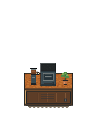](../../game/tests/fixtures/furniture-calibration/coffee-station-code-v1/north-whole.png)

Source / prompt: [coffee-service-north-v2.png](../../game/assets/source/overnight-20260904/kits/coffee-service-north-v2.png) · [coffee-station.png](../../game/assets/runtime/office/coffee-station.png) · [coffee-service-north-v2.md](../../game/assets/source/overnight-20260904/kits/coffee-service-north-v2.md)

Review: [COFFEE_STATION_PRODUCTION_REVIEW.md](COFFEE_STATION_PRODUCTION_REVIEW.md) · [COFFEE_CODE_NATIVE_CANDIDATE_REVIEW.md](COFFEE_CODE_NATIVE_CANDIDATE_REVIEW.md)

Native evidence: [all-four-room-native.png](../../game/tests/output/coffee-station-candidate/all-four-room-native.png) · [manifest.json](../../game/tests/fixtures/furniture-calibration/coffee-station-code-v1/manifest.json) · [all-four-service-native.png](../../game/tests/output/coffee-station-candidate/all-four-service-native.png) · [REGRESSION_CHECKPOINT_COFFEE_PRODUCTION.md](REGRESSION_CHECKPOINT_COFFEE_PRODUCTION.md)

Export method: Deterministic typed-GDScript geometry; no raster rotation, mirror, runtime scaling, provider call, or semantic source edit.

**Declared native layers (not automatically approved)**

| Export | Canvas / pivot | Actual opaque bounds | Derivation / limits |
| --- | --- | --- | --- |
| [north-floor_shadow.png](../../game/tests/fixtures/furniture-calibration/coffee-station-code-v1/north-floor_shadow.png) | 192×256 / [96, 192] | [51, 205, 90, 7]; 560 pixels | Accepted coffee-station-v1 registered layer; same canvas/pivot and exact per-side production order. |
| [north-counter_carcass.png](../../game/tests/fixtures/furniture-calibration/coffee-station-code-v1/north-counter_carcass.png) | 192×256 / [96, 192] | [48, 176, 96, 28]; 112 pixels | Accepted coffee-station-v1 registered layer; same canvas/pivot and exact per-side production order. |
| [north-counter_top.png](../../game/tests/fixtures/furniture-calibration/coffee-station-code-v1/north-counter_top.png) | 192×256 / [96, 192] | [48, 144, 96, 32]; 3072 pixels | Accepted coffee-station-v1 registered layer; same canvas/pivot and exact per-side production order. |
| [north-counter_front.png](../../game/tests/fixtures/furniture-calibration/coffee-station-code-v1/north-counter_front.png) | 192×256 / [96, 192] | [50, 176, 92, 28]; 2576 pixels | Accepted coffee-station-v1 registered layer; same canvas/pivot and exact per-side production order. |
| [north-counter_plinth.png](../../game/tests/fixtures/furniture-calibration/coffee-station-code-v1/north-counter_plinth.png) | 192×256 / [96, 192] | [48, 204, 96, 4]; 384 pixels | Accepted coffee-station-v1 registered layer; same canvas/pivot and exact per-side production order. |
| [north-service_panel.png](../../game/tests/fixtures/furniture-calibration/coffee-station-code-v1/north-service_panel.png) | 192×256 / [96, 192] | [52, 180, 88, 24]; 2112 pixels | Accepted coffee-station-v1 registered layer; same canvas/pivot and exact per-side production order. |
| [north-serviceware.png](../../game/tests/fixtures/furniture-calibration/coffee-station-code-v1/north-serviceware.png) | 192×256 / [96, 192] | [71, 141, 7, 7]; 43 pixels | Accepted coffee-station-v1 registered layer; same canvas/pivot and exact per-side production order. |
| [north-plant.png](../../game/tests/fixtures/furniture-calibration/coffee-station-code-v1/north-plant.png) | 192×256 / [96, 192] | [121, 142, 15, 25]; 208 pixels | Accepted coffee-station-v1 registered layer; same canvas/pivot and exact per-side production order. |
| [north-grinder.png](../../game/tests/fixtures/furniture-calibration/coffee-station-code-v1/north-grinder.png) | 192×256 / [96, 192] | [60, 134, 13, 33]; 323 pixels | Accepted coffee-station-v1 registered layer; same canvas/pivot and exact per-side production order. |
| [north-espresso.png](../../game/tests/fixtures/furniture-calibration/coffee-station-code-v1/north-espresso.png) | 192×256 / [96, 192] | [80, 124, 31, 46]; 1426 pixels | Accepted coffee-station-v1 registered layer; same canvas/pivot and exact per-side production order. |

north-floor_shadow.png references: [COFFEE_STATION_PRODUCTION_REVIEW.md](COFFEE_STATION_PRODUCTION_REVIEW.md)

north-counter_carcass.png references: [COFFEE_STATION_PRODUCTION_REVIEW.md](COFFEE_STATION_PRODUCTION_REVIEW.md)

north-counter_top.png references: [COFFEE_STATION_PRODUCTION_REVIEW.md](COFFEE_STATION_PRODUCTION_REVIEW.md)

north-counter_front.png references: [COFFEE_STATION_PRODUCTION_REVIEW.md](COFFEE_STATION_PRODUCTION_REVIEW.md)

north-counter_plinth.png references: [COFFEE_STATION_PRODUCTION_REVIEW.md](COFFEE_STATION_PRODUCTION_REVIEW.md)

north-service_panel.png references: [COFFEE_STATION_PRODUCTION_REVIEW.md](COFFEE_STATION_PRODUCTION_REVIEW.md)

north-serviceware.png references: [COFFEE_STATION_PRODUCTION_REVIEW.md](COFFEE_STATION_PRODUCTION_REVIEW.md)

north-plant.png references: [COFFEE_STATION_PRODUCTION_REVIEW.md](COFFEE_STATION_PRODUCTION_REVIEW.md)

north-grinder.png references: [COFFEE_STATION_PRODUCTION_REVIEW.md](COFFEE_STATION_PRODUCTION_REVIEW.md)

north-espresso.png references: [COFFEE_STATION_PRODUCTION_REVIEW.md](COFFEE_STATION_PRODUCTION_REVIEW.md)

**Installed runtime layers — explicit integration evidence required**

| Export | Canvas / pivot | Actual opaque bounds | Derivation / limits |
| --- | --- | --- | --- |
| [north-floor_shadow.png](../../game/assets/runtime/office/coffee-station-v1/north-floor_shadow.png) | 192×256 / [96, 192] | [51, 205, 90, 7]; 560 pixels | Installed coffee-station-v1 layer; bytes exactly match the accepted native export. |
| [north-counter_carcass.png](../../game/assets/runtime/office/coffee-station-v1/north-counter_carcass.png) | 192×256 / [96, 192] | [48, 176, 96, 28]; 112 pixels | Installed coffee-station-v1 layer; bytes exactly match the accepted native export. |
| [north-counter_top.png](../../game/assets/runtime/office/coffee-station-v1/north-counter_top.png) | 192×256 / [96, 192] | [48, 144, 96, 32]; 3072 pixels | Installed coffee-station-v1 layer; bytes exactly match the accepted native export. |
| [north-counter_front.png](../../game/assets/runtime/office/coffee-station-v1/north-counter_front.png) | 192×256 / [96, 192] | [50, 176, 92, 28]; 2576 pixels | Installed coffee-station-v1 layer; bytes exactly match the accepted native export. |
| [north-counter_plinth.png](../../game/assets/runtime/office/coffee-station-v1/north-counter_plinth.png) | 192×256 / [96, 192] | [48, 204, 96, 4]; 384 pixels | Installed coffee-station-v1 layer; bytes exactly match the accepted native export. |
| [north-service_panel.png](../../game/assets/runtime/office/coffee-station-v1/north-service_panel.png) | 192×256 / [96, 192] | [52, 180, 88, 24]; 2112 pixels | Installed coffee-station-v1 layer; bytes exactly match the accepted native export. |
| [north-serviceware.png](../../game/assets/runtime/office/coffee-station-v1/north-serviceware.png) | 192×256 / [96, 192] | [71, 141, 7, 7]; 43 pixels | Installed coffee-station-v1 layer; bytes exactly match the accepted native export. |
| [north-plant.png](../../game/assets/runtime/office/coffee-station-v1/north-plant.png) | 192×256 / [96, 192] | [121, 142, 15, 25]; 208 pixels | Installed coffee-station-v1 layer; bytes exactly match the accepted native export. |
| [north-grinder.png](../../game/assets/runtime/office/coffee-station-v1/north-grinder.png) | 192×256 / [96, 192] | [60, 134, 13, 33]; 323 pixels | Installed coffee-station-v1 layer; bytes exactly match the accepted native export. |
| [north-espresso.png](../../game/assets/runtime/office/coffee-station-v1/north-espresso.png) | 192×256 / [96, 192] | [80, 124, 31, 46]; 1426 pixels | Installed coffee-station-v1 layer; bytes exactly match the accepted native export. |

north-floor_shadow.png references: [north-floor_shadow.png](../../game/tests/fixtures/furniture-calibration/coffee-station-code-v1/north-floor_shadow.png) · [COFFEE_STATION_PRODUCTION_REVIEW.md](COFFEE_STATION_PRODUCTION_REVIEW.md)

north-counter_carcass.png references: [north-counter_carcass.png](../../game/tests/fixtures/furniture-calibration/coffee-station-code-v1/north-counter_carcass.png) · [COFFEE_STATION_PRODUCTION_REVIEW.md](COFFEE_STATION_PRODUCTION_REVIEW.md)

north-counter_top.png references: [north-counter_top.png](../../game/tests/fixtures/furniture-calibration/coffee-station-code-v1/north-counter_top.png) · [COFFEE_STATION_PRODUCTION_REVIEW.md](COFFEE_STATION_PRODUCTION_REVIEW.md)

north-counter_front.png references: [north-counter_front.png](../../game/tests/fixtures/furniture-calibration/coffee-station-code-v1/north-counter_front.png) · [COFFEE_STATION_PRODUCTION_REVIEW.md](COFFEE_STATION_PRODUCTION_REVIEW.md)

north-counter_plinth.png references: [north-counter_plinth.png](../../game/tests/fixtures/furniture-calibration/coffee-station-code-v1/north-counter_plinth.png) · [COFFEE_STATION_PRODUCTION_REVIEW.md](COFFEE_STATION_PRODUCTION_REVIEW.md)

north-service_panel.png references: [north-service_panel.png](../../game/tests/fixtures/furniture-calibration/coffee-station-code-v1/north-service_panel.png) · [COFFEE_STATION_PRODUCTION_REVIEW.md](COFFEE_STATION_PRODUCTION_REVIEW.md)

north-serviceware.png references: [north-serviceware.png](../../game/tests/fixtures/furniture-calibration/coffee-station-code-v1/north-serviceware.png) · [COFFEE_STATION_PRODUCTION_REVIEW.md](COFFEE_STATION_PRODUCTION_REVIEW.md)

north-plant.png references: [north-plant.png](../../game/tests/fixtures/furniture-calibration/coffee-station-code-v1/north-plant.png) · [COFFEE_STATION_PRODUCTION_REVIEW.md](COFFEE_STATION_PRODUCTION_REVIEW.md)

north-grinder.png references: [north-grinder.png](../../game/tests/fixtures/furniture-calibration/coffee-station-code-v1/north-grinder.png) · [COFFEE_STATION_PRODUCTION_REVIEW.md](COFFEE_STATION_PRODUCTION_REVIEW.md)

north-espresso.png references: [north-espresso.png](../../game/tests/fixtures/furniture-calibration/coffee-station-code-v1/north-espresso.png) · [COFFEE_STATION_PRODUCTION_REVIEW.md](COFFEE_STATION_PRODUCTION_REVIEW.md)

Runtime whole reference / integration evidence: [north-whole.png](../../game/assets/runtime/office/coffee-station-v1/north-whole.png) · [COFFEE_STATION_PRODUCTION_REVIEW.md](COFFEE_STATION_PRODUCTION_REVIEW.md)

**Independent components and material inserts — not approved assembly masks**

| Export | Canvas / pivot | Actual opaque bounds | Derivation / limits |
| --- | --- | --- | --- |
| [espresso: coffee-service-north-v2-espresso.png](../../game/tests/fixtures/furniture-calibration/kits/coffee-service-north-v2-espresso.png) | 192×256 / [96, 192] | [107, 129, 28, 44]; 1209 pixels | Independent appliance, not approved contact/occlusion geometry or a new coffee action. |
| [grinder: coffee-service-north-v2-grinder.png](../../game/tests/fixtures/furniture-calibration/kits/coffee-service-north-v2-grinder.png) | 192×256 / [96, 192] | [86, 136, 12, 30]; 323 pixels | Independent appliance, not approved contact/occlusion geometry or a new coffee action. |
| [mug: coffee-service-north-v2-mug.png](../../game/tests/fixtures/furniture-calibration/kits/coffee-service-north-v2-mug.png) | 192×256 / [96, 192] | [72, 143, 10, 10]; 79 pixels | Independent appliance, not approved contact/occlusion geometry or a new coffee action. |
| [plant: coffee-service-north-v2-plant.png](../../game/tests/fixtures/furniture-calibration/kits/coffee-service-north-v2-plant.png) | 192×256 / [96, 192] | [55, 147, 15, 24]; 272 pixels | Independent appliance, not approved contact/occlusion geometry or a new coffee action. |

coffee-service-north-v2-espresso.png references: [coffee-service-north-v2.png](../../game/assets/source/overnight-20260904/kits/coffee-service-north-v2.png)

coffee-service-north-v2-grinder.png references: [coffee-service-north-v2.png](../../game/assets/source/overnight-20260904/kits/coffee-service-north-v2.png)

coffee-service-north-v2-mug.png references: [coffee-service-north-v2.png](../../game/assets/source/overnight-20260904/kits/coffee-service-north-v2.png)

coffee-service-north-v2-plant.png references: [coffee-service-north-v2.png](../../game/assets/source/overnight-20260904/kits/coffee-service-north-v2.png)

**Additional composites**

| Export | Canvas / pivot | Actual opaque bounds | Derivation / limits |
| --- | --- | --- | --- |
| [appliance_union: coffee-service-north-v2.png](../../game/tests/fixtures/furniture-calibration/kits/coffee-service-north-v2.png) | 192×256 / [96, 192] | [55, 129, 80, 44]; 1883 pixels | Uniform per-object point normalization; binary alpha and shared palette. |

Retained native composite / source candidate: [north-whole.png](../../game/tests/fixtures/furniture-calibration/coffee-station-code-v1/north-whole.png)

**Retained source attempts**

| Source | Actual master | Prompt | Disposition |
| --- | --- | --- | --- |
| [coffee-service-north-v1.png](../../game/assets/source/overnight-20260904/kits/coffee-service-north-v1.png) | 1774×887 RGB; Opaque source | [coffee-service-north-v1.md](../../game/assets/source/overnight-20260904/kits/coffee-service-north-v1.md) | Opaque independently drawn rear view. |
| [coffee-service-north-v2.png](../../game/assets/source/overnight-20260904/kits/coffee-service-north-v2.png) | 1774×887 RGBA; Genuine nonopaque alpha | [coffee-service-north-v2.md](../../game/assets/source/overnight-20260904/kits/coffee-service-north-v2.md) | True alpha after one targeted retry; native export present, room review pending at08:37. |

**east retained batch:** 1 initial + 3 targeted retries, limit 3; **exhausted**. Initial plus three targeted retries complete. Interior-material reuse never resets exhausted batch or completes the missing kit.

**east: runtime integrated.** Accepted coffee-station-v1 code-native art and service geometry. Runtime bytes match the reviewed candidate; the service socket remains navigation-only because coffee interaction is explicitly disabled.

[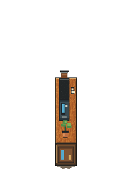](../../game/tests/fixtures/furniture-calibration/coffee-station-code-v1/east-whole.png)

Source / prompt: [coffee-station.png](../../game/assets/runtime/office/coffee-station.png)

Review: [COFFEE_STATION_PRODUCTION_REVIEW.md](COFFEE_STATION_PRODUCTION_REVIEW.md) · [COFFEE_CODE_NATIVE_CANDIDATE_REVIEW.md](COFFEE_CODE_NATIVE_CANDIDATE_REVIEW.md)

Native evidence: [all-four-room-native.png](../../game/tests/output/coffee-station-candidate/all-four-room-native.png) · [manifest.json](../../game/tests/fixtures/furniture-calibration/coffee-station-code-v1/manifest.json) · [all-four-service-native.png](../../game/tests/output/coffee-station-candidate/all-four-service-native.png) · [REGRESSION_CHECKPOINT_COFFEE_PRODUCTION.md](REGRESSION_CHECKPOINT_COFFEE_PRODUCTION.md)

Export method: Deterministic typed-GDScript geometry; no raster rotation, mirror, runtime scaling, provider call, or semantic source edit.

**Declared native layers (not automatically approved)**

| Export | Canvas / pivot | Actual opaque bounds | Derivation / limits |
| --- | --- | --- | --- |
| [east-floor_shadow.png](../../game/tests/fixtures/furniture-calibration/coffee-station-code-v1/east-floor_shadow.png) | 192×256 / [96, 192] | [83, 237, 26, 7]; 144 pixels | Accepted coffee-station-v1 registered layer; same canvas/pivot and exact per-side production order. |
| [east-counter_carcass.png](../../game/tests/fixtures/furniture-calibration/coffee-station-code-v1/east-counter_carcass.png) | 192×256 / [96, 192] | [80, 208, 32, 28]; 112 pixels | Accepted coffee-station-v1 registered layer; same canvas/pivot and exact per-side production order. |
| [east-counter_top.png](../../game/tests/fixtures/furniture-calibration/coffee-station-code-v1/east-counter_top.png) | 192×256 / [96, 192] | [80, 112, 32, 96]; 3072 pixels | Accepted coffee-station-v1 registered layer; same canvas/pivot and exact per-side production order. |
| [east-counter_front.png](../../game/tests/fixtures/furniture-calibration/coffee-station-code-v1/east-counter_front.png) | 192×256 / [96, 192] | [82, 208, 28, 28]; 784 pixels | Accepted coffee-station-v1 registered layer; same canvas/pivot and exact per-side production order. |
| [east-counter_plinth.png](../../game/tests/fixtures/furniture-calibration/coffee-station-code-v1/east-counter_plinth.png) | 192×256 / [96, 192] | [80, 236, 32, 4]; 128 pixels | Accepted coffee-station-v1 registered layer; same canvas/pivot and exact per-side production order. |
| [east-service_panel.png](../../game/tests/fixtures/furniture-calibration/coffee-station-code-v1/east-service_panel.png) | 192×256 / [96, 192] | [84, 212, 24, 24]; 576 pixels | Accepted coffee-station-v1 registered layer; same canvas/pivot and exact per-side production order. |
| [east-grinder.png](../../game/tests/fixtures/furniture-calibration/coffee-station-code-v1/east-grinder.png) | 192×256 / [96, 192] | [87, 102, 13, 33]; 323 pixels | Accepted coffee-station-v1 registered layer; same canvas/pivot and exact per-side production order. |
| [east-serviceware.png](../../game/tests/fixtures/furniture-calibration/coffee-station-code-v1/east-serviceware.png) | 192×256 / [96, 192] | [103, 126, 6, 10]; 53 pixels | Accepted coffee-station-v1 registered layer; same canvas/pivot and exact per-side production order. |
| [east-espresso.png](../../game/tests/fixtures/furniture-calibration/coffee-station-code-v1/east-espresso.png) | 192×256 / [96, 192] | [86, 113, 15, 62]; 930 pixels | Accepted coffee-station-v1 registered layer; same canvas/pivot and exact per-side production order. |
| [east-plant.png](../../game/tests/fixtures/furniture-calibration/coffee-station-code-v1/east-plant.png) | 192×256 / [96, 192] | [89, 174, 15, 25]; 200 pixels | Accepted coffee-station-v1 registered layer; same canvas/pivot and exact per-side production order. |

east-floor_shadow.png references: [COFFEE_STATION_PRODUCTION_REVIEW.md](COFFEE_STATION_PRODUCTION_REVIEW.md)

east-counter_carcass.png references: [COFFEE_STATION_PRODUCTION_REVIEW.md](COFFEE_STATION_PRODUCTION_REVIEW.md)

east-counter_top.png references: [COFFEE_STATION_PRODUCTION_REVIEW.md](COFFEE_STATION_PRODUCTION_REVIEW.md)

east-counter_front.png references: [COFFEE_STATION_PRODUCTION_REVIEW.md](COFFEE_STATION_PRODUCTION_REVIEW.md)

east-counter_plinth.png references: [COFFEE_STATION_PRODUCTION_REVIEW.md](COFFEE_STATION_PRODUCTION_REVIEW.md)

east-service_panel.png references: [COFFEE_STATION_PRODUCTION_REVIEW.md](COFFEE_STATION_PRODUCTION_REVIEW.md)

east-grinder.png references: [COFFEE_STATION_PRODUCTION_REVIEW.md](COFFEE_STATION_PRODUCTION_REVIEW.md)

east-serviceware.png references: [COFFEE_STATION_PRODUCTION_REVIEW.md](COFFEE_STATION_PRODUCTION_REVIEW.md)

east-espresso.png references: [COFFEE_STATION_PRODUCTION_REVIEW.md](COFFEE_STATION_PRODUCTION_REVIEW.md)

east-plant.png references: [COFFEE_STATION_PRODUCTION_REVIEW.md](COFFEE_STATION_PRODUCTION_REVIEW.md)

**Installed runtime layers — explicit integration evidence required**

| Export | Canvas / pivot | Actual opaque bounds | Derivation / limits |
| --- | --- | --- | --- |
| [east-floor_shadow.png](../../game/assets/runtime/office/coffee-station-v1/east-floor_shadow.png) | 192×256 / [96, 192] | [83, 237, 26, 7]; 144 pixels | Installed coffee-station-v1 layer; bytes exactly match the accepted native export. |
| [east-counter_carcass.png](../../game/assets/runtime/office/coffee-station-v1/east-counter_carcass.png) | 192×256 / [96, 192] | [80, 208, 32, 28]; 112 pixels | Installed coffee-station-v1 layer; bytes exactly match the accepted native export. |
| [east-counter_top.png](../../game/assets/runtime/office/coffee-station-v1/east-counter_top.png) | 192×256 / [96, 192] | [80, 112, 32, 96]; 3072 pixels | Installed coffee-station-v1 layer; bytes exactly match the accepted native export. |
| [east-counter_front.png](../../game/assets/runtime/office/coffee-station-v1/east-counter_front.png) | 192×256 / [96, 192] | [82, 208, 28, 28]; 784 pixels | Installed coffee-station-v1 layer; bytes exactly match the accepted native export. |
| [east-counter_plinth.png](../../game/assets/runtime/office/coffee-station-v1/east-counter_plinth.png) | 192×256 / [96, 192] | [80, 236, 32, 4]; 128 pixels | Installed coffee-station-v1 layer; bytes exactly match the accepted native export. |
| [east-service_panel.png](../../game/assets/runtime/office/coffee-station-v1/east-service_panel.png) | 192×256 / [96, 192] | [84, 212, 24, 24]; 576 pixels | Installed coffee-station-v1 layer; bytes exactly match the accepted native export. |
| [east-grinder.png](../../game/assets/runtime/office/coffee-station-v1/east-grinder.png) | 192×256 / [96, 192] | [87, 102, 13, 33]; 323 pixels | Installed coffee-station-v1 layer; bytes exactly match the accepted native export. |
| [east-serviceware.png](../../game/assets/runtime/office/coffee-station-v1/east-serviceware.png) | 192×256 / [96, 192] | [103, 126, 6, 10]; 53 pixels | Installed coffee-station-v1 layer; bytes exactly match the accepted native export. |
| [east-espresso.png](../../game/assets/runtime/office/coffee-station-v1/east-espresso.png) | 192×256 / [96, 192] | [86, 113, 15, 62]; 930 pixels | Installed coffee-station-v1 layer; bytes exactly match the accepted native export. |
| [east-plant.png](../../game/assets/runtime/office/coffee-station-v1/east-plant.png) | 192×256 / [96, 192] | [89, 174, 15, 25]; 200 pixels | Installed coffee-station-v1 layer; bytes exactly match the accepted native export. |

east-floor_shadow.png references: [east-floor_shadow.png](../../game/tests/fixtures/furniture-calibration/coffee-station-code-v1/east-floor_shadow.png) · [COFFEE_STATION_PRODUCTION_REVIEW.md](COFFEE_STATION_PRODUCTION_REVIEW.md)

east-counter_carcass.png references: [east-counter_carcass.png](../../game/tests/fixtures/furniture-calibration/coffee-station-code-v1/east-counter_carcass.png) · [COFFEE_STATION_PRODUCTION_REVIEW.md](COFFEE_STATION_PRODUCTION_REVIEW.md)

east-counter_top.png references: [east-counter_top.png](../../game/tests/fixtures/furniture-calibration/coffee-station-code-v1/east-counter_top.png) · [COFFEE_STATION_PRODUCTION_REVIEW.md](COFFEE_STATION_PRODUCTION_REVIEW.md)

east-counter_front.png references: [east-counter_front.png](../../game/tests/fixtures/furniture-calibration/coffee-station-code-v1/east-counter_front.png) · [COFFEE_STATION_PRODUCTION_REVIEW.md](COFFEE_STATION_PRODUCTION_REVIEW.md)

east-counter_plinth.png references: [east-counter_plinth.png](../../game/tests/fixtures/furniture-calibration/coffee-station-code-v1/east-counter_plinth.png) · [COFFEE_STATION_PRODUCTION_REVIEW.md](COFFEE_STATION_PRODUCTION_REVIEW.md)

east-service_panel.png references: [east-service_panel.png](../../game/tests/fixtures/furniture-calibration/coffee-station-code-v1/east-service_panel.png) · [COFFEE_STATION_PRODUCTION_REVIEW.md](COFFEE_STATION_PRODUCTION_REVIEW.md)

east-grinder.png references: [east-grinder.png](../../game/tests/fixtures/furniture-calibration/coffee-station-code-v1/east-grinder.png) · [COFFEE_STATION_PRODUCTION_REVIEW.md](COFFEE_STATION_PRODUCTION_REVIEW.md)

east-serviceware.png references: [east-serviceware.png](../../game/tests/fixtures/furniture-calibration/coffee-station-code-v1/east-serviceware.png) · [COFFEE_STATION_PRODUCTION_REVIEW.md](COFFEE_STATION_PRODUCTION_REVIEW.md)

east-espresso.png references: [east-espresso.png](../../game/tests/fixtures/furniture-calibration/coffee-station-code-v1/east-espresso.png) · [COFFEE_STATION_PRODUCTION_REVIEW.md](COFFEE_STATION_PRODUCTION_REVIEW.md)

east-plant.png references: [east-plant.png](../../game/tests/fixtures/furniture-calibration/coffee-station-code-v1/east-plant.png) · [COFFEE_STATION_PRODUCTION_REVIEW.md](COFFEE_STATION_PRODUCTION_REVIEW.md)

Runtime whole reference / integration evidence: [east-whole.png](../../game/assets/runtime/office/coffee-station-v1/east-whole.png) · [COFFEE_STATION_PRODUCTION_REVIEW.md](COFFEE_STATION_PRODUCTION_REVIEW.md)

Retained native composite / source candidate: [east-whole.png](../../game/tests/fixtures/furniture-calibration/coffee-station-code-v1/east-whole.png)

**Retained source attempts**

| Source | Actual master | Prompt | Disposition |
| --- | --- | --- | --- |
| [coffee-service-east-v1.png](../../game/assets/source/overnight-20260904/kits/coffee-service-east-v1.png) | 1774×887 RGB; Opaque source | [coffee-service-east-v1.md](../../game/assets/source/overnight-20260904/kits/coffee-service-east-v1.md) | Opaque whole-kit failure. Geometry/direction invalid; only a v2 interior face rectangle is reused in separate espresso feasibility, not a recovered full kit. |
| [coffee-service-east-v2.png](../../game/assets/source/overnight-20260904/kits/coffee-service-east-v2.png) | 1774×887 RGB; Opaque source | [coffee-service-east-v2.md](../../game/assets/source/overnight-20260904/kits/coffee-service-east-v2.md) | Opaque whole-kit failure. Geometry/direction invalid; only a v2 interior face rectangle is reused in separate espresso feasibility, not a recovered full kit. |
| [coffee-service-east-v3.png](../../game/assets/source/overnight-20260904/kits/coffee-service-east-v3.png) | 887×1774 RGB; Opaque source | [coffee-service-east-v3.md](../../game/assets/source/overnight-20260904/kits/coffee-service-east-v3.md) | Opaque whole-kit failure. Geometry/direction invalid; only a v2 interior face rectangle is reused in separate espresso feasibility, not a recovered full kit. |
| [coffee-service-east-v4.png](../../game/assets/source/overnight-20260904/kits/coffee-service-east-v4.png) | 1774×887 RGB; Opaque source | [coffee-service-east-v4.md](../../game/assets/source/overnight-20260904/kits/coffee-service-east-v4.md) | Opaque whole-kit failure. Geometry/direction invalid; only a v2 interior face rectangle is reused in separate espresso feasibility, not a recovered full kit. |

**south retained batch:** 1 initial + 3 targeted retries, limit 3; **exhausted**. Do not reset the recorded retry allowance.

**south: runtime integrated.** Accepted coffee-station-v1 code-native art and service geometry. Runtime bytes match the reviewed candidate; the service socket remains navigation-only because coffee interaction is explicitly disabled.

[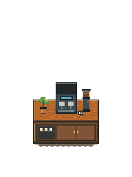](../../game/tests/fixtures/furniture-calibration/coffee-station-code-v1/south-whole.png)

Source / prompt: [coffee-service-south-v4.png](../../game/assets/source/overnight-20260904/kits/coffee-service-south-v4.png) · [coffee-station.png](../../game/assets/runtime/office/coffee-station.png) · [coffee-service-south-v4.md](../../game/assets/source/overnight-20260904/kits/coffee-service-south-v4.md)

Review: [COFFEE_STATION_PRODUCTION_REVIEW.md](COFFEE_STATION_PRODUCTION_REVIEW.md) · [COFFEE_CODE_NATIVE_CANDIDATE_REVIEW.md](COFFEE_CODE_NATIVE_CANDIDATE_REVIEW.md)

Native evidence: [all-four-room-native.png](../../game/tests/output/coffee-station-candidate/all-four-room-native.png) · [manifest.json](../../game/tests/fixtures/furniture-calibration/coffee-station-code-v1/manifest.json) · [all-four-service-native.png](../../game/tests/output/coffee-station-candidate/all-four-service-native.png) · [REGRESSION_CHECKPOINT_COFFEE_PRODUCTION.md](REGRESSION_CHECKPOINT_COFFEE_PRODUCTION.md)

Export method: Deterministic typed-GDScript geometry; no raster rotation, mirror, runtime scaling, provider call, or semantic source edit.

**Declared native layers (not automatically approved)**

| Export | Canvas / pivot | Actual opaque bounds | Derivation / limits |
| --- | --- | --- | --- |
| [south-floor_shadow.png](../../game/tests/fixtures/furniture-calibration/coffee-station-code-v1/south-floor_shadow.png) | 192×256 / [96, 192] | [51, 205, 90, 7]; 560 pixels | Accepted coffee-station-v1 registered layer; same canvas/pivot and exact per-side production order. |
| [south-counter_carcass.png](../../game/tests/fixtures/furniture-calibration/coffee-station-code-v1/south-counter_carcass.png) | 192×256 / [96, 192] | [48, 176, 96, 28]; 112 pixels | Accepted coffee-station-v1 registered layer; same canvas/pivot and exact per-side production order. |
| [south-counter_top.png](../../game/tests/fixtures/furniture-calibration/coffee-station-code-v1/south-counter_top.png) | 192×256 / [96, 192] | [48, 144, 96, 32]; 3072 pixels | Accepted coffee-station-v1 registered layer; same canvas/pivot and exact per-side production order. |
| [south-counter_front.png](../../game/tests/fixtures/furniture-calibration/coffee-station-code-v1/south-counter_front.png) | 192×256 / [96, 192] | [50, 176, 92, 28]; 2576 pixels | Accepted coffee-station-v1 registered layer; same canvas/pivot and exact per-side production order. |
| [south-counter_plinth.png](../../game/tests/fixtures/furniture-calibration/coffee-station-code-v1/south-counter_plinth.png) | 192×256 / [96, 192] | [48, 204, 96, 4]; 384 pixels | Accepted coffee-station-v1 registered layer; same canvas/pivot and exact per-side production order. |
| [south-service_panel.png](../../game/tests/fixtures/furniture-calibration/coffee-station-code-v1/south-service_panel.png) | 192×256 / [96, 192] | [52, 180, 88, 24]; 2112 pixels | Accepted coffee-station-v1 registered layer; same canvas/pivot and exact per-side production order. |
| [south-grinder.png](../../game/tests/fixtures/furniture-calibration/coffee-station-code-v1/south-grinder.png) | 192×256 / [96, 192] | [119, 129, 13, 33]; 323 pixels | Accepted coffee-station-v1 registered layer; same canvas/pivot and exact per-side production order. |
| [south-espresso.png](../../game/tests/fixtures/furniture-calibration/coffee-station-code-v1/south-espresso.png) | 192×256 / [96, 192] | [81, 119, 31, 46]; 1426 pixels | Accepted coffee-station-v1 registered layer; same canvas/pivot and exact per-side production order. |
| [south-plant.png](../../game/tests/fixtures/furniture-calibration/coffee-station-code-v1/south-plant.png) | 192×256 / [96, 192] | [56, 140, 15, 25]; 206 pixels | Accepted coffee-station-v1 registered layer; same canvas/pivot and exact per-side production order. |
| [south-serviceware.png](../../game/tests/fixtures/furniture-calibration/coffee-station-code-v1/south-serviceware.png) | 192×256 / [96, 192] | [114, 160, 7, 7]; 43 pixels | Accepted coffee-station-v1 registered layer; same canvas/pivot and exact per-side production order. |

south-floor_shadow.png references: [COFFEE_STATION_PRODUCTION_REVIEW.md](COFFEE_STATION_PRODUCTION_REVIEW.md)

south-counter_carcass.png references: [COFFEE_STATION_PRODUCTION_REVIEW.md](COFFEE_STATION_PRODUCTION_REVIEW.md)

south-counter_top.png references: [COFFEE_STATION_PRODUCTION_REVIEW.md](COFFEE_STATION_PRODUCTION_REVIEW.md)

south-counter_front.png references: [COFFEE_STATION_PRODUCTION_REVIEW.md](COFFEE_STATION_PRODUCTION_REVIEW.md)

south-counter_plinth.png references: [COFFEE_STATION_PRODUCTION_REVIEW.md](COFFEE_STATION_PRODUCTION_REVIEW.md)

south-service_panel.png references: [COFFEE_STATION_PRODUCTION_REVIEW.md](COFFEE_STATION_PRODUCTION_REVIEW.md)

south-grinder.png references: [COFFEE_STATION_PRODUCTION_REVIEW.md](COFFEE_STATION_PRODUCTION_REVIEW.md)

south-espresso.png references: [COFFEE_STATION_PRODUCTION_REVIEW.md](COFFEE_STATION_PRODUCTION_REVIEW.md)

south-plant.png references: [COFFEE_STATION_PRODUCTION_REVIEW.md](COFFEE_STATION_PRODUCTION_REVIEW.md)

south-serviceware.png references: [COFFEE_STATION_PRODUCTION_REVIEW.md](COFFEE_STATION_PRODUCTION_REVIEW.md)

**Installed runtime layers — explicit integration evidence required**

| Export | Canvas / pivot | Actual opaque bounds | Derivation / limits |
| --- | --- | --- | --- |
| [south-floor_shadow.png](../../game/assets/runtime/office/coffee-station-v1/south-floor_shadow.png) | 192×256 / [96, 192] | [51, 205, 90, 7]; 560 pixels | Installed coffee-station-v1 layer; bytes exactly match the accepted native export. |
| [south-counter_carcass.png](../../game/assets/runtime/office/coffee-station-v1/south-counter_carcass.png) | 192×256 / [96, 192] | [48, 176, 96, 28]; 112 pixels | Installed coffee-station-v1 layer; bytes exactly match the accepted native export. |
| [south-counter_top.png](../../game/assets/runtime/office/coffee-station-v1/south-counter_top.png) | 192×256 / [96, 192] | [48, 144, 96, 32]; 3072 pixels | Installed coffee-station-v1 layer; bytes exactly match the accepted native export. |
| [south-counter_front.png](../../game/assets/runtime/office/coffee-station-v1/south-counter_front.png) | 192×256 / [96, 192] | [50, 176, 92, 28]; 2576 pixels | Installed coffee-station-v1 layer; bytes exactly match the accepted native export. |
| [south-counter_plinth.png](../../game/assets/runtime/office/coffee-station-v1/south-counter_plinth.png) | 192×256 / [96, 192] | [48, 204, 96, 4]; 384 pixels | Installed coffee-station-v1 layer; bytes exactly match the accepted native export. |
| [south-service_panel.png](../../game/assets/runtime/office/coffee-station-v1/south-service_panel.png) | 192×256 / [96, 192] | [52, 180, 88, 24]; 2112 pixels | Installed coffee-station-v1 layer; bytes exactly match the accepted native export. |
| [south-grinder.png](../../game/assets/runtime/office/coffee-station-v1/south-grinder.png) | 192×256 / [96, 192] | [119, 129, 13, 33]; 323 pixels | Installed coffee-station-v1 layer; bytes exactly match the accepted native export. |
| [south-espresso.png](../../game/assets/runtime/office/coffee-station-v1/south-espresso.png) | 192×256 / [96, 192] | [81, 119, 31, 46]; 1426 pixels | Installed coffee-station-v1 layer; bytes exactly match the accepted native export. |
| [south-plant.png](../../game/assets/runtime/office/coffee-station-v1/south-plant.png) | 192×256 / [96, 192] | [56, 140, 15, 25]; 206 pixels | Installed coffee-station-v1 layer; bytes exactly match the accepted native export. |
| [south-serviceware.png](../../game/assets/runtime/office/coffee-station-v1/south-serviceware.png) | 192×256 / [96, 192] | [114, 160, 7, 7]; 43 pixels | Installed coffee-station-v1 layer; bytes exactly match the accepted native export. |

south-floor_shadow.png references: [south-floor_shadow.png](../../game/tests/fixtures/furniture-calibration/coffee-station-code-v1/south-floor_shadow.png) · [COFFEE_STATION_PRODUCTION_REVIEW.md](COFFEE_STATION_PRODUCTION_REVIEW.md)

south-counter_carcass.png references: [south-counter_carcass.png](../../game/tests/fixtures/furniture-calibration/coffee-station-code-v1/south-counter_carcass.png) · [COFFEE_STATION_PRODUCTION_REVIEW.md](COFFEE_STATION_PRODUCTION_REVIEW.md)

south-counter_top.png references: [south-counter_top.png](../../game/tests/fixtures/furniture-calibration/coffee-station-code-v1/south-counter_top.png) · [COFFEE_STATION_PRODUCTION_REVIEW.md](COFFEE_STATION_PRODUCTION_REVIEW.md)

south-counter_front.png references: [south-counter_front.png](../../game/tests/fixtures/furniture-calibration/coffee-station-code-v1/south-counter_front.png) · [COFFEE_STATION_PRODUCTION_REVIEW.md](COFFEE_STATION_PRODUCTION_REVIEW.md)

south-counter_plinth.png references: [south-counter_plinth.png](../../game/tests/fixtures/furniture-calibration/coffee-station-code-v1/south-counter_plinth.png) · [COFFEE_STATION_PRODUCTION_REVIEW.md](COFFEE_STATION_PRODUCTION_REVIEW.md)

south-service_panel.png references: [south-service_panel.png](../../game/tests/fixtures/furniture-calibration/coffee-station-code-v1/south-service_panel.png) · [COFFEE_STATION_PRODUCTION_REVIEW.md](COFFEE_STATION_PRODUCTION_REVIEW.md)

south-grinder.png references: [south-grinder.png](../../game/tests/fixtures/furniture-calibration/coffee-station-code-v1/south-grinder.png) · [COFFEE_STATION_PRODUCTION_REVIEW.md](COFFEE_STATION_PRODUCTION_REVIEW.md)

south-espresso.png references: [south-espresso.png](../../game/tests/fixtures/furniture-calibration/coffee-station-code-v1/south-espresso.png) · [COFFEE_STATION_PRODUCTION_REVIEW.md](COFFEE_STATION_PRODUCTION_REVIEW.md)

south-plant.png references: [south-plant.png](../../game/tests/fixtures/furniture-calibration/coffee-station-code-v1/south-plant.png) · [COFFEE_STATION_PRODUCTION_REVIEW.md](COFFEE_STATION_PRODUCTION_REVIEW.md)

south-serviceware.png references: [south-serviceware.png](../../game/tests/fixtures/furniture-calibration/coffee-station-code-v1/south-serviceware.png) · [COFFEE_STATION_PRODUCTION_REVIEW.md](COFFEE_STATION_PRODUCTION_REVIEW.md)

Runtime whole reference / integration evidence: [south-whole.png](../../game/assets/runtime/office/coffee-station-v1/south-whole.png) · [COFFEE_STATION_PRODUCTION_REVIEW.md](COFFEE_STATION_PRODUCTION_REVIEW.md)

**Independent components and material inserts — not approved assembly masks**

| Export | Canvas / pivot | Actual opaque bounds | Derivation / limits |
| --- | --- | --- | --- |
| [espresso: coffee-service-south-v4-espresso.png](../../game/tests/fixtures/furniture-calibration/kits/coffee-service-south-v4-espresso.png) | 192×256 / [96, 192] | [56, 116, 29, 44]; 1255 pixels | Independent appliance, not approved contact/occlusion geometry or a new coffee action. |
| [grinder: coffee-service-south-v4-grinder.png](../../game/tests/fixtures/furniture-calibration/kits/coffee-service-south-v4-grinder.png) | 192×256 / [96, 192] | [94, 130, 12, 30]; 297 pixels | Independent appliance, not approved contact/occlusion geometry or a new coffee action. |
| [mug: coffee-service-south-v4-mug.png](../../game/tests/fixtures/furniture-calibration/kits/coffee-service-south-v4-mug.png) | 192×256 / [96, 192] | [109, 161, 10, 10]; 80 pixels | Independent appliance, not approved contact/occlusion geometry or a new coffee action. |
| [plant: coffee-service-south-v4-plant.png](../../game/tests/fixtures/furniture-calibration/kits/coffee-service-south-v4-plant.png) | 192×256 / [96, 192] | [121, 136, 16, 24]; 266 pixels | Independent appliance, not approved contact/occlusion geometry or a new coffee action. |

coffee-service-south-v4-espresso.png references: [coffee-service-south-v4.png](../../game/assets/source/overnight-20260904/kits/coffee-service-south-v4.png)

coffee-service-south-v4-grinder.png references: [coffee-service-south-v4.png](../../game/assets/source/overnight-20260904/kits/coffee-service-south-v4.png)

coffee-service-south-v4-mug.png references: [coffee-service-south-v4.png](../../game/assets/source/overnight-20260904/kits/coffee-service-south-v4.png)

coffee-service-south-v4-plant.png references: [coffee-service-south-v4.png](../../game/assets/source/overnight-20260904/kits/coffee-service-south-v4.png)

**Additional composites**

| Export | Canvas / pivot | Actual opaque bounds | Derivation / limits |
| --- | --- | --- | --- |
| [appliance_union: coffee-service-south-v4.png](../../game/tests/fixtures/furniture-calibration/kits/coffee-service-south-v4.png) | 192×256 / [96, 192] | [56, 116, 81, 55]; 1898 pixels | Uniform per-object point normalization; binary alpha and shared palette. |

Retained native composite / source candidate: [south-whole.png](../../game/tests/fixtures/furniture-calibration/coffee-station-code-v1/south-whole.png)

**Retained source attempts**

| Source | Actual master | Prompt | Disposition |
| --- | --- | --- | --- |
| [coffee-service-south-v1.png](../../game/assets/source/overnight-20260904/kits/coffee-service-south-v1.png) | 1774×887 RGB; Opaque source | [coffee-service-south-v1.md](../../game/assets/source/overnight-20260904/kits/coffee-service-south-v1.md) | Opaque initial; shallow machine top. |
| [coffee-service-south-v2.png](../../game/assets/source/overnight-20260904/kits/coffee-service-south-v2.png) | 1774×887 RGB; Opaque source | [coffee-service-south-v2.md](../../game/assets/source/overnight-20260904/kits/coffee-service-south-v2.md) | Opaque geometry retry; wedge taper. |
| [coffee-service-south-v3.png](../../game/assets/source/overnight-20260904/kits/coffee-service-south-v3.png) | 1774×887 RGB; Opaque source | [coffee-service-south-v3.md](../../game/assets/source/overnight-20260904/kits/coffee-service-south-v3.md) | Opaque second geometry correction. |
| [coffee-service-south-v4.png](../../game/assets/source/overnight-20260904/kits/coffee-service-south-v4.png) | 1774×887 RGBA; Genuine nonopaque alpha | [coffee-service-south-v4.md](../../game/assets/source/overnight-20260904/kits/coffee-service-south-v4.md) | Final allowed alpha extraction; native candidate, not approved. |

**west retained batch:** 1 initial + 3 targeted retries, limit 3; **exhausted**. Initial plus three targeted retries complete. Interior-material reuse never resets exhausted batch or completes the missing kit.

**west: runtime integrated.** Accepted coffee-station-v1 code-native art and service geometry. Runtime bytes match the reviewed candidate; the service socket remains navigation-only because coffee interaction is explicitly disabled.

[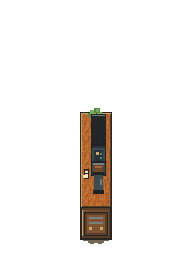](../../game/tests/fixtures/furniture-calibration/coffee-station-code-v1/west-whole.png)

Source / prompt: [coffee-station.png](../../game/assets/runtime/office/coffee-station.png)

Review: [COFFEE_STATION_PRODUCTION_REVIEW.md](COFFEE_STATION_PRODUCTION_REVIEW.md) · [COFFEE_CODE_NATIVE_CANDIDATE_REVIEW.md](COFFEE_CODE_NATIVE_CANDIDATE_REVIEW.md)

Native evidence: [all-four-room-native.png](../../game/tests/output/coffee-station-candidate/all-four-room-native.png) · [manifest.json](../../game/tests/fixtures/furniture-calibration/coffee-station-code-v1/manifest.json) · [all-four-service-native.png](../../game/tests/output/coffee-station-candidate/all-four-service-native.png) · [REGRESSION_CHECKPOINT_COFFEE_PRODUCTION.md](REGRESSION_CHECKPOINT_COFFEE_PRODUCTION.md)

Export method: Deterministic typed-GDScript geometry; no raster rotation, mirror, runtime scaling, provider call, or semantic source edit.

**Declared native layers (not automatically approved)**

| Export | Canvas / pivot | Actual opaque bounds | Derivation / limits |
| --- | --- | --- | --- |
| [west-floor_shadow.png](../../game/tests/fixtures/furniture-calibration/coffee-station-code-v1/west-floor_shadow.png) | 192×256 / [96, 192] | [83, 237, 26, 7]; 144 pixels | Accepted coffee-station-v1 registered layer; same canvas/pivot and exact per-side production order. |
| [west-counter_carcass.png](../../game/tests/fixtures/furniture-calibration/coffee-station-code-v1/west-counter_carcass.png) | 192×256 / [96, 192] | [80, 208, 32, 28]; 112 pixels | Accepted coffee-station-v1 registered layer; same canvas/pivot and exact per-side production order. |
| [west-counter_top.png](../../game/tests/fixtures/furniture-calibration/coffee-station-code-v1/west-counter_top.png) | 192×256 / [96, 192] | [80, 112, 32, 96]; 3072 pixels | Accepted coffee-station-v1 registered layer; same canvas/pivot and exact per-side production order. |
| [west-counter_front.png](../../game/tests/fixtures/furniture-calibration/coffee-station-code-v1/west-counter_front.png) | 192×256 / [96, 192] | [82, 208, 28, 28]; 784 pixels | Accepted coffee-station-v1 registered layer; same canvas/pivot and exact per-side production order. |
| [west-counter_plinth.png](../../game/tests/fixtures/furniture-calibration/coffee-station-code-v1/west-counter_plinth.png) | 192×256 / [96, 192] | [80, 236, 32, 4]; 128 pixels | Accepted coffee-station-v1 registered layer; same canvas/pivot and exact per-side production order. |
| [west-service_panel.png](../../game/tests/fixtures/furniture-calibration/coffee-station-code-v1/west-service_panel.png) | 192×256 / [96, 192] | [84, 212, 24, 24]; 576 pixels | Accepted coffee-station-v1 registered layer; same canvas/pivot and exact per-side production order. |
| [west-plant.png](../../game/tests/fixtures/furniture-calibration/coffee-station-code-v1/west-plant.png) | 192×256 / [96, 192] | [88, 108, 15, 25]; 204 pixels | Accepted coffee-station-v1 registered layer; same canvas/pivot and exact per-side production order. |
| [west-espresso.png](../../game/tests/fixtures/furniture-calibration/coffee-station-code-v1/west-espresso.png) | 192×256 / [96, 192] | [91, 114, 15, 62]; 930 pixels | Accepted coffee-station-v1 registered layer; same canvas/pivot and exact per-side production order. |
| [west-serviceware.png](../../game/tests/fixtures/furniture-calibration/coffee-station-code-v1/west-serviceware.png) | 192×256 / [96, 192] | [83, 169, 6, 10]; 53 pixels | Accepted coffee-station-v1 registered layer; same canvas/pivot and exact per-side production order. |
| [west-grinder.png](../../game/tests/fixtures/furniture-calibration/coffee-station-code-v1/west-grinder.png) | 192×256 / [96, 192] | [92, 161, 13, 33]; 323 pixels | Accepted coffee-station-v1 registered layer; same canvas/pivot and exact per-side production order. |

west-floor_shadow.png references: [COFFEE_STATION_PRODUCTION_REVIEW.md](COFFEE_STATION_PRODUCTION_REVIEW.md)

west-counter_carcass.png references: [COFFEE_STATION_PRODUCTION_REVIEW.md](COFFEE_STATION_PRODUCTION_REVIEW.md)

west-counter_top.png references: [COFFEE_STATION_PRODUCTION_REVIEW.md](COFFEE_STATION_PRODUCTION_REVIEW.md)

west-counter_front.png references: [COFFEE_STATION_PRODUCTION_REVIEW.md](COFFEE_STATION_PRODUCTION_REVIEW.md)

west-counter_plinth.png references: [COFFEE_STATION_PRODUCTION_REVIEW.md](COFFEE_STATION_PRODUCTION_REVIEW.md)

west-service_panel.png references: [COFFEE_STATION_PRODUCTION_REVIEW.md](COFFEE_STATION_PRODUCTION_REVIEW.md)

west-plant.png references: [COFFEE_STATION_PRODUCTION_REVIEW.md](COFFEE_STATION_PRODUCTION_REVIEW.md)

west-espresso.png references: [COFFEE_STATION_PRODUCTION_REVIEW.md](COFFEE_STATION_PRODUCTION_REVIEW.md)

west-serviceware.png references: [COFFEE_STATION_PRODUCTION_REVIEW.md](COFFEE_STATION_PRODUCTION_REVIEW.md)

west-grinder.png references: [COFFEE_STATION_PRODUCTION_REVIEW.md](COFFEE_STATION_PRODUCTION_REVIEW.md)

**Installed runtime layers — explicit integration evidence required**

| Export | Canvas / pivot | Actual opaque bounds | Derivation / limits |
| --- | --- | --- | --- |
| [west-floor_shadow.png](../../game/assets/runtime/office/coffee-station-v1/west-floor_shadow.png) | 192×256 / [96, 192] | [83, 237, 26, 7]; 144 pixels | Installed coffee-station-v1 layer; bytes exactly match the accepted native export. |
| [west-counter_carcass.png](../../game/assets/runtime/office/coffee-station-v1/west-counter_carcass.png) | 192×256 / [96, 192] | [80, 208, 32, 28]; 112 pixels | Installed coffee-station-v1 layer; bytes exactly match the accepted native export. |
| [west-counter_top.png](../../game/assets/runtime/office/coffee-station-v1/west-counter_top.png) | 192×256 / [96, 192] | [80, 112, 32, 96]; 3072 pixels | Installed coffee-station-v1 layer; bytes exactly match the accepted native export. |
| [west-counter_front.png](../../game/assets/runtime/office/coffee-station-v1/west-counter_front.png) | 192×256 / [96, 192] | [82, 208, 28, 28]; 784 pixels | Installed coffee-station-v1 layer; bytes exactly match the accepted native export. |
| [west-counter_plinth.png](../../game/assets/runtime/office/coffee-station-v1/west-counter_plinth.png) | 192×256 / [96, 192] | [80, 236, 32, 4]; 128 pixels | Installed coffee-station-v1 layer; bytes exactly match the accepted native export. |
| [west-service_panel.png](../../game/assets/runtime/office/coffee-station-v1/west-service_panel.png) | 192×256 / [96, 192] | [84, 212, 24, 24]; 576 pixels | Installed coffee-station-v1 layer; bytes exactly match the accepted native export. |
| [west-plant.png](../../game/assets/runtime/office/coffee-station-v1/west-plant.png) | 192×256 / [96, 192] | [88, 108, 15, 25]; 204 pixels | Installed coffee-station-v1 layer; bytes exactly match the accepted native export. |
| [west-espresso.png](../../game/assets/runtime/office/coffee-station-v1/west-espresso.png) | 192×256 / [96, 192] | [91, 114, 15, 62]; 930 pixels | Installed coffee-station-v1 layer; bytes exactly match the accepted native export. |
| [west-serviceware.png](../../game/assets/runtime/office/coffee-station-v1/west-serviceware.png) | 192×256 / [96, 192] | [83, 169, 6, 10]; 53 pixels | Installed coffee-station-v1 layer; bytes exactly match the accepted native export. |
| [west-grinder.png](../../game/assets/runtime/office/coffee-station-v1/west-grinder.png) | 192×256 / [96, 192] | [92, 161, 13, 33]; 323 pixels | Installed coffee-station-v1 layer; bytes exactly match the accepted native export. |

west-floor_shadow.png references: [west-floor_shadow.png](../../game/tests/fixtures/furniture-calibration/coffee-station-code-v1/west-floor_shadow.png) · [COFFEE_STATION_PRODUCTION_REVIEW.md](COFFEE_STATION_PRODUCTION_REVIEW.md)

west-counter_carcass.png references: [west-counter_carcass.png](../../game/tests/fixtures/furniture-calibration/coffee-station-code-v1/west-counter_carcass.png) · [COFFEE_STATION_PRODUCTION_REVIEW.md](COFFEE_STATION_PRODUCTION_REVIEW.md)

west-counter_top.png references: [west-counter_top.png](../../game/tests/fixtures/furniture-calibration/coffee-station-code-v1/west-counter_top.png) · [COFFEE_STATION_PRODUCTION_REVIEW.md](COFFEE_STATION_PRODUCTION_REVIEW.md)

west-counter_front.png references: [west-counter_front.png](../../game/tests/fixtures/furniture-calibration/coffee-station-code-v1/west-counter_front.png) · [COFFEE_STATION_PRODUCTION_REVIEW.md](COFFEE_STATION_PRODUCTION_REVIEW.md)

west-counter_plinth.png references: [west-counter_plinth.png](../../game/tests/fixtures/furniture-calibration/coffee-station-code-v1/west-counter_plinth.png) · [COFFEE_STATION_PRODUCTION_REVIEW.md](COFFEE_STATION_PRODUCTION_REVIEW.md)

west-service_panel.png references: [west-service_panel.png](../../game/tests/fixtures/furniture-calibration/coffee-station-code-v1/west-service_panel.png) · [COFFEE_STATION_PRODUCTION_REVIEW.md](COFFEE_STATION_PRODUCTION_REVIEW.md)

west-plant.png references: [west-plant.png](../../game/tests/fixtures/furniture-calibration/coffee-station-code-v1/west-plant.png) · [COFFEE_STATION_PRODUCTION_REVIEW.md](COFFEE_STATION_PRODUCTION_REVIEW.md)

west-espresso.png references: [west-espresso.png](../../game/tests/fixtures/furniture-calibration/coffee-station-code-v1/west-espresso.png) · [COFFEE_STATION_PRODUCTION_REVIEW.md](COFFEE_STATION_PRODUCTION_REVIEW.md)

west-serviceware.png references: [west-serviceware.png](../../game/tests/fixtures/furniture-calibration/coffee-station-code-v1/west-serviceware.png) · [COFFEE_STATION_PRODUCTION_REVIEW.md](COFFEE_STATION_PRODUCTION_REVIEW.md)

west-grinder.png references: [west-grinder.png](../../game/tests/fixtures/furniture-calibration/coffee-station-code-v1/west-grinder.png) · [COFFEE_STATION_PRODUCTION_REVIEW.md](COFFEE_STATION_PRODUCTION_REVIEW.md)

Runtime whole reference / integration evidence: [west-whole.png](../../game/assets/runtime/office/coffee-station-v1/west-whole.png) · [COFFEE_STATION_PRODUCTION_REVIEW.md](COFFEE_STATION_PRODUCTION_REVIEW.md)

Retained native composite / source candidate: [west-whole.png](../../game/tests/fixtures/furniture-calibration/coffee-station-code-v1/west-whole.png)

**Retained source attempts**

| Source | Actual master | Prompt | Disposition |
| --- | --- | --- | --- |
| [coffee-service-west-v1.png](../../game/assets/source/overnight-20260904/kits/coffee-service-west-v1.png) | 1774×887 RGB; Opaque source | [coffee-service-west-v1.md](../../game/assets/source/overnight-20260904/kits/coffee-service-west-v1.md) | Opaque whole-kit failure. Geometry/direction invalid; only a v2 interior face rectangle is reused in separate espresso feasibility, not a recovered full kit. |
| [coffee-service-west-v2.png](../../game/assets/source/overnight-20260904/kits/coffee-service-west-v2.png) | 1774×887 RGB; Opaque source | [coffee-service-west-v2.md](../../game/assets/source/overnight-20260904/kits/coffee-service-west-v2.md) | Opaque whole-kit failure. Geometry/direction invalid; only a v2 interior face rectangle is reused in separate espresso feasibility, not a recovered full kit. |
| [coffee-service-west-v3.png](../../game/assets/source/overnight-20260904/kits/coffee-service-west-v3.png) | 887×1774 RGB; Opaque source | [coffee-service-west-v3.md](../../game/assets/source/overnight-20260904/kits/coffee-service-west-v3.md) | Opaque whole-kit failure. Geometry/direction invalid; only a v2 interior face rectangle is reused in separate espresso feasibility, not a recovered full kit. |
| [coffee-service-west-v4.png](../../game/assets/source/overnight-20260904/kits/coffee-service-west-v4.png) | 1774×887 RGB; Opaque source | [coffee-service-west-v4.md](../../game/assets/source/overnight-20260904/kits/coffee-service-west-v4.md) | Opaque whole-kit failure. Geometry/direction invalid; only a v2 interior face rectangle is reused in separate espresso feasibility, not a recovered full kit. |

### Collaboration table

`collaboration_cluster` · P1 · shared.

Direction semantics: **multi seat reference gaze**.

One reusable team table-and-four-chair assembly with four distinct service sockets; employees and meeting behavior remain separate.

Proposed envelope **256×272**, fixed floor anchor **[128, 176]**. N/E footprints: **5×2 / 2×5 cells**.

Tools: shared planning surface; four independently layered collaboration chairs; four reusable collaboration sockets. Layers: `floor_shadow`, `rear_structure`, `front_structure`.

**north: runtime integrated.** Approved and runtime-integrated collaboration-cluster-v2 north profile. The installed layers are byte-exact copies of the reviewed native exports on the common 256x272 canvas and [128,176] floor pivot. Ordinary GameMain production acceptance passes 574/0 headless and 1056/0 native without catalogue injection, including two-employee contact, schedule interruption, pause/resume, collision/navigation, occupied rejection, vacant rotate plus Undo, and stage 0–4 placement.

[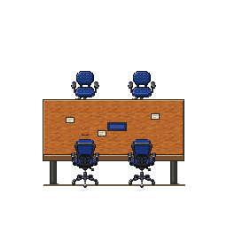](../../game/tests/fixtures/furniture-calibration/collaboration-cluster-v2/north-whole.png)

Source / prompt: [collaboration_table_geometry.gd](../../game/tools/collaboration_table_geometry.gd)

Review: [COLLABORATION_PRODUCTION_REVIEW.md](../COLLABORATION_PRODUCTION_REVIEW.md)

Native evidence: [full-room-hold-native-panels.png](../../game/tests/output/collaboration-production/full-room-hold-native-panels.png) · [manifest.json](../../game/tests/fixtures/furniture-calibration/collaboration-cluster-v2/manifest.json) · [headless-results.json](../../game/tests/output/collaboration-cluster-v2-actual-room/headless-results.json) · [actual-room-results.json](../../game/tests/output/collaboration-cluster-v2-actual-room/actual-room-results.json) · [actual-room-contact-sheet-native.png](../../game/tests/output/collaboration-cluster-v2-actual-room/actual-room-contact-sheet-native.png) · [actual-room-empty-contact-sheet-native.png](../../game/tests/output/collaboration-cluster-v2-actual-room/actual-room-empty-contact-sheet-native.png) · [actual-room-contact-sheet-2x.png](../../game/tests/output/collaboration-cluster-v2-actual-room/actual-room-contact-sheet-2x.png) · [full-room-contact-sheet-native-panels.png](../../game/tests/output/collaboration-cluster-v2-actual-room/full-room-contact-sheet-native-panels.png) · [component-contact-sheet-native.png](../../game/tests/output/collaboration-cluster-v2/component-contact-sheet-native.png) · [manifest.json](../../game/assets/runtime/office/collaboration-cluster-v2/manifest.json) · [COLLABORATION_PRODUCTION_REVIEW.md](../COLLABORATION_PRODUCTION_REVIEW.md) · [test_collaboration_production.gd](../../game/tests/test_collaboration_production.gd) · [actual-room-results.json](../../game/tests/output/collaboration-production/actual-room-results.json) · [results-headless.json](../../game/tests/output/collaboration-production/results-headless.json) · [entry-keyframes-native.png](../../game/tests/output/collaboration-production/entry-keyframes-native.png) · [work-interrupt-keyframes-native.png](../../game/tests/output/collaboration-production/work-interrupt-keyframes-native.png) · [hold-contact-sheet-native.png](../../game/tests/output/collaboration-production/hold-contact-sheet-native.png) · [pause-resume-contact-sheet-native.png](../../game/tests/output/collaboration-production/pause-resume-contact-sheet-native.png) · [rotation-contact-sheet-native.png](../../game/tests/output/collaboration-production/rotation-contact-sheet-native.png)

Export method: Code-native table layers plus byte-preserving registration of already reviewed directional task-chair components. South/West table pivots are corrected as complete-layer translations; no finished bitmap rotation, mirror, scale, crop, or repaint.

**Declared native layers (not automatically approved)**

| Export | Canvas / pivot | Actual opaque bounds | Derivation / limits |
| --- | --- | --- | --- |
| [north-table_floor_shadow.png](../../game/tests/fixtures/furniture-calibration/collaboration-cluster-v2/north-table_floor_shadow.png) | 256×272 / [128, 176] | [49, 149, 160, 61]; 372 pixels | Exact deterministic code-native cluster layer on the common 256x272 canvas and [128,176] floor anchor; independently declared north screen-axis assembly, with reviewed workstations-v2 chair pixels registered without rotation, mirroring, scaling, crop or repaint. |
| [north-table_rear_structure.png](../../game/tests/fixtures/furniture-calibration/collaboration-cluster-v2/north-table_rear_structure.png) | 256×272 / [128, 176] | [48, 112, 160, 64]; 10240 pixels | Exact deterministic code-native cluster layer on the common 256x272 canvas and [128,176] floor anchor; independently declared north screen-axis assembly, with reviewed workstations-v2 chair pixels registered without rotation, mirroring, scaling, crop or repaint. |
| [north-table_front_structure.png](../../game/tests/fixtures/furniture-calibration/collaboration-cluster-v2/north-table_front_structure.png) | 256×272 / [128, 176] | [48, 174, 160, 34]; 1696 pixels | Exact deterministic code-native cluster layer on the common 256x272 canvas and [128,176] floor anchor; independently declared north screen-axis assembly, with reviewed workstations-v2 chair pixels registered without rotation, mirroring, scaling, crop or repaint. |
| [north-north_chair_0_whole.png](../../game/tests/fixtures/furniture-calibration/collaboration-cluster-v2/north-north_chair_0_whole.png) | 256×272 / [128, 176] | [80, 80, 32, 52]; 891 pixels | Exact deterministic code-native cluster layer on the common 256x272 canvas and [128,176] floor anchor; independently declared north screen-axis assembly, with reviewed workstations-v2 chair pixels registered without rotation, mirroring, scaling, crop or repaint. |
| [north-south_chair_0_whole.png](../../game/tests/fixtures/furniture-calibration/collaboration-cluster-v2/north-south_chair_0_whole.png) | 256×272 / [128, 176] | [80, 157, 32, 55]; 1006 pixels | Exact deterministic code-native cluster layer on the common 256x272 canvas and [128,176] floor anchor; independently declared north screen-axis assembly, with reviewed workstations-v2 chair pixels registered without rotation, mirroring, scaling, crop or repaint. |
| [north-north_chair_1_whole.png](../../game/tests/fixtures/furniture-calibration/collaboration-cluster-v2/north-north_chair_1_whole.png) | 256×272 / [128, 176] | [144, 80, 32, 52]; 891 pixels | Exact deterministic code-native cluster layer on the common 256x272 canvas and [128,176] floor anchor; independently declared north screen-axis assembly, with reviewed workstations-v2 chair pixels registered without rotation, mirroring, scaling, crop or repaint. |
| [north-south_chair_1_whole.png](../../game/tests/fixtures/furniture-calibration/collaboration-cluster-v2/north-south_chair_1_whole.png) | 256×272 / [128, 176] | [144, 157, 32, 55]; 1006 pixels | Exact deterministic code-native cluster layer on the common 256x272 canvas and [128,176] floor anchor; independently declared north screen-axis assembly, with reviewed workstations-v2 chair pixels registered without rotation, mirroring, scaling, crop or repaint. |

north-table_floor_shadow.png references: [collaboration_table_geometry.gd](../../game/tools/collaboration_table_geometry.gd) · [COLLABORATION_PRODUCTION_REVIEW.md](../COLLABORATION_PRODUCTION_REVIEW.md)

north-table_rear_structure.png references: [collaboration_table_geometry.gd](../../game/tools/collaboration_table_geometry.gd) · [COLLABORATION_PRODUCTION_REVIEW.md](../COLLABORATION_PRODUCTION_REVIEW.md)

north-table_front_structure.png references: [collaboration_table_geometry.gd](../../game/tools/collaboration_table_geometry.gd) · [COLLABORATION_PRODUCTION_REVIEW.md](../COLLABORATION_PRODUCTION_REVIEW.md)

north-north_chair_0_whole.png references: [collaboration_table_geometry.gd](../../game/tools/collaboration_table_geometry.gd) · [COLLABORATION_PRODUCTION_REVIEW.md](../COLLABORATION_PRODUCTION_REVIEW.md)

north-south_chair_0_whole.png references: [collaboration_table_geometry.gd](../../game/tools/collaboration_table_geometry.gd) · [COLLABORATION_PRODUCTION_REVIEW.md](../COLLABORATION_PRODUCTION_REVIEW.md)

north-north_chair_1_whole.png references: [collaboration_table_geometry.gd](../../game/tools/collaboration_table_geometry.gd) · [COLLABORATION_PRODUCTION_REVIEW.md](../COLLABORATION_PRODUCTION_REVIEW.md)

north-south_chair_1_whole.png references: [collaboration_table_geometry.gd](../../game/tools/collaboration_table_geometry.gd) · [COLLABORATION_PRODUCTION_REVIEW.md](../COLLABORATION_PRODUCTION_REVIEW.md)

**Installed runtime layers — explicit integration evidence required**

| Export | Canvas / pivot | Actual opaque bounds | Derivation / limits |
| --- | --- | --- | --- |
| [north-table_floor_shadow.png](../../game/assets/runtime/office/collaboration-cluster-v2/north-table_floor_shadow.png) | 256×272 / [128, 176] | [49, 149, 160, 61]; 372 pixels | Installed byte-exact copy of the reviewed native layer; no rotation, mirroring, resampling, crop or repaint. |
| [north-table_rear_structure.png](../../game/assets/runtime/office/collaboration-cluster-v2/north-table_rear_structure.png) | 256×272 / [128, 176] | [48, 112, 160, 64]; 10240 pixels | Installed byte-exact copy of the reviewed native layer; no rotation, mirroring, resampling, crop or repaint. |
| [north-table_front_structure.png](../../game/assets/runtime/office/collaboration-cluster-v2/north-table_front_structure.png) | 256×272 / [128, 176] | [48, 174, 160, 34]; 1696 pixels | Installed byte-exact copy of the reviewed native layer; no rotation, mirroring, resampling, crop or repaint. |
| [north-north_chair_0_whole.png](../../game/assets/runtime/office/collaboration-cluster-v2/north-north_chair_0_whole.png) | 256×272 / [128, 176] | [80, 80, 32, 52]; 891 pixels | Installed byte-exact copy of the reviewed native layer; no rotation, mirroring, resampling, crop or repaint. |
| [north-south_chair_0_whole.png](../../game/assets/runtime/office/collaboration-cluster-v2/north-south_chair_0_whole.png) | 256×272 / [128, 176] | [80, 157, 32, 55]; 1006 pixels | Installed byte-exact copy of the reviewed native layer; no rotation, mirroring, resampling, crop or repaint. |
| [north-north_chair_1_whole.png](../../game/assets/runtime/office/collaboration-cluster-v2/north-north_chair_1_whole.png) | 256×272 / [128, 176] | [144, 80, 32, 52]; 891 pixels | Installed byte-exact copy of the reviewed native layer; no rotation, mirroring, resampling, crop or repaint. |
| [north-south_chair_1_whole.png](../../game/assets/runtime/office/collaboration-cluster-v2/north-south_chair_1_whole.png) | 256×272 / [128, 176] | [144, 157, 32, 55]; 1006 pixels | Installed byte-exact copy of the reviewed native layer; no rotation, mirroring, resampling, crop or repaint. |

north-table_floor_shadow.png references: [north-table_floor_shadow.png](../../game/tests/fixtures/furniture-calibration/collaboration-cluster-v2/north-table_floor_shadow.png) · [COLLABORATION_PRODUCTION_REVIEW.md](../COLLABORATION_PRODUCTION_REVIEW.md)

north-table_rear_structure.png references: [north-table_rear_structure.png](../../game/tests/fixtures/furniture-calibration/collaboration-cluster-v2/north-table_rear_structure.png) · [COLLABORATION_PRODUCTION_REVIEW.md](../COLLABORATION_PRODUCTION_REVIEW.md)

north-table_front_structure.png references: [north-table_front_structure.png](../../game/tests/fixtures/furniture-calibration/collaboration-cluster-v2/north-table_front_structure.png) · [COLLABORATION_PRODUCTION_REVIEW.md](../COLLABORATION_PRODUCTION_REVIEW.md)

north-north_chair_0_whole.png references: [north-north_chair_0_whole.png](../../game/tests/fixtures/furniture-calibration/collaboration-cluster-v2/north-north_chair_0_whole.png) · [COLLABORATION_PRODUCTION_REVIEW.md](../COLLABORATION_PRODUCTION_REVIEW.md)

north-south_chair_0_whole.png references: [north-south_chair_0_whole.png](../../game/tests/fixtures/furniture-calibration/collaboration-cluster-v2/north-south_chair_0_whole.png) · [COLLABORATION_PRODUCTION_REVIEW.md](../COLLABORATION_PRODUCTION_REVIEW.md)

north-north_chair_1_whole.png references: [north-north_chair_1_whole.png](../../game/tests/fixtures/furniture-calibration/collaboration-cluster-v2/north-north_chair_1_whole.png) · [COLLABORATION_PRODUCTION_REVIEW.md](../COLLABORATION_PRODUCTION_REVIEW.md)

north-south_chair_1_whole.png references: [north-south_chair_1_whole.png](../../game/tests/fixtures/furniture-calibration/collaboration-cluster-v2/north-south_chair_1_whole.png) · [COLLABORATION_PRODUCTION_REVIEW.md](../COLLABORATION_PRODUCTION_REVIEW.md)

Runtime whole reference / integration evidence: [actual-room-results.json](../../game/tests/output/collaboration-production/actual-room-results.json)

**Additional composites**

| Export | Canvas / pivot | Actual opaque bounds | Derivation / limits |
| --- | --- | --- | --- |
| [north-whole.png](../../game/tests/fixtures/furniture-calibration/collaboration-cluster-v2/north-whole.png) | 256×272 / [128, 176] | [48, 80, 161, 132]; 14034 pixels | Approved native whole reconstruction reference assembled byte-exactly from the declared reviewed layers; the whole image is review evidence and is not installed as a runtime monolith. |

north-whole.png references: [collaboration_table_geometry.gd](../../game/tools/collaboration_table_geometry.gd) · [COLLABORATION_PRODUCTION_REVIEW.md](../COLLABORATION_PRODUCTION_REVIEW.md)

Retained native composite / source candidate: [north-whole.png](../../game/tests/fixtures/furniture-calibration/collaboration-cluster-v2/north-whole.png)

**east: runtime integrated.** Approved and runtime-integrated collaboration-cluster-v2 east profile. The installed layers are byte-exact copies of the reviewed native exports on the common 256x272 canvas and [128,176] floor pivot. Ordinary GameMain production acceptance passes 574/0 headless and 1056/0 native without catalogue injection, including two-employee contact, schedule interruption, pause/resume, collision/navigation, occupied rejection, vacant rotate plus Undo, and stage 0–4 placement.

[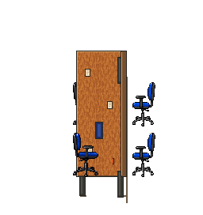](../../game/tests/fixtures/furniture-calibration/collaboration-cluster-v2/east-whole.png)

Source / prompt: [collaboration_table_geometry.gd](../../game/tools/collaboration_table_geometry.gd)

Review: [COLLABORATION_PRODUCTION_REVIEW.md](../COLLABORATION_PRODUCTION_REVIEW.md)

Native evidence: [full-room-hold-native-panels.png](../../game/tests/output/collaboration-production/full-room-hold-native-panels.png) · [manifest.json](../../game/tests/fixtures/furniture-calibration/collaboration-cluster-v2/manifest.json) · [headless-results.json](../../game/tests/output/collaboration-cluster-v2-actual-room/headless-results.json) · [actual-room-results.json](../../game/tests/output/collaboration-cluster-v2-actual-room/actual-room-results.json) · [actual-room-contact-sheet-native.png](../../game/tests/output/collaboration-cluster-v2-actual-room/actual-room-contact-sheet-native.png) · [actual-room-empty-contact-sheet-native.png](../../game/tests/output/collaboration-cluster-v2-actual-room/actual-room-empty-contact-sheet-native.png) · [actual-room-contact-sheet-2x.png](../../game/tests/output/collaboration-cluster-v2-actual-room/actual-room-contact-sheet-2x.png) · [full-room-contact-sheet-native-panels.png](../../game/tests/output/collaboration-cluster-v2-actual-room/full-room-contact-sheet-native-panels.png) · [component-contact-sheet-native.png](../../game/tests/output/collaboration-cluster-v2/component-contact-sheet-native.png) · [manifest.json](../../game/assets/runtime/office/collaboration-cluster-v2/manifest.json) · [COLLABORATION_PRODUCTION_REVIEW.md](../COLLABORATION_PRODUCTION_REVIEW.md) · [test_collaboration_production.gd](../../game/tests/test_collaboration_production.gd) · [actual-room-results.json](../../game/tests/output/collaboration-production/actual-room-results.json) · [results-headless.json](../../game/tests/output/collaboration-production/results-headless.json) · [entry-keyframes-native.png](../../game/tests/output/collaboration-production/entry-keyframes-native.png) · [work-interrupt-keyframes-native.png](../../game/tests/output/collaboration-production/work-interrupt-keyframes-native.png) · [hold-contact-sheet-native.png](../../game/tests/output/collaboration-production/hold-contact-sheet-native.png) · [pause-resume-contact-sheet-native.png](../../game/tests/output/collaboration-production/pause-resume-contact-sheet-native.png) · [rotation-contact-sheet-native.png](../../game/tests/output/collaboration-production/rotation-contact-sheet-native.png)

Export method: Code-native table layers plus byte-preserving registration of already reviewed directional task-chair components. South/West table pivots are corrected as complete-layer translations; no finished bitmap rotation, mirror, scale, crop, or repaint.

**Declared native layers (not automatically approved)**

| Export | Canvas / pivot | Actual opaque bounds | Derivation / limits |
| --- | --- | --- | --- |
| [east-table_floor_shadow.png](../../game/tests/fixtures/furniture-calibration/collaboration-cluster-v2/east-table_floor_shadow.png) | 256×272 / [128, 176] | [101, 97, 60, 160]; 384 pixels | Exact deterministic code-native cluster layer on the common 256x272 canvas and [128,176] floor anchor; independently declared east screen-axis assembly, with reviewed workstations-v2 chair pixels registered without rotation, mirroring, scaling, crop or repaint. |
| [east-table_rear_structure.png](../../game/tests/fixtures/furniture-calibration/collaboration-cluster-v2/east-table_rear_structure.png) | 256×272 / [128, 176] | [96, 64, 64, 184]; 10432 pixels | Exact deterministic code-native cluster layer on the common 256x272 canvas and [128,176] floor anchor; independently declared east screen-axis assembly, with reviewed workstations-v2 chair pixels registered without rotation, mirroring, scaling, crop or repaint. |
| [east-table_front_structure.png](../../game/tests/fixtures/furniture-calibration/collaboration-cluster-v2/east-table_front_structure.png) | 256×272 / [128, 176] | [148, 64, 12, 186]; 1656 pixels | Exact deterministic code-native cluster layer on the common 256x272 canvas and [128,176] floor anchor; independently declared east screen-axis assembly, with reviewed workstations-v2 chair pixels registered without rotation, mirroring, scaling, crop or repaint. |
| [east-west_chair_0_rear.png](../../game/tests/fixtures/furniture-calibration/collaboration-cluster-v2/east-west_chair_0_rear.png) | 256×272 / [128, 176] | [92, 104, 32, 56]; 659 pixels | Exact deterministic code-native cluster layer on the common 256x272 canvas and [128,176] floor anchor; independently declared east screen-axis assembly, with reviewed workstations-v2 chair pixels registered without rotation, mirroring, scaling, crop or repaint. |
| [east-west_chair_0_front.png](../../game/tests/fixtures/furniture-calibration/collaboration-cluster-v2/east-west_chair_0_front.png) | 256×272 / [128, 176] | [104, 120, 14, 14]; 81 pixels | Exact deterministic code-native cluster layer on the common 256x272 canvas and [128,176] floor anchor; independently declared east screen-axis assembly, with reviewed workstations-v2 chair pixels registered without rotation, mirroring, scaling, crop or repaint. |
| [east-east_chair_0_rear.png](../../game/tests/fixtures/furniture-calibration/collaboration-cluster-v2/east-east_chair_0_rear.png) | 256×272 / [128, 176] | [167, 104, 29, 56]; 574 pixels | Exact deterministic code-native cluster layer on the common 256x272 canvas and [128,176] floor anchor; independently declared east screen-axis assembly, with reviewed workstations-v2 chair pixels registered without rotation, mirroring, scaling, crop or repaint. |
| [east-east_chair_0_front.png](../../game/tests/fixtures/furniture-calibration/collaboration-cluster-v2/east-east_chair_0_front.png) | 256×272 / [128, 176] | [171, 121, 13, 14]; 86 pixels | Exact deterministic code-native cluster layer on the common 256x272 canvas and [128,176] floor anchor; independently declared east screen-axis assembly, with reviewed workstations-v2 chair pixels registered without rotation, mirroring, scaling, crop or repaint. |
| [east-west_chair_1_rear.png](../../game/tests/fixtures/furniture-calibration/collaboration-cluster-v2/east-west_chair_1_rear.png) | 256×272 / [128, 176] | [92, 168, 32, 56]; 659 pixels | Exact deterministic code-native cluster layer on the common 256x272 canvas and [128,176] floor anchor; independently declared east screen-axis assembly, with reviewed workstations-v2 chair pixels registered without rotation, mirroring, scaling, crop or repaint. |
| [east-west_chair_1_front.png](../../game/tests/fixtures/furniture-calibration/collaboration-cluster-v2/east-west_chair_1_front.png) | 256×272 / [128, 176] | [104, 184, 14, 14]; 81 pixels | Exact deterministic code-native cluster layer on the common 256x272 canvas and [128,176] floor anchor; independently declared east screen-axis assembly, with reviewed workstations-v2 chair pixels registered without rotation, mirroring, scaling, crop or repaint. |
| [east-east_chair_1_rear.png](../../game/tests/fixtures/furniture-calibration/collaboration-cluster-v2/east-east_chair_1_rear.png) | 256×272 / [128, 176] | [167, 168, 29, 56]; 574 pixels | Exact deterministic code-native cluster layer on the common 256x272 canvas and [128,176] floor anchor; independently declared east screen-axis assembly, with reviewed workstations-v2 chair pixels registered without rotation, mirroring, scaling, crop or repaint. |
| [east-east_chair_1_front.png](../../game/tests/fixtures/furniture-calibration/collaboration-cluster-v2/east-east_chair_1_front.png) | 256×272 / [128, 176] | [171, 185, 13, 14]; 86 pixels | Exact deterministic code-native cluster layer on the common 256x272 canvas and [128,176] floor anchor; independently declared east screen-axis assembly, with reviewed workstations-v2 chair pixels registered without rotation, mirroring, scaling, crop or repaint. |

east-table_floor_shadow.png references: [collaboration_table_geometry.gd](../../game/tools/collaboration_table_geometry.gd) · [COLLABORATION_PRODUCTION_REVIEW.md](../COLLABORATION_PRODUCTION_REVIEW.md)

east-table_rear_structure.png references: [collaboration_table_geometry.gd](../../game/tools/collaboration_table_geometry.gd) · [COLLABORATION_PRODUCTION_REVIEW.md](../COLLABORATION_PRODUCTION_REVIEW.md)

east-table_front_structure.png references: [collaboration_table_geometry.gd](../../game/tools/collaboration_table_geometry.gd) · [COLLABORATION_PRODUCTION_REVIEW.md](../COLLABORATION_PRODUCTION_REVIEW.md)

east-west_chair_0_rear.png references: [collaboration_table_geometry.gd](../../game/tools/collaboration_table_geometry.gd) · [COLLABORATION_PRODUCTION_REVIEW.md](../COLLABORATION_PRODUCTION_REVIEW.md)

east-west_chair_0_front.png references: [collaboration_table_geometry.gd](../../game/tools/collaboration_table_geometry.gd) · [COLLABORATION_PRODUCTION_REVIEW.md](../COLLABORATION_PRODUCTION_REVIEW.md)

east-east_chair_0_rear.png references: [collaboration_table_geometry.gd](../../game/tools/collaboration_table_geometry.gd) · [COLLABORATION_PRODUCTION_REVIEW.md](../COLLABORATION_PRODUCTION_REVIEW.md)

east-east_chair_0_front.png references: [collaboration_table_geometry.gd](../../game/tools/collaboration_table_geometry.gd) · [COLLABORATION_PRODUCTION_REVIEW.md](../COLLABORATION_PRODUCTION_REVIEW.md)

east-west_chair_1_rear.png references: [collaboration_table_geometry.gd](../../game/tools/collaboration_table_geometry.gd) · [COLLABORATION_PRODUCTION_REVIEW.md](../COLLABORATION_PRODUCTION_REVIEW.md)

east-west_chair_1_front.png references: [collaboration_table_geometry.gd](../../game/tools/collaboration_table_geometry.gd) · [COLLABORATION_PRODUCTION_REVIEW.md](../COLLABORATION_PRODUCTION_REVIEW.md)

east-east_chair_1_rear.png references: [collaboration_table_geometry.gd](../../game/tools/collaboration_table_geometry.gd) · [COLLABORATION_PRODUCTION_REVIEW.md](../COLLABORATION_PRODUCTION_REVIEW.md)

east-east_chair_1_front.png references: [collaboration_table_geometry.gd](../../game/tools/collaboration_table_geometry.gd) · [COLLABORATION_PRODUCTION_REVIEW.md](../COLLABORATION_PRODUCTION_REVIEW.md)

**Installed runtime layers — explicit integration evidence required**

| Export | Canvas / pivot | Actual opaque bounds | Derivation / limits |
| --- | --- | --- | --- |
| [east-table_floor_shadow.png](../../game/assets/runtime/office/collaboration-cluster-v2/east-table_floor_shadow.png) | 256×272 / [128, 176] | [101, 97, 60, 160]; 384 pixels | Installed byte-exact copy of the reviewed native layer; no rotation, mirroring, resampling, crop or repaint. |
| [east-table_rear_structure.png](../../game/assets/runtime/office/collaboration-cluster-v2/east-table_rear_structure.png) | 256×272 / [128, 176] | [96, 64, 64, 184]; 10432 pixels | Installed byte-exact copy of the reviewed native layer; no rotation, mirroring, resampling, crop or repaint. |
| [east-table_front_structure.png](../../game/assets/runtime/office/collaboration-cluster-v2/east-table_front_structure.png) | 256×272 / [128, 176] | [148, 64, 12, 186]; 1656 pixels | Installed byte-exact copy of the reviewed native layer; no rotation, mirroring, resampling, crop or repaint. |
| [east-west_chair_0_rear.png](../../game/assets/runtime/office/collaboration-cluster-v2/east-west_chair_0_rear.png) | 256×272 / [128, 176] | [92, 104, 32, 56]; 659 pixels | Installed byte-exact copy of the reviewed native layer; no rotation, mirroring, resampling, crop or repaint. |
| [east-west_chair_0_front.png](../../game/assets/runtime/office/collaboration-cluster-v2/east-west_chair_0_front.png) | 256×272 / [128, 176] | [104, 120, 14, 14]; 81 pixels | Installed byte-exact copy of the reviewed native layer; no rotation, mirroring, resampling, crop or repaint. |
| [east-east_chair_0_rear.png](../../game/assets/runtime/office/collaboration-cluster-v2/east-east_chair_0_rear.png) | 256×272 / [128, 176] | [167, 104, 29, 56]; 574 pixels | Installed byte-exact copy of the reviewed native layer; no rotation, mirroring, resampling, crop or repaint. |
| [east-east_chair_0_front.png](../../game/assets/runtime/office/collaboration-cluster-v2/east-east_chair_0_front.png) | 256×272 / [128, 176] | [171, 121, 13, 14]; 86 pixels | Installed byte-exact copy of the reviewed native layer; no rotation, mirroring, resampling, crop or repaint. |
| [east-west_chair_1_rear.png](../../game/assets/runtime/office/collaboration-cluster-v2/east-west_chair_1_rear.png) | 256×272 / [128, 176] | [92, 168, 32, 56]; 659 pixels | Installed byte-exact copy of the reviewed native layer; no rotation, mirroring, resampling, crop or repaint. |
| [east-west_chair_1_front.png](../../game/assets/runtime/office/collaboration-cluster-v2/east-west_chair_1_front.png) | 256×272 / [128, 176] | [104, 184, 14, 14]; 81 pixels | Installed byte-exact copy of the reviewed native layer; no rotation, mirroring, resampling, crop or repaint. |
| [east-east_chair_1_rear.png](../../game/assets/runtime/office/collaboration-cluster-v2/east-east_chair_1_rear.png) | 256×272 / [128, 176] | [167, 168, 29, 56]; 574 pixels | Installed byte-exact copy of the reviewed native layer; no rotation, mirroring, resampling, crop or repaint. |
| [east-east_chair_1_front.png](../../game/assets/runtime/office/collaboration-cluster-v2/east-east_chair_1_front.png) | 256×272 / [128, 176] | [171, 185, 13, 14]; 86 pixels | Installed byte-exact copy of the reviewed native layer; no rotation, mirroring, resampling, crop or repaint. |

east-table_floor_shadow.png references: [east-table_floor_shadow.png](../../game/tests/fixtures/furniture-calibration/collaboration-cluster-v2/east-table_floor_shadow.png) · [COLLABORATION_PRODUCTION_REVIEW.md](../COLLABORATION_PRODUCTION_REVIEW.md)

east-table_rear_structure.png references: [east-table_rear_structure.png](../../game/tests/fixtures/furniture-calibration/collaboration-cluster-v2/east-table_rear_structure.png) · [COLLABORATION_PRODUCTION_REVIEW.md](../COLLABORATION_PRODUCTION_REVIEW.md)

east-table_front_structure.png references: [east-table_front_structure.png](../../game/tests/fixtures/furniture-calibration/collaboration-cluster-v2/east-table_front_structure.png) · [COLLABORATION_PRODUCTION_REVIEW.md](../COLLABORATION_PRODUCTION_REVIEW.md)

east-west_chair_0_rear.png references: [east-west_chair_0_rear.png](../../game/tests/fixtures/furniture-calibration/collaboration-cluster-v2/east-west_chair_0_rear.png) · [COLLABORATION_PRODUCTION_REVIEW.md](../COLLABORATION_PRODUCTION_REVIEW.md)

east-west_chair_0_front.png references: [east-west_chair_0_front.png](../../game/tests/fixtures/furniture-calibration/collaboration-cluster-v2/east-west_chair_0_front.png) · [COLLABORATION_PRODUCTION_REVIEW.md](../COLLABORATION_PRODUCTION_REVIEW.md)

east-east_chair_0_rear.png references: [east-east_chair_0_rear.png](../../game/tests/fixtures/furniture-calibration/collaboration-cluster-v2/east-east_chair_0_rear.png) · [COLLABORATION_PRODUCTION_REVIEW.md](../COLLABORATION_PRODUCTION_REVIEW.md)

east-east_chair_0_front.png references: [east-east_chair_0_front.png](../../game/tests/fixtures/furniture-calibration/collaboration-cluster-v2/east-east_chair_0_front.png) · [COLLABORATION_PRODUCTION_REVIEW.md](../COLLABORATION_PRODUCTION_REVIEW.md)

east-west_chair_1_rear.png references: [east-west_chair_1_rear.png](../../game/tests/fixtures/furniture-calibration/collaboration-cluster-v2/east-west_chair_1_rear.png) · [COLLABORATION_PRODUCTION_REVIEW.md](../COLLABORATION_PRODUCTION_REVIEW.md)

east-west_chair_1_front.png references: [east-west_chair_1_front.png](../../game/tests/fixtures/furniture-calibration/collaboration-cluster-v2/east-west_chair_1_front.png) · [COLLABORATION_PRODUCTION_REVIEW.md](../COLLABORATION_PRODUCTION_REVIEW.md)

east-east_chair_1_rear.png references: [east-east_chair_1_rear.png](../../game/tests/fixtures/furniture-calibration/collaboration-cluster-v2/east-east_chair_1_rear.png) · [COLLABORATION_PRODUCTION_REVIEW.md](../COLLABORATION_PRODUCTION_REVIEW.md)

east-east_chair_1_front.png references: [east-east_chair_1_front.png](../../game/tests/fixtures/furniture-calibration/collaboration-cluster-v2/east-east_chair_1_front.png) · [COLLABORATION_PRODUCTION_REVIEW.md](../COLLABORATION_PRODUCTION_REVIEW.md)

Runtime whole reference / integration evidence: [actual-room-results.json](../../game/tests/output/collaboration-production/actual-room-results.json)

**Additional composites**

| Export | Canvas / pivot | Actual opaque bounds | Derivation / limits |
| --- | --- | --- | --- |
| [east-whole.png](../../game/tests/fixtures/furniture-calibration/collaboration-cluster-v2/east-whole.png) | 256×272 / [128, 176] | [92, 64, 104, 193]; 12370 pixels | Approved native whole reconstruction reference assembled byte-exactly from the declared reviewed layers; the whole image is review evidence and is not installed as a runtime monolith. |

east-whole.png references: [collaboration_table_geometry.gd](../../game/tools/collaboration_table_geometry.gd) · [COLLABORATION_PRODUCTION_REVIEW.md](../COLLABORATION_PRODUCTION_REVIEW.md)

Retained native composite / source candidate: [east-whole.png](../../game/tests/fixtures/furniture-calibration/collaboration-cluster-v2/east-whole.png)

**south: runtime integrated.** Approved and runtime-integrated collaboration-cluster-v2 south profile. The installed layers are byte-exact copies of the reviewed native exports on the common 256x272 canvas and [128,176] floor pivot. Ordinary GameMain production acceptance passes 574/0 headless and 1056/0 native without catalogue injection, including two-employee contact, schedule interruption, pause/resume, collision/navigation, occupied rejection, vacant rotate plus Undo, and stage 0–4 placement.

[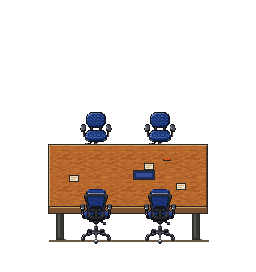](../../game/tests/fixtures/furniture-calibration/collaboration-cluster-v2/south-whole.png)

Source / prompt: [collaboration_table_geometry.gd](../../game/tools/collaboration_table_geometry.gd)

Review: [COLLABORATION_PRODUCTION_REVIEW.md](../COLLABORATION_PRODUCTION_REVIEW.md)

Native evidence: [full-room-hold-native-panels.png](../../game/tests/output/collaboration-production/full-room-hold-native-panels.png) · [manifest.json](../../game/tests/fixtures/furniture-calibration/collaboration-cluster-v2/manifest.json) · [headless-results.json](../../game/tests/output/collaboration-cluster-v2-actual-room/headless-results.json) · [actual-room-results.json](../../game/tests/output/collaboration-cluster-v2-actual-room/actual-room-results.json) · [actual-room-contact-sheet-native.png](../../game/tests/output/collaboration-cluster-v2-actual-room/actual-room-contact-sheet-native.png) · [actual-room-empty-contact-sheet-native.png](../../game/tests/output/collaboration-cluster-v2-actual-room/actual-room-empty-contact-sheet-native.png) · [actual-room-contact-sheet-2x.png](../../game/tests/output/collaboration-cluster-v2-actual-room/actual-room-contact-sheet-2x.png) · [full-room-contact-sheet-native-panels.png](../../game/tests/output/collaboration-cluster-v2-actual-room/full-room-contact-sheet-native-panels.png) · [component-contact-sheet-native.png](../../game/tests/output/collaboration-cluster-v2/component-contact-sheet-native.png) · [manifest.json](../../game/assets/runtime/office/collaboration-cluster-v2/manifest.json) · [COLLABORATION_PRODUCTION_REVIEW.md](../COLLABORATION_PRODUCTION_REVIEW.md) · [test_collaboration_production.gd](../../game/tests/test_collaboration_production.gd) · [actual-room-results.json](../../game/tests/output/collaboration-production/actual-room-results.json) · [results-headless.json](../../game/tests/output/collaboration-production/results-headless.json) · [entry-keyframes-native.png](../../game/tests/output/collaboration-production/entry-keyframes-native.png) · [work-interrupt-keyframes-native.png](../../game/tests/output/collaboration-production/work-interrupt-keyframes-native.png) · [hold-contact-sheet-native.png](../../game/tests/output/collaboration-production/hold-contact-sheet-native.png) · [pause-resume-contact-sheet-native.png](../../game/tests/output/collaboration-production/pause-resume-contact-sheet-native.png) · [rotation-contact-sheet-native.png](../../game/tests/output/collaboration-production/rotation-contact-sheet-native.png)

Export method: Code-native table layers plus byte-preserving registration of already reviewed directional task-chair components. South/West table pivots are corrected as complete-layer translations; no finished bitmap rotation, mirror, scale, crop, or repaint.

**Declared native layers (not automatically approved)**

| Export | Canvas / pivot | Actual opaque bounds | Derivation / limits |
| --- | --- | --- | --- |
| [south-table_floor_shadow.png](../../game/tests/fixtures/furniture-calibration/collaboration-cluster-v2/south-table_floor_shadow.png) | 256×272 / [128, 176] | [49, 181, 160, 61]; 372 pixels | Exact deterministic code-native cluster layer on the common 256x272 canvas and [128,176] floor anchor; independently declared south screen-axis assembly, with reviewed workstations-v2 chair pixels registered without rotation, mirroring, scaling, crop or repaint. |
| [south-table_rear_structure.png](../../game/tests/fixtures/furniture-calibration/collaboration-cluster-v2/south-table_rear_structure.png) | 256×272 / [128, 176] | [48, 144, 160, 64]; 10240 pixels | Exact deterministic code-native cluster layer on the common 256x272 canvas and [128,176] floor anchor; independently declared south screen-axis assembly, with reviewed workstations-v2 chair pixels registered without rotation, mirroring, scaling, crop or repaint. |
| [south-table_front_structure.png](../../game/tests/fixtures/furniture-calibration/collaboration-cluster-v2/south-table_front_structure.png) | 256×272 / [128, 176] | [48, 206, 160, 34]; 1696 pixels | Exact deterministic code-native cluster layer on the common 256x272 canvas and [128,176] floor anchor; independently declared south screen-axis assembly, with reviewed workstations-v2 chair pixels registered without rotation, mirroring, scaling, crop or repaint. |
| [south-north_chair_0_whole.png](../../game/tests/fixtures/furniture-calibration/collaboration-cluster-v2/south-north_chair_0_whole.png) | 256×272 / [128, 176] | [80, 112, 32, 52]; 891 pixels | Exact deterministic code-native cluster layer on the common 256x272 canvas and [128,176] floor anchor; independently declared south screen-axis assembly, with reviewed workstations-v2 chair pixels registered without rotation, mirroring, scaling, crop or repaint. |
| [south-south_chair_0_whole.png](../../game/tests/fixtures/furniture-calibration/collaboration-cluster-v2/south-south_chair_0_whole.png) | 256×272 / [128, 176] | [80, 189, 32, 55]; 1006 pixels | Exact deterministic code-native cluster layer on the common 256x272 canvas and [128,176] floor anchor; independently declared south screen-axis assembly, with reviewed workstations-v2 chair pixels registered without rotation, mirroring, scaling, crop or repaint. |
| [south-north_chair_1_whole.png](../../game/tests/fixtures/furniture-calibration/collaboration-cluster-v2/south-north_chair_1_whole.png) | 256×272 / [128, 176] | [144, 112, 32, 52]; 891 pixels | Exact deterministic code-native cluster layer on the common 256x272 canvas and [128,176] floor anchor; independently declared south screen-axis assembly, with reviewed workstations-v2 chair pixels registered without rotation, mirroring, scaling, crop or repaint. |
| [south-south_chair_1_whole.png](../../game/tests/fixtures/furniture-calibration/collaboration-cluster-v2/south-south_chair_1_whole.png) | 256×272 / [128, 176] | [144, 189, 32, 55]; 1006 pixels | Exact deterministic code-native cluster layer on the common 256x272 canvas and [128,176] floor anchor; independently declared south screen-axis assembly, with reviewed workstations-v2 chair pixels registered without rotation, mirroring, scaling, crop or repaint. |

south-table_floor_shadow.png references: [collaboration_table_geometry.gd](../../game/tools/collaboration_table_geometry.gd) · [COLLABORATION_PRODUCTION_REVIEW.md](../COLLABORATION_PRODUCTION_REVIEW.md)

south-table_rear_structure.png references: [collaboration_table_geometry.gd](../../game/tools/collaboration_table_geometry.gd) · [COLLABORATION_PRODUCTION_REVIEW.md](../COLLABORATION_PRODUCTION_REVIEW.md)

south-table_front_structure.png references: [collaboration_table_geometry.gd](../../game/tools/collaboration_table_geometry.gd) · [COLLABORATION_PRODUCTION_REVIEW.md](../COLLABORATION_PRODUCTION_REVIEW.md)

south-north_chair_0_whole.png references: [collaboration_table_geometry.gd](../../game/tools/collaboration_table_geometry.gd) · [COLLABORATION_PRODUCTION_REVIEW.md](../COLLABORATION_PRODUCTION_REVIEW.md)

south-south_chair_0_whole.png references: [collaboration_table_geometry.gd](../../game/tools/collaboration_table_geometry.gd) · [COLLABORATION_PRODUCTION_REVIEW.md](../COLLABORATION_PRODUCTION_REVIEW.md)

south-north_chair_1_whole.png references: [collaboration_table_geometry.gd](../../game/tools/collaboration_table_geometry.gd) · [COLLABORATION_PRODUCTION_REVIEW.md](../COLLABORATION_PRODUCTION_REVIEW.md)

south-south_chair_1_whole.png references: [collaboration_table_geometry.gd](../../game/tools/collaboration_table_geometry.gd) · [COLLABORATION_PRODUCTION_REVIEW.md](../COLLABORATION_PRODUCTION_REVIEW.md)

**Installed runtime layers — explicit integration evidence required**

| Export | Canvas / pivot | Actual opaque bounds | Derivation / limits |
| --- | --- | --- | --- |
| [south-table_floor_shadow.png](../../game/assets/runtime/office/collaboration-cluster-v2/south-table_floor_shadow.png) | 256×272 / [128, 176] | [49, 181, 160, 61]; 372 pixels | Installed byte-exact copy of the reviewed native layer; no rotation, mirroring, resampling, crop or repaint. |
| [south-table_rear_structure.png](../../game/assets/runtime/office/collaboration-cluster-v2/south-table_rear_structure.png) | 256×272 / [128, 176] | [48, 144, 160, 64]; 10240 pixels | Installed byte-exact copy of the reviewed native layer; no rotation, mirroring, resampling, crop or repaint. |
| [south-table_front_structure.png](../../game/assets/runtime/office/collaboration-cluster-v2/south-table_front_structure.png) | 256×272 / [128, 176] | [48, 206, 160, 34]; 1696 pixels | Installed byte-exact copy of the reviewed native layer; no rotation, mirroring, resampling, crop or repaint. |
| [south-north_chair_0_whole.png](../../game/assets/runtime/office/collaboration-cluster-v2/south-north_chair_0_whole.png) | 256×272 / [128, 176] | [80, 112, 32, 52]; 891 pixels | Installed byte-exact copy of the reviewed native layer; no rotation, mirroring, resampling, crop or repaint. |
| [south-south_chair_0_whole.png](../../game/assets/runtime/office/collaboration-cluster-v2/south-south_chair_0_whole.png) | 256×272 / [128, 176] | [80, 189, 32, 55]; 1006 pixels | Installed byte-exact copy of the reviewed native layer; no rotation, mirroring, resampling, crop or repaint. |
| [south-north_chair_1_whole.png](../../game/assets/runtime/office/collaboration-cluster-v2/south-north_chair_1_whole.png) | 256×272 / [128, 176] | [144, 112, 32, 52]; 891 pixels | Installed byte-exact copy of the reviewed native layer; no rotation, mirroring, resampling, crop or repaint. |
| [south-south_chair_1_whole.png](../../game/assets/runtime/office/collaboration-cluster-v2/south-south_chair_1_whole.png) | 256×272 / [128, 176] | [144, 189, 32, 55]; 1006 pixels | Installed byte-exact copy of the reviewed native layer; no rotation, mirroring, resampling, crop or repaint. |

south-table_floor_shadow.png references: [south-table_floor_shadow.png](../../game/tests/fixtures/furniture-calibration/collaboration-cluster-v2/south-table_floor_shadow.png) · [COLLABORATION_PRODUCTION_REVIEW.md](../COLLABORATION_PRODUCTION_REVIEW.md)

south-table_rear_structure.png references: [south-table_rear_structure.png](../../game/tests/fixtures/furniture-calibration/collaboration-cluster-v2/south-table_rear_structure.png) · [COLLABORATION_PRODUCTION_REVIEW.md](../COLLABORATION_PRODUCTION_REVIEW.md)

south-table_front_structure.png references: [south-table_front_structure.png](../../game/tests/fixtures/furniture-calibration/collaboration-cluster-v2/south-table_front_structure.png) · [COLLABORATION_PRODUCTION_REVIEW.md](../COLLABORATION_PRODUCTION_REVIEW.md)

south-north_chair_0_whole.png references: [south-north_chair_0_whole.png](../../game/tests/fixtures/furniture-calibration/collaboration-cluster-v2/south-north_chair_0_whole.png) · [COLLABORATION_PRODUCTION_REVIEW.md](../COLLABORATION_PRODUCTION_REVIEW.md)

south-south_chair_0_whole.png references: [south-south_chair_0_whole.png](../../game/tests/fixtures/furniture-calibration/collaboration-cluster-v2/south-south_chair_0_whole.png) · [COLLABORATION_PRODUCTION_REVIEW.md](../COLLABORATION_PRODUCTION_REVIEW.md)

south-north_chair_1_whole.png references: [south-north_chair_1_whole.png](../../game/tests/fixtures/furniture-calibration/collaboration-cluster-v2/south-north_chair_1_whole.png) · [COLLABORATION_PRODUCTION_REVIEW.md](../COLLABORATION_PRODUCTION_REVIEW.md)

south-south_chair_1_whole.png references: [south-south_chair_1_whole.png](../../game/tests/fixtures/furniture-calibration/collaboration-cluster-v2/south-south_chair_1_whole.png) · [COLLABORATION_PRODUCTION_REVIEW.md](../COLLABORATION_PRODUCTION_REVIEW.md)

Runtime whole reference / integration evidence: [actual-room-results.json](../../game/tests/output/collaboration-production/actual-room-results.json)

**Additional composites**

| Export | Canvas / pivot | Actual opaque bounds | Derivation / limits |
| --- | --- | --- | --- |
| [south-whole.png](../../game/tests/fixtures/furniture-calibration/collaboration-cluster-v2/south-whole.png) | 256×272 / [128, 176] | [48, 112, 161, 132]; 14034 pixels | Approved native whole reconstruction reference assembled byte-exactly from the declared reviewed layers; the whole image is review evidence and is not installed as a runtime monolith. |

south-whole.png references: [collaboration_table_geometry.gd](../../game/tools/collaboration_table_geometry.gd) · [COLLABORATION_PRODUCTION_REVIEW.md](../COLLABORATION_PRODUCTION_REVIEW.md)

Retained native composite / source candidate: [south-whole.png](../../game/tests/fixtures/furniture-calibration/collaboration-cluster-v2/south-whole.png)

**west: runtime integrated.** Approved and runtime-integrated collaboration-cluster-v2 west profile. The installed layers are byte-exact copies of the reviewed native exports on the common 256x272 canvas and [128,176] floor pivot. Ordinary GameMain production acceptance passes 574/0 headless and 1056/0 native without catalogue injection, including two-employee contact, schedule interruption, pause/resume, collision/navigation, occupied rejection, vacant rotate plus Undo, and stage 0–4 placement.

[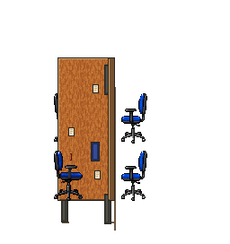](../../game/tests/fixtures/furniture-calibration/collaboration-cluster-v2/west-whole.png)

Source / prompt: [collaboration_table_geometry.gd](../../game/tools/collaboration_table_geometry.gd)

Review: [COLLABORATION_PRODUCTION_REVIEW.md](../COLLABORATION_PRODUCTION_REVIEW.md)

Native evidence: [full-room-hold-native-panels.png](../../game/tests/output/collaboration-production/full-room-hold-native-panels.png) · [manifest.json](../../game/tests/fixtures/furniture-calibration/collaboration-cluster-v2/manifest.json) · [headless-results.json](../../game/tests/output/collaboration-cluster-v2-actual-room/headless-results.json) · [actual-room-results.json](../../game/tests/output/collaboration-cluster-v2-actual-room/actual-room-results.json) · [actual-room-contact-sheet-native.png](../../game/tests/output/collaboration-cluster-v2-actual-room/actual-room-contact-sheet-native.png) · [actual-room-empty-contact-sheet-native.png](../../game/tests/output/collaboration-cluster-v2-actual-room/actual-room-empty-contact-sheet-native.png) · [actual-room-contact-sheet-2x.png](../../game/tests/output/collaboration-cluster-v2-actual-room/actual-room-contact-sheet-2x.png) · [full-room-contact-sheet-native-panels.png](../../game/tests/output/collaboration-cluster-v2-actual-room/full-room-contact-sheet-native-panels.png) · [component-contact-sheet-native.png](../../game/tests/output/collaboration-cluster-v2/component-contact-sheet-native.png) · [manifest.json](../../game/assets/runtime/office/collaboration-cluster-v2/manifest.json) · [COLLABORATION_PRODUCTION_REVIEW.md](../COLLABORATION_PRODUCTION_REVIEW.md) · [test_collaboration_production.gd](../../game/tests/test_collaboration_production.gd) · [actual-room-results.json](../../game/tests/output/collaboration-production/actual-room-results.json) · [results-headless.json](../../game/tests/output/collaboration-production/results-headless.json) · [entry-keyframes-native.png](../../game/tests/output/collaboration-production/entry-keyframes-native.png) · [work-interrupt-keyframes-native.png](../../game/tests/output/collaboration-production/work-interrupt-keyframes-native.png) · [hold-contact-sheet-native.png](../../game/tests/output/collaboration-production/hold-contact-sheet-native.png) · [pause-resume-contact-sheet-native.png](../../game/tests/output/collaboration-production/pause-resume-contact-sheet-native.png) · [rotation-contact-sheet-native.png](../../game/tests/output/collaboration-production/rotation-contact-sheet-native.png)

Export method: Code-native table layers plus byte-preserving registration of already reviewed directional task-chair components. South/West table pivots are corrected as complete-layer translations; no finished bitmap rotation, mirror, scale, crop, or repaint.

**Declared native layers (not automatically approved)**

| Export | Canvas / pivot | Actual opaque bounds | Derivation / limits |
| --- | --- | --- | --- |
| [west-table_floor_shadow.png](../../game/tests/fixtures/furniture-calibration/collaboration-cluster-v2/west-table_floor_shadow.png) | 256×272 / [128, 176] | [69, 97, 60, 160]; 384 pixels | Exact deterministic code-native cluster layer on the common 256x272 canvas and [128,176] floor anchor; independently declared west screen-axis assembly, with reviewed workstations-v2 chair pixels registered without rotation, mirroring, scaling, crop or repaint. |
| [west-table_rear_structure.png](../../game/tests/fixtures/furniture-calibration/collaboration-cluster-v2/west-table_rear_structure.png) | 256×272 / [128, 176] | [64, 64, 64, 184]; 10432 pixels | Exact deterministic code-native cluster layer on the common 256x272 canvas and [128,176] floor anchor; independently declared west screen-axis assembly, with reviewed workstations-v2 chair pixels registered without rotation, mirroring, scaling, crop or repaint. |
| [west-table_front_structure.png](../../game/tests/fixtures/furniture-calibration/collaboration-cluster-v2/west-table_front_structure.png) | 256×272 / [128, 176] | [116, 64, 12, 186]; 1656 pixels | Exact deterministic code-native cluster layer on the common 256x272 canvas and [128,176] floor anchor; independently declared west screen-axis assembly, with reviewed workstations-v2 chair pixels registered without rotation, mirroring, scaling, crop or repaint. |
| [west-west_chair_0_rear.png](../../game/tests/fixtures/furniture-calibration/collaboration-cluster-v2/west-west_chair_0_rear.png) | 256×272 / [128, 176] | [60, 104, 32, 56]; 659 pixels | Exact deterministic code-native cluster layer on the common 256x272 canvas and [128,176] floor anchor; independently declared west screen-axis assembly, with reviewed workstations-v2 chair pixels registered without rotation, mirroring, scaling, crop or repaint. |
| [west-west_chair_0_front.png](../../game/tests/fixtures/furniture-calibration/collaboration-cluster-v2/west-west_chair_0_front.png) | 256×272 / [128, 176] | [72, 120, 14, 14]; 81 pixels | Exact deterministic code-native cluster layer on the common 256x272 canvas and [128,176] floor anchor; independently declared west screen-axis assembly, with reviewed workstations-v2 chair pixels registered without rotation, mirroring, scaling, crop or repaint. |
| [west-east_chair_0_rear.png](../../game/tests/fixtures/furniture-calibration/collaboration-cluster-v2/west-east_chair_0_rear.png) | 256×272 / [128, 176] | [135, 104, 29, 56]; 574 pixels | Exact deterministic code-native cluster layer on the common 256x272 canvas and [128,176] floor anchor; independently declared west screen-axis assembly, with reviewed workstations-v2 chair pixels registered without rotation, mirroring, scaling, crop or repaint. |
| [west-east_chair_0_front.png](../../game/tests/fixtures/furniture-calibration/collaboration-cluster-v2/west-east_chair_0_front.png) | 256×272 / [128, 176] | [139, 121, 13, 14]; 86 pixels | Exact deterministic code-native cluster layer on the common 256x272 canvas and [128,176] floor anchor; independently declared west screen-axis assembly, with reviewed workstations-v2 chair pixels registered without rotation, mirroring, scaling, crop or repaint. |
| [west-west_chair_1_rear.png](../../game/tests/fixtures/furniture-calibration/collaboration-cluster-v2/west-west_chair_1_rear.png) | 256×272 / [128, 176] | [60, 168, 32, 56]; 659 pixels | Exact deterministic code-native cluster layer on the common 256x272 canvas and [128,176] floor anchor; independently declared west screen-axis assembly, with reviewed workstations-v2 chair pixels registered without rotation, mirroring, scaling, crop or repaint. |
| [west-west_chair_1_front.png](../../game/tests/fixtures/furniture-calibration/collaboration-cluster-v2/west-west_chair_1_front.png) | 256×272 / [128, 176] | [72, 184, 14, 14]; 81 pixels | Exact deterministic code-native cluster layer on the common 256x272 canvas and [128,176] floor anchor; independently declared west screen-axis assembly, with reviewed workstations-v2 chair pixels registered without rotation, mirroring, scaling, crop or repaint. |
| [west-east_chair_1_rear.png](../../game/tests/fixtures/furniture-calibration/collaboration-cluster-v2/west-east_chair_1_rear.png) | 256×272 / [128, 176] | [135, 168, 29, 56]; 574 pixels | Exact deterministic code-native cluster layer on the common 256x272 canvas and [128,176] floor anchor; independently declared west screen-axis assembly, with reviewed workstations-v2 chair pixels registered without rotation, mirroring, scaling, crop or repaint. |
| [west-east_chair_1_front.png](../../game/tests/fixtures/furniture-calibration/collaboration-cluster-v2/west-east_chair_1_front.png) | 256×272 / [128, 176] | [139, 185, 13, 14]; 86 pixels | Exact deterministic code-native cluster layer on the common 256x272 canvas and [128,176] floor anchor; independently declared west screen-axis assembly, with reviewed workstations-v2 chair pixels registered without rotation, mirroring, scaling, crop or repaint. |

west-table_floor_shadow.png references: [collaboration_table_geometry.gd](../../game/tools/collaboration_table_geometry.gd) · [COLLABORATION_PRODUCTION_REVIEW.md](../COLLABORATION_PRODUCTION_REVIEW.md)

west-table_rear_structure.png references: [collaboration_table_geometry.gd](../../game/tools/collaboration_table_geometry.gd) · [COLLABORATION_PRODUCTION_REVIEW.md](../COLLABORATION_PRODUCTION_REVIEW.md)

west-table_front_structure.png references: [collaboration_table_geometry.gd](../../game/tools/collaboration_table_geometry.gd) · [COLLABORATION_PRODUCTION_REVIEW.md](../COLLABORATION_PRODUCTION_REVIEW.md)

west-west_chair_0_rear.png references: [collaboration_table_geometry.gd](../../game/tools/collaboration_table_geometry.gd) · [COLLABORATION_PRODUCTION_REVIEW.md](../COLLABORATION_PRODUCTION_REVIEW.md)

west-west_chair_0_front.png references: [collaboration_table_geometry.gd](../../game/tools/collaboration_table_geometry.gd) · [COLLABORATION_PRODUCTION_REVIEW.md](../COLLABORATION_PRODUCTION_REVIEW.md)

west-east_chair_0_rear.png references: [collaboration_table_geometry.gd](../../game/tools/collaboration_table_geometry.gd) · [COLLABORATION_PRODUCTION_REVIEW.md](../COLLABORATION_PRODUCTION_REVIEW.md)

west-east_chair_0_front.png references: [collaboration_table_geometry.gd](../../game/tools/collaboration_table_geometry.gd) · [COLLABORATION_PRODUCTION_REVIEW.md](../COLLABORATION_PRODUCTION_REVIEW.md)

west-west_chair_1_rear.png references: [collaboration_table_geometry.gd](../../game/tools/collaboration_table_geometry.gd) · [COLLABORATION_PRODUCTION_REVIEW.md](../COLLABORATION_PRODUCTION_REVIEW.md)

west-west_chair_1_front.png references: [collaboration_table_geometry.gd](../../game/tools/collaboration_table_geometry.gd) · [COLLABORATION_PRODUCTION_REVIEW.md](../COLLABORATION_PRODUCTION_REVIEW.md)

west-east_chair_1_rear.png references: [collaboration_table_geometry.gd](../../game/tools/collaboration_table_geometry.gd) · [COLLABORATION_PRODUCTION_REVIEW.md](../COLLABORATION_PRODUCTION_REVIEW.md)

west-east_chair_1_front.png references: [collaboration_table_geometry.gd](../../game/tools/collaboration_table_geometry.gd) · [COLLABORATION_PRODUCTION_REVIEW.md](../COLLABORATION_PRODUCTION_REVIEW.md)

**Installed runtime layers — explicit integration evidence required**

| Export | Canvas / pivot | Actual opaque bounds | Derivation / limits |
| --- | --- | --- | --- |
| [west-table_floor_shadow.png](../../game/assets/runtime/office/collaboration-cluster-v2/west-table_floor_shadow.png) | 256×272 / [128, 176] | [69, 97, 60, 160]; 384 pixels | Installed byte-exact copy of the reviewed native layer; no rotation, mirroring, resampling, crop or repaint. |
| [west-table_rear_structure.png](../../game/assets/runtime/office/collaboration-cluster-v2/west-table_rear_structure.png) | 256×272 / [128, 176] | [64, 64, 64, 184]; 10432 pixels | Installed byte-exact copy of the reviewed native layer; no rotation, mirroring, resampling, crop or repaint. |
| [west-table_front_structure.png](../../game/assets/runtime/office/collaboration-cluster-v2/west-table_front_structure.png) | 256×272 / [128, 176] | [116, 64, 12, 186]; 1656 pixels | Installed byte-exact copy of the reviewed native layer; no rotation, mirroring, resampling, crop or repaint. |
| [west-west_chair_0_rear.png](../../game/assets/runtime/office/collaboration-cluster-v2/west-west_chair_0_rear.png) | 256×272 / [128, 176] | [60, 104, 32, 56]; 659 pixels | Installed byte-exact copy of the reviewed native layer; no rotation, mirroring, resampling, crop or repaint. |
| [west-west_chair_0_front.png](../../game/assets/runtime/office/collaboration-cluster-v2/west-west_chair_0_front.png) | 256×272 / [128, 176] | [72, 120, 14, 14]; 81 pixels | Installed byte-exact copy of the reviewed native layer; no rotation, mirroring, resampling, crop or repaint. |
| [west-east_chair_0_rear.png](../../game/assets/runtime/office/collaboration-cluster-v2/west-east_chair_0_rear.png) | 256×272 / [128, 176] | [135, 104, 29, 56]; 574 pixels | Installed byte-exact copy of the reviewed native layer; no rotation, mirroring, resampling, crop or repaint. |
| [west-east_chair_0_front.png](../../game/assets/runtime/office/collaboration-cluster-v2/west-east_chair_0_front.png) | 256×272 / [128, 176] | [139, 121, 13, 14]; 86 pixels | Installed byte-exact copy of the reviewed native layer; no rotation, mirroring, resampling, crop or repaint. |
| [west-west_chair_1_rear.png](../../game/assets/runtime/office/collaboration-cluster-v2/west-west_chair_1_rear.png) | 256×272 / [128, 176] | [60, 168, 32, 56]; 659 pixels | Installed byte-exact copy of the reviewed native layer; no rotation, mirroring, resampling, crop or repaint. |
| [west-west_chair_1_front.png](../../game/assets/runtime/office/collaboration-cluster-v2/west-west_chair_1_front.png) | 256×272 / [128, 176] | [72, 184, 14, 14]; 81 pixels | Installed byte-exact copy of the reviewed native layer; no rotation, mirroring, resampling, crop or repaint. |
| [west-east_chair_1_rear.png](../../game/assets/runtime/office/collaboration-cluster-v2/west-east_chair_1_rear.png) | 256×272 / [128, 176] | [135, 168, 29, 56]; 574 pixels | Installed byte-exact copy of the reviewed native layer; no rotation, mirroring, resampling, crop or repaint. |
| [west-east_chair_1_front.png](../../game/assets/runtime/office/collaboration-cluster-v2/west-east_chair_1_front.png) | 256×272 / [128, 176] | [139, 185, 13, 14]; 86 pixels | Installed byte-exact copy of the reviewed native layer; no rotation, mirroring, resampling, crop or repaint. |

west-table_floor_shadow.png references: [west-table_floor_shadow.png](../../game/tests/fixtures/furniture-calibration/collaboration-cluster-v2/west-table_floor_shadow.png) · [COLLABORATION_PRODUCTION_REVIEW.md](../COLLABORATION_PRODUCTION_REVIEW.md)

west-table_rear_structure.png references: [west-table_rear_structure.png](../../game/tests/fixtures/furniture-calibration/collaboration-cluster-v2/west-table_rear_structure.png) · [COLLABORATION_PRODUCTION_REVIEW.md](../COLLABORATION_PRODUCTION_REVIEW.md)

west-table_front_structure.png references: [west-table_front_structure.png](../../game/tests/fixtures/furniture-calibration/collaboration-cluster-v2/west-table_front_structure.png) · [COLLABORATION_PRODUCTION_REVIEW.md](../COLLABORATION_PRODUCTION_REVIEW.md)

west-west_chair_0_rear.png references: [west-west_chair_0_rear.png](../../game/tests/fixtures/furniture-calibration/collaboration-cluster-v2/west-west_chair_0_rear.png) · [COLLABORATION_PRODUCTION_REVIEW.md](../COLLABORATION_PRODUCTION_REVIEW.md)

west-west_chair_0_front.png references: [west-west_chair_0_front.png](../../game/tests/fixtures/furniture-calibration/collaboration-cluster-v2/west-west_chair_0_front.png) · [COLLABORATION_PRODUCTION_REVIEW.md](../COLLABORATION_PRODUCTION_REVIEW.md)

west-east_chair_0_rear.png references: [west-east_chair_0_rear.png](../../game/tests/fixtures/furniture-calibration/collaboration-cluster-v2/west-east_chair_0_rear.png) · [COLLABORATION_PRODUCTION_REVIEW.md](../COLLABORATION_PRODUCTION_REVIEW.md)

west-east_chair_0_front.png references: [west-east_chair_0_front.png](../../game/tests/fixtures/furniture-calibration/collaboration-cluster-v2/west-east_chair_0_front.png) · [COLLABORATION_PRODUCTION_REVIEW.md](../COLLABORATION_PRODUCTION_REVIEW.md)

west-west_chair_1_rear.png references: [west-west_chair_1_rear.png](../../game/tests/fixtures/furniture-calibration/collaboration-cluster-v2/west-west_chair_1_rear.png) · [COLLABORATION_PRODUCTION_REVIEW.md](../COLLABORATION_PRODUCTION_REVIEW.md)

west-west_chair_1_front.png references: [west-west_chair_1_front.png](../../game/tests/fixtures/furniture-calibration/collaboration-cluster-v2/west-west_chair_1_front.png) · [COLLABORATION_PRODUCTION_REVIEW.md](../COLLABORATION_PRODUCTION_REVIEW.md)

west-east_chair_1_rear.png references: [west-east_chair_1_rear.png](../../game/tests/fixtures/furniture-calibration/collaboration-cluster-v2/west-east_chair_1_rear.png) · [COLLABORATION_PRODUCTION_REVIEW.md](../COLLABORATION_PRODUCTION_REVIEW.md)

west-east_chair_1_front.png references: [west-east_chair_1_front.png](../../game/tests/fixtures/furniture-calibration/collaboration-cluster-v2/west-east_chair_1_front.png) · [COLLABORATION_PRODUCTION_REVIEW.md](../COLLABORATION_PRODUCTION_REVIEW.md)

Runtime whole reference / integration evidence: [actual-room-results.json](../../game/tests/output/collaboration-production/actual-room-results.json)

**Additional composites**

| Export | Canvas / pivot | Actual opaque bounds | Derivation / limits |
| --- | --- | --- | --- |
| [west-whole.png](../../game/tests/fixtures/furniture-calibration/collaboration-cluster-v2/west-whole.png) | 256×272 / [128, 176] | [60, 64, 104, 193]; 12370 pixels | Approved native whole reconstruction reference assembled byte-exactly from the declared reviewed layers; the whole image is review evidence and is not installed as a runtime monolith. |

west-whole.png references: [collaboration_table_geometry.gd](../../game/tools/collaboration_table_geometry.gd) · [COLLABORATION_PRODUCTION_REVIEW.md](../COLLABORATION_PRODUCTION_REVIEW.md)

Retained native composite / source candidate: [west-whole.png](../../game/tests/fixtures/furniture-calibration/collaboration-cluster-v2/west-whole.png)

### Artifact archive

`artifact_archive` · P1 · shared.

Direction semantics: **service side**. Service N/E/S/W uses approach gaze S/W/N/E; this is not workstation-facing.

Readable shared-file destination; keep document highlights as optional overlays.

Proposed envelope **192×288**, fixed floor anchor **[96, 224]**. N/E footprints: **3×1 / 1×3 cells**.

Tools: project folders; document trays; archive terminal. Layers: `floor_shadow` (optional), `rear_structure`, `front_structure`, `ambient_overlay` (optional), `top_surface`, `base_plinth`, `surface_decor_front`.

**north retained batch:** 1 initial + 0 targeted retries, limit 3; **not exhausted at this checkpoint**. Original request history is not reset by reclassification.

**north: runtime integrated.** Archive alone accepted for production. Legacy South location/footprint preserved. North actor occlusion and quiet end details disclosed; cast shadow and use animation deferred.

[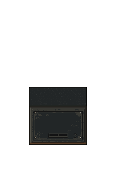](../../game/tests/fixtures/furniture-calibration/modular-archive-v1/north-whole.png)

Source / prompt: [archive-service-north-back-v1.png](../../game/assets/source/overnight-20260904/kits/archive-service-north-back-v1.png) · [artifact-archive.png](../../game/assets/runtime/office/artifact-archive.png) · [archive-service-north-back-v1.md](../../game/assets/source/overnight-20260904/kits/archive-service-north-back-v1.md)

Review: [ARCHIVE_ASSEMBLY_REVIEW.md](ARCHIVE_ASSEMBLY_REVIEW.md) · [CANONICAL_SERVICE_INTEGRATION.md](CANONICAL_SERVICE_INTEGRATION.md) · [ARCHIVE_PRODUCTION_REVIEW.md](ARCHIVE_PRODUCTION_REVIEW.md)

Native evidence: [all-four-native.png](../../game/tests/output/archive-production/all-four-native.png) · [manifest.json](../../game/tests/output/archive-assembly/manifest.json) · [wall-corners-service.png](../../game/tests/output/archive-assembly/wall-corners-service.png) · [manifest.json](../../game/tests/output/archive-production/manifest.json)

Export method: Transparent render of exact code-native cabinet, generated flat face and powdercoat; no raster rotation.

**Declared native layers (not automatically approved)**

| Export | Canvas / pivot | Actual opaque bounds | Derivation / limits |
| --- | --- | --- | --- |
| [north-carcass.png](../../game/tests/fixtures/furniture-calibration/modular-archive-v1/north-carcass.png) | 192×288 / [96, 224] | [48, 176, 96, 60]; 240 pixels | Reviewed archive v1 order: carcass,top,front,plinth,insert; same ground depth. |
| [north-top.png](../../game/tests/fixtures/furniture-calibration/modular-archive-v1/north-top.png) | 192×288 / [96, 224] | [48, 144, 96, 32]; 3072 pixels | Reviewed archive v1 order: carcass,top,front,plinth,insert; same ground depth. |
| [north-front.png](../../game/tests/fixtures/furniture-calibration/modular-archive-v1/north-front.png) | 192×288 / [96, 224] | [50, 176, 92, 60]; 5520 pixels | Reviewed archive v1 order: carcass,top,front,plinth,insert; same ground depth. |
| [north-plinth.png](../../game/tests/fixtures/furniture-calibration/modular-archive-v1/north-plinth.png) | 192×288 / [96, 224] | [48, 236, 96, 4]; 384 pixels | Reviewed archive v1 order: carcass,top,front,plinth,insert; same ground depth. |
| [north-insert.png](../../game/tests/fixtures/furniture-calibration/modular-archive-v1/north-insert.png) | 192×288 / [96, 224] | [52, 180, 88, 56]; 4928 pixels | Reviewed archive v1 order: carcass,top,front,plinth,insert; same ground depth. |

**Installed runtime layers — explicit integration evidence required**

| Export | Canvas / pivot | Actual opaque bounds | Derivation / limits |
| --- | --- | --- | --- |
| [north-carcass.png](../../game/assets/runtime/office/archive-v1/north-carcass.png) | 192×288 / [96, 224] | [48, 176, 96, 60]; 240 pixels | Approved archive v1 layer; runtime/imported bytes exactly match staged export. |
| [north-top.png](../../game/assets/runtime/office/archive-v1/north-top.png) | 192×288 / [96, 224] | [48, 144, 96, 32]; 3072 pixels | Approved archive v1 layer; runtime/imported bytes exactly match staged export. |
| [north-front.png](../../game/assets/runtime/office/archive-v1/north-front.png) | 192×288 / [96, 224] | [50, 176, 92, 60]; 5520 pixels | Approved archive v1 layer; runtime/imported bytes exactly match staged export. |
| [north-plinth.png](../../game/assets/runtime/office/archive-v1/north-plinth.png) | 192×288 / [96, 224] | [48, 236, 96, 4]; 384 pixels | Approved archive v1 layer; runtime/imported bytes exactly match staged export. |
| [north-insert.png](../../game/assets/runtime/office/archive-v1/north-insert.png) | 192×288 / [96, 224] | [52, 180, 88, 56]; 4928 pixels | Approved archive v1 layer; runtime/imported bytes exactly match staged export. |

north-carcass.png references: [north-carcass.png](../../game/tests/fixtures/furniture-calibration/modular-archive-v1/north-carcass.png)

north-top.png references: [north-top.png](../../game/tests/fixtures/furniture-calibration/modular-archive-v1/north-top.png)

north-front.png references: [north-front.png](../../game/tests/fixtures/furniture-calibration/modular-archive-v1/north-front.png)

north-plinth.png references: [north-plinth.png](../../game/tests/fixtures/furniture-calibration/modular-archive-v1/north-plinth.png)

north-insert.png references: [north-insert.png](../../game/tests/fixtures/furniture-calibration/modular-archive-v1/north-insert.png)

Runtime whole reference / integration evidence: [north-whole.png](../../game/assets/runtime/office/archive-v1/north-whole.png) · [manifest.json](../../game/tests/output/archive-production/manifest.json)

**Independent components and material inserts — not approved assembly masks**

| Export | Canvas / pivot | Actual opaque bounds | Derivation / limits |
| --- | --- | --- | --- |
| [raw_native_face: archive-service-north-back-v1.png](../../game/tests/fixtures/furniture-calibration/kits/archive-service-north-back-v1.png) | 88×56 | [0, 0, 88, 56]; 4928 pixels | Flat native panel, no floor anchor or whole-cabinet claim. |
| [registered_face: archive-service-north-back-v1-registered.png](../../game/tests/fixtures/furniture-calibration/kits/archive-service-north-back-v1-registered.png) | 192×288 / [96, 224] | [52, 180, 88, 56]; 4928 pixels | Exact native panel on full shared canvas; equals rendered Insert. |

archive-service-north-back-v1.png references: [archive-service-north-back-v1.png](../../game/assets/source/overnight-20260904/kits/archive-service-north-back-v1.png)

**Additional composites**

| Export | Canvas / pivot | Actual opaque bounds | Derivation / limits |
| --- | --- | --- | --- |
| [ordered_union: north-whole.png](../../game/tests/fixtures/furniture-calibration/modular-archive-v1/north-whole.png) | 192×288 / [96, 224] | [48, 144, 96, 96]; 9216 pixels | Exact ordered alpha union of five same-depth code-native/material layers. |

Retained native composite / source candidate: [north-whole.png](../../game/tests/fixtures/furniture-calibration/modular-archive-v1/north-whole.png)

**Retained source attempts**

| Source | Actual master | Prompt | Disposition |
| --- | --- | --- | --- |
| [archive-service-north-back-v1.png](../../game/assets/source/overnight-20260904/kits/archive-service-north-back-v1.png) | 1572×1001 RGB; Opaque source | [archive-service-north-back-v1.md](../../game/assets/source/overnight-20260904/kits/archive-service-north-back-v1.md) | Intentionally opaque flat face, not a failed transparent whole-object cutout. Uniform native normalization retains padding. |

**east retained batch:** 1 initial + 0 targeted retries, limit 3; **not exhausted at this checkpoint**. Original request history is not reset by reclassification.

**east: runtime integrated.** Archive alone accepted for production. Legacy South location/footprint preserved. North actor occlusion and quiet end details disclosed; cast shadow and use animation deferred.

[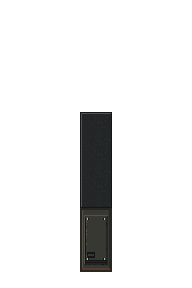](../../game/tests/fixtures/furniture-calibration/modular-archive-v1/east-whole.png)

Source / prompt: [archive-service-east-locker-end-v1.png](../../game/assets/source/overnight-20260904/kits/archive-service-east-locker-end-v1.png) · [artifact-archive.png](../../game/assets/runtime/office/artifact-archive.png) · [archive-service-east-locker-end-v1.md](../../game/assets/source/overnight-20260904/kits/archive-service-east-locker-end-v1.md)

Review: [ARCHIVE_ASSEMBLY_REVIEW.md](ARCHIVE_ASSEMBLY_REVIEW.md) · [CANONICAL_SERVICE_INTEGRATION.md](CANONICAL_SERVICE_INTEGRATION.md) · [ARCHIVE_PRODUCTION_REVIEW.md](ARCHIVE_PRODUCTION_REVIEW.md)

Native evidence: [all-four-native.png](../../game/tests/output/archive-production/all-four-native.png) · [manifest.json](../../game/tests/output/archive-assembly/manifest.json) · [wall-corners-service.png](../../game/tests/output/archive-assembly/wall-corners-service.png) · [manifest.json](../../game/tests/output/archive-production/manifest.json)

Export method: Transparent render of exact code-native cabinet, generated flat face and powdercoat; no raster rotation.

**Declared native layers (not automatically approved)**

| Export | Canvas / pivot | Actual opaque bounds | Derivation / limits |
| --- | --- | --- | --- |
| [east-carcass.png](../../game/tests/fixtures/furniture-calibration/modular-archive-v1/east-carcass.png) | 192×288 / [96, 224] | [80, 208, 32, 60]; 240 pixels | Reviewed archive v1 order: carcass,top,front,plinth,insert; same ground depth. |
| [east-top.png](../../game/tests/fixtures/furniture-calibration/modular-archive-v1/east-top.png) | 192×288 / [96, 224] | [80, 112, 32, 96]; 3072 pixels | Reviewed archive v1 order: carcass,top,front,plinth,insert; same ground depth. |
| [east-front.png](../../game/tests/fixtures/furniture-calibration/modular-archive-v1/east-front.png) | 192×288 / [96, 224] | [82, 208, 28, 60]; 1680 pixels | Reviewed archive v1 order: carcass,top,front,plinth,insert; same ground depth. |
| [east-plinth.png](../../game/tests/fixtures/furniture-calibration/modular-archive-v1/east-plinth.png) | 192×288 / [96, 224] | [80, 268, 32, 4]; 128 pixels | Reviewed archive v1 order: carcass,top,front,plinth,insert; same ground depth. |
| [east-insert.png](../../game/tests/fixtures/furniture-calibration/modular-archive-v1/east-insert.png) | 192×288 / [96, 224] | [84, 215, 24, 50]; 1200 pixels | Reviewed archive v1 order: carcass,top,front,plinth,insert; same ground depth. |

**Installed runtime layers — explicit integration evidence required**

| Export | Canvas / pivot | Actual opaque bounds | Derivation / limits |
| --- | --- | --- | --- |
| [east-carcass.png](../../game/assets/runtime/office/archive-v1/east-carcass.png) | 192×288 / [96, 224] | [80, 208, 32, 60]; 240 pixels | Approved archive v1 layer; runtime/imported bytes exactly match staged export. |
| [east-top.png](../../game/assets/runtime/office/archive-v1/east-top.png) | 192×288 / [96, 224] | [80, 112, 32, 96]; 3072 pixels | Approved archive v1 layer; runtime/imported bytes exactly match staged export. |
| [east-front.png](../../game/assets/runtime/office/archive-v1/east-front.png) | 192×288 / [96, 224] | [82, 208, 28, 60]; 1680 pixels | Approved archive v1 layer; runtime/imported bytes exactly match staged export. |
| [east-plinth.png](../../game/assets/runtime/office/archive-v1/east-plinth.png) | 192×288 / [96, 224] | [80, 268, 32, 4]; 128 pixels | Approved archive v1 layer; runtime/imported bytes exactly match staged export. |
| [east-insert.png](../../game/assets/runtime/office/archive-v1/east-insert.png) | 192×288 / [96, 224] | [84, 215, 24, 50]; 1200 pixels | Approved archive v1 layer; runtime/imported bytes exactly match staged export. |

east-carcass.png references: [east-carcass.png](../../game/tests/fixtures/furniture-calibration/modular-archive-v1/east-carcass.png)

east-top.png references: [east-top.png](../../game/tests/fixtures/furniture-calibration/modular-archive-v1/east-top.png)

east-front.png references: [east-front.png](../../game/tests/fixtures/furniture-calibration/modular-archive-v1/east-front.png)

east-plinth.png references: [east-plinth.png](../../game/tests/fixtures/furniture-calibration/modular-archive-v1/east-plinth.png)

east-insert.png references: [east-insert.png](../../game/tests/fixtures/furniture-calibration/modular-archive-v1/east-insert.png)

Runtime whole reference / integration evidence: [east-whole.png](../../game/assets/runtime/office/archive-v1/east-whole.png) · [manifest.json](../../game/tests/output/archive-production/manifest.json)

**Independent components and material inserts — not approved assembly masks**

| Export | Canvas / pivot | Actual opaque bounds | Derivation / limits |
| --- | --- | --- | --- |
| [raw_native_face: archive-service-east-locker-end-v1.png](../../game/tests/fixtures/furniture-calibration/kits/archive-service-east-locker-end-v1.png) | 24×56 | [0, 3, 24, 50]; 1200 pixels | Flat native panel, no floor anchor or whole-cabinet claim. |
| [registered_face: archive-service-east-locker-end-v1-registered.png](../../game/tests/fixtures/furniture-calibration/kits/archive-service-east-locker-end-v1-registered.png) | 192×288 / [96, 224] | [84, 215, 24, 50]; 1200 pixels | Exact native panel on full shared canvas; equals rendered Insert. |

archive-service-east-locker-end-v1.png references: [archive-service-east-locker-end-v1.png](../../game/assets/source/overnight-20260904/kits/archive-service-east-locker-end-v1.png)

**Additional composites**

| Export | Canvas / pivot | Actual opaque bounds | Derivation / limits |
| --- | --- | --- | --- |
| [ordered_union: east-whole.png](../../game/tests/fixtures/furniture-calibration/modular-archive-v1/east-whole.png) | 192×288 / [96, 224] | [80, 112, 32, 160]; 5120 pixels | Exact ordered alpha union of five same-depth code-native/material layers. |

Retained native composite / source candidate: [east-whole.png](../../game/tests/fixtures/furniture-calibration/modular-archive-v1/east-whole.png)

**Retained source attempts**

| Source | Actual master | Prompt | Disposition |
| --- | --- | --- | --- |
| [archive-service-east-locker-end-v1.png](../../game/assets/source/overnight-20260904/kits/archive-service-east-locker-end-v1.png) | 866×1817 RGB; Opaque source | [archive-service-east-locker-end-v1.md](../../game/assets/source/overnight-20260904/kits/archive-service-east-locker-end-v1.md) | Intentionally opaque flat face, not a failed transparent whole-object cutout. Uniform native normalization retains padding. |

**south retained batch:** 1 initial + 0 targeted retries, limit 3; **not exhausted at this checkpoint**. Original request history is not reset by reclassification.

**south: runtime integrated.** Archive alone accepted for production. Legacy South location/footprint preserved. North actor occlusion and quiet end details disclosed; cast shadow and use animation deferred.

[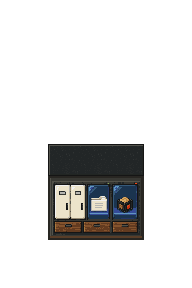](../../game/tests/fixtures/furniture-calibration/modular-archive-v1/south-whole.png)

Source / prompt: [archive-service-south-insert-v1.png](../../game/assets/source/overnight-20260904/kits/archive-service-south-insert-v1.png) · [artifact-archive.png](../../game/assets/runtime/office/artifact-archive.png) · [archive-service-south-insert-v1.md](../../game/assets/source/overnight-20260904/kits/archive-service-south-insert-v1.md)

Review: [ARCHIVE_ASSEMBLY_REVIEW.md](ARCHIVE_ASSEMBLY_REVIEW.md) · [CANONICAL_SERVICE_INTEGRATION.md](CANONICAL_SERVICE_INTEGRATION.md) · [ARCHIVE_PRODUCTION_REVIEW.md](ARCHIVE_PRODUCTION_REVIEW.md)

Native evidence: [all-four-native.png](../../game/tests/output/archive-production/all-four-native.png) · [manifest.json](../../game/tests/output/archive-assembly/manifest.json) · [wall-corners-service.png](../../game/tests/output/archive-assembly/wall-corners-service.png) · [manifest.json](../../game/tests/output/archive-production/manifest.json)

Export method: Transparent render of exact code-native cabinet, generated flat face and powdercoat; no raster rotation.

**Declared native layers (not automatically approved)**

| Export | Canvas / pivot | Actual opaque bounds | Derivation / limits |
| --- | --- | --- | --- |
| [south-carcass.png](../../game/tests/fixtures/furniture-calibration/modular-archive-v1/south-carcass.png) | 192×288 / [96, 224] | [48, 176, 96, 60]; 240 pixels | Reviewed archive v1 order: carcass,top,front,plinth,insert; same ground depth. |
| [south-top.png](../../game/tests/fixtures/furniture-calibration/modular-archive-v1/south-top.png) | 192×288 / [96, 224] | [48, 144, 96, 32]; 3072 pixels | Reviewed archive v1 order: carcass,top,front,plinth,insert; same ground depth. |
| [south-front.png](../../game/tests/fixtures/furniture-calibration/modular-archive-v1/south-front.png) | 192×288 / [96, 224] | [50, 176, 92, 60]; 5520 pixels | Reviewed archive v1 order: carcass,top,front,plinth,insert; same ground depth. |
| [south-plinth.png](../../game/tests/fixtures/furniture-calibration/modular-archive-v1/south-plinth.png) | 192×288 / [96, 224] | [48, 236, 96, 4]; 384 pixels | Reviewed archive v1 order: carcass,top,front,plinth,insert; same ground depth. |
| [south-insert.png](../../game/tests/fixtures/furniture-calibration/modular-archive-v1/south-insert.png) | 192×288 / [96, 224] | [52, 181, 88, 54]; 4752 pixels | Reviewed archive v1 order: carcass,top,front,plinth,insert; same ground depth. |

**Installed runtime layers — explicit integration evidence required**

| Export | Canvas / pivot | Actual opaque bounds | Derivation / limits |
| --- | --- | --- | --- |
| [south-carcass.png](../../game/assets/runtime/office/archive-v1/south-carcass.png) | 192×288 / [96, 224] | [48, 176, 96, 60]; 240 pixels | Approved archive v1 layer; runtime/imported bytes exactly match staged export. |
| [south-top.png](../../game/assets/runtime/office/archive-v1/south-top.png) | 192×288 / [96, 224] | [48, 144, 96, 32]; 3072 pixels | Approved archive v1 layer; runtime/imported bytes exactly match staged export. |
| [south-front.png](../../game/assets/runtime/office/archive-v1/south-front.png) | 192×288 / [96, 224] | [50, 176, 92, 60]; 5520 pixels | Approved archive v1 layer; runtime/imported bytes exactly match staged export. |
| [south-plinth.png](../../game/assets/runtime/office/archive-v1/south-plinth.png) | 192×288 / [96, 224] | [48, 236, 96, 4]; 384 pixels | Approved archive v1 layer; runtime/imported bytes exactly match staged export. |
| [south-insert.png](../../game/assets/runtime/office/archive-v1/south-insert.png) | 192×288 / [96, 224] | [52, 181, 88, 54]; 4752 pixels | Approved archive v1 layer; runtime/imported bytes exactly match staged export. |

south-carcass.png references: [south-carcass.png](../../game/tests/fixtures/furniture-calibration/modular-archive-v1/south-carcass.png)

south-top.png references: [south-top.png](../../game/tests/fixtures/furniture-calibration/modular-archive-v1/south-top.png)

south-front.png references: [south-front.png](../../game/tests/fixtures/furniture-calibration/modular-archive-v1/south-front.png)

south-plinth.png references: [south-plinth.png](../../game/tests/fixtures/furniture-calibration/modular-archive-v1/south-plinth.png)

south-insert.png references: [south-insert.png](../../game/tests/fixtures/furniture-calibration/modular-archive-v1/south-insert.png)

Runtime whole reference / integration evidence: [south-whole.png](../../game/assets/runtime/office/archive-v1/south-whole.png) · [manifest.json](../../game/tests/output/archive-production/manifest.json)

**Independent components and material inserts — not approved assembly masks**

| Export | Canvas / pivot | Actual opaque bounds | Derivation / limits |
| --- | --- | --- | --- |
| [raw_native_face: archive-service-south-insert-v1.png](../../game/tests/fixtures/furniture-calibration/kits/archive-service-south-insert-v1.png) | 88×56 | [0, 1, 88, 54]; 4752 pixels | Flat native panel, no floor anchor or whole-cabinet claim. |
| [registered_face: archive-service-south-insert-v1-registered.png](../../game/tests/fixtures/furniture-calibration/kits/archive-service-south-insert-v1-registered.png) | 192×288 / [96, 224] | [52, 181, 88, 54]; 4752 pixels | Exact native panel on full shared canvas; equals rendered Insert. |

archive-service-south-insert-v1.png references: [archive-service-south-insert-v1.png](../../game/assets/source/overnight-20260904/kits/archive-service-south-insert-v1.png)

**Additional composites**

| Export | Canvas / pivot | Actual opaque bounds | Derivation / limits |
| --- | --- | --- | --- |
| [ordered_union: south-whole.png](../../game/tests/fixtures/furniture-calibration/modular-archive-v1/south-whole.png) | 192×288 / [96, 224] | [48, 144, 96, 96]; 9216 pixels | Exact ordered alpha union of five same-depth code-native/material layers. |

Retained native composite / source candidate: [south-whole.png](../../game/tests/fixtures/furniture-calibration/modular-archive-v1/south-whole.png)

**Retained source attempts**

| Source | Actual master | Prompt | Disposition |
| --- | --- | --- | --- |
| [archive-service-south-insert-v1.png](../../game/assets/source/overnight-20260904/kits/archive-service-south-insert-v1.png) | 1572×1001 RGB; Opaque source | [archive-service-south-insert-v1.md](../../game/assets/source/overnight-20260904/kits/archive-service-south-insert-v1.md) | Intentionally opaque flat face, not a failed transparent whole-object cutout. Uniform native normalization retains padding. |

**west retained batch:** 1 initial + 0 targeted retries, limit 3; **not exhausted at this checkpoint**. Original request history is not reset by reclassification.

**west: runtime integrated.** Archive alone accepted for production. Legacy South location/footprint preserved. North actor occlusion and quiet end details disclosed; cast shadow and use animation deferred.

[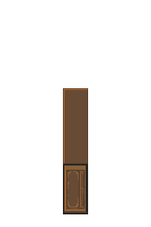](../../game/tests/fixtures/furniture-calibration/modular-archive-v1/west-whole.png)

Source / prompt: [archive-service-west-display-end-v1.png](../../game/assets/source/overnight-20260904/kits/archive-service-west-display-end-v1.png) · [artifact-archive.png](../../game/assets/runtime/office/artifact-archive.png) · [archive-service-west-display-end-v1.md](../../game/assets/source/overnight-20260904/kits/archive-service-west-display-end-v1.md)

Review: [ARCHIVE_ASSEMBLY_REVIEW.md](ARCHIVE_ASSEMBLY_REVIEW.md) · [CANONICAL_SERVICE_INTEGRATION.md](CANONICAL_SERVICE_INTEGRATION.md) · [ARCHIVE_PRODUCTION_REVIEW.md](ARCHIVE_PRODUCTION_REVIEW.md)

Native evidence: [all-four-native.png](../../game/tests/output/archive-production/all-four-native.png) · [manifest.json](../../game/tests/output/archive-assembly/manifest.json) · [wall-corners-service.png](../../game/tests/output/archive-assembly/wall-corners-service.png) · [manifest.json](../../game/tests/output/archive-production/manifest.json)

Export method: Transparent render of exact code-native cabinet, generated flat face and powdercoat; no raster rotation.

**Declared native layers (not automatically approved)**

| Export | Canvas / pivot | Actual opaque bounds | Derivation / limits |
| --- | --- | --- | --- |
| [west-carcass.png](../../game/tests/fixtures/furniture-calibration/modular-archive-v1/west-carcass.png) | 192×288 / [96, 224] | [80, 208, 32, 60]; 240 pixels | Reviewed archive v1 order: carcass,top,front,plinth,insert; same ground depth. |
| [west-top.png](../../game/tests/fixtures/furniture-calibration/modular-archive-v1/west-top.png) | 192×288 / [96, 224] | [80, 112, 32, 96]; 3072 pixels | Reviewed archive v1 order: carcass,top,front,plinth,insert; same ground depth. |
| [west-front.png](../../game/tests/fixtures/furniture-calibration/modular-archive-v1/west-front.png) | 192×288 / [96, 224] | [82, 208, 28, 60]; 1680 pixels | Reviewed archive v1 order: carcass,top,front,plinth,insert; same ground depth. |
| [west-plinth.png](../../game/tests/fixtures/furniture-calibration/modular-archive-v1/west-plinth.png) | 192×288 / [96, 224] | [80, 268, 32, 4]; 128 pixels | Reviewed archive v1 order: carcass,top,front,plinth,insert; same ground depth. |
| [west-insert.png](../../game/tests/fixtures/furniture-calibration/modular-archive-v1/west-insert.png) | 192×288 / [96, 224] | [84, 215, 24, 50]; 1200 pixels | Reviewed archive v1 order: carcass,top,front,plinth,insert; same ground depth. |

**Installed runtime layers — explicit integration evidence required**

| Export | Canvas / pivot | Actual opaque bounds | Derivation / limits |
| --- | --- | --- | --- |
| [west-carcass.png](../../game/assets/runtime/office/archive-v1/west-carcass.png) | 192×288 / [96, 224] | [80, 208, 32, 60]; 240 pixels | Approved archive v1 layer; runtime/imported bytes exactly match staged export. |
| [west-top.png](../../game/assets/runtime/office/archive-v1/west-top.png) | 192×288 / [96, 224] | [80, 112, 32, 96]; 3072 pixels | Approved archive v1 layer; runtime/imported bytes exactly match staged export. |
| [west-front.png](../../game/assets/runtime/office/archive-v1/west-front.png) | 192×288 / [96, 224] | [82, 208, 28, 60]; 1680 pixels | Approved archive v1 layer; runtime/imported bytes exactly match staged export. |
| [west-plinth.png](../../game/assets/runtime/office/archive-v1/west-plinth.png) | 192×288 / [96, 224] | [80, 268, 32, 4]; 128 pixels | Approved archive v1 layer; runtime/imported bytes exactly match staged export. |
| [west-insert.png](../../game/assets/runtime/office/archive-v1/west-insert.png) | 192×288 / [96, 224] | [84, 215, 24, 50]; 1200 pixels | Approved archive v1 layer; runtime/imported bytes exactly match staged export. |

west-carcass.png references: [west-carcass.png](../../game/tests/fixtures/furniture-calibration/modular-archive-v1/west-carcass.png)

west-top.png references: [west-top.png](../../game/tests/fixtures/furniture-calibration/modular-archive-v1/west-top.png)

west-front.png references: [west-front.png](../../game/tests/fixtures/furniture-calibration/modular-archive-v1/west-front.png)

west-plinth.png references: [west-plinth.png](../../game/tests/fixtures/furniture-calibration/modular-archive-v1/west-plinth.png)

west-insert.png references: [west-insert.png](../../game/tests/fixtures/furniture-calibration/modular-archive-v1/west-insert.png)

Runtime whole reference / integration evidence: [west-whole.png](../../game/assets/runtime/office/archive-v1/west-whole.png) · [manifest.json](../../game/tests/output/archive-production/manifest.json)

**Independent components and material inserts — not approved assembly masks**

| Export | Canvas / pivot | Actual opaque bounds | Derivation / limits |
| --- | --- | --- | --- |
| [raw_native_face: archive-service-west-display-end-v1.png](../../game/tests/fixtures/furniture-calibration/kits/archive-service-west-display-end-v1.png) | 24×56 | [0, 3, 24, 50]; 1200 pixels | Flat native panel, no floor anchor or whole-cabinet claim. |
| [registered_face: archive-service-west-display-end-v1-registered.png](../../game/tests/fixtures/furniture-calibration/kits/archive-service-west-display-end-v1-registered.png) | 192×288 / [96, 224] | [84, 215, 24, 50]; 1200 pixels | Exact native panel on full shared canvas; equals rendered Insert. |

archive-service-west-display-end-v1.png references: [archive-service-west-display-end-v1.png](../../game/assets/source/overnight-20260904/kits/archive-service-west-display-end-v1.png)

**Additional composites**

| Export | Canvas / pivot | Actual opaque bounds | Derivation / limits |
| --- | --- | --- | --- |
| [ordered_union: west-whole.png](../../game/tests/fixtures/furniture-calibration/modular-archive-v1/west-whole.png) | 192×288 / [96, 224] | [80, 112, 32, 160]; 5120 pixels | Exact ordered alpha union of five same-depth code-native/material layers. |

Retained native composite / source candidate: [west-whole.png](../../game/tests/fixtures/furniture-calibration/modular-archive-v1/west-whole.png)

**Retained source attempts**

| Source | Actual master | Prompt | Disposition |
| --- | --- | --- | --- |
| [archive-service-west-display-end-v1.png](../../game/assets/source/overnight-20260904/kits/archive-service-west-display-end-v1.png) | 866×1817 RGB; Opaque source | [archive-service-west-display-end-v1.md](../../game/assets/source/overnight-20260904/kits/archive-service-west-display-end-v1.md) | Intentionally opaque flat face, not a failed transparent whole-object cutout. Uniform native normalization retains padding. |

### Research bench

`research_table` · P0 · Mina, product, Theo.

Direction semantics: **workstation gaze**.

Generic bench shell with separate active tools; actor hand and torso occlusion must work in every direction.

Proposed envelope **192×320**, fixed floor anchor **[96, 240]**. N/E footprints: **3×2 / 2×3 cells**.

Tools: research work surface; modular instrument shelf. Layers: `floor_shadow`, `rear_structure`, `front_structure`, `tool_overlay`.

**north: runtime integrated.** Accepted corrected research-bench-v1 layers and research-v1 Mina/Theo directional poses. Opposite-side work cells, one stable four-frame analyzer scan, native all-employee/all-facing captures and ordinary production routing pass.

[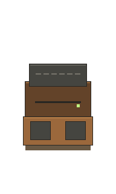](../../game/tests/fixtures/furniture-calibration/research-bench-v1/north-whole.png)

Source / prompt: [layered-furniture.png](../../game/assets/runtime/office/layered-furniture.png)

Review: [RESEARCH_BENCH_PRODUCTION_REVIEW.md](RESEARCH_BENCH_PRODUCTION_REVIEW.md)

Native evidence: [four-facing-contact-sheet.png](../../game/tests/output/research-bench-production/four-facing-contact-sheet.png) · [results.json](../../game/tests/output/research-bench-production/results.json) · [manifest.json](../../game/assets/runtime/office/research-bench-v1/manifest.json) · [manifest.json](../../game/assets/runtime/characters/research-v1/manifest.json)

Export method: Deterministic typed-GDScript native geometry and pose reconstruction; no finished-raster rotation, mirror, runtime scaling, or accepted use of rejected ImageGen sheets.

**Declared native layers (not automatically approved)**

| Export | Canvas / pivot | Actual opaque bounds | Derivation / limits |
| --- | --- | --- | --- |
| [north-floor_shadow.png](../../game/tests/fixtures/furniture-calibration/research-bench-v1/north-floor_shadow.png) | 192×320 / [96, 240] | Not measured here | Accepted research-bench-v1 layer in the exact production order and native registration. |
| [north-rear_structure.png](../../game/tests/fixtures/furniture-calibration/research-bench-v1/north-rear_structure.png) | 192×320 / [96, 240] | Not measured here | Accepted research-bench-v1 layer in the exact production order and native registration. |
| [north-front_structure.png](../../game/tests/fixtures/furniture-calibration/research-bench-v1/north-front_structure.png) | 192×320 / [96, 240] | Not measured here | Accepted research-bench-v1 layer in the exact production order and native registration. |
| [north-tool_overlay.png](../../game/tests/fixtures/furniture-calibration/research-bench-v1/north-tool_overlay.png) | 192×320 / [96, 240] | Not measured here | Accepted research-bench-v1 layer in the exact production order and native registration. |

north-floor_shadow.png references: [RESEARCH_BENCH_PRODUCTION_REVIEW.md](RESEARCH_BENCH_PRODUCTION_REVIEW.md)

north-rear_structure.png references: [RESEARCH_BENCH_PRODUCTION_REVIEW.md](RESEARCH_BENCH_PRODUCTION_REVIEW.md)

north-front_structure.png references: [RESEARCH_BENCH_PRODUCTION_REVIEW.md](RESEARCH_BENCH_PRODUCTION_REVIEW.md)

north-tool_overlay.png references: [RESEARCH_BENCH_PRODUCTION_REVIEW.md](RESEARCH_BENCH_PRODUCTION_REVIEW.md)

**Installed runtime layers — explicit integration evidence required**

| Export | Canvas / pivot | Actual opaque bounds | Derivation / limits |
| --- | --- | --- | --- |
| [north-floor_shadow.png](../../game/assets/runtime/office/research-bench-v1/north-floor_shadow.png) | 192×320 / [96, 240] | Not measured here | Installed research-bench-v1 layer; bytes exactly match the accepted native fixture. |
| [north-rear_structure.png](../../game/assets/runtime/office/research-bench-v1/north-rear_structure.png) | 192×320 / [96, 240] | Not measured here | Installed research-bench-v1 layer; bytes exactly match the accepted native fixture. |
| [north-front_structure.png](../../game/assets/runtime/office/research-bench-v1/north-front_structure.png) | 192×320 / [96, 240] | Not measured here | Installed research-bench-v1 layer; bytes exactly match the accepted native fixture. |
| [north-tool_overlay.png](../../game/assets/runtime/office/research-bench-v1/north-tool_overlay.png) | 192×320 / [96, 240] | Not measured here | Installed research-bench-v1 layer; bytes exactly match the accepted native fixture. |

north-floor_shadow.png references: [north-floor_shadow.png](../../game/tests/fixtures/furniture-calibration/research-bench-v1/north-floor_shadow.png) · [RESEARCH_BENCH_PRODUCTION_REVIEW.md](RESEARCH_BENCH_PRODUCTION_REVIEW.md)

north-rear_structure.png references: [north-rear_structure.png](../../game/tests/fixtures/furniture-calibration/research-bench-v1/north-rear_structure.png) · [RESEARCH_BENCH_PRODUCTION_REVIEW.md](RESEARCH_BENCH_PRODUCTION_REVIEW.md)

north-front_structure.png references: [north-front_structure.png](../../game/tests/fixtures/furniture-calibration/research-bench-v1/north-front_structure.png) · [RESEARCH_BENCH_PRODUCTION_REVIEW.md](RESEARCH_BENCH_PRODUCTION_REVIEW.md)

north-tool_overlay.png references: [north-tool_overlay.png](../../game/tests/fixtures/furniture-calibration/research-bench-v1/north-tool_overlay.png) · [RESEARCH_BENCH_PRODUCTION_REVIEW.md](RESEARCH_BENCH_PRODUCTION_REVIEW.md)

Runtime whole reference / integration evidence: [RESEARCH_BENCH_PRODUCTION_REVIEW.md](RESEARCH_BENCH_PRODUCTION_REVIEW.md)

Retained native composite / source candidate: [north-whole.png](../../game/tests/fixtures/furniture-calibration/research-bench-v1/north-whole.png)

**east: runtime integrated.** Accepted corrected research-bench-v1 layers and research-v1 Mina/Theo directional poses. Opposite-side work cells, one stable four-frame analyzer scan, native all-employee/all-facing captures and ordinary production routing pass.

[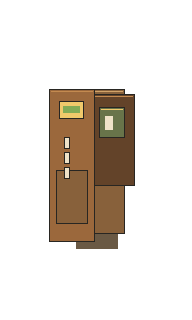](../../game/tests/fixtures/furniture-calibration/research-bench-v1/east-whole.png)

Source / prompt: [layered-furniture.png](../../game/assets/runtime/office/layered-furniture.png)

Review: [RESEARCH_BENCH_PRODUCTION_REVIEW.md](RESEARCH_BENCH_PRODUCTION_REVIEW.md)

Native evidence: [four-facing-contact-sheet.png](../../game/tests/output/research-bench-production/four-facing-contact-sheet.png) · [results.json](../../game/tests/output/research-bench-production/results.json) · [manifest.json](../../game/assets/runtime/office/research-bench-v1/manifest.json) · [manifest.json](../../game/assets/runtime/characters/research-v1/manifest.json)

Export method: Deterministic typed-GDScript native geometry and pose reconstruction; no finished-raster rotation, mirror, runtime scaling, or accepted use of rejected ImageGen sheets.

**Declared native layers (not automatically approved)**

| Export | Canvas / pivot | Actual opaque bounds | Derivation / limits |
| --- | --- | --- | --- |
| [east-floor_shadow.png](../../game/tests/fixtures/furniture-calibration/research-bench-v1/east-floor_shadow.png) | 192×320 / [96, 240] | Not measured here | Accepted research-bench-v1 layer in the exact production order and native registration. |
| [east-rear_structure.png](../../game/tests/fixtures/furniture-calibration/research-bench-v1/east-rear_structure.png) | 192×320 / [96, 240] | Not measured here | Accepted research-bench-v1 layer in the exact production order and native registration. |
| [east-front_structure.png](../../game/tests/fixtures/furniture-calibration/research-bench-v1/east-front_structure.png) | 192×320 / [96, 240] | Not measured here | Accepted research-bench-v1 layer in the exact production order and native registration. |
| [east-tool_overlay.png](../../game/tests/fixtures/furniture-calibration/research-bench-v1/east-tool_overlay.png) | 192×320 / [96, 240] | Not measured here | Accepted research-bench-v1 layer in the exact production order and native registration. |

east-floor_shadow.png references: [RESEARCH_BENCH_PRODUCTION_REVIEW.md](RESEARCH_BENCH_PRODUCTION_REVIEW.md)

east-rear_structure.png references: [RESEARCH_BENCH_PRODUCTION_REVIEW.md](RESEARCH_BENCH_PRODUCTION_REVIEW.md)

east-front_structure.png references: [RESEARCH_BENCH_PRODUCTION_REVIEW.md](RESEARCH_BENCH_PRODUCTION_REVIEW.md)

east-tool_overlay.png references: [RESEARCH_BENCH_PRODUCTION_REVIEW.md](RESEARCH_BENCH_PRODUCTION_REVIEW.md)

**Installed runtime layers — explicit integration evidence required**

| Export | Canvas / pivot | Actual opaque bounds | Derivation / limits |
| --- | --- | --- | --- |
| [east-floor_shadow.png](../../game/assets/runtime/office/research-bench-v1/east-floor_shadow.png) | 192×320 / [96, 240] | Not measured here | Installed research-bench-v1 layer; bytes exactly match the accepted native fixture. |
| [east-rear_structure.png](../../game/assets/runtime/office/research-bench-v1/east-rear_structure.png) | 192×320 / [96, 240] | Not measured here | Installed research-bench-v1 layer; bytes exactly match the accepted native fixture. |
| [east-front_structure.png](../../game/assets/runtime/office/research-bench-v1/east-front_structure.png) | 192×320 / [96, 240] | Not measured here | Installed research-bench-v1 layer; bytes exactly match the accepted native fixture. |
| [east-tool_overlay.png](../../game/assets/runtime/office/research-bench-v1/east-tool_overlay.png) | 192×320 / [96, 240] | Not measured here | Installed research-bench-v1 layer; bytes exactly match the accepted native fixture. |

east-floor_shadow.png references: [east-floor_shadow.png](../../game/tests/fixtures/furniture-calibration/research-bench-v1/east-floor_shadow.png) · [RESEARCH_BENCH_PRODUCTION_REVIEW.md](RESEARCH_BENCH_PRODUCTION_REVIEW.md)

east-rear_structure.png references: [east-rear_structure.png](../../game/tests/fixtures/furniture-calibration/research-bench-v1/east-rear_structure.png) · [RESEARCH_BENCH_PRODUCTION_REVIEW.md](RESEARCH_BENCH_PRODUCTION_REVIEW.md)

east-front_structure.png references: [east-front_structure.png](../../game/tests/fixtures/furniture-calibration/research-bench-v1/east-front_structure.png) · [RESEARCH_BENCH_PRODUCTION_REVIEW.md](RESEARCH_BENCH_PRODUCTION_REVIEW.md)

east-tool_overlay.png references: [east-tool_overlay.png](../../game/tests/fixtures/furniture-calibration/research-bench-v1/east-tool_overlay.png) · [RESEARCH_BENCH_PRODUCTION_REVIEW.md](RESEARCH_BENCH_PRODUCTION_REVIEW.md)

Runtime whole reference / integration evidence: [RESEARCH_BENCH_PRODUCTION_REVIEW.md](RESEARCH_BENCH_PRODUCTION_REVIEW.md)

Retained native composite / source candidate: [east-whole.png](../../game/tests/fixtures/furniture-calibration/research-bench-v1/east-whole.png)

**south: runtime integrated.** Accepted corrected research-bench-v1 layers and research-v1 Mina/Theo directional poses. Opposite-side work cells, one stable four-frame analyzer scan, native all-employee/all-facing captures and ordinary production routing pass.

[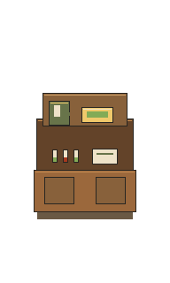](../../game/tests/fixtures/furniture-calibration/research-bench-v1/south-whole.png)

Source / prompt: [layered-furniture.png](../../game/assets/runtime/office/layered-furniture.png)

Review: [RESEARCH_BENCH_PRODUCTION_REVIEW.md](RESEARCH_BENCH_PRODUCTION_REVIEW.md)

Native evidence: [four-facing-contact-sheet.png](../../game/tests/output/research-bench-production/four-facing-contact-sheet.png) · [results.json](../../game/tests/output/research-bench-production/results.json) · [manifest.json](../../game/assets/runtime/office/research-bench-v1/manifest.json) · [manifest.json](../../game/assets/runtime/characters/research-v1/manifest.json)

Export method: Deterministic typed-GDScript native geometry and pose reconstruction; no finished-raster rotation, mirror, runtime scaling, or accepted use of rejected ImageGen sheets.

**Declared native layers (not automatically approved)**

| Export | Canvas / pivot | Actual opaque bounds | Derivation / limits |
| --- | --- | --- | --- |
| [south-floor_shadow.png](../../game/tests/fixtures/furniture-calibration/research-bench-v1/south-floor_shadow.png) | 192×320 / [96, 240] | Not measured here | Accepted research-bench-v1 layer in the exact production order and native registration. |
| [south-rear_structure.png](../../game/tests/fixtures/furniture-calibration/research-bench-v1/south-rear_structure.png) | 192×320 / [96, 240] | Not measured here | Accepted research-bench-v1 layer in the exact production order and native registration. |
| [south-front_structure.png](../../game/tests/fixtures/furniture-calibration/research-bench-v1/south-front_structure.png) | 192×320 / [96, 240] | Not measured here | Accepted research-bench-v1 layer in the exact production order and native registration. |
| [south-tool_overlay.png](../../game/tests/fixtures/furniture-calibration/research-bench-v1/south-tool_overlay.png) | 192×320 / [96, 240] | Not measured here | Accepted research-bench-v1 layer in the exact production order and native registration. |

south-floor_shadow.png references: [RESEARCH_BENCH_PRODUCTION_REVIEW.md](RESEARCH_BENCH_PRODUCTION_REVIEW.md)

south-rear_structure.png references: [RESEARCH_BENCH_PRODUCTION_REVIEW.md](RESEARCH_BENCH_PRODUCTION_REVIEW.md)

south-front_structure.png references: [RESEARCH_BENCH_PRODUCTION_REVIEW.md](RESEARCH_BENCH_PRODUCTION_REVIEW.md)

south-tool_overlay.png references: [RESEARCH_BENCH_PRODUCTION_REVIEW.md](RESEARCH_BENCH_PRODUCTION_REVIEW.md)

**Installed runtime layers — explicit integration evidence required**

| Export | Canvas / pivot | Actual opaque bounds | Derivation / limits |
| --- | --- | --- | --- |
| [south-floor_shadow.png](../../game/assets/runtime/office/research-bench-v1/south-floor_shadow.png) | 192×320 / [96, 240] | Not measured here | Installed research-bench-v1 layer; bytes exactly match the accepted native fixture. |
| [south-rear_structure.png](../../game/assets/runtime/office/research-bench-v1/south-rear_structure.png) | 192×320 / [96, 240] | Not measured here | Installed research-bench-v1 layer; bytes exactly match the accepted native fixture. |
| [south-front_structure.png](../../game/assets/runtime/office/research-bench-v1/south-front_structure.png) | 192×320 / [96, 240] | Not measured here | Installed research-bench-v1 layer; bytes exactly match the accepted native fixture. |
| [south-tool_overlay.png](../../game/assets/runtime/office/research-bench-v1/south-tool_overlay.png) | 192×320 / [96, 240] | Not measured here | Installed research-bench-v1 layer; bytes exactly match the accepted native fixture. |

south-floor_shadow.png references: [south-floor_shadow.png](../../game/tests/fixtures/furniture-calibration/research-bench-v1/south-floor_shadow.png) · [RESEARCH_BENCH_PRODUCTION_REVIEW.md](RESEARCH_BENCH_PRODUCTION_REVIEW.md)

south-rear_structure.png references: [south-rear_structure.png](../../game/tests/fixtures/furniture-calibration/research-bench-v1/south-rear_structure.png) · [RESEARCH_BENCH_PRODUCTION_REVIEW.md](RESEARCH_BENCH_PRODUCTION_REVIEW.md)

south-front_structure.png references: [south-front_structure.png](../../game/tests/fixtures/furniture-calibration/research-bench-v1/south-front_structure.png) · [RESEARCH_BENCH_PRODUCTION_REVIEW.md](RESEARCH_BENCH_PRODUCTION_REVIEW.md)

south-tool_overlay.png references: [south-tool_overlay.png](../../game/tests/fixtures/furniture-calibration/research-bench-v1/south-tool_overlay.png) · [RESEARCH_BENCH_PRODUCTION_REVIEW.md](RESEARCH_BENCH_PRODUCTION_REVIEW.md)

Runtime whole reference / integration evidence: [RESEARCH_BENCH_PRODUCTION_REVIEW.md](RESEARCH_BENCH_PRODUCTION_REVIEW.md)

Retained native composite / source candidate: [south-whole.png](../../game/tests/fixtures/furniture-calibration/research-bench-v1/south-whole.png)

**west: runtime integrated.** Accepted corrected research-bench-v1 layers and research-v1 Mina/Theo directional poses. Opposite-side work cells, one stable four-frame analyzer scan, native all-employee/all-facing captures and ordinary production routing pass.

[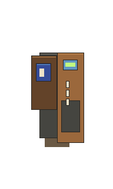](../../game/tests/fixtures/furniture-calibration/research-bench-v1/west-whole.png)

Source / prompt: [layered-furniture.png](../../game/assets/runtime/office/layered-furniture.png)

Review: [RESEARCH_BENCH_PRODUCTION_REVIEW.md](RESEARCH_BENCH_PRODUCTION_REVIEW.md)

Native evidence: [four-facing-contact-sheet.png](../../game/tests/output/research-bench-production/four-facing-contact-sheet.png) · [results.json](../../game/tests/output/research-bench-production/results.json) · [manifest.json](../../game/assets/runtime/office/research-bench-v1/manifest.json) · [manifest.json](../../game/assets/runtime/characters/research-v1/manifest.json)

Export method: Deterministic typed-GDScript native geometry and pose reconstruction; no finished-raster rotation, mirror, runtime scaling, or accepted use of rejected ImageGen sheets.

**Declared native layers (not automatically approved)**

| Export | Canvas / pivot | Actual opaque bounds | Derivation / limits |
| --- | --- | --- | --- |
| [west-floor_shadow.png](../../game/tests/fixtures/furniture-calibration/research-bench-v1/west-floor_shadow.png) | 192×320 / [96, 240] | Not measured here | Accepted research-bench-v1 layer in the exact production order and native registration. |
| [west-rear_structure.png](../../game/tests/fixtures/furniture-calibration/research-bench-v1/west-rear_structure.png) | 192×320 / [96, 240] | Not measured here | Accepted research-bench-v1 layer in the exact production order and native registration. |
| [west-front_structure.png](../../game/tests/fixtures/furniture-calibration/research-bench-v1/west-front_structure.png) | 192×320 / [96, 240] | Not measured here | Accepted research-bench-v1 layer in the exact production order and native registration. |
| [west-tool_overlay.png](../../game/tests/fixtures/furniture-calibration/research-bench-v1/west-tool_overlay.png) | 192×320 / [96, 240] | Not measured here | Accepted research-bench-v1 layer in the exact production order and native registration. |

west-floor_shadow.png references: [RESEARCH_BENCH_PRODUCTION_REVIEW.md](RESEARCH_BENCH_PRODUCTION_REVIEW.md)

west-rear_structure.png references: [RESEARCH_BENCH_PRODUCTION_REVIEW.md](RESEARCH_BENCH_PRODUCTION_REVIEW.md)

west-front_structure.png references: [RESEARCH_BENCH_PRODUCTION_REVIEW.md](RESEARCH_BENCH_PRODUCTION_REVIEW.md)

west-tool_overlay.png references: [RESEARCH_BENCH_PRODUCTION_REVIEW.md](RESEARCH_BENCH_PRODUCTION_REVIEW.md)

**Installed runtime layers — explicit integration evidence required**

| Export | Canvas / pivot | Actual opaque bounds | Derivation / limits |
| --- | --- | --- | --- |
| [west-floor_shadow.png](../../game/assets/runtime/office/research-bench-v1/west-floor_shadow.png) | 192×320 / [96, 240] | Not measured here | Installed research-bench-v1 layer; bytes exactly match the accepted native fixture. |
| [west-rear_structure.png](../../game/assets/runtime/office/research-bench-v1/west-rear_structure.png) | 192×320 / [96, 240] | Not measured here | Installed research-bench-v1 layer; bytes exactly match the accepted native fixture. |
| [west-front_structure.png](../../game/assets/runtime/office/research-bench-v1/west-front_structure.png) | 192×320 / [96, 240] | Not measured here | Installed research-bench-v1 layer; bytes exactly match the accepted native fixture. |
| [west-tool_overlay.png](../../game/assets/runtime/office/research-bench-v1/west-tool_overlay.png) | 192×320 / [96, 240] | Not measured here | Installed research-bench-v1 layer; bytes exactly match the accepted native fixture. |

west-floor_shadow.png references: [west-floor_shadow.png](../../game/tests/fixtures/furniture-calibration/research-bench-v1/west-floor_shadow.png) · [RESEARCH_BENCH_PRODUCTION_REVIEW.md](RESEARCH_BENCH_PRODUCTION_REVIEW.md)

west-rear_structure.png references: [west-rear_structure.png](../../game/tests/fixtures/furniture-calibration/research-bench-v1/west-rear_structure.png) · [RESEARCH_BENCH_PRODUCTION_REVIEW.md](RESEARCH_BENCH_PRODUCTION_REVIEW.md)

west-front_structure.png references: [west-front_structure.png](../../game/tests/fixtures/furniture-calibration/research-bench-v1/west-front_structure.png) · [RESEARCH_BENCH_PRODUCTION_REVIEW.md](RESEARCH_BENCH_PRODUCTION_REVIEW.md)

west-tool_overlay.png references: [west-tool_overlay.png](../../game/tests/fixtures/furniture-calibration/research-bench-v1/west-tool_overlay.png) · [RESEARCH_BENCH_PRODUCTION_REVIEW.md](RESEARCH_BENCH_PRODUCTION_REVIEW.md)

Runtime whole reference / integration evidence: [RESEARCH_BENCH_PRODUCTION_REVIEW.md](RESEARCH_BENCH_PRODUCTION_REVIEW.md)

Retained native composite / source candidate: [west-whole.png](../../game/tests/fixtures/furniture-calibration/research-bench-v1/west-whole.png)

### Decision console

`approval_console` · P1 · founder, shared.

Direction semantics: **service side**. Service N/E/S/W uses approach gaze S/W/N/E; this is not workstation-facing.

Clear decision station; status lights are event-driven overlays, not permanently painted alerts.

Proposed envelope **192×288**, fixed floor anchor **[96, 208]**. N/E footprints: **3×2 / 2×3 cells**.

Tools: review display; decision tray. Layers: `floor_shadow`, `rear_structure`, `front_structure`, `ambient_overlay` (optional).

**north: runtime integrated.** Accepted as the north standing approval/activity service profile. Native room review meets the 2.67/2 visual gate; deterministic, geometry, room and production checks pass. No reaching pose or animated screen is claimed.

[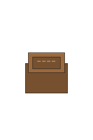](../../game/tests/fixtures/furniture-calibration/decision-console-v1/north-rear_structure.png)

Source / prompt: [approval-console.png](../../game/assets/runtime/office/approval-console.png)

Review: [DECISION_CONSOLE_PRODUCTION_REVIEW.md](DECISION_CONSOLE_PRODUCTION_REVIEW.md)

Native evidence: [actual-room-contact-sheet-native.png](../../game/tests/output/decision-console-room/actual-room-contact-sheet-native.png) · [results.json](../../game/tests/output/decision-console-room/results.json)

**Declared native layers (not automatically approved)**

| Export | Canvas / pivot | Actual opaque bounds | Derivation / limits |
| --- | --- | --- | --- |
| [north-floor_shadow.png](../../game/tests/fixtures/furniture-calibration/decision-console-v1/north-floor_shadow.png) | 192×288 / [96, 208] | Not measured here | Original independently declared code-native service-console layer; no finished raster rotation, mirror or scaling. |
| [north-rear_structure.png](../../game/tests/fixtures/furniture-calibration/decision-console-v1/north-rear_structure.png) | 192×288 / [96, 208] | Not measured here | Original independently declared code-native service-console layer; no finished raster rotation, mirror or scaling. |
| [north-front_structure.png](../../game/tests/fixtures/furniture-calibration/decision-console-v1/north-front_structure.png) | 192×288 / [96, 208] | Not measured here | Original independently declared code-native service-console layer; no finished raster rotation, mirror or scaling. |
| [north-ambient_overlay.png](../../game/tests/fixtures/furniture-calibration/decision-console-v1/north-ambient_overlay.png) | 192×288 / [96, 208] | Not measured here | Original independently declared code-native service-console layer; no finished raster rotation, mirror or scaling. |

north-floor_shadow.png references: [DECISION_CONSOLE_PRODUCTION_REVIEW.md](DECISION_CONSOLE_PRODUCTION_REVIEW.md)

north-rear_structure.png references: [DECISION_CONSOLE_PRODUCTION_REVIEW.md](DECISION_CONSOLE_PRODUCTION_REVIEW.md)

north-front_structure.png references: [DECISION_CONSOLE_PRODUCTION_REVIEW.md](DECISION_CONSOLE_PRODUCTION_REVIEW.md)

north-ambient_overlay.png references: [DECISION_CONSOLE_PRODUCTION_REVIEW.md](DECISION_CONSOLE_PRODUCTION_REVIEW.md)

**Installed runtime layers — explicit integration evidence required**

| Export | Canvas / pivot | Actual opaque bounds | Derivation / limits |
| --- | --- | --- | --- |
| [north-floor_shadow.png](../../game/assets/runtime/office/approval-console-v1/north-floor_shadow.png) | 192×288 / [96, 208] | Not measured here | Exact hash-locked production copy of the reviewed native component; native scale 1 and no raster rotation. |
| [north-rear_structure.png](../../game/assets/runtime/office/approval-console-v1/north-rear_structure.png) | 192×288 / [96, 208] | Not measured here | Exact hash-locked production copy of the reviewed native component; native scale 1 and no raster rotation. |
| [north-front_structure.png](../../game/assets/runtime/office/approval-console-v1/north-front_structure.png) | 192×288 / [96, 208] | Not measured here | Exact hash-locked production copy of the reviewed native component; native scale 1 and no raster rotation. |
| [north-ambient_overlay.png](../../game/assets/runtime/office/approval-console-v1/north-ambient_overlay.png) | 192×288 / [96, 208] | Not measured here | Exact hash-locked production copy of the reviewed native component; native scale 1 and no raster rotation. |

north-floor_shadow.png references: [north-floor_shadow.png](../../game/tests/fixtures/furniture-calibration/decision-console-v1/north-floor_shadow.png)

north-rear_structure.png references: [north-rear_structure.png](../../game/tests/fixtures/furniture-calibration/decision-console-v1/north-rear_structure.png)

north-front_structure.png references: [north-front_structure.png](../../game/tests/fixtures/furniture-calibration/decision-console-v1/north-front_structure.png)

north-ambient_overlay.png references: [north-ambient_overlay.png](../../game/tests/fixtures/furniture-calibration/decision-console-v1/north-ambient_overlay.png)

Runtime whole reference / integration evidence: [DECISION_CONSOLE_PRODUCTION_REVIEW.md](DECISION_CONSOLE_PRODUCTION_REVIEW.md)

**east: runtime integrated.** Accepted as the east standing approval/activity service profile. Native room review meets the 2.67/2 visual gate; deterministic, geometry, room and production checks pass. No reaching pose or animated screen is claimed.

[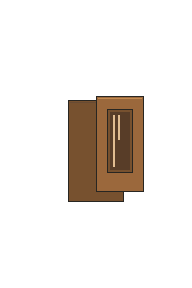](../../game/tests/fixtures/furniture-calibration/decision-console-v1/east-rear_structure.png)

Source / prompt: [approval-console.png](../../game/assets/runtime/office/approval-console.png)

Review: [DECISION_CONSOLE_PRODUCTION_REVIEW.md](DECISION_CONSOLE_PRODUCTION_REVIEW.md)

Native evidence: [actual-room-contact-sheet-native.png](../../game/tests/output/decision-console-room/actual-room-contact-sheet-native.png) · [results.json](../../game/tests/output/decision-console-room/results.json)

**Declared native layers (not automatically approved)**

| Export | Canvas / pivot | Actual opaque bounds | Derivation / limits |
| --- | --- | --- | --- |
| [east-floor_shadow.png](../../game/tests/fixtures/furniture-calibration/decision-console-v1/east-floor_shadow.png) | 192×288 / [96, 208] | Not measured here | Original independently declared code-native service-console layer; no finished raster rotation, mirror or scaling. |
| [east-rear_structure.png](../../game/tests/fixtures/furniture-calibration/decision-console-v1/east-rear_structure.png) | 192×288 / [96, 208] | Not measured here | Original independently declared code-native service-console layer; no finished raster rotation, mirror or scaling. |
| [east-front_structure.png](../../game/tests/fixtures/furniture-calibration/decision-console-v1/east-front_structure.png) | 192×288 / [96, 208] | Not measured here | Original independently declared code-native service-console layer; no finished raster rotation, mirror or scaling. |
| [east-ambient_overlay.png](../../game/tests/fixtures/furniture-calibration/decision-console-v1/east-ambient_overlay.png) | 192×288 / [96, 208] | Not measured here | Original independently declared code-native service-console layer; no finished raster rotation, mirror or scaling. |

east-floor_shadow.png references: [DECISION_CONSOLE_PRODUCTION_REVIEW.md](DECISION_CONSOLE_PRODUCTION_REVIEW.md)

east-rear_structure.png references: [DECISION_CONSOLE_PRODUCTION_REVIEW.md](DECISION_CONSOLE_PRODUCTION_REVIEW.md)

east-front_structure.png references: [DECISION_CONSOLE_PRODUCTION_REVIEW.md](DECISION_CONSOLE_PRODUCTION_REVIEW.md)

east-ambient_overlay.png references: [DECISION_CONSOLE_PRODUCTION_REVIEW.md](DECISION_CONSOLE_PRODUCTION_REVIEW.md)

**Installed runtime layers — explicit integration evidence required**

| Export | Canvas / pivot | Actual opaque bounds | Derivation / limits |
| --- | --- | --- | --- |
| [east-floor_shadow.png](../../game/assets/runtime/office/approval-console-v1/east-floor_shadow.png) | 192×288 / [96, 208] | Not measured here | Exact hash-locked production copy of the reviewed native component; native scale 1 and no raster rotation. |
| [east-rear_structure.png](../../game/assets/runtime/office/approval-console-v1/east-rear_structure.png) | 192×288 / [96, 208] | Not measured here | Exact hash-locked production copy of the reviewed native component; native scale 1 and no raster rotation. |
| [east-front_structure.png](../../game/assets/runtime/office/approval-console-v1/east-front_structure.png) | 192×288 / [96, 208] | Not measured here | Exact hash-locked production copy of the reviewed native component; native scale 1 and no raster rotation. |
| [east-ambient_overlay.png](../../game/assets/runtime/office/approval-console-v1/east-ambient_overlay.png) | 192×288 / [96, 208] | Not measured here | Exact hash-locked production copy of the reviewed native component; native scale 1 and no raster rotation. |

east-floor_shadow.png references: [east-floor_shadow.png](../../game/tests/fixtures/furniture-calibration/decision-console-v1/east-floor_shadow.png)

east-rear_structure.png references: [east-rear_structure.png](../../game/tests/fixtures/furniture-calibration/decision-console-v1/east-rear_structure.png)

east-front_structure.png references: [east-front_structure.png](../../game/tests/fixtures/furniture-calibration/decision-console-v1/east-front_structure.png)

east-ambient_overlay.png references: [east-ambient_overlay.png](../../game/tests/fixtures/furniture-calibration/decision-console-v1/east-ambient_overlay.png)

Runtime whole reference / integration evidence: [DECISION_CONSOLE_PRODUCTION_REVIEW.md](DECISION_CONSOLE_PRODUCTION_REVIEW.md)

**south: runtime integrated.** Accepted as the south standing approval/activity service profile. Native room review meets the 2.67/2 visual gate; deterministic, geometry, room and production checks pass. No reaching pose or animated screen is claimed.

[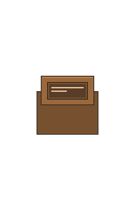](../../game/tests/fixtures/furniture-calibration/decision-console-v1/south-rear_structure.png)

Source / prompt: [approval-console.png](../../game/assets/runtime/office/approval-console.png)

Review: [DECISION_CONSOLE_PRODUCTION_REVIEW.md](DECISION_CONSOLE_PRODUCTION_REVIEW.md)

Native evidence: [actual-room-contact-sheet-native.png](../../game/tests/output/decision-console-room/actual-room-contact-sheet-native.png) · [results.json](../../game/tests/output/decision-console-room/results.json)

**Declared native layers (not automatically approved)**

| Export | Canvas / pivot | Actual opaque bounds | Derivation / limits |
| --- | --- | --- | --- |
| [south-floor_shadow.png](../../game/tests/fixtures/furniture-calibration/decision-console-v1/south-floor_shadow.png) | 192×288 / [96, 208] | Not measured here | Original independently declared code-native service-console layer; no finished raster rotation, mirror or scaling. |
| [south-rear_structure.png](../../game/tests/fixtures/furniture-calibration/decision-console-v1/south-rear_structure.png) | 192×288 / [96, 208] | Not measured here | Original independently declared code-native service-console layer; no finished raster rotation, mirror or scaling. |
| [south-front_structure.png](../../game/tests/fixtures/furniture-calibration/decision-console-v1/south-front_structure.png) | 192×288 / [96, 208] | Not measured here | Original independently declared code-native service-console layer; no finished raster rotation, mirror or scaling. |
| [south-ambient_overlay.png](../../game/tests/fixtures/furniture-calibration/decision-console-v1/south-ambient_overlay.png) | 192×288 / [96, 208] | Not measured here | Original independently declared code-native service-console layer; no finished raster rotation, mirror or scaling. |

south-floor_shadow.png references: [DECISION_CONSOLE_PRODUCTION_REVIEW.md](DECISION_CONSOLE_PRODUCTION_REVIEW.md)

south-rear_structure.png references: [DECISION_CONSOLE_PRODUCTION_REVIEW.md](DECISION_CONSOLE_PRODUCTION_REVIEW.md)

south-front_structure.png references: [DECISION_CONSOLE_PRODUCTION_REVIEW.md](DECISION_CONSOLE_PRODUCTION_REVIEW.md)

south-ambient_overlay.png references: [DECISION_CONSOLE_PRODUCTION_REVIEW.md](DECISION_CONSOLE_PRODUCTION_REVIEW.md)

**Installed runtime layers — explicit integration evidence required**

| Export | Canvas / pivot | Actual opaque bounds | Derivation / limits |
| --- | --- | --- | --- |
| [south-floor_shadow.png](../../game/assets/runtime/office/approval-console-v1/south-floor_shadow.png) | 192×288 / [96, 208] | Not measured here | Exact hash-locked production copy of the reviewed native component; native scale 1 and no raster rotation. |
| [south-rear_structure.png](../../game/assets/runtime/office/approval-console-v1/south-rear_structure.png) | 192×288 / [96, 208] | Not measured here | Exact hash-locked production copy of the reviewed native component; native scale 1 and no raster rotation. |
| [south-front_structure.png](../../game/assets/runtime/office/approval-console-v1/south-front_structure.png) | 192×288 / [96, 208] | Not measured here | Exact hash-locked production copy of the reviewed native component; native scale 1 and no raster rotation. |
| [south-ambient_overlay.png](../../game/assets/runtime/office/approval-console-v1/south-ambient_overlay.png) | 192×288 / [96, 208] | Not measured here | Exact hash-locked production copy of the reviewed native component; native scale 1 and no raster rotation. |

south-floor_shadow.png references: [south-floor_shadow.png](../../game/tests/fixtures/furniture-calibration/decision-console-v1/south-floor_shadow.png)

south-rear_structure.png references: [south-rear_structure.png](../../game/tests/fixtures/furniture-calibration/decision-console-v1/south-rear_structure.png)

south-front_structure.png references: [south-front_structure.png](../../game/tests/fixtures/furniture-calibration/decision-console-v1/south-front_structure.png)

south-ambient_overlay.png references: [south-ambient_overlay.png](../../game/tests/fixtures/furniture-calibration/decision-console-v1/south-ambient_overlay.png)

Runtime whole reference / integration evidence: [DECISION_CONSOLE_PRODUCTION_REVIEW.md](DECISION_CONSOLE_PRODUCTION_REVIEW.md)

**west: runtime integrated.** Accepted as the west standing approval/activity service profile. Native room review meets the 2.67/2 visual gate; deterministic, geometry, room and production checks pass. No reaching pose or animated screen is claimed.

[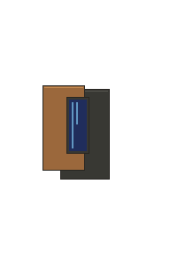](../../game/tests/fixtures/furniture-calibration/decision-console-v1/west-rear_structure.png)

Source / prompt: [approval-console.png](../../game/assets/runtime/office/approval-console.png)

Review: [DECISION_CONSOLE_PRODUCTION_REVIEW.md](DECISION_CONSOLE_PRODUCTION_REVIEW.md)

Native evidence: [actual-room-contact-sheet-native.png](../../game/tests/output/decision-console-room/actual-room-contact-sheet-native.png) · [results.json](../../game/tests/output/decision-console-room/results.json)

**Declared native layers (not automatically approved)**

| Export | Canvas / pivot | Actual opaque bounds | Derivation / limits |
| --- | --- | --- | --- |
| [west-floor_shadow.png](../../game/tests/fixtures/furniture-calibration/decision-console-v1/west-floor_shadow.png) | 192×288 / [96, 208] | Not measured here | Original independently declared code-native service-console layer; no finished raster rotation, mirror or scaling. |
| [west-rear_structure.png](../../game/tests/fixtures/furniture-calibration/decision-console-v1/west-rear_structure.png) | 192×288 / [96, 208] | Not measured here | Original independently declared code-native service-console layer; no finished raster rotation, mirror or scaling. |
| [west-front_structure.png](../../game/tests/fixtures/furniture-calibration/decision-console-v1/west-front_structure.png) | 192×288 / [96, 208] | Not measured here | Original independently declared code-native service-console layer; no finished raster rotation, mirror or scaling. |
| [west-ambient_overlay.png](../../game/tests/fixtures/furniture-calibration/decision-console-v1/west-ambient_overlay.png) | 192×288 / [96, 208] | Not measured here | Original independently declared code-native service-console layer; no finished raster rotation, mirror or scaling. |

west-floor_shadow.png references: [DECISION_CONSOLE_PRODUCTION_REVIEW.md](DECISION_CONSOLE_PRODUCTION_REVIEW.md)

west-rear_structure.png references: [DECISION_CONSOLE_PRODUCTION_REVIEW.md](DECISION_CONSOLE_PRODUCTION_REVIEW.md)

west-front_structure.png references: [DECISION_CONSOLE_PRODUCTION_REVIEW.md](DECISION_CONSOLE_PRODUCTION_REVIEW.md)

west-ambient_overlay.png references: [DECISION_CONSOLE_PRODUCTION_REVIEW.md](DECISION_CONSOLE_PRODUCTION_REVIEW.md)

**Installed runtime layers — explicit integration evidence required**

| Export | Canvas / pivot | Actual opaque bounds | Derivation / limits |
| --- | --- | --- | --- |
| [west-floor_shadow.png](../../game/assets/runtime/office/approval-console-v1/west-floor_shadow.png) | 192×288 / [96, 208] | Not measured here | Exact hash-locked production copy of the reviewed native component; native scale 1 and no raster rotation. |
| [west-rear_structure.png](../../game/assets/runtime/office/approval-console-v1/west-rear_structure.png) | 192×288 / [96, 208] | Not measured here | Exact hash-locked production copy of the reviewed native component; native scale 1 and no raster rotation. |
| [west-front_structure.png](../../game/assets/runtime/office/approval-console-v1/west-front_structure.png) | 192×288 / [96, 208] | Not measured here | Exact hash-locked production copy of the reviewed native component; native scale 1 and no raster rotation. |
| [west-ambient_overlay.png](../../game/assets/runtime/office/approval-console-v1/west-ambient_overlay.png) | 192×288 / [96, 208] | Not measured here | Exact hash-locked production copy of the reviewed native component; native scale 1 and no raster rotation. |

west-floor_shadow.png references: [west-floor_shadow.png](../../game/tests/fixtures/furniture-calibration/decision-console-v1/west-floor_shadow.png)

west-rear_structure.png references: [west-rear_structure.png](../../game/tests/fixtures/furniture-calibration/decision-console-v1/west-rear_structure.png)

west-front_structure.png references: [west-front_structure.png](../../game/tests/fixtures/furniture-calibration/decision-console-v1/west-front_structure.png)

west-ambient_overlay.png references: [west-ambient_overlay.png](../../game/tests/fixtures/furniture-calibration/decision-console-v1/west-ambient_overlay.png)

Runtime whole reference / integration evidence: [DECISION_CONSOLE_PRODUCTION_REVIEW.md](DECISION_CONSOLE_PRODUCTION_REVIEW.md)

### Prototype bench

`prototype_bench` · P1 · product, creative, engineer.

Direction semantics: **workstation gaze**.

Shared hands-on prototyping surface; retain small detachable tools and a readable silhouette.

Proposed envelope **192×320**, fixed floor anchor **[96, 240]**. N/E footprints: **3×2 / 2×3 cells**.

Tools: cutting mat; modular test equipment. Layers: `floor_shadow`, `rear_structure`, `front_structure`, `ambient_overlay` (optional).

**north: runtime integrated.** Accepted as the north standing shared prototype-bench base. Native room review meets the 2.67/2 visual gate and export, pixel, room and production checks pass. Profession-specific host kits and reaching/using poses remain open.

Source / prompt: [prototype-bench.png](../../game/assets/runtime/office/prototype-bench.png)

Review: [PROTOTYPE_BENCH_PRODUCTION_REVIEW.md](PROTOTYPE_BENCH_PRODUCTION_REVIEW.md)

Native evidence: [actual-room-contact-sheet-native.png](../../game/tests/output/prototype-bench-room/actual-room-contact-sheet-native.png) · [results.json](../../game/tests/output/prototype-bench-room/results.json)

**Declared native layers (not automatically approved)**

| Export | Canvas / pivot | Actual opaque bounds | Derivation / limits |
| --- | --- | --- | --- |
| [north-floor_shadow.png](../../game/tests/fixtures/furniture-calibration/prototype-bench-v1/north-floor_shadow.png) | 192×320 / [96, 240] | Not measured here | Original independently declared code-native prototype-bench layer; no finished raster rotation, mirror or scaling. |
| [north-rear_structure.png](../../game/tests/fixtures/furniture-calibration/prototype-bench-v1/north-rear_structure.png) | 192×320 / [96, 240] | Not measured here | Original independently declared code-native prototype-bench layer; no finished raster rotation, mirror or scaling. |
| [north-front_structure.png](../../game/tests/fixtures/furniture-calibration/prototype-bench-v1/north-front_structure.png) | 192×320 / [96, 240] | Not measured here | Original independently declared code-native prototype-bench layer; no finished raster rotation, mirror or scaling. |
| [north-tool_overlay.png](../../game/tests/fixtures/furniture-calibration/prototype-bench-v1/north-tool_overlay.png) | 192×320 / [96, 240] | Not measured here | Original independently declared code-native prototype-bench layer; no finished raster rotation, mirror or scaling. |

north-floor_shadow.png references: [PROTOTYPE_BENCH_PRODUCTION_REVIEW.md](PROTOTYPE_BENCH_PRODUCTION_REVIEW.md)

north-rear_structure.png references: [PROTOTYPE_BENCH_PRODUCTION_REVIEW.md](PROTOTYPE_BENCH_PRODUCTION_REVIEW.md)

north-front_structure.png references: [PROTOTYPE_BENCH_PRODUCTION_REVIEW.md](PROTOTYPE_BENCH_PRODUCTION_REVIEW.md)

north-tool_overlay.png references: [PROTOTYPE_BENCH_PRODUCTION_REVIEW.md](PROTOTYPE_BENCH_PRODUCTION_REVIEW.md)

**Installed runtime layers — explicit integration evidence required**

| Export | Canvas / pivot | Actual opaque bounds | Derivation / limits |
| --- | --- | --- | --- |
| [north-floor_shadow.png](../../game/assets/runtime/office/prototype-bench-v1/north-floor_shadow.png) | 192×320 / [96, 240] | Not measured here | Exact hash-locked production copy of the reviewed native component; native scale 1 and no raster rotation. |
| [north-rear_structure.png](../../game/assets/runtime/office/prototype-bench-v1/north-rear_structure.png) | 192×320 / [96, 240] | Not measured here | Exact hash-locked production copy of the reviewed native component; native scale 1 and no raster rotation. |
| [north-front_structure.png](../../game/assets/runtime/office/prototype-bench-v1/north-front_structure.png) | 192×320 / [96, 240] | Not measured here | Exact hash-locked production copy of the reviewed native component; native scale 1 and no raster rotation. |
| [north-tool_overlay.png](../../game/assets/runtime/office/prototype-bench-v1/north-tool_overlay.png) | 192×320 / [96, 240] | Not measured here | Exact hash-locked production copy of the reviewed native component; native scale 1 and no raster rotation. |

north-floor_shadow.png references: [north-floor_shadow.png](../../game/tests/fixtures/furniture-calibration/prototype-bench-v1/north-floor_shadow.png)

north-rear_structure.png references: [north-rear_structure.png](../../game/tests/fixtures/furniture-calibration/prototype-bench-v1/north-rear_structure.png)

north-front_structure.png references: [north-front_structure.png](../../game/tests/fixtures/furniture-calibration/prototype-bench-v1/north-front_structure.png)

north-tool_overlay.png references: [north-tool_overlay.png](../../game/tests/fixtures/furniture-calibration/prototype-bench-v1/north-tool_overlay.png)

Runtime whole reference / integration evidence: [PROTOTYPE_BENCH_PRODUCTION_REVIEW.md](PROTOTYPE_BENCH_PRODUCTION_REVIEW.md)

**east: runtime integrated.** Accepted as the east standing shared prototype-bench base. Native room review meets the 2.67/2 visual gate and export, pixel, room and production checks pass. Profession-specific host kits and reaching/using poses remain open.

[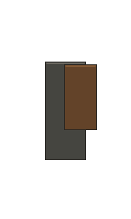](../../game/tests/fixtures/furniture-calibration/prototype-bench-v1/east-rear_structure.png)

Source / prompt: [prototype-bench.png](../../game/assets/runtime/office/prototype-bench.png)

Review: [PROTOTYPE_BENCH_PRODUCTION_REVIEW.md](PROTOTYPE_BENCH_PRODUCTION_REVIEW.md)

Native evidence: [actual-room-contact-sheet-native.png](../../game/tests/output/prototype-bench-room/actual-room-contact-sheet-native.png) · [results.json](../../game/tests/output/prototype-bench-room/results.json)

**Declared native layers (not automatically approved)**

| Export | Canvas / pivot | Actual opaque bounds | Derivation / limits |
| --- | --- | --- | --- |
| [east-floor_shadow.png](../../game/tests/fixtures/furniture-calibration/prototype-bench-v1/east-floor_shadow.png) | 192×320 / [96, 240] | Not measured here | Original independently declared code-native prototype-bench layer; no finished raster rotation, mirror or scaling. |
| [east-rear_structure.png](../../game/tests/fixtures/furniture-calibration/prototype-bench-v1/east-rear_structure.png) | 192×320 / [96, 240] | Not measured here | Original independently declared code-native prototype-bench layer; no finished raster rotation, mirror or scaling. |
| [east-front_structure.png](../../game/tests/fixtures/furniture-calibration/prototype-bench-v1/east-front_structure.png) | 192×320 / [96, 240] | Not measured here | Original independently declared code-native prototype-bench layer; no finished raster rotation, mirror or scaling. |
| [east-tool_overlay.png](../../game/tests/fixtures/furniture-calibration/prototype-bench-v1/east-tool_overlay.png) | 192×320 / [96, 240] | Not measured here | Original independently declared code-native prototype-bench layer; no finished raster rotation, mirror or scaling. |

east-floor_shadow.png references: [PROTOTYPE_BENCH_PRODUCTION_REVIEW.md](PROTOTYPE_BENCH_PRODUCTION_REVIEW.md)

east-rear_structure.png references: [PROTOTYPE_BENCH_PRODUCTION_REVIEW.md](PROTOTYPE_BENCH_PRODUCTION_REVIEW.md)

east-front_structure.png references: [PROTOTYPE_BENCH_PRODUCTION_REVIEW.md](PROTOTYPE_BENCH_PRODUCTION_REVIEW.md)

east-tool_overlay.png references: [PROTOTYPE_BENCH_PRODUCTION_REVIEW.md](PROTOTYPE_BENCH_PRODUCTION_REVIEW.md)

**Installed runtime layers — explicit integration evidence required**

| Export | Canvas / pivot | Actual opaque bounds | Derivation / limits |
| --- | --- | --- | --- |
| [east-floor_shadow.png](../../game/assets/runtime/office/prototype-bench-v1/east-floor_shadow.png) | 192×320 / [96, 240] | Not measured here | Exact hash-locked production copy of the reviewed native component; native scale 1 and no raster rotation. |
| [east-rear_structure.png](../../game/assets/runtime/office/prototype-bench-v1/east-rear_structure.png) | 192×320 / [96, 240] | Not measured here | Exact hash-locked production copy of the reviewed native component; native scale 1 and no raster rotation. |
| [east-front_structure.png](../../game/assets/runtime/office/prototype-bench-v1/east-front_structure.png) | 192×320 / [96, 240] | Not measured here | Exact hash-locked production copy of the reviewed native component; native scale 1 and no raster rotation. |
| [east-tool_overlay.png](../../game/assets/runtime/office/prototype-bench-v1/east-tool_overlay.png) | 192×320 / [96, 240] | Not measured here | Exact hash-locked production copy of the reviewed native component; native scale 1 and no raster rotation. |

east-floor_shadow.png references: [east-floor_shadow.png](../../game/tests/fixtures/furniture-calibration/prototype-bench-v1/east-floor_shadow.png)

east-rear_structure.png references: [east-rear_structure.png](../../game/tests/fixtures/furniture-calibration/prototype-bench-v1/east-rear_structure.png)

east-front_structure.png references: [east-front_structure.png](../../game/tests/fixtures/furniture-calibration/prototype-bench-v1/east-front_structure.png)

east-tool_overlay.png references: [east-tool_overlay.png](../../game/tests/fixtures/furniture-calibration/prototype-bench-v1/east-tool_overlay.png)

Runtime whole reference / integration evidence: [PROTOTYPE_BENCH_PRODUCTION_REVIEW.md](PROTOTYPE_BENCH_PRODUCTION_REVIEW.md)

**south: runtime integrated.** Accepted as the south standing shared prototype-bench base. Native room review meets the 2.67/2 visual gate and export, pixel, room and production checks pass. Profession-specific host kits and reaching/using poses remain open.

[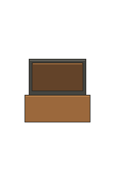](../../game/tests/fixtures/furniture-calibration/prototype-bench-v1/south-rear_structure.png)

Source / prompt: [prototype-bench.png](../../game/assets/runtime/office/prototype-bench.png)

Review: [PROTOTYPE_BENCH_PRODUCTION_REVIEW.md](PROTOTYPE_BENCH_PRODUCTION_REVIEW.md)

Native evidence: [actual-room-contact-sheet-native.png](../../game/tests/output/prototype-bench-room/actual-room-contact-sheet-native.png) · [results.json](../../game/tests/output/prototype-bench-room/results.json)

**Declared native layers (not automatically approved)**

| Export | Canvas / pivot | Actual opaque bounds | Derivation / limits |
| --- | --- | --- | --- |
| [south-floor_shadow.png](../../game/tests/fixtures/furniture-calibration/prototype-bench-v1/south-floor_shadow.png) | 192×320 / [96, 240] | Not measured here | Original independently declared code-native prototype-bench layer; no finished raster rotation, mirror or scaling. |
| [south-rear_structure.png](../../game/tests/fixtures/furniture-calibration/prototype-bench-v1/south-rear_structure.png) | 192×320 / [96, 240] | Not measured here | Original independently declared code-native prototype-bench layer; no finished raster rotation, mirror or scaling. |
| [south-front_structure.png](../../game/tests/fixtures/furniture-calibration/prototype-bench-v1/south-front_structure.png) | 192×320 / [96, 240] | Not measured here | Original independently declared code-native prototype-bench layer; no finished raster rotation, mirror or scaling. |
| [south-tool_overlay.png](../../game/tests/fixtures/furniture-calibration/prototype-bench-v1/south-tool_overlay.png) | 192×320 / [96, 240] | Not measured here | Original independently declared code-native prototype-bench layer; no finished raster rotation, mirror or scaling. |

south-floor_shadow.png references: [PROTOTYPE_BENCH_PRODUCTION_REVIEW.md](PROTOTYPE_BENCH_PRODUCTION_REVIEW.md)

south-rear_structure.png references: [PROTOTYPE_BENCH_PRODUCTION_REVIEW.md](PROTOTYPE_BENCH_PRODUCTION_REVIEW.md)

south-front_structure.png references: [PROTOTYPE_BENCH_PRODUCTION_REVIEW.md](PROTOTYPE_BENCH_PRODUCTION_REVIEW.md)

south-tool_overlay.png references: [PROTOTYPE_BENCH_PRODUCTION_REVIEW.md](PROTOTYPE_BENCH_PRODUCTION_REVIEW.md)

**Installed runtime layers — explicit integration evidence required**

| Export | Canvas / pivot | Actual opaque bounds | Derivation / limits |
| --- | --- | --- | --- |
| [south-floor_shadow.png](../../game/assets/runtime/office/prototype-bench-v1/south-floor_shadow.png) | 192×320 / [96, 240] | Not measured here | Exact hash-locked production copy of the reviewed native component; native scale 1 and no raster rotation. |
| [south-rear_structure.png](../../game/assets/runtime/office/prototype-bench-v1/south-rear_structure.png) | 192×320 / [96, 240] | Not measured here | Exact hash-locked production copy of the reviewed native component; native scale 1 and no raster rotation. |
| [south-front_structure.png](../../game/assets/runtime/office/prototype-bench-v1/south-front_structure.png) | 192×320 / [96, 240] | Not measured here | Exact hash-locked production copy of the reviewed native component; native scale 1 and no raster rotation. |
| [south-tool_overlay.png](../../game/assets/runtime/office/prototype-bench-v1/south-tool_overlay.png) | 192×320 / [96, 240] | Not measured here | Exact hash-locked production copy of the reviewed native component; native scale 1 and no raster rotation. |

south-floor_shadow.png references: [south-floor_shadow.png](../../game/tests/fixtures/furniture-calibration/prototype-bench-v1/south-floor_shadow.png)

south-rear_structure.png references: [south-rear_structure.png](../../game/tests/fixtures/furniture-calibration/prototype-bench-v1/south-rear_structure.png)

south-front_structure.png references: [south-front_structure.png](../../game/tests/fixtures/furniture-calibration/prototype-bench-v1/south-front_structure.png)

south-tool_overlay.png references: [south-tool_overlay.png](../../game/tests/fixtures/furniture-calibration/prototype-bench-v1/south-tool_overlay.png)

Runtime whole reference / integration evidence: [PROTOTYPE_BENCH_PRODUCTION_REVIEW.md](PROTOTYPE_BENCH_PRODUCTION_REVIEW.md)

**west: runtime integrated.** Accepted as the west standing shared prototype-bench base. Native room review meets the 2.67/2 visual gate and export, pixel, room and production checks pass. Profession-specific host kits and reaching/using poses remain open.

[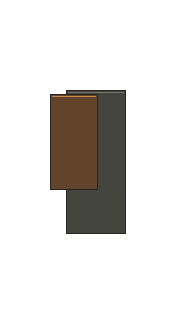](../../game/tests/fixtures/furniture-calibration/prototype-bench-v1/west-rear_structure.png)

Source / prompt: [prototype-bench.png](../../game/assets/runtime/office/prototype-bench.png)

Review: [PROTOTYPE_BENCH_PRODUCTION_REVIEW.md](PROTOTYPE_BENCH_PRODUCTION_REVIEW.md)

Native evidence: [actual-room-contact-sheet-native.png](../../game/tests/output/prototype-bench-room/actual-room-contact-sheet-native.png) · [results.json](../../game/tests/output/prototype-bench-room/results.json)

**Declared native layers (not automatically approved)**

| Export | Canvas / pivot | Actual opaque bounds | Derivation / limits |
| --- | --- | --- | --- |
| [west-floor_shadow.png](../../game/tests/fixtures/furniture-calibration/prototype-bench-v1/west-floor_shadow.png) | 192×320 / [96, 240] | Not measured here | Original independently declared code-native prototype-bench layer; no finished raster rotation, mirror or scaling. |
| [west-rear_structure.png](../../game/tests/fixtures/furniture-calibration/prototype-bench-v1/west-rear_structure.png) | 192×320 / [96, 240] | Not measured here | Original independently declared code-native prototype-bench layer; no finished raster rotation, mirror or scaling. |
| [west-front_structure.png](../../game/tests/fixtures/furniture-calibration/prototype-bench-v1/west-front_structure.png) | 192×320 / [96, 240] | Not measured here | Original independently declared code-native prototype-bench layer; no finished raster rotation, mirror or scaling. |
| [west-tool_overlay.png](../../game/tests/fixtures/furniture-calibration/prototype-bench-v1/west-tool_overlay.png) | 192×320 / [96, 240] | Not measured here | Original independently declared code-native prototype-bench layer; no finished raster rotation, mirror or scaling. |

west-floor_shadow.png references: [PROTOTYPE_BENCH_PRODUCTION_REVIEW.md](PROTOTYPE_BENCH_PRODUCTION_REVIEW.md)

west-rear_structure.png references: [PROTOTYPE_BENCH_PRODUCTION_REVIEW.md](PROTOTYPE_BENCH_PRODUCTION_REVIEW.md)

west-front_structure.png references: [PROTOTYPE_BENCH_PRODUCTION_REVIEW.md](PROTOTYPE_BENCH_PRODUCTION_REVIEW.md)

west-tool_overlay.png references: [PROTOTYPE_BENCH_PRODUCTION_REVIEW.md](PROTOTYPE_BENCH_PRODUCTION_REVIEW.md)

**Installed runtime layers — explicit integration evidence required**

| Export | Canvas / pivot | Actual opaque bounds | Derivation / limits |
| --- | --- | --- | --- |
| [west-floor_shadow.png](../../game/assets/runtime/office/prototype-bench-v1/west-floor_shadow.png) | 192×320 / [96, 240] | Not measured here | Exact hash-locked production copy of the reviewed native component; native scale 1 and no raster rotation. |
| [west-rear_structure.png](../../game/assets/runtime/office/prototype-bench-v1/west-rear_structure.png) | 192×320 / [96, 240] | Not measured here | Exact hash-locked production copy of the reviewed native component; native scale 1 and no raster rotation. |
| [west-front_structure.png](../../game/assets/runtime/office/prototype-bench-v1/west-front_structure.png) | 192×320 / [96, 240] | Not measured here | Exact hash-locked production copy of the reviewed native component; native scale 1 and no raster rotation. |
| [west-tool_overlay.png](../../game/assets/runtime/office/prototype-bench-v1/west-tool_overlay.png) | 192×320 / [96, 240] | Not measured here | Exact hash-locked production copy of the reviewed native component; native scale 1 and no raster rotation. |

west-floor_shadow.png references: [west-floor_shadow.png](../../game/tests/fixtures/furniture-calibration/prototype-bench-v1/west-floor_shadow.png)

west-rear_structure.png references: [west-rear_structure.png](../../game/tests/fixtures/furniture-calibration/prototype-bench-v1/west-rear_structure.png)

west-front_structure.png references: [west-front_structure.png](../../game/tests/fixtures/furniture-calibration/prototype-bench-v1/west-front_structure.png)

west-tool_overlay.png references: [west-tool_overlay.png](../../game/tests/fixtures/furniture-calibration/prototype-bench-v1/west-tool_overlay.png)

Runtime whole reference / integration evidence: [PROTOTYPE_BENCH_PRODUCTION_REVIEW.md](PROTOTYPE_BENCH_PRODUCTION_REVIEW.md)

### Compact starter desk

`compact_desk` · P0 · founder, all future specialists.

Direction semantics: **workstation gaze**.

Small-office starting point; use the same joinery and material as the shared workstation.

Proposed envelope **160×192**, fixed floor anchor **[80, 128]**. N/E footprints: **2×1 / 1×2 cells**.

Tools: small clean task surface. Layers: `floor_shadow`, `rear_structure`, `front_structure`.

**north: approved.** Approved as a reusable passive compact base after the checker-mesh shadow was replaced by bounded contact marks. Chairs, devices, role tools, seated actors and lifecycle remain separate assembly work. This approval is passive base-art only; no runtime/default-layout binding or workstation capability is implied.

[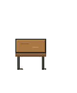](../../game/tests/fixtures/furniture-calibration/compact-desk-v2/north-whole.png)

Review: [BASE_FURNITURE_BASE_ONLY_REVIEW_2026-09-06.md](BASE_FURNITURE_BASE_ONLY_REVIEW_2026-09-06.md)

Native evidence: [compact_desk-actual-room-base-native.png](../../game/tests/output/base-furniture-review-2026-09-06/compact_desk-actual-room-base-native.png) · [manifest.json](../../game/tests/fixtures/furniture-calibration/compact-desk-v2/manifest.json) · [export-results.json](../../game/tests/output/base-furniture-review-2026-09-06/export-results.json) · [actual-room-results.json](../../game/tests/output/base-furniture-review-2026-09-06/actual-room-results.json) · [compact_desk-after-v2-native.png](../../game/tests/output/base-furniture-review-2026-09-06/compact_desk-after-v2-native.png) · [compact_desk-before-after-4x.png](../../game/tests/output/base-furniture-review-2026-09-06/compact_desk-before-after-4x.png) · [compact_desk-actual-room-actor-native.png](../../game/tests/output/base-furniture-review-2026-09-06/compact_desk-actual-room-actor-native.png) · [compact_desk-actual-room-actor-4x.png](../../game/tests/output/base-furniture-review-2026-09-06/compact_desk-actual-room-actor-4x.png) · [BASE_FURNITURE_BASE_ONLY_REVIEW_2026-09-06.md](BASE_FURNITURE_BASE_ONLY_REVIEW_2026-09-06.md)

Export method: Versioned deterministic typed-GDScript screen-axis base. compact-desk-v2 retains rear/front structure byte-identical to v1 and replaces only floor_shadow with authored contact marks; no generated source, raster rotation, mirror, scale, baked attachment, actor, text or logo.

**Declared native layers (not automatically approved)**

| Export | Canvas / pivot | Actual opaque bounds | Derivation / limits |
| --- | --- | --- | --- |
| [north-floor_shadow.png](../../game/tests/fixtures/furniture-calibration/compact-desk-v2/north-floor_shadow.png) | 160×192 / [80, 128] | [40, 141, 56, 3]; 32 pixels | Exact code-native north contact-shadow revision; fixed upper-left light, binary alpha, zero hidden RGB, shared canvas/pivot, no finished-raster transform. |
| [north-rear_structure.png](../../game/tests/fixtures/furniture-calibration/compact-desk-v2/north-rear_structure.png) | 160×192 / [80, 128] | [32, 80, 64, 35]; 1970 pixels | Byte-identical north v1 structure layer retained inside the versioned v2 base bundle. |
| [north-front_structure.png](../../game/tests/fixtures/furniture-calibration/compact-desk-v2/north-front_structure.png) | 160×192 / [80, 128] | [32, 110, 64, 34]; 718 pixels | Byte-identical north v1 structure layer retained inside the versioned v2 base bundle. |

north-floor_shadow.png references: [base_furniture_review_v2.gd](../../game/tools/base_furniture_review_v2.gd) · [BASE_FURNITURE_BASE_ONLY_REVIEW_2026-09-06.md](BASE_FURNITURE_BASE_ONLY_REVIEW_2026-09-06.md)

north-rear_structure.png references: [compact_desk_geometry.gd](../../game/tools/compact_desk_geometry.gd) · [BASE_FURNITURE_BASE_ONLY_REVIEW_2026-09-06.md](BASE_FURNITURE_BASE_ONLY_REVIEW_2026-09-06.md)

north-front_structure.png references: [compact_desk_geometry.gd](../../game/tools/compact_desk_geometry.gd) · [BASE_FURNITURE_BASE_ONLY_REVIEW_2026-09-06.md](BASE_FURNITURE_BASE_ONLY_REVIEW_2026-09-06.md)

**Additional composites**

| Export | Canvas / pivot | Actual opaque bounds | Derivation / limits |
| --- | --- | --- | --- |
| [north-whole.png](../../game/tests/fixtures/furniture-calibration/compact-desk-v2/north-whole.png) | 160×192 / [80, 128] | [32, 80, 64, 64]; 2668 pixels | Byte-exact ordered union of the three registered v2 native base layers. |

Retained native composite / source candidate: [north-whole.png](../../game/tests/fixtures/furniture-calibration/compact-desk-v2/north-whole.png)

**east: approved.** Approved as a reusable passive compact base after the checker-mesh shadow was replaced by bounded contact marks. Chairs, devices, role tools, seated actors and lifecycle remain separate assembly work. This approval is passive base-art only; no runtime/default-layout binding or workstation capability is implied.

[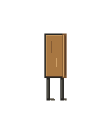](../../game/tests/fixtures/furniture-calibration/compact-desk-v2/east-whole.png)

Review: [BASE_FURNITURE_BASE_ONLY_REVIEW_2026-09-06.md](BASE_FURNITURE_BASE_ONLY_REVIEW_2026-09-06.md)

Native evidence: [compact_desk-actual-room-base-native.png](../../game/tests/output/base-furniture-review-2026-09-06/compact_desk-actual-room-base-native.png) · [manifest.json](../../game/tests/fixtures/furniture-calibration/compact-desk-v2/manifest.json) · [export-results.json](../../game/tests/output/base-furniture-review-2026-09-06/export-results.json) · [actual-room-results.json](../../game/tests/output/base-furniture-review-2026-09-06/actual-room-results.json) · [compact_desk-after-v2-native.png](../../game/tests/output/base-furniture-review-2026-09-06/compact_desk-after-v2-native.png) · [compact_desk-before-after-4x.png](../../game/tests/output/base-furniture-review-2026-09-06/compact_desk-before-after-4x.png) · [compact_desk-actual-room-actor-native.png](../../game/tests/output/base-furniture-review-2026-09-06/compact_desk-actual-room-actor-native.png) · [compact_desk-actual-room-actor-4x.png](../../game/tests/output/base-furniture-review-2026-09-06/compact_desk-actual-room-actor-4x.png) · [BASE_FURNITURE_BASE_ONLY_REVIEW_2026-09-06.md](BASE_FURNITURE_BASE_ONLY_REVIEW_2026-09-06.md)

Export method: Versioned deterministic typed-GDScript screen-axis base. compact-desk-v2 retains rear/front structure byte-identical to v1 and replaces only floor_shadow with authored contact marks; no generated source, raster rotation, mirror, scale, baked attachment, actor, text or logo.

**Declared native layers (not automatically approved)**

| Export | Canvas / pivot | Actual opaque bounds | Derivation / limits |
| --- | --- | --- | --- |
| [east-floor_shadow.png](../../game/tests/fixtures/furniture-calibration/compact-desk-v2/east-floor_shadow.png) | 160×192 / [80, 128] | [71, 141, 25, 3]; 32 pixels | Exact code-native east contact-shadow revision; fixed upper-left light, binary alpha, zero hidden RGB, shared canvas/pivot, no finished-raster transform. |
| [east-rear_structure.png](../../game/tests/fixtures/furniture-calibration/compact-desk-v2/east-rear_structure.png) | 160×192 / [80, 128] | [64, 48, 30, 64]; 1920 pixels | Byte-identical east v1 structure layer retained inside the versioned v2 base bundle. |
| [east-front_structure.png](../../game/tests/fixtures/furniture-calibration/compact-desk-v2/east-front_structure.png) | 160×192 / [80, 128] | [67, 48, 29, 96]; 704 pixels | Byte-identical east v1 structure layer retained inside the versioned v2 base bundle. |

east-floor_shadow.png references: [base_furniture_review_v2.gd](../../game/tools/base_furniture_review_v2.gd) · [BASE_FURNITURE_BASE_ONLY_REVIEW_2026-09-06.md](BASE_FURNITURE_BASE_ONLY_REVIEW_2026-09-06.md)

east-rear_structure.png references: [compact_desk_geometry.gd](../../game/tools/compact_desk_geometry.gd) · [BASE_FURNITURE_BASE_ONLY_REVIEW_2026-09-06.md](BASE_FURNITURE_BASE_ONLY_REVIEW_2026-09-06.md)

east-front_structure.png references: [compact_desk_geometry.gd](../../game/tools/compact_desk_geometry.gd) · [BASE_FURNITURE_BASE_ONLY_REVIEW_2026-09-06.md](BASE_FURNITURE_BASE_ONLY_REVIEW_2026-09-06.md)

**Additional composites**

| Export | Canvas / pivot | Actual opaque bounds | Derivation / limits |
| --- | --- | --- | --- |
| [east-whole.png](../../game/tests/fixtures/furniture-calibration/compact-desk-v2/east-whole.png) | 160×192 / [80, 128] | [64, 48, 32, 96]; 2398 pixels | Byte-exact ordered union of the three registered v2 native base layers. |

Retained native composite / source candidate: [east-whole.png](../../game/tests/fixtures/furniture-calibration/compact-desk-v2/east-whole.png)

**south: approved.** Approved as a reusable passive compact base after the checker-mesh shadow was replaced by bounded contact marks. Chairs, devices, role tools, seated actors and lifecycle remain separate assembly work. This approval is passive base-art only; no runtime/default-layout binding or workstation capability is implied.

[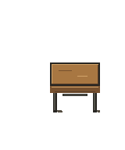](../../game/tests/fixtures/furniture-calibration/compact-desk-v2/south-whole.png)

Review: [BASE_FURNITURE_BASE_ONLY_REVIEW_2026-09-06.md](BASE_FURNITURE_BASE_ONLY_REVIEW_2026-09-06.md)

Native evidence: [compact_desk-actual-room-base-native.png](../../game/tests/output/base-furniture-review-2026-09-06/compact_desk-actual-room-base-native.png) · [manifest.json](../../game/tests/fixtures/furniture-calibration/compact-desk-v2/manifest.json) · [export-results.json](../../game/tests/output/base-furniture-review-2026-09-06/export-results.json) · [actual-room-results.json](../../game/tests/output/base-furniture-review-2026-09-06/actual-room-results.json) · [compact_desk-after-v2-native.png](../../game/tests/output/base-furniture-review-2026-09-06/compact_desk-after-v2-native.png) · [compact_desk-before-after-4x.png](../../game/tests/output/base-furniture-review-2026-09-06/compact_desk-before-after-4x.png) · [compact_desk-actual-room-actor-native.png](../../game/tests/output/base-furniture-review-2026-09-06/compact_desk-actual-room-actor-native.png) · [compact_desk-actual-room-actor-4x.png](../../game/tests/output/base-furniture-review-2026-09-06/compact_desk-actual-room-actor-4x.png) · [BASE_FURNITURE_BASE_ONLY_REVIEW_2026-09-06.md](BASE_FURNITURE_BASE_ONLY_REVIEW_2026-09-06.md)

Export method: Versioned deterministic typed-GDScript screen-axis base. compact-desk-v2 retains rear/front structure byte-identical to v1 and replaces only floor_shadow with authored contact marks; no generated source, raster rotation, mirror, scale, baked attachment, actor, text or logo.

**Declared native layers (not automatically approved)**

| Export | Canvas / pivot | Actual opaque bounds | Derivation / limits |
| --- | --- | --- | --- |
| [south-floor_shadow.png](../../game/tests/fixtures/furniture-calibration/compact-desk-v2/south-floor_shadow.png) | 160×192 / [80, 128] | [72, 141, 56, 3]; 32 pixels | Exact code-native south contact-shadow revision; fixed upper-left light, binary alpha, zero hidden RGB, shared canvas/pivot, no finished-raster transform. |
| [south-rear_structure.png](../../game/tests/fixtures/furniture-calibration/compact-desk-v2/south-rear_structure.png) | 160×192 / [80, 128] | [68, 84, 56, 39]; 590 pixels | Byte-identical south v1 structure layer retained inside the versioned v2 base bundle. |
| [south-front_structure.png](../../game/tests/fixtures/furniture-calibration/compact-desk-v2/south-front_structure.png) | 160×192 / [80, 128] | [64, 80, 64, 64]; 2746 pixels | Byte-identical south v1 structure layer retained inside the versioned v2 base bundle. |

south-floor_shadow.png references: [base_furniture_review_v2.gd](../../game/tools/base_furniture_review_v2.gd) · [BASE_FURNITURE_BASE_ONLY_REVIEW_2026-09-06.md](BASE_FURNITURE_BASE_ONLY_REVIEW_2026-09-06.md)

south-rear_structure.png references: [compact_desk_geometry.gd](../../game/tools/compact_desk_geometry.gd) · [BASE_FURNITURE_BASE_ONLY_REVIEW_2026-09-06.md](BASE_FURNITURE_BASE_ONLY_REVIEW_2026-09-06.md)

south-front_structure.png references: [compact_desk_geometry.gd](../../game/tools/compact_desk_geometry.gd) · [BASE_FURNITURE_BASE_ONLY_REVIEW_2026-09-06.md](BASE_FURNITURE_BASE_ONLY_REVIEW_2026-09-06.md)

**Additional composites**

| Export | Canvas / pivot | Actual opaque bounds | Derivation / limits |
| --- | --- | --- | --- |
| [south-whole.png](../../game/tests/fixtures/furniture-calibration/compact-desk-v2/south-whole.png) | 160×192 / [80, 128] | [64, 80, 64, 64]; 2872 pixels | Byte-exact ordered union of the three registered v2 native base layers. |

Retained native composite / source candidate: [south-whole.png](../../game/tests/fixtures/furniture-calibration/compact-desk-v2/south-whole.png)

**west: approved.** Approved as a reusable passive compact base after the checker-mesh shadow was replaced by bounded contact marks. Chairs, devices, role tools, seated actors and lifecycle remain separate assembly work. This approval is passive base-art only; no runtime/default-layout binding or workstation capability is implied.

[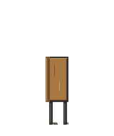](../../game/tests/fixtures/furniture-calibration/compact-desk-v2/west-whole.png)

Review: [BASE_FURNITURE_BASE_ONLY_REVIEW_2026-09-06.md](BASE_FURNITURE_BASE_ONLY_REVIEW_2026-09-06.md)

Native evidence: [compact_desk-actual-room-base-native.png](../../game/tests/output/base-furniture-review-2026-09-06/compact_desk-actual-room-base-native.png) · [manifest.json](../../game/tests/fixtures/furniture-calibration/compact-desk-v2/manifest.json) · [export-results.json](../../game/tests/output/base-furniture-review-2026-09-06/export-results.json) · [actual-room-results.json](../../game/tests/output/base-furniture-review-2026-09-06/actual-room-results.json) · [compact_desk-after-v2-native.png](../../game/tests/output/base-furniture-review-2026-09-06/compact_desk-after-v2-native.png) · [compact_desk-before-after-4x.png](../../game/tests/output/base-furniture-review-2026-09-06/compact_desk-before-after-4x.png) · [compact_desk-actual-room-actor-native.png](../../game/tests/output/base-furniture-review-2026-09-06/compact_desk-actual-room-actor-native.png) · [compact_desk-actual-room-actor-4x.png](../../game/tests/output/base-furniture-review-2026-09-06/compact_desk-actual-room-actor-4x.png) · [BASE_FURNITURE_BASE_ONLY_REVIEW_2026-09-06.md](BASE_FURNITURE_BASE_ONLY_REVIEW_2026-09-06.md)

Export method: Versioned deterministic typed-GDScript screen-axis base. compact-desk-v2 retains rear/front structure byte-identical to v1 and replaces only floor_shadow with authored contact marks; no generated source, raster rotation, mirror, scale, baked attachment, actor, text or logo.

**Declared native layers (not automatically approved)**

| Export | Canvas / pivot | Actual opaque bounds | Derivation / limits |
| --- | --- | --- | --- |
| [west-floor_shadow.png](../../game/tests/fixtures/furniture-calibration/compact-desk-v2/west-floor_shadow.png) | 160×192 / [80, 128] | [73, 173, 23, 3]; 26 pixels | Exact code-native west contact-shadow revision; fixed upper-left light, binary alpha, zero hidden RGB, shared canvas/pivot, no finished-raster transform. |
| [west-rear_structure.png](../../game/tests/fixtures/furniture-calibration/compact-desk-v2/west-rear_structure.png) | 160×192 / [80, 128] | [66, 80, 30, 64]; 1920 pixels | Byte-identical west v1 structure layer retained inside the versioned v2 base bundle. |
| [west-front_structure.png](../../game/tests/fixtures/furniture-calibration/compact-desk-v2/west-front_structure.png) | 160×192 / [80, 128] | [64, 80, 30, 96]; 704 pixels | Byte-identical west v1 structure layer retained inside the versioned v2 base bundle. |

west-floor_shadow.png references: [base_furniture_review_v2.gd](../../game/tools/base_furniture_review_v2.gd) · [BASE_FURNITURE_BASE_ONLY_REVIEW_2026-09-06.md](BASE_FURNITURE_BASE_ONLY_REVIEW_2026-09-06.md)

west-rear_structure.png references: [compact_desk_geometry.gd](../../game/tools/compact_desk_geometry.gd) · [BASE_FURNITURE_BASE_ONLY_REVIEW_2026-09-06.md](BASE_FURNITURE_BASE_ONLY_REVIEW_2026-09-06.md)

west-front_structure.png references: [compact_desk_geometry.gd](../../game/tools/compact_desk_geometry.gd) · [BASE_FURNITURE_BASE_ONLY_REVIEW_2026-09-06.md](BASE_FURNITURE_BASE_ONLY_REVIEW_2026-09-06.md)

**Additional composites**

| Export | Canvas / pivot | Actual opaque bounds | Derivation / limits |
| --- | --- | --- | --- |
| [west-whole.png](../../game/tests/fixtures/furniture-calibration/compact-desk-v2/west-whole.png) | 160×192 / [80, 128] | [64, 80, 32, 96]; 2392 pixels | Byte-exact ordered union of the three registered v2 native base layers. |

Retained native composite / source candidate: [west-whole.png](../../game/tests/fixtures/furniture-calibration/compact-desk-v2/west-whole.png)

### Two-person workbench

`shared_workbench` · P2 · engineer, creative, shared.

Direction semantics: **workstation gaze**.

A space-efficient paired surface; two separate seats and tool kits attach independently.

Proposed envelope **256×304**, fixed floor anchor **[128, 208]**. N/E footprints: **5×1 / 1×5 cells**.

Tools: two modular work bays; cable trough. Layers: `floor_shadow`, `rear_structure`, `front_structure`.

**north: approved.** Approved at the minimum threshold as a reusable passive two-bay base after the dominant checker shadow was replaced by bounded contact marks. Bare East/West ambiguity and all paired attachments/lifecycle remain separate work. This approval is passive base-art only; no runtime/default-layout binding or workstation capability is implied.

[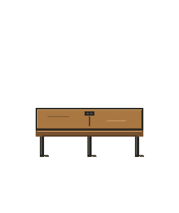](../../game/tests/fixtures/furniture-calibration/shared-workbench-v2/north-whole.png)

Review: [BASE_FURNITURE_BASE_ONLY_REVIEW_2026-09-06.md](BASE_FURNITURE_BASE_ONLY_REVIEW_2026-09-06.md)

Native evidence: [shared_workbench-actual-room-base-native.png](../../game/tests/output/base-furniture-review-2026-09-06/shared_workbench-actual-room-base-native.png) · [manifest.json](../../game/tests/fixtures/furniture-calibration/shared-workbench-v2/manifest.json) · [export-results.json](../../game/tests/output/base-furniture-review-2026-09-06/export-results.json) · [actual-room-results.json](../../game/tests/output/base-furniture-review-2026-09-06/actual-room-results.json) · [shared_workbench-after-v2-native.png](../../game/tests/output/base-furniture-review-2026-09-06/shared_workbench-after-v2-native.png) · [shared_workbench-before-after-4x.png](../../game/tests/output/base-furniture-review-2026-09-06/shared_workbench-before-after-4x.png) · [shared_workbench-actual-room-actor-native.png](../../game/tests/output/base-furniture-review-2026-09-06/shared_workbench-actual-room-actor-native.png) · [shared_workbench-actual-room-actor-4x.png](../../game/tests/output/base-furniture-review-2026-09-06/shared_workbench-actual-room-actor-4x.png) · [BASE_FURNITURE_BASE_ONLY_REVIEW_2026-09-06.md](BASE_FURNITURE_BASE_ONLY_REVIEW_2026-09-06.md)

Export method: Versioned deterministic typed-GDScript screen-axis base. shared-workbench-v2 retains rear/front structure byte-identical to v1 and replaces only floor_shadow with authored contact marks; no generated source, raster rotation, mirror, scale, baked attachment, actor, text or logo.

**Declared native layers (not automatically approved)**

| Export | Canvas / pivot | Actual opaque bounds | Derivation / limits |
| --- | --- | --- | --- |
| [north-floor_shadow.png](../../game/tests/fixtures/furniture-calibration/shared-workbench-v2/north-floor_shadow.png) | 256×304 / [128, 208] | [62, 221, 144, 3]; 60 pixels | Exact code-native north contact-shadow revision; fixed upper-left light, binary alpha, zero hidden RGB, shared canvas/pivot, no finished-raster transform. |
| [north-rear_structure.png](../../game/tests/fixtures/furniture-calibration/shared-workbench-v2/north-rear_structure.png) | 256×304 / [128, 208] | [51, 154, 154, 41]; 5090 pixels | Byte-identical north v1 structure layer retained inside the versioned v2 base bundle. |
| [north-front_structure.png](../../game/tests/fixtures/furniture-calibration/shared-workbench-v2/north-front_structure.png) | 256×304 / [128, 208] | [51, 186, 154, 38]; 1908 pixels | Byte-identical north v1 structure layer retained inside the versioned v2 base bundle. |

north-floor_shadow.png references: [base_furniture_review_v2.gd](../../game/tools/base_furniture_review_v2.gd) · [BASE_FURNITURE_BASE_ONLY_REVIEW_2026-09-06.md](BASE_FURNITURE_BASE_ONLY_REVIEW_2026-09-06.md)

north-rear_structure.png references: [shared_workbench_geometry.gd](../../game/tools/shared_workbench_geometry.gd) · [BASE_FURNITURE_BASE_ONLY_REVIEW_2026-09-06.md](BASE_FURNITURE_BASE_ONLY_REVIEW_2026-09-06.md)

north-front_structure.png references: [shared_workbench_geometry.gd](../../game/tools/shared_workbench_geometry.gd) · [BASE_FURNITURE_BASE_ONLY_REVIEW_2026-09-06.md](BASE_FURNITURE_BASE_ONLY_REVIEW_2026-09-06.md)

**Additional composites**

| Export | Canvas / pivot | Actual opaque bounds | Derivation / limits |
| --- | --- | --- | --- |
| [north-whole.png](../../game/tests/fixtures/furniture-calibration/shared-workbench-v2/north-whole.png) | 256×304 / [128, 208] | [51, 154, 155, 70]; 6893 pixels | Byte-exact ordered union of the three registered v2 native base layers. |

Retained native composite / source candidate: [north-whole.png](../../game/tests/fixtures/furniture-calibration/shared-workbench-v2/north-whole.png)

**east: approved.** Approved at the minimum threshold as a reusable passive two-bay base after the dominant checker shadow was replaced by bounded contact marks. Bare East/West ambiguity and all paired attachments/lifecycle remain separate work. This approval is passive base-art only; no runtime/default-layout binding or workstation capability is implied.

[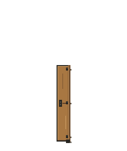](../../game/tests/fixtures/furniture-calibration/shared-workbench-v2/east-whole.png)

Review: [BASE_FURNITURE_BASE_ONLY_REVIEW_2026-09-06.md](BASE_FURNITURE_BASE_ONLY_REVIEW_2026-09-06.md)

Native evidence: [shared_workbench-actual-room-base-native.png](../../game/tests/output/base-furniture-review-2026-09-06/shared_workbench-actual-room-base-native.png) · [manifest.json](../../game/tests/fixtures/furniture-calibration/shared-workbench-v2/manifest.json) · [export-results.json](../../game/tests/output/base-furniture-review-2026-09-06/export-results.json) · [actual-room-results.json](../../game/tests/output/base-furniture-review-2026-09-06/actual-room-results.json) · [shared_workbench-after-v2-native.png](../../game/tests/output/base-furniture-review-2026-09-06/shared_workbench-after-v2-native.png) · [shared_workbench-before-after-4x.png](../../game/tests/output/base-furniture-review-2026-09-06/shared_workbench-before-after-4x.png) · [shared_workbench-actual-room-actor-native.png](../../game/tests/output/base-furniture-review-2026-09-06/shared_workbench-actual-room-actor-native.png) · [shared_workbench-actual-room-actor-4x.png](../../game/tests/output/base-furniture-review-2026-09-06/shared_workbench-actual-room-actor-4x.png) · [BASE_FURNITURE_BASE_ONLY_REVIEW_2026-09-06.md](BASE_FURNITURE_BASE_ONLY_REVIEW_2026-09-06.md)

Export method: Versioned deterministic typed-GDScript screen-axis base. shared-workbench-v2 retains rear/front structure byte-identical to v1 and replaces only floor_shadow with authored contact marks; no generated source, raster rotation, mirror, scale, baked attachment, actor, text or logo.

**Declared native layers (not automatically approved)**

| Export | Canvas / pivot | Actual opaque bounds | Derivation / limits |
| --- | --- | --- | --- |
| [east-floor_shadow.png](../../game/tests/fixtures/furniture-calibration/shared-workbench-v2/east-floor_shadow.png) | 256×304 / [128, 208] | [140, 139, 4, 149]; 36 pixels | Exact code-native east contact-shadow revision; fixed upper-left light, binary alpha, zero hidden RGB, shared canvas/pivot, no finished-raster transform. |
| [east-rear_structure.png](../../game/tests/fixtures/furniture-calibration/shared-workbench-v2/east-rear_structure.png) | 256×304 / [128, 208] | [114, 131, 28, 154]; 4312 pixels | Byte-identical east v1 structure layer retained inside the versioned v2 base bundle. |
| [east-front_structure.png](../../game/tests/fixtures/furniture-calibration/shared-workbench-v2/east-front_structure.png) | 256×304 / [128, 208] | [133, 131, 9, 157]; 882 pixels | Byte-identical east v1 structure layer retained inside the versioned v2 base bundle. |

east-floor_shadow.png references: [base_furniture_review_v2.gd](../../game/tools/base_furniture_review_v2.gd) · [BASE_FURNITURE_BASE_ONLY_REVIEW_2026-09-06.md](BASE_FURNITURE_BASE_ONLY_REVIEW_2026-09-06.md)

east-rear_structure.png references: [shared_workbench_geometry.gd](../../game/tools/shared_workbench_geometry.gd) · [BASE_FURNITURE_BASE_ONLY_REVIEW_2026-09-06.md](BASE_FURNITURE_BASE_ONLY_REVIEW_2026-09-06.md)

east-front_structure.png references: [shared_workbench_geometry.gd](../../game/tools/shared_workbench_geometry.gd) · [BASE_FURNITURE_BASE_ONLY_REVIEW_2026-09-06.md](BASE_FURNITURE_BASE_ONLY_REVIEW_2026-09-06.md)

**Additional composites**

| Export | Canvas / pivot | Actual opaque bounds | Derivation / limits |
| --- | --- | --- | --- |
| [east-whole.png](../../game/tests/fixtures/furniture-calibration/shared-workbench-v2/east-whole.png) | 256×304 / [128, 208] | [114, 131, 30, 157]; 4362 pixels | Byte-exact ordered union of the three registered v2 native base layers. |

Retained native composite / source candidate: [east-whole.png](../../game/tests/fixtures/furniture-calibration/shared-workbench-v2/east-whole.png)

**south: approved.** Approved at the minimum threshold as a reusable passive two-bay base after the dominant checker shadow was replaced by bounded contact marks. Bare East/West ambiguity and all paired attachments/lifecycle remain separate work. This approval is passive base-art only; no runtime/default-layout binding or workstation capability is implied.

[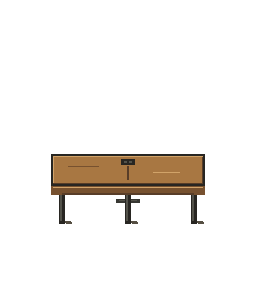](../../game/tests/fixtures/furniture-calibration/shared-workbench-v2/south-whole.png)

Review: [BASE_FURNITURE_BASE_ONLY_REVIEW_2026-09-06.md](BASE_FURNITURE_BASE_ONLY_REVIEW_2026-09-06.md)

Native evidence: [shared_workbench-actual-room-base-native.png](../../game/tests/output/base-furniture-review-2026-09-06/shared_workbench-actual-room-base-native.png) · [manifest.json](../../game/tests/fixtures/furniture-calibration/shared-workbench-v2/manifest.json) · [export-results.json](../../game/tests/output/base-furniture-review-2026-09-06/export-results.json) · [actual-room-results.json](../../game/tests/output/base-furniture-review-2026-09-06/actual-room-results.json) · [shared_workbench-after-v2-native.png](../../game/tests/output/base-furniture-review-2026-09-06/shared_workbench-after-v2-native.png) · [shared_workbench-before-after-4x.png](../../game/tests/output/base-furniture-review-2026-09-06/shared_workbench-before-after-4x.png) · [shared_workbench-actual-room-actor-native.png](../../game/tests/output/base-furniture-review-2026-09-06/shared_workbench-actual-room-actor-native.png) · [shared_workbench-actual-room-actor-4x.png](../../game/tests/output/base-furniture-review-2026-09-06/shared_workbench-actual-room-actor-4x.png) · [BASE_FURNITURE_BASE_ONLY_REVIEW_2026-09-06.md](BASE_FURNITURE_BASE_ONLY_REVIEW_2026-09-06.md)

Export method: Versioned deterministic typed-GDScript screen-axis base. shared-workbench-v2 retains rear/front structure byte-identical to v1 and replaces only floor_shadow with authored contact marks; no generated source, raster rotation, mirror, scale, baked attachment, actor, text or logo.

**Declared native layers (not automatically approved)**

| Export | Canvas / pivot | Actual opaque bounds | Derivation / limits |
| --- | --- | --- | --- |
| [south-floor_shadow.png](../../game/tests/fixtures/furniture-calibration/shared-workbench-v2/south-floor_shadow.png) | 256×304 / [128, 208] | [64, 221, 140, 3]; 60 pixels | Exact code-native south contact-shadow revision; fixed upper-left light, binary alpha, zero hidden RGB, shared canvas/pivot, no finished-raster transform. |
| [south-rear_structure.png](../../game/tests/fixtures/furniture-calibration/shared-workbench-v2/south-rear_structure.png) | 256×304 / [128, 208] | [59, 158, 138, 45]; 1362 pixels | Byte-identical south v1 structure layer retained inside the versioned v2 base bundle. |
| [south-front_structure.png](../../game/tests/fixtures/furniture-calibration/shared-workbench-v2/south-front_structure.png) | 256×304 / [128, 208] | [51, 154, 154, 70]; 6836 pixels | Byte-identical south v1 structure layer retained inside the versioned v2 base bundle. |

south-floor_shadow.png references: [base_furniture_review_v2.gd](../../game/tools/base_furniture_review_v2.gd) · [BASE_FURNITURE_BASE_ONLY_REVIEW_2026-09-06.md](BASE_FURNITURE_BASE_ONLY_REVIEW_2026-09-06.md)

south-rear_structure.png references: [shared_workbench_geometry.gd](../../game/tools/shared_workbench_geometry.gd) · [BASE_FURNITURE_BASE_ONLY_REVIEW_2026-09-06.md](BASE_FURNITURE_BASE_ONLY_REVIEW_2026-09-06.md)

south-front_structure.png references: [shared_workbench_geometry.gd](../../game/tools/shared_workbench_geometry.gd) · [BASE_FURNITURE_BASE_ONLY_REVIEW_2026-09-06.md](BASE_FURNITURE_BASE_ONLY_REVIEW_2026-09-06.md)

**Additional composites**

| Export | Canvas / pivot | Actual opaque bounds | Derivation / limits |
| --- | --- | --- | --- |
| [south-whole.png](../../game/tests/fixtures/furniture-calibration/shared-workbench-v2/south-whole.png) | 256×304 / [128, 208] | [51, 154, 154, 70]; 6965 pixels | Byte-exact ordered union of the three registered v2 native base layers. |

Retained native composite / source candidate: [south-whole.png](../../game/tests/fixtures/furniture-calibration/shared-workbench-v2/south-whole.png)

**west: approved.** Approved at the minimum threshold as a reusable passive two-bay base after the dominant checker shadow was replaced by bounded contact marks. Bare East/West ambiguity and all paired attachments/lifecycle remain separate work. This approval is passive base-art only; no runtime/default-layout binding or workstation capability is implied.

[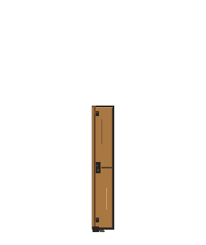](../../game/tests/fixtures/furniture-calibration/shared-workbench-v2/west-whole.png)

Review: [BASE_FURNITURE_BASE_ONLY_REVIEW_2026-09-06.md](BASE_FURNITURE_BASE_ONLY_REVIEW_2026-09-06.md)

Native evidence: [shared_workbench-actual-room-base-native.png](../../game/tests/output/base-furniture-review-2026-09-06/shared_workbench-actual-room-base-native.png) · [manifest.json](../../game/tests/fixtures/furniture-calibration/shared-workbench-v2/manifest.json) · [export-results.json](../../game/tests/output/base-furniture-review-2026-09-06/export-results.json) · [actual-room-results.json](../../game/tests/output/base-furniture-review-2026-09-06/actual-room-results.json) · [shared_workbench-after-v2-native.png](../../game/tests/output/base-furniture-review-2026-09-06/shared_workbench-after-v2-native.png) · [shared_workbench-before-after-4x.png](../../game/tests/output/base-furniture-review-2026-09-06/shared_workbench-before-after-4x.png) · [shared_workbench-actual-room-actor-native.png](../../game/tests/output/base-furniture-review-2026-09-06/shared_workbench-actual-room-actor-native.png) · [shared_workbench-actual-room-actor-4x.png](../../game/tests/output/base-furniture-review-2026-09-06/shared_workbench-actual-room-actor-4x.png) · [BASE_FURNITURE_BASE_ONLY_REVIEW_2026-09-06.md](BASE_FURNITURE_BASE_ONLY_REVIEW_2026-09-06.md)

Export method: Versioned deterministic typed-GDScript screen-axis base. shared-workbench-v2 retains rear/front structure byte-identical to v1 and replaces only floor_shadow with authored contact marks; no generated source, raster rotation, mirror, scale, baked attachment, actor, text or logo.

**Declared native layers (not automatically approved)**

| Export | Canvas / pivot | Actual opaque bounds | Derivation / limits |
| --- | --- | --- | --- |
| [west-floor_shadow.png](../../game/tests/fixtures/furniture-calibration/shared-workbench-v2/west-floor_shadow.png) | 256×304 / [128, 208] | [122, 141, 8, 147]; 80 pixels | Exact code-native west contact-shadow revision; fixed upper-left light, binary alpha, zero hidden RGB, shared canvas/pivot, no finished-raster transform. |
| [west-rear_structure.png](../../game/tests/fixtures/furniture-calibration/shared-workbench-v2/west-rear_structure.png) | 256×304 / [128, 208] | [114, 131, 28, 154]; 4312 pixels | Byte-identical west v1 structure layer retained inside the versioned v2 base bundle. |
| [west-front_structure.png](../../game/tests/fixtures/furniture-calibration/shared-workbench-v2/west-front_structure.png) | 256×304 / [128, 208] | [114, 131, 9, 157]; 882 pixels | Byte-identical west v1 structure layer retained inside the versioned v2 base bundle. |

west-floor_shadow.png references: [base_furniture_review_v2.gd](../../game/tools/base_furniture_review_v2.gd) · [BASE_FURNITURE_BASE_ONLY_REVIEW_2026-09-06.md](BASE_FURNITURE_BASE_ONLY_REVIEW_2026-09-06.md)

west-rear_structure.png references: [shared_workbench_geometry.gd](../../game/tools/shared_workbench_geometry.gd) · [BASE_FURNITURE_BASE_ONLY_REVIEW_2026-09-06.md](BASE_FURNITURE_BASE_ONLY_REVIEW_2026-09-06.md)

west-front_structure.png references: [shared_workbench_geometry.gd](../../game/tools/shared_workbench_geometry.gd) · [BASE_FURNITURE_BASE_ONLY_REVIEW_2026-09-06.md](BASE_FURNITURE_BASE_ONLY_REVIEW_2026-09-06.md)

**Additional composites**

| Export | Canvas / pivot | Actual opaque bounds | Derivation / limits |
| --- | --- | --- | --- |
| [west-whole.png](../../game/tests/fixtures/furniture-calibration/shared-workbench-v2/west-whole.png) | 256×304 / [128, 208] | [114, 131, 28, 157]; 4355 pixels | Byte-exact ordered union of the three registered v2 native base layers. |

Retained native composite / source candidate: [west-whole.png](../../game/tests/fixtures/furniture-calibration/shared-workbench-v2/west-whole.png)

### Task chair

`ergonomic_chair` · P0 · all roles.

Direction semantics: **seated occupant gaze**.

Separate chair with seated actor slot; preserve seat height and no baked employee.

Proposed envelope **96×160**, fixed floor anchor **[48, 112]**. N/E footprints: **1×1 / 1×1 cells**.

Tools: seat; backrest; casters. Layers: `floor_shadow` (optional), `seat_back`, `seat_front` (optional).

**north: runtime integrated.** Accepted as the shared north workstation chair component through complete actor lifecycle and ordinary GameMain production evidence. This does not approve profession-specific chair variants.

[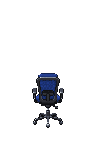](../../game/tests/fixtures/furniture-calibration/chair-north-v1.png)

Source / prompt: [chair-north-v1.png](../../game/assets/source/overnight-20260904/calibration/chair-north-v1.png) · [chair-north-v1.md](prompts/chair-north-v1.md)

Review: [COMPLETE_NORTH_WORKSTATION_REVIEW.md](COMPLETE_NORTH_WORKSTATION_REVIEW.md) · [FOUR_FACING_WORKSTATION_PRODUCTION_REVIEW.md](FOUR_FACING_WORKSTATION_PRODUCTION_REVIEW.md)

Native evidence: [six-poses-review-native.png](../../game/tests/output/complete-north-workstation/six-poses-review-native.png) · [production-four-facing-contact-sheet.png](../../game/tests/output/reviewed-workstations-production/production-four-facing-contact-sheet.png)

**Declared native layers (not automatically approved)**

| Export | Canvas / pivot | Actual opaque bounds | Derivation / limits |
| --- | --- | --- | --- |
| [whole_chair: chair-north-v1.png](../../game/tests/fixtures/furniture-calibration/chair-north-v1.png) | 96×160 / [48, 112] | Not measured here | Reviewed whole-chair native layer. |

chair-north-v1.png references: [COMPLETE_NORTH_WORKSTATION_REVIEW.md](COMPLETE_NORTH_WORKSTATION_REVIEW.md)

**Installed runtime layers — explicit integration evidence required**

| Export | Canvas / pivot | Actual opaque bounds | Derivation / limits |
| --- | --- | --- | --- |
| [chair-north.png](../../game/assets/runtime/office/workstations-v2/chair-north.png) | 96×160 / [48, 112] | Not measured here | Exact hash-locked production copy of the reviewed native component; native scale 1 and no raster rotation. |

chair-north.png references: [chair-north-v1.png](../../game/tests/fixtures/furniture-calibration/chair-north-v1.png)

Runtime whole reference / integration evidence: [FOUR_FACING_WORKSTATION_PRODUCTION_REVIEW.md](FOUR_FACING_WORKSTATION_PRODUCTION_REVIEW.md)

**east: runtime integrated.** Accepted as the shared east workstation chair component through complete actor lifecycle and ordinary GameMain production evidence. This does not approve profession-specific chair variants.

Source / prompt: [chair-east-v2.png](../../game/assets/source/overnight-20260904/calibration/chair-east-v2.png) · [chair-east-v2.md](prompts/chair-east-v2.md)

Review: [README.md](../../game/tests/fixtures/furniture-calibration/chair-layers-v1/README.md) · [EAST_ACTOR_LAYER_REVIEW.md](EAST_ACTOR_LAYER_REVIEW.md) · [COMPLETE_EAST_WORKSTATION_REVIEW.md](COMPLETE_EAST_WORKSTATION_REVIEW.md) · [FOUR_FACING_WORKSTATION_PRODUCTION_REVIEW.md](FOUR_FACING_WORKSTATION_PRODUCTION_REVIEW.md)

Native evidence: [six-poses-review-native.png](../../game/tests/output/complete-east-workstation/six-poses-review-native.png) · [source-rear-arm-reunion-native.png](../../game/tests/output/chair-layer-export/source-rear-arm-reunion-native.png) · [results-headless.json](../../game/tests/output/chair-layer-export/results-headless.json) · [production-four-facing-contact-sheet.png](../../game/tests/output/reviewed-workstations-production/production-four-facing-contact-sheet.png)

**Declared native layers (not automatically approved)**

| Export | Canvas / pivot | Actual opaque bounds | Derivation / limits |
| --- | --- | --- | --- |
| [rear: east-rear.png](../../game/tests/fixtures/furniture-calibration/chair-layers-v1/east-rear.png) | 96×160 / [48, 112] | Not measured here | Reviewed exact native rear/near-arm partition. |
| [near_arm: east-front.png](../../game/tests/fixtures/furniture-calibration/chair-layers-v1/east-front.png) | 96×160 / [48, 112] | Not measured here | Reviewed exact native rear/near-arm partition. |

east-rear.png references: [COMPLETE_EAST_WORKSTATION_REVIEW.md](COMPLETE_EAST_WORKSTATION_REVIEW.md)

east-front.png references: [COMPLETE_EAST_WORKSTATION_REVIEW.md](COMPLETE_EAST_WORKSTATION_REVIEW.md)

**Installed runtime layers — explicit integration evidence required**

| Export | Canvas / pivot | Actual opaque bounds | Derivation / limits |
| --- | --- | --- | --- |
| [chair-east-rear.png](../../game/assets/runtime/office/workstations-v2/chair-east-rear.png) | 96×160 / [48, 112] | Not measured here | Exact hash-locked production copy of the reviewed native component; native scale 1 and no raster rotation. |
| [chair-east-front.png](../../game/assets/runtime/office/workstations-v2/chair-east-front.png) | 96×160 / [48, 112] | Not measured here | Exact hash-locked production copy of the reviewed native component; native scale 1 and no raster rotation. |

chair-east-rear.png references: [east-rear.png](../../game/tests/fixtures/furniture-calibration/chair-layers-v1/east-rear.png)

chair-east-front.png references: [east-front.png](../../game/tests/fixtures/furniture-calibration/chair-layers-v1/east-front.png)

Runtime whole reference / integration evidence: [FOUR_FACING_WORKSTATION_PRODUCTION_REVIEW.md](FOUR_FACING_WORKSTATION_PRODUCTION_REVIEW.md)

**south: runtime integrated.** Accepted as the shared south workstation chair component through complete actor lifecycle and ordinary GameMain production evidence. This does not approve profession-specific chair variants.

Source / prompt: [chair-south-v3.png](../../game/assets/source/overnight-20260904/calibration/chair-south-v3.png) · [chair-south-v3.md](prompts/chair-south-v3.md)

Review: [COMPLETE_SOUTH_HANDOFF_REVIEW.md](COMPLETE_SOUTH_HANDOFF_REVIEW.md) · [FOUR_FACING_WORKSTATION_PRODUCTION_REVIEW.md](FOUR_FACING_WORKSTATION_PRODUCTION_REVIEW.md)

Native evidence: [six-poses-review-native.png](../../game/tests/output/complete-south-workstation-after-handoff/six-poses-review-native.png) · [production-four-facing-contact-sheet.png](../../game/tests/output/reviewed-workstations-production/production-four-facing-contact-sheet.png)

**Declared native layers (not automatically approved)**

| Export | Canvas / pivot | Actual opaque bounds | Derivation / limits |
| --- | --- | --- | --- |
| [whole_chair: chair-south-v3.png](../../game/tests/fixtures/furniture-calibration/chair-south-v3.png) | 96×160 / [48, 112] | Not measured here | Reviewed whole-chair native layer. |

chair-south-v3.png references: [COMPLETE_SOUTH_HANDOFF_REVIEW.md](COMPLETE_SOUTH_HANDOFF_REVIEW.md)

**Installed runtime layers — explicit integration evidence required**

| Export | Canvas / pivot | Actual opaque bounds | Derivation / limits |
| --- | --- | --- | --- |
| [chair-south.png](../../game/assets/runtime/office/workstations-v2/chair-south.png) | 96×160 / [48, 112] | Not measured here | Exact hash-locked production copy of the reviewed native component; native scale 1 and no raster rotation. |

chair-south.png references: [chair-south-v3.png](../../game/tests/fixtures/furniture-calibration/chair-south-v3.png)

Runtime whole reference / integration evidence: [FOUR_FACING_WORKSTATION_PRODUCTION_REVIEW.md](FOUR_FACING_WORKSTATION_PRODUCTION_REVIEW.md)

**west: runtime integrated.** Accepted as the shared west workstation chair component through complete actor lifecycle and ordinary GameMain production evidence. This does not approve profession-specific chair variants.

Source / prompt: [chair-west-v2.png](../../game/assets/source/overnight-20260904/calibration/chair-west-v2.png) · [chair-west-v2.md](prompts/chair-west-v2.md)

Review: [CHAIR_WEST_REVIEW.md](CHAIR_WEST_REVIEW.md) · [CHAIR_WEST_HEIGHT_REVIEW.md](CHAIR_WEST_HEIGHT_REVIEW.md) · [SUPPORTED_WEST_ASSEMBLY_REVIEW.md](SUPPORTED_WEST_ASSEMBLY_REVIEW.md) · [README.md](../../game/tests/fixtures/furniture-calibration/chair-layers-v1/README.md) · [WEST_SUPPORTED_LAYERS_REVIEW.md](WEST_SUPPORTED_LAYERS_REVIEW.md) · [COMPLETE_WEST_WORKSTATION_REVIEW.md](COMPLETE_WEST_WORKSTATION_REVIEW.md) · [FOUR_FACING_WORKSTATION_PRODUCTION_REVIEW.md](FOUR_FACING_WORKSTATION_PRODUCTION_REVIEW.md)

Native evidence: [six-poses-review-native.png](../../game/tests/output/complete-west-workstation/six-poses-review-native.png) · [all-six-support-native-contact.png](../../game/tests/output/supported-west-assembly/height56/all-six-support-native-contact.png) · [manifest.json](../../game/tests/output/supported-west-assembly/height56/manifest.json) · [source-rear-arm-reunion-native.png](../../game/tests/output/chair-layer-export/source-rear-arm-reunion-native.png) · [results-headless.json](../../game/tests/output/chair-layer-export/results-headless.json) · [production-four-facing-contact-sheet.png](../../game/tests/output/reviewed-workstations-production/production-four-facing-contact-sheet.png)

**Declared native layers (not automatically approved)**

| Export | Canvas / pivot | Actual opaque bounds | Derivation / limits |
| --- | --- | --- | --- |
| [rear: west-rear.png](../../game/tests/fixtures/furniture-calibration/chair-layers-v1/west-rear.png) | 96×160 / [48, 112] | Not measured here | Reviewed exact native rear/near-arm partition. |
| [near_arm: west-front.png](../../game/tests/fixtures/furniture-calibration/chair-layers-v1/west-front.png) | 96×160 / [48, 112] | Not measured here | Reviewed exact native rear/near-arm partition. |

west-rear.png references: [COMPLETE_WEST_WORKSTATION_REVIEW.md](COMPLETE_WEST_WORKSTATION_REVIEW.md)

west-front.png references: [COMPLETE_WEST_WORKSTATION_REVIEW.md](COMPLETE_WEST_WORKSTATION_REVIEW.md)

**Installed runtime layers — explicit integration evidence required**

| Export | Canvas / pivot | Actual opaque bounds | Derivation / limits |
| --- | --- | --- | --- |
| [chair-west-rear.png](../../game/assets/runtime/office/workstations-v2/chair-west-rear.png) | 96×160 / [48, 112] | Not measured here | Exact hash-locked production copy of the reviewed native component; native scale 1 and no raster rotation. |
| [chair-west-front.png](../../game/assets/runtime/office/workstations-v2/chair-west-front.png) | 96×160 / [48, 112] | Not measured here | Exact hash-locked production copy of the reviewed native component; native scale 1 and no raster rotation. |

chair-west-rear.png references: [west-rear.png](../../game/tests/fixtures/furniture-calibration/chair-layers-v1/west-rear.png)

chair-west-front.png references: [west-front.png](../../game/tests/fixtures/furniture-calibration/chair-layers-v1/west-front.png)

Runtime whole reference / integration evidence: [FOUR_FACING_WORKSTATION_PRODUCTION_REVIEW.md](FOUR_FACING_WORKSTATION_PRODUCTION_REVIEW.md)

**Alternative normalization — not a new source generation or directional slot**

| Export | Canvas / pivot | Actual opaque bounds | Derivation / limits |
| --- | --- | --- | --- |
| [chair-west-v2-height56.png](../../game/tests/fixtures/furniture-calibration/chair-west-v2-height56.png) | 96×160 / [48, 112] | [35, 72, 29, 56] | Existing W2 master uniformly normalized to body height56 rather than32px caster width. No new generation, source replacement, nonuniform stretch or layer approval. |

chair-west-v2-height56.png references: [chair-west-v2.png](../../game/assets/source/overnight-20260904/calibration/chair-west-v2.png) · [CHAIR_WEST_HEIGHT_REVIEW.md](CHAIR_WEST_HEIGHT_REVIEW.md) · [family-native.png](../../game/tests/output/chair-west-height-study/family-native.png)

### Visitor chair

`visitor_chair` · P1 · shared, customer_success, lawyer.

Direction semantics: **seated occupant gaze**.

Lighter guest seating for reviews; intentionally distinct from the rolling task chair.

Proposed envelope **96×144**, fixed floor anchor **[48, 96]**. N/E footprints: **1×1 / 1×1 cells**.

Tools: simple upholstered seat. Layers: `floor_shadow`, `seat_back`, `seat_front`.

**north: approved.** Approved as exact visitor-chair-v2 bare art after a shadow-only correction. Small support-local contact marks replace the rejected v1 dither/solid basket; every chair structure pixel, projection, pivot and physical record remains v1-exact. The optional contact socket and existing Mina scale/depth probe do not approve a seated pose, Sit action, reservation policy or lifecycle. Passive art-library approval only; no runtime/default-layout binding follows.

[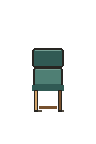](../../game/tests/fixtures/furniture-calibration/visitor-chair-v2/north-whole.png)

Review: [VISITOR_CHAIR_V2_REVIEW_2026-09-06.md](VISITOR_CHAIR_V2_REVIEW_2026-09-06.md)

Native evidence: [actual-gamemain-contact-sheet-native.png](../../game/tests/output/visitor-chair-v2/actual-gamemain-contact-sheet-native.png) · [manifest.json](../../game/tests/fixtures/furniture-calibration/visitor-chair-v2/manifest.json) · [actual-room-results.json](../../game/tests/output/visitor-chair-v2/actual-room-results.json) · [candidate-contact-sheet-native.png](../../game/tests/output/visitor-chair-v2/candidate-contact-sheet-native.png) · [candidate-contact-sheet-4x.png](../../game/tests/output/visitor-chair-v2/candidate-contact-sheet-4x.png) · [v1-v2-before-after-native.png](../../game/tests/output/visitor-chair-v2/v1-v2-before-after-native.png) · [v1-v2-before-after-4x.png](../../game/tests/output/visitor-chair-v2/v1-v2-before-after-4x.png) · [actual-room-base-contact-sheet-native.png](../../game/tests/output/visitor-chair-v2/actual-room-base-contact-sheet-native.png) · [actual-room-standing-contact-sheet-native.png](../../game/tests/output/visitor-chair-v2/actual-room-standing-contact-sheet-native.png) · [actual-room-seated-contact-sheet-native.png](../../game/tests/output/visitor-chair-v2/actual-room-seated-contact-sheet-native.png) · [actual-room-seated-contact-sheet-4x.png](../../game/tests/output/visitor-chair-v2/actual-room-seated-contact-sheet-4x.png)

Export method: Shadow-only visitor-chair-v2 revision: deterministic support-local contact marks replace v1 floor_shadow; seat_back and seat_front remain byte-identical code-native v1 screen-axis geometry. No generated source, finished-bitmap rotation, mirror, flip, scale, baked actor, text or logo.

**Declared native layers (not automatically approved)**

| Export | Canvas / pivot | Actual opaque bounds | Derivation / limits |
| --- | --- | --- | --- |
| [north-floor_shadow.png](../../game/tests/fixtures/furniture-calibration/visitor-chair-v2/north-floor_shadow.png) | 96×144 / [48, 96] | [37, 87, 27, 25]; 28 pixels | Shadow-only authored contact marks |
| [north-seat_back.png](../../game/tests/fixtures/furniture-calibration/visitor-chair-v2/north-seat_back.png) | 96×144 / [48, 96] | [32, 48, 32, 41]; 1208 pixels | Byte-identical visitor-chair-v1 structure layer |
| [north-seat_front.png](../../game/tests/fixtures/furniture-calibration/visitor-chair-v2/north-seat_front.png) | 96×144 / [48, 96] | [32, 85, 32, 27]; 414 pixels | Byte-identical visitor-chair-v1 structure layer |

north-floor_shadow.png references: [visitor_chair_review_v2.gd](../../game/tools/visitor_chair_review_v2.gd) · [VISITOR_CHAIR_V2_REVIEW_2026-09-06.md](VISITOR_CHAIR_V2_REVIEW_2026-09-06.md)

north-seat_back.png references: [visitor_chair_geometry.gd](../../game/tools/visitor_chair_geometry.gd) · [VISITOR_CHAIR_V2_REVIEW_2026-09-06.md](VISITOR_CHAIR_V2_REVIEW_2026-09-06.md)

north-seat_front.png references: [visitor_chair_geometry.gd](../../game/tools/visitor_chair_geometry.gd) · [VISITOR_CHAIR_V2_REVIEW_2026-09-06.md](VISITOR_CHAIR_V2_REVIEW_2026-09-06.md)

**Additional composites**

| Export | Canvas / pivot | Actual opaque bounds | Derivation / limits |
| --- | --- | --- | --- |
| [north-whole.png](../../game/tests/fixtures/furniture-calibration/visitor-chair-v2/north-whole.png) | 96×144 / [48, 96] | [32, 48, 32, 64]; 1562 pixels | Byte-exact ordered union of v2 contact shadow and unchanged v1 chair structure. |

Retained native composite / source candidate: [north-whole.png](../../game/tests/fixtures/furniture-calibration/visitor-chair-v2/north-whole.png)

**east: approved.** Approved as exact visitor-chair-v2 bare art after a shadow-only correction. Small support-local contact marks replace the rejected v1 dither/solid basket; every chair structure pixel, projection, pivot and physical record remains v1-exact. The optional contact socket and existing Mina scale/depth probe do not approve a seated pose, Sit action, reservation policy or lifecycle. Passive art-library approval only; no runtime/default-layout binding follows.

[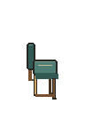](../../game/tests/fixtures/furniture-calibration/visitor-chair-v2/east-whole.png)

Review: [VISITOR_CHAIR_V2_REVIEW_2026-09-06.md](VISITOR_CHAIR_V2_REVIEW_2026-09-06.md)

Native evidence: [actual-gamemain-contact-sheet-native.png](../../game/tests/output/visitor-chair-v2/actual-gamemain-contact-sheet-native.png) · [manifest.json](../../game/tests/fixtures/furniture-calibration/visitor-chair-v2/manifest.json) · [actual-room-results.json](../../game/tests/output/visitor-chair-v2/actual-room-results.json) · [candidate-contact-sheet-native.png](../../game/tests/output/visitor-chair-v2/candidate-contact-sheet-native.png) · [candidate-contact-sheet-4x.png](../../game/tests/output/visitor-chair-v2/candidate-contact-sheet-4x.png) · [v1-v2-before-after-native.png](../../game/tests/output/visitor-chair-v2/v1-v2-before-after-native.png) · [v1-v2-before-after-4x.png](../../game/tests/output/visitor-chair-v2/v1-v2-before-after-4x.png) · [actual-room-base-contact-sheet-native.png](../../game/tests/output/visitor-chair-v2/actual-room-base-contact-sheet-native.png) · [actual-room-standing-contact-sheet-native.png](../../game/tests/output/visitor-chair-v2/actual-room-standing-contact-sheet-native.png) · [actual-room-seated-contact-sheet-native.png](../../game/tests/output/visitor-chair-v2/actual-room-seated-contact-sheet-native.png) · [actual-room-seated-contact-sheet-4x.png](../../game/tests/output/visitor-chair-v2/actual-room-seated-contact-sheet-4x.png)

Export method: Shadow-only visitor-chair-v2 revision: deterministic support-local contact marks replace v1 floor_shadow; seat_back and seat_front remain byte-identical code-native v1 screen-axis geometry. No generated source, finished-bitmap rotation, mirror, flip, scale, baked actor, text or logo.

**Declared native layers (not automatically approved)**

| Export | Canvas / pivot | Actual opaque bounds | Derivation / limits |
| --- | --- | --- | --- |
| [east-floor_shadow.png](../../game/tests/fixtures/furniture-calibration/visitor-chair-v2/east-floor_shadow.png) | 96×144 / [48, 96] | [35, 89, 29, 23]; 30 pixels | Shadow-only authored contact marks |
| [east-seat_back.png](../../game/tests/fixtures/furniture-calibration/visitor-chair-v2/east-seat_back.png) | 96×144 / [48, 96] | [30, 48, 35, 60]; 961 pixels | Byte-identical visitor-chair-v1 structure layer |
| [east-seat_front.png](../../game/tests/fixtures/furniture-calibration/visitor-chair-v2/east-seat_front.png) | 96×144 / [48, 96] | [40, 83, 26, 29]; 305 pixels | Byte-identical visitor-chair-v1 structure layer |

east-floor_shadow.png references: [visitor_chair_review_v2.gd](../../game/tools/visitor_chair_review_v2.gd) · [VISITOR_CHAIR_V2_REVIEW_2026-09-06.md](VISITOR_CHAIR_V2_REVIEW_2026-09-06.md)

east-seat_back.png references: [visitor_chair_geometry.gd](../../game/tools/visitor_chair_geometry.gd) · [VISITOR_CHAIR_V2_REVIEW_2026-09-06.md](VISITOR_CHAIR_V2_REVIEW_2026-09-06.md)

east-seat_front.png references: [visitor_chair_geometry.gd](../../game/tools/visitor_chair_geometry.gd) · [VISITOR_CHAIR_V2_REVIEW_2026-09-06.md](VISITOR_CHAIR_V2_REVIEW_2026-09-06.md)

**Additional composites**

| Export | Canvas / pivot | Actual opaque bounds | Derivation / limits |
| --- | --- | --- | --- |
| [east-whole.png](../../game/tests/fixtures/furniture-calibration/visitor-chair-v2/east-whole.png) | 96×144 / [48, 96] | [30, 48, 36, 64]; 1206 pixels | Byte-exact ordered union of v2 contact shadow and unchanged v1 chair structure. |

Retained native composite / source candidate: [east-whole.png](../../game/tests/fixtures/furniture-calibration/visitor-chair-v2/east-whole.png)

**south: approved.** Approved as exact visitor-chair-v2 bare art after a shadow-only correction. Small support-local contact marks replace the rejected v1 dither/solid basket; every chair structure pixel, projection, pivot and physical record remains v1-exact. The optional contact socket and existing Mina scale/depth probe do not approve a seated pose, Sit action, reservation policy or lifecycle. Passive art-library approval only; no runtime/default-layout binding follows.

[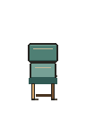](../../game/tests/fixtures/furniture-calibration/visitor-chair-v2/south-whole.png)

Review: [VISITOR_CHAIR_V2_REVIEW_2026-09-06.md](VISITOR_CHAIR_V2_REVIEW_2026-09-06.md)

Native evidence: [actual-gamemain-contact-sheet-native.png](../../game/tests/output/visitor-chair-v2/actual-gamemain-contact-sheet-native.png) · [manifest.json](../../game/tests/fixtures/furniture-calibration/visitor-chair-v2/manifest.json) · [actual-room-results.json](../../game/tests/output/visitor-chair-v2/actual-room-results.json) · [candidate-contact-sheet-native.png](../../game/tests/output/visitor-chair-v2/candidate-contact-sheet-native.png) · [candidate-contact-sheet-4x.png](../../game/tests/output/visitor-chair-v2/candidate-contact-sheet-4x.png) · [v1-v2-before-after-native.png](../../game/tests/output/visitor-chair-v2/v1-v2-before-after-native.png) · [v1-v2-before-after-4x.png](../../game/tests/output/visitor-chair-v2/v1-v2-before-after-4x.png) · [actual-room-base-contact-sheet-native.png](../../game/tests/output/visitor-chair-v2/actual-room-base-contact-sheet-native.png) · [actual-room-standing-contact-sheet-native.png](../../game/tests/output/visitor-chair-v2/actual-room-standing-contact-sheet-native.png) · [actual-room-seated-contact-sheet-native.png](../../game/tests/output/visitor-chair-v2/actual-room-seated-contact-sheet-native.png) · [actual-room-seated-contact-sheet-4x.png](../../game/tests/output/visitor-chair-v2/actual-room-seated-contact-sheet-4x.png)

Export method: Shadow-only visitor-chair-v2 revision: deterministic support-local contact marks replace v1 floor_shadow; seat_back and seat_front remain byte-identical code-native v1 screen-axis geometry. No generated source, finished-bitmap rotation, mirror, flip, scale, baked actor, text or logo.

**Declared native layers (not automatically approved)**

| Export | Canvas / pivot | Actual opaque bounds | Derivation / limits |
| --- | --- | --- | --- |
| [south-floor_shadow.png](../../game/tests/fixtures/furniture-calibration/visitor-chair-v2/south-floor_shadow.png) | 96×144 / [48, 96] | [37, 84, 27, 28]; 30 pixels | Shadow-only authored contact marks |
| [south-seat_back.png](../../game/tests/fixtures/furniture-calibration/visitor-chair-v2/south-seat_back.png) | 96×144 / [48, 96] | [31, 48, 34, 41]; 1298 pixels | Byte-identical visitor-chair-v1 structure layer |
| [south-seat_front.png](../../game/tests/fixtures/furniture-calibration/visitor-chair-v2/south-seat_front.png) | 96×144 / [48, 96] | [32, 87, 32, 25]; 419 pixels | Byte-identical visitor-chair-v1 structure layer |

south-floor_shadow.png references: [visitor_chair_review_v2.gd](../../game/tools/visitor_chair_review_v2.gd) · [VISITOR_CHAIR_V2_REVIEW_2026-09-06.md](VISITOR_CHAIR_V2_REVIEW_2026-09-06.md)

south-seat_back.png references: [visitor_chair_geometry.gd](../../game/tools/visitor_chair_geometry.gd) · [VISITOR_CHAIR_V2_REVIEW_2026-09-06.md](VISITOR_CHAIR_V2_REVIEW_2026-09-06.md)

south-seat_front.png references: [visitor_chair_geometry.gd](../../game/tools/visitor_chair_geometry.gd) · [VISITOR_CHAIR_V2_REVIEW_2026-09-06.md](VISITOR_CHAIR_V2_REVIEW_2026-09-06.md)

**Additional composites**

| Export | Canvas / pivot | Actual opaque bounds | Derivation / limits |
| --- | --- | --- | --- |
| [south-whole.png](../../game/tests/fixtures/furniture-calibration/visitor-chair-v2/south-whole.png) | 96×144 / [48, 96] | [31, 48, 34, 64]; 1679 pixels | Byte-exact ordered union of v2 contact shadow and unchanged v1 chair structure. |

Retained native composite / source candidate: [south-whole.png](../../game/tests/fixtures/furniture-calibration/visitor-chair-v2/south-whole.png)

**west: approved.** Approved as exact visitor-chair-v2 bare art after a shadow-only correction. Small support-local contact marks replace the rejected v1 dither/solid basket; every chair structure pixel, projection, pivot and physical record remains v1-exact. The optional contact socket and existing Mina scale/depth probe do not approve a seated pose, Sit action, reservation policy or lifecycle. Passive art-library approval only; no runtime/default-layout binding follows.

[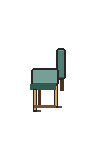](../../game/tests/fixtures/furniture-calibration/visitor-chair-v2/west-whole.png)

Review: [VISITOR_CHAIR_V2_REVIEW_2026-09-06.md](VISITOR_CHAIR_V2_REVIEW_2026-09-06.md)

Native evidence: [actual-gamemain-contact-sheet-native.png](../../game/tests/output/visitor-chair-v2/actual-gamemain-contact-sheet-native.png) · [manifest.json](../../game/tests/fixtures/furniture-calibration/visitor-chair-v2/manifest.json) · [actual-room-results.json](../../game/tests/output/visitor-chair-v2/actual-room-results.json) · [candidate-contact-sheet-native.png](../../game/tests/output/visitor-chair-v2/candidate-contact-sheet-native.png) · [candidate-contact-sheet-4x.png](../../game/tests/output/visitor-chair-v2/candidate-contact-sheet-4x.png) · [v1-v2-before-after-native.png](../../game/tests/output/visitor-chair-v2/v1-v2-before-after-native.png) · [v1-v2-before-after-4x.png](../../game/tests/output/visitor-chair-v2/v1-v2-before-after-4x.png) · [actual-room-base-contact-sheet-native.png](../../game/tests/output/visitor-chair-v2/actual-room-base-contact-sheet-native.png) · [actual-room-standing-contact-sheet-native.png](../../game/tests/output/visitor-chair-v2/actual-room-standing-contact-sheet-native.png) · [actual-room-seated-contact-sheet-native.png](../../game/tests/output/visitor-chair-v2/actual-room-seated-contact-sheet-native.png) · [actual-room-seated-contact-sheet-4x.png](../../game/tests/output/visitor-chair-v2/actual-room-seated-contact-sheet-4x.png)

Export method: Shadow-only visitor-chair-v2 revision: deterministic support-local contact marks replace v1 floor_shadow; seat_back and seat_front remain byte-identical code-native v1 screen-axis geometry. No generated source, finished-bitmap rotation, mirror, flip, scale, baked actor, text or logo.

**Declared native layers (not automatically approved)**

| Export | Canvas / pivot | Actual opaque bounds | Derivation / limits |
| --- | --- | --- | --- |
| [west-floor_shadow.png](../../game/tests/fixtures/furniture-calibration/visitor-chair-v2/west-floor_shadow.png) | 96×144 / [48, 96] | [36, 89, 28, 23]; 28 pixels | Shadow-only authored contact marks |
| [west-seat_back.png](../../game/tests/fixtures/furniture-calibration/visitor-chair-v2/west-seat_back.png) | 96×144 / [48, 96] | [31, 48, 35, 60]; 963 pixels | Byte-identical visitor-chair-v1 structure layer |
| [west-seat_front.png](../../game/tests/fixtures/furniture-calibration/visitor-chair-v2/west-seat_front.png) | 96×144 / [48, 96] | [30, 84, 26, 28]; 301 pixels | Byte-identical visitor-chair-v1 structure layer |

west-floor_shadow.png references: [visitor_chair_review_v2.gd](../../game/tools/visitor_chair_review_v2.gd) · [VISITOR_CHAIR_V2_REVIEW_2026-09-06.md](VISITOR_CHAIR_V2_REVIEW_2026-09-06.md)

west-seat_back.png references: [visitor_chair_geometry.gd](../../game/tools/visitor_chair_geometry.gd) · [VISITOR_CHAIR_V2_REVIEW_2026-09-06.md](VISITOR_CHAIR_V2_REVIEW_2026-09-06.md)

west-seat_front.png references: [visitor_chair_geometry.gd](../../game/tools/visitor_chair_geometry.gd) · [VISITOR_CHAIR_V2_REVIEW_2026-09-06.md](VISITOR_CHAIR_V2_REVIEW_2026-09-06.md)

**Additional composites**

| Export | Canvas / pivot | Actual opaque bounds | Derivation / limits |
| --- | --- | --- | --- |
| [west-whole.png](../../game/tests/fixtures/furniture-calibration/visitor-chair-v2/west-whole.png) | 96×144 / [48, 96] | [30, 48, 36, 64]; 1204 pixels | Byte-exact ordered union of v2 contact shadow and unchanged v1 chair structure. |

Retained native composite / source candidate: [west-whole.png](../../game/tests/fixtures/furniture-calibration/visitor-chair-v2/west-whole.png)

### Two-seat sofa

`two_seat_sofa` · P1 · shared.

Direction semantics: **seated occupant gaze**.

A compact break-area anchor; keep both seated silhouettes visible.

Proposed envelope **192×224**, fixed floor anchor **[96, 144]**. N/E footprints: **3×2 / 2×3 cells**.

Tools: two readable seat positions; soft cushions. Layers: `floor_shadow`, `rear_structure`, `front_structure`.

**north: approved.** Approved as a bare passive two-seat sofa art-library object. V3 replaces the rejected false North front with a real opaque rear shell and gives E/W full floor-depth-plus-rise side construction. Short wooden supports and support-local contact marks form one connected silhouette. Simple flat upholstery and the elongated E/W projection remain visible score-2 limits. No seat socket, Sit action, two-person occupancy, actor pose, reservation, interaction, worker authority, persistence or runtime/default-layout binding is approved. Passive art-library approval only.

[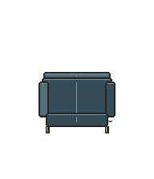](../../game/tests/fixtures/furniture-calibration/two-seat-sofa-v3/north-whole.png)

Source / prompt: [lounge_seating_geometry.gd](../../game/tools/lounge_seating_geometry.gd)

Review: [LOUNGE_SEATING_REVIEW_2026-09-06.md](LOUNGE_SEATING_REVIEW_2026-09-06.md)

Native evidence: [lounge-pair-north-room.png](../../game/tests/output/lounge-seating-v3-final/lounge-pair-north-room.png) · [manifest.json](../../game/tests/fixtures/furniture-calibration/two-seat-sofa-v3/manifest.json) · [export-results.json](../../game/tests/output/lounge-seating-v3/export-results.json) · [actual-room-results.json](../../game/tests/output/lounge-seating-v3-final/actual-room-results.json) · [two_seat_sofa-north-base-native.png](../../game/tests/output/lounge-seating-v3-final/two_seat_sofa-north-base-native.png) · [two_seat_sofa-north-base-4x.png](../../game/tests/output/lounge-seating-v3-final/two_seat_sofa-north-base-4x.png) · [two_seat_sofa-north-founder-behind-native.png](../../game/tests/output/lounge-seating-v3-final/two_seat_sofa-north-founder-behind-native.png) · [two_seat_sofa-north-founder-behind-4x.png](../../game/tests/output/lounge-seating-v3-final/two_seat_sofa-north-founder-behind-4x.png) · [LOUNGE_SEATING_REVIEW_2026-09-06.md](LOUNGE_SEATING_REVIEW_2026-09-06.md)

Export method: Deterministic typed-GDScript fixed-screen-axis upholstery and structure. V3 authors distinct rear, front, right-side and left-side geometry; no generated complete source, finished-bitmap rotation, mirror, flip, stretch, scale, baked actor, chair occupant, tool, text or logo.

**Declared native layers (not automatically approved)**

| Export | Canvas / pivot | Actual opaque bounds | Derivation / limits |
| --- | --- | --- | --- |
| [north-floor_shadow.png](../../game/tests/fixtures/furniture-calibration/two-seat-sofa-v3/north-floor_shadow.png) | 192×224 / [96, 144] | [59, 108, 81, 45]; 32 pixels | Deterministic native screen-axis upholstery and structure; no finished-raster transform. |
| [north-rear_structure.png](../../game/tests/fixtures/furniture-calibration/two-seat-sofa-v3/north-rear_structure.png) | 192×224 / [96, 144] | [54, 90, 84, 9]; 744 pixels | Deterministic native screen-axis upholstery and structure; no finished-raster transform. |
| [north-front_structure.png](../../game/tests/fixtures/furniture-calibration/two-seat-sofa-v3/north-front_structure.png) | 192×224 / [96, 144] | [48, 97, 96, 70]; 5757 pixels | Deterministic native screen-axis upholstery and structure; no finished-raster transform. |

north-floor_shadow.png references: [lounge_seating_geometry.gd](../../game/tools/lounge_seating_geometry.gd) · [LOUNGE_SEATING_REVIEW_2026-09-06.md](LOUNGE_SEATING_REVIEW_2026-09-06.md)

north-rear_structure.png references: [lounge_seating_geometry.gd](../../game/tools/lounge_seating_geometry.gd) · [LOUNGE_SEATING_REVIEW_2026-09-06.md](LOUNGE_SEATING_REVIEW_2026-09-06.md)

north-front_structure.png references: [lounge_seating_geometry.gd](../../game/tools/lounge_seating_geometry.gd) · [LOUNGE_SEATING_REVIEW_2026-09-06.md](LOUNGE_SEATING_REVIEW_2026-09-06.md)

**Additional composites**

| Export | Canvas / pivot | Actual opaque bounds | Derivation / limits |
| --- | --- | --- | --- |
| [north-whole.png](../../game/tests/fixtures/furniture-calibration/two-seat-sofa-v3/north-whole.png) | 192×224 / [96, 144] | [48, 90, 96, 77]; 6347 pixels | Byte-exact ordered union of support-local contact, rear upholstery and front upholstery. |

Retained native composite / source candidate: [north-whole.png](../../game/tests/fixtures/furniture-calibration/two-seat-sofa-v3/north-whole.png)

**east: approved.** Approved as a bare passive two-seat sofa art-library object. V3 replaces the rejected false North front with a real opaque rear shell and gives E/W full floor-depth-plus-rise side construction. Short wooden supports and support-local contact marks form one connected silhouette. Simple flat upholstery and the elongated E/W projection remain visible score-2 limits. No seat socket, Sit action, two-person occupancy, actor pose, reservation, interaction, worker authority, persistence or runtime/default-layout binding is approved. Passive art-library approval only.

[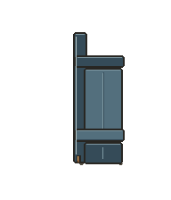](../../game/tests/fixtures/furniture-calibration/two-seat-sofa-v3/east-whole.png)

Source / prompt: [lounge_seating_geometry.gd](../../game/tools/lounge_seating_geometry.gd)

Review: [LOUNGE_SEATING_REVIEW_2026-09-06.md](LOUNGE_SEATING_REVIEW_2026-09-06.md)

Native evidence: [lounge-pair-east-room.png](../../game/tests/output/lounge-seating-v3-final/lounge-pair-east-room.png) · [manifest.json](../../game/tests/fixtures/furniture-calibration/two-seat-sofa-v3/manifest.json) · [export-results.json](../../game/tests/output/lounge-seating-v3/export-results.json) · [actual-room-results.json](../../game/tests/output/lounge-seating-v3-final/actual-room-results.json) · [two_seat_sofa-east-base-native.png](../../game/tests/output/lounge-seating-v3-final/two_seat_sofa-east-base-native.png) · [two_seat_sofa-east-base-4x.png](../../game/tests/output/lounge-seating-v3-final/two_seat_sofa-east-base-4x.png) · [two_seat_sofa-east-founder-behind-native.png](../../game/tests/output/lounge-seating-v3-final/two_seat_sofa-east-founder-behind-native.png) · [two_seat_sofa-east-founder-behind-4x.png](../../game/tests/output/lounge-seating-v3-final/two_seat_sofa-east-founder-behind-4x.png) · [LOUNGE_SEATING_REVIEW_2026-09-06.md](LOUNGE_SEATING_REVIEW_2026-09-06.md)

Export method: Deterministic typed-GDScript fixed-screen-axis upholstery and structure. V3 authors distinct rear, front, right-side and left-side geometry; no generated complete source, finished-bitmap rotation, mirror, flip, stretch, scale, baked actor, chair occupant, tool, text or logo.

**Declared native layers (not automatically approved)**

| Export | Canvas / pivot | Actual opaque bounds | Derivation / limits |
| --- | --- | --- | --- |
| [east-floor_shadow.png](../../game/tests/fixtures/furniture-calibration/two-seat-sofa-v3/east-floor_shadow.png) | 192×224 / [96, 144] | [89, 106, 49, 79]; 32 pixels | Deterministic native screen-axis upholstery and structure; no finished-raster transform. |
| [east-rear_structure.png](../../game/tests/fixtures/furniture-calibration/two-seat-sofa-v3/east-rear_structure.png) | 192×224 / [96, 144] | [82, 36, 58, 147]; 6276 pixels | Deterministic native screen-axis upholstery and structure; no finished-raster transform. |
| [east-front_structure.png](../../game/tests/fixtures/furniture-calibration/two-seat-sofa-v3/east-front_structure.png) | 192×224 / [96, 144] | [84, 41, 56, 143]; 2080 pixels | Deterministic native screen-axis upholstery and structure; no finished-raster transform. |

east-floor_shadow.png references: [lounge_seating_geometry.gd](../../game/tools/lounge_seating_geometry.gd) · [LOUNGE_SEATING_REVIEW_2026-09-06.md](LOUNGE_SEATING_REVIEW_2026-09-06.md)

east-rear_structure.png references: [lounge_seating_geometry.gd](../../game/tools/lounge_seating_geometry.gd) · [LOUNGE_SEATING_REVIEW_2026-09-06.md](LOUNGE_SEATING_REVIEW_2026-09-06.md)

east-front_structure.png references: [lounge_seating_geometry.gd](../../game/tools/lounge_seating_geometry.gd) · [LOUNGE_SEATING_REVIEW_2026-09-06.md](LOUNGE_SEATING_REVIEW_2026-09-06.md)

**Additional composites**

| Export | Canvas / pivot | Actual opaque bounds | Derivation / limits |
| --- | --- | --- | --- |
| [east-whole.png](../../game/tests/fixtures/furniture-calibration/two-seat-sofa-v3/east-whole.png) | 192×224 / [96, 144] | [82, 36, 58, 149]; 7275 pixels | Byte-exact ordered union of support-local contact, rear upholstery and front upholstery. |

Retained native composite / source candidate: [east-whole.png](../../game/tests/fixtures/furniture-calibration/two-seat-sofa-v3/east-whole.png)

**south: approved.** Approved as a bare passive two-seat sofa art-library object. V3 replaces the rejected false North front with a real opaque rear shell and gives E/W full floor-depth-plus-rise side construction. Short wooden supports and support-local contact marks form one connected silhouette. Simple flat upholstery and the elongated E/W projection remain visible score-2 limits. No seat socket, Sit action, two-person occupancy, actor pose, reservation, interaction, worker authority, persistence or runtime/default-layout binding is approved. Passive art-library approval only.

[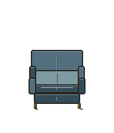](../../game/tests/fixtures/furniture-calibration/two-seat-sofa-v3/south-whole.png)

Source / prompt: [lounge_seating_geometry.gd](../../game/tools/lounge_seating_geometry.gd)

Review: [LOUNGE_SEATING_REVIEW_2026-09-06.md](LOUNGE_SEATING_REVIEW_2026-09-06.md)

Native evidence: [lounge-pair-south-room.png](../../game/tests/output/lounge-seating-v3-final/lounge-pair-south-room.png) · [manifest.json](../../game/tests/fixtures/furniture-calibration/two-seat-sofa-v3/manifest.json) · [export-results.json](../../game/tests/output/lounge-seating-v3/export-results.json) · [actual-room-results.json](../../game/tests/output/lounge-seating-v3-final/actual-room-results.json) · [two_seat_sofa-south-base-native.png](../../game/tests/output/lounge-seating-v3-final/two_seat_sofa-south-base-native.png) · [two_seat_sofa-south-base-4x.png](../../game/tests/output/lounge-seating-v3-final/two_seat_sofa-south-base-4x.png) · [two_seat_sofa-south-founder-behind-native.png](../../game/tests/output/lounge-seating-v3-final/two_seat_sofa-south-founder-behind-native.png) · [two_seat_sofa-south-founder-behind-4x.png](../../game/tests/output/lounge-seating-v3-final/two_seat_sofa-south-founder-behind-4x.png) · [LOUNGE_SEATING_REVIEW_2026-09-06.md](LOUNGE_SEATING_REVIEW_2026-09-06.md)

Export method: Deterministic typed-GDScript fixed-screen-axis upholstery and structure. V3 authors distinct rear, front, right-side and left-side geometry; no generated complete source, finished-bitmap rotation, mirror, flip, stretch, scale, baked actor, chair occupant, tool, text or logo.

**Declared native layers (not automatically approved)**

| Export | Canvas / pivot | Actual opaque bounds | Derivation / limits |
| --- | --- | --- | --- |
| [south-floor_shadow.png](../../game/tests/fixtures/furniture-calibration/two-seat-sofa-v3/south-floor_shadow.png) | 192×224 / [96, 144] | [59, 140, 81, 45]; 32 pixels | Deterministic native screen-axis upholstery and structure; no finished-raster transform. |
| [south-rear_structure.png](../../game/tests/fixtures/furniture-calibration/two-seat-sofa-v3/south-rear_structure.png) | 192×224 / [96, 144] | [49, 84, 94, 66]; 5878 pixels | Deterministic native screen-axis upholstery and structure; no finished-raster transform. |
| [south-front_structure.png](../../game/tests/fixtures/furniture-calibration/two-seat-sofa-v3/south-front_structure.png) | 192×224 / [96, 144] | [48, 131, 96, 52]; 3227 pixels | Deterministic native screen-axis upholstery and structure; no finished-raster transform. |

south-floor_shadow.png references: [lounge_seating_geometry.gd](../../game/tools/lounge_seating_geometry.gd) · [LOUNGE_SEATING_REVIEW_2026-09-06.md](LOUNGE_SEATING_REVIEW_2026-09-06.md)

south-rear_structure.png references: [lounge_seating_geometry.gd](../../game/tools/lounge_seating_geometry.gd) · [LOUNGE_SEATING_REVIEW_2026-09-06.md](LOUNGE_SEATING_REVIEW_2026-09-06.md)

south-front_structure.png references: [lounge_seating_geometry.gd](../../game/tools/lounge_seating_geometry.gd) · [LOUNGE_SEATING_REVIEW_2026-09-06.md](LOUNGE_SEATING_REVIEW_2026-09-06.md)

**Additional composites**

| Export | Canvas / pivot | Actual opaque bounds | Derivation / limits |
| --- | --- | --- | --- |
| [south-whole.png](../../game/tests/fixtures/furniture-calibration/two-seat-sofa-v3/south-whole.png) | 192×224 / [96, 144] | [48, 84, 96, 101]; 8265 pixels | Byte-exact ordered union of support-local contact, rear upholstery and front upholstery. |

Retained native composite / source candidate: [south-whole.png](../../game/tests/fixtures/furniture-calibration/two-seat-sofa-v3/south-whole.png)

**west: approved.** Approved as a bare passive two-seat sofa art-library object. V3 replaces the rejected false North front with a real opaque rear shell and gives E/W full floor-depth-plus-rise side construction. Short wooden supports and support-local contact marks form one connected silhouette. Simple flat upholstery and the elongated E/W projection remain visible score-2 limits. No seat socket, Sit action, two-person occupancy, actor pose, reservation, interaction, worker authority, persistence or runtime/default-layout binding is approved. Passive art-library approval only.

[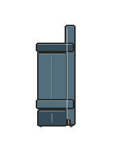](../../game/tests/fixtures/furniture-calibration/two-seat-sofa-v3/west-whole.png)

Source / prompt: [lounge_seating_geometry.gd](../../game/tools/lounge_seating_geometry.gd)

Review: [LOUNGE_SEATING_REVIEW_2026-09-06.md](LOUNGE_SEATING_REVIEW_2026-09-06.md)

Native evidence: [lounge-pair-west-room.png](../../game/tests/output/lounge-seating-v3-final/lounge-pair-west-room.png) · [manifest.json](../../game/tests/fixtures/furniture-calibration/two-seat-sofa-v3/manifest.json) · [export-results.json](../../game/tests/output/lounge-seating-v3/export-results.json) · [actual-room-results.json](../../game/tests/output/lounge-seating-v3-final/actual-room-results.json) · [two_seat_sofa-west-base-native.png](../../game/tests/output/lounge-seating-v3-final/two_seat_sofa-west-base-native.png) · [two_seat_sofa-west-base-4x.png](../../game/tests/output/lounge-seating-v3-final/two_seat_sofa-west-base-4x.png) · [two_seat_sofa-west-founder-behind-native.png](../../game/tests/output/lounge-seating-v3-final/two_seat_sofa-west-founder-behind-native.png) · [two_seat_sofa-west-founder-behind-4x.png](../../game/tests/output/lounge-seating-v3-final/two_seat_sofa-west-founder-behind-4x.png) · [LOUNGE_SEATING_REVIEW_2026-09-06.md](LOUNGE_SEATING_REVIEW_2026-09-06.md)

Export method: Deterministic typed-GDScript fixed-screen-axis upholstery and structure. V3 authors distinct rear, front, right-side and left-side geometry; no generated complete source, finished-bitmap rotation, mirror, flip, stretch, scale, baked actor, chair occupant, tool, text or logo.

**Declared native layers (not automatically approved)**

| Export | Canvas / pivot | Actual opaque bounds | Derivation / limits |
| --- | --- | --- | --- |
| [west-floor_shadow.png](../../game/tests/fixtures/furniture-calibration/two-seat-sofa-v3/west-floor_shadow.png) | 192×224 / [96, 144] | [57, 106, 49, 79]; 32 pixels | Deterministic native screen-axis upholstery and structure; no finished-raster transform. |
| [west-rear_structure.png](../../game/tests/fixtures/furniture-calibration/two-seat-sofa-v3/west-rear_structure.png) | 192×224 / [96, 144] | [52, 36, 58, 147]; 6279 pixels | Deterministic native screen-axis upholstery and structure; no finished-raster transform. |
| [west-front_structure.png](../../game/tests/fixtures/furniture-calibration/two-seat-sofa-v3/west-front_structure.png) | 192×224 / [96, 144] | [52, 41, 56, 143]; 2067 pixels | Deterministic native screen-axis upholstery and structure; no finished-raster transform. |

west-floor_shadow.png references: [lounge_seating_geometry.gd](../../game/tools/lounge_seating_geometry.gd) · [LOUNGE_SEATING_REVIEW_2026-09-06.md](LOUNGE_SEATING_REVIEW_2026-09-06.md)

west-rear_structure.png references: [lounge_seating_geometry.gd](../../game/tools/lounge_seating_geometry.gd) · [LOUNGE_SEATING_REVIEW_2026-09-06.md](LOUNGE_SEATING_REVIEW_2026-09-06.md)

west-front_structure.png references: [lounge_seating_geometry.gd](../../game/tools/lounge_seating_geometry.gd) · [LOUNGE_SEATING_REVIEW_2026-09-06.md](LOUNGE_SEATING_REVIEW_2026-09-06.md)

**Additional composites**

| Export | Canvas / pivot | Actual opaque bounds | Derivation / limits |
| --- | --- | --- | --- |
| [west-whole.png](../../game/tests/fixtures/furniture-calibration/two-seat-sofa-v3/west-whole.png) | 192×224 / [96, 144] | [52, 36, 58, 149]; 7277 pixels | Byte-exact ordered union of support-local contact, rear upholstery and front upholstery. |

Retained native composite / source candidate: [west-whole.png](../../game/tests/fixtures/furniture-calibration/two-seat-sofa-v3/west-whole.png)

### Lounge armchair

`lounge_armchair` · P2 · shared.

Direction semantics: **seated occupant gaze**.

Small quiet-corner alternative to a second sofa; not a recolor variant.

Proposed envelope **160×208**, fixed floor anchor **[80, 128]**. N/E footprints: **2×2 / 2×2 cells**.

Tools: single soft seat; arms. Layers: `floor_shadow`, `rear_structure`, `front_structure`.

**north: approved.** Approved as a bare passive lounge-armchair art-library object. V3 replaces the rejected false North front with a real opaque rear shell and gives E/W full floor-depth-plus-rise side construction. Short wooden supports and support-local contact marks form one connected silhouette. Simple flat upholstery and the elongated E/W projection remain visible score-2 limits. No seat socket, Sit action, actor pose, reservation, interaction, worker authority, persistence or runtime/default-layout binding is approved. Passive art-library approval only.

[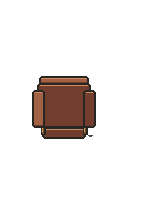](../../game/tests/fixtures/furniture-calibration/lounge-armchair-v3/north-whole.png)

Source / prompt: [lounge_seating_geometry.gd](../../game/tools/lounge_seating_geometry.gd)

Review: [LOUNGE_SEATING_REVIEW_2026-09-06.md](LOUNGE_SEATING_REVIEW_2026-09-06.md)

Native evidence: [lounge-pair-north-room.png](../../game/tests/output/lounge-seating-v3-final/lounge-pair-north-room.png) · [manifest.json](../../game/tests/fixtures/furniture-calibration/lounge-armchair-v3/manifest.json) · [export-results.json](../../game/tests/output/lounge-seating-v3/export-results.json) · [actual-room-results.json](../../game/tests/output/lounge-seating-v3-final/actual-room-results.json) · [lounge_armchair-north-base-native.png](../../game/tests/output/lounge-seating-v3-final/lounge_armchair-north-base-native.png) · [lounge_armchair-north-base-4x.png](../../game/tests/output/lounge-seating-v3-final/lounge_armchair-north-base-4x.png) · [lounge_armchair-north-mira-behind-native.png](../../game/tests/output/lounge-seating-v3-final/lounge_armchair-north-mira-behind-native.png) · [lounge_armchair-north-mira-behind-4x.png](../../game/tests/output/lounge-seating-v3-final/lounge_armchair-north-mira-behind-4x.png) · [LOUNGE_SEATING_REVIEW_2026-09-06.md](LOUNGE_SEATING_REVIEW_2026-09-06.md)

Export method: Deterministic typed-GDScript fixed-screen-axis upholstery and structure. V3 authors distinct rear, front, right-side and left-side geometry; no generated complete source, finished-bitmap rotation, mirror, flip, stretch, scale, baked actor, chair occupant, tool, text or logo.

**Declared native layers (not automatically approved)**

| Export | Canvas / pivot | Actual opaque bounds | Derivation / limits |
| --- | --- | --- | --- |
| [north-floor_shadow.png](../../game/tests/fixtures/furniture-calibration/lounge-armchair-v3/north-floor_shadow.png) | 160×208 / [80, 128] | [42, 92, 51, 45]; 32 pixels | Deterministic native screen-axis upholstery and structure; no finished-raster transform. |
| [north-rear_structure.png](../../game/tests/fixtures/furniture-calibration/lounge-armchair-v3/north-rear_structure.png) | 160×208 / [80, 128] | [39, 76, 50, 9]; 438 pixels | Deterministic native screen-axis upholstery and structure; no finished-raster transform. |
| [north-front_structure.png](../../game/tests/fixtures/furniture-calibration/lounge-armchair-v3/north-front_structure.png) | 160×208 / [80, 128] | [32, 83, 64, 56]; 3291 pixels | Deterministic native screen-axis upholstery and structure; no finished-raster transform. |

north-floor_shadow.png references: [lounge_seating_geometry.gd](../../game/tools/lounge_seating_geometry.gd) · [LOUNGE_SEATING_REVIEW_2026-09-06.md](LOUNGE_SEATING_REVIEW_2026-09-06.md)

north-rear_structure.png references: [lounge_seating_geometry.gd](../../game/tools/lounge_seating_geometry.gd) · [LOUNGE_SEATING_REVIEW_2026-09-06.md](LOUNGE_SEATING_REVIEW_2026-09-06.md)

north-front_structure.png references: [lounge_seating_geometry.gd](../../game/tools/lounge_seating_geometry.gd) · [LOUNGE_SEATING_REVIEW_2026-09-06.md](LOUNGE_SEATING_REVIEW_2026-09-06.md)

**Additional composites**

| Export | Canvas / pivot | Actual opaque bounds | Derivation / limits |
| --- | --- | --- | --- |
| [north-whole.png](../../game/tests/fixtures/furniture-calibration/lounge-armchair-v3/north-whole.png) | 160×208 / [80, 128] | [32, 76, 64, 63]; 3643 pixels | Byte-exact ordered union of support-local contact, rear upholstery and front upholstery. |

Retained native composite / source candidate: [north-whole.png](../../game/tests/fixtures/furniture-calibration/lounge-armchair-v3/north-whole.png)

**east: approved.** Approved as a bare passive lounge-armchair art-library object. V3 replaces the rejected false North front with a real opaque rear shell and gives E/W full floor-depth-plus-rise side construction. Short wooden supports and support-local contact marks form one connected silhouette. Simple flat upholstery and the elongated E/W projection remain visible score-2 limits. No seat socket, Sit action, actor pose, reservation, interaction, worker authority, persistence or runtime/default-layout binding is approved. Passive art-library approval only.

[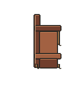](../../game/tests/fixtures/furniture-calibration/lounge-armchair-v3/east-whole.png)

Source / prompt: [lounge_seating_geometry.gd](../../game/tools/lounge_seating_geometry.gd)

Review: [LOUNGE_SEATING_REVIEW_2026-09-06.md](LOUNGE_SEATING_REVIEW_2026-09-06.md)

Native evidence: [lounge-pair-east-room.png](../../game/tests/output/lounge-seating-v3-final/lounge-pair-east-room.png) · [manifest.json](../../game/tests/fixtures/furniture-calibration/lounge-armchair-v3/manifest.json) · [export-results.json](../../game/tests/output/lounge-seating-v3/export-results.json) · [actual-room-results.json](../../game/tests/output/lounge-seating-v3-final/actual-room-results.json) · [lounge_armchair-east-base-native.png](../../game/tests/output/lounge-seating-v3-final/lounge_armchair-east-base-native.png) · [lounge_armchair-east-base-4x.png](../../game/tests/output/lounge-seating-v3-final/lounge_armchair-east-base-4x.png) · [lounge_armchair-east-mira-behind-native.png](../../game/tests/output/lounge-seating-v3-final/lounge_armchair-east-mira-behind-native.png) · [lounge_armchair-east-mira-behind-4x.png](../../game/tests/output/lounge-seating-v3-final/lounge_armchair-east-mira-behind-4x.png) · [LOUNGE_SEATING_REVIEW_2026-09-06.md](LOUNGE_SEATING_REVIEW_2026-09-06.md)

Export method: Deterministic typed-GDScript fixed-screen-axis upholstery and structure. V3 authors distinct rear, front, right-side and left-side geometry; no generated complete source, finished-bitmap rotation, mirror, flip, stretch, scale, baked actor, chair occupant, tool, text or logo.

**Declared native layers (not automatically approved)**

| Export | Canvas / pivot | Actual opaque bounds | Derivation / limits |
| --- | --- | --- | --- |
| [east-floor_shadow.png](../../game/tests/fixtures/furniture-calibration/lounge-armchair-v3/east-floor_shadow.png) | 160×208 / [80, 128] | [74, 90, 49, 48]; 32 pixels | Deterministic native screen-axis upholstery and structure; no finished-raster transform. |
| [east-rear_structure.png](../../game/tests/fixtures/furniture-calibration/lounge-armchair-v3/east-rear_structure.png) | 160×208 / [80, 128] | [67, 28, 56, 108]; 3965 pixels | Deterministic native screen-axis upholstery and structure; no finished-raster transform. |
| [east-front_structure.png](../../game/tests/fixtures/furniture-calibration/lounge-armchair-v3/east-front_structure.png) | 160×208 / [80, 128] | [69, 32, 54, 105]; 1525 pixels | Deterministic native screen-axis upholstery and structure; no finished-raster transform. |

east-floor_shadow.png references: [lounge_seating_geometry.gd](../../game/tools/lounge_seating_geometry.gd) · [LOUNGE_SEATING_REVIEW_2026-09-06.md](LOUNGE_SEATING_REVIEW_2026-09-06.md)

east-rear_structure.png references: [lounge_seating_geometry.gd](../../game/tools/lounge_seating_geometry.gd) · [LOUNGE_SEATING_REVIEW_2026-09-06.md](LOUNGE_SEATING_REVIEW_2026-09-06.md)

east-front_structure.png references: [lounge_seating_geometry.gd](../../game/tools/lounge_seating_geometry.gd) · [LOUNGE_SEATING_REVIEW_2026-09-06.md](LOUNGE_SEATING_REVIEW_2026-09-06.md)

**Additional composites**

| Export | Canvas / pivot | Actual opaque bounds | Derivation / limits |
| --- | --- | --- | --- |
| [east-whole.png](../../game/tests/fixtures/furniture-calibration/lounge-armchair-v3/east-whole.png) | 160×208 / [80, 128] | [67, 28, 56, 110]; 4881 pixels | Byte-exact ordered union of support-local contact, rear upholstery and front upholstery. |

Retained native composite / source candidate: [east-whole.png](../../game/tests/fixtures/furniture-calibration/lounge-armchair-v3/east-whole.png)

**south: approved.** Approved as a bare passive lounge-armchair art-library object. V3 replaces the rejected false North front with a real opaque rear shell and gives E/W full floor-depth-plus-rise side construction. Short wooden supports and support-local contact marks form one connected silhouette. Simple flat upholstery and the elongated E/W projection remain visible score-2 limits. No seat socket, Sit action, actor pose, reservation, interaction, worker authority, persistence or runtime/default-layout binding is approved. Passive art-library approval only.

Source / prompt: [lounge_seating_geometry.gd](../../game/tools/lounge_seating_geometry.gd)

Review: [LOUNGE_SEATING_REVIEW_2026-09-06.md](LOUNGE_SEATING_REVIEW_2026-09-06.md)

Native evidence: [lounge-pair-south-room.png](../../game/tests/output/lounge-seating-v3-final/lounge-pair-south-room.png) · [manifest.json](../../game/tests/fixtures/furniture-calibration/lounge-armchair-v3/manifest.json) · [export-results.json](../../game/tests/output/lounge-seating-v3/export-results.json) · [actual-room-results.json](../../game/tests/output/lounge-seating-v3-final/actual-room-results.json) · [lounge_armchair-south-base-native.png](../../game/tests/output/lounge-seating-v3-final/lounge_armchair-south-base-native.png) · [lounge_armchair-south-base-4x.png](../../game/tests/output/lounge-seating-v3-final/lounge_armchair-south-base-4x.png) · [lounge_armchair-south-mira-behind-native.png](../../game/tests/output/lounge-seating-v3-final/lounge_armchair-south-mira-behind-native.png) · [lounge_armchair-south-mira-behind-4x.png](../../game/tests/output/lounge-seating-v3-final/lounge_armchair-south-mira-behind-4x.png) · [LOUNGE_SEATING_REVIEW_2026-09-06.md](LOUNGE_SEATING_REVIEW_2026-09-06.md)

Export method: Deterministic typed-GDScript fixed-screen-axis upholstery and structure. V3 authors distinct rear, front, right-side and left-side geometry; no generated complete source, finished-bitmap rotation, mirror, flip, stretch, scale, baked actor, chair occupant, tool, text or logo.

**Declared native layers (not automatically approved)**

| Export | Canvas / pivot | Actual opaque bounds | Derivation / limits |
| --- | --- | --- | --- |
| [south-floor_shadow.png](../../game/tests/fixtures/furniture-calibration/lounge-armchair-v3/south-floor_shadow.png) | 160×208 / [80, 128] | [74, 124, 51, 45]; 32 pixels | Deterministic native screen-axis upholstery and structure; no finished-raster transform. |
| [south-rear_structure.png](../../game/tests/fixtures/furniture-calibration/lounge-armchair-v3/south-rear_structure.png) | 160×208 / [80, 128] | [66, 76, 60, 66]; 3622 pixels | Deterministic native screen-axis upholstery and structure; no finished-raster transform. |
| [south-front_structure.png](../../game/tests/fixtures/furniture-calibration/lounge-armchair-v3/south-front_structure.png) | 160×208 / [80, 128] | [66, 122, 60, 45]; 1747 pixels | Deterministic native screen-axis upholstery and structure; no finished-raster transform. |

south-floor_shadow.png references: [lounge_seating_geometry.gd](../../game/tools/lounge_seating_geometry.gd) · [LOUNGE_SEATING_REVIEW_2026-09-06.md](LOUNGE_SEATING_REVIEW_2026-09-06.md)

south-rear_structure.png references: [lounge_seating_geometry.gd](../../game/tools/lounge_seating_geometry.gd) · [LOUNGE_SEATING_REVIEW_2026-09-06.md](LOUNGE_SEATING_REVIEW_2026-09-06.md)

south-front_structure.png references: [lounge_seating_geometry.gd](../../game/tools/lounge_seating_geometry.gd) · [LOUNGE_SEATING_REVIEW_2026-09-06.md](LOUNGE_SEATING_REVIEW_2026-09-06.md)

**Additional composites**

| Export | Canvas / pivot | Actual opaque bounds | Derivation / limits |
| --- | --- | --- | --- |
| [south-whole.png](../../game/tests/fixtures/furniture-calibration/lounge-armchair-v3/south-whole.png) | 160×208 / [80, 128] | [66, 76, 60, 93]; 4685 pixels | Byte-exact ordered union of support-local contact, rear upholstery and front upholstery. |

Retained native composite / source candidate: [south-whole.png](../../game/tests/fixtures/furniture-calibration/lounge-armchair-v3/south-whole.png)

**west: approved.** Approved as a bare passive lounge-armchair art-library object. V3 replaces the rejected false North front with a real opaque rear shell and gives E/W full floor-depth-plus-rise side construction. Short wooden supports and support-local contact marks form one connected silhouette. Simple flat upholstery and the elongated E/W projection remain visible score-2 limits. No seat socket, Sit action, actor pose, reservation, interaction, worker authority, persistence or runtime/default-layout binding is approved. Passive art-library approval only.

Source / prompt: [lounge_seating_geometry.gd](../../game/tools/lounge_seating_geometry.gd)

Review: [LOUNGE_SEATING_REVIEW_2026-09-06.md](LOUNGE_SEATING_REVIEW_2026-09-06.md)

Native evidence: [lounge-pair-west-room.png](../../game/tests/output/lounge-seating-v3-final/lounge-pair-west-room.png) · [manifest.json](../../game/tests/fixtures/furniture-calibration/lounge-armchair-v3/manifest.json) · [export-results.json](../../game/tests/output/lounge-seating-v3/export-results.json) · [actual-room-results.json](../../game/tests/output/lounge-seating-v3-final/actual-room-results.json) · [lounge_armchair-west-base-native.png](../../game/tests/output/lounge-seating-v3-final/lounge_armchair-west-base-native.png) · [lounge_armchair-west-base-4x.png](../../game/tests/output/lounge-seating-v3-final/lounge_armchair-west-base-4x.png) · [lounge_armchair-west-mira-behind-native.png](../../game/tests/output/lounge-seating-v3-final/lounge_armchair-west-mira-behind-native.png) · [lounge_armchair-west-mira-behind-4x.png](../../game/tests/output/lounge-seating-v3-final/lounge_armchair-west-mira-behind-4x.png) · [LOUNGE_SEATING_REVIEW_2026-09-06.md](LOUNGE_SEATING_REVIEW_2026-09-06.md)

Export method: Deterministic typed-GDScript fixed-screen-axis upholstery and structure. V3 authors distinct rear, front, right-side and left-side geometry; no generated complete source, finished-bitmap rotation, mirror, flip, stretch, scale, baked actor, chair occupant, tool, text or logo.

**Declared native layers (not automatically approved)**

| Export | Canvas / pivot | Actual opaque bounds | Derivation / limits |
| --- | --- | --- | --- |
| [west-floor_shadow.png](../../game/tests/fixtures/furniture-calibration/lounge-armchair-v3/west-floor_shadow.png) | 160×208 / [80, 128] | [42, 122, 49, 48]; 32 pixels | Deterministic native screen-axis upholstery and structure; no finished-raster transform. |
| [west-rear_structure.png](../../game/tests/fixtures/furniture-calibration/lounge-armchair-v3/west-rear_structure.png) | 160×208 / [80, 128] | [37, 60, 57, 108]; 4022 pixels | Deterministic native screen-axis upholstery and structure; no finished-raster transform. |
| [west-front_structure.png](../../game/tests/fixtures/furniture-calibration/lounge-armchair-v3/west-front_structure.png) | 160×208 / [80, 128] | [37, 64, 54, 105]; 1491 pixels | Deterministic native screen-axis upholstery and structure; no finished-raster transform. |

west-floor_shadow.png references: [lounge_seating_geometry.gd](../../game/tools/lounge_seating_geometry.gd) · [LOUNGE_SEATING_REVIEW_2026-09-06.md](LOUNGE_SEATING_REVIEW_2026-09-06.md)

west-rear_structure.png references: [lounge_seating_geometry.gd](../../game/tools/lounge_seating_geometry.gd) · [LOUNGE_SEATING_REVIEW_2026-09-06.md](LOUNGE_SEATING_REVIEW_2026-09-06.md)

west-front_structure.png references: [lounge_seating_geometry.gd](../../game/tools/lounge_seating_geometry.gd) · [LOUNGE_SEATING_REVIEW_2026-09-06.md](LOUNGE_SEATING_REVIEW_2026-09-06.md)

**Additional composites**

| Export | Canvas / pivot | Actual opaque bounds | Derivation / limits |
| --- | --- | --- | --- |
| [west-whole.png](../../game/tests/fixtures/furniture-calibration/lounge-armchair-v3/west-whole.png) | 160×208 / [80, 128] | [37, 60, 57, 110]; 4929 pixels | Byte-exact ordered union of support-local contact, rear upholstery and front upholstery. |

Retained native composite / source candidate: [west-whole.png](../../game/tests/fixtures/furniture-calibration/lounge-armchair-v3/west-whole.png)

### Low lounge table

`low_coffee_table` · P2 · shared.

Direction semantics: **visual orientation**.

Pairs with lounge seating without blocking faces; no baked magazines or cups.

Proposed envelope **160×160**, fixed floor anchor **[80, 96]**. N/E footprints: **2×1 / 1×2 cells**.

Tools: low clear tabletop. Layers: `floor_shadow`, `rear_structure`, `front_structure`.

**north: approved.** Approved as a low two-cell lounge-table base with a 20px rise, four separated supports and support-local contact marks. The long-axis top stays deliberately simple at native size. No seating, props or interaction is included. Passive art-library approval only; no runtime/default-layout binding follows.

Review: [PASSIVE_TABLES_REVIEW_2026-09-06.md](PASSIVE_TABLES_REVIEW_2026-09-06.md)

Native evidence: [all-tables-north-room.png](../../game/tests/output/passive-tables-v2/all-tables-north-room.png) · [manifest.json](../../game/tests/fixtures/furniture-calibration/low-coffee-table-v1/manifest.json) · [export-results.json](../../game/tests/output/passive-tables-v2/export-results.json) · [actual-room-results.json](../../game/tests/output/passive-tables-v2/actual-room-results.json) · [low_coffee_table-north-base-native.png](../../game/tests/output/passive-tables-v2/low_coffee_table-north-base-native.png) · [low_coffee_table-north-base-4x.png](../../game/tests/output/passive-tables-v2/low_coffee_table-north-base-4x.png) · [low_coffee_table-north-founder-behind-native.png](../../game/tests/output/passive-tables-v2/low_coffee_table-north-founder-behind-native.png) · [low_coffee_table-north-founder-behind-4x.png](../../game/tests/output/passive-tables-v2/low_coffee_table-north-founder-behind-4x.png) · [PASSIVE_TABLES_REVIEW_2026-09-06.md](PASSIVE_TABLES_REVIEW_2026-09-06.md)

Export method: Deterministic typed-GDScript screen-axis geometry using the shared quiet-oak material and existing charcoal/metal palette. No generated complete source, finished-bitmap rotation, mirror, flip, scale, baked actor, chair, tool, text or logo.

**Declared native layers (not automatically approved)**

| Export | Canvas / pivot | Actual opaque bounds | Derivation / limits |
| --- | --- | --- | --- |
| [north-floor_shadow.png](../../game/tests/fixtures/furniture-calibration/low-coffee-table-v1/north-floor_shadow.png) | 160×160 / [80, 96] | [41, 87, 52, 22]; 28 pixels | Deterministic native screen-axis geometry using the shared quiet-oak material; no complete-bitmap transform. |
| [north-rear_structure.png](../../game/tests/fixtures/furniture-calibration/low-coffee-table-v1/north-rear_structure.png) | 160×160 / [80, 96] | [36, 64, 56, 25]; 1344 pixels | Deterministic native screen-axis geometry using the shared quiet-oak material; no complete-bitmap transform. |
| [north-front_structure.png](../../game/tests/fixtures/furniture-calibration/low-coffee-table-v1/north-front_structure.png) | 160×160 / [80, 96] | [37, 84, 54, 25]; 456 pixels | Deterministic native screen-axis geometry using the shared quiet-oak material; no complete-bitmap transform. |

north-floor_shadow.png references: [passive_table_geometry.gd](../../game/tools/passive_table_geometry.gd) · [PASSIVE_TABLES_REVIEW_2026-09-06.md](PASSIVE_TABLES_REVIEW_2026-09-06.md)

north-rear_structure.png references: [passive_table_geometry.gd](../../game/tools/passive_table_geometry.gd) · [PASSIVE_TABLES_REVIEW_2026-09-06.md](PASSIVE_TABLES_REVIEW_2026-09-06.md)

north-front_structure.png references: [passive_table_geometry.gd](../../game/tools/passive_table_geometry.gd) · [PASSIVE_TABLES_REVIEW_2026-09-06.md](PASSIVE_TABLES_REVIEW_2026-09-06.md)

**Additional composites**

| Export | Canvas / pivot | Actual opaque bounds | Derivation / limits |
| --- | --- | --- | --- |
| [north-whole.png](../../game/tests/fixtures/furniture-calibration/low-coffee-table-v1/north-whole.png) | 160×160 / [80, 96] | [36, 64, 57, 45]; 1598 pixels | Byte-exact ordered union of floor_shadow, rear_structure and front_structure. |

Retained native composite / source candidate: [north-whole.png](../../game/tests/fixtures/furniture-calibration/low-coffee-table-v1/north-whole.png)

**east: approved.** Approved as a low two-cell lounge-table base with a 20px rise, four separated supports and support-local contact marks. The long-axis top stays deliberately simple at native size. No seating, props or interaction is included. Passive art-library approval only; no runtime/default-layout binding follows.

Review: [PASSIVE_TABLES_REVIEW_2026-09-06.md](PASSIVE_TABLES_REVIEW_2026-09-06.md)

Native evidence: [all-tables-east-room.png](../../game/tests/output/passive-tables-v2/all-tables-east-room.png) · [manifest.json](../../game/tests/fixtures/furniture-calibration/low-coffee-table-v1/manifest.json) · [export-results.json](../../game/tests/output/passive-tables-v2/export-results.json) · [actual-room-results.json](../../game/tests/output/passive-tables-v2/actual-room-results.json) · [low_coffee_table-east-base-native.png](../../game/tests/output/passive-tables-v2/low_coffee_table-east-base-native.png) · [low_coffee_table-east-base-4x.png](../../game/tests/output/passive-tables-v2/low_coffee_table-east-base-4x.png) · [low_coffee_table-east-founder-behind-native.png](../../game/tests/output/passive-tables-v2/low_coffee_table-east-founder-behind-native.png) · [low_coffee_table-east-founder-behind-4x.png](../../game/tests/output/passive-tables-v2/low_coffee_table-east-founder-behind-4x.png) · [PASSIVE_TABLES_REVIEW_2026-09-06.md](PASSIVE_TABLES_REVIEW_2026-09-06.md)

Export method: Deterministic typed-GDScript screen-axis geometry using the shared quiet-oak material and existing charcoal/metal palette. No generated complete source, finished-bitmap rotation, mirror, flip, scale, baked actor, chair, tool, text or logo.

**Declared native layers (not automatically approved)**

| Export | Canvas / pivot | Actual opaque bounds | Derivation / limits |
| --- | --- | --- | --- |
| [east-floor_shadow.png](../../game/tests/fixtures/furniture-calibration/low-coffee-table-v1/east-floor_shadow.png) | 160×160 / [80, 96] | [73, 55, 20, 54]; 28 pixels | Deterministic native screen-axis geometry using the shared quiet-oak material; no complete-bitmap transform. |
| [east-rear_structure.png](../../game/tests/fixtures/furniture-calibration/low-coffee-table-v1/east-rear_structure.png) | 160×160 / [80, 96] | [68, 32, 24, 56]; 1328 pixels | Deterministic native screen-axis geometry using the shared quiet-oak material; no complete-bitmap transform. |
| [east-front_structure.png](../../game/tests/fixtures/furniture-calibration/low-coffee-table-v1/east-front_structure.png) | 160×160 / [80, 96] | [69, 84, 22, 25]; 328 pixels | Deterministic native screen-axis geometry using the shared quiet-oak material; no complete-bitmap transform. |

east-floor_shadow.png references: [passive_table_geometry.gd](../../game/tools/passive_table_geometry.gd) · [PASSIVE_TABLES_REVIEW_2026-09-06.md](PASSIVE_TABLES_REVIEW_2026-09-06.md)

east-rear_structure.png references: [passive_table_geometry.gd](../../game/tools/passive_table_geometry.gd) · [PASSIVE_TABLES_REVIEW_2026-09-06.md](PASSIVE_TABLES_REVIEW_2026-09-06.md)

east-front_structure.png references: [passive_table_geometry.gd](../../game/tools/passive_table_geometry.gd) · [PASSIVE_TABLES_REVIEW_2026-09-06.md](PASSIVE_TABLES_REVIEW_2026-09-06.md)

**Additional composites**

| Export | Canvas / pivot | Actual opaque bounds | Derivation / limits |
| --- | --- | --- | --- |
| [east-whole.png](../../game/tests/fixtures/furniture-calibration/low-coffee-table-v1/east-whole.png) | 160×160 / [80, 96] | [68, 32, 25, 77]; 1594 pixels | Byte-exact ordered union of floor_shadow, rear_structure and front_structure. |

Retained native composite / source candidate: [east-whole.png](../../game/tests/fixtures/furniture-calibration/low-coffee-table-v1/east-whole.png)

**south: approved.** Approved as a low two-cell lounge-table base with a 20px rise, four separated supports and support-local contact marks. The long-axis top stays deliberately simple at native size. No seating, props or interaction is included. Passive art-library approval only; no runtime/default-layout binding follows.

Review: [PASSIVE_TABLES_REVIEW_2026-09-06.md](PASSIVE_TABLES_REVIEW_2026-09-06.md)

Native evidence: [all-tables-south-room.png](../../game/tests/output/passive-tables-v2/all-tables-south-room.png) · [manifest.json](../../game/tests/fixtures/furniture-calibration/low-coffee-table-v1/manifest.json) · [export-results.json](../../game/tests/output/passive-tables-v2/export-results.json) · [actual-room-results.json](../../game/tests/output/passive-tables-v2/actual-room-results.json) · [low_coffee_table-south-base-native.png](../../game/tests/output/passive-tables-v2/low_coffee_table-south-base-native.png) · [low_coffee_table-south-base-4x.png](../../game/tests/output/passive-tables-v2/low_coffee_table-south-base-4x.png) · [low_coffee_table-south-founder-behind-native.png](../../game/tests/output/passive-tables-v2/low_coffee_table-south-founder-behind-native.png) · [low_coffee_table-south-founder-behind-4x.png](../../game/tests/output/passive-tables-v2/low_coffee_table-south-founder-behind-4x.png) · [PASSIVE_TABLES_REVIEW_2026-09-06.md](PASSIVE_TABLES_REVIEW_2026-09-06.md)

Export method: Deterministic typed-GDScript screen-axis geometry using the shared quiet-oak material and existing charcoal/metal palette. No generated complete source, finished-bitmap rotation, mirror, flip, scale, baked actor, chair, tool, text or logo.

**Declared native layers (not automatically approved)**

| Export | Canvas / pivot | Actual opaque bounds | Derivation / limits |
| --- | --- | --- | --- |
| [south-floor_shadow.png](../../game/tests/fixtures/furniture-calibration/low-coffee-table-v1/south-floor_shadow.png) | 160×160 / [80, 96] | [73, 87, 52, 22]; 28 pixels | Deterministic native screen-axis geometry using the shared quiet-oak material; no complete-bitmap transform. |
| [south-rear_structure.png](../../game/tests/fixtures/furniture-calibration/low-coffee-table-v1/south-rear_structure.png) | 160×160 / [80, 96] | [68, 64, 56, 25]; 1344 pixels | Deterministic native screen-axis geometry using the shared quiet-oak material; no complete-bitmap transform. |
| [south-front_structure.png](../../game/tests/fixtures/furniture-calibration/low-coffee-table-v1/south-front_structure.png) | 160×160 / [80, 96] | [69, 84, 54, 25]; 456 pixels | Deterministic native screen-axis geometry using the shared quiet-oak material; no complete-bitmap transform. |

south-floor_shadow.png references: [passive_table_geometry.gd](../../game/tools/passive_table_geometry.gd) · [PASSIVE_TABLES_REVIEW_2026-09-06.md](PASSIVE_TABLES_REVIEW_2026-09-06.md)

south-rear_structure.png references: [passive_table_geometry.gd](../../game/tools/passive_table_geometry.gd) · [PASSIVE_TABLES_REVIEW_2026-09-06.md](PASSIVE_TABLES_REVIEW_2026-09-06.md)

south-front_structure.png references: [passive_table_geometry.gd](../../game/tools/passive_table_geometry.gd) · [PASSIVE_TABLES_REVIEW_2026-09-06.md](PASSIVE_TABLES_REVIEW_2026-09-06.md)

**Additional composites**

| Export | Canvas / pivot | Actual opaque bounds | Derivation / limits |
| --- | --- | --- | --- |
| [south-whole.png](../../game/tests/fixtures/furniture-calibration/low-coffee-table-v1/south-whole.png) | 160×160 / [80, 96] | [68, 64, 57, 45]; 1598 pixels | Byte-exact ordered union of floor_shadow, rear_structure and front_structure. |

Retained native composite / source candidate: [south-whole.png](../../game/tests/fixtures/furniture-calibration/low-coffee-table-v1/south-whole.png)

**west: approved.** Approved as a low two-cell lounge-table base with a 20px rise, four separated supports and support-local contact marks. The long-axis top stays deliberately simple at native size. No seating, props or interaction is included. Passive art-library approval only; no runtime/default-layout binding follows.

Review: [PASSIVE_TABLES_REVIEW_2026-09-06.md](PASSIVE_TABLES_REVIEW_2026-09-06.md)

Native evidence: [all-tables-west-room.png](../../game/tests/output/passive-tables-v2/all-tables-west-room.png) · [manifest.json](../../game/tests/fixtures/furniture-calibration/low-coffee-table-v1/manifest.json) · [export-results.json](../../game/tests/output/passive-tables-v2/export-results.json) · [actual-room-results.json](../../game/tests/output/passive-tables-v2/actual-room-results.json) · [low_coffee_table-west-base-native.png](../../game/tests/output/passive-tables-v2/low_coffee_table-west-base-native.png) · [low_coffee_table-west-base-4x.png](../../game/tests/output/passive-tables-v2/low_coffee_table-west-base-4x.png) · [low_coffee_table-west-founder-behind-native.png](../../game/tests/output/passive-tables-v2/low_coffee_table-west-founder-behind-native.png) · [low_coffee_table-west-founder-behind-4x.png](../../game/tests/output/passive-tables-v2/low_coffee_table-west-founder-behind-4x.png) · [PASSIVE_TABLES_REVIEW_2026-09-06.md](PASSIVE_TABLES_REVIEW_2026-09-06.md)

Export method: Deterministic typed-GDScript screen-axis geometry using the shared quiet-oak material and existing charcoal/metal palette. No generated complete source, finished-bitmap rotation, mirror, flip, scale, baked actor, chair, tool, text or logo.

**Declared native layers (not automatically approved)**

| Export | Canvas / pivot | Actual opaque bounds | Derivation / limits |
| --- | --- | --- | --- |
| [west-floor_shadow.png](../../game/tests/fixtures/furniture-calibration/low-coffee-table-v1/west-floor_shadow.png) | 160×160 / [80, 96] | [73, 87, 20, 54]; 28 pixels | Deterministic native screen-axis geometry using the shared quiet-oak material; no complete-bitmap transform. |
| [west-rear_structure.png](../../game/tests/fixtures/furniture-calibration/low-coffee-table-v1/west-rear_structure.png) | 160×160 / [80, 96] | [68, 64, 24, 56]; 1328 pixels | Deterministic native screen-axis geometry using the shared quiet-oak material; no complete-bitmap transform. |
| [west-front_structure.png](../../game/tests/fixtures/furniture-calibration/low-coffee-table-v1/west-front_structure.png) | 160×160 / [80, 96] | [69, 116, 22, 25]; 328 pixels | Deterministic native screen-axis geometry using the shared quiet-oak material; no complete-bitmap transform. |

west-floor_shadow.png references: [passive_table_geometry.gd](../../game/tools/passive_table_geometry.gd) · [PASSIVE_TABLES_REVIEW_2026-09-06.md](PASSIVE_TABLES_REVIEW_2026-09-06.md)

west-rear_structure.png references: [passive_table_geometry.gd](../../game/tools/passive_table_geometry.gd) · [PASSIVE_TABLES_REVIEW_2026-09-06.md](PASSIVE_TABLES_REVIEW_2026-09-06.md)

west-front_structure.png references: [passive_table_geometry.gd](../../game/tools/passive_table_geometry.gd) · [PASSIVE_TABLES_REVIEW_2026-09-06.md](PASSIVE_TABLES_REVIEW_2026-09-06.md)

**Additional composites**

| Export | Canvas / pivot | Actual opaque bounds | Derivation / limits |
| --- | --- | --- | --- |
| [west-whole.png](../../game/tests/fixtures/furniture-calibration/low-coffee-table-v1/west-whole.png) | 160×160 / [80, 96] | [68, 64, 25, 77]; 1594 pixels | Byte-exact ordered union of floor_shadow, rear_structure and front_structure. |

Retained native composite / source candidate: [west-whole.png](../../game/tests/fixtures/furniture-calibration/low-coffee-table-v1/west-whole.png)

### Small round meeting table

`round_meeting_table` · P1 · founder, lawyer, customer_success, shared.

Direction semantics: **visual orientation**.

Useful for two-person reviews in tight rooms; chairs remain independent.

Proposed envelope **224×288**, fixed floor anchor **[112, 176]**. N/E footprints: **3×3 / 3×3 cells**.

Tools: compact meeting surface. Layers: `floor_shadow`, `rear_structure`, `front_structure`.

**north: approved.** Approved as a larger three-by-three round meeting-table base with a 52px-rise elliptical surface and wide central pedestal foot. Its registered NESW composites are intentionally equal by physical rotational symmetry. No seats, meeting action or interaction is included. Passive art-library approval only; no runtime/default-layout binding follows.

Review: [PASSIVE_TABLES_REVIEW_2026-09-06.md](PASSIVE_TABLES_REVIEW_2026-09-06.md)

Native evidence: [all-tables-north-room.png](../../game/tests/output/passive-tables-v2/all-tables-north-room.png) · [manifest.json](../../game/tests/fixtures/furniture-calibration/round-meeting-table-v1/manifest.json) · [export-results.json](../../game/tests/output/passive-tables-v2/export-results.json) · [actual-room-results.json](../../game/tests/output/passive-tables-v2/actual-room-results.json) · [round_meeting_table-north-base-native.png](../../game/tests/output/passive-tables-v2/round_meeting_table-north-base-native.png) · [round_meeting_table-north-base-4x.png](../../game/tests/output/passive-tables-v2/round_meeting_table-north-base-4x.png) · [round_meeting_table-north-theo-behind-native.png](../../game/tests/output/passive-tables-v2/round_meeting_table-north-theo-behind-native.png) · [round_meeting_table-north-theo-behind-4x.png](../../game/tests/output/passive-tables-v2/round_meeting_table-north-theo-behind-4x.png) · [PASSIVE_TABLES_REVIEW_2026-09-06.md](PASSIVE_TABLES_REVIEW_2026-09-06.md)

Export method: Deterministic typed-GDScript screen-axis geometry using the shared quiet-oak material and existing charcoal/metal palette. No generated complete source, finished-bitmap rotation, mirror, flip, scale, baked actor, chair, tool, text or logo.

**Declared native layers (not automatically approved)**

| Export | Canvas / pivot | Actual opaque bounds | Derivation / limits |
| --- | --- | --- | --- |
| [north-floor_shadow.png](../../game/tests/fixtures/furniture-calibration/round-meeting-table-v1/north-floor_shadow.png) | 224×288 / [112, 176] | [93, 201, 44, 15]; 28 pixels | Deterministic native screen-axis geometry using the shared quiet-oak material; no complete-bitmap transform. |
| [north-rear_structure.png](../../game/tests/fixtures/furniture-calibration/round-meeting-table-v1/north-rear_structure.png) | 224×288 / [112, 176] | [70, 98, 84, 113]; 4294 pixels | Deterministic native screen-axis geometry using the shared quiet-oak material; no complete-bitmap transform. |
| [north-front_structure.png](../../game/tests/fixtures/furniture-calibration/round-meeting-table-v1/north-front_structure.png) | 224×288 / [112, 176] | [84, 147, 56, 68]; 598 pixels | Deterministic native screen-axis geometry using the shared quiet-oak material; no complete-bitmap transform. |

north-floor_shadow.png references: [passive_table_geometry.gd](../../game/tools/passive_table_geometry.gd) · [PASSIVE_TABLES_REVIEW_2026-09-06.md](PASSIVE_TABLES_REVIEW_2026-09-06.md)

north-rear_structure.png references: [passive_table_geometry.gd](../../game/tools/passive_table_geometry.gd) · [PASSIVE_TABLES_REVIEW_2026-09-06.md](PASSIVE_TABLES_REVIEW_2026-09-06.md)

north-front_structure.png references: [passive_table_geometry.gd](../../game/tools/passive_table_geometry.gd) · [PASSIVE_TABLES_REVIEW_2026-09-06.md](PASSIVE_TABLES_REVIEW_2026-09-06.md)

**Additional composites**

| Export | Canvas / pivot | Actual opaque bounds | Derivation / limits |
| --- | --- | --- | --- |
| [north-whole.png](../../game/tests/fixtures/furniture-calibration/round-meeting-table-v1/north-whole.png) | 224×288 / [112, 176] | [70, 98, 84, 118]; 4776 pixels | Byte-exact ordered union of floor_shadow, rear_structure and front_structure. |

Retained native composite / source candidate: [north-whole.png](../../game/tests/fixtures/furniture-calibration/round-meeting-table-v1/north-whole.png)

**east: approved.** Approved as a larger three-by-three round meeting-table base with a 52px-rise elliptical surface and wide central pedestal foot. Its registered NESW composites are intentionally equal by physical rotational symmetry. No seats, meeting action or interaction is included. Passive art-library approval only; no runtime/default-layout binding follows.

Review: [PASSIVE_TABLES_REVIEW_2026-09-06.md](PASSIVE_TABLES_REVIEW_2026-09-06.md)

Native evidence: [all-tables-east-room.png](../../game/tests/output/passive-tables-v2/all-tables-east-room.png) · [manifest.json](../../game/tests/fixtures/furniture-calibration/round-meeting-table-v1/manifest.json) · [export-results.json](../../game/tests/output/passive-tables-v2/export-results.json) · [actual-room-results.json](../../game/tests/output/passive-tables-v2/actual-room-results.json) · [round_meeting_table-east-base-native.png](../../game/tests/output/passive-tables-v2/round_meeting_table-east-base-native.png) · [round_meeting_table-east-base-4x.png](../../game/tests/output/passive-tables-v2/round_meeting_table-east-base-4x.png) · [round_meeting_table-east-theo-behind-native.png](../../game/tests/output/passive-tables-v2/round_meeting_table-east-theo-behind-native.png) · [round_meeting_table-east-theo-behind-4x.png](../../game/tests/output/passive-tables-v2/round_meeting_table-east-theo-behind-4x.png) · [PASSIVE_TABLES_REVIEW_2026-09-06.md](PASSIVE_TABLES_REVIEW_2026-09-06.md)

Export method: Deterministic typed-GDScript screen-axis geometry using the shared quiet-oak material and existing charcoal/metal palette. No generated complete source, finished-bitmap rotation, mirror, flip, scale, baked actor, chair, tool, text or logo.

**Declared native layers (not automatically approved)**

| Export | Canvas / pivot | Actual opaque bounds | Derivation / limits |
| --- | --- | --- | --- |
| [east-floor_shadow.png](../../game/tests/fixtures/furniture-calibration/round-meeting-table-v1/east-floor_shadow.png) | 224×288 / [112, 176] | [93, 201, 44, 15]; 28 pixels | Deterministic native screen-axis geometry using the shared quiet-oak material; no complete-bitmap transform. |
| [east-rear_structure.png](../../game/tests/fixtures/furniture-calibration/round-meeting-table-v1/east-rear_structure.png) | 224×288 / [112, 176] | [70, 98, 84, 113]; 4294 pixels | Deterministic native screen-axis geometry using the shared quiet-oak material; no complete-bitmap transform. |
| [east-front_structure.png](../../game/tests/fixtures/furniture-calibration/round-meeting-table-v1/east-front_structure.png) | 224×288 / [112, 176] | [84, 147, 56, 68]; 598 pixels | Deterministic native screen-axis geometry using the shared quiet-oak material; no complete-bitmap transform. |

east-floor_shadow.png references: [passive_table_geometry.gd](../../game/tools/passive_table_geometry.gd) · [PASSIVE_TABLES_REVIEW_2026-09-06.md](PASSIVE_TABLES_REVIEW_2026-09-06.md)

east-rear_structure.png references: [passive_table_geometry.gd](../../game/tools/passive_table_geometry.gd) · [PASSIVE_TABLES_REVIEW_2026-09-06.md](PASSIVE_TABLES_REVIEW_2026-09-06.md)

east-front_structure.png references: [passive_table_geometry.gd](../../game/tools/passive_table_geometry.gd) · [PASSIVE_TABLES_REVIEW_2026-09-06.md](PASSIVE_TABLES_REVIEW_2026-09-06.md)

**Additional composites**

| Export | Canvas / pivot | Actual opaque bounds | Derivation / limits |
| --- | --- | --- | --- |
| [east-whole.png](../../game/tests/fixtures/furniture-calibration/round-meeting-table-v1/east-whole.png) | 224×288 / [112, 176] | [70, 98, 84, 118]; 4776 pixels | Byte-exact ordered union of floor_shadow, rear_structure and front_structure. |

Retained native composite / source candidate: [east-whole.png](../../game/tests/fixtures/furniture-calibration/round-meeting-table-v1/east-whole.png)

**south: approved.** Approved as a larger three-by-three round meeting-table base with a 52px-rise elliptical surface and wide central pedestal foot. Its registered NESW composites are intentionally equal by physical rotational symmetry. No seats, meeting action or interaction is included. Passive art-library approval only; no runtime/default-layout binding follows.

Review: [PASSIVE_TABLES_REVIEW_2026-09-06.md](PASSIVE_TABLES_REVIEW_2026-09-06.md)

Native evidence: [all-tables-south-room.png](../../game/tests/output/passive-tables-v2/all-tables-south-room.png) · [manifest.json](../../game/tests/fixtures/furniture-calibration/round-meeting-table-v1/manifest.json) · [export-results.json](../../game/tests/output/passive-tables-v2/export-results.json) · [actual-room-results.json](../../game/tests/output/passive-tables-v2/actual-room-results.json) · [round_meeting_table-south-base-native.png](../../game/tests/output/passive-tables-v2/round_meeting_table-south-base-native.png) · [round_meeting_table-south-base-4x.png](../../game/tests/output/passive-tables-v2/round_meeting_table-south-base-4x.png) · [round_meeting_table-south-theo-behind-native.png](../../game/tests/output/passive-tables-v2/round_meeting_table-south-theo-behind-native.png) · [round_meeting_table-south-theo-behind-4x.png](../../game/tests/output/passive-tables-v2/round_meeting_table-south-theo-behind-4x.png) · [PASSIVE_TABLES_REVIEW_2026-09-06.md](PASSIVE_TABLES_REVIEW_2026-09-06.md)

Export method: Deterministic typed-GDScript screen-axis geometry using the shared quiet-oak material and existing charcoal/metal palette. No generated complete source, finished-bitmap rotation, mirror, flip, scale, baked actor, chair, tool, text or logo.

**Declared native layers (not automatically approved)**

| Export | Canvas / pivot | Actual opaque bounds | Derivation / limits |
| --- | --- | --- | --- |
| [south-floor_shadow.png](../../game/tests/fixtures/furniture-calibration/round-meeting-table-v1/south-floor_shadow.png) | 224×288 / [112, 176] | [93, 201, 44, 15]; 28 pixels | Deterministic native screen-axis geometry using the shared quiet-oak material; no complete-bitmap transform. |
| [south-rear_structure.png](../../game/tests/fixtures/furniture-calibration/round-meeting-table-v1/south-rear_structure.png) | 224×288 / [112, 176] | [70, 98, 84, 113]; 4294 pixels | Deterministic native screen-axis geometry using the shared quiet-oak material; no complete-bitmap transform. |
| [south-front_structure.png](../../game/tests/fixtures/furniture-calibration/round-meeting-table-v1/south-front_structure.png) | 224×288 / [112, 176] | [84, 147, 56, 68]; 598 pixels | Deterministic native screen-axis geometry using the shared quiet-oak material; no complete-bitmap transform. |

south-floor_shadow.png references: [passive_table_geometry.gd](../../game/tools/passive_table_geometry.gd) · [PASSIVE_TABLES_REVIEW_2026-09-06.md](PASSIVE_TABLES_REVIEW_2026-09-06.md)

south-rear_structure.png references: [passive_table_geometry.gd](../../game/tools/passive_table_geometry.gd) · [PASSIVE_TABLES_REVIEW_2026-09-06.md](PASSIVE_TABLES_REVIEW_2026-09-06.md)

south-front_structure.png references: [passive_table_geometry.gd](../../game/tools/passive_table_geometry.gd) · [PASSIVE_TABLES_REVIEW_2026-09-06.md](PASSIVE_TABLES_REVIEW_2026-09-06.md)

**Additional composites**

| Export | Canvas / pivot | Actual opaque bounds | Derivation / limits |
| --- | --- | --- | --- |
| [south-whole.png](../../game/tests/fixtures/furniture-calibration/round-meeting-table-v1/south-whole.png) | 224×288 / [112, 176] | [70, 98, 84, 118]; 4776 pixels | Byte-exact ordered union of floor_shadow, rear_structure and front_structure. |

Retained native composite / source candidate: [south-whole.png](../../game/tests/fixtures/furniture-calibration/round-meeting-table-v1/south-whole.png)

**west: approved.** Approved as a larger three-by-three round meeting-table base with a 52px-rise elliptical surface and wide central pedestal foot. Its registered NESW composites are intentionally equal by physical rotational symmetry. No seats, meeting action or interaction is included. Passive art-library approval only; no runtime/default-layout binding follows.

Review: [PASSIVE_TABLES_REVIEW_2026-09-06.md](PASSIVE_TABLES_REVIEW_2026-09-06.md)

Native evidence: [all-tables-west-room.png](../../game/tests/output/passive-tables-v2/all-tables-west-room.png) · [manifest.json](../../game/tests/fixtures/furniture-calibration/round-meeting-table-v1/manifest.json) · [export-results.json](../../game/tests/output/passive-tables-v2/export-results.json) · [actual-room-results.json](../../game/tests/output/passive-tables-v2/actual-room-results.json) · [round_meeting_table-west-base-native.png](../../game/tests/output/passive-tables-v2/round_meeting_table-west-base-native.png) · [round_meeting_table-west-base-4x.png](../../game/tests/output/passive-tables-v2/round_meeting_table-west-base-4x.png) · [round_meeting_table-west-theo-behind-native.png](../../game/tests/output/passive-tables-v2/round_meeting_table-west-theo-behind-native.png) · [round_meeting_table-west-theo-behind-4x.png](../../game/tests/output/passive-tables-v2/round_meeting_table-west-theo-behind-4x.png) · [PASSIVE_TABLES_REVIEW_2026-09-06.md](PASSIVE_TABLES_REVIEW_2026-09-06.md)

Export method: Deterministic typed-GDScript screen-axis geometry using the shared quiet-oak material and existing charcoal/metal palette. No generated complete source, finished-bitmap rotation, mirror, flip, scale, baked actor, chair, tool, text or logo.

**Declared native layers (not automatically approved)**

| Export | Canvas / pivot | Actual opaque bounds | Derivation / limits |
| --- | --- | --- | --- |
| [west-floor_shadow.png](../../game/tests/fixtures/furniture-calibration/round-meeting-table-v1/west-floor_shadow.png) | 224×288 / [112, 176] | [93, 201, 44, 15]; 28 pixels | Deterministic native screen-axis geometry using the shared quiet-oak material; no complete-bitmap transform. |
| [west-rear_structure.png](../../game/tests/fixtures/furniture-calibration/round-meeting-table-v1/west-rear_structure.png) | 224×288 / [112, 176] | [70, 98, 84, 113]; 4294 pixels | Deterministic native screen-axis geometry using the shared quiet-oak material; no complete-bitmap transform. |
| [west-front_structure.png](../../game/tests/fixtures/furniture-calibration/round-meeting-table-v1/west-front_structure.png) | 224×288 / [112, 176] | [84, 147, 56, 68]; 598 pixels | Deterministic native screen-axis geometry using the shared quiet-oak material; no complete-bitmap transform. |

west-floor_shadow.png references: [passive_table_geometry.gd](../../game/tools/passive_table_geometry.gd) · [PASSIVE_TABLES_REVIEW_2026-09-06.md](PASSIVE_TABLES_REVIEW_2026-09-06.md)

west-rear_structure.png references: [passive_table_geometry.gd](../../game/tools/passive_table_geometry.gd) · [PASSIVE_TABLES_REVIEW_2026-09-06.md](PASSIVE_TABLES_REVIEW_2026-09-06.md)

west-front_structure.png references: [passive_table_geometry.gd](../../game/tools/passive_table_geometry.gd) · [PASSIVE_TABLES_REVIEW_2026-09-06.md](PASSIVE_TABLES_REVIEW_2026-09-06.md)

**Additional composites**

| Export | Canvas / pivot | Actual opaque bounds | Derivation / limits |
| --- | --- | --- | --- |
| [west-whole.png](../../game/tests/fixtures/furniture-calibration/round-meeting-table-v1/west-whole.png) | 224×288 / [112, 176] | [70, 98, 84, 118]; 4776 pixels | Byte-exact ordered union of floor_shadow, rear_structure and front_structure. |

Retained native composite / source candidate: [west-whole.png](../../game/tests/fixtures/furniture-calibration/round-meeting-table-v1/west-whole.png)

### Mobile planning board

`mobile_whiteboard` · P1 · founder, Mina, product, creative.

Direction semantics: **service side**. Service N/E/S/W uses approach gaze S/W/N/E; this is not workstation-facing.

Measured code-native board:88×56 face,4px edge,80px rise. Seven registered layers per view; optional80×48 South planning insert from one initial plus two retries. Thin E/W edge and square casters remain.

Proposed envelope **192×224**, fixed floor anchor **[96, 160]**. N/E footprints: **3×1 / 1×3 cells**.

Tools: blank board; marker tray; casters. Layers: `ground_base`, `rear_structure`, `surface_decor_rear`, `front_structure`, `surface_decor_front`, `floor_shadow` (optional).

Code-native provenance: 1628headless/1972native;28layer+4whole exports,4enlargements plus optionalSouthwhole. No canonical admission or writing interaction. service_side denotes physical front/viewing side and opposite approach_gaze only; no implemented service or workstation gaze inferred.

Measured contract / geometry / review: [MOBILE_WHITEBOARD_CONTRACT.md](MOBILE_WHITEBOARD_CONTRACT.md) · [mobile_whiteboard_geometry.gd](../../game/tools/mobile_whiteboard_geometry.gd) · [MOBILE_WHITEBOARD_REVIEW.md](MOBILE_WHITEBOARD_REVIEW.md) · [manifest.json](../../game/tests/output/mobile-whiteboard/manifest.json) · [PASSIVE_FURNITURE_INTEGRATION_REVIEW.md](PASSIVE_FURNITURE_INTEGRATION_REVIEW.md)

Historical 2026-09-04T09:40:00Z envelope: 192×320 / pivot [96, 256], rise 192px. Retained untested planning envelope. Replaced at10:20 by measured code-native contract; no production geometry changed.

**north: approved.** Approved as an exact passive blank-board library object. The South V3 planning face remains an optional reviewed insert, not a writing action. Thin E/W edges and square caster blocks remain accepted 2/3 limits. Passive art-library approval only; no runtime/default-layout binding follows.

Review: [PASSIVE_FURNITURE_LIBRARY_REVIEW_2026-09-06.md](PASSIVE_FURNITURE_LIBRARY_REVIEW_2026-09-06.md)

Native evidence: [all-four-native.png](../../game/tests/output/mobile-whiteboard/all-four-native.png)

**Declared native layers (not automatically approved)**

| Export | Canvas / pivot | Actual opaque bounds | Derivation / limits |
| --- | --- | --- | --- |
| [north-ground_base.png](../../game/tests/fixtures/furniture-calibration/mobile-whiteboard-v1/north-ground_base.png) | 192×224 / [96, 160] | [48, 144, 96, 32]; 536 pixels | Exact code-native registered layer; binary alpha, common family depth. |
| [north-rear_supports.png](../../game/tests/fixtures/furniture-calibration/mobile-whiteboard-v1/north-rear_supports.png) | 192×224 / [96, 160] | [52, 136, 88, 34]; 592 pixels | Exact code-native registered layer; binary alpha, common family depth. |
| [north-far_tray.png](../../game/tests/fixtures/furniture-calibration/mobile-whiteboard-v1/north-far_tray.png) | 192×224 / [96, 160] | [56, 128, 80, 9]; 720 pixels | Exact code-native registered layer; binary alpha, common family depth. |
| [north-board_frame.png](../../game/tests/fixtures/furniture-calibration/mobile-whiteboard-v1/north-board_frame.png) | 192×224 / [96, 160] | [52, 78, 88, 60]; 5280 pixels | Exact code-native registered layer; binary alpha, common family depth. |
| [north-face_insert.png](../../game/tests/fixtures/furniture-calibration/mobile-whiteboard-v1/north-face_insert.png) | 192×224 / [96, 160] | [0, 0, 0, 0] | Exact code-native registered layer; binary alpha, common family depth. |
| [north-near_tray.png](../../game/tests/fixtures/furniture-calibration/mobile-whiteboard-v1/north-near_tray.png) | 192×224 / [96, 160] | [0, 0, 0, 0] | Exact code-native registered layer; binary alpha, common family depth. |
| [north-near_supports.png](../../game/tests/fixtures/furniture-calibration/mobile-whiteboard-v1/north-near_supports.png) | 192×224 / [96, 160] | [0, 0, 0, 0] | Exact code-native registered layer; binary alpha, common family depth. |

**Additional composites**

| Export | Canvas / pivot | Actual opaque bounds | Derivation / limits |
| --- | --- | --- | --- |
| [north-whole.png](../../game/tests/fixtures/furniture-calibration/mobile-whiteboard-v1/north-whole.png) | 192×224 | [48, 78, 96, 98]; 6176 pixels |  |

Retained native composite / source candidate: [north-whole.png](../../game/tests/fixtures/furniture-calibration/mobile-whiteboard-v1/north-whole.png)

**east: approved.** Approved as an exact passive blank-board library object. The South V3 planning face remains an optional reviewed insert, not a writing action. Thin E/W edges and square caster blocks remain accepted 2/3 limits. Passive art-library approval only; no runtime/default-layout binding follows.

Review: [PASSIVE_FURNITURE_LIBRARY_REVIEW_2026-09-06.md](PASSIVE_FURNITURE_LIBRARY_REVIEW_2026-09-06.md)

Native evidence: [all-four-native.png](../../game/tests/output/mobile-whiteboard/all-four-native.png)

**Declared native layers (not automatically approved)**

| Export | Canvas / pivot | Actual opaque bounds | Derivation / limits |
| --- | --- | --- | --- |
| [east-ground_base.png](../../game/tests/fixtures/furniture-calibration/mobile-whiteboard-v1/east-ground_base.png) | 192×224 / [96, 160] | [80, 112, 32, 96]; 544 pixels | Exact code-native registered layer; binary alpha, common family depth. |
| [east-rear_supports.png](../../game/tests/fixtures/furniture-calibration/mobile-whiteboard-v1/east-rear_supports.png) | 192×224 / [96, 160] | [94, 94, 4, 28]; 112 pixels | Exact code-native registered layer; binary alpha, common family depth. |
| [east-far_tray.png](../../game/tests/fixtures/furniture-calibration/mobile-whiteboard-v1/east-far_tray.png) | 192×224 / [96, 160] | [0, 0, 0, 0] | Exact code-native registered layer; binary alpha, common family depth. |
| [east-board_frame.png](../../game/tests/fixtures/furniture-calibration/mobile-whiteboard-v1/east-board_frame.png) | 192×224 / [96, 160] | [94, 36, 4, 144]; 576 pixels | Exact code-native registered layer; binary alpha, common family depth. |
| [east-face_insert.png](../../game/tests/fixtures/furniture-calibration/mobile-whiteboard-v1/east-face_insert.png) | 192×224 / [96, 160] | [0, 0, 0, 0] | Exact code-native registered layer; binary alpha, common family depth. |
| [east-near_tray.png](../../game/tests/fixtures/furniture-calibration/mobile-whiteboard-v1/east-near_tray.png) | 192×224 / [96, 160] | [98, 96, 8, 80]; 640 pixels | Exact code-native registered layer; binary alpha, common family depth. |
| [east-near_supports.png](../../game/tests/fixtures/furniture-calibration/mobile-whiteboard-v1/east-near_supports.png) | 192×224 / [96, 160] | [94, 178, 4, 28]; 112 pixels | Exact code-native registered layer; binary alpha, common family depth. |

**Additional composites**

| Export | Canvas / pivot | Actual opaque bounds | Derivation / limits |
| --- | --- | --- | --- |
| [east-whole.png](../../game/tests/fixtures/furniture-calibration/mobile-whiteboard-v1/east-whole.png) | 192×224 | [80, 36, 32, 172]; 1756 pixels |  |

Retained native composite / source candidate: [east-whole.png](../../game/tests/fixtures/furniture-calibration/mobile-whiteboard-v1/east-whole.png)

**south: approved.** Approved as an exact passive blank-board library object. The South V3 planning face remains an optional reviewed insert, not a writing action. Thin E/W edges and square caster blocks remain accepted 2/3 limits. Passive art-library approval only; no runtime/default-layout binding follows.

Source / prompt: [planning-board-content-v3.png](../../game/assets/source/overnight-20260904/kits/planning-board-content-v3.png) · [planning-board-content-v3.md](../../game/assets/source/overnight-20260904/kits/planning-board-content-v3.md)

Review: [PASSIVE_FURNITURE_LIBRARY_REVIEW_2026-09-06.md](PASSIVE_FURNITURE_LIBRARY_REVIEW_2026-09-06.md)

Native evidence: [all-four-native.png](../../game/tests/output/mobile-whiteboard/all-four-native.png)

**Declared native layers (not automatically approved)**

| Export | Canvas / pivot | Actual opaque bounds | Derivation / limits |
| --- | --- | --- | --- |
| [south-ground_base.png](../../game/tests/fixtures/furniture-calibration/mobile-whiteboard-v1/south-ground_base.png) | 192×224 / [96, 160] | [48, 144, 96, 32]; 536 pixels | Exact code-native registered layer; binary alpha, common family depth. |
| [south-rear_supports.png](../../game/tests/fixtures/furniture-calibration/mobile-whiteboard-v1/south-rear_supports.png) | 192×224 / [96, 160] | [52, 136, 88, 34]; 592 pixels | Exact code-native registered layer; binary alpha, common family depth. |
| [south-far_tray.png](../../game/tests/fixtures/furniture-calibration/mobile-whiteboard-v1/south-far_tray.png) | 192×224 / [96, 160] | [0, 0, 0, 0] | Exact code-native registered layer; binary alpha, common family depth. |
| [south-board_frame.png](../../game/tests/fixtures/furniture-calibration/mobile-whiteboard-v1/south-board_frame.png) | 192×224 / [96, 160] | [52, 78, 88, 60]; 5280 pixels | Exact code-native registered layer; binary alpha, common family depth. |
| [south-face_insert.png](../../game/tests/fixtures/furniture-calibration/mobile-whiteboard-v1/south-face_insert.png) | 192×224 / [96, 160] | [0, 0, 0, 0] | Exact code-native registered layer; binary alpha, common family depth. |
| [south-near_tray.png](../../game/tests/fixtures/furniture-calibration/mobile-whiteboard-v1/south-near_tray.png) | 192×224 / [96, 160] | [56, 138, 80, 9]; 720 pixels | Exact code-native registered layer; binary alpha, common family depth. |
| [south-near_supports.png](../../game/tests/fixtures/furniture-calibration/mobile-whiteboard-v1/south-near_supports.png) | 192×224 / [96, 160] | [0, 0, 0, 0] | Exact code-native registered layer; binary alpha, common family depth. |

**Independent components and material inserts — not approved assembly masks**

| Export | Canvas / pivot | Actual opaque bounds | Derivation / limits |
| --- | --- | --- | --- |
| [planning-content.png](../../game/tests/fixtures/furniture-calibration/whiteboard-v3/planning-content.png) | 80×48 | [0, 0, 80, 48]; 3840 pixels |  |

**Additional composites**

| Export | Canvas / pivot | Actual opaque bounds | Derivation / limits |
| --- | --- | --- | --- |
| [south-whole.png](../../game/tests/fixtures/furniture-calibration/mobile-whiteboard-v1/south-whole.png) | 192×224 | [48, 78, 96, 98]; 6878 pixels |  |
| [south-planning-whole.png](../../game/tests/fixtures/furniture-calibration/mobile-whiteboard-v1/south-planning-whole.png) | 192×224 | [48, 78, 96, 98]; 6878 pixels |  |

Retained native composite / source candidate: [south-whole.png](../../game/tests/fixtures/furniture-calibration/mobile-whiteboard-v1/south-whole.png)

**west: approved.** Approved as an exact passive blank-board library object. The South V3 planning face remains an optional reviewed insert, not a writing action. Thin E/W edges and square caster blocks remain accepted 2/3 limits. Passive art-library approval only; no runtime/default-layout binding follows.

Review: [PASSIVE_FURNITURE_LIBRARY_REVIEW_2026-09-06.md](PASSIVE_FURNITURE_LIBRARY_REVIEW_2026-09-06.md)

Native evidence: [all-four-native.png](../../game/tests/output/mobile-whiteboard/all-four-native.png)

**Declared native layers (not automatically approved)**

| Export | Canvas / pivot | Actual opaque bounds | Derivation / limits |
| --- | --- | --- | --- |
| [west-ground_base.png](../../game/tests/fixtures/furniture-calibration/mobile-whiteboard-v1/west-ground_base.png) | 192×224 / [96, 160] | [80, 112, 32, 96]; 544 pixels | Exact code-native registered layer; binary alpha, common family depth. |
| [west-rear_supports.png](../../game/tests/fixtures/furniture-calibration/mobile-whiteboard-v1/west-rear_supports.png) | 192×224 / [96, 160] | [94, 94, 4, 28]; 112 pixels | Exact code-native registered layer; binary alpha, common family depth. |
| [west-far_tray.png](../../game/tests/fixtures/furniture-calibration/mobile-whiteboard-v1/west-far_tray.png) | 192×224 / [96, 160] | [0, 0, 0, 0] | Exact code-native registered layer; binary alpha, common family depth. |
| [west-board_frame.png](../../game/tests/fixtures/furniture-calibration/mobile-whiteboard-v1/west-board_frame.png) | 192×224 / [96, 160] | [94, 36, 4, 144]; 576 pixels | Exact code-native registered layer; binary alpha, common family depth. |
| [west-face_insert.png](../../game/tests/fixtures/furniture-calibration/mobile-whiteboard-v1/west-face_insert.png) | 192×224 / [96, 160] | [0, 0, 0, 0] | Exact code-native registered layer; binary alpha, common family depth. |
| [west-near_tray.png](../../game/tests/fixtures/furniture-calibration/mobile-whiteboard-v1/west-near_tray.png) | 192×224 / [96, 160] | [86, 96, 8, 80]; 640 pixels | Exact code-native registered layer; binary alpha, common family depth. |
| [west-near_supports.png](../../game/tests/fixtures/furniture-calibration/mobile-whiteboard-v1/west-near_supports.png) | 192×224 / [96, 160] | [94, 178, 4, 28]; 112 pixels | Exact code-native registered layer; binary alpha, common family depth. |

**Additional composites**

| Export | Canvas / pivot | Actual opaque bounds | Derivation / limits |
| --- | --- | --- | --- |
| [west-whole.png](../../game/tests/fixtures/furniture-calibration/mobile-whiteboard-v1/west-whole.png) | 192×224 | [80, 36, 32, 172]; 1760 pixels |  |

Retained native composite / source candidate: [west-whole.png](../../game/tests/fixtures/furniture-calibration/mobile-whiteboard-v1/west-whole.png)

### Rolling storage pedestal

`rolling_storage_pedestal` · P2 · all roles.

Direction semantics: **service side**. Service N/E/S/W uses approach gaze S/W/N/E; this is not workstation-facing.

Measured code-native pedestal:32px top rise,28×24/24×28 body floor,one occupied cell. Six registered layers per view; one new South24×24 drawer-front material. Other faces reuse powdercoat. Not under-desk furniture.

Proposed envelope **96×144**, fixed floor anchor **[48, 96]**. N/E footprints: **1×1 / 1×1 cells**.

Tools: drawers; small wheel base. Layers: `ground_base`, `rear_structure`, `top_surface`, `front_structure`, `surface_decor_front`, `floor_shadow` (optional).

Code-native provenance: 1450headless/1768native;24layer+4whole exports,4enlargements plus flatfront. Coordinator endorsed3/3/2/3/2/2mean2.5artstudy; canonical integration missing at cutoff, not production accepted. service_side denotes physical front/viewing side and opposite approach_gaze only; no implemented service or workstation gaze inferred.

Measured contract / geometry / review: [ROLLING_PEDESTAL_CONTRACT.md](ROLLING_PEDESTAL_CONTRACT.md) · [rolling_pedestal_geometry.gd](../../game/tools/rolling_pedestal_geometry.gd) · [ROLLING_PEDESTAL_REVIEW.md](ROLLING_PEDESTAL_REVIEW.md) · [manifest.json](../../game/tests/output/rolling-pedestal/manifest.json) · [PASSIVE_FURNITURE_INTEGRATION_REVIEW.md](PASSIVE_FURNITURE_INTEGRATION_REVIEW.md)

Historical 2026-09-04T09:40:00Z envelope: 96×144 / pivot [48, 96], rise 48px. Retained untested planning envelope. Replaced at10:20 by measured code-native contract; no production geometry changed.

**north: runtime integrated.** Accepted exact native artwork integrated through the production furnishing projection, with worker/Godot geometry parity and actual-room lifecycle review. No additional generated pixels or fake service action.

Review: [PASSIVE_FURNITURE_LIBRARY_REVIEW_2026-09-06.md](PASSIVE_FURNITURE_LIBRARY_REVIEW_2026-09-06.md)

Native evidence: [all-four-native.png](../../game/tests/output/rolling-pedestal/all-four-native.png)

**Declared native layers (not automatically approved)**

| Export | Canvas / pivot | Actual opaque bounds | Derivation / limits |
| --- | --- | --- | --- |
| [north-caster_rear.png](../../game/tests/fixtures/furniture-calibration/pedestal-v1/north-caster_rear.png) | 96×144 / [48, 96] | [34, 76, 28, 8]; 80 pixels | Exact code-native registered layer; binary alpha, common family depth. |
| [north-caster_front.png](../../game/tests/fixtures/furniture-calibration/pedestal-v1/north-caster_front.png) | 96×144 / [48, 96] | [34, 102, 28, 8]; 80 pixels | Exact code-native registered layer; binary alpha, common family depth. |
| [north-carcass.png](../../game/tests/fixtures/furniture-calibration/pedestal-v1/north-carcass.png) | 96×144 / [48, 96] | [34, 76, 28, 28]; 784 pixels | Exact code-native registered layer; binary alpha, common family depth. |
| [north-top.png](../../game/tests/fixtures/furniture-calibration/pedestal-v1/north-top.png) | 96×144 / [48, 96] | [34, 52, 28, 24]; 672 pixels | Exact code-native registered layer; binary alpha, common family depth. |
| [north-near_face.png](../../game/tests/fixtures/furniture-calibration/pedestal-v1/north-near_face.png) | 96×144 / [48, 96] | [36, 78, 24, 24]; 576 pixels | Exact code-native registered layer; binary alpha, common family depth. |
| [north-face_insert.png](../../game/tests/fixtures/furniture-calibration/pedestal-v1/north-face_insert.png) | 96×144 / [48, 96] | [0, 0, 0, 0] | Exact code-native registered layer; binary alpha, common family depth. |

**Installed runtime layers — explicit integration evidence required**

| Export | Canvas / pivot | Actual opaque bounds | Derivation / limits |
| --- | --- | --- | --- |
| [north-caster_rear.png](../../game/assets/runtime/office/furnishing-library/rolling_storage_pedestal/north-caster_rear.png) | 96×144 / [48, 96] | [34, 76, 28, 8]; 80 pixels | Byte-exact approved native layer copy; shared pivot, authored depth, scale one, no bitmap rotation or mirror. |
| [north-caster_front.png](../../game/assets/runtime/office/furnishing-library/rolling_storage_pedestal/north-caster_front.png) | 96×144 / [48, 96] | [34, 102, 28, 8]; 80 pixels | Byte-exact approved native layer copy; shared pivot, authored depth, scale one, no bitmap rotation or mirror. |
| [north-carcass.png](../../game/assets/runtime/office/furnishing-library/rolling_storage_pedestal/north-carcass.png) | 96×144 / [48, 96] | [34, 76, 28, 28]; 784 pixels | Byte-exact approved native layer copy; shared pivot, authored depth, scale one, no bitmap rotation or mirror. |
| [north-top.png](../../game/assets/runtime/office/furnishing-library/rolling_storage_pedestal/north-top.png) | 96×144 / [48, 96] | [34, 52, 28, 24]; 672 pixels | Byte-exact approved native layer copy; shared pivot, authored depth, scale one, no bitmap rotation or mirror. |
| [north-near_face.png](../../game/assets/runtime/office/furnishing-library/rolling_storage_pedestal/north-near_face.png) | 96×144 / [48, 96] | [36, 78, 24, 24]; 576 pixels | Byte-exact approved native layer copy; shared pivot, authored depth, scale one, no bitmap rotation or mirror. |
| [north-face_insert.png](../../game/assets/runtime/office/furnishing-library/rolling_storage_pedestal/north-face_insert.png) | 96×144 / [48, 96] | [0, 0, 0, 0] | Byte-exact approved native layer copy; shared pivot, authored depth, scale one, no bitmap rotation or mirror. |

north-caster_rear.png references: [north-caster_rear.png](../../game/tests/fixtures/furniture-calibration/pedestal-v1/north-caster_rear.png)

north-caster_front.png references: [north-caster_front.png](../../game/tests/fixtures/furniture-calibration/pedestal-v1/north-caster_front.png)

north-carcass.png references: [north-carcass.png](../../game/tests/fixtures/furniture-calibration/pedestal-v1/north-carcass.png)

north-top.png references: [north-top.png](../../game/tests/fixtures/furniture-calibration/pedestal-v1/north-top.png)

north-near_face.png references: [north-near_face.png](../../game/tests/fixtures/furniture-calibration/pedestal-v1/north-near_face.png)

north-face_insert.png references: [north-face_insert.png](../../game/tests/fixtures/furniture-calibration/pedestal-v1/north-face_insert.png)

Runtime whole reference / integration evidence: [north-whole.png](../../game/assets/runtime/office/furnishing-library/rolling_storage_pedestal/north-whole.png) · [decor-north.png](../../game/tests/output/furnishing-runtime/decor-north.png)

**Additional composites**

| Export | Canvas / pivot | Actual opaque bounds | Derivation / limits |
| --- | --- | --- | --- |
| [north-whole.png](../../game/tests/fixtures/furniture-calibration/pedestal-v1/north-whole.png) | 96×144 | [34, 52, 28, 58]; 1520 pixels |  |

Retained native composite / source candidate: [north-whole.png](../../game/tests/fixtures/furniture-calibration/pedestal-v1/north-whole.png)

**east: runtime integrated.** Accepted exact native artwork integrated through the production furnishing projection, with worker/Godot geometry parity and actual-room lifecycle review. No additional generated pixels or fake service action.

Review: [PASSIVE_FURNITURE_LIBRARY_REVIEW_2026-09-06.md](PASSIVE_FURNITURE_LIBRARY_REVIEW_2026-09-06.md)

Native evidence: [all-four-native.png](../../game/tests/output/rolling-pedestal/all-four-native.png)

**Declared native layers (not automatically approved)**

| Export | Canvas / pivot | Actual opaque bounds | Derivation / limits |
| --- | --- | --- | --- |
| [east-caster_rear.png](../../game/tests/fixtures/furniture-calibration/pedestal-v1/east-caster_rear.png) | 96×144 / [48, 96] | [32, 78, 32, 8]; 80 pixels | Exact code-native registered layer; binary alpha, common family depth. |
| [east-caster_front.png](../../game/tests/fixtures/furniture-calibration/pedestal-v1/east-caster_front.png) | 96×144 / [48, 96] | [32, 100, 32, 8]; 80 pixels | Exact code-native registered layer; binary alpha, common family depth. |
| [east-carcass.png](../../game/tests/fixtures/furniture-calibration/pedestal-v1/east-carcass.png) | 96×144 / [48, 96] | [36, 78, 24, 28]; 672 pixels | Exact code-native registered layer; binary alpha, common family depth. |
| [east-top.png](../../game/tests/fixtures/furniture-calibration/pedestal-v1/east-top.png) | 96×144 / [48, 96] | [36, 50, 24, 28]; 672 pixels | Exact code-native registered layer; binary alpha, common family depth. |
| [east-near_face.png](../../game/tests/fixtures/furniture-calibration/pedestal-v1/east-near_face.png) | 96×144 / [48, 96] | [38, 80, 20, 24]; 480 pixels | Exact code-native registered layer; binary alpha, common family depth. |
| [east-face_insert.png](../../game/tests/fixtures/furniture-calibration/pedestal-v1/east-face_insert.png) | 96×144 / [48, 96] | [0, 0, 0, 0] | Exact code-native registered layer; binary alpha, common family depth. |

**Installed runtime layers — explicit integration evidence required**

| Export | Canvas / pivot | Actual opaque bounds | Derivation / limits |
| --- | --- | --- | --- |
| [east-caster_rear.png](../../game/assets/runtime/office/furnishing-library/rolling_storage_pedestal/east-caster_rear.png) | 96×144 / [48, 96] | [32, 78, 32, 8]; 80 pixels | Byte-exact approved native layer copy; shared pivot, authored depth, scale one, no bitmap rotation or mirror. |
| [east-caster_front.png](../../game/assets/runtime/office/furnishing-library/rolling_storage_pedestal/east-caster_front.png) | 96×144 / [48, 96] | [32, 100, 32, 8]; 80 pixels | Byte-exact approved native layer copy; shared pivot, authored depth, scale one, no bitmap rotation or mirror. |
| [east-carcass.png](../../game/assets/runtime/office/furnishing-library/rolling_storage_pedestal/east-carcass.png) | 96×144 / [48, 96] | [36, 78, 24, 28]; 672 pixels | Byte-exact approved native layer copy; shared pivot, authored depth, scale one, no bitmap rotation or mirror. |
| [east-top.png](../../game/assets/runtime/office/furnishing-library/rolling_storage_pedestal/east-top.png) | 96×144 / [48, 96] | [36, 50, 24, 28]; 672 pixels | Byte-exact approved native layer copy; shared pivot, authored depth, scale one, no bitmap rotation or mirror. |
| [east-near_face.png](../../game/assets/runtime/office/furnishing-library/rolling_storage_pedestal/east-near_face.png) | 96×144 / [48, 96] | [38, 80, 20, 24]; 480 pixels | Byte-exact approved native layer copy; shared pivot, authored depth, scale one, no bitmap rotation or mirror. |
| [east-face_insert.png](../../game/assets/runtime/office/furnishing-library/rolling_storage_pedestal/east-face_insert.png) | 96×144 / [48, 96] | [0, 0, 0, 0] | Byte-exact approved native layer copy; shared pivot, authored depth, scale one, no bitmap rotation or mirror. |

east-caster_rear.png references: [east-caster_rear.png](../../game/tests/fixtures/furniture-calibration/pedestal-v1/east-caster_rear.png)

east-caster_front.png references: [east-caster_front.png](../../game/tests/fixtures/furniture-calibration/pedestal-v1/east-caster_front.png)

east-carcass.png references: [east-carcass.png](../../game/tests/fixtures/furniture-calibration/pedestal-v1/east-carcass.png)

east-top.png references: [east-top.png](../../game/tests/fixtures/furniture-calibration/pedestal-v1/east-top.png)

east-near_face.png references: [east-near_face.png](../../game/tests/fixtures/furniture-calibration/pedestal-v1/east-near_face.png)

east-face_insert.png references: [east-face_insert.png](../../game/tests/fixtures/furniture-calibration/pedestal-v1/east-face_insert.png)

Runtime whole reference / integration evidence: [east-whole.png](../../game/assets/runtime/office/furnishing-library/rolling_storage_pedestal/east-whole.png) · [decor-east.png](../../game/tests/output/furnishing-runtime/decor-east.png)

**Additional composites**

| Export | Canvas / pivot | Actual opaque bounds | Derivation / limits |
| --- | --- | --- | --- |
| [east-whole.png](../../game/tests/fixtures/furniture-calibration/pedestal-v1/east-whole.png) | 96×144 | [32, 50, 32, 58]; 1462 pixels |  |

Retained native composite / source candidate: [east-whole.png](../../game/tests/fixtures/furniture-calibration/pedestal-v1/east-whole.png)

**south: runtime integrated.** Accepted exact native artwork integrated through the production furnishing projection, with worker/Godot geometry parity and actual-room lifecycle review. No additional generated pixels or fake service action.

Source / prompt: [pedestal-south-front-v1.png](../../game/assets/source/overnight-20260904/kits/pedestal-south-front-v1.png) · [pedestal-south-front-v1.md](../../game/assets/source/overnight-20260904/kits/pedestal-south-front-v1.md)

Review: [PASSIVE_FURNITURE_LIBRARY_REVIEW_2026-09-06.md](PASSIVE_FURNITURE_LIBRARY_REVIEW_2026-09-06.md)

Native evidence: [all-four-native.png](../../game/tests/output/rolling-pedestal/all-four-native.png)

**Declared native layers (not automatically approved)**

| Export | Canvas / pivot | Actual opaque bounds | Derivation / limits |
| --- | --- | --- | --- |
| [south-caster_rear.png](../../game/tests/fixtures/furniture-calibration/pedestal-v1/south-caster_rear.png) | 96×144 / [48, 96] | [34, 76, 28, 8]; 80 pixels | Exact code-native registered layer; binary alpha, common family depth. |
| [south-caster_front.png](../../game/tests/fixtures/furniture-calibration/pedestal-v1/south-caster_front.png) | 96×144 / [48, 96] | [34, 102, 28, 8]; 80 pixels | Exact code-native registered layer; binary alpha, common family depth. |
| [south-carcass.png](../../game/tests/fixtures/furniture-calibration/pedestal-v1/south-carcass.png) | 96×144 / [48, 96] | [34, 76, 28, 28]; 784 pixels | Exact code-native registered layer; binary alpha, common family depth. |
| [south-top.png](../../game/tests/fixtures/furniture-calibration/pedestal-v1/south-top.png) | 96×144 / [48, 96] | [34, 52, 28, 24]; 672 pixels | Exact code-native registered layer; binary alpha, common family depth. |
| [south-near_face.png](../../game/tests/fixtures/furniture-calibration/pedestal-v1/south-near_face.png) | 96×144 / [48, 96] | [36, 78, 24, 24]; 576 pixels | Exact code-native registered layer; binary alpha, common family depth. |
| [south-face_insert.png](../../game/tests/fixtures/furniture-calibration/pedestal-v1/south-face_insert.png) | 96×144 / [48, 96] | [36, 78, 24, 24]; 576 pixels | Exact code-native registered layer; binary alpha, common family depth. |

**Installed runtime layers — explicit integration evidence required**

| Export | Canvas / pivot | Actual opaque bounds | Derivation / limits |
| --- | --- | --- | --- |
| [south-caster_rear.png](../../game/assets/runtime/office/furnishing-library/rolling_storage_pedestal/south-caster_rear.png) | 96×144 / [48, 96] | [34, 76, 28, 8]; 80 pixels | Byte-exact approved native layer copy; shared pivot, authored depth, scale one, no bitmap rotation or mirror. |
| [south-caster_front.png](../../game/assets/runtime/office/furnishing-library/rolling_storage_pedestal/south-caster_front.png) | 96×144 / [48, 96] | [34, 102, 28, 8]; 80 pixels | Byte-exact approved native layer copy; shared pivot, authored depth, scale one, no bitmap rotation or mirror. |
| [south-carcass.png](../../game/assets/runtime/office/furnishing-library/rolling_storage_pedestal/south-carcass.png) | 96×144 / [48, 96] | [34, 76, 28, 28]; 784 pixels | Byte-exact approved native layer copy; shared pivot, authored depth, scale one, no bitmap rotation or mirror. |
| [south-top.png](../../game/assets/runtime/office/furnishing-library/rolling_storage_pedestal/south-top.png) | 96×144 / [48, 96] | [34, 52, 28, 24]; 672 pixels | Byte-exact approved native layer copy; shared pivot, authored depth, scale one, no bitmap rotation or mirror. |
| [south-near_face.png](../../game/assets/runtime/office/furnishing-library/rolling_storage_pedestal/south-near_face.png) | 96×144 / [48, 96] | [36, 78, 24, 24]; 576 pixels | Byte-exact approved native layer copy; shared pivot, authored depth, scale one, no bitmap rotation or mirror. |
| [south-face_insert.png](../../game/assets/runtime/office/furnishing-library/rolling_storage_pedestal/south-face_insert.png) | 96×144 / [48, 96] | [36, 78, 24, 24]; 576 pixels | Byte-exact approved native layer copy; shared pivot, authored depth, scale one, no bitmap rotation or mirror. |

south-caster_rear.png references: [south-caster_rear.png](../../game/tests/fixtures/furniture-calibration/pedestal-v1/south-caster_rear.png)

south-caster_front.png references: [south-caster_front.png](../../game/tests/fixtures/furniture-calibration/pedestal-v1/south-caster_front.png)

south-carcass.png references: [south-carcass.png](../../game/tests/fixtures/furniture-calibration/pedestal-v1/south-carcass.png)

south-top.png references: [south-top.png](../../game/tests/fixtures/furniture-calibration/pedestal-v1/south-top.png)

south-near_face.png references: [south-near_face.png](../../game/tests/fixtures/furniture-calibration/pedestal-v1/south-near_face.png)

south-face_insert.png references: [south-face_insert.png](../../game/tests/fixtures/furniture-calibration/pedestal-v1/south-face_insert.png)

Runtime whole reference / integration evidence: [south-whole.png](../../game/assets/runtime/office/furnishing-library/rolling_storage_pedestal/south-whole.png) · [decor-south.png](../../game/tests/output/furnishing-runtime/decor-south.png)

**Independent components and material inserts — not approved assembly masks**

| Export | Canvas / pivot | Actual opaque bounds | Derivation / limits |
| --- | --- | --- | --- |
| [drawer-front.png](../../game/tests/fixtures/furniture-calibration/pedestal-v1/drawer-front.png) | 24×24 | [0, 0, 24, 24]; 576 pixels |  |

**Additional composites**

| Export | Canvas / pivot | Actual opaque bounds | Derivation / limits |
| --- | --- | --- | --- |
| [south-whole.png](../../game/tests/fixtures/furniture-calibration/pedestal-v1/south-whole.png) | 96×144 | [34, 52, 28, 58]; 1520 pixels |  |

Retained native composite / source candidate: [south-whole.png](../../game/tests/fixtures/furniture-calibration/pedestal-v1/south-whole.png)

**west: runtime integrated.** Accepted exact native artwork integrated through the production furnishing projection, with worker/Godot geometry parity and actual-room lifecycle review. No additional generated pixels or fake service action.

Review: [PASSIVE_FURNITURE_LIBRARY_REVIEW_2026-09-06.md](PASSIVE_FURNITURE_LIBRARY_REVIEW_2026-09-06.md)

Native evidence: [all-four-native.png](../../game/tests/output/rolling-pedestal/all-four-native.png)

**Declared native layers (not automatically approved)**

| Export | Canvas / pivot | Actual opaque bounds | Derivation / limits |
| --- | --- | --- | --- |
| [west-caster_rear.png](../../game/tests/fixtures/furniture-calibration/pedestal-v1/west-caster_rear.png) | 96×144 / [48, 96] | [32, 78, 32, 8]; 80 pixels | Exact code-native registered layer; binary alpha, common family depth. |
| [west-caster_front.png](../../game/tests/fixtures/furniture-calibration/pedestal-v1/west-caster_front.png) | 96×144 / [48, 96] | [32, 100, 32, 8]; 80 pixels | Exact code-native registered layer; binary alpha, common family depth. |
| [west-carcass.png](../../game/tests/fixtures/furniture-calibration/pedestal-v1/west-carcass.png) | 96×144 / [48, 96] | [36, 78, 24, 28]; 672 pixels | Exact code-native registered layer; binary alpha, common family depth. |
| [west-top.png](../../game/tests/fixtures/furniture-calibration/pedestal-v1/west-top.png) | 96×144 / [48, 96] | [36, 50, 24, 28]; 672 pixels | Exact code-native registered layer; binary alpha, common family depth. |
| [west-near_face.png](../../game/tests/fixtures/furniture-calibration/pedestal-v1/west-near_face.png) | 96×144 / [48, 96] | [38, 80, 20, 24]; 480 pixels | Exact code-native registered layer; binary alpha, common family depth. |
| [west-face_insert.png](../../game/tests/fixtures/furniture-calibration/pedestal-v1/west-face_insert.png) | 96×144 / [48, 96] | [0, 0, 0, 0] | Exact code-native registered layer; binary alpha, common family depth. |

**Installed runtime layers — explicit integration evidence required**

| Export | Canvas / pivot | Actual opaque bounds | Derivation / limits |
| --- | --- | --- | --- |
| [west-caster_rear.png](../../game/assets/runtime/office/furnishing-library/rolling_storage_pedestal/west-caster_rear.png) | 96×144 / [48, 96] | [32, 78, 32, 8]; 80 pixels | Byte-exact approved native layer copy; shared pivot, authored depth, scale one, no bitmap rotation or mirror. |
| [west-caster_front.png](../../game/assets/runtime/office/furnishing-library/rolling_storage_pedestal/west-caster_front.png) | 96×144 / [48, 96] | [32, 100, 32, 8]; 80 pixels | Byte-exact approved native layer copy; shared pivot, authored depth, scale one, no bitmap rotation or mirror. |
| [west-carcass.png](../../game/assets/runtime/office/furnishing-library/rolling_storage_pedestal/west-carcass.png) | 96×144 / [48, 96] | [36, 78, 24, 28]; 672 pixels | Byte-exact approved native layer copy; shared pivot, authored depth, scale one, no bitmap rotation or mirror. |
| [west-top.png](../../game/assets/runtime/office/furnishing-library/rolling_storage_pedestal/west-top.png) | 96×144 / [48, 96] | [36, 50, 24, 28]; 672 pixels | Byte-exact approved native layer copy; shared pivot, authored depth, scale one, no bitmap rotation or mirror. |
| [west-near_face.png](../../game/assets/runtime/office/furnishing-library/rolling_storage_pedestal/west-near_face.png) | 96×144 / [48, 96] | [38, 80, 20, 24]; 480 pixels | Byte-exact approved native layer copy; shared pivot, authored depth, scale one, no bitmap rotation or mirror. |
| [west-face_insert.png](../../game/assets/runtime/office/furnishing-library/rolling_storage_pedestal/west-face_insert.png) | 96×144 / [48, 96] | [0, 0, 0, 0] | Byte-exact approved native layer copy; shared pivot, authored depth, scale one, no bitmap rotation or mirror. |

west-caster_rear.png references: [west-caster_rear.png](../../game/tests/fixtures/furniture-calibration/pedestal-v1/west-caster_rear.png)

west-caster_front.png references: [west-caster_front.png](../../game/tests/fixtures/furniture-calibration/pedestal-v1/west-caster_front.png)

west-carcass.png references: [west-carcass.png](../../game/tests/fixtures/furniture-calibration/pedestal-v1/west-carcass.png)

west-top.png references: [west-top.png](../../game/tests/fixtures/furniture-calibration/pedestal-v1/west-top.png)

west-near_face.png references: [west-near_face.png](../../game/tests/fixtures/furniture-calibration/pedestal-v1/west-near_face.png)

west-face_insert.png references: [west-face_insert.png](../../game/tests/fixtures/furniture-calibration/pedestal-v1/west-face_insert.png)

Runtime whole reference / integration evidence: [west-whole.png](../../game/assets/runtime/office/furnishing-library/rolling_storage_pedestal/west-whole.png) · [decor-west.png](../../game/tests/output/furnishing-runtime/decor-west.png)

**Additional composites**

| Export | Canvas / pivot | Actual opaque bounds | Derivation / limits |
| --- | --- | --- | --- |
| [west-whole.png](../../game/tests/fixtures/furniture-calibration/pedestal-v1/west-whole.png) | 96×144 | [32, 50, 32, 58]; 1462 pixels |  |

Retained native composite / source candidate: [west-whole.png](../../game/tests/fixtures/furniture-calibration/pedestal-v1/west-whole.png)

### Low resource shelf

`low_bookshelf` · P1 · lawyer, product, shared.

Direction semantics: **visual orientation**.

Low storage can divide a room without forming another visually dominant tall wall.

Proposed envelope **192×224**, fixed floor anchor **[96, 160]**. N/E footprints: **3×1 / 1×3 cells**.

Tools: books; resource bin. Layers: `rear_structure`, `front_structure`, `ground_base`, `surface_decor_front`, `floor_shadow` (optional).

Code-native provenance: One new South flat original; strict88x24 rejected. Full-source70x24 measured-fit at9px inset inside88x24 code dark bay. Existing quiet oak pixels, code structure, three distinct projections/four slots; no service or production.

Measured contract / geometry / review: [LOW_BOOKSHELF_CONTRACT.md](LOW_BOOKSHELF_CONTRACT.md) · [low_bookshelf_geometry.gd](../../game/tools/low_bookshelf_geometry.gd) · [LOW_BOOKSHELF_REVIEW.md](LOW_BOOKSHELF_REVIEW.md) · [manifest.json](../../game/tests/output/low-bookshelf/manifest.json)

Declared physical symmetry: east = west. Four named exports, 3 projected shapes, 1 generated material/front original; no actor gaze or service.

Historical 2026-09-04T10:55:00Z envelope: 192×224 / pivot [96, 160], rise 96px. Prior untested96px rise and proposed service-side metadata retained. Measured passive32px shelf has no employee/service/work point; production unchanged.

**north: approved.** Approved as exact passive low-shelf art. South uses the source-preserving 70x24 row centered in the unchanged 88x24 dark bay; the rejected 88x24 source target stays failed. E/W closed ends are byte-identical and honestly lose bookshelf identity. Passive art-library approval only; no runtime/default-layout binding follows.

Review: [PASSIVE_FURNITURE_LIBRARY_REVIEW_2026-09-06.md](PASSIVE_FURNITURE_LIBRARY_REVIEW_2026-09-06.md)

Native evidence: [south-room.png](../../game/tests/output/low-bookshelf/south-room.png)

**Declared native layers (not automatically approved)**

| Export | Canvas / pivot | Actual opaque bounds | Derivation / limits |
| --- | --- | --- | --- |
| [north-carcass.png](../../game/tests/fixtures/furniture-calibration/low-bookshelf-v1/north-carcass.png) | 192×224 / [96, 160] | [48, 144, 96, 32]; 3072 pixels | rear_structure |
| [north-top.png](../../game/tests/fixtures/furniture-calibration/low-bookshelf-v1/north-top.png) | 192×224 / [96, 160] | [48, 112, 96, 32]; 3072 pixels | front_structure |
| [north-front.png](../../game/tests/fixtures/furniture-calibration/low-bookshelf-v1/north-front.png) | 192×224 / [96, 160] | [50, 144, 92, 28]; 2576 pixels | front_structure |
| [north-plinth.png](../../game/tests/fixtures/furniture-calibration/low-bookshelf-v1/north-plinth.png) | 192×224 / [96, 160] | [48, 172, 96, 4]; 384 pixels | ground_base |
| [north-insert.png](../../game/tests/fixtures/furniture-calibration/low-bookshelf-v1/north-insert.png) | 192×224 / [96, 160] | [0, 0, 0, 0] | surface_decor_front |

**Additional composites**

| Export | Canvas / pivot | Actual opaque bounds | Derivation / limits |
| --- | --- | --- | --- |
| [north-whole.png](../../game/tests/fixtures/furniture-calibration/low-bookshelf-v1/north-whole.png) | 192×224 | [48, 112, 96, 64]; 6144 pixels |  |

Retained native composite / source candidate: [north-whole.png](../../game/tests/fixtures/furniture-calibration/low-bookshelf-v1/north-whole.png)

**east: approved.** Approved as exact passive low-shelf art. South uses the source-preserving 70x24 row centered in the unchanged 88x24 dark bay; the rejected 88x24 source target stays failed. E/W closed ends are byte-identical and honestly lose bookshelf identity. Passive art-library approval only; no runtime/default-layout binding follows.

Review: [PASSIVE_FURNITURE_LIBRARY_REVIEW_2026-09-06.md](PASSIVE_FURNITURE_LIBRARY_REVIEW_2026-09-06.md)

Native evidence: [south-room.png](../../game/tests/output/low-bookshelf/south-room.png)

**Declared native layers (not automatically approved)**

| Export | Canvas / pivot | Actual opaque bounds | Derivation / limits |
| --- | --- | --- | --- |
| [east-carcass.png](../../game/tests/fixtures/furniture-calibration/low-bookshelf-v1/east-carcass.png) | 192×224 / [96, 160] | [80, 176, 32, 32]; 1024 pixels | rear_structure |
| [east-top.png](../../game/tests/fixtures/furniture-calibration/low-bookshelf-v1/east-top.png) | 192×224 / [96, 160] | [80, 80, 32, 96]; 3072 pixels | front_structure |
| [east-front.png](../../game/tests/fixtures/furniture-calibration/low-bookshelf-v1/east-front.png) | 192×224 / [96, 160] | [82, 176, 28, 28]; 784 pixels | front_structure |
| [east-plinth.png](../../game/tests/fixtures/furniture-calibration/low-bookshelf-v1/east-plinth.png) | 192×224 / [96, 160] | [80, 204, 32, 4]; 128 pixels | ground_base |
| [east-insert.png](../../game/tests/fixtures/furniture-calibration/low-bookshelf-v1/east-insert.png) | 192×224 / [96, 160] | [0, 0, 0, 0] | surface_decor_front |

**Additional composites**

| Export | Canvas / pivot | Actual opaque bounds | Derivation / limits |
| --- | --- | --- | --- |
| [east-whole.png](../../game/tests/fixtures/furniture-calibration/low-bookshelf-v1/east-whole.png) | 192×224 | [80, 80, 32, 128]; 4096 pixels |  |

Retained native composite / source candidate: [east-whole.png](../../game/tests/fixtures/furniture-calibration/low-bookshelf-v1/east-whole.png)

**south: approved.** Approved as exact passive low-shelf art. South uses the source-preserving 70x24 row centered in the unchanged 88x24 dark bay; the rejected 88x24 source target stays failed. E/W closed ends are byte-identical and honestly lose bookshelf identity. Passive art-library approval only; no runtime/default-layout binding follows.

Source / prompt: [low-bookshelf-south-insert-v1.png](../../game/assets/source/overnight-20260904/kits/low-bookshelf-south-insert-v1.png)

Review: [PASSIVE_FURNITURE_LIBRARY_REVIEW_2026-09-06.md](PASSIVE_FURNITURE_LIBRARY_REVIEW_2026-09-06.md)

Native evidence: [south-room.png](../../game/tests/output/low-bookshelf/south-room.png)

**Declared native layers (not automatically approved)**

| Export | Canvas / pivot | Actual opaque bounds | Derivation / limits |
| --- | --- | --- | --- |
| [south-carcass.png](../../game/tests/fixtures/furniture-calibration/low-bookshelf-v1/south-carcass.png) | 192×224 / [96, 160] | [48, 144, 96, 32]; 3072 pixels | rear_structure |
| [south-top.png](../../game/tests/fixtures/furniture-calibration/low-bookshelf-v1/south-top.png) | 192×224 / [96, 160] | [48, 112, 96, 32]; 3072 pixels | front_structure |
| [south-front.png](../../game/tests/fixtures/furniture-calibration/low-bookshelf-v1/south-front.png) | 192×224 / [96, 160] | [50, 144, 92, 28]; 2576 pixels | front_structure |
| [south-plinth.png](../../game/tests/fixtures/furniture-calibration/low-bookshelf-v1/south-plinth.png) | 192×224 / [96, 160] | [48, 172, 96, 4]; 384 pixels | ground_base |
| [south-insert.png](../../game/tests/fixtures/furniture-calibration/low-bookshelf-v1/south-insert.png) | 192×224 / [96, 160] | [61, 148, 70, 24]; 1680 pixels | surface_decor_front |

**Additional composites**

| Export | Canvas / pivot | Actual opaque bounds | Derivation / limits |
| --- | --- | --- | --- |
| [south-whole.png](../../game/tests/fixtures/furniture-calibration/low-bookshelf-v1/south-whole.png) | 192×224 | [48, 112, 96, 64]; 6144 pixels |  |

Retained native composite / source candidate: [south-whole.png](../../game/tests/fixtures/furniture-calibration/low-bookshelf-v1/south-whole.png)

**west: approved.** Approved as exact passive low-shelf art. South uses the source-preserving 70x24 row centered in the unchanged 88x24 dark bay; the rejected 88x24 source target stays failed. E/W closed ends are byte-identical and honestly lose bookshelf identity. Passive art-library approval only; no runtime/default-layout binding follows.

Review: [PASSIVE_FURNITURE_LIBRARY_REVIEW_2026-09-06.md](PASSIVE_FURNITURE_LIBRARY_REVIEW_2026-09-06.md)

Native evidence: [south-room.png](../../game/tests/output/low-bookshelf/south-room.png)

**Declared native layers (not automatically approved)**

| Export | Canvas / pivot | Actual opaque bounds | Derivation / limits |
| --- | --- | --- | --- |
| [west-carcass.png](../../game/tests/fixtures/furniture-calibration/low-bookshelf-v1/west-carcass.png) | 192×224 / [96, 160] | [80, 176, 32, 32]; 1024 pixels | rear_structure |
| [west-top.png](../../game/tests/fixtures/furniture-calibration/low-bookshelf-v1/west-top.png) | 192×224 / [96, 160] | [80, 80, 32, 96]; 3072 pixels | front_structure |
| [west-front.png](../../game/tests/fixtures/furniture-calibration/low-bookshelf-v1/west-front.png) | 192×224 / [96, 160] | [82, 176, 28, 28]; 784 pixels | front_structure |
| [west-plinth.png](../../game/tests/fixtures/furniture-calibration/low-bookshelf-v1/west-plinth.png) | 192×224 / [96, 160] | [80, 204, 32, 4]; 128 pixels | ground_base |
| [west-insert.png](../../game/tests/fixtures/furniture-calibration/low-bookshelf-v1/west-insert.png) | 192×224 / [96, 160] | [0, 0, 0, 0] | surface_decor_front |

**Additional composites**

| Export | Canvas / pivot | Actual opaque bounds | Derivation / limits |
| --- | --- | --- | --- |
| [west-whole.png](../../game/tests/fixtures/furniture-calibration/low-bookshelf-v1/west-whole.png) | 192×224 | [80, 80, 32, 128]; 4096 pixels |  |

Retained native composite / source candidate: [west-whole.png](../../game/tests/fixtures/furniture-calibration/low-bookshelf-v1/west-whole.png)

### Tall supply cabinet

`tall_storage_cabinet` · P2 · shared.

Direction semantics: **service side**. Service N/E/S/W uses approach gaze S/W/N/E; this is not workstation-facing.

One deliberate tall silhouette; footprint and visual wall clearance must be checked separately. V2 is a perspective-correct tall supply cabinet with an explicit footprint-derived top plane and camera-front elevation.

Proposed envelope **160×288**, fixed floor anchor **[80, 224]**. N/E footprints: **2×1 / 1×2 cells**.

Tools: closed supply doors; closed supply storage. Layers: `floor_shadow`, `rear_structure`, `front_structure`.

Code-native provenance: Editable typed-GDScript vertical extrusion with a physical-footprint top plane and separate camera-front elevation; reviewed native oak/powdercoat tiles are retained materials only. No generated full view, transformed finished raster, provider call, text, logo, fake metric, baked actor, or service implementation.

**north: approved.** tall-storage-cabinet-v2 north passes passive-library review at mean 2.67/minimum 2. The exact 32px footprint depth is visible on a full translated top plane, the 80px camera-front elevation reaches contact, and actual GameMain records 1525 natural actor/prop overlap pixels with actor_behind_structure. No runtime, service, pose or interaction claim.

Source / prompt: [passive_utility_library_v2_geometry.gd](../../game/tools/passive_utility_library_v2_geometry.gd)

Review: [PASSIVE_UTILITY_LIBRARY_V2_NATIVE_REVIEW.md](../PASSIVE_UTILITY_LIBRARY_V2_NATIVE_REVIEW.md) · [PASSIVE_UTILITY_LIBRARY_NATIVE_REVIEW.md](../PASSIVE_UTILITY_LIBRARY_NATIVE_REVIEW.md)

Native evidence: [actual-room-approach-contact-sheet-native.png](../../game/tests/output/tall-storage-cabinet-v2/actual-room-approach-contact-sheet-native.png) · [manifest.json](../../game/tests/fixtures/furniture-calibration/tall-storage-cabinet-v2/manifest.json) · [structural-results.json](../../game/tests/output/tall-storage-cabinet-v2/structural-results.json) · [actual-room-results.json](../../game/tests/output/tall-storage-cabinet-v2/actual-room-results.json) · [native-invocation-tall-storage-cabinet.json](../../game/tests/output/passive-utility-library-v2/native-invocation-tall-storage-cabinet.json) · [actual-room-isolated-aggregate-results.json](../../game/tests/output/passive-utility-library-v2/actual-room-isolated-aggregate-results.json) · [candidate-contact-sheet-native.png](../../game/tests/output/tall-storage-cabinet-v2/candidate-contact-sheet-native.png) · [candidate-contact-sheet-4x.png](../../game/tests/output/tall-storage-cabinet-v2/candidate-contact-sheet-4x.png) · [candidate-layers-native.png](../../game/tests/output/tall-storage-cabinet-v2/candidate-layers-native.png) · [actual-room-base-contact-sheet-native.png](../../game/tests/output/tall-storage-cabinet-v2/actual-room-base-contact-sheet-native.png) · [actual-room-approach-contact-sheet-4x.png](../../game/tests/output/tall-storage-cabinet-v2/actual-room-approach-contact-sheet-4x.png) · [room-north.png](../../game/tests/output/tall-storage-cabinet-v2/room-north.png) · [PASSIVE_UTILITY_LIBRARY_V2_NATIVE_REVIEW.md](../PASSIVE_UTILITY_LIBRARY_V2_NATIVE_REVIEW.md)

Export method: Independent deterministic typed-GDScript screen-axis geometry for tall-storage-cabinet-v2 north; retained reviewed material tiles only, with zero ImageGen calls and no finished-raster rotation, mirror, flip, scale, text, logo, fake metric or baked actor.

**Declared native layers (not automatically approved)**

| Export | Canvas / pivot | Actual opaque bounds | Derivation / limits |
| --- | --- | --- | --- |
| [north-floor_shadow.png](../../game/tests/fixtures/furniture-calibration/tall-storage-cabinet-v2/north-floor_shadow.png) | 160×288 / [80, 224] | [59, 235, 74, 4]; 30 pixels | Exact independently authored code-native north layer with binary alpha, zero hidden RGB, common canvas/pivot, no finished-raster transform. |
| [north-rear_structure.png](../../game/tests/fixtures/furniture-calibration/tall-storage-cabinet-v2/north-rear_structure.png) | 160×288 / [80, 224] | [64, 128, 64, 112]; 7168 pixels | Exact independently authored code-native north layer with binary alpha, zero hidden RGB, common canvas/pivot, no finished-raster transform. |
| [north-front_structure.png](../../game/tests/fixtures/furniture-calibration/tall-storage-cabinet-v2/north-front_structure.png) | 160×288 / [80, 224] | [69, 144, 54, 91]; 3888 pixels | Exact independently authored code-native north layer with binary alpha, zero hidden RGB, common canvas/pivot, no finished-raster transform. |

north-floor_shadow.png references: [passive_utility_library_v2_geometry.gd](../../game/tools/passive_utility_library_v2_geometry.gd) · [PASSIVE_UTILITY_LIBRARY_V2_NATIVE_REVIEW.md](../PASSIVE_UTILITY_LIBRARY_V2_NATIVE_REVIEW.md)

north-rear_structure.png references: [passive_utility_library_v2_geometry.gd](../../game/tools/passive_utility_library_v2_geometry.gd) · [PASSIVE_UTILITY_LIBRARY_V2_NATIVE_REVIEW.md](../PASSIVE_UTILITY_LIBRARY_V2_NATIVE_REVIEW.md)

north-front_structure.png references: [passive_utility_library_v2_geometry.gd](../../game/tools/passive_utility_library_v2_geometry.gd) · [PASSIVE_UTILITY_LIBRARY_V2_NATIVE_REVIEW.md](../PASSIVE_UTILITY_LIBRARY_V2_NATIVE_REVIEW.md)

**Additional composites**

| Export | Canvas / pivot | Actual opaque bounds | Derivation / limits |
| --- | --- | --- | --- |
| [north-whole.png](../../game/tests/fixtures/furniture-calibration/tall-storage-cabinet-v2/north-whole.png) | 160×288 / [80, 224] | [59, 128, 74, 112]; 7198 pixels | Exact ordered floor_shadow over rear_structure over front_structure reconstruction. |

north-whole.png references: [passive_utility_library_v2_geometry.gd](../../game/tools/passive_utility_library_v2_geometry.gd) · [PASSIVE_UTILITY_LIBRARY_V2_NATIVE_REVIEW.md](../PASSIVE_UTILITY_LIBRARY_V2_NATIVE_REVIEW.md)

Retained native composite / source candidate: [north-whole.png](../../game/tests/fixtures/furniture-calibration/tall-storage-cabinet-v2/north-whole.png)

**east: approved.** tall-storage-cabinet-v2 east passes passive-library review at mean 2.67/minimum 2. The exact 64px footprint depth is visible on a full translated top plane, the 80px camera-front elevation reaches contact, and actual GameMain records 0 natural actor/prop overlap pixels with actor_between_rear_and_front_layers. No runtime, service, pose or interaction claim.

Source / prompt: [passive_utility_library_v2_geometry.gd](../../game/tools/passive_utility_library_v2_geometry.gd)

Review: [PASSIVE_UTILITY_LIBRARY_V2_NATIVE_REVIEW.md](../PASSIVE_UTILITY_LIBRARY_V2_NATIVE_REVIEW.md) · [PASSIVE_UTILITY_LIBRARY_NATIVE_REVIEW.md](../PASSIVE_UTILITY_LIBRARY_NATIVE_REVIEW.md)

Native evidence: [actual-room-approach-contact-sheet-native.png](../../game/tests/output/tall-storage-cabinet-v2/actual-room-approach-contact-sheet-native.png) · [manifest.json](../../game/tests/fixtures/furniture-calibration/tall-storage-cabinet-v2/manifest.json) · [structural-results.json](../../game/tests/output/tall-storage-cabinet-v2/structural-results.json) · [actual-room-results.json](../../game/tests/output/tall-storage-cabinet-v2/actual-room-results.json) · [native-invocation-tall-storage-cabinet.json](../../game/tests/output/passive-utility-library-v2/native-invocation-tall-storage-cabinet.json) · [actual-room-isolated-aggregate-results.json](../../game/tests/output/passive-utility-library-v2/actual-room-isolated-aggregate-results.json) · [candidate-contact-sheet-native.png](../../game/tests/output/tall-storage-cabinet-v2/candidate-contact-sheet-native.png) · [candidate-contact-sheet-4x.png](../../game/tests/output/tall-storage-cabinet-v2/candidate-contact-sheet-4x.png) · [candidate-layers-native.png](../../game/tests/output/tall-storage-cabinet-v2/candidate-layers-native.png) · [actual-room-base-contact-sheet-native.png](../../game/tests/output/tall-storage-cabinet-v2/actual-room-base-contact-sheet-native.png) · [actual-room-approach-contact-sheet-4x.png](../../game/tests/output/tall-storage-cabinet-v2/actual-room-approach-contact-sheet-4x.png) · [room-east.png](../../game/tests/output/tall-storage-cabinet-v2/room-east.png) · [PASSIVE_UTILITY_LIBRARY_V2_NATIVE_REVIEW.md](../PASSIVE_UTILITY_LIBRARY_V2_NATIVE_REVIEW.md)

Export method: Independent deterministic typed-GDScript screen-axis geometry for tall-storage-cabinet-v2 east; retained reviewed material tiles only, with zero ImageGen calls and no finished-raster rotation, mirror, flip, scale, text, logo, fake metric or baked actor.

**Declared native layers (not automatically approved)**

| Export | Canvas / pivot | Actual opaque bounds | Derivation / limits |
| --- | --- | --- | --- |
| [east-floor_shadow.png](../../game/tests/fixtures/furniture-calibration/tall-storage-cabinet-v2/east-floor_shadow.png) | 160×288 / [80, 224] | [59, 267, 42, 4]; 30 pixels | Exact independently authored code-native east layer with binary alpha, zero hidden RGB, common canvas/pivot, no finished-raster transform. |
| [east-rear_structure.png](../../game/tests/fixtures/furniture-calibration/tall-storage-cabinet-v2/east-rear_structure.png) | 160×288 / [80, 224] | [64, 128, 32, 144]; 4608 pixels | Exact independently authored code-native east layer with binary alpha, zero hidden RGB, common canvas/pivot, no finished-raster transform. |
| [east-front_structure.png](../../game/tests/fixtures/furniture-calibration/tall-storage-cabinet-v2/east-front_structure.png) | 160×288 / [80, 224] | [69, 160, 22, 107]; 1584 pixels | Exact independently authored code-native east layer with binary alpha, zero hidden RGB, common canvas/pivot, no finished-raster transform. |

east-floor_shadow.png references: [passive_utility_library_v2_geometry.gd](../../game/tools/passive_utility_library_v2_geometry.gd) · [PASSIVE_UTILITY_LIBRARY_V2_NATIVE_REVIEW.md](../PASSIVE_UTILITY_LIBRARY_V2_NATIVE_REVIEW.md)

east-rear_structure.png references: [passive_utility_library_v2_geometry.gd](../../game/tools/passive_utility_library_v2_geometry.gd) · [PASSIVE_UTILITY_LIBRARY_V2_NATIVE_REVIEW.md](../PASSIVE_UTILITY_LIBRARY_V2_NATIVE_REVIEW.md)

east-front_structure.png references: [passive_utility_library_v2_geometry.gd](../../game/tools/passive_utility_library_v2_geometry.gd) · [PASSIVE_UTILITY_LIBRARY_V2_NATIVE_REVIEW.md](../PASSIVE_UTILITY_LIBRARY_V2_NATIVE_REVIEW.md)

**Additional composites**

| Export | Canvas / pivot | Actual opaque bounds | Derivation / limits |
| --- | --- | --- | --- |
| [east-whole.png](../../game/tests/fixtures/furniture-calibration/tall-storage-cabinet-v2/east-whole.png) | 160×288 / [80, 224] | [59, 128, 42, 144]; 4638 pixels | Exact ordered floor_shadow over rear_structure over front_structure reconstruction. |

east-whole.png references: [passive_utility_library_v2_geometry.gd](../../game/tools/passive_utility_library_v2_geometry.gd) · [PASSIVE_UTILITY_LIBRARY_V2_NATIVE_REVIEW.md](../PASSIVE_UTILITY_LIBRARY_V2_NATIVE_REVIEW.md)

Retained native composite / source candidate: [east-whole.png](../../game/tests/fixtures/furniture-calibration/tall-storage-cabinet-v2/east-whole.png)

**south: approved.** tall-storage-cabinet-v2 south passes passive-library review at mean 2.67/minimum 2. The exact 32px footprint depth is visible on a full translated top plane, the 80px camera-front elevation reaches contact, and actual GameMain records 1242 natural actor/prop overlap pixels with actor_in_front_of_structure. No runtime, service, pose or interaction claim.

Source / prompt: [passive_utility_library_v2_geometry.gd](../../game/tools/passive_utility_library_v2_geometry.gd)

Review: [PASSIVE_UTILITY_LIBRARY_V2_NATIVE_REVIEW.md](../PASSIVE_UTILITY_LIBRARY_V2_NATIVE_REVIEW.md) · [PASSIVE_UTILITY_LIBRARY_NATIVE_REVIEW.md](../PASSIVE_UTILITY_LIBRARY_NATIVE_REVIEW.md)

Native evidence: [actual-room-approach-contact-sheet-native.png](../../game/tests/output/tall-storage-cabinet-v2/actual-room-approach-contact-sheet-native.png) · [manifest.json](../../game/tests/fixtures/furniture-calibration/tall-storage-cabinet-v2/manifest.json) · [structural-results.json](../../game/tests/output/tall-storage-cabinet-v2/structural-results.json) · [actual-room-results.json](../../game/tests/output/tall-storage-cabinet-v2/actual-room-results.json) · [native-invocation-tall-storage-cabinet.json](../../game/tests/output/passive-utility-library-v2/native-invocation-tall-storage-cabinet.json) · [actual-room-isolated-aggregate-results.json](../../game/tests/output/passive-utility-library-v2/actual-room-isolated-aggregate-results.json) · [candidate-contact-sheet-native.png](../../game/tests/output/tall-storage-cabinet-v2/candidate-contact-sheet-native.png) · [candidate-contact-sheet-4x.png](../../game/tests/output/tall-storage-cabinet-v2/candidate-contact-sheet-4x.png) · [candidate-layers-native.png](../../game/tests/output/tall-storage-cabinet-v2/candidate-layers-native.png) · [actual-room-base-contact-sheet-native.png](../../game/tests/output/tall-storage-cabinet-v2/actual-room-base-contact-sheet-native.png) · [actual-room-approach-contact-sheet-4x.png](../../game/tests/output/tall-storage-cabinet-v2/actual-room-approach-contact-sheet-4x.png) · [room-south.png](../../game/tests/output/tall-storage-cabinet-v2/room-south.png) · [PASSIVE_UTILITY_LIBRARY_V2_NATIVE_REVIEW.md](../PASSIVE_UTILITY_LIBRARY_V2_NATIVE_REVIEW.md)

Export method: Independent deterministic typed-GDScript screen-axis geometry for tall-storage-cabinet-v2 south; retained reviewed material tiles only, with zero ImageGen calls and no finished-raster rotation, mirror, flip, scale, text, logo, fake metric or baked actor.

**Declared native layers (not automatically approved)**

| Export | Canvas / pivot | Actual opaque bounds | Derivation / limits |
| --- | --- | --- | --- |
| [south-floor_shadow.png](../../game/tests/fixtures/furniture-calibration/tall-storage-cabinet-v2/south-floor_shadow.png) | 160×288 / [80, 224] | [27, 235, 74, 4]; 30 pixels | Exact independently authored code-native south layer with binary alpha, zero hidden RGB, common canvas/pivot, no finished-raster transform. |
| [south-rear_structure.png](../../game/tests/fixtures/furniture-calibration/tall-storage-cabinet-v2/south-rear_structure.png) | 160×288 / [80, 224] | [32, 128, 64, 112]; 7168 pixels | Exact independently authored code-native south layer with binary alpha, zero hidden RGB, common canvas/pivot, no finished-raster transform. |
| [south-front_structure.png](../../game/tests/fixtures/furniture-calibration/tall-storage-cabinet-v2/south-front_structure.png) | 160×288 / [80, 224] | [37, 144, 54, 91]; 3888 pixels | Exact independently authored code-native south layer with binary alpha, zero hidden RGB, common canvas/pivot, no finished-raster transform. |

south-floor_shadow.png references: [passive_utility_library_v2_geometry.gd](../../game/tools/passive_utility_library_v2_geometry.gd) · [PASSIVE_UTILITY_LIBRARY_V2_NATIVE_REVIEW.md](../PASSIVE_UTILITY_LIBRARY_V2_NATIVE_REVIEW.md)

south-rear_structure.png references: [passive_utility_library_v2_geometry.gd](../../game/tools/passive_utility_library_v2_geometry.gd) · [PASSIVE_UTILITY_LIBRARY_V2_NATIVE_REVIEW.md](../PASSIVE_UTILITY_LIBRARY_V2_NATIVE_REVIEW.md)

south-front_structure.png references: [passive_utility_library_v2_geometry.gd](../../game/tools/passive_utility_library_v2_geometry.gd) · [PASSIVE_UTILITY_LIBRARY_V2_NATIVE_REVIEW.md](../PASSIVE_UTILITY_LIBRARY_V2_NATIVE_REVIEW.md)

**Additional composites**

| Export | Canvas / pivot | Actual opaque bounds | Derivation / limits |
| --- | --- | --- | --- |
| [south-whole.png](../../game/tests/fixtures/furniture-calibration/tall-storage-cabinet-v2/south-whole.png) | 160×288 / [80, 224] | [27, 128, 74, 112]; 7198 pixels | Exact ordered floor_shadow over rear_structure over front_structure reconstruction. |

south-whole.png references: [passive_utility_library_v2_geometry.gd](../../game/tools/passive_utility_library_v2_geometry.gd) · [PASSIVE_UTILITY_LIBRARY_V2_NATIVE_REVIEW.md](../PASSIVE_UTILITY_LIBRARY_V2_NATIVE_REVIEW.md)

Retained native composite / source candidate: [south-whole.png](../../game/tests/fixtures/furniture-calibration/tall-storage-cabinet-v2/south-whole.png)

**west: approved.** tall-storage-cabinet-v2 west passes passive-library review at mean 2.67/minimum 2. The exact 64px footprint depth is visible on a full translated top plane, the 80px camera-front elevation reaches contact, and actual GameMain records 0 natural actor/prop overlap pixels with actor_between_rear_and_front_layers. No runtime, service, pose or interaction claim.

Source / prompt: [passive_utility_library_v2_geometry.gd](../../game/tools/passive_utility_library_v2_geometry.gd)

Review: [PASSIVE_UTILITY_LIBRARY_V2_NATIVE_REVIEW.md](../PASSIVE_UTILITY_LIBRARY_V2_NATIVE_REVIEW.md) · [PASSIVE_UTILITY_LIBRARY_NATIVE_REVIEW.md](../PASSIVE_UTILITY_LIBRARY_NATIVE_REVIEW.md)

Native evidence: [actual-room-approach-contact-sheet-native.png](../../game/tests/output/tall-storage-cabinet-v2/actual-room-approach-contact-sheet-native.png) · [manifest.json](../../game/tests/fixtures/furniture-calibration/tall-storage-cabinet-v2/manifest.json) · [structural-results.json](../../game/tests/output/tall-storage-cabinet-v2/structural-results.json) · [actual-room-results.json](../../game/tests/output/tall-storage-cabinet-v2/actual-room-results.json) · [native-invocation-tall-storage-cabinet.json](../../game/tests/output/passive-utility-library-v2/native-invocation-tall-storage-cabinet.json) · [actual-room-isolated-aggregate-results.json](../../game/tests/output/passive-utility-library-v2/actual-room-isolated-aggregate-results.json) · [candidate-contact-sheet-native.png](../../game/tests/output/tall-storage-cabinet-v2/candidate-contact-sheet-native.png) · [candidate-contact-sheet-4x.png](../../game/tests/output/tall-storage-cabinet-v2/candidate-contact-sheet-4x.png) · [candidate-layers-native.png](../../game/tests/output/tall-storage-cabinet-v2/candidate-layers-native.png) · [actual-room-base-contact-sheet-native.png](../../game/tests/output/tall-storage-cabinet-v2/actual-room-base-contact-sheet-native.png) · [actual-room-approach-contact-sheet-4x.png](../../game/tests/output/tall-storage-cabinet-v2/actual-room-approach-contact-sheet-4x.png) · [room-west.png](../../game/tests/output/tall-storage-cabinet-v2/room-west.png) · [PASSIVE_UTILITY_LIBRARY_V2_NATIVE_REVIEW.md](../PASSIVE_UTILITY_LIBRARY_V2_NATIVE_REVIEW.md)

Export method: Independent deterministic typed-GDScript screen-axis geometry for tall-storage-cabinet-v2 west; retained reviewed material tiles only, with zero ImageGen calls and no finished-raster rotation, mirror, flip, scale, text, logo, fake metric or baked actor.

**Declared native layers (not automatically approved)**

| Export | Canvas / pivot | Actual opaque bounds | Derivation / limits |
| --- | --- | --- | --- |
| [west-floor_shadow.png](../../game/tests/fixtures/furniture-calibration/tall-storage-cabinet-v2/west-floor_shadow.png) | 160×288 / [80, 224] | [59, 235, 42, 4]; 30 pixels | Exact independently authored code-native west layer with binary alpha, zero hidden RGB, common canvas/pivot, no finished-raster transform. |
| [west-rear_structure.png](../../game/tests/fixtures/furniture-calibration/tall-storage-cabinet-v2/west-rear_structure.png) | 160×288 / [80, 224] | [64, 96, 32, 144]; 4608 pixels | Exact independently authored code-native west layer with binary alpha, zero hidden RGB, common canvas/pivot, no finished-raster transform. |
| [west-front_structure.png](../../game/tests/fixtures/furniture-calibration/tall-storage-cabinet-v2/west-front_structure.png) | 160×288 / [80, 224] | [69, 128, 22, 107]; 1584 pixels | Exact independently authored code-native west layer with binary alpha, zero hidden RGB, common canvas/pivot, no finished-raster transform. |

west-floor_shadow.png references: [passive_utility_library_v2_geometry.gd](../../game/tools/passive_utility_library_v2_geometry.gd) · [PASSIVE_UTILITY_LIBRARY_V2_NATIVE_REVIEW.md](../PASSIVE_UTILITY_LIBRARY_V2_NATIVE_REVIEW.md)

west-rear_structure.png references: [passive_utility_library_v2_geometry.gd](../../game/tools/passive_utility_library_v2_geometry.gd) · [PASSIVE_UTILITY_LIBRARY_V2_NATIVE_REVIEW.md](../PASSIVE_UTILITY_LIBRARY_V2_NATIVE_REVIEW.md)

west-front_structure.png references: [passive_utility_library_v2_geometry.gd](../../game/tools/passive_utility_library_v2_geometry.gd) · [PASSIVE_UTILITY_LIBRARY_V2_NATIVE_REVIEW.md](../PASSIVE_UTILITY_LIBRARY_V2_NATIVE_REVIEW.md)

**Additional composites**

| Export | Canvas / pivot | Actual opaque bounds | Derivation / limits |
| --- | --- | --- | --- |
| [west-whole.png](../../game/tests/fixtures/furniture-calibration/tall-storage-cabinet-v2/west-whole.png) | 160×288 / [80, 224] | [59, 96, 42, 144]; 4638 pixels | Exact ordered floor_shadow over rear_structure over front_structure reconstruction. |

west-whole.png references: [passive_utility_library_v2_geometry.gd](../../game/tools/passive_utility_library_v2_geometry.gd) · [PASSIVE_UTILITY_LIBRARY_V2_NATIVE_REVIEW.md](../PASSIVE_UTILITY_LIBRARY_V2_NATIVE_REVIEW.md)

Retained native composite / source candidate: [west-whole.png](../../game/tests/fixtures/furniture-calibration/tall-storage-cabinet-v2/west-whole.png)

### Freestanding acoustic divider

`acoustic_divider` · P2 · customer_success, shared.

Direction semantics: **visual orientation**.

Softly separates call areas without becoming architectural wall art; alternate views need feet and thickness.

Proposed envelope **192×224**, fixed floor anchor **[96, 160]**. N/E footprints: **3×1 / 1×3 cells**.

Tools: fabric panel; freestanding feet. Layers: `rear_structure`, `front_structure`, `ground_base`, `floor_shadow` (optional).

Code-native provenance: One generated felt material; symmetric code projections in four slots. Local decorative admission only; no interaction or standing viewpoint.

Measured contract / geometry / review: [ACOUSTIC_DIVIDER_CONTRACT.md](ACOUSTIC_DIVIDER_CONTRACT.md) · [acoustic_divider_geometry.gd](../../game/tools/acoustic_divider_geometry.gd) · [manifest.json](../../game/tests/fixtures/furniture-calibration/acoustic-divider-v1/manifest.json)

Declared physical symmetry: north = south; east = west. Four named exports, 2 projected shapes, 1 generated material/front original; no actor gaze or service.

Historical 2026-09-04T10:20:00Z envelope: 192×288 / pivot [96, 224], rise 160px. Old untested160px-rise/192x288 proposal retained; measured64px-rise panel replaces it only in dev catalogue.

**north: approved.** Approved as exact passive divider art under the proposed library-only validator contract. N=S and E=W are byte-identical physical symmetry pairs. The thin edge remains pole-like and the simple feet/frame remain accepted 2/3 limits. Passive art-library approval only; no runtime/default-layout binding follows.

Source / prompt: [indigo-acoustic-felt-v1.png](../../game/assets/source/overnight-20260904/materials/indigo-acoustic-felt-v1.png)

Review: [PASSIVE_FURNITURE_LIBRARY_REVIEW_2026-09-06.md](PASSIVE_FURNITURE_LIBRARY_REVIEW_2026-09-06.md)

Native evidence: [south-room.png](../../game/tests/output/acoustic-divider/south-room.png)

**Declared native layers (not automatically approved)**

| Export | Canvas / pivot | Actual opaque bounds | Derivation / limits |
| --- | --- | --- | --- |
| [north-rear_support.png](../../game/tests/fixtures/furniture-calibration/acoustic-divider-v1/north-rear_support.png) | 192×224 / [96, 160] | [56, 144, 80, 22]; 316 pixels | rear_structure |
| [north-panel.png](../../game/tests/fixtures/furniture-calibration/acoustic-divider-v1/north-panel.png) | 192×224 / [96, 160] | [52, 93, 88, 62]; 5456 pixels | front_structure |
| [north-front_foot.png](../../game/tests/fixtures/furniture-calibration/acoustic-divider-v1/north-front_foot.png) | 192×224 / [96, 160] | [55, 162, 82, 14]; 276 pixels | ground_base |

**Additional composites**

| Export | Canvas / pivot | Actual opaque bounds | Derivation / limits |
| --- | --- | --- | --- |
| [north-whole.png](../../game/tests/fixtures/furniture-calibration/acoustic-divider-v1/north-whole.png) | 192×224 | [52, 93, 88, 83]; 5844 pixels |  |

Retained native composite / source candidate: [north-whole.png](../../game/tests/fixtures/furniture-calibration/acoustic-divider-v1/north-whole.png)

**east: approved.** Approved as exact passive divider art under the proposed library-only validator contract. N=S and E=W are byte-identical physical symmetry pairs. The thin edge remains pole-like and the simple feet/frame remain accepted 2/3 limits. Passive art-library approval only; no runtime/default-layout binding follows.

Source / prompt: [indigo-acoustic-felt-v1.png](../../game/assets/source/overnight-20260904/materials/indigo-acoustic-felt-v1.png)

Review: [PASSIVE_FURNITURE_LIBRARY_REVIEW_2026-09-06.md](PASSIVE_FURNITURE_LIBRARY_REVIEW_2026-09-06.md)

Native evidence: [south-room.png](../../game/tests/output/acoustic-divider/south-room.png)

**Declared native layers (not automatically approved)**

| Export | Canvas / pivot | Actual opaque bounds | Derivation / limits |
| --- | --- | --- | --- |
| [east-rear_support.png](../../game/tests/fixtures/furniture-calibration/acoustic-divider-v1/east-rear_support.png) | 192×224 / [96, 160] | [80, 116, 32, 82]; 308 pixels | rear_structure |
| [east-panel.png](../../game/tests/fixtures/furniture-calibration/acoustic-divider-v1/east-panel.png) | 192×224 / [96, 160] | [93, 52, 6, 144]; 864 pixels | front_structure |
| [east-front_foot.png](../../game/tests/fixtures/furniture-calibration/acoustic-divider-v1/east-front_foot.png) | 192×224 / [96, 160] | [80, 192, 32, 8]; 252 pixels | ground_base |

**Additional composites**

| Export | Canvas / pivot | Actual opaque bounds | Derivation / limits |
| --- | --- | --- | --- |
| [east-whole.png](../../game/tests/fixtures/furniture-calibration/acoustic-divider-v1/east-whole.png) | 192×224 | [80, 52, 32, 148]; 1296 pixels |  |

Retained native composite / source candidate: [east-whole.png](../../game/tests/fixtures/furniture-calibration/acoustic-divider-v1/east-whole.png)

**south: approved.** Approved as exact passive divider art under the proposed library-only validator contract. N=S and E=W are byte-identical physical symmetry pairs. The thin edge remains pole-like and the simple feet/frame remain accepted 2/3 limits. Passive art-library approval only; no runtime/default-layout binding follows.

Source / prompt: [indigo-acoustic-felt-v1.png](../../game/assets/source/overnight-20260904/materials/indigo-acoustic-felt-v1.png)

Review: [PASSIVE_FURNITURE_LIBRARY_REVIEW_2026-09-06.md](PASSIVE_FURNITURE_LIBRARY_REVIEW_2026-09-06.md)

Native evidence: [south-room.png](../../game/tests/output/acoustic-divider/south-room.png)

**Declared native layers (not automatically approved)**

| Export | Canvas / pivot | Actual opaque bounds | Derivation / limits |
| --- | --- | --- | --- |
| [south-rear_support.png](../../game/tests/fixtures/furniture-calibration/acoustic-divider-v1/south-rear_support.png) | 192×224 / [96, 160] | [56, 144, 80, 22]; 316 pixels | rear_structure |
| [south-panel.png](../../game/tests/fixtures/furniture-calibration/acoustic-divider-v1/south-panel.png) | 192×224 / [96, 160] | [52, 93, 88, 62]; 5456 pixels | front_structure |
| [south-front_foot.png](../../game/tests/fixtures/furniture-calibration/acoustic-divider-v1/south-front_foot.png) | 192×224 / [96, 160] | [55, 162, 82, 14]; 276 pixels | ground_base |

**Additional composites**

| Export | Canvas / pivot | Actual opaque bounds | Derivation / limits |
| --- | --- | --- | --- |
| [south-whole.png](../../game/tests/fixtures/furniture-calibration/acoustic-divider-v1/south-whole.png) | 192×224 | [52, 93, 88, 83]; 5844 pixels |  |

Retained native composite / source candidate: [south-whole.png](../../game/tests/fixtures/furniture-calibration/acoustic-divider-v1/south-whole.png)

**west: approved.** Approved as exact passive divider art under the proposed library-only validator contract. N=S and E=W are byte-identical physical symmetry pairs. The thin edge remains pole-like and the simple feet/frame remain accepted 2/3 limits. Passive art-library approval only; no runtime/default-layout binding follows.

Source / prompt: [indigo-acoustic-felt-v1.png](../../game/assets/source/overnight-20260904/materials/indigo-acoustic-felt-v1.png)

Review: [PASSIVE_FURNITURE_LIBRARY_REVIEW_2026-09-06.md](PASSIVE_FURNITURE_LIBRARY_REVIEW_2026-09-06.md)

Native evidence: [south-room.png](../../game/tests/output/acoustic-divider/south-room.png)

**Declared native layers (not automatically approved)**

| Export | Canvas / pivot | Actual opaque bounds | Derivation / limits |
| --- | --- | --- | --- |
| [west-rear_support.png](../../game/tests/fixtures/furniture-calibration/acoustic-divider-v1/west-rear_support.png) | 192×224 / [96, 160] | [80, 116, 32, 82]; 308 pixels | rear_structure |
| [west-panel.png](../../game/tests/fixtures/furniture-calibration/acoustic-divider-v1/west-panel.png) | 192×224 / [96, 160] | [93, 52, 6, 144]; 864 pixels | front_structure |
| [west-front_foot.png](../../game/tests/fixtures/furniture-calibration/acoustic-divider-v1/west-front_foot.png) | 192×224 / [96, 160] | [80, 192, 32, 8]; 252 pixels | ground_base |

**Additional composites**

| Export | Canvas / pivot | Actual opaque bounds | Derivation / limits |
| --- | --- | --- | --- |
| [west-whole.png](../../game/tests/fixtures/furniture-calibration/acoustic-divider-v1/west-whole.png) | 192×224 | [80, 52, 32, 148]; 1296 pixels |  |

Retained native composite / source candidate: [west-whole.png](../../game/tests/fixtures/furniture-calibration/acoustic-divider-v1/west-whole.png)

### Broadleaf floor planter

`broadleaf_planter` · P1 · shared.

Direction semantics: **visual orientation**.

One reusable organic silhouette for corners; leaves may not obscure protected interaction lanes.

Proposed envelope **128×224**, fixed floor anchor **[64, 176]**. N/E footprints: **1×1 / 1×1 cells**.

Tools: plant; weighted pot. Layers: `floor_shadow`, `rear_structure`, `front_structure`.

**north retained batch:** 1 initial + 1 targeted retries, limit 3; **not exhausted at this checkpoint**. Initial plus one targeted retry are preserved; the batch limit is not exhausted, while repeating the same alpha-only method is closed as ineffective.

**north: runtime integrated.** Accepted exact native artwork integrated through the production furnishing projection, with worker/Godot geometry parity and actual-room lifecycle review. No additional generated pixels or fake service action.

Source / prompt: [broadleaf_planter_geometry.gd](../../game/tools/broadleaf_planter_geometry.gd)

Review: [BROADLEAF_PLANTER_NATIVE_REVIEW.md](../BROADLEAF_PLANTER_NATIVE_REVIEW.md)

Native evidence: [actual-room-actor-contact-sheet-native.png](../../game/tests/output/broadleaf-planter/actual-room-actor-contact-sheet-native.png) · [manifest.json](../../game/tests/fixtures/furniture-calibration/broadleaf-planter-v1/manifest.json) · [structural-results.json](../../game/tests/output/broadleaf-planter/structural-results.json) · [actual-room-results.json](../../game/tests/output/broadleaf-planter/actual-room-results.json) · [candidate-contact-sheet-native.png](../../game/tests/output/broadleaf-planter/candidate-contact-sheet-native.png) · [candidate-contact-sheet-4x.png](../../game/tests/output/broadleaf-planter/candidate-contact-sheet-4x.png) · [candidate-layers-native.png](../../game/tests/output/broadleaf-planter/candidate-layers-native.png) · [actual-room-base-contact-sheet-native.png](../../game/tests/output/broadleaf-planter/actual-room-base-contact-sheet-native.png) · [actual-room-actor-contact-sheet-4x.png](../../game/tests/output/broadleaf-planter/actual-room-actor-contact-sheet-4x.png) · [actual-gamemain-contact-sheet-native.png](../../game/tests/output/broadleaf-planter/actual-gamemain-contact-sheet-native.png)

Export method: Original editable code-native RGBA construction on the common 128x224 canvas and [64,176] floor pivot; north branch/leaf geometry, pot profile and fixed upper-left screen light are authored directly without loading, keying, masking, tracing, rotating, mirroring, flipping, scaling or resampling a generated or finished bitmap.

**Declared native layers (not automatically approved)**

| Export | Canvas / pivot | Actual opaque bounds | Derivation / limits |
| --- | --- | --- | --- |
| [north-floor_shadow.png](../../game/tests/fixtures/furniture-calibration/broadleaf-planter-v1/north-floor_shadow.png) | 128×224 / [64, 176] | [36, 170, 56, 18]; 584 pixels | Exact deterministic code-native north floor_shadow layer; no generated-source sampling or finished-raster transform. |
| [north-rear_structure.png](../../game/tests/fixtures/furniture-calibration/broadleaf-planter-v1/north-rear_structure.png) | 128×224 / [64, 176] | [29, 59, 71, 97]; 3482 pixels | Exact deterministic code-native north rear_structure layer; no generated-source sampling or finished-raster transform. |
| [north-front_structure.png](../../game/tests/fixtures/furniture-calibration/broadleaf-planter-v1/north-front_structure.png) | 128×224 / [64, 176] | [21, 113, 88, 68]; 3096 pixels | Exact deterministic code-native north front_structure layer; no generated-source sampling or finished-raster transform. |

north-floor_shadow.png references: [broadleaf_planter_geometry.gd](../../game/tools/broadleaf_planter_geometry.gd) · [BROADLEAF_PLANTER_NATIVE_REVIEW.md](../BROADLEAF_PLANTER_NATIVE_REVIEW.md)

north-rear_structure.png references: [broadleaf_planter_geometry.gd](../../game/tools/broadleaf_planter_geometry.gd) · [BROADLEAF_PLANTER_NATIVE_REVIEW.md](../BROADLEAF_PLANTER_NATIVE_REVIEW.md)

north-front_structure.png references: [broadleaf_planter_geometry.gd](../../game/tools/broadleaf_planter_geometry.gd) · [BROADLEAF_PLANTER_NATIVE_REVIEW.md](../BROADLEAF_PLANTER_NATIVE_REVIEW.md)

**Installed runtime layers — explicit integration evidence required**

| Export | Canvas / pivot | Actual opaque bounds | Derivation / limits |
| --- | --- | --- | --- |
| [north-floor_shadow.png](../../game/assets/runtime/office/furnishing-library/broadleaf_planter/north-floor_shadow.png) | 128×224 / [64, 176] | [36, 170, 56, 18]; 584 pixels | Byte-exact approved native layer copy; shared pivot, authored depth, scale one, no bitmap rotation or mirror. |
| [north-rear_structure.png](../../game/assets/runtime/office/furnishing-library/broadleaf_planter/north-rear_structure.png) | 128×224 / [64, 176] | [29, 59, 71, 97]; 3482 pixels | Byte-exact approved native layer copy; shared pivot, authored depth, scale one, no bitmap rotation or mirror. |
| [north-front_structure.png](../../game/assets/runtime/office/furnishing-library/broadleaf_planter/north-front_structure.png) | 128×224 / [64, 176] | [21, 113, 88, 68]; 3096 pixels | Byte-exact approved native layer copy; shared pivot, authored depth, scale one, no bitmap rotation or mirror. |

north-floor_shadow.png references: [north-floor_shadow.png](../../game/tests/fixtures/furniture-calibration/broadleaf-planter-v1/north-floor_shadow.png) · [BROADLEAF_PLANTER_NATIVE_REVIEW.md](../BROADLEAF_PLANTER_NATIVE_REVIEW.md)

north-rear_structure.png references: [north-rear_structure.png](../../game/tests/fixtures/furniture-calibration/broadleaf-planter-v1/north-rear_structure.png) · [BROADLEAF_PLANTER_NATIVE_REVIEW.md](../BROADLEAF_PLANTER_NATIVE_REVIEW.md)

north-front_structure.png references: [north-front_structure.png](../../game/tests/fixtures/furniture-calibration/broadleaf-planter-v1/north-front_structure.png) · [BROADLEAF_PLANTER_NATIVE_REVIEW.md](../BROADLEAF_PLANTER_NATIVE_REVIEW.md)

Runtime whole reference / integration evidence: [north-whole.png](../../game/assets/runtime/office/furnishing-library/broadleaf_planter/north-whole.png) · [decor-north.png](../../game/tests/output/furnishing-runtime/decor-north.png)

**Additional composites**

| Export | Canvas / pivot | Actual opaque bounds | Derivation / limits |
| --- | --- | --- | --- |
| [north-whole.png](../../game/tests/fixtures/furniture-calibration/broadleaf-planter-v1/north-whole.png) | 128×224 / [64, 176] | [21, 59, 88, 129]; 6402 pixels | Byte-exact ordered union of floor shadow, rear structure and front structure for native review only. |

north-whole.png references: [broadleaf_planter_geometry.gd](../../game/tools/broadleaf_planter_geometry.gd) · [BROADLEAF_PLANTER_NATIVE_REVIEW.md](../BROADLEAF_PLANTER_NATIVE_REVIEW.md)

Retained native composite / source candidate: [north-whole.png](../../game/tests/fixtures/furniture-calibration/broadleaf-planter-v1/north-whole.png)

**Retained source attempts**

| Source | Actual master | Prompt | Disposition |
| --- | --- | --- | --- |
| [broadleaf-planter-fourway-v1.png](../../game/assets/source/overnight-20260904/plants/broadleaf-planter-fourway-v1.png) | 948×1659 RGB; none; painted checkerboard is opaque RGB content | [broadleaf-planter-fourway-v1.md](prompts/broadleaf-planter-fourway-v1.md) | Batch-one initial built-in generation rejected: 948x1659 RGB with painted checkerboard and no native transparency. Retained only as physical-identity reference; no pixels used by native candidate. |
| [broadleaf-planter-fourway-v2.png](../../game/assets/source/overnight-20260904/plants/broadleaf-planter-fourway-v2.png) | 949×1658 RGB; none; painted checkerboard is opaque RGB content | [broadleaf-planter-fourway-v2.md](prompts/broadleaf-planter-fourway-v2.md) | Batch-one retry rejected: 949x1658 RGB with painted checkerboard and no native transparency. Equivalent alpha-only retry method closed; retained only as physical-identity reference and no pixels used. |

**east retained batch:** 1 initial + 1 targeted retries, limit 3; **not exhausted at this checkpoint**. Initial plus one targeted retry are preserved; the batch limit is not exhausted, while repeating the same alpha-only method is closed as ineffective.

**east: runtime integrated.** Accepted exact native artwork integrated through the production furnishing projection, with worker/Godot geometry parity and actual-room lifecycle review. No additional generated pixels or fake service action.

Source / prompt: [broadleaf_planter_geometry.gd](../../game/tools/broadleaf_planter_geometry.gd)

Review: [BROADLEAF_PLANTER_NATIVE_REVIEW.md](../BROADLEAF_PLANTER_NATIVE_REVIEW.md)

Native evidence: [actual-room-actor-contact-sheet-native.png](../../game/tests/output/broadleaf-planter/actual-room-actor-contact-sheet-native.png) · [manifest.json](../../game/tests/fixtures/furniture-calibration/broadleaf-planter-v1/manifest.json) · [structural-results.json](../../game/tests/output/broadleaf-planter/structural-results.json) · [actual-room-results.json](../../game/tests/output/broadleaf-planter/actual-room-results.json) · [candidate-contact-sheet-native.png](../../game/tests/output/broadleaf-planter/candidate-contact-sheet-native.png) · [candidate-contact-sheet-4x.png](../../game/tests/output/broadleaf-planter/candidate-contact-sheet-4x.png) · [candidate-layers-native.png](../../game/tests/output/broadleaf-planter/candidate-layers-native.png) · [actual-room-base-contact-sheet-native.png](../../game/tests/output/broadleaf-planter/actual-room-base-contact-sheet-native.png) · [actual-room-actor-contact-sheet-4x.png](../../game/tests/output/broadleaf-planter/actual-room-actor-contact-sheet-4x.png) · [actual-gamemain-contact-sheet-native.png](../../game/tests/output/broadleaf-planter/actual-gamemain-contact-sheet-native.png)

Export method: Original editable code-native RGBA construction on the common 128x224 canvas and [64,176] floor pivot; east branch/leaf geometry, pot profile and fixed upper-left screen light are authored directly without loading, keying, masking, tracing, rotating, mirroring, flipping, scaling or resampling a generated or finished bitmap.

**Declared native layers (not automatically approved)**

| Export | Canvas / pivot | Actual opaque bounds | Derivation / limits |
| --- | --- | --- | --- |
| [east-floor_shadow.png](../../game/tests/fixtures/furniture-calibration/broadleaf-planter-v1/east-floor_shadow.png) | 128×224 / [64, 176] | [37, 170, 56, 18]; 584 pixels | Exact deterministic code-native east floor_shadow layer; no generated-source sampling or finished-raster transform. |
| [east-rear_structure.png](../../game/tests/fixtures/furniture-calibration/broadleaf-planter-v1/east-rear_structure.png) | 128×224 / [64, 176] | [38, 59, 69, 98]; 3403 pixels | Exact deterministic code-native east rear_structure layer; no generated-source sampling or finished-raster transform. |
| [east-front_structure.png](../../game/tests/fixtures/furniture-calibration/broadleaf-planter-v1/east-front_structure.png) | 128×224 / [64, 176] | [27, 118, 85, 63]; 2748 pixels | Exact deterministic code-native east front_structure layer; no generated-source sampling or finished-raster transform. |

east-floor_shadow.png references: [broadleaf_planter_geometry.gd](../../game/tools/broadleaf_planter_geometry.gd) · [BROADLEAF_PLANTER_NATIVE_REVIEW.md](../BROADLEAF_PLANTER_NATIVE_REVIEW.md)

east-rear_structure.png references: [broadleaf_planter_geometry.gd](../../game/tools/broadleaf_planter_geometry.gd) · [BROADLEAF_PLANTER_NATIVE_REVIEW.md](../BROADLEAF_PLANTER_NATIVE_REVIEW.md)

east-front_structure.png references: [broadleaf_planter_geometry.gd](../../game/tools/broadleaf_planter_geometry.gd) · [BROADLEAF_PLANTER_NATIVE_REVIEW.md](../BROADLEAF_PLANTER_NATIVE_REVIEW.md)

**Installed runtime layers — explicit integration evidence required**

| Export | Canvas / pivot | Actual opaque bounds | Derivation / limits |
| --- | --- | --- | --- |
| [east-floor_shadow.png](../../game/assets/runtime/office/furnishing-library/broadleaf_planter/east-floor_shadow.png) | 128×224 / [64, 176] | [37, 170, 56, 18]; 584 pixels | Byte-exact approved native layer copy; shared pivot, authored depth, scale one, no bitmap rotation or mirror. |
| [east-rear_structure.png](../../game/assets/runtime/office/furnishing-library/broadleaf_planter/east-rear_structure.png) | 128×224 / [64, 176] | [38, 59, 69, 98]; 3403 pixels | Byte-exact approved native layer copy; shared pivot, authored depth, scale one, no bitmap rotation or mirror. |
| [east-front_structure.png](../../game/assets/runtime/office/furnishing-library/broadleaf_planter/east-front_structure.png) | 128×224 / [64, 176] | [27, 118, 85, 63]; 2748 pixels | Byte-exact approved native layer copy; shared pivot, authored depth, scale one, no bitmap rotation or mirror. |

east-floor_shadow.png references: [east-floor_shadow.png](../../game/tests/fixtures/furniture-calibration/broadleaf-planter-v1/east-floor_shadow.png) · [BROADLEAF_PLANTER_NATIVE_REVIEW.md](../BROADLEAF_PLANTER_NATIVE_REVIEW.md)

east-rear_structure.png references: [east-rear_structure.png](../../game/tests/fixtures/furniture-calibration/broadleaf-planter-v1/east-rear_structure.png) · [BROADLEAF_PLANTER_NATIVE_REVIEW.md](../BROADLEAF_PLANTER_NATIVE_REVIEW.md)

east-front_structure.png references: [east-front_structure.png](../../game/tests/fixtures/furniture-calibration/broadleaf-planter-v1/east-front_structure.png) · [BROADLEAF_PLANTER_NATIVE_REVIEW.md](../BROADLEAF_PLANTER_NATIVE_REVIEW.md)

Runtime whole reference / integration evidence: [east-whole.png](../../game/assets/runtime/office/furnishing-library/broadleaf_planter/east-whole.png) · [decor-east.png](../../game/tests/output/furnishing-runtime/decor-east.png)

**Additional composites**

| Export | Canvas / pivot | Actual opaque bounds | Derivation / limits |
| --- | --- | --- | --- |
| [east-whole.png](../../game/tests/fixtures/furniture-calibration/broadleaf-planter-v1/east-whole.png) | 128×224 / [64, 176] | [27, 59, 85, 129]; 6060 pixels | Byte-exact ordered union of floor shadow, rear structure and front structure for native review only. |

east-whole.png references: [broadleaf_planter_geometry.gd](../../game/tools/broadleaf_planter_geometry.gd) · [BROADLEAF_PLANTER_NATIVE_REVIEW.md](../BROADLEAF_PLANTER_NATIVE_REVIEW.md)

Retained native composite / source candidate: [east-whole.png](../../game/tests/fixtures/furniture-calibration/broadleaf-planter-v1/east-whole.png)

**Retained source attempts**

| Source | Actual master | Prompt | Disposition |
| --- | --- | --- | --- |
| [broadleaf-planter-fourway-v1.png](../../game/assets/source/overnight-20260904/plants/broadleaf-planter-fourway-v1.png) | 948×1659 RGB; none; painted checkerboard is opaque RGB content | [broadleaf-planter-fourway-v1.md](prompts/broadleaf-planter-fourway-v1.md) | Batch-one initial built-in generation rejected: 948x1659 RGB with painted checkerboard and no native transparency. Retained only as physical-identity reference; no pixels used by native candidate. |
| [broadleaf-planter-fourway-v2.png](../../game/assets/source/overnight-20260904/plants/broadleaf-planter-fourway-v2.png) | 949×1658 RGB; none; painted checkerboard is opaque RGB content | [broadleaf-planter-fourway-v2.md](prompts/broadleaf-planter-fourway-v2.md) | Batch-one retry rejected: 949x1658 RGB with painted checkerboard and no native transparency. Equivalent alpha-only retry method closed; retained only as physical-identity reference and no pixels used. |

**south retained batch:** 1 initial + 1 targeted retries, limit 3; **not exhausted at this checkpoint**. Initial plus one targeted retry are preserved; the batch limit is not exhausted, while repeating the same alpha-only method is closed as ineffective.

**south: runtime integrated.** Accepted exact native artwork integrated through the production furnishing projection, with worker/Godot geometry parity and actual-room lifecycle review. No additional generated pixels or fake service action.

Source / prompt: [broadleaf_planter_geometry.gd](../../game/tools/broadleaf_planter_geometry.gd)

Review: [BROADLEAF_PLANTER_NATIVE_REVIEW.md](../BROADLEAF_PLANTER_NATIVE_REVIEW.md)

Native evidence: [actual-room-actor-contact-sheet-native.png](../../game/tests/output/broadleaf-planter/actual-room-actor-contact-sheet-native.png) · [manifest.json](../../game/tests/fixtures/furniture-calibration/broadleaf-planter-v1/manifest.json) · [structural-results.json](../../game/tests/output/broadleaf-planter/structural-results.json) · [actual-room-results.json](../../game/tests/output/broadleaf-planter/actual-room-results.json) · [candidate-contact-sheet-native.png](../../game/tests/output/broadleaf-planter/candidate-contact-sheet-native.png) · [candidate-contact-sheet-4x.png](../../game/tests/output/broadleaf-planter/candidate-contact-sheet-4x.png) · [candidate-layers-native.png](../../game/tests/output/broadleaf-planter/candidate-layers-native.png) · [actual-room-base-contact-sheet-native.png](../../game/tests/output/broadleaf-planter/actual-room-base-contact-sheet-native.png) · [actual-room-actor-contact-sheet-4x.png](../../game/tests/output/broadleaf-planter/actual-room-actor-contact-sheet-4x.png) · [actual-gamemain-contact-sheet-native.png](../../game/tests/output/broadleaf-planter/actual-gamemain-contact-sheet-native.png)

Export method: Original editable code-native RGBA construction on the common 128x224 canvas and [64,176] floor pivot; south branch/leaf geometry, pot profile and fixed upper-left screen light are authored directly without loading, keying, masking, tracing, rotating, mirroring, flipping, scaling or resampling a generated or finished bitmap.

**Declared native layers (not automatically approved)**

| Export | Canvas / pivot | Actual opaque bounds | Derivation / limits |
| --- | --- | --- | --- |
| [south-floor_shadow.png](../../game/tests/fixtures/furniture-calibration/broadleaf-planter-v1/south-floor_shadow.png) | 128×224 / [64, 176] | [35, 169, 56, 18]; 584 pixels | Exact deterministic code-native south floor_shadow layer; no generated-source sampling or finished-raster transform. |
| [south-rear_structure.png](../../game/tests/fixtures/furniture-calibration/broadleaf-planter-v1/south-rear_structure.png) | 128×224 / [64, 176] | [24, 60, 76, 96]; 3777 pixels | Exact deterministic code-native south rear_structure layer; no generated-source sampling or finished-raster transform. |
| [south-front_structure.png](../../game/tests/fixtures/furniture-calibration/broadleaf-planter-v1/south-front_structure.png) | 128×224 / [64, 176] | [19, 118, 86, 62]; 2814 pixels | Exact deterministic code-native south front_structure layer; no generated-source sampling or finished-raster transform. |

south-floor_shadow.png references: [broadleaf_planter_geometry.gd](../../game/tools/broadleaf_planter_geometry.gd) · [BROADLEAF_PLANTER_NATIVE_REVIEW.md](../BROADLEAF_PLANTER_NATIVE_REVIEW.md)

south-rear_structure.png references: [broadleaf_planter_geometry.gd](../../game/tools/broadleaf_planter_geometry.gd) · [BROADLEAF_PLANTER_NATIVE_REVIEW.md](../BROADLEAF_PLANTER_NATIVE_REVIEW.md)

south-front_structure.png references: [broadleaf_planter_geometry.gd](../../game/tools/broadleaf_planter_geometry.gd) · [BROADLEAF_PLANTER_NATIVE_REVIEW.md](../BROADLEAF_PLANTER_NATIVE_REVIEW.md)

**Installed runtime layers — explicit integration evidence required**

| Export | Canvas / pivot | Actual opaque bounds | Derivation / limits |
| --- | --- | --- | --- |
| [south-floor_shadow.png](../../game/assets/runtime/office/furnishing-library/broadleaf_planter/south-floor_shadow.png) | 128×224 / [64, 176] | [35, 169, 56, 18]; 584 pixels | Byte-exact approved native layer copy; shared pivot, authored depth, scale one, no bitmap rotation or mirror. |
| [south-rear_structure.png](../../game/assets/runtime/office/furnishing-library/broadleaf_planter/south-rear_structure.png) | 128×224 / [64, 176] | [24, 60, 76, 96]; 3777 pixels | Byte-exact approved native layer copy; shared pivot, authored depth, scale one, no bitmap rotation or mirror. |
| [south-front_structure.png](../../game/assets/runtime/office/furnishing-library/broadleaf_planter/south-front_structure.png) | 128×224 / [64, 176] | [19, 118, 86, 62]; 2814 pixels | Byte-exact approved native layer copy; shared pivot, authored depth, scale one, no bitmap rotation or mirror. |

south-floor_shadow.png references: [south-floor_shadow.png](../../game/tests/fixtures/furniture-calibration/broadleaf-planter-v1/south-floor_shadow.png) · [BROADLEAF_PLANTER_NATIVE_REVIEW.md](../BROADLEAF_PLANTER_NATIVE_REVIEW.md)

south-rear_structure.png references: [south-rear_structure.png](../../game/tests/fixtures/furniture-calibration/broadleaf-planter-v1/south-rear_structure.png) · [BROADLEAF_PLANTER_NATIVE_REVIEW.md](../BROADLEAF_PLANTER_NATIVE_REVIEW.md)

south-front_structure.png references: [south-front_structure.png](../../game/tests/fixtures/furniture-calibration/broadleaf-planter-v1/south-front_structure.png) · [BROADLEAF_PLANTER_NATIVE_REVIEW.md](../BROADLEAF_PLANTER_NATIVE_REVIEW.md)

Runtime whole reference / integration evidence: [south-whole.png](../../game/assets/runtime/office/furnishing-library/broadleaf_planter/south-whole.png) · [decor-south.png](../../game/tests/output/furnishing-runtime/decor-south.png)

**Additional composites**

| Export | Canvas / pivot | Actual opaque bounds | Derivation / limits |
| --- | --- | --- | --- |
| [south-whole.png](../../game/tests/fixtures/furniture-calibration/broadleaf-planter-v1/south-whole.png) | 128×224 / [64, 176] | [19, 60, 86, 127]; 6314 pixels | Byte-exact ordered union of floor shadow, rear structure and front structure for native review only. |

south-whole.png references: [broadleaf_planter_geometry.gd](../../game/tools/broadleaf_planter_geometry.gd) · [BROADLEAF_PLANTER_NATIVE_REVIEW.md](../BROADLEAF_PLANTER_NATIVE_REVIEW.md)

Retained native composite / source candidate: [south-whole.png](../../game/tests/fixtures/furniture-calibration/broadleaf-planter-v1/south-whole.png)

**Retained source attempts**

| Source | Actual master | Prompt | Disposition |
| --- | --- | --- | --- |
| [broadleaf-planter-fourway-v1.png](../../game/assets/source/overnight-20260904/plants/broadleaf-planter-fourway-v1.png) | 948×1659 RGB; none; painted checkerboard is opaque RGB content | [broadleaf-planter-fourway-v1.md](prompts/broadleaf-planter-fourway-v1.md) | Batch-one initial built-in generation rejected: 948x1659 RGB with painted checkerboard and no native transparency. Retained only as physical-identity reference; no pixels used by native candidate. |
| [broadleaf-planter-fourway-v2.png](../../game/assets/source/overnight-20260904/plants/broadleaf-planter-fourway-v2.png) | 949×1658 RGB; none; painted checkerboard is opaque RGB content | [broadleaf-planter-fourway-v2.md](prompts/broadleaf-planter-fourway-v2.md) | Batch-one retry rejected: 949x1658 RGB with painted checkerboard and no native transparency. Equivalent alpha-only retry method closed; retained only as physical-identity reference and no pixels used. |

**west retained batch:** 1 initial + 1 targeted retries, limit 3; **not exhausted at this checkpoint**. Initial plus one targeted retry are preserved; the batch limit is not exhausted, while repeating the same alpha-only method is closed as ineffective.

**west: runtime integrated.** Accepted exact native artwork integrated through the production furnishing projection, with worker/Godot geometry parity and actual-room lifecycle review. No additional generated pixels or fake service action.

Source / prompt: [broadleaf_planter_geometry.gd](../../game/tools/broadleaf_planter_geometry.gd)

Review: [BROADLEAF_PLANTER_NATIVE_REVIEW.md](../BROADLEAF_PLANTER_NATIVE_REVIEW.md)

Native evidence: [actual-room-actor-contact-sheet-native.png](../../game/tests/output/broadleaf-planter/actual-room-actor-contact-sheet-native.png) · [manifest.json](../../game/tests/fixtures/furniture-calibration/broadleaf-planter-v1/manifest.json) · [structural-results.json](../../game/tests/output/broadleaf-planter/structural-results.json) · [actual-room-results.json](../../game/tests/output/broadleaf-planter/actual-room-results.json) · [candidate-contact-sheet-native.png](../../game/tests/output/broadleaf-planter/candidate-contact-sheet-native.png) · [candidate-contact-sheet-4x.png](../../game/tests/output/broadleaf-planter/candidate-contact-sheet-4x.png) · [candidate-layers-native.png](../../game/tests/output/broadleaf-planter/candidate-layers-native.png) · [actual-room-base-contact-sheet-native.png](../../game/tests/output/broadleaf-planter/actual-room-base-contact-sheet-native.png) · [actual-room-actor-contact-sheet-4x.png](../../game/tests/output/broadleaf-planter/actual-room-actor-contact-sheet-4x.png) · [actual-gamemain-contact-sheet-native.png](../../game/tests/output/broadleaf-planter/actual-gamemain-contact-sheet-native.png)

Export method: Original editable code-native RGBA construction on the common 128x224 canvas and [64,176] floor pivot; west branch/leaf geometry, pot profile and fixed upper-left screen light are authored directly without loading, keying, masking, tracing, rotating, mirroring, flipping, scaling or resampling a generated or finished bitmap.

**Declared native layers (not automatically approved)**

| Export | Canvas / pivot | Actual opaque bounds | Derivation / limits |
| --- | --- | --- | --- |
| [west-floor_shadow.png](../../game/tests/fixtures/furniture-calibration/broadleaf-planter-v1/west-floor_shadow.png) | 128×224 / [64, 176] | [36, 170, 56, 18]; 584 pixels | Exact deterministic code-native west floor_shadow layer; no generated-source sampling or finished-raster transform. |
| [west-rear_structure.png](../../game/tests/fixtures/furniture-calibration/broadleaf-planter-v1/west-rear_structure.png) | 128×224 / [64, 176] | [20, 61, 72, 96]; 3491 pixels | Exact deterministic code-native west rear_structure layer; no generated-source sampling or finished-raster transform. |
| [west-front_structure.png](../../game/tests/fixtures/furniture-calibration/broadleaf-planter-v1/west-front_structure.png) | 128×224 / [64, 176] | [18, 118, 86, 63]; 2771 pixels | Exact deterministic code-native west front_structure layer; no generated-source sampling or finished-raster transform. |

west-floor_shadow.png references: [broadleaf_planter_geometry.gd](../../game/tools/broadleaf_planter_geometry.gd) · [BROADLEAF_PLANTER_NATIVE_REVIEW.md](../BROADLEAF_PLANTER_NATIVE_REVIEW.md)

west-rear_structure.png references: [broadleaf_planter_geometry.gd](../../game/tools/broadleaf_planter_geometry.gd) · [BROADLEAF_PLANTER_NATIVE_REVIEW.md](../BROADLEAF_PLANTER_NATIVE_REVIEW.md)

west-front_structure.png references: [broadleaf_planter_geometry.gd](../../game/tools/broadleaf_planter_geometry.gd) · [BROADLEAF_PLANTER_NATIVE_REVIEW.md](../BROADLEAF_PLANTER_NATIVE_REVIEW.md)

**Installed runtime layers — explicit integration evidence required**

| Export | Canvas / pivot | Actual opaque bounds | Derivation / limits |
| --- | --- | --- | --- |
| [west-floor_shadow.png](../../game/assets/runtime/office/furnishing-library/broadleaf_planter/west-floor_shadow.png) | 128×224 / [64, 176] | [36, 170, 56, 18]; 584 pixels | Byte-exact approved native layer copy; shared pivot, authored depth, scale one, no bitmap rotation or mirror. |
| [west-rear_structure.png](../../game/assets/runtime/office/furnishing-library/broadleaf_planter/west-rear_structure.png) | 128×224 / [64, 176] | [20, 61, 72, 96]; 3491 pixels | Byte-exact approved native layer copy; shared pivot, authored depth, scale one, no bitmap rotation or mirror. |
| [west-front_structure.png](../../game/assets/runtime/office/furnishing-library/broadleaf_planter/west-front_structure.png) | 128×224 / [64, 176] | [18, 118, 86, 63]; 2771 pixels | Byte-exact approved native layer copy; shared pivot, authored depth, scale one, no bitmap rotation or mirror. |

west-floor_shadow.png references: [west-floor_shadow.png](../../game/tests/fixtures/furniture-calibration/broadleaf-planter-v1/west-floor_shadow.png) · [BROADLEAF_PLANTER_NATIVE_REVIEW.md](../BROADLEAF_PLANTER_NATIVE_REVIEW.md)

west-rear_structure.png references: [west-rear_structure.png](../../game/tests/fixtures/furniture-calibration/broadleaf-planter-v1/west-rear_structure.png) · [BROADLEAF_PLANTER_NATIVE_REVIEW.md](../BROADLEAF_PLANTER_NATIVE_REVIEW.md)

west-front_structure.png references: [west-front_structure.png](../../game/tests/fixtures/furniture-calibration/broadleaf-planter-v1/west-front_structure.png) · [BROADLEAF_PLANTER_NATIVE_REVIEW.md](../BROADLEAF_PLANTER_NATIVE_REVIEW.md)

Runtime whole reference / integration evidence: [west-whole.png](../../game/assets/runtime/office/furnishing-library/broadleaf_planter/west-whole.png) · [decor-west.png](../../game/tests/output/furnishing-runtime/decor-west.png)

**Additional composites**

| Export | Canvas / pivot | Actual opaque bounds | Derivation / limits |
| --- | --- | --- | --- |
| [west-whole.png](../../game/tests/fixtures/furniture-calibration/broadleaf-planter-v1/west-whole.png) | 128×224 / [64, 176] | [18, 61, 86, 127]; 6187 pixels | Byte-exact ordered union of floor shadow, rear structure and front structure for native review only. |

west-whole.png references: [broadleaf_planter_geometry.gd](../../game/tools/broadleaf_planter_geometry.gd) · [BROADLEAF_PLANTER_NATIVE_REVIEW.md](../BROADLEAF_PLANTER_NATIVE_REVIEW.md)

Retained native composite / source candidate: [west-whole.png](../../game/tests/fixtures/furniture-calibration/broadleaf-planter-v1/west-whole.png)

**Retained source attempts**

| Source | Actual master | Prompt | Disposition |
| --- | --- | --- | --- |
| [broadleaf-planter-fourway-v1.png](../../game/assets/source/overnight-20260904/plants/broadleaf-planter-fourway-v1.png) | 948×1659 RGB; none; painted checkerboard is opaque RGB content | [broadleaf-planter-fourway-v1.md](prompts/broadleaf-planter-fourway-v1.md) | Batch-one initial built-in generation rejected: 948x1659 RGB with painted checkerboard and no native transparency. Retained only as physical-identity reference; no pixels used by native candidate. |
| [broadleaf-planter-fourway-v2.png](../../game/assets/source/overnight-20260904/plants/broadleaf-planter-fourway-v2.png) | 949×1658 RGB; none; painted checkerboard is opaque RGB content | [broadleaf-planter-fourway-v2.md](prompts/broadleaf-planter-fourway-v2.md) | Batch-one retry rejected: 949x1658 RGB with painted checkerboard and no native transparency. Equivalent alpha-only retry method closed; retained only as physical-identity reference and no pixels used. |

### Reading floor lamp

`task_floor_lamp` · P2 · shared.

Direction semantics: **visual orientation**.

Directional lamp useful beside sofa or documents; light glow stays in a separate optional overlay.

Proposed envelope **128×256**, fixed floor anchor **[64, 208]**. N/E footprints: **1×1 / 1×1 cells**.

Tools: adjustable shade; weighted base. Layers: `floor_shadow`, `rear_structure`, `front_structure`, `ambient_overlay` (optional).

**north: runtime integrated.** Accepted exact native artwork integrated through the production furnishing projection, with worker/Godot geometry parity and actual-room lifecycle review. No additional generated pixels or fake service action.

Source / prompt: [passive_lighting_entry_geometry.gd](../../game/tools/passive_lighting_entry_geometry.gd)

Review: [PASSIVE_LIGHTING_ENTRY_NATIVE_REVIEW.md](../PASSIVE_LIGHTING_ENTRY_NATIVE_REVIEW.md)

Native evidence: [actual-room-actor-contact-sheet-native.png](../../game/tests/output/task-floor-lamp-v2/actual-room-actor-contact-sheet-native.png) · [manifest.json](../../game/tests/fixtures/furniture-calibration/task-floor-lamp-v2/manifest.json) · [structural-results.json](../../game/tests/output/task-floor-lamp-v2/structural-results.json) · [actual-room-results.json](../../game/tests/output/task-floor-lamp-v2/actual-room-results.json) · [candidate-contact-sheet-native.png](../../game/tests/output/task-floor-lamp-v2/candidate-contact-sheet-native.png) · [candidate-contact-sheet-4x.png](../../game/tests/output/task-floor-lamp-v2/candidate-contact-sheet-4x.png) · [candidate-layers-native.png](../../game/tests/output/task-floor-lamp-v2/candidate-layers-native.png) · [actual-room-base-contact-sheet-native.png](../../game/tests/output/task-floor-lamp-v2/actual-room-base-contact-sheet-native.png) · [actual-room-actor-contact-sheet-4x.png](../../game/tests/output/task-floor-lamp-v2/actual-room-actor-contact-sheet-4x.png) · [actual-gamemain-contact-sheet-native.png](../../game/tests/output/task-floor-lamp-v2/actual-gamemain-contact-sheet-native.png)

Export method: Original editable code-native RGBA north screen-axis construction on the common canvas/pivot; no provider, generated raster, loaded source, finished-bitmap rotation, mirroring, flipping, scaling or resampling.

**Declared native layers (not automatically approved)**

| Export | Canvas / pivot | Actual opaque bounds | Derivation / limits |
| --- | --- | --- | --- |
| [north-floor_shadow.png](../../game/tests/fixtures/furniture-calibration/task-floor-lamp-v2/north-floor_shadow.png) | 128×256 / [64, 208] | [38, 197, 52, 14]; 576 pixels | Exact deterministic code-native north/floor_shadow layer; fixed screen light and no finished-raster transform. |
| [north-rear_structure.png](../../game/tests/fixtures/furniture-calibration/task-floor-lamp-v2/north-rear_structure.png) | 128×256 / [64, 208] | [48, 50, 32, 153]; 1299 pixels | Exact deterministic code-native north/rear_structure layer; fixed screen light and no finished-raster transform. |
| [north-front_structure.png](../../game/tests/fixtures/furniture-calibration/task-floor-lamp-v2/north-front_structure.png) | 128×256 / [64, 208] | [44, 65, 40, 146]; 556 pixels | Exact deterministic code-native north/front_structure layer; fixed screen light and no finished-raster transform. |

north-floor_shadow.png references: [passive_lighting_entry_geometry.gd](../../game/tools/passive_lighting_entry_geometry.gd) · [PASSIVE_LIGHTING_ENTRY_NATIVE_REVIEW.md](../PASSIVE_LIGHTING_ENTRY_NATIVE_REVIEW.md)

north-rear_structure.png references: [passive_lighting_entry_geometry.gd](../../game/tools/passive_lighting_entry_geometry.gd) · [PASSIVE_LIGHTING_ENTRY_NATIVE_REVIEW.md](../PASSIVE_LIGHTING_ENTRY_NATIVE_REVIEW.md)

north-front_structure.png references: [passive_lighting_entry_geometry.gd](../../game/tools/passive_lighting_entry_geometry.gd) · [PASSIVE_LIGHTING_ENTRY_NATIVE_REVIEW.md](../PASSIVE_LIGHTING_ENTRY_NATIVE_REVIEW.md)

**Installed runtime layers — explicit integration evidence required**

| Export | Canvas / pivot | Actual opaque bounds | Derivation / limits |
| --- | --- | --- | --- |
| [north-floor_shadow.png](../../game/assets/runtime/office/furnishing-library/task_floor_lamp/north-floor_shadow.png) | 128×256 / [64, 208] | [38, 197, 52, 14]; 576 pixels | Byte-exact approved native layer copy; shared pivot, authored depth, scale one, no bitmap rotation or mirror. |
| [north-rear_structure.png](../../game/assets/runtime/office/furnishing-library/task_floor_lamp/north-rear_structure.png) | 128×256 / [64, 208] | [48, 50, 32, 153]; 1299 pixels | Byte-exact approved native layer copy; shared pivot, authored depth, scale one, no bitmap rotation or mirror. |
| [north-front_structure.png](../../game/assets/runtime/office/furnishing-library/task_floor_lamp/north-front_structure.png) | 128×256 / [64, 208] | [44, 65, 40, 146]; 556 pixels | Byte-exact approved native layer copy; shared pivot, authored depth, scale one, no bitmap rotation or mirror. |

north-floor_shadow.png references: [north-floor_shadow.png](../../game/tests/fixtures/furniture-calibration/task-floor-lamp-v2/north-floor_shadow.png) · [PASSIVE_LIGHTING_ENTRY_NATIVE_REVIEW.md](../PASSIVE_LIGHTING_ENTRY_NATIVE_REVIEW.md)

north-rear_structure.png references: [north-rear_structure.png](../../game/tests/fixtures/furniture-calibration/task-floor-lamp-v2/north-rear_structure.png) · [PASSIVE_LIGHTING_ENTRY_NATIVE_REVIEW.md](../PASSIVE_LIGHTING_ENTRY_NATIVE_REVIEW.md)

north-front_structure.png references: [north-front_structure.png](../../game/tests/fixtures/furniture-calibration/task-floor-lamp-v2/north-front_structure.png) · [PASSIVE_LIGHTING_ENTRY_NATIVE_REVIEW.md](../PASSIVE_LIGHTING_ENTRY_NATIVE_REVIEW.md)

Runtime whole reference / integration evidence: [north-whole.png](../../game/assets/runtime/office/furnishing-library/task_floor_lamp/north-whole.png) · [decor-north.png](../../game/tests/output/furnishing-runtime/decor-north.png)

**Additional composites**

| Export | Canvas / pivot | Actual opaque bounds | Derivation / limits |
| --- | --- | --- | --- |
| [north-whole.png](../../game/tests/fixtures/furniture-calibration/task-floor-lamp-v2/north-whole.png) | 128×256 / [64, 208] | [38, 50, 52, 161]; 1839 pixels | Byte-exact ordered native-layer union for review only; no approval or runtime installation. |

north-whole.png references: [passive_lighting_entry_geometry.gd](../../game/tools/passive_lighting_entry_geometry.gd) · [PASSIVE_LIGHTING_ENTRY_NATIVE_REVIEW.md](../PASSIVE_LIGHTING_ENTRY_NATIVE_REVIEW.md)

Retained native composite / source candidate: [north-whole.png](../../game/tests/fixtures/furniture-calibration/task-floor-lamp-v2/north-whole.png)

**east: runtime integrated.** Accepted exact native artwork integrated through the production furnishing projection, with worker/Godot geometry parity and actual-room lifecycle review. No additional generated pixels or fake service action.

Source / prompt: [passive_lighting_entry_geometry.gd](../../game/tools/passive_lighting_entry_geometry.gd)

Review: [PASSIVE_LIGHTING_ENTRY_NATIVE_REVIEW.md](../PASSIVE_LIGHTING_ENTRY_NATIVE_REVIEW.md)

Native evidence: [actual-room-actor-contact-sheet-native.png](../../game/tests/output/task-floor-lamp-v2/actual-room-actor-contact-sheet-native.png) · [manifest.json](../../game/tests/fixtures/furniture-calibration/task-floor-lamp-v2/manifest.json) · [structural-results.json](../../game/tests/output/task-floor-lamp-v2/structural-results.json) · [actual-room-results.json](../../game/tests/output/task-floor-lamp-v2/actual-room-results.json) · [candidate-contact-sheet-native.png](../../game/tests/output/task-floor-lamp-v2/candidate-contact-sheet-native.png) · [candidate-contact-sheet-4x.png](../../game/tests/output/task-floor-lamp-v2/candidate-contact-sheet-4x.png) · [candidate-layers-native.png](../../game/tests/output/task-floor-lamp-v2/candidate-layers-native.png) · [actual-room-base-contact-sheet-native.png](../../game/tests/output/task-floor-lamp-v2/actual-room-base-contact-sheet-native.png) · [actual-room-actor-contact-sheet-4x.png](../../game/tests/output/task-floor-lamp-v2/actual-room-actor-contact-sheet-4x.png) · [actual-gamemain-contact-sheet-native.png](../../game/tests/output/task-floor-lamp-v2/actual-gamemain-contact-sheet-native.png)

Export method: Original editable code-native RGBA east screen-axis construction on the common canvas/pivot; no provider, generated raster, loaded source, finished-bitmap rotation, mirroring, flipping, scaling or resampling.

**Declared native layers (not automatically approved)**

| Export | Canvas / pivot | Actual opaque bounds | Derivation / limits |
| --- | --- | --- | --- |
| [east-floor_shadow.png](../../game/tests/fixtures/furniture-calibration/task-floor-lamp-v2/east-floor_shadow.png) | 128×256 / [64, 208] | [37, 197, 52, 14]; 576 pixels | Exact deterministic code-native east/floor_shadow layer; fixed screen light and no finished-raster transform. |
| [east-rear_structure.png](../../game/tests/fixtures/furniture-calibration/task-floor-lamp-v2/east-rear_structure.png) | 128×256 / [64, 208] | [59, 61, 50, 142]; 1266 pixels | Exact deterministic code-native east/rear_structure layer; fixed screen light and no finished-raster transform. |
| [east-front_structure.png](../../game/tests/fixtures/furniture-calibration/task-floor-lamp-v2/east-front_structure.png) | 128×256 / [64, 208] | [43, 63, 66, 148]; 512 pixels | Exact deterministic code-native east/front_structure layer; fixed screen light and no finished-raster transform. |

east-floor_shadow.png references: [passive_lighting_entry_geometry.gd](../../game/tools/passive_lighting_entry_geometry.gd) · [PASSIVE_LIGHTING_ENTRY_NATIVE_REVIEW.md](../PASSIVE_LIGHTING_ENTRY_NATIVE_REVIEW.md)

east-rear_structure.png references: [passive_lighting_entry_geometry.gd](../../game/tools/passive_lighting_entry_geometry.gd) · [PASSIVE_LIGHTING_ENTRY_NATIVE_REVIEW.md](../PASSIVE_LIGHTING_ENTRY_NATIVE_REVIEW.md)

east-front_structure.png references: [passive_lighting_entry_geometry.gd](../../game/tools/passive_lighting_entry_geometry.gd) · [PASSIVE_LIGHTING_ENTRY_NATIVE_REVIEW.md](../PASSIVE_LIGHTING_ENTRY_NATIVE_REVIEW.md)

**Installed runtime layers — explicit integration evidence required**

| Export | Canvas / pivot | Actual opaque bounds | Derivation / limits |
| --- | --- | --- | --- |
| [east-floor_shadow.png](../../game/assets/runtime/office/furnishing-library/task_floor_lamp/east-floor_shadow.png) | 128×256 / [64, 208] | [37, 197, 52, 14]; 576 pixels | Byte-exact approved native layer copy; shared pivot, authored depth, scale one, no bitmap rotation or mirror. |
| [east-rear_structure.png](../../game/assets/runtime/office/furnishing-library/task_floor_lamp/east-rear_structure.png) | 128×256 / [64, 208] | [59, 61, 50, 142]; 1266 pixels | Byte-exact approved native layer copy; shared pivot, authored depth, scale one, no bitmap rotation or mirror. |
| [east-front_structure.png](../../game/assets/runtime/office/furnishing-library/task_floor_lamp/east-front_structure.png) | 128×256 / [64, 208] | [43, 63, 66, 148]; 512 pixels | Byte-exact approved native layer copy; shared pivot, authored depth, scale one, no bitmap rotation or mirror. |

east-floor_shadow.png references: [east-floor_shadow.png](../../game/tests/fixtures/furniture-calibration/task-floor-lamp-v2/east-floor_shadow.png) · [PASSIVE_LIGHTING_ENTRY_NATIVE_REVIEW.md](../PASSIVE_LIGHTING_ENTRY_NATIVE_REVIEW.md)

east-rear_structure.png references: [east-rear_structure.png](../../game/tests/fixtures/furniture-calibration/task-floor-lamp-v2/east-rear_structure.png) · [PASSIVE_LIGHTING_ENTRY_NATIVE_REVIEW.md](../PASSIVE_LIGHTING_ENTRY_NATIVE_REVIEW.md)

east-front_structure.png references: [east-front_structure.png](../../game/tests/fixtures/furniture-calibration/task-floor-lamp-v2/east-front_structure.png) · [PASSIVE_LIGHTING_ENTRY_NATIVE_REVIEW.md](../PASSIVE_LIGHTING_ENTRY_NATIVE_REVIEW.md)

Runtime whole reference / integration evidence: [east-whole.png](../../game/assets/runtime/office/furnishing-library/task_floor_lamp/east-whole.png) · [decor-east.png](../../game/tests/output/furnishing-runtime/decor-east.png)

**Additional composites**

| Export | Canvas / pivot | Actual opaque bounds | Derivation / limits |
| --- | --- | --- | --- |
| [east-whole.png](../../game/tests/fixtures/furniture-calibration/task-floor-lamp-v2/east-whole.png) | 128×256 / [64, 208] | [37, 61, 72, 150]; 1806 pixels | Byte-exact ordered native-layer union for review only; no approval or runtime installation. |

east-whole.png references: [passive_lighting_entry_geometry.gd](../../game/tools/passive_lighting_entry_geometry.gd) · [PASSIVE_LIGHTING_ENTRY_NATIVE_REVIEW.md](../PASSIVE_LIGHTING_ENTRY_NATIVE_REVIEW.md)

Retained native composite / source candidate: [east-whole.png](../../game/tests/fixtures/furniture-calibration/task-floor-lamp-v2/east-whole.png)

**south: runtime integrated.** Accepted exact native artwork integrated through the production furnishing projection, with worker/Godot geometry parity and actual-room lifecycle review. No additional generated pixels or fake service action.

Source / prompt: [passive_lighting_entry_geometry.gd](../../game/tools/passive_lighting_entry_geometry.gd)

Review: [PASSIVE_LIGHTING_ENTRY_NATIVE_REVIEW.md](../PASSIVE_LIGHTING_ENTRY_NATIVE_REVIEW.md)

Native evidence: [actual-room-actor-contact-sheet-native.png](../../game/tests/output/task-floor-lamp-v2/actual-room-actor-contact-sheet-native.png) · [manifest.json](../../game/tests/fixtures/furniture-calibration/task-floor-lamp-v2/manifest.json) · [structural-results.json](../../game/tests/output/task-floor-lamp-v2/structural-results.json) · [actual-room-results.json](../../game/tests/output/task-floor-lamp-v2/actual-room-results.json) · [candidate-contact-sheet-native.png](../../game/tests/output/task-floor-lamp-v2/candidate-contact-sheet-native.png) · [candidate-contact-sheet-4x.png](../../game/tests/output/task-floor-lamp-v2/candidate-contact-sheet-4x.png) · [candidate-layers-native.png](../../game/tests/output/task-floor-lamp-v2/candidate-layers-native.png) · [actual-room-base-contact-sheet-native.png](../../game/tests/output/task-floor-lamp-v2/actual-room-base-contact-sheet-native.png) · [actual-room-actor-contact-sheet-4x.png](../../game/tests/output/task-floor-lamp-v2/actual-room-actor-contact-sheet-4x.png) · [actual-gamemain-contact-sheet-native.png](../../game/tests/output/task-floor-lamp-v2/actual-gamemain-contact-sheet-native.png)

Export method: Original editable code-native RGBA south screen-axis construction on the common canvas/pivot; no provider, generated raster, loaded source, finished-bitmap rotation, mirroring, flipping, scaling or resampling.

**Declared native layers (not automatically approved)**

| Export | Canvas / pivot | Actual opaque bounds | Derivation / limits |
| --- | --- | --- | --- |
| [south-floor_shadow.png](../../game/tests/fixtures/furniture-calibration/task-floor-lamp-v2/south-floor_shadow.png) | 128×256 / [64, 208] | [38, 197, 52, 14]; 576 pixels | Exact deterministic code-native south/floor_shadow layer; fixed screen light and no finished-raster transform. |
| [south-rear_structure.png](../../game/tests/fixtures/furniture-calibration/task-floor-lamp-v2/south-rear_structure.png) | 128×256 / [64, 208] | [47, 70, 34, 133]; 1260 pixels | Exact deterministic code-native south/rear_structure layer; fixed screen light and no finished-raster transform. |
| [south-front_structure.png](../../game/tests/fixtures/furniture-calibration/task-floor-lamp-v2/south-front_structure.png) | 128×256 / [64, 208] | [44, 86, 40, 125]; 564 pixels | Exact deterministic code-native south/front_structure layer; fixed screen light and no finished-raster transform. |

south-floor_shadow.png references: [passive_lighting_entry_geometry.gd](../../game/tools/passive_lighting_entry_geometry.gd) · [PASSIVE_LIGHTING_ENTRY_NATIVE_REVIEW.md](../PASSIVE_LIGHTING_ENTRY_NATIVE_REVIEW.md)

south-rear_structure.png references: [passive_lighting_entry_geometry.gd](../../game/tools/passive_lighting_entry_geometry.gd) · [PASSIVE_LIGHTING_ENTRY_NATIVE_REVIEW.md](../PASSIVE_LIGHTING_ENTRY_NATIVE_REVIEW.md)

south-front_structure.png references: [passive_lighting_entry_geometry.gd](../../game/tools/passive_lighting_entry_geometry.gd) · [PASSIVE_LIGHTING_ENTRY_NATIVE_REVIEW.md](../PASSIVE_LIGHTING_ENTRY_NATIVE_REVIEW.md)

**Installed runtime layers — explicit integration evidence required**

| Export | Canvas / pivot | Actual opaque bounds | Derivation / limits |
| --- | --- | --- | --- |
| [south-floor_shadow.png](../../game/assets/runtime/office/furnishing-library/task_floor_lamp/south-floor_shadow.png) | 128×256 / [64, 208] | [38, 197, 52, 14]; 576 pixels | Byte-exact approved native layer copy; shared pivot, authored depth, scale one, no bitmap rotation or mirror. |
| [south-rear_structure.png](../../game/assets/runtime/office/furnishing-library/task_floor_lamp/south-rear_structure.png) | 128×256 / [64, 208] | [47, 70, 34, 133]; 1260 pixels | Byte-exact approved native layer copy; shared pivot, authored depth, scale one, no bitmap rotation or mirror. |
| [south-front_structure.png](../../game/assets/runtime/office/furnishing-library/task_floor_lamp/south-front_structure.png) | 128×256 / [64, 208] | [44, 86, 40, 125]; 564 pixels | Byte-exact approved native layer copy; shared pivot, authored depth, scale one, no bitmap rotation or mirror. |

south-floor_shadow.png references: [south-floor_shadow.png](../../game/tests/fixtures/furniture-calibration/task-floor-lamp-v2/south-floor_shadow.png) · [PASSIVE_LIGHTING_ENTRY_NATIVE_REVIEW.md](../PASSIVE_LIGHTING_ENTRY_NATIVE_REVIEW.md)

south-rear_structure.png references: [south-rear_structure.png](../../game/tests/fixtures/furniture-calibration/task-floor-lamp-v2/south-rear_structure.png) · [PASSIVE_LIGHTING_ENTRY_NATIVE_REVIEW.md](../PASSIVE_LIGHTING_ENTRY_NATIVE_REVIEW.md)

south-front_structure.png references: [south-front_structure.png](../../game/tests/fixtures/furniture-calibration/task-floor-lamp-v2/south-front_structure.png) · [PASSIVE_LIGHTING_ENTRY_NATIVE_REVIEW.md](../PASSIVE_LIGHTING_ENTRY_NATIVE_REVIEW.md)

Runtime whole reference / integration evidence: [south-whole.png](../../game/assets/runtime/office/furnishing-library/task_floor_lamp/south-whole.png) · [decor-south.png](../../game/tests/output/furnishing-runtime/decor-south.png)

**Additional composites**

| Export | Canvas / pivot | Actual opaque bounds | Derivation / limits |
| --- | --- | --- | --- |
| [south-whole.png](../../game/tests/fixtures/furniture-calibration/task-floor-lamp-v2/south-whole.png) | 128×256 / [64, 208] | [38, 70, 52, 141]; 1800 pixels | Byte-exact ordered native-layer union for review only; no approval or runtime installation. |

south-whole.png references: [passive_lighting_entry_geometry.gd](../../game/tools/passive_lighting_entry_geometry.gd) · [PASSIVE_LIGHTING_ENTRY_NATIVE_REVIEW.md](../PASSIVE_LIGHTING_ENTRY_NATIVE_REVIEW.md)

Retained native composite / source candidate: [south-whole.png](../../game/tests/fixtures/furniture-calibration/task-floor-lamp-v2/south-whole.png)

**west: runtime integrated.** Accepted exact native artwork integrated through the production furnishing projection, with worker/Godot geometry parity and actual-room lifecycle review. No additional generated pixels or fake service action.

Source / prompt: [passive_lighting_entry_geometry.gd](../../game/tools/passive_lighting_entry_geometry.gd)

Review: [PASSIVE_LIGHTING_ENTRY_NATIVE_REVIEW.md](../PASSIVE_LIGHTING_ENTRY_NATIVE_REVIEW.md)

Native evidence: [actual-room-actor-contact-sheet-native.png](../../game/tests/output/task-floor-lamp-v2/actual-room-actor-contact-sheet-native.png) · [manifest.json](../../game/tests/fixtures/furniture-calibration/task-floor-lamp-v2/manifest.json) · [structural-results.json](../../game/tests/output/task-floor-lamp-v2/structural-results.json) · [actual-room-results.json](../../game/tests/output/task-floor-lamp-v2/actual-room-results.json) · [candidate-contact-sheet-native.png](../../game/tests/output/task-floor-lamp-v2/candidate-contact-sheet-native.png) · [candidate-contact-sheet-4x.png](../../game/tests/output/task-floor-lamp-v2/candidate-contact-sheet-4x.png) · [candidate-layers-native.png](../../game/tests/output/task-floor-lamp-v2/candidate-layers-native.png) · [actual-room-base-contact-sheet-native.png](../../game/tests/output/task-floor-lamp-v2/actual-room-base-contact-sheet-native.png) · [actual-room-actor-contact-sheet-4x.png](../../game/tests/output/task-floor-lamp-v2/actual-room-actor-contact-sheet-4x.png) · [actual-gamemain-contact-sheet-native.png](../../game/tests/output/task-floor-lamp-v2/actual-gamemain-contact-sheet-native.png)

Export method: Original editable code-native RGBA west screen-axis construction on the common canvas/pivot; no provider, generated raster, loaded source, finished-bitmap rotation, mirroring, flipping, scaling or resampling.

**Declared native layers (not automatically approved)**

| Export | Canvas / pivot | Actual opaque bounds | Derivation / limits |
| --- | --- | --- | --- |
| [west-floor_shadow.png](../../game/tests/fixtures/furniture-calibration/task-floor-lamp-v2/west-floor_shadow.png) | 128×256 / [64, 208] | [39, 197, 52, 14]; 576 pixels | Exact deterministic code-native west/floor_shadow layer; fixed screen light and no finished-raster transform. |
| [west-rear_structure.png](../../game/tests/fixtures/furniture-calibration/task-floor-lamp-v2/west-rear_structure.png) | 128×256 / [64, 208] | [19, 60, 50, 143]; 1288 pixels | Exact deterministic code-native west/rear_structure layer; fixed screen light and no finished-raster transform. |
| [west-front_structure.png](../../game/tests/fixtures/furniture-calibration/task-floor-lamp-v2/west-front_structure.png) | 128×256 / [64, 208] | [19, 62, 66, 149]; 512 pixels | Exact deterministic code-native west/front_structure layer; fixed screen light and no finished-raster transform. |

west-floor_shadow.png references: [passive_lighting_entry_geometry.gd](../../game/tools/passive_lighting_entry_geometry.gd) · [PASSIVE_LIGHTING_ENTRY_NATIVE_REVIEW.md](../PASSIVE_LIGHTING_ENTRY_NATIVE_REVIEW.md)

west-rear_structure.png references: [passive_lighting_entry_geometry.gd](../../game/tools/passive_lighting_entry_geometry.gd) · [PASSIVE_LIGHTING_ENTRY_NATIVE_REVIEW.md](../PASSIVE_LIGHTING_ENTRY_NATIVE_REVIEW.md)

west-front_structure.png references: [passive_lighting_entry_geometry.gd](../../game/tools/passive_lighting_entry_geometry.gd) · [PASSIVE_LIGHTING_ENTRY_NATIVE_REVIEW.md](../PASSIVE_LIGHTING_ENTRY_NATIVE_REVIEW.md)

**Installed runtime layers — explicit integration evidence required**

| Export | Canvas / pivot | Actual opaque bounds | Derivation / limits |
| --- | --- | --- | --- |
| [west-floor_shadow.png](../../game/assets/runtime/office/furnishing-library/task_floor_lamp/west-floor_shadow.png) | 128×256 / [64, 208] | [39, 197, 52, 14]; 576 pixels | Byte-exact approved native layer copy; shared pivot, authored depth, scale one, no bitmap rotation or mirror. |
| [west-rear_structure.png](../../game/assets/runtime/office/furnishing-library/task_floor_lamp/west-rear_structure.png) | 128×256 / [64, 208] | [19, 60, 50, 143]; 1288 pixels | Byte-exact approved native layer copy; shared pivot, authored depth, scale one, no bitmap rotation or mirror. |
| [west-front_structure.png](../../game/assets/runtime/office/furnishing-library/task_floor_lamp/west-front_structure.png) | 128×256 / [64, 208] | [19, 62, 66, 149]; 512 pixels | Byte-exact approved native layer copy; shared pivot, authored depth, scale one, no bitmap rotation or mirror. |

west-floor_shadow.png references: [west-floor_shadow.png](../../game/tests/fixtures/furniture-calibration/task-floor-lamp-v2/west-floor_shadow.png) · [PASSIVE_LIGHTING_ENTRY_NATIVE_REVIEW.md](../PASSIVE_LIGHTING_ENTRY_NATIVE_REVIEW.md)

west-rear_structure.png references: [west-rear_structure.png](../../game/tests/fixtures/furniture-calibration/task-floor-lamp-v2/west-rear_structure.png) · [PASSIVE_LIGHTING_ENTRY_NATIVE_REVIEW.md](../PASSIVE_LIGHTING_ENTRY_NATIVE_REVIEW.md)

west-front_structure.png references: [west-front_structure.png](../../game/tests/fixtures/furniture-calibration/task-floor-lamp-v2/west-front_structure.png) · [PASSIVE_LIGHTING_ENTRY_NATIVE_REVIEW.md](../PASSIVE_LIGHTING_ENTRY_NATIVE_REVIEW.md)

Runtime whole reference / integration evidence: [west-whole.png](../../game/assets/runtime/office/furnishing-library/task_floor_lamp/west-whole.png) · [decor-west.png](../../game/tests/output/furnishing-runtime/decor-west.png)

**Additional composites**

| Export | Canvas / pivot | Actual opaque bounds | Derivation / limits |
| --- | --- | --- | --- |
| [west-whole.png](../../game/tests/fixtures/furniture-calibration/task-floor-lamp-v2/west-whole.png) | 128×256 / [64, 208] | [19, 60, 72, 151]; 1828 pixels | Byte-exact ordered native-layer union for review only; no approval or runtime installation. |

west-whole.png references: [passive_lighting_entry_geometry.gd](../../game/tools/passive_lighting_entry_geometry.gd) · [PASSIVE_LIGHTING_ENTRY_NATIVE_REVIEW.md](../PASSIVE_LIGHTING_ENTRY_NATIVE_REVIEW.md)

Retained native composite / source candidate: [west-whole.png](../../game/tests/fixtures/furniture-calibration/task-floor-lamp-v2/west-whole.png)

### Water and tea station

`water_station` · P2 · shared.

Direction semantics: **service side**. Service N/E/S/W uses approach gaze S/W/N/E; this is not workstation-facing.

A smaller shared-break alternative to coffee, not another large counter. V2 changes only the native reservoir silhouette rejected in v1. Base elevation, top-plane geometry, floor contact, canvas, pivot, masks and layers remain fixed.

Proposed envelope **160×240**, fixed floor anchor **[80, 176]**. N/E footprints: **2×1 / 1×2 cells**.

Tools: water dispenser; tea kettle; cups. Layers: `floor_shadow`, `rear_structure`, `front_structure`, `ambient_overlay` (optional).

Code-native provenance: Editable typed-GDScript floor-axis extrusion with a physical-footprint top plane and separately authored front/rear/end identity; reviewed native oak/powdercoat tiles are retained materials only. No generated full view, transformed finished raster, provider call, text, logo, fake metric, baked actor, or service implementation.

**north: approved.** water-station-v2 north passes passive-library review at mean 2.50/minimum 2. supported broad stepped water jug, dispenser, kettle and cup station; actual GameMain records 1363 natural actor/prop overlap pixels with actor_behind_structure. The reservoir and opaque appliance sides are deliberately simple/flat; no translucent fluid, glow, flow animation or active water service is claimed.

Source / prompt: [passive_service_library_geometry.gd](../../game/tools/passive_service_library_geometry.gd)

Review: [PASSIVE_SERVICE_LIBRARY_NATIVE_REVIEW.md](../PASSIVE_SERVICE_LIBRARY_NATIVE_REVIEW.md)

Native evidence: [actual-room-approach-contact-sheet-native.png](../../game/tests/output/water-station-v2/actual-room-approach-contact-sheet-native.png) · [manifest.json](../../game/tests/fixtures/furniture-calibration/water-station-v2/manifest.json) · [structural-results.json](../../game/tests/output/water-station-v2/structural-results.json) · [actual-room-results.json](../../game/tests/output/water-station-v2/actual-room-results.json) · [native-invocation-water-station.json](../../game/tests/output/passive-service-library/native-invocation-water-station.json) · [actual-room-isolated-aggregate-results.json](../../game/tests/output/passive-service-library/actual-room-isolated-aggregate-results.json) · [candidate-contact-sheet-native.png](../../game/tests/output/water-station-v2/candidate-contact-sheet-native.png) · [candidate-contact-sheet-4x.png](../../game/tests/output/water-station-v2/candidate-contact-sheet-4x.png) · [candidate-layers-native.png](../../game/tests/output/water-station-v2/candidate-layers-native.png) · [actual-room-base-contact-sheet-native.png](../../game/tests/output/water-station-v2/actual-room-base-contact-sheet-native.png) · [actual-room-approach-contact-sheet-4x.png](../../game/tests/output/water-station-v2/actual-room-approach-contact-sheet-4x.png) · [room-north.png](../../game/tests/output/water-station-v2/room-north.png) · [PASSIVE_SERVICE_LIBRARY_NATIVE_REVIEW.md](../PASSIVE_SERVICE_LIBRARY_NATIVE_REVIEW.md)

Export method: Independent deterministic typed-GDScript screen-axis geometry for water-station-v2 north; retained reviewed material tiles only, with zero image-generation calls and no finished-raster rotation, mirror, flip, scale, text, logo, fake metric or baked actor.

**Declared native layers (not automatically approved)**

| Export | Canvas / pivot | Actual opaque bounds | Derivation / limits |
| --- | --- | --- | --- |
| [north-floor_shadow.png](../../game/tests/fixtures/furniture-calibration/water-station-v2/north-floor_shadow.png) | 160×240 / [80, 176] | [59, 187, 74, 4]; 30 pixels | Exact independently authored code-native north layer with binary alpha, zero hidden RGB, common canvas/pivot and no finished-raster transform. |
| [north-rear_structure.png](../../game/tests/fixtures/furniture-calibration/water-station-v2/north-rear_structure.png) | 160×240 / [80, 176] | [64, 81, 64, 111]; 5570 pixels | Exact independently authored code-native north layer with binary alpha, zero hidden RGB, common canvas/pivot and no finished-raster transform. |
| [north-front_structure.png](../../game/tests/fixtures/furniture-calibration/water-station-v2/north-front_structure.png) | 160×240 / [80, 176] | [69, 124, 54, 63]; 1816 pixels | Exact independently authored code-native north layer with binary alpha, zero hidden RGB, common canvas/pivot and no finished-raster transform. |

north-floor_shadow.png references: [passive_service_library_geometry.gd](../../game/tools/passive_service_library_geometry.gd) · [PASSIVE_SERVICE_LIBRARY_NATIVE_REVIEW.md](../PASSIVE_SERVICE_LIBRARY_NATIVE_REVIEW.md)

north-rear_structure.png references: [passive_service_library_geometry.gd](../../game/tools/passive_service_library_geometry.gd) · [PASSIVE_SERVICE_LIBRARY_NATIVE_REVIEW.md](../PASSIVE_SERVICE_LIBRARY_NATIVE_REVIEW.md)

north-front_structure.png references: [passive_service_library_geometry.gd](../../game/tools/passive_service_library_geometry.gd) · [PASSIVE_SERVICE_LIBRARY_NATIVE_REVIEW.md](../PASSIVE_SERVICE_LIBRARY_NATIVE_REVIEW.md)

**Additional composites**

| Export | Canvas / pivot | Actual opaque bounds | Derivation / limits |
| --- | --- | --- | --- |
| [north-whole.png](../../game/tests/fixtures/furniture-calibration/water-station-v2/north-whole.png) | 160×240 / [80, 176] | [59, 81, 74, 111]; 5600 pixels | Exact ordered floor_shadow over rear_structure over front_structure reconstruction. |

north-whole.png references: [passive_service_library_geometry.gd](../../game/tools/passive_service_library_geometry.gd) · [PASSIVE_SERVICE_LIBRARY_NATIVE_REVIEW.md](../PASSIVE_SERVICE_LIBRARY_NATIVE_REVIEW.md)

Retained native composite / source candidate: [north-whole.png](../../game/tests/fixtures/furniture-calibration/water-station-v2/north-whole.png)

**east: approved.** water-station-v2 east passes passive-library review at mean 2.50/minimum 2. supported broad stepped water jug, dispenser, kettle and cup station; actual GameMain records 0 natural actor/prop overlap pixels with actor_between_rear_and_front_layers. The reservoir and opaque appliance sides are deliberately simple/flat; no translucent fluid, glow, flow animation or active water service is claimed.

Source / prompt: [passive_service_library_geometry.gd](../../game/tools/passive_service_library_geometry.gd)

Review: [PASSIVE_SERVICE_LIBRARY_NATIVE_REVIEW.md](../PASSIVE_SERVICE_LIBRARY_NATIVE_REVIEW.md)

Native evidence: [actual-room-approach-contact-sheet-native.png](../../game/tests/output/water-station-v2/actual-room-approach-contact-sheet-native.png) · [manifest.json](../../game/tests/fixtures/furniture-calibration/water-station-v2/manifest.json) · [structural-results.json](../../game/tests/output/water-station-v2/structural-results.json) · [actual-room-results.json](../../game/tests/output/water-station-v2/actual-room-results.json) · [native-invocation-water-station.json](../../game/tests/output/passive-service-library/native-invocation-water-station.json) · [actual-room-isolated-aggregate-results.json](../../game/tests/output/passive-service-library/actual-room-isolated-aggregate-results.json) · [candidate-contact-sheet-native.png](../../game/tests/output/water-station-v2/candidate-contact-sheet-native.png) · [candidate-contact-sheet-4x.png](../../game/tests/output/water-station-v2/candidate-contact-sheet-4x.png) · [candidate-layers-native.png](../../game/tests/output/water-station-v2/candidate-layers-native.png) · [actual-room-base-contact-sheet-native.png](../../game/tests/output/water-station-v2/actual-room-base-contact-sheet-native.png) · [actual-room-approach-contact-sheet-4x.png](../../game/tests/output/water-station-v2/actual-room-approach-contact-sheet-4x.png) · [room-east.png](../../game/tests/output/water-station-v2/room-east.png) · [PASSIVE_SERVICE_LIBRARY_NATIVE_REVIEW.md](../PASSIVE_SERVICE_LIBRARY_NATIVE_REVIEW.md)

Export method: Independent deterministic typed-GDScript screen-axis geometry for water-station-v2 east; retained reviewed material tiles only, with zero image-generation calls and no finished-raster rotation, mirror, flip, scale, text, logo, fake metric or baked actor.

**Declared native layers (not automatically approved)**

| Export | Canvas / pivot | Actual opaque bounds | Derivation / limits |
| --- | --- | --- | --- |
| [east-floor_shadow.png](../../game/tests/fixtures/furniture-calibration/water-station-v2/east-floor_shadow.png) | 160×240 / [80, 176] | [59, 219, 42, 4]; 30 pixels | Exact independently authored code-native east layer with binary alpha, zero hidden RGB, common canvas/pivot and no finished-raster transform. |
| [east-rear_structure.png](../../game/tests/fixtures/furniture-calibration/water-station-v2/east-rear_structure.png) | 160×240 / [80, 176] | [64, 81, 32, 143]; 4158 pixels | Exact independently authored code-native east layer with binary alpha, zero hidden RGB, common canvas/pivot and no finished-raster transform. |
| [east-front_structure.png](../../game/tests/fixtures/furniture-calibration/water-station-v2/east-front_structure.png) | 160×240 / [80, 176] | [69, 155, 25, 64]; 856 pixels | Exact independently authored code-native east layer with binary alpha, zero hidden RGB, common canvas/pivot and no finished-raster transform. |

east-floor_shadow.png references: [passive_service_library_geometry.gd](../../game/tools/passive_service_library_geometry.gd) · [PASSIVE_SERVICE_LIBRARY_NATIVE_REVIEW.md](../PASSIVE_SERVICE_LIBRARY_NATIVE_REVIEW.md)

east-rear_structure.png references: [passive_service_library_geometry.gd](../../game/tools/passive_service_library_geometry.gd) · [PASSIVE_SERVICE_LIBRARY_NATIVE_REVIEW.md](../PASSIVE_SERVICE_LIBRARY_NATIVE_REVIEW.md)

east-front_structure.png references: [passive_service_library_geometry.gd](../../game/tools/passive_service_library_geometry.gd) · [PASSIVE_SERVICE_LIBRARY_NATIVE_REVIEW.md](../PASSIVE_SERVICE_LIBRARY_NATIVE_REVIEW.md)

**Additional composites**

| Export | Canvas / pivot | Actual opaque bounds | Derivation / limits |
| --- | --- | --- | --- |
| [east-whole.png](../../game/tests/fixtures/furniture-calibration/water-station-v2/east-whole.png) | 160×240 / [80, 176] | [59, 81, 42, 143]; 4188 pixels | Exact ordered floor_shadow over rear_structure over front_structure reconstruction. |

east-whole.png references: [passive_service_library_geometry.gd](../../game/tools/passive_service_library_geometry.gd) · [PASSIVE_SERVICE_LIBRARY_NATIVE_REVIEW.md](../PASSIVE_SERVICE_LIBRARY_NATIVE_REVIEW.md)

Retained native composite / source candidate: [east-whole.png](../../game/tests/fixtures/furniture-calibration/water-station-v2/east-whole.png)

**south: approved.** water-station-v2 south passes passive-library review at mean 2.50/minimum 2. supported broad stepped water jug, dispenser, kettle and cup station; actual GameMain records 1242 natural actor/prop overlap pixels with actor_in_front_of_structure. The reservoir and opaque appliance sides are deliberately simple/flat; no translucent fluid, glow, flow animation or active water service is claimed.

Source / prompt: [passive_service_library_geometry.gd](../../game/tools/passive_service_library_geometry.gd)

Review: [PASSIVE_SERVICE_LIBRARY_NATIVE_REVIEW.md](../PASSIVE_SERVICE_LIBRARY_NATIVE_REVIEW.md)

Native evidence: [actual-room-approach-contact-sheet-native.png](../../game/tests/output/water-station-v2/actual-room-approach-contact-sheet-native.png) · [manifest.json](../../game/tests/fixtures/furniture-calibration/water-station-v2/manifest.json) · [structural-results.json](../../game/tests/output/water-station-v2/structural-results.json) · [actual-room-results.json](../../game/tests/output/water-station-v2/actual-room-results.json) · [native-invocation-water-station.json](../../game/tests/output/passive-service-library/native-invocation-water-station.json) · [actual-room-isolated-aggregate-results.json](../../game/tests/output/passive-service-library/actual-room-isolated-aggregate-results.json) · [candidate-contact-sheet-native.png](../../game/tests/output/water-station-v2/candidate-contact-sheet-native.png) · [candidate-contact-sheet-4x.png](../../game/tests/output/water-station-v2/candidate-contact-sheet-4x.png) · [candidate-layers-native.png](../../game/tests/output/water-station-v2/candidate-layers-native.png) · [actual-room-base-contact-sheet-native.png](../../game/tests/output/water-station-v2/actual-room-base-contact-sheet-native.png) · [actual-room-approach-contact-sheet-4x.png](../../game/tests/output/water-station-v2/actual-room-approach-contact-sheet-4x.png) · [room-south.png](../../game/tests/output/water-station-v2/room-south.png) · [PASSIVE_SERVICE_LIBRARY_NATIVE_REVIEW.md](../PASSIVE_SERVICE_LIBRARY_NATIVE_REVIEW.md)

Export method: Independent deterministic typed-GDScript screen-axis geometry for water-station-v2 south; retained reviewed material tiles only, with zero image-generation calls and no finished-raster rotation, mirror, flip, scale, text, logo, fake metric or baked actor.

**Declared native layers (not automatically approved)**

| Export | Canvas / pivot | Actual opaque bounds | Derivation / limits |
| --- | --- | --- | --- |
| [south-floor_shadow.png](../../game/tests/fixtures/furniture-calibration/water-station-v2/south-floor_shadow.png) | 160×240 / [80, 176] | [27, 187, 74, 4]; 30 pixels | Exact independently authored code-native south layer with binary alpha, zero hidden RGB, common canvas/pivot and no finished-raster transform. |
| [south-rear_structure.png](../../game/tests/fixtures/furniture-calibration/water-station-v2/south-rear_structure.png) | 160×240 / [80, 176] | [32, 81, 64, 111]; 5570 pixels | Exact independently authored code-native south layer with binary alpha, zero hidden RGB, common canvas/pivot and no finished-raster transform. |
| [south-front_structure.png](../../game/tests/fixtures/furniture-calibration/water-station-v2/south-front_structure.png) | 160×240 / [80, 176] | [37, 129, 54, 58]; 1816 pixels | Exact independently authored code-native south layer with binary alpha, zero hidden RGB, common canvas/pivot and no finished-raster transform. |

south-floor_shadow.png references: [passive_service_library_geometry.gd](../../game/tools/passive_service_library_geometry.gd) · [PASSIVE_SERVICE_LIBRARY_NATIVE_REVIEW.md](../PASSIVE_SERVICE_LIBRARY_NATIVE_REVIEW.md)

south-rear_structure.png references: [passive_service_library_geometry.gd](../../game/tools/passive_service_library_geometry.gd) · [PASSIVE_SERVICE_LIBRARY_NATIVE_REVIEW.md](../PASSIVE_SERVICE_LIBRARY_NATIVE_REVIEW.md)

south-front_structure.png references: [passive_service_library_geometry.gd](../../game/tools/passive_service_library_geometry.gd) · [PASSIVE_SERVICE_LIBRARY_NATIVE_REVIEW.md](../PASSIVE_SERVICE_LIBRARY_NATIVE_REVIEW.md)

**Additional composites**

| Export | Canvas / pivot | Actual opaque bounds | Derivation / limits |
| --- | --- | --- | --- |
| [south-whole.png](../../game/tests/fixtures/furniture-calibration/water-station-v2/south-whole.png) | 160×240 / [80, 176] | [27, 81, 74, 111]; 5600 pixels | Exact ordered floor_shadow over rear_structure over front_structure reconstruction. |

south-whole.png references: [passive_service_library_geometry.gd](../../game/tools/passive_service_library_geometry.gd) · [PASSIVE_SERVICE_LIBRARY_NATIVE_REVIEW.md](../PASSIVE_SERVICE_LIBRARY_NATIVE_REVIEW.md)

Retained native composite / source candidate: [south-whole.png](../../game/tests/fixtures/furniture-calibration/water-station-v2/south-whole.png)

**west: approved.** water-station-v2 west passes passive-library review at mean 2.50/minimum 2. supported broad stepped water jug, dispenser, kettle and cup station; actual GameMain records 0 natural actor/prop overlap pixels with actor_between_rear_and_front_layers. The reservoir and opaque appliance sides are deliberately simple/flat; no translucent fluid, glow, flow animation or active water service is claimed.

Source / prompt: [passive_service_library_geometry.gd](../../game/tools/passive_service_library_geometry.gd)

Review: [PASSIVE_SERVICE_LIBRARY_NATIVE_REVIEW.md](../PASSIVE_SERVICE_LIBRARY_NATIVE_REVIEW.md)

Native evidence: [actual-room-approach-contact-sheet-native.png](../../game/tests/output/water-station-v2/actual-room-approach-contact-sheet-native.png) · [manifest.json](../../game/tests/fixtures/furniture-calibration/water-station-v2/manifest.json) · [structural-results.json](../../game/tests/output/water-station-v2/structural-results.json) · [actual-room-results.json](../../game/tests/output/water-station-v2/actual-room-results.json) · [native-invocation-water-station.json](../../game/tests/output/passive-service-library/native-invocation-water-station.json) · [actual-room-isolated-aggregate-results.json](../../game/tests/output/passive-service-library/actual-room-isolated-aggregate-results.json) · [candidate-contact-sheet-native.png](../../game/tests/output/water-station-v2/candidate-contact-sheet-native.png) · [candidate-contact-sheet-4x.png](../../game/tests/output/water-station-v2/candidate-contact-sheet-4x.png) · [candidate-layers-native.png](../../game/tests/output/water-station-v2/candidate-layers-native.png) · [actual-room-base-contact-sheet-native.png](../../game/tests/output/water-station-v2/actual-room-base-contact-sheet-native.png) · [actual-room-approach-contact-sheet-4x.png](../../game/tests/output/water-station-v2/actual-room-approach-contact-sheet-4x.png) · [room-west.png](../../game/tests/output/water-station-v2/room-west.png) · [PASSIVE_SERVICE_LIBRARY_NATIVE_REVIEW.md](../PASSIVE_SERVICE_LIBRARY_NATIVE_REVIEW.md)

Export method: Independent deterministic typed-GDScript screen-axis geometry for water-station-v2 west; retained reviewed material tiles only, with zero image-generation calls and no finished-raster rotation, mirror, flip, scale, text, logo, fake metric or baked actor.

**Declared native layers (not automatically approved)**

| Export | Canvas / pivot | Actual opaque bounds | Derivation / limits |
| --- | --- | --- | --- |
| [west-floor_shadow.png](../../game/tests/fixtures/furniture-calibration/water-station-v2/west-floor_shadow.png) | 160×240 / [80, 176] | [59, 187, 42, 4]; 30 pixels | Exact independently authored code-native west layer with binary alpha, zero hidden RGB, common canvas/pivot and no finished-raster transform. |
| [west-rear_structure.png](../../game/tests/fixtures/furniture-calibration/water-station-v2/west-rear_structure.png) | 160×240 / [80, 176] | [64, 49, 32, 143]; 4158 pixels | Exact independently authored code-native west layer with binary alpha, zero hidden RGB, common canvas/pivot and no finished-raster transform. |
| [west-front_structure.png](../../game/tests/fixtures/furniture-calibration/water-station-v2/west-front_structure.png) | 160×240 / [80, 176] | [67, 123, 24, 64]; 856 pixels | Exact independently authored code-native west layer with binary alpha, zero hidden RGB, common canvas/pivot and no finished-raster transform. |

west-floor_shadow.png references: [passive_service_library_geometry.gd](../../game/tools/passive_service_library_geometry.gd) · [PASSIVE_SERVICE_LIBRARY_NATIVE_REVIEW.md](../PASSIVE_SERVICE_LIBRARY_NATIVE_REVIEW.md)

west-rear_structure.png references: [passive_service_library_geometry.gd](../../game/tools/passive_service_library_geometry.gd) · [PASSIVE_SERVICE_LIBRARY_NATIVE_REVIEW.md](../PASSIVE_SERVICE_LIBRARY_NATIVE_REVIEW.md)

west-front_structure.png references: [passive_service_library_geometry.gd](../../game/tools/passive_service_library_geometry.gd) · [PASSIVE_SERVICE_LIBRARY_NATIVE_REVIEW.md](../PASSIVE_SERVICE_LIBRARY_NATIVE_REVIEW.md)

**Additional composites**

| Export | Canvas / pivot | Actual opaque bounds | Derivation / limits |
| --- | --- | --- | --- |
| [west-whole.png](../../game/tests/fixtures/furniture-calibration/water-station-v2/west-whole.png) | 160×240 / [80, 176] | [59, 49, 42, 143]; 4188 pixels | Exact ordered floor_shadow over rear_structure over front_structure reconstruction. |

west-whole.png references: [passive_service_library_geometry.gd](../../game/tools/passive_service_library_geometry.gd) · [PASSIVE_SERVICE_LIBRARY_NATIVE_REVIEW.md](../PASSIVE_SERVICE_LIBRARY_NATIVE_REVIEW.md)

Retained native composite / source candidate: [west-whole.png](../../game/tests/fixtures/furniture-calibration/water-station-v2/west-whole.png)

### Coat and bag stand

`coat_bag_stand` · P2 · shared.

Direction semantics: **service side**. Service N/E/S/W uses approach gaze S/W/N/E; this is not workstation-facing.

Entrance utility with a narrow footprint and recognizable front/back silhouette.

Proposed envelope **128×256**, fixed floor anchor **[64, 208]**. N/E footprints: **1×1 / 1×1 cells**.

Tools: coat hooks; bag shelf. Layers: `floor_shadow`, `rear_structure`, `front_structure`.

**north: approved.** Approved passive-art-library coat-bag-stand-v3 north front view. Export 112/0, structural 412/0 and isolated actual GameMain 183/0 pass. The one-cell collision/navigation remains stable; the existing founder reaches the exact contact with 979 natural overlap pixels, zero wrong-depth pixels and zero occupied crossings. Physical hanger and bag/shelf contact remain visible. V1 support failure and v2 directional rejection stay preserved. No runtime/default placement, service or actor behavior.

Source / prompt: [passive_lighting_entry_geometry.gd](../../game/tools/passive_lighting_entry_geometry.gd)

Review: [PASSIVE_LIGHTING_ENTRY_NATIVE_REVIEW.md](../PASSIVE_LIGHTING_ENTRY_NATIVE_REVIEW.md)

Native evidence: [actual-room-actor-contact-sheet-native.png](../../game/tests/output/coat-bag-stand-v3/actual-room-actor-contact-sheet-native.png) · [manifest.json](../../game/tests/fixtures/furniture-calibration/coat-bag-stand-v3/manifest.json) · [structural-results.json](../../game/tests/output/coat-bag-stand-v3/structural-results.json) · [actual-room-results.json](../../game/tests/output/coat-bag-stand-v3/actual-room-results.json) · [candidate-contact-sheet-native.png](../../game/tests/output/coat-bag-stand-v3/candidate-contact-sheet-native.png) · [candidate-contact-sheet-4x.png](../../game/tests/output/coat-bag-stand-v3/candidate-contact-sheet-4x.png) · [candidate-layers-native.png](../../game/tests/output/coat-bag-stand-v3/candidate-layers-native.png) · [actual-room-base-contact-sheet-native.png](../../game/tests/output/coat-bag-stand-v3/actual-room-base-contact-sheet-native.png) · [actual-room-actor-contact-sheet-4x.png](../../game/tests/output/coat-bag-stand-v3/actual-room-actor-contact-sheet-4x.png) · [actual-gamemain-contact-sheet-native.png](../../game/tests/output/coat-bag-stand-v3/actual-gamemain-contact-sheet-native.png)

Export method: Original editable code-native RGBA north front construction on the common 128×256 canvas and [64,208] pivot; no provider, generated raster, loaded source, finished-bitmap rotation, mirroring, flipping, scaling or resampling.

**Declared native layers (not automatically approved)**

| Export | Canvas / pivot | Actual opaque bounds | Derivation / limits |
| --- | --- | --- | --- |
| [north-floor_shadow.png](../../game/tests/fixtures/furniture-calibration/coat-bag-stand-v3/north-floor_shadow.png) | 128×256 / [64, 208] | [37, 199, 54, 14]; 596 pixels | Exact deterministic code-native north/floor_shadow layer; fixed screen light and no finished-raster transform. |
| [north-rear_structure.png](../../game/tests/fixtures/furniture-calibration/coat-bag-stand-v3/north-rear_structure.png) | 128×256 / [64, 208] | [35, 51, 59, 154]; 1735 pixels | Exact deterministic code-native north/rear_structure layer; fixed screen light and no finished-raster transform. |
| [north-front_structure.png](../../game/tests/fixtures/furniture-calibration/coat-bag-stand-v3/north-front_structure.png) | 128×256 / [64, 208] | [34, 77, 58, 135]; 2878 pixels | Exact deterministic code-native north/front_structure layer; fixed screen light and no finished-raster transform. |

north-floor_shadow.png references: [passive_lighting_entry_geometry.gd](../../game/tools/passive_lighting_entry_geometry.gd) · [PASSIVE_LIGHTING_ENTRY_NATIVE_REVIEW.md](../PASSIVE_LIGHTING_ENTRY_NATIVE_REVIEW.md)

north-rear_structure.png references: [passive_lighting_entry_geometry.gd](../../game/tools/passive_lighting_entry_geometry.gd) · [PASSIVE_LIGHTING_ENTRY_NATIVE_REVIEW.md](../PASSIVE_LIGHTING_ENTRY_NATIVE_REVIEW.md)

north-front_structure.png references: [passive_lighting_entry_geometry.gd](../../game/tools/passive_lighting_entry_geometry.gd) · [PASSIVE_LIGHTING_ENTRY_NATIVE_REVIEW.md](../PASSIVE_LIGHTING_ENTRY_NATIVE_REVIEW.md)

**Additional composites**

| Export | Canvas / pivot | Actual opaque bounds | Derivation / limits |
| --- | --- | --- | --- |
| [north-whole.png](../../game/tests/fixtures/furniture-calibration/coat-bag-stand-v3/north-whole.png) | 128×256 / [64, 208] | [34, 51, 60, 162]; 4632 pixels | Byte-exact ordered native-layer union for review only; no approval or runtime installation. |

north-whole.png references: [passive_lighting_entry_geometry.gd](../../game/tools/passive_lighting_entry_geometry.gd) · [PASSIVE_LIGHTING_ENTRY_NATIVE_REVIEW.md](../PASSIVE_LIGHTING_ENTRY_NATIVE_REVIEW.md)

Retained native composite / source candidate: [north-whole.png](../../game/tests/fixtures/furniture-calibration/coat-bag-stand-v3/north-whole.png)

**east: approved.** Approved passive-art-library coat-bag-stand-v3 east side view. Export 112/0, structural 412/0 and isolated actual GameMain 183/0 pass. The one-cell collision/navigation remains stable; the existing founder reaches the exact contact with 7 natural overlap pixels, zero wrong-depth pixels and zero occupied crossings. Physical hanger and bag/shelf contact remain visible. V1 support failure and v2 directional rejection stay preserved. No runtime/default placement, service or actor behavior.

Source / prompt: [passive_lighting_entry_geometry.gd](../../game/tools/passive_lighting_entry_geometry.gd)

Review: [PASSIVE_LIGHTING_ENTRY_NATIVE_REVIEW.md](../PASSIVE_LIGHTING_ENTRY_NATIVE_REVIEW.md)

Native evidence: [actual-room-actor-contact-sheet-native.png](../../game/tests/output/coat-bag-stand-v3/actual-room-actor-contact-sheet-native.png) · [manifest.json](../../game/tests/fixtures/furniture-calibration/coat-bag-stand-v3/manifest.json) · [structural-results.json](../../game/tests/output/coat-bag-stand-v3/structural-results.json) · [actual-room-results.json](../../game/tests/output/coat-bag-stand-v3/actual-room-results.json) · [candidate-contact-sheet-native.png](../../game/tests/output/coat-bag-stand-v3/candidate-contact-sheet-native.png) · [candidate-contact-sheet-4x.png](../../game/tests/output/coat-bag-stand-v3/candidate-contact-sheet-4x.png) · [candidate-layers-native.png](../../game/tests/output/coat-bag-stand-v3/candidate-layers-native.png) · [actual-room-base-contact-sheet-native.png](../../game/tests/output/coat-bag-stand-v3/actual-room-base-contact-sheet-native.png) · [actual-room-actor-contact-sheet-4x.png](../../game/tests/output/coat-bag-stand-v3/actual-room-actor-contact-sheet-4x.png) · [actual-gamemain-contact-sheet-native.png](../../game/tests/output/coat-bag-stand-v3/actual-gamemain-contact-sheet-native.png)

Export method: Original editable code-native RGBA east side construction on the common 128×256 canvas and [64,208] pivot; no provider, generated raster, loaded source, finished-bitmap rotation, mirroring, flipping, scaling or resampling.

**Declared native layers (not automatically approved)**

| Export | Canvas / pivot | Actual opaque bounds | Derivation / limits |
| --- | --- | --- | --- |
| [east-floor_shadow.png](../../game/tests/fixtures/furniture-calibration/coat-bag-stand-v3/east-floor_shadow.png) | 128×256 / [64, 208] | [38, 199, 54, 14]; 596 pixels | Exact deterministic code-native east/floor_shadow layer; fixed screen light and no finished-raster transform. |
| [east-rear_structure.png](../../game/tests/fixtures/furniture-calibration/coat-bag-stand-v3/east-rear_structure.png) | 128×256 / [64, 208] | [48, 53, 34, 152]; 1479 pixels | Exact deterministic code-native east/rear_structure layer; fixed screen light and no finished-raster transform. |
| [east-front_structure.png](../../game/tests/fixtures/furniture-calibration/coat-bag-stand-v3/east-front_structure.png) | 128×256 / [64, 208] | [45, 79, 40, 133]; 1708 pixels | Exact deterministic code-native east/front_structure layer; fixed screen light and no finished-raster transform. |

east-floor_shadow.png references: [passive_lighting_entry_geometry.gd](../../game/tools/passive_lighting_entry_geometry.gd) · [PASSIVE_LIGHTING_ENTRY_NATIVE_REVIEW.md](../PASSIVE_LIGHTING_ENTRY_NATIVE_REVIEW.md)

east-rear_structure.png references: [passive_lighting_entry_geometry.gd](../../game/tools/passive_lighting_entry_geometry.gd) · [PASSIVE_LIGHTING_ENTRY_NATIVE_REVIEW.md](../PASSIVE_LIGHTING_ENTRY_NATIVE_REVIEW.md)

east-front_structure.png references: [passive_lighting_entry_geometry.gd](../../game/tools/passive_lighting_entry_geometry.gd) · [PASSIVE_LIGHTING_ENTRY_NATIVE_REVIEW.md](../PASSIVE_LIGHTING_ENTRY_NATIVE_REVIEW.md)

**Additional composites**

| Export | Canvas / pivot | Actual opaque bounds | Derivation / limits |
| --- | --- | --- | --- |
| [east-whole.png](../../game/tests/fixtures/furniture-calibration/coat-bag-stand-v3/east-whole.png) | 128×256 / [64, 208] | [38, 53, 54, 160]; 3081 pixels | Byte-exact ordered native-layer union for review only; no approval or runtime installation. |

east-whole.png references: [passive_lighting_entry_geometry.gd](../../game/tools/passive_lighting_entry_geometry.gd) · [PASSIVE_LIGHTING_ENTRY_NATIVE_REVIEW.md](../PASSIVE_LIGHTING_ENTRY_NATIVE_REVIEW.md)

Retained native composite / source candidate: [east-whole.png](../../game/tests/fixtures/furniture-calibration/coat-bag-stand-v3/east-whole.png)

**south: approved.** Approved passive-art-library coat-bag-stand-v3 south rear view. Export 112/0, structural 412/0 and isolated actual GameMain 183/0 pass. The one-cell collision/navigation remains stable; the existing founder reaches the exact contact with 884 natural overlap pixels, zero wrong-depth pixels and zero occupied crossings. Physical hanger and bag/shelf contact remain visible. V1 support failure and v2 directional rejection stay preserved. No runtime/default placement, service or actor behavior.

Source / prompt: [passive_lighting_entry_geometry.gd](../../game/tools/passive_lighting_entry_geometry.gd)

Review: [PASSIVE_LIGHTING_ENTRY_NATIVE_REVIEW.md](../PASSIVE_LIGHTING_ENTRY_NATIVE_REVIEW.md)

Native evidence: [actual-room-actor-contact-sheet-native.png](../../game/tests/output/coat-bag-stand-v3/actual-room-actor-contact-sheet-native.png) · [manifest.json](../../game/tests/fixtures/furniture-calibration/coat-bag-stand-v3/manifest.json) · [structural-results.json](../../game/tests/output/coat-bag-stand-v3/structural-results.json) · [actual-room-results.json](../../game/tests/output/coat-bag-stand-v3/actual-room-results.json) · [candidate-contact-sheet-native.png](../../game/tests/output/coat-bag-stand-v3/candidate-contact-sheet-native.png) · [candidate-contact-sheet-4x.png](../../game/tests/output/coat-bag-stand-v3/candidate-contact-sheet-4x.png) · [candidate-layers-native.png](../../game/tests/output/coat-bag-stand-v3/candidate-layers-native.png) · [actual-room-base-contact-sheet-native.png](../../game/tests/output/coat-bag-stand-v3/actual-room-base-contact-sheet-native.png) · [actual-room-actor-contact-sheet-4x.png](../../game/tests/output/coat-bag-stand-v3/actual-room-actor-contact-sheet-4x.png) · [actual-gamemain-contact-sheet-native.png](../../game/tests/output/coat-bag-stand-v3/actual-gamemain-contact-sheet-native.png)

Export method: Original editable code-native RGBA south rear construction on the common 128×256 canvas and [64,208] pivot; no provider, generated raster, loaded source, finished-bitmap rotation, mirroring, flipping, scaling or resampling.

**Declared native layers (not automatically approved)**

| Export | Canvas / pivot | Actual opaque bounds | Derivation / limits |
| --- | --- | --- | --- |
| [south-floor_shadow.png](../../game/tests/fixtures/furniture-calibration/coat-bag-stand-v3/south-floor_shadow.png) | 128×256 / [64, 208] | [36, 199, 54, 14]; 596 pixels | Exact deterministic code-native south/floor_shadow layer; fixed screen light and no finished-raster transform. |
| [south-rear_structure.png](../../game/tests/fixtures/furniture-calibration/coat-bag-stand-v3/south-rear_structure.png) | 128×256 / [64, 208] | [33, 50, 60, 155]; 1809 pixels | Exact deterministic code-native south/rear_structure layer; fixed screen light and no finished-raster transform. |
| [south-front_structure.png](../../game/tests/fixtures/furniture-calibration/coat-bag-stand-v3/south-front_structure.png) | 128×256 / [64, 208] | [36, 78, 58, 134]; 3055 pixels | Exact deterministic code-native south/front_structure layer; fixed screen light and no finished-raster transform. |

south-floor_shadow.png references: [passive_lighting_entry_geometry.gd](../../game/tools/passive_lighting_entry_geometry.gd) · [PASSIVE_LIGHTING_ENTRY_NATIVE_REVIEW.md](../PASSIVE_LIGHTING_ENTRY_NATIVE_REVIEW.md)

south-rear_structure.png references: [passive_lighting_entry_geometry.gd](../../game/tools/passive_lighting_entry_geometry.gd) · [PASSIVE_LIGHTING_ENTRY_NATIVE_REVIEW.md](../PASSIVE_LIGHTING_ENTRY_NATIVE_REVIEW.md)

south-front_structure.png references: [passive_lighting_entry_geometry.gd](../../game/tools/passive_lighting_entry_geometry.gd) · [PASSIVE_LIGHTING_ENTRY_NATIVE_REVIEW.md](../PASSIVE_LIGHTING_ENTRY_NATIVE_REVIEW.md)

**Additional composites**

| Export | Canvas / pivot | Actual opaque bounds | Derivation / limits |
| --- | --- | --- | --- |
| [south-whole.png](../../game/tests/fixtures/furniture-calibration/coat-bag-stand-v3/south-whole.png) | 128×256 / [64, 208] | [33, 50, 61, 163]; 4846 pixels | Byte-exact ordered native-layer union for review only; no approval or runtime installation. |

south-whole.png references: [passive_lighting_entry_geometry.gd](../../game/tools/passive_lighting_entry_geometry.gd) · [PASSIVE_LIGHTING_ENTRY_NATIVE_REVIEW.md](../PASSIVE_LIGHTING_ENTRY_NATIVE_REVIEW.md)

Retained native composite / source candidate: [south-whole.png](../../game/tests/fixtures/furniture-calibration/coat-bag-stand-v3/south-whole.png)

**west: approved.** Approved passive-art-library coat-bag-stand-v3 west side view. Export 112/0, structural 412/0 and isolated actual GameMain 183/0 pass. The one-cell collision/navigation remains stable; the existing founder reaches the exact contact with 24 natural overlap pixels, zero wrong-depth pixels and zero occupied crossings. Physical hanger and bag/shelf contact remain visible. V1 support failure and v2 directional rejection stay preserved. No runtime/default placement, service or actor behavior.

Source / prompt: [passive_lighting_entry_geometry.gd](../../game/tools/passive_lighting_entry_geometry.gd)

Review: [PASSIVE_LIGHTING_ENTRY_NATIVE_REVIEW.md](../PASSIVE_LIGHTING_ENTRY_NATIVE_REVIEW.md)

Native evidence: [actual-room-actor-contact-sheet-native.png](../../game/tests/output/coat-bag-stand-v3/actual-room-actor-contact-sheet-native.png) · [manifest.json](../../game/tests/fixtures/furniture-calibration/coat-bag-stand-v3/manifest.json) · [structural-results.json](../../game/tests/output/coat-bag-stand-v3/structural-results.json) · [actual-room-results.json](../../game/tests/output/coat-bag-stand-v3/actual-room-results.json) · [candidate-contact-sheet-native.png](../../game/tests/output/coat-bag-stand-v3/candidate-contact-sheet-native.png) · [candidate-contact-sheet-4x.png](../../game/tests/output/coat-bag-stand-v3/candidate-contact-sheet-4x.png) · [candidate-layers-native.png](../../game/tests/output/coat-bag-stand-v3/candidate-layers-native.png) · [actual-room-base-contact-sheet-native.png](../../game/tests/output/coat-bag-stand-v3/actual-room-base-contact-sheet-native.png) · [actual-room-actor-contact-sheet-4x.png](../../game/tests/output/coat-bag-stand-v3/actual-room-actor-contact-sheet-4x.png) · [actual-gamemain-contact-sheet-native.png](../../game/tests/output/coat-bag-stand-v3/actual-gamemain-contact-sheet-native.png)

Export method: Original editable code-native RGBA west side construction on the common 128×256 canvas and [64,208] pivot; no provider, generated raster, loaded source, finished-bitmap rotation, mirroring, flipping, scaling or resampling.

**Declared native layers (not automatically approved)**

| Export | Canvas / pivot | Actual opaque bounds | Derivation / limits |
| --- | --- | --- | --- |
| [west-floor_shadow.png](../../game/tests/fixtures/furniture-calibration/coat-bag-stand-v3/west-floor_shadow.png) | 128×256 / [64, 208] | [35, 199, 54, 14]; 596 pixels | Exact deterministic code-native west/floor_shadow layer; fixed screen light and no finished-raster transform. |
| [west-rear_structure.png](../../game/tests/fixtures/furniture-calibration/coat-bag-stand-v3/west-rear_structure.png) | 128×256 / [64, 208] | [45, 52, 36, 153]; 1473 pixels | Exact deterministic code-native west/rear_structure layer; fixed screen light and no finished-raster transform. |
| [west-front_structure.png](../../game/tests/fixtures/furniture-calibration/coat-bag-stand-v3/west-front_structure.png) | 128×256 / [64, 208] | [42, 80, 40, 132]; 1695 pixels | Exact deterministic code-native west/front_structure layer; fixed screen light and no finished-raster transform. |

west-floor_shadow.png references: [passive_lighting_entry_geometry.gd](../../game/tools/passive_lighting_entry_geometry.gd) · [PASSIVE_LIGHTING_ENTRY_NATIVE_REVIEW.md](../PASSIVE_LIGHTING_ENTRY_NATIVE_REVIEW.md)

west-rear_structure.png references: [passive_lighting_entry_geometry.gd](../../game/tools/passive_lighting_entry_geometry.gd) · [PASSIVE_LIGHTING_ENTRY_NATIVE_REVIEW.md](../PASSIVE_LIGHTING_ENTRY_NATIVE_REVIEW.md)

west-front_structure.png references: [passive_lighting_entry_geometry.gd](../../game/tools/passive_lighting_entry_geometry.gd) · [PASSIVE_LIGHTING_ENTRY_NATIVE_REVIEW.md](../PASSIVE_LIGHTING_ENTRY_NATIVE_REVIEW.md)

**Additional composites**

| Export | Canvas / pivot | Actual opaque bounds | Derivation / limits |
| --- | --- | --- | --- |
| [west-whole.png](../../game/tests/fixtures/furniture-calibration/coat-bag-stand-v3/west-whole.png) | 128×256 / [64, 208] | [35, 52, 54, 161]; 3104 pixels | Byte-exact ordered native-layer union for review only; no approval or runtime installation. |

west-whole.png references: [passive_lighting_entry_geometry.gd](../../game/tools/passive_lighting_entry_geometry.gd) · [PASSIVE_LIGHTING_ENTRY_NATIVE_REVIEW.md](../PASSIVE_LIGHTING_ENTRY_NATIVE_REVIEW.md)

Retained native composite / source candidate: [west-whole.png](../../game/tests/fixtures/furniture-calibration/coat-bag-stand-v3/west-whole.png)

### Printer and scanner station

`printer_scanner_station` · P1 · lawyer, finance, shared.

Direction semantics: **service side**. Service N/E/S/W uses approach gaze S/W/N/E; this is not workstation-facing.

Shared paperwork equipment; active paper feed is optional and cannot imply real external printing. The first native candidate keeps the planned canvas, pivot and masks while recording exact feature height and footprint-projected depth separately.

Proposed envelope **160×208**, fixed floor anchor **[80, 144]**. N/E footprints: **2×1 / 1×2 cells**.

Tools: printer; scanner lid; paper tray. Layers: `floor_shadow`, `rear_structure`, `front_structure`, `ambient_overlay` (optional).

Code-native provenance: Editable typed-GDScript floor-axis extrusion with a physical-footprint top plane and separately authored front/rear/end identity; reviewed native oak/powdercoat tiles are retained materials only. No generated full view, transformed finished raster, provider call, text, logo, fake metric, baked actor, or service implementation.

**north: approved.** printer-scanner-station-v1 north passes passive-library review at mean 2.50/minimum 2. printer/scanner body with raised lid and static paper/output tray; actual GameMain records 763 natural actor/prop overlap pixels with actor_behind_structure. Rear/end faces are intentionally restrained and paper is static; no external printing, scanning action, paper animation or device state is claimed.

Source / prompt: [passive_service_library_geometry.gd](../../game/tools/passive_service_library_geometry.gd)

Review: [PASSIVE_SERVICE_LIBRARY_NATIVE_REVIEW.md](../PASSIVE_SERVICE_LIBRARY_NATIVE_REVIEW.md)

Native evidence: [actual-room-approach-contact-sheet-native.png](../../game/tests/output/printer-scanner-station-v1/actual-room-approach-contact-sheet-native.png) · [manifest.json](../../game/tests/fixtures/furniture-calibration/printer-scanner-station-v1/manifest.json) · [structural-results.json](../../game/tests/output/printer-scanner-station-v1/structural-results.json) · [actual-room-results.json](../../game/tests/output/printer-scanner-station-v1/actual-room-results.json) · [native-invocation-printer-scanner-station.json](../../game/tests/output/passive-service-library/native-invocation-printer-scanner-station.json) · [actual-room-isolated-aggregate-results.json](../../game/tests/output/passive-service-library/actual-room-isolated-aggregate-results.json) · [candidate-contact-sheet-native.png](../../game/tests/output/printer-scanner-station-v1/candidate-contact-sheet-native.png) · [candidate-contact-sheet-4x.png](../../game/tests/output/printer-scanner-station-v1/candidate-contact-sheet-4x.png) · [candidate-layers-native.png](../../game/tests/output/printer-scanner-station-v1/candidate-layers-native.png) · [actual-room-base-contact-sheet-native.png](../../game/tests/output/printer-scanner-station-v1/actual-room-base-contact-sheet-native.png) · [actual-room-approach-contact-sheet-4x.png](../../game/tests/output/printer-scanner-station-v1/actual-room-approach-contact-sheet-4x.png) · [room-north.png](../../game/tests/output/printer-scanner-station-v1/room-north.png) · [PASSIVE_SERVICE_LIBRARY_NATIVE_REVIEW.md](../PASSIVE_SERVICE_LIBRARY_NATIVE_REVIEW.md)

Export method: Independent deterministic typed-GDScript screen-axis geometry for printer-scanner-station-v1 north; retained reviewed material tiles only, with zero image-generation calls and no finished-raster rotation, mirror, flip, scale, text, logo, fake metric or baked actor.

**Declared native layers (not automatically approved)**

| Export | Canvas / pivot | Actual opaque bounds | Derivation / limits |
| --- | --- | --- | --- |
| [north-floor_shadow.png](../../game/tests/fixtures/furniture-calibration/printer-scanner-station-v1/north-floor_shadow.png) | 160×208 / [80, 144] | [59, 155, 74, 4]; 30 pixels | Exact independently authored code-native north layer with binary alpha, zero hidden RGB, common canvas/pivot and no finished-raster transform. |
| [north-rear_structure.png](../../game/tests/fixtures/furniture-calibration/printer-scanner-station-v1/north-rear_structure.png) | 160×208 / [80, 144] | [64, 74, 64, 86]; 5152 pixels | Exact independently authored code-native north layer with binary alpha, zero hidden RGB, common canvas/pivot and no finished-raster transform. |
| [north-front_structure.png](../../game/tests/fixtures/furniture-calibration/printer-scanner-station-v1/north-front_structure.png) | 160×208 / [80, 144] | [69, 99, 54, 56]; 1374 pixels | Exact independently authored code-native north layer with binary alpha, zero hidden RGB, common canvas/pivot and no finished-raster transform. |

north-floor_shadow.png references: [passive_service_library_geometry.gd](../../game/tools/passive_service_library_geometry.gd) · [PASSIVE_SERVICE_LIBRARY_NATIVE_REVIEW.md](../PASSIVE_SERVICE_LIBRARY_NATIVE_REVIEW.md)

north-rear_structure.png references: [passive_service_library_geometry.gd](../../game/tools/passive_service_library_geometry.gd) · [PASSIVE_SERVICE_LIBRARY_NATIVE_REVIEW.md](../PASSIVE_SERVICE_LIBRARY_NATIVE_REVIEW.md)

north-front_structure.png references: [passive_service_library_geometry.gd](../../game/tools/passive_service_library_geometry.gd) · [PASSIVE_SERVICE_LIBRARY_NATIVE_REVIEW.md](../PASSIVE_SERVICE_LIBRARY_NATIVE_REVIEW.md)

**Additional composites**

| Export | Canvas / pivot | Actual opaque bounds | Derivation / limits |
| --- | --- | --- | --- |
| [north-whole.png](../../game/tests/fixtures/furniture-calibration/printer-scanner-station-v1/north-whole.png) | 160×208 / [80, 144] | [59, 74, 74, 86]; 5182 pixels | Exact ordered floor_shadow over rear_structure over front_structure reconstruction. |

north-whole.png references: [passive_service_library_geometry.gd](../../game/tools/passive_service_library_geometry.gd) · [PASSIVE_SERVICE_LIBRARY_NATIVE_REVIEW.md](../PASSIVE_SERVICE_LIBRARY_NATIVE_REVIEW.md)

Retained native composite / source candidate: [north-whole.png](../../game/tests/fixtures/furniture-calibration/printer-scanner-station-v1/north-whole.png)

**east: approved.** printer-scanner-station-v1 east passes passive-library review at mean 2.50/minimum 2. printer/scanner body with raised lid and static paper/output tray; actual GameMain records 0 natural actor/prop overlap pixels with actor_between_rear_and_front_layers. Rear/end faces are intentionally restrained and paper is static; no external printing, scanning action, paper animation or device state is claimed.

Source / prompt: [passive_service_library_geometry.gd](../../game/tools/passive_service_library_geometry.gd)

Review: [PASSIVE_SERVICE_LIBRARY_NATIVE_REVIEW.md](../PASSIVE_SERVICE_LIBRARY_NATIVE_REVIEW.md)

Native evidence: [actual-room-approach-contact-sheet-native.png](../../game/tests/output/printer-scanner-station-v1/actual-room-approach-contact-sheet-native.png) · [manifest.json](../../game/tests/fixtures/furniture-calibration/printer-scanner-station-v1/manifest.json) · [structural-results.json](../../game/tests/output/printer-scanner-station-v1/structural-results.json) · [actual-room-results.json](../../game/tests/output/printer-scanner-station-v1/actual-room-results.json) · [native-invocation-printer-scanner-station.json](../../game/tests/output/passive-service-library/native-invocation-printer-scanner-station.json) · [actual-room-isolated-aggregate-results.json](../../game/tests/output/passive-service-library/actual-room-isolated-aggregate-results.json) · [candidate-contact-sheet-native.png](../../game/tests/output/printer-scanner-station-v1/candidate-contact-sheet-native.png) · [candidate-contact-sheet-4x.png](../../game/tests/output/printer-scanner-station-v1/candidate-contact-sheet-4x.png) · [candidate-layers-native.png](../../game/tests/output/printer-scanner-station-v1/candidate-layers-native.png) · [actual-room-base-contact-sheet-native.png](../../game/tests/output/printer-scanner-station-v1/actual-room-base-contact-sheet-native.png) · [actual-room-approach-contact-sheet-4x.png](../../game/tests/output/printer-scanner-station-v1/actual-room-approach-contact-sheet-4x.png) · [room-east.png](../../game/tests/output/printer-scanner-station-v1/room-east.png) · [PASSIVE_SERVICE_LIBRARY_NATIVE_REVIEW.md](../PASSIVE_SERVICE_LIBRARY_NATIVE_REVIEW.md)

Export method: Independent deterministic typed-GDScript screen-axis geometry for printer-scanner-station-v1 east; retained reviewed material tiles only, with zero image-generation calls and no finished-raster rotation, mirror, flip, scale, text, logo, fake metric or baked actor.

**Declared native layers (not automatically approved)**

| Export | Canvas / pivot | Actual opaque bounds | Derivation / limits |
| --- | --- | --- | --- |
| [east-floor_shadow.png](../../game/tests/fixtures/furniture-calibration/printer-scanner-station-v1/east-floor_shadow.png) | 160×208 / [80, 144] | [59, 187, 42, 4]; 30 pixels | Exact independently authored code-native east layer with binary alpha, zero hidden RGB, common canvas/pivot and no finished-raster transform. |
| [east-rear_structure.png](../../game/tests/fixtures/furniture-calibration/printer-scanner-station-v1/east-rear_structure.png) | 160×208 / [80, 144] | [64, 74, 32, 118]; 3512 pixels | Exact independently authored code-native east layer with binary alpha, zero hidden RGB, common canvas/pivot and no finished-raster transform. |
| [east-front_structure.png](../../game/tests/fixtures/furniture-calibration/printer-scanner-station-v1/east-front_structure.png) | 160×208 / [80, 144] | [69, 119, 22, 68]; 524 pixels | Exact independently authored code-native east layer with binary alpha, zero hidden RGB, common canvas/pivot and no finished-raster transform. |

east-floor_shadow.png references: [passive_service_library_geometry.gd](../../game/tools/passive_service_library_geometry.gd) · [PASSIVE_SERVICE_LIBRARY_NATIVE_REVIEW.md](../PASSIVE_SERVICE_LIBRARY_NATIVE_REVIEW.md)

east-rear_structure.png references: [passive_service_library_geometry.gd](../../game/tools/passive_service_library_geometry.gd) · [PASSIVE_SERVICE_LIBRARY_NATIVE_REVIEW.md](../PASSIVE_SERVICE_LIBRARY_NATIVE_REVIEW.md)

east-front_structure.png references: [passive_service_library_geometry.gd](../../game/tools/passive_service_library_geometry.gd) · [PASSIVE_SERVICE_LIBRARY_NATIVE_REVIEW.md](../PASSIVE_SERVICE_LIBRARY_NATIVE_REVIEW.md)

**Additional composites**

| Export | Canvas / pivot | Actual opaque bounds | Derivation / limits |
| --- | --- | --- | --- |
| [east-whole.png](../../game/tests/fixtures/furniture-calibration/printer-scanner-station-v1/east-whole.png) | 160×208 / [80, 144] | [59, 74, 42, 118]; 3542 pixels | Exact ordered floor_shadow over rear_structure over front_structure reconstruction. |

east-whole.png references: [passive_service_library_geometry.gd](../../game/tools/passive_service_library_geometry.gd) · [PASSIVE_SERVICE_LIBRARY_NATIVE_REVIEW.md](../PASSIVE_SERVICE_LIBRARY_NATIVE_REVIEW.md)

Retained native composite / source candidate: [east-whole.png](../../game/tests/fixtures/furniture-calibration/printer-scanner-station-v1/east-whole.png)

**south: approved.** printer-scanner-station-v1 south passes passive-library review at mean 2.50/minimum 2. printer/scanner body with raised lid and static paper/output tray; actual GameMain records 1242 natural actor/prop overlap pixels with actor_in_front_of_structure. Rear/end faces are intentionally restrained and paper is static; no external printing, scanning action, paper animation or device state is claimed.

Source / prompt: [passive_service_library_geometry.gd](../../game/tools/passive_service_library_geometry.gd)

Review: [PASSIVE_SERVICE_LIBRARY_NATIVE_REVIEW.md](../PASSIVE_SERVICE_LIBRARY_NATIVE_REVIEW.md)

Native evidence: [actual-room-approach-contact-sheet-native.png](../../game/tests/output/printer-scanner-station-v1/actual-room-approach-contact-sheet-native.png) · [manifest.json](../../game/tests/fixtures/furniture-calibration/printer-scanner-station-v1/manifest.json) · [structural-results.json](../../game/tests/output/printer-scanner-station-v1/structural-results.json) · [actual-room-results.json](../../game/tests/output/printer-scanner-station-v1/actual-room-results.json) · [native-invocation-printer-scanner-station.json](../../game/tests/output/passive-service-library/native-invocation-printer-scanner-station.json) · [actual-room-isolated-aggregate-results.json](../../game/tests/output/passive-service-library/actual-room-isolated-aggregate-results.json) · [candidate-contact-sheet-native.png](../../game/tests/output/printer-scanner-station-v1/candidate-contact-sheet-native.png) · [candidate-contact-sheet-4x.png](../../game/tests/output/printer-scanner-station-v1/candidate-contact-sheet-4x.png) · [candidate-layers-native.png](../../game/tests/output/printer-scanner-station-v1/candidate-layers-native.png) · [actual-room-base-contact-sheet-native.png](../../game/tests/output/printer-scanner-station-v1/actual-room-base-contact-sheet-native.png) · [actual-room-approach-contact-sheet-4x.png](../../game/tests/output/printer-scanner-station-v1/actual-room-approach-contact-sheet-4x.png) · [room-south.png](../../game/tests/output/printer-scanner-station-v1/room-south.png) · [PASSIVE_SERVICE_LIBRARY_NATIVE_REVIEW.md](../PASSIVE_SERVICE_LIBRARY_NATIVE_REVIEW.md)

Export method: Independent deterministic typed-GDScript screen-axis geometry for printer-scanner-station-v1 south; retained reviewed material tiles only, with zero image-generation calls and no finished-raster rotation, mirror, flip, scale, text, logo, fake metric or baked actor.

**Declared native layers (not automatically approved)**

| Export | Canvas / pivot | Actual opaque bounds | Derivation / limits |
| --- | --- | --- | --- |
| [south-floor_shadow.png](../../game/tests/fixtures/furniture-calibration/printer-scanner-station-v1/south-floor_shadow.png) | 160×208 / [80, 144] | [27, 155, 74, 4]; 30 pixels | Exact independently authored code-native south layer with binary alpha, zero hidden RGB, common canvas/pivot and no finished-raster transform. |
| [south-rear_structure.png](../../game/tests/fixtures/furniture-calibration/printer-scanner-station-v1/south-rear_structure.png) | 160×208 / [80, 144] | [32, 74, 64, 86]; 5152 pixels | Exact independently authored code-native south layer with binary alpha, zero hidden RGB, common canvas/pivot and no finished-raster transform. |
| [south-front_structure.png](../../game/tests/fixtures/furniture-calibration/printer-scanner-station-v1/south-front_structure.png) | 160×208 / [80, 144] | [37, 99, 54, 56]; 1532 pixels | Exact independently authored code-native south layer with binary alpha, zero hidden RGB, common canvas/pivot and no finished-raster transform. |

south-floor_shadow.png references: [passive_service_library_geometry.gd](../../game/tools/passive_service_library_geometry.gd) · [PASSIVE_SERVICE_LIBRARY_NATIVE_REVIEW.md](../PASSIVE_SERVICE_LIBRARY_NATIVE_REVIEW.md)

south-rear_structure.png references: [passive_service_library_geometry.gd](../../game/tools/passive_service_library_geometry.gd) · [PASSIVE_SERVICE_LIBRARY_NATIVE_REVIEW.md](../PASSIVE_SERVICE_LIBRARY_NATIVE_REVIEW.md)

south-front_structure.png references: [passive_service_library_geometry.gd](../../game/tools/passive_service_library_geometry.gd) · [PASSIVE_SERVICE_LIBRARY_NATIVE_REVIEW.md](../PASSIVE_SERVICE_LIBRARY_NATIVE_REVIEW.md)

**Additional composites**

| Export | Canvas / pivot | Actual opaque bounds | Derivation / limits |
| --- | --- | --- | --- |
| [south-whole.png](../../game/tests/fixtures/furniture-calibration/printer-scanner-station-v1/south-whole.png) | 160×208 / [80, 144] | [27, 74, 74, 86]; 5182 pixels | Exact ordered floor_shadow over rear_structure over front_structure reconstruction. |

south-whole.png references: [passive_service_library_geometry.gd](../../game/tools/passive_service_library_geometry.gd) · [PASSIVE_SERVICE_LIBRARY_NATIVE_REVIEW.md](../PASSIVE_SERVICE_LIBRARY_NATIVE_REVIEW.md)

Retained native composite / source candidate: [south-whole.png](../../game/tests/fixtures/furniture-calibration/printer-scanner-station-v1/south-whole.png)

**west: approved.** printer-scanner-station-v1 west passes passive-library review at mean 2.50/minimum 2. printer/scanner body with raised lid and static paper/output tray; actual GameMain records 0 natural actor/prop overlap pixels with actor_between_rear_and_front_layers. Rear/end faces are intentionally restrained and paper is static; no external printing, scanning action, paper animation or device state is claimed.

Source / prompt: [passive_service_library_geometry.gd](../../game/tools/passive_service_library_geometry.gd)

Review: [PASSIVE_SERVICE_LIBRARY_NATIVE_REVIEW.md](../PASSIVE_SERVICE_LIBRARY_NATIVE_REVIEW.md)

Native evidence: [actual-room-approach-contact-sheet-native.png](../../game/tests/output/printer-scanner-station-v1/actual-room-approach-contact-sheet-native.png) · [manifest.json](../../game/tests/fixtures/furniture-calibration/printer-scanner-station-v1/manifest.json) · [structural-results.json](../../game/tests/output/printer-scanner-station-v1/structural-results.json) · [actual-room-results.json](../../game/tests/output/printer-scanner-station-v1/actual-room-results.json) · [native-invocation-printer-scanner-station.json](../../game/tests/output/passive-service-library/native-invocation-printer-scanner-station.json) · [actual-room-isolated-aggregate-results.json](../../game/tests/output/passive-service-library/actual-room-isolated-aggregate-results.json) · [candidate-contact-sheet-native.png](../../game/tests/output/printer-scanner-station-v1/candidate-contact-sheet-native.png) · [candidate-contact-sheet-4x.png](../../game/tests/output/printer-scanner-station-v1/candidate-contact-sheet-4x.png) · [candidate-layers-native.png](../../game/tests/output/printer-scanner-station-v1/candidate-layers-native.png) · [actual-room-base-contact-sheet-native.png](../../game/tests/output/printer-scanner-station-v1/actual-room-base-contact-sheet-native.png) · [actual-room-approach-contact-sheet-4x.png](../../game/tests/output/printer-scanner-station-v1/actual-room-approach-contact-sheet-4x.png) · [room-west.png](../../game/tests/output/printer-scanner-station-v1/room-west.png) · [PASSIVE_SERVICE_LIBRARY_NATIVE_REVIEW.md](../PASSIVE_SERVICE_LIBRARY_NATIVE_REVIEW.md)

Export method: Independent deterministic typed-GDScript screen-axis geometry for printer-scanner-station-v1 west; retained reviewed material tiles only, with zero image-generation calls and no finished-raster rotation, mirror, flip, scale, text, logo, fake metric or baked actor.

**Declared native layers (not automatically approved)**

| Export | Canvas / pivot | Actual opaque bounds | Derivation / limits |
| --- | --- | --- | --- |
| [west-floor_shadow.png](../../game/tests/fixtures/furniture-calibration/printer-scanner-station-v1/west-floor_shadow.png) | 160×208 / [80, 144] | [59, 155, 42, 4]; 30 pixels | Exact independently authored code-native west layer with binary alpha, zero hidden RGB, common canvas/pivot and no finished-raster transform. |
| [west-rear_structure.png](../../game/tests/fixtures/furniture-calibration/printer-scanner-station-v1/west-rear_structure.png) | 160×208 / [80, 144] | [64, 42, 32, 118]; 3512 pixels | Exact independently authored code-native west layer with binary alpha, zero hidden RGB, common canvas/pivot and no finished-raster transform. |
| [west-front_structure.png](../../game/tests/fixtures/furniture-calibration/printer-scanner-station-v1/west-front_structure.png) | 160×208 / [80, 144] | [69, 87, 22, 68]; 524 pixels | Exact independently authored code-native west layer with binary alpha, zero hidden RGB, common canvas/pivot and no finished-raster transform. |

west-floor_shadow.png references: [passive_service_library_geometry.gd](../../game/tools/passive_service_library_geometry.gd) · [PASSIVE_SERVICE_LIBRARY_NATIVE_REVIEW.md](../PASSIVE_SERVICE_LIBRARY_NATIVE_REVIEW.md)

west-rear_structure.png references: [passive_service_library_geometry.gd](../../game/tools/passive_service_library_geometry.gd) · [PASSIVE_SERVICE_LIBRARY_NATIVE_REVIEW.md](../PASSIVE_SERVICE_LIBRARY_NATIVE_REVIEW.md)

west-front_structure.png references: [passive_service_library_geometry.gd](../../game/tools/passive_service_library_geometry.gd) · [PASSIVE_SERVICE_LIBRARY_NATIVE_REVIEW.md](../PASSIVE_SERVICE_LIBRARY_NATIVE_REVIEW.md)

**Additional composites**

| Export | Canvas / pivot | Actual opaque bounds | Derivation / limits |
| --- | --- | --- | --- |
| [west-whole.png](../../game/tests/fixtures/furniture-calibration/printer-scanner-station-v1/west-whole.png) | 160×208 / [80, 144] | [59, 42, 42, 118]; 3542 pixels | Exact ordered floor_shadow over rear_structure over front_structure reconstruction. |

west-whole.png references: [passive_service_library_geometry.gd](../../game/tools/passive_service_library_geometry.gd) · [PASSIVE_SERVICE_LIBRARY_NATIVE_REVIEW.md](../PASSIVE_SERVICE_LIBRARY_NATIVE_REVIEW.md)

Retained native composite / source candidate: [west-whole.png](../../game/tests/fixtures/furniture-calibration/printer-scanner-station-v1/west-whole.png)

### Recycling sorter

`recycling_sorter` · P2 · shared.

Direction semantics: **service side**. Service N/E/S/W uses approach gaze S/W/N/E; this is not workstation-facing.

Compact functional break-area prop; icon labels distinguish bins without tiny text. V2 is a perspective-correct three-stream recycling sorter with an explicit footprint-derived top plane and camera-front elevation.

Proposed envelope **160×176**, fixed floor anchor **[80, 112]**. N/E footprints: **2×1 / 1×2 cells**.

Tools: three color-and-shape-coded waste openings. Layers: `floor_shadow`, `rear_structure`, `front_structure`.

Code-native provenance: Editable typed-GDScript vertical extrusion with a physical-footprint top plane and separate camera-front elevation; reviewed native oak/powdercoat tiles are retained materials only. No generated full view, transformed finished raster, provider call, text, logo, fake metric, baked actor, or service implementation.

**north: approved.** recycling-sorter-v2 north passes passive-library review at mean 2.67/minimum 2. The exact 32px footprint depth is visible on a full translated top plane, the 32px camera-front elevation reaches contact, and actual GameMain records 267 natural actor/prop overlap pixels with actor_behind_structure. No runtime, service, pose or interaction claim.

Source / prompt: [passive_utility_library_v2_geometry.gd](../../game/tools/passive_utility_library_v2_geometry.gd)

Review: [PASSIVE_UTILITY_LIBRARY_V2_NATIVE_REVIEW.md](../PASSIVE_UTILITY_LIBRARY_V2_NATIVE_REVIEW.md) · [PASSIVE_UTILITY_LIBRARY_NATIVE_REVIEW.md](../PASSIVE_UTILITY_LIBRARY_NATIVE_REVIEW.md)

Native evidence: [actual-room-approach-contact-sheet-native.png](../../game/tests/output/recycling-sorter-v2/actual-room-approach-contact-sheet-native.png) · [manifest.json](../../game/tests/fixtures/furniture-calibration/recycling-sorter-v2/manifest.json) · [structural-results.json](../../game/tests/output/recycling-sorter-v2/structural-results.json) · [actual-room-results.json](../../game/tests/output/recycling-sorter-v2/actual-room-results.json) · [native-invocation-recycling-sorter.json](../../game/tests/output/passive-utility-library-v2/native-invocation-recycling-sorter.json) · [actual-room-isolated-aggregate-results.json](../../game/tests/output/passive-utility-library-v2/actual-room-isolated-aggregate-results.json) · [candidate-contact-sheet-native.png](../../game/tests/output/recycling-sorter-v2/candidate-contact-sheet-native.png) · [candidate-contact-sheet-4x.png](../../game/tests/output/recycling-sorter-v2/candidate-contact-sheet-4x.png) · [candidate-layers-native.png](../../game/tests/output/recycling-sorter-v2/candidate-layers-native.png) · [actual-room-base-contact-sheet-native.png](../../game/tests/output/recycling-sorter-v2/actual-room-base-contact-sheet-native.png) · [actual-room-approach-contact-sheet-4x.png](../../game/tests/output/recycling-sorter-v2/actual-room-approach-contact-sheet-4x.png) · [room-north.png](../../game/tests/output/recycling-sorter-v2/room-north.png) · [PASSIVE_UTILITY_LIBRARY_V2_NATIVE_REVIEW.md](../PASSIVE_UTILITY_LIBRARY_V2_NATIVE_REVIEW.md)

Export method: Independent deterministic typed-GDScript screen-axis geometry for recycling-sorter-v2 north; retained reviewed material tiles only, with zero ImageGen calls and no finished-raster rotation, mirror, flip, scale, text, logo, fake metric or baked actor.

**Declared native layers (not automatically approved)**

| Export | Canvas / pivot | Actual opaque bounds | Derivation / limits |
| --- | --- | --- | --- |
| [north-floor_shadow.png](../../game/tests/fixtures/furniture-calibration/recycling-sorter-v2/north-floor_shadow.png) | 160×176 / [80, 112] | [59, 123, 74, 4]; 30 pixels | Exact independently authored code-native north layer with binary alpha, zero hidden RGB, common canvas/pivot, no finished-raster transform. |
| [north-rear_structure.png](../../game/tests/fixtures/furniture-calibration/recycling-sorter-v2/north-rear_structure.png) | 160×176 / [80, 112] | [64, 64, 64, 64]; 4096 pixels | Exact independently authored code-native north layer with binary alpha, zero hidden RGB, common canvas/pivot, no finished-raster transform. |
| [north-front_structure.png](../../game/tests/fixtures/furniture-calibration/recycling-sorter-v2/north-front_structure.png) | 160×176 / [80, 112] | [69, 69, 54, 54]; 1443 pixels | Exact independently authored code-native north layer with binary alpha, zero hidden RGB, common canvas/pivot, no finished-raster transform. |

north-floor_shadow.png references: [passive_utility_library_v2_geometry.gd](../../game/tools/passive_utility_library_v2_geometry.gd) · [PASSIVE_UTILITY_LIBRARY_V2_NATIVE_REVIEW.md](../PASSIVE_UTILITY_LIBRARY_V2_NATIVE_REVIEW.md)

north-rear_structure.png references: [passive_utility_library_v2_geometry.gd](../../game/tools/passive_utility_library_v2_geometry.gd) · [PASSIVE_UTILITY_LIBRARY_V2_NATIVE_REVIEW.md](../PASSIVE_UTILITY_LIBRARY_V2_NATIVE_REVIEW.md)

north-front_structure.png references: [passive_utility_library_v2_geometry.gd](../../game/tools/passive_utility_library_v2_geometry.gd) · [PASSIVE_UTILITY_LIBRARY_V2_NATIVE_REVIEW.md](../PASSIVE_UTILITY_LIBRARY_V2_NATIVE_REVIEW.md)

**Additional composites**

| Export | Canvas / pivot | Actual opaque bounds | Derivation / limits |
| --- | --- | --- | --- |
| [north-whole.png](../../game/tests/fixtures/furniture-calibration/recycling-sorter-v2/north-whole.png) | 160×176 / [80, 112] | [59, 64, 74, 64]; 4126 pixels | Exact ordered floor_shadow over rear_structure over front_structure reconstruction. |

north-whole.png references: [passive_utility_library_v2_geometry.gd](../../game/tools/passive_utility_library_v2_geometry.gd) · [PASSIVE_UTILITY_LIBRARY_V2_NATIVE_REVIEW.md](../PASSIVE_UTILITY_LIBRARY_V2_NATIVE_REVIEW.md)

Retained native composite / source candidate: [north-whole.png](../../game/tests/fixtures/furniture-calibration/recycling-sorter-v2/north-whole.png)

**east: approved.** recycling-sorter-v2 east passes passive-library review at mean 2.67/minimum 2. The exact 64px footprint depth is visible on a full translated top plane, the 32px camera-front elevation reaches contact, and actual GameMain records 0 natural actor/prop overlap pixels with actor_between_rear_and_front_layers. No runtime, service, pose or interaction claim.

Source / prompt: [passive_utility_library_v2_geometry.gd](../../game/tools/passive_utility_library_v2_geometry.gd)

Review: [PASSIVE_UTILITY_LIBRARY_V2_NATIVE_REVIEW.md](../PASSIVE_UTILITY_LIBRARY_V2_NATIVE_REVIEW.md) · [PASSIVE_UTILITY_LIBRARY_NATIVE_REVIEW.md](../PASSIVE_UTILITY_LIBRARY_NATIVE_REVIEW.md)

Native evidence: [actual-room-approach-contact-sheet-native.png](../../game/tests/output/recycling-sorter-v2/actual-room-approach-contact-sheet-native.png) · [manifest.json](../../game/tests/fixtures/furniture-calibration/recycling-sorter-v2/manifest.json) · [structural-results.json](../../game/tests/output/recycling-sorter-v2/structural-results.json) · [actual-room-results.json](../../game/tests/output/recycling-sorter-v2/actual-room-results.json) · [native-invocation-recycling-sorter.json](../../game/tests/output/passive-utility-library-v2/native-invocation-recycling-sorter.json) · [actual-room-isolated-aggregate-results.json](../../game/tests/output/passive-utility-library-v2/actual-room-isolated-aggregate-results.json) · [candidate-contact-sheet-native.png](../../game/tests/output/recycling-sorter-v2/candidate-contact-sheet-native.png) · [candidate-contact-sheet-4x.png](../../game/tests/output/recycling-sorter-v2/candidate-contact-sheet-4x.png) · [candidate-layers-native.png](../../game/tests/output/recycling-sorter-v2/candidate-layers-native.png) · [actual-room-base-contact-sheet-native.png](../../game/tests/output/recycling-sorter-v2/actual-room-base-contact-sheet-native.png) · [actual-room-approach-contact-sheet-4x.png](../../game/tests/output/recycling-sorter-v2/actual-room-approach-contact-sheet-4x.png) · [room-east.png](../../game/tests/output/recycling-sorter-v2/room-east.png) · [PASSIVE_UTILITY_LIBRARY_V2_NATIVE_REVIEW.md](../PASSIVE_UTILITY_LIBRARY_V2_NATIVE_REVIEW.md)

Export method: Independent deterministic typed-GDScript screen-axis geometry for recycling-sorter-v2 east; retained reviewed material tiles only, with zero ImageGen calls and no finished-raster rotation, mirror, flip, scale, text, logo, fake metric or baked actor.

**Declared native layers (not automatically approved)**

| Export | Canvas / pivot | Actual opaque bounds | Derivation / limits |
| --- | --- | --- | --- |
| [east-floor_shadow.png](../../game/tests/fixtures/furniture-calibration/recycling-sorter-v2/east-floor_shadow.png) | 160×176 / [80, 112] | [59, 155, 42, 4]; 30 pixels | Exact independently authored code-native east layer with binary alpha, zero hidden RGB, common canvas/pivot, no finished-raster transform. |
| [east-rear_structure.png](../../game/tests/fixtures/furniture-calibration/recycling-sorter-v2/east-rear_structure.png) | 160×176 / [80, 112] | [64, 64, 32, 96]; 3072 pixels | Exact independently authored code-native east layer with binary alpha, zero hidden RGB, common canvas/pivot, no finished-raster transform. |
| [east-front_structure.png](../../game/tests/fixtures/furniture-calibration/recycling-sorter-v2/east-front_structure.png) | 160×176 / [80, 112] | [69, 70, 24, 85]; 744 pixels | Exact independently authored code-native east layer with binary alpha, zero hidden RGB, common canvas/pivot, no finished-raster transform. |

east-floor_shadow.png references: [passive_utility_library_v2_geometry.gd](../../game/tools/passive_utility_library_v2_geometry.gd) · [PASSIVE_UTILITY_LIBRARY_V2_NATIVE_REVIEW.md](../PASSIVE_UTILITY_LIBRARY_V2_NATIVE_REVIEW.md)

east-rear_structure.png references: [passive_utility_library_v2_geometry.gd](../../game/tools/passive_utility_library_v2_geometry.gd) · [PASSIVE_UTILITY_LIBRARY_V2_NATIVE_REVIEW.md](../PASSIVE_UTILITY_LIBRARY_V2_NATIVE_REVIEW.md)

east-front_structure.png references: [passive_utility_library_v2_geometry.gd](../../game/tools/passive_utility_library_v2_geometry.gd) · [PASSIVE_UTILITY_LIBRARY_V2_NATIVE_REVIEW.md](../PASSIVE_UTILITY_LIBRARY_V2_NATIVE_REVIEW.md)

**Additional composites**

| Export | Canvas / pivot | Actual opaque bounds | Derivation / limits |
| --- | --- | --- | --- |
| [east-whole.png](../../game/tests/fixtures/furniture-calibration/recycling-sorter-v2/east-whole.png) | 160×176 / [80, 112] | [59, 64, 42, 96]; 3102 pixels | Exact ordered floor_shadow over rear_structure over front_structure reconstruction. |

east-whole.png references: [passive_utility_library_v2_geometry.gd](../../game/tools/passive_utility_library_v2_geometry.gd) · [PASSIVE_UTILITY_LIBRARY_V2_NATIVE_REVIEW.md](../PASSIVE_UTILITY_LIBRARY_V2_NATIVE_REVIEW.md)

Retained native composite / source candidate: [east-whole.png](../../game/tests/fixtures/furniture-calibration/recycling-sorter-v2/east-whole.png)

**south: approved.** recycling-sorter-v2 south passes passive-library review at mean 2.67/minimum 2. The exact 32px footprint depth is visible on a full translated top plane, the 32px camera-front elevation reaches contact, and actual GameMain records 1242 natural actor/prop overlap pixels with actor_in_front_of_structure. No runtime, service, pose or interaction claim.

Source / prompt: [passive_utility_library_v2_geometry.gd](../../game/tools/passive_utility_library_v2_geometry.gd)

Review: [PASSIVE_UTILITY_LIBRARY_V2_NATIVE_REVIEW.md](../PASSIVE_UTILITY_LIBRARY_V2_NATIVE_REVIEW.md) · [PASSIVE_UTILITY_LIBRARY_NATIVE_REVIEW.md](../PASSIVE_UTILITY_LIBRARY_NATIVE_REVIEW.md)

Native evidence: [actual-room-approach-contact-sheet-native.png](../../game/tests/output/recycling-sorter-v2/actual-room-approach-contact-sheet-native.png) · [manifest.json](../../game/tests/fixtures/furniture-calibration/recycling-sorter-v2/manifest.json) · [structural-results.json](../../game/tests/output/recycling-sorter-v2/structural-results.json) · [actual-room-results.json](../../game/tests/output/recycling-sorter-v2/actual-room-results.json) · [native-invocation-recycling-sorter.json](../../game/tests/output/passive-utility-library-v2/native-invocation-recycling-sorter.json) · [actual-room-isolated-aggregate-results.json](../../game/tests/output/passive-utility-library-v2/actual-room-isolated-aggregate-results.json) · [candidate-contact-sheet-native.png](../../game/tests/output/recycling-sorter-v2/candidate-contact-sheet-native.png) · [candidate-contact-sheet-4x.png](../../game/tests/output/recycling-sorter-v2/candidate-contact-sheet-4x.png) · [candidate-layers-native.png](../../game/tests/output/recycling-sorter-v2/candidate-layers-native.png) · [actual-room-base-contact-sheet-native.png](../../game/tests/output/recycling-sorter-v2/actual-room-base-contact-sheet-native.png) · [actual-room-approach-contact-sheet-4x.png](../../game/tests/output/recycling-sorter-v2/actual-room-approach-contact-sheet-4x.png) · [room-south.png](../../game/tests/output/recycling-sorter-v2/room-south.png) · [PASSIVE_UTILITY_LIBRARY_V2_NATIVE_REVIEW.md](../PASSIVE_UTILITY_LIBRARY_V2_NATIVE_REVIEW.md)

Export method: Independent deterministic typed-GDScript screen-axis geometry for recycling-sorter-v2 south; retained reviewed material tiles only, with zero ImageGen calls and no finished-raster rotation, mirror, flip, scale, text, logo, fake metric or baked actor.

**Declared native layers (not automatically approved)**

| Export | Canvas / pivot | Actual opaque bounds | Derivation / limits |
| --- | --- | --- | --- |
| [south-floor_shadow.png](../../game/tests/fixtures/furniture-calibration/recycling-sorter-v2/south-floor_shadow.png) | 160×176 / [80, 112] | [27, 123, 74, 4]; 30 pixels | Exact independently authored code-native south layer with binary alpha, zero hidden RGB, common canvas/pivot, no finished-raster transform. |
| [south-rear_structure.png](../../game/tests/fixtures/furniture-calibration/recycling-sorter-v2/south-rear_structure.png) | 160×176 / [80, 112] | [32, 64, 64, 64]; 4096 pixels | Exact independently authored code-native south layer with binary alpha, zero hidden RGB, common canvas/pivot, no finished-raster transform. |
| [south-front_structure.png](../../game/tests/fixtures/furniture-calibration/recycling-sorter-v2/south-front_structure.png) | 160×176 / [80, 112] | [37, 86, 54, 37]; 1443 pixels | Exact independently authored code-native south layer with binary alpha, zero hidden RGB, common canvas/pivot, no finished-raster transform. |

south-floor_shadow.png references: [passive_utility_library_v2_geometry.gd](../../game/tools/passive_utility_library_v2_geometry.gd) · [PASSIVE_UTILITY_LIBRARY_V2_NATIVE_REVIEW.md](../PASSIVE_UTILITY_LIBRARY_V2_NATIVE_REVIEW.md)

south-rear_structure.png references: [passive_utility_library_v2_geometry.gd](../../game/tools/passive_utility_library_v2_geometry.gd) · [PASSIVE_UTILITY_LIBRARY_V2_NATIVE_REVIEW.md](../PASSIVE_UTILITY_LIBRARY_V2_NATIVE_REVIEW.md)

south-front_structure.png references: [passive_utility_library_v2_geometry.gd](../../game/tools/passive_utility_library_v2_geometry.gd) · [PASSIVE_UTILITY_LIBRARY_V2_NATIVE_REVIEW.md](../PASSIVE_UTILITY_LIBRARY_V2_NATIVE_REVIEW.md)

**Additional composites**

| Export | Canvas / pivot | Actual opaque bounds | Derivation / limits |
| --- | --- | --- | --- |
| [south-whole.png](../../game/tests/fixtures/furniture-calibration/recycling-sorter-v2/south-whole.png) | 160×176 / [80, 112] | [27, 64, 74, 64]; 4126 pixels | Exact ordered floor_shadow over rear_structure over front_structure reconstruction. |

south-whole.png references: [passive_utility_library_v2_geometry.gd](../../game/tools/passive_utility_library_v2_geometry.gd) · [PASSIVE_UTILITY_LIBRARY_V2_NATIVE_REVIEW.md](../PASSIVE_UTILITY_LIBRARY_V2_NATIVE_REVIEW.md)

Retained native composite / source candidate: [south-whole.png](../../game/tests/fixtures/furniture-calibration/recycling-sorter-v2/south-whole.png)

**west: approved.** recycling-sorter-v2 west passes passive-library review at mean 2.67/minimum 2. The exact 64px footprint depth is visible on a full translated top plane, the 32px camera-front elevation reaches contact, and actual GameMain records 0 natural actor/prop overlap pixels with actor_between_rear_and_front_layers. No runtime, service, pose or interaction claim.

Source / prompt: [passive_utility_library_v2_geometry.gd](../../game/tools/passive_utility_library_v2_geometry.gd)

Review: [PASSIVE_UTILITY_LIBRARY_V2_NATIVE_REVIEW.md](../PASSIVE_UTILITY_LIBRARY_V2_NATIVE_REVIEW.md) · [PASSIVE_UTILITY_LIBRARY_NATIVE_REVIEW.md](../PASSIVE_UTILITY_LIBRARY_NATIVE_REVIEW.md)

Native evidence: [actual-room-approach-contact-sheet-native.png](../../game/tests/output/recycling-sorter-v2/actual-room-approach-contact-sheet-native.png) · [manifest.json](../../game/tests/fixtures/furniture-calibration/recycling-sorter-v2/manifest.json) · [structural-results.json](../../game/tests/output/recycling-sorter-v2/structural-results.json) · [actual-room-results.json](../../game/tests/output/recycling-sorter-v2/actual-room-results.json) · [native-invocation-recycling-sorter.json](../../game/tests/output/passive-utility-library-v2/native-invocation-recycling-sorter.json) · [actual-room-isolated-aggregate-results.json](../../game/tests/output/passive-utility-library-v2/actual-room-isolated-aggregate-results.json) · [candidate-contact-sheet-native.png](../../game/tests/output/recycling-sorter-v2/candidate-contact-sheet-native.png) · [candidate-contact-sheet-4x.png](../../game/tests/output/recycling-sorter-v2/candidate-contact-sheet-4x.png) · [candidate-layers-native.png](../../game/tests/output/recycling-sorter-v2/candidate-layers-native.png) · [actual-room-base-contact-sheet-native.png](../../game/tests/output/recycling-sorter-v2/actual-room-base-contact-sheet-native.png) · [actual-room-approach-contact-sheet-4x.png](../../game/tests/output/recycling-sorter-v2/actual-room-approach-contact-sheet-4x.png) · [room-west.png](../../game/tests/output/recycling-sorter-v2/room-west.png) · [PASSIVE_UTILITY_LIBRARY_V2_NATIVE_REVIEW.md](../PASSIVE_UTILITY_LIBRARY_V2_NATIVE_REVIEW.md)

Export method: Independent deterministic typed-GDScript screen-axis geometry for recycling-sorter-v2 west; retained reviewed material tiles only, with zero ImageGen calls and no finished-raster rotation, mirror, flip, scale, text, logo, fake metric or baked actor.

**Declared native layers (not automatically approved)**

| Export | Canvas / pivot | Actual opaque bounds | Derivation / limits |
| --- | --- | --- | --- |
| [west-floor_shadow.png](../../game/tests/fixtures/furniture-calibration/recycling-sorter-v2/west-floor_shadow.png) | 160×176 / [80, 112] | [59, 123, 42, 4]; 30 pixels | Exact independently authored code-native west layer with binary alpha, zero hidden RGB, common canvas/pivot, no finished-raster transform. |
| [west-rear_structure.png](../../game/tests/fixtures/furniture-calibration/recycling-sorter-v2/west-rear_structure.png) | 160×176 / [80, 112] | [64, 32, 32, 96]; 3072 pixels | Exact independently authored code-native west layer with binary alpha, zero hidden RGB, common canvas/pivot, no finished-raster transform. |
| [west-front_structure.png](../../game/tests/fixtures/furniture-calibration/recycling-sorter-v2/west-front_structure.png) | 160×176 / [80, 112] | [69, 38, 22, 85]; 744 pixels | Exact independently authored code-native west layer with binary alpha, zero hidden RGB, common canvas/pivot, no finished-raster transform. |

west-floor_shadow.png references: [passive_utility_library_v2_geometry.gd](../../game/tools/passive_utility_library_v2_geometry.gd) · [PASSIVE_UTILITY_LIBRARY_V2_NATIVE_REVIEW.md](../PASSIVE_UTILITY_LIBRARY_V2_NATIVE_REVIEW.md)

west-rear_structure.png references: [passive_utility_library_v2_geometry.gd](../../game/tools/passive_utility_library_v2_geometry.gd) · [PASSIVE_UTILITY_LIBRARY_V2_NATIVE_REVIEW.md](../PASSIVE_UTILITY_LIBRARY_V2_NATIVE_REVIEW.md)

west-front_structure.png references: [passive_utility_library_v2_geometry.gd](../../game/tools/passive_utility_library_v2_geometry.gd) · [PASSIVE_UTILITY_LIBRARY_V2_NATIVE_REVIEW.md](../PASSIVE_UTILITY_LIBRARY_V2_NATIVE_REVIEW.md)

**Additional composites**

| Export | Canvas / pivot | Actual opaque bounds | Derivation / limits |
| --- | --- | --- | --- |
| [west-whole.png](../../game/tests/fixtures/furniture-calibration/recycling-sorter-v2/west-whole.png) | 160×176 / [80, 112] | [59, 32, 42, 96]; 3102 pixels | Exact ordered floor_shadow over rear_structure over front_structure reconstruction. |

west-whole.png references: [passive_utility_library_v2_geometry.gd](../../game/tools/passive_utility_library_v2_geometry.gd) · [PASSIVE_UTILITY_LIBRARY_V2_NATIVE_REVIEW.md](../PASSIVE_UTILITY_LIBRARY_V2_NATIVE_REVIEW.md)

Retained native composite / source candidate: [west-whole.png](../../game/tests/fixtures/furniture-calibration/recycling-sorter-v2/west-whole.png)

### Compact server cabinet

`server_cabinet` · P2 · engineer.

Direction semantics: **service side**. Service N/E/S/W uses approach gaze S/W/N/E; this is not workstation-facing.

One specialist equipment silhouette; no fake live server activity in static art. V2 is a perspective-correct compact server cabinet with an explicit footprint-derived top plane and camera-front elevation.

Proposed envelope **160×288**, fixed floor anchor **[80, 224]**. N/E footprints: **2×1 / 1×2 cells**.

Tools: rack units; cable management; ventilation panels; static unlit service markers. Layers: `floor_shadow`, `rear_structure`, `front_structure`, `ambient_overlay` (optional).

Code-native provenance: Editable typed-GDScript vertical extrusion with a physical-footprint top plane and separate camera-front elevation; reviewed native oak/powdercoat tiles are retained materials only. No generated full view, transformed finished raster, provider call, text, logo, fake metric, baked actor, or service implementation.

**north: approved.** server-cabinet-v2 north passes passive-library review at mean 2.67/minimum 2. The exact 32px footprint depth is visible on a full translated top plane, the 72px camera-front elevation reaches contact, and actual GameMain records 1342 natural actor/prop overlap pixels with actor_behind_structure. No runtime, service, pose or interaction claim.

Source / prompt: [passive_utility_library_v2_geometry.gd](../../game/tools/passive_utility_library_v2_geometry.gd)

Review: [PASSIVE_UTILITY_LIBRARY_V2_NATIVE_REVIEW.md](../PASSIVE_UTILITY_LIBRARY_V2_NATIVE_REVIEW.md) · [PASSIVE_UTILITY_LIBRARY_NATIVE_REVIEW.md](../PASSIVE_UTILITY_LIBRARY_NATIVE_REVIEW.md)

Native evidence: [actual-room-approach-contact-sheet-native.png](../../game/tests/output/server-cabinet-v2/actual-room-approach-contact-sheet-native.png) · [manifest.json](../../game/tests/fixtures/furniture-calibration/server-cabinet-v2/manifest.json) · [structural-results.json](../../game/tests/output/server-cabinet-v2/structural-results.json) · [actual-room-results.json](../../game/tests/output/server-cabinet-v2/actual-room-results.json) · [native-invocation-server-cabinet.json](../../game/tests/output/passive-utility-library-v2/native-invocation-server-cabinet.json) · [actual-room-isolated-aggregate-results.json](../../game/tests/output/passive-utility-library-v2/actual-room-isolated-aggregate-results.json) · [candidate-contact-sheet-native.png](../../game/tests/output/server-cabinet-v2/candidate-contact-sheet-native.png) · [candidate-contact-sheet-4x.png](../../game/tests/output/server-cabinet-v2/candidate-contact-sheet-4x.png) · [candidate-layers-native.png](../../game/tests/output/server-cabinet-v2/candidate-layers-native.png) · [actual-room-base-contact-sheet-native.png](../../game/tests/output/server-cabinet-v2/actual-room-base-contact-sheet-native.png) · [actual-room-approach-contact-sheet-4x.png](../../game/tests/output/server-cabinet-v2/actual-room-approach-contact-sheet-4x.png) · [room-north.png](../../game/tests/output/server-cabinet-v2/room-north.png) · [PASSIVE_UTILITY_LIBRARY_V2_NATIVE_REVIEW.md](../PASSIVE_UTILITY_LIBRARY_V2_NATIVE_REVIEW.md)

Export method: Independent deterministic typed-GDScript screen-axis geometry for server-cabinet-v2 north; retained reviewed material tiles only, with zero ImageGen calls and no finished-raster rotation, mirror, flip, scale, text, logo, fake metric or baked actor.

**Declared native layers (not automatically approved)**

| Export | Canvas / pivot | Actual opaque bounds | Derivation / limits |
| --- | --- | --- | --- |
| [north-floor_shadow.png](../../game/tests/fixtures/furniture-calibration/server-cabinet-v2/north-floor_shadow.png) | 160×288 / [80, 224] | [59, 235, 74, 4]; 30 pixels | Exact independently authored code-native north layer with binary alpha, zero hidden RGB, common canvas/pivot, no finished-raster transform. |
| [north-rear_structure.png](../../game/tests/fixtures/furniture-calibration/server-cabinet-v2/north-rear_structure.png) | 160×288 / [80, 224] | [64, 136, 64, 104]; 6656 pixels | Exact independently authored code-native north layer with binary alpha, zero hidden RGB, common canvas/pivot, no finished-raster transform. |
| [north-front_structure.png](../../game/tests/fixtures/furniture-calibration/server-cabinet-v2/north-front_structure.png) | 160×288 / [80, 224] | [69, 145, 54, 90]; 3532 pixels | Exact independently authored code-native north layer with binary alpha, zero hidden RGB, common canvas/pivot, no finished-raster transform. |

north-floor_shadow.png references: [passive_utility_library_v2_geometry.gd](../../game/tools/passive_utility_library_v2_geometry.gd) · [PASSIVE_UTILITY_LIBRARY_V2_NATIVE_REVIEW.md](../PASSIVE_UTILITY_LIBRARY_V2_NATIVE_REVIEW.md)

north-rear_structure.png references: [passive_utility_library_v2_geometry.gd](../../game/tools/passive_utility_library_v2_geometry.gd) · [PASSIVE_UTILITY_LIBRARY_V2_NATIVE_REVIEW.md](../PASSIVE_UTILITY_LIBRARY_V2_NATIVE_REVIEW.md)

north-front_structure.png references: [passive_utility_library_v2_geometry.gd](../../game/tools/passive_utility_library_v2_geometry.gd) · [PASSIVE_UTILITY_LIBRARY_V2_NATIVE_REVIEW.md](../PASSIVE_UTILITY_LIBRARY_V2_NATIVE_REVIEW.md)

**Additional composites**

| Export | Canvas / pivot | Actual opaque bounds | Derivation / limits |
| --- | --- | --- | --- |
| [north-whole.png](../../game/tests/fixtures/furniture-calibration/server-cabinet-v2/north-whole.png) | 160×288 / [80, 224] | [59, 136, 74, 104]; 6686 pixels | Exact ordered floor_shadow over rear_structure over front_structure reconstruction. |

north-whole.png references: [passive_utility_library_v2_geometry.gd](../../game/tools/passive_utility_library_v2_geometry.gd) · [PASSIVE_UTILITY_LIBRARY_V2_NATIVE_REVIEW.md](../PASSIVE_UTILITY_LIBRARY_V2_NATIVE_REVIEW.md)

Retained native composite / source candidate: [north-whole.png](../../game/tests/fixtures/furniture-calibration/server-cabinet-v2/north-whole.png)

**east: approved.** server-cabinet-v2 east passes passive-library review at mean 2.67/minimum 2. The exact 64px footprint depth is visible on a full translated top plane, the 72px camera-front elevation reaches contact, and actual GameMain records 0 natural actor/prop overlap pixels with actor_between_rear_and_front_layers. No runtime, service, pose or interaction claim.

Source / prompt: [passive_utility_library_v2_geometry.gd](../../game/tools/passive_utility_library_v2_geometry.gd)

Review: [PASSIVE_UTILITY_LIBRARY_V2_NATIVE_REVIEW.md](../PASSIVE_UTILITY_LIBRARY_V2_NATIVE_REVIEW.md) · [PASSIVE_UTILITY_LIBRARY_NATIVE_REVIEW.md](../PASSIVE_UTILITY_LIBRARY_NATIVE_REVIEW.md)

Native evidence: [actual-room-approach-contact-sheet-native.png](../../game/tests/output/server-cabinet-v2/actual-room-approach-contact-sheet-native.png) · [manifest.json](../../game/tests/fixtures/furniture-calibration/server-cabinet-v2/manifest.json) · [structural-results.json](../../game/tests/output/server-cabinet-v2/structural-results.json) · [actual-room-results.json](../../game/tests/output/server-cabinet-v2/actual-room-results.json) · [native-invocation-server-cabinet.json](../../game/tests/output/passive-utility-library-v2/native-invocation-server-cabinet.json) · [actual-room-isolated-aggregate-results.json](../../game/tests/output/passive-utility-library-v2/actual-room-isolated-aggregate-results.json) · [candidate-contact-sheet-native.png](../../game/tests/output/server-cabinet-v2/candidate-contact-sheet-native.png) · [candidate-contact-sheet-4x.png](../../game/tests/output/server-cabinet-v2/candidate-contact-sheet-4x.png) · [candidate-layers-native.png](../../game/tests/output/server-cabinet-v2/candidate-layers-native.png) · [actual-room-base-contact-sheet-native.png](../../game/tests/output/server-cabinet-v2/actual-room-base-contact-sheet-native.png) · [actual-room-approach-contact-sheet-4x.png](../../game/tests/output/server-cabinet-v2/actual-room-approach-contact-sheet-4x.png) · [room-east.png](../../game/tests/output/server-cabinet-v2/room-east.png) · [PASSIVE_UTILITY_LIBRARY_V2_NATIVE_REVIEW.md](../PASSIVE_UTILITY_LIBRARY_V2_NATIVE_REVIEW.md)

Export method: Independent deterministic typed-GDScript screen-axis geometry for server-cabinet-v2 east; retained reviewed material tiles only, with zero ImageGen calls and no finished-raster rotation, mirror, flip, scale, text, logo, fake metric or baked actor.

**Declared native layers (not automatically approved)**

| Export | Canvas / pivot | Actual opaque bounds | Derivation / limits |
| --- | --- | --- | --- |
| [east-floor_shadow.png](../../game/tests/fixtures/furniture-calibration/server-cabinet-v2/east-floor_shadow.png) | 160×288 / [80, 224] | [59, 267, 42, 4]; 30 pixels | Exact independently authored code-native east layer with binary alpha, zero hidden RGB, common canvas/pivot, no finished-raster transform. |
| [east-rear_structure.png](../../game/tests/fixtures/furniture-calibration/server-cabinet-v2/east-rear_structure.png) | 160×288 / [80, 224] | [64, 136, 32, 136]; 4352 pixels | Exact independently authored code-native east layer with binary alpha, zero hidden RGB, common canvas/pivot, no finished-raster transform. |
| [east-front_structure.png](../../game/tests/fixtures/furniture-calibration/server-cabinet-v2/east-front_structure.png) | 160×288 / [80, 224] | [69, 145, 22, 122]; 1532 pixels | Exact independently authored code-native east layer with binary alpha, zero hidden RGB, common canvas/pivot, no finished-raster transform. |

east-floor_shadow.png references: [passive_utility_library_v2_geometry.gd](../../game/tools/passive_utility_library_v2_geometry.gd) · [PASSIVE_UTILITY_LIBRARY_V2_NATIVE_REVIEW.md](../PASSIVE_UTILITY_LIBRARY_V2_NATIVE_REVIEW.md)

east-rear_structure.png references: [passive_utility_library_v2_geometry.gd](../../game/tools/passive_utility_library_v2_geometry.gd) · [PASSIVE_UTILITY_LIBRARY_V2_NATIVE_REVIEW.md](../PASSIVE_UTILITY_LIBRARY_V2_NATIVE_REVIEW.md)

east-front_structure.png references: [passive_utility_library_v2_geometry.gd](../../game/tools/passive_utility_library_v2_geometry.gd) · [PASSIVE_UTILITY_LIBRARY_V2_NATIVE_REVIEW.md](../PASSIVE_UTILITY_LIBRARY_V2_NATIVE_REVIEW.md)

**Additional composites**

| Export | Canvas / pivot | Actual opaque bounds | Derivation / limits |
| --- | --- | --- | --- |
| [east-whole.png](../../game/tests/fixtures/furniture-calibration/server-cabinet-v2/east-whole.png) | 160×288 / [80, 224] | [59, 136, 42, 136]; 4382 pixels | Exact ordered floor_shadow over rear_structure over front_structure reconstruction. |

east-whole.png references: [passive_utility_library_v2_geometry.gd](../../game/tools/passive_utility_library_v2_geometry.gd) · [PASSIVE_UTILITY_LIBRARY_V2_NATIVE_REVIEW.md](../PASSIVE_UTILITY_LIBRARY_V2_NATIVE_REVIEW.md)

Retained native composite / source candidate: [east-whole.png](../../game/tests/fixtures/furniture-calibration/server-cabinet-v2/east-whole.png)

**south: approved.** server-cabinet-v2 south passes passive-library review at mean 2.67/minimum 2. The exact 32px footprint depth is visible on a full translated top plane, the 72px camera-front elevation reaches contact, and actual GameMain records 1242 natural actor/prop overlap pixels with actor_in_front_of_structure. No runtime, service, pose or interaction claim.

Source / prompt: [passive_utility_library_v2_geometry.gd](../../game/tools/passive_utility_library_v2_geometry.gd)

Review: [PASSIVE_UTILITY_LIBRARY_V2_NATIVE_REVIEW.md](../PASSIVE_UTILITY_LIBRARY_V2_NATIVE_REVIEW.md) · [PASSIVE_UTILITY_LIBRARY_NATIVE_REVIEW.md](../PASSIVE_UTILITY_LIBRARY_NATIVE_REVIEW.md)

Native evidence: [actual-room-approach-contact-sheet-native.png](../../game/tests/output/server-cabinet-v2/actual-room-approach-contact-sheet-native.png) · [manifest.json](../../game/tests/fixtures/furniture-calibration/server-cabinet-v2/manifest.json) · [structural-results.json](../../game/tests/output/server-cabinet-v2/structural-results.json) · [actual-room-results.json](../../game/tests/output/server-cabinet-v2/actual-room-results.json) · [native-invocation-server-cabinet.json](../../game/tests/output/passive-utility-library-v2/native-invocation-server-cabinet.json) · [actual-room-isolated-aggregate-results.json](../../game/tests/output/passive-utility-library-v2/actual-room-isolated-aggregate-results.json) · [candidate-contact-sheet-native.png](../../game/tests/output/server-cabinet-v2/candidate-contact-sheet-native.png) · [candidate-contact-sheet-4x.png](../../game/tests/output/server-cabinet-v2/candidate-contact-sheet-4x.png) · [candidate-layers-native.png](../../game/tests/output/server-cabinet-v2/candidate-layers-native.png) · [actual-room-base-contact-sheet-native.png](../../game/tests/output/server-cabinet-v2/actual-room-base-contact-sheet-native.png) · [actual-room-approach-contact-sheet-4x.png](../../game/tests/output/server-cabinet-v2/actual-room-approach-contact-sheet-4x.png) · [room-south.png](../../game/tests/output/server-cabinet-v2/room-south.png) · [PASSIVE_UTILITY_LIBRARY_V2_NATIVE_REVIEW.md](../PASSIVE_UTILITY_LIBRARY_V2_NATIVE_REVIEW.md)

Export method: Independent deterministic typed-GDScript screen-axis geometry for server-cabinet-v2 south; retained reviewed material tiles only, with zero ImageGen calls and no finished-raster rotation, mirror, flip, scale, text, logo, fake metric or baked actor.

**Declared native layers (not automatically approved)**

| Export | Canvas / pivot | Actual opaque bounds | Derivation / limits |
| --- | --- | --- | --- |
| [south-floor_shadow.png](../../game/tests/fixtures/furniture-calibration/server-cabinet-v2/south-floor_shadow.png) | 160×288 / [80, 224] | [27, 235, 74, 4]; 30 pixels | Exact independently authored code-native south layer with binary alpha, zero hidden RGB, common canvas/pivot, no finished-raster transform. |
| [south-rear_structure.png](../../game/tests/fixtures/furniture-calibration/server-cabinet-v2/south-rear_structure.png) | 160×288 / [80, 224] | [32, 136, 64, 104]; 6656 pixels | Exact independently authored code-native south layer with binary alpha, zero hidden RGB, common canvas/pivot, no finished-raster transform. |
| [south-front_structure.png](../../game/tests/fixtures/furniture-calibration/server-cabinet-v2/south-front_structure.png) | 160×288 / [80, 224] | [37, 145, 54, 90]; 3532 pixels | Exact independently authored code-native south layer with binary alpha, zero hidden RGB, common canvas/pivot, no finished-raster transform. |

south-floor_shadow.png references: [passive_utility_library_v2_geometry.gd](../../game/tools/passive_utility_library_v2_geometry.gd) · [PASSIVE_UTILITY_LIBRARY_V2_NATIVE_REVIEW.md](../PASSIVE_UTILITY_LIBRARY_V2_NATIVE_REVIEW.md)

south-rear_structure.png references: [passive_utility_library_v2_geometry.gd](../../game/tools/passive_utility_library_v2_geometry.gd) · [PASSIVE_UTILITY_LIBRARY_V2_NATIVE_REVIEW.md](../PASSIVE_UTILITY_LIBRARY_V2_NATIVE_REVIEW.md)

south-front_structure.png references: [passive_utility_library_v2_geometry.gd](../../game/tools/passive_utility_library_v2_geometry.gd) · [PASSIVE_UTILITY_LIBRARY_V2_NATIVE_REVIEW.md](../PASSIVE_UTILITY_LIBRARY_V2_NATIVE_REVIEW.md)

**Additional composites**

| Export | Canvas / pivot | Actual opaque bounds | Derivation / limits |
| --- | --- | --- | --- |
| [south-whole.png](../../game/tests/fixtures/furniture-calibration/server-cabinet-v2/south-whole.png) | 160×288 / [80, 224] | [27, 136, 74, 104]; 6686 pixels | Exact ordered floor_shadow over rear_structure over front_structure reconstruction. |

south-whole.png references: [passive_utility_library_v2_geometry.gd](../../game/tools/passive_utility_library_v2_geometry.gd) · [PASSIVE_UTILITY_LIBRARY_V2_NATIVE_REVIEW.md](../PASSIVE_UTILITY_LIBRARY_V2_NATIVE_REVIEW.md)

Retained native composite / source candidate: [south-whole.png](../../game/tests/fixtures/furniture-calibration/server-cabinet-v2/south-whole.png)

**west: approved.** server-cabinet-v2 west passes passive-library review at mean 2.67/minimum 2. The exact 64px footprint depth is visible on a full translated top plane, the 72px camera-front elevation reaches contact, and actual GameMain records 0 natural actor/prop overlap pixels with actor_between_rear_and_front_layers. No runtime, service, pose or interaction claim.

Source / prompt: [passive_utility_library_v2_geometry.gd](../../game/tools/passive_utility_library_v2_geometry.gd)

Review: [PASSIVE_UTILITY_LIBRARY_V2_NATIVE_REVIEW.md](../PASSIVE_UTILITY_LIBRARY_V2_NATIVE_REVIEW.md) · [PASSIVE_UTILITY_LIBRARY_NATIVE_REVIEW.md](../PASSIVE_UTILITY_LIBRARY_NATIVE_REVIEW.md)

Native evidence: [actual-room-approach-contact-sheet-native.png](../../game/tests/output/server-cabinet-v2/actual-room-approach-contact-sheet-native.png) · [manifest.json](../../game/tests/fixtures/furniture-calibration/server-cabinet-v2/manifest.json) · [structural-results.json](../../game/tests/output/server-cabinet-v2/structural-results.json) · [actual-room-results.json](../../game/tests/output/server-cabinet-v2/actual-room-results.json) · [native-invocation-server-cabinet.json](../../game/tests/output/passive-utility-library-v2/native-invocation-server-cabinet.json) · [actual-room-isolated-aggregate-results.json](../../game/tests/output/passive-utility-library-v2/actual-room-isolated-aggregate-results.json) · [candidate-contact-sheet-native.png](../../game/tests/output/server-cabinet-v2/candidate-contact-sheet-native.png) · [candidate-contact-sheet-4x.png](../../game/tests/output/server-cabinet-v2/candidate-contact-sheet-4x.png) · [candidate-layers-native.png](../../game/tests/output/server-cabinet-v2/candidate-layers-native.png) · [actual-room-base-contact-sheet-native.png](../../game/tests/output/server-cabinet-v2/actual-room-base-contact-sheet-native.png) · [actual-room-approach-contact-sheet-4x.png](../../game/tests/output/server-cabinet-v2/actual-room-approach-contact-sheet-4x.png) · [room-west.png](../../game/tests/output/server-cabinet-v2/room-west.png) · [PASSIVE_UTILITY_LIBRARY_V2_NATIVE_REVIEW.md](../PASSIVE_UTILITY_LIBRARY_V2_NATIVE_REVIEW.md)

Export method: Independent deterministic typed-GDScript screen-axis geometry for server-cabinet-v2 west; retained reviewed material tiles only, with zero ImageGen calls and no finished-raster rotation, mirror, flip, scale, text, logo, fake metric or baked actor.

**Declared native layers (not automatically approved)**

| Export | Canvas / pivot | Actual opaque bounds | Derivation / limits |
| --- | --- | --- | --- |
| [west-floor_shadow.png](../../game/tests/fixtures/furniture-calibration/server-cabinet-v2/west-floor_shadow.png) | 160×288 / [80, 224] | [59, 235, 42, 4]; 30 pixels | Exact independently authored code-native west layer with binary alpha, zero hidden RGB, common canvas/pivot, no finished-raster transform. |
| [west-rear_structure.png](../../game/tests/fixtures/furniture-calibration/server-cabinet-v2/west-rear_structure.png) | 160×288 / [80, 224] | [64, 104, 32, 136]; 4352 pixels | Exact independently authored code-native west layer with binary alpha, zero hidden RGB, common canvas/pivot, no finished-raster transform. |
| [west-front_structure.png](../../game/tests/fixtures/furniture-calibration/server-cabinet-v2/west-front_structure.png) | 160×288 / [80, 224] | [69, 113, 22, 122]; 1532 pixels | Exact independently authored code-native west layer with binary alpha, zero hidden RGB, common canvas/pivot, no finished-raster transform. |

west-floor_shadow.png references: [passive_utility_library_v2_geometry.gd](../../game/tools/passive_utility_library_v2_geometry.gd) · [PASSIVE_UTILITY_LIBRARY_V2_NATIVE_REVIEW.md](../PASSIVE_UTILITY_LIBRARY_V2_NATIVE_REVIEW.md)

west-rear_structure.png references: [passive_utility_library_v2_geometry.gd](../../game/tools/passive_utility_library_v2_geometry.gd) · [PASSIVE_UTILITY_LIBRARY_V2_NATIVE_REVIEW.md](../PASSIVE_UTILITY_LIBRARY_V2_NATIVE_REVIEW.md)

west-front_structure.png references: [passive_utility_library_v2_geometry.gd](../../game/tools/passive_utility_library_v2_geometry.gd) · [PASSIVE_UTILITY_LIBRARY_V2_NATIVE_REVIEW.md](../PASSIVE_UTILITY_LIBRARY_V2_NATIVE_REVIEW.md)

**Additional composites**

| Export | Canvas / pivot | Actual opaque bounds | Derivation / limits |
| --- | --- | --- | --- |
| [west-whole.png](../../game/tests/fixtures/furniture-calibration/server-cabinet-v2/west-whole.png) | 160×288 / [80, 224] | [59, 104, 42, 136]; 4382 pixels | Exact ordered floor_shadow over rear_structure over front_structure reconstruction. |

west-whole.png references: [passive_utility_library_v2_geometry.gd](../../game/tools/passive_utility_library_v2_geometry.gd) · [PASSIVE_UTILITY_LIBRARY_V2_NATIVE_REVIEW.md](../PASSIVE_UTILITY_LIBRARY_V2_NATIVE_REVIEW.md)

Retained native composite / source candidate: [west-whole.png](../../game/tests/fixtures/furniture-calibration/server-cabinet-v2/west-whole.png)

### Quiet call booth

`phone_booth` · P2 · customer_success, shared.

Direction semantics: **service side**. Service N/E/S/W uses approach gaze S/W/N/E; this is not workstation-facing.

Larger late-office object; doorway, interior and glass front must remain independently occludable.

Proposed envelope **256×416**, fixed floor anchor **[128, 304]**. N/E footprints: **2×2 / 2×2 cells**.

Tools: small standing shelf; glazed door; acoustic panels. Layers: `floor_shadow`, `interior`, `door_glazing`, `rear_structure`, `front_structure`.

**north: approved.** V3 compact closed booth passes native exterior geometry and bounded3/2/2/3/2/3 visual gate. Cap/body joined; South glazing/shelf reads clearly, opaque elevations remain cabinet-like. Passive library only, no entry or calling.

Source / prompt: [phone_booth_geometry.gd](../../game/tools/phone_booth_geometry.gd)

Review: [PHONE_BOOTH_NATIVE_REVIEW.md](PHONE_BOOTH_NATIVE_REVIEW.md)

Native evidence: [actual-room-contact-sheet-native.png](../../game/tests/output/phone-booth-v3/actual-room-contact-sheet-native.png) · [results.json](../../game/tests/output/phone-booth-v3/results.json) · [actual-room-results.json](../../game/tests/output/phone-booth-v3/actual-room-results.json) · [actual-room-contact-sheet-4x.png](../../game/tests/output/phone-booth-v3/actual-room-contact-sheet-4x.png) · [actual-room-north.png](../../game/tests/output/phone-booth-v3/actual-room-north.png)

**Declared native layers (not automatically approved)**

| Export | Canvas / pivot | Actual opaque bounds | Derivation / limits |
| --- | --- | --- | --- |
| [north-floor_shadow.png](../../game/tests/fixtures/furniture-calibration/phone-booth-v3/north-floor_shadow.png) | 256×416 / [128, 304] | [116, 351, 58, 3]; 174 pixels | floor_shadow |
| [north-interior.png](../../game/tests/fixtures/furniture-calibration/phone-booth-v3/north-interior.png) | 256×416 / [128, 304] | [118, 236, 52, 112]; 5824 pixels | interior |
| [north-door_glazing.png](../../game/tests/fixtures/furniture-calibration/phone-booth-v3/north-door_glazing.png) | 256×416 / [128, 304] | [120, 238, 48, 109]; 308 pixels | door_glazing |
| [north-rear_structure.png](../../game/tests/fixtures/furniture-calibration/phone-booth-v3/north-rear_structure.png) | 256×416 / [128, 304] | [114, 168, 60, 184]; 5040 pixels | rear_structure |
| [north-front_structure.png](../../game/tests/fixtures/furniture-calibration/phone-booth-v3/north-front_structure.png) | 256×416 / [128, 304] | [114, 232, 60, 120]; 6320 pixels | front_structure |

north-floor_shadow.png references: [phone_booth_geometry.gd](../../game/tools/phone_booth_geometry.gd) · [PHONE_BOOTH_NATIVE_REVIEW.md](PHONE_BOOTH_NATIVE_REVIEW.md)

north-interior.png references: [phone_booth_geometry.gd](../../game/tools/phone_booth_geometry.gd) · [PHONE_BOOTH_NATIVE_REVIEW.md](PHONE_BOOTH_NATIVE_REVIEW.md)

north-door_glazing.png references: [phone_booth_geometry.gd](../../game/tools/phone_booth_geometry.gd) · [PHONE_BOOTH_NATIVE_REVIEW.md](PHONE_BOOTH_NATIVE_REVIEW.md)

north-rear_structure.png references: [phone_booth_geometry.gd](../../game/tools/phone_booth_geometry.gd) · [PHONE_BOOTH_NATIVE_REVIEW.md](PHONE_BOOTH_NATIVE_REVIEW.md)

north-front_structure.png references: [phone_booth_geometry.gd](../../game/tools/phone_booth_geometry.gd) · [PHONE_BOOTH_NATIVE_REVIEW.md](PHONE_BOOTH_NATIVE_REVIEW.md)

**Additional composites**

| Export | Canvas / pivot | Actual opaque bounds | Derivation / limits |
| --- | --- | --- | --- |
| [north-whole.png](../../game/tests/fixtures/furniture-calibration/phone-booth-v3/north-whole.png) | 256×416 / [128, 304] | [114, 168, 60, 186]; 11156 pixels |  |

north-whole.png references: [phone_booth_geometry.gd](../../game/tools/phone_booth_geometry.gd) · [PHONE_BOOTH_NATIVE_REVIEW.md](PHONE_BOOTH_NATIVE_REVIEW.md)

Retained native composite / source candidate: [north-whole.png](../../game/tests/fixtures/furniture-calibration/phone-booth-v3/north-whole.png)

**east: approved.** V3 compact closed booth passes native exterior geometry and bounded3/2/2/3/2/3 visual gate. Cap/body joined; South glazing/shelf reads clearly, opaque elevations remain cabinet-like. Passive library only, no entry or calling.

Source / prompt: [phone_booth_geometry.gd](../../game/tools/phone_booth_geometry.gd)

Review: [PHONE_BOOTH_NATIVE_REVIEW.md](PHONE_BOOTH_NATIVE_REVIEW.md)

Native evidence: [actual-room-contact-sheet-native.png](../../game/tests/output/phone-booth-v3/actual-room-contact-sheet-native.png) · [results.json](../../game/tests/output/phone-booth-v3/results.json) · [actual-room-results.json](../../game/tests/output/phone-booth-v3/actual-room-results.json) · [actual-room-contact-sheet-4x.png](../../game/tests/output/phone-booth-v3/actual-room-contact-sheet-4x.png) · [actual-room-east.png](../../game/tests/output/phone-booth-v3/actual-room-east.png)

**Declared native layers (not automatically approved)**

| Export | Canvas / pivot | Actual opaque bounds | Derivation / limits |
| --- | --- | --- | --- |
| [east-floor_shadow.png](../../game/tests/fixtures/furniture-calibration/phone-booth-v3/east-floor_shadow.png) | 256×416 / [128, 304] | [84, 351, 58, 3]; 174 pixels | floor_shadow |
| [east-interior.png](../../game/tests/fixtures/furniture-calibration/phone-booth-v3/east-interior.png) | 256×416 / [128, 304] | [86, 236, 52, 112]; 5824 pixels | interior |
| [east-door_glazing.png](../../game/tests/fixtures/furniture-calibration/phone-booth-v3/east-door_glazing.png) | 256×416 / [128, 304] | [88, 238, 48, 109]; 308 pixels | door_glazing |
| [east-rear_structure.png](../../game/tests/fixtures/furniture-calibration/phone-booth-v3/east-rear_structure.png) | 256×416 / [128, 304] | [82, 168, 60, 184]; 5040 pixels | rear_structure |
| [east-front_structure.png](../../game/tests/fixtures/furniture-calibration/phone-booth-v3/east-front_structure.png) | 256×416 / [128, 304] | [82, 232, 60, 120]; 6320 pixels | front_structure |

east-floor_shadow.png references: [phone_booth_geometry.gd](../../game/tools/phone_booth_geometry.gd) · [PHONE_BOOTH_NATIVE_REVIEW.md](PHONE_BOOTH_NATIVE_REVIEW.md)

east-interior.png references: [phone_booth_geometry.gd](../../game/tools/phone_booth_geometry.gd) · [PHONE_BOOTH_NATIVE_REVIEW.md](PHONE_BOOTH_NATIVE_REVIEW.md)

east-door_glazing.png references: [phone_booth_geometry.gd](../../game/tools/phone_booth_geometry.gd) · [PHONE_BOOTH_NATIVE_REVIEW.md](PHONE_BOOTH_NATIVE_REVIEW.md)

east-rear_structure.png references: [phone_booth_geometry.gd](../../game/tools/phone_booth_geometry.gd) · [PHONE_BOOTH_NATIVE_REVIEW.md](PHONE_BOOTH_NATIVE_REVIEW.md)

east-front_structure.png references: [phone_booth_geometry.gd](../../game/tools/phone_booth_geometry.gd) · [PHONE_BOOTH_NATIVE_REVIEW.md](PHONE_BOOTH_NATIVE_REVIEW.md)

**Additional composites**

| Export | Canvas / pivot | Actual opaque bounds | Derivation / limits |
| --- | --- | --- | --- |
| [east-whole.png](../../game/tests/fixtures/furniture-calibration/phone-booth-v3/east-whole.png) | 256×416 / [128, 304] | [82, 168, 60, 186]; 11156 pixels |  |

east-whole.png references: [phone_booth_geometry.gd](../../game/tools/phone_booth_geometry.gd) · [PHONE_BOOTH_NATIVE_REVIEW.md](PHONE_BOOTH_NATIVE_REVIEW.md)

Retained native composite / source candidate: [east-whole.png](../../game/tests/fixtures/furniture-calibration/phone-booth-v3/east-whole.png)

**south: approved.** V3 compact closed booth passes native exterior geometry and bounded3/2/2/3/2/3 visual gate. Cap/body joined; South glazing/shelf reads clearly, opaque elevations remain cabinet-like. Passive library only, no entry or calling.

Source / prompt: [phone_booth_geometry.gd](../../game/tools/phone_booth_geometry.gd)

Review: [PHONE_BOOTH_NATIVE_REVIEW.md](PHONE_BOOTH_NATIVE_REVIEW.md)

Native evidence: [actual-room-contact-sheet-native.png](../../game/tests/output/phone-booth-v3/actual-room-contact-sheet-native.png) · [results.json](../../game/tests/output/phone-booth-v3/results.json) · [actual-room-results.json](../../game/tests/output/phone-booth-v3/actual-room-results.json) · [actual-room-contact-sheet-4x.png](../../game/tests/output/phone-booth-v3/actual-room-contact-sheet-4x.png) · [actual-room-south.png](../../game/tests/output/phone-booth-v3/actual-room-south.png)

**Declared native layers (not automatically approved)**

| Export | Canvas / pivot | Actual opaque bounds | Derivation / limits |
| --- | --- | --- | --- |
| [south-floor_shadow.png](../../game/tests/fixtures/furniture-calibration/phone-booth-v3/south-floor_shadow.png) | 256×416 / [128, 304] | [84, 319, 58, 3]; 174 pixels | floor_shadow |
| [south-interior.png](../../game/tests/fixtures/furniture-calibration/phone-booth-v3/south-interior.png) | 256×416 / [128, 304] | [86, 204, 52, 112]; 5824 pixels | interior |
| [south-door_glazing.png](../../game/tests/fixtures/furniture-calibration/phone-booth-v3/south-door_glazing.png) | 256×416 / [128, 304] | [88, 206, 48, 109]; 308 pixels | door_glazing |
| [south-rear_structure.png](../../game/tests/fixtures/furniture-calibration/phone-booth-v3/south-rear_structure.png) | 256×416 / [128, 304] | [82, 136, 60, 184]; 5040 pixels | rear_structure |
| [south-front_structure.png](../../game/tests/fixtures/furniture-calibration/phone-booth-v3/south-front_structure.png) | 256×416 / [128, 304] | [82, 200, 60, 120]; 600 pixels | front_structure |

south-floor_shadow.png references: [phone_booth_geometry.gd](../../game/tools/phone_booth_geometry.gd) · [PHONE_BOOTH_NATIVE_REVIEW.md](PHONE_BOOTH_NATIVE_REVIEW.md)

south-interior.png references: [phone_booth_geometry.gd](../../game/tools/phone_booth_geometry.gd) · [PHONE_BOOTH_NATIVE_REVIEW.md](PHONE_BOOTH_NATIVE_REVIEW.md)

south-door_glazing.png references: [phone_booth_geometry.gd](../../game/tools/phone_booth_geometry.gd) · [PHONE_BOOTH_NATIVE_REVIEW.md](PHONE_BOOTH_NATIVE_REVIEW.md)

south-rear_structure.png references: [phone_booth_geometry.gd](../../game/tools/phone_booth_geometry.gd) · [PHONE_BOOTH_NATIVE_REVIEW.md](PHONE_BOOTH_NATIVE_REVIEW.md)

south-front_structure.png references: [phone_booth_geometry.gd](../../game/tools/phone_booth_geometry.gd) · [PHONE_BOOTH_NATIVE_REVIEW.md](PHONE_BOOTH_NATIVE_REVIEW.md)

**Additional composites**

| Export | Canvas / pivot | Actual opaque bounds | Derivation / limits |
| --- | --- | --- | --- |
| [south-whole.png](../../game/tests/fixtures/furniture-calibration/phone-booth-v3/south-whole.png) | 256×416 / [128, 304] | [82, 136, 60, 186]; 11156 pixels |  |

south-whole.png references: [phone_booth_geometry.gd](../../game/tools/phone_booth_geometry.gd) · [PHONE_BOOTH_NATIVE_REVIEW.md](PHONE_BOOTH_NATIVE_REVIEW.md)

Retained native composite / source candidate: [south-whole.png](../../game/tests/fixtures/furniture-calibration/phone-booth-v3/south-whole.png)

**west: approved.** V3 compact closed booth passes native exterior geometry and bounded3/2/2/3/2/3 visual gate. Cap/body joined; South glazing/shelf reads clearly, opaque elevations remain cabinet-like. Passive library only, no entry or calling.

Source / prompt: [phone_booth_geometry.gd](../../game/tools/phone_booth_geometry.gd)

Review: [PHONE_BOOTH_NATIVE_REVIEW.md](PHONE_BOOTH_NATIVE_REVIEW.md)

Native evidence: [actual-room-contact-sheet-native.png](../../game/tests/output/phone-booth-v3/actual-room-contact-sheet-native.png) · [results.json](../../game/tests/output/phone-booth-v3/results.json) · [actual-room-results.json](../../game/tests/output/phone-booth-v3/actual-room-results.json) · [actual-room-contact-sheet-4x.png](../../game/tests/output/phone-booth-v3/actual-room-contact-sheet-4x.png) · [actual-room-west.png](../../game/tests/output/phone-booth-v3/actual-room-west.png)

**Declared native layers (not automatically approved)**

| Export | Canvas / pivot | Actual opaque bounds | Derivation / limits |
| --- | --- | --- | --- |
| [west-floor_shadow.png](../../game/tests/fixtures/furniture-calibration/phone-booth-v3/west-floor_shadow.png) | 256×416 / [128, 304] | [116, 319, 58, 3]; 174 pixels | floor_shadow |
| [west-interior.png](../../game/tests/fixtures/furniture-calibration/phone-booth-v3/west-interior.png) | 256×416 / [128, 304] | [118, 204, 52, 112]; 5824 pixels | interior |
| [west-door_glazing.png](../../game/tests/fixtures/furniture-calibration/phone-booth-v3/west-door_glazing.png) | 256×416 / [128, 304] | [120, 206, 48, 109]; 308 pixels | door_glazing |
| [west-rear_structure.png](../../game/tests/fixtures/furniture-calibration/phone-booth-v3/west-rear_structure.png) | 256×416 / [128, 304] | [114, 136, 60, 184]; 5040 pixels | rear_structure |
| [west-front_structure.png](../../game/tests/fixtures/furniture-calibration/phone-booth-v3/west-front_structure.png) | 256×416 / [128, 304] | [114, 200, 60, 120]; 6320 pixels | front_structure |

west-floor_shadow.png references: [phone_booth_geometry.gd](../../game/tools/phone_booth_geometry.gd) · [PHONE_BOOTH_NATIVE_REVIEW.md](PHONE_BOOTH_NATIVE_REVIEW.md)

west-interior.png references: [phone_booth_geometry.gd](../../game/tools/phone_booth_geometry.gd) · [PHONE_BOOTH_NATIVE_REVIEW.md](PHONE_BOOTH_NATIVE_REVIEW.md)

west-door_glazing.png references: [phone_booth_geometry.gd](../../game/tools/phone_booth_geometry.gd) · [PHONE_BOOTH_NATIVE_REVIEW.md](PHONE_BOOTH_NATIVE_REVIEW.md)

west-rear_structure.png references: [phone_booth_geometry.gd](../../game/tools/phone_booth_geometry.gd) · [PHONE_BOOTH_NATIVE_REVIEW.md](PHONE_BOOTH_NATIVE_REVIEW.md)

west-front_structure.png references: [phone_booth_geometry.gd](../../game/tools/phone_booth_geometry.gd) · [PHONE_BOOTH_NATIVE_REVIEW.md](PHONE_BOOTH_NATIVE_REVIEW.md)

**Additional composites**

| Export | Canvas / pivot | Actual opaque bounds | Derivation / limits |
| --- | --- | --- | --- |
| [west-whole.png](../../game/tests/fixtures/furniture-calibration/phone-booth-v3/west-whole.png) | 256×416 / [128, 304] | [114, 136, 60, 186]; 11156 pixels |  |

west-whole.png references: [phone_booth_geometry.gd](../../game/tools/phone_booth_geometry.gd) · [PHONE_BOOTH_NATIVE_REVIEW.md](PHONE_BOOTH_NATIVE_REVIEW.md)

Retained native composite / source candidate: [west-whole.png](../../game/tests/fixtures/furniture-calibration/phone-booth-v3/west-whole.png)

### Founder strategy kit

`founder_strategy_kit` · P0 · founder.

Direction semantics: **host gaze**.

A recognizably scrappy founder surface; no money piles or magical business progress.

Proposed envelope **192×224**, fixed floor anchor **[96, 160]**. N/E footprints: **0×0 / 0×0 cells**. Primary host: `desk`; no extra floor collision.

Tools: open roadmap notebook; small planning cards; decision folder. Layers: `surface_decor_rear`, `surface_decor_front`.

**north: approved.** Approved passive four-facing art-library deliverable after explicit native-size and enlarged visual review. Original candidate history and source provenance retained; no runtime binding or new employee behavior.

Review: [ROLE_LIBRARY_ACCEPTANCE_20260906.md](ROLE_LIBRARY_ACCEPTANCE_20260906.md)

Native evidence: [actual-room-contact-sheet-native.png](../../game/tests/output/founder-strategy-kit/actual-room-contact-sheet-native.png) · [manifest.json](../../game/tests/fixtures/furniture-calibration/founder-strategy-kit-v1/manifest.json) · [structural-results.json](../../game/tests/output/founder-strategy-kit/structural-results.json) · [actual-room-results.json](../../game/tests/output/founder-strategy-kit/actual-room-results.json) · [candidate-contact-sheet-native.png](../../game/tests/output/founder-strategy-kit/candidate-contact-sheet-native.png) · [candidate-contact-sheet-4x.png](../../game/tests/output/founder-strategy-kit/candidate-contact-sheet-4x.png) · [actual-room-contact-sheet-4x.png](../../game/tests/output/founder-strategy-kit/actual-room-contact-sheet-4x.png) · [ROLE_LIBRARY_ACCEPTANCE_20260906.md](ROLE_LIBRARY_ACCEPTANCE_20260906.md)

Export method: Independent deterministic typed-GDScript screen-axis geometry; no generated source, finished-raster rotation, mirror, scale, text, logo, money imagery or metric.

**Declared native layers (not automatically approved)**

| Export | Canvas / pivot | Actual opaque bounds | Derivation / limits |
| --- | --- | --- | --- |
| [north-surface_decor_rear.png](../../game/tests/fixtures/furniture-calibration/founder-strategy-kit-v1/north-surface_decor_rear.png) | 192×224 / [96, 160] | [50, 117, 79, 10]; 269 pixels | Exact code-native registered layer; binary alpha, zero hidden RGB, shared canvas/pivot and independently declared north layout. |
| [north-surface_decor_front.png](../../game/tests/fixtures/furniture-calibration/founder-strategy-kit-v1/north-surface_decor_front.png) | 192×224 / [96, 160] | [50, 131, 23, 11]; 252 pixels | Exact code-native registered layer; binary alpha, zero hidden RGB, shared canvas/pivot and independently declared north layout. |

north-surface_decor_rear.png references: [founder_strategy_kit_geometry.gd](../../game/tools/founder_strategy_kit_geometry.gd) · [FOUNDER_STRATEGY_NATIVE_REVIEW.md](../FOUNDER_STRATEGY_NATIVE_REVIEW.md)

north-surface_decor_front.png references: [founder_strategy_kit_geometry.gd](../../game/tools/founder_strategy_kit_geometry.gd) · [FOUNDER_STRATEGY_NATIVE_REVIEW.md](../FOUNDER_STRATEGY_NATIVE_REVIEW.md)

**Additional composites**

| Export | Canvas / pivot | Actual opaque bounds | Derivation / limits |
| --- | --- | --- | --- |
| [north-whole.png](../../game/tests/fixtures/furniture-calibration/founder-strategy-kit-v1/north-whole.png) | 192×224 / [96, 160] | [50, 117, 79, 25]; 521 pixels | Byte-exact ordered union of the two registered native layers. |

Retained native composite / source candidate: [north-whole.png](../../game/tests/fixtures/furniture-calibration/founder-strategy-kit-v1/north-whole.png)

**east: approved.** Approved passive four-facing art-library deliverable after explicit native-size and enlarged visual review. Original candidate history and source provenance retained; no runtime binding or new employee behavior.

Review: [ROLE_LIBRARY_ACCEPTANCE_20260906.md](ROLE_LIBRARY_ACCEPTANCE_20260906.md)

Native evidence: [actual-room-contact-sheet-native.png](../../game/tests/output/founder-strategy-kit/actual-room-contact-sheet-native.png) · [manifest.json](../../game/tests/fixtures/furniture-calibration/founder-strategy-kit-v1/manifest.json) · [structural-results.json](../../game/tests/output/founder-strategy-kit/structural-results.json) · [actual-room-results.json](../../game/tests/output/founder-strategy-kit/actual-room-results.json) · [candidate-contact-sheet-native.png](../../game/tests/output/founder-strategy-kit/candidate-contact-sheet-native.png) · [candidate-contact-sheet-4x.png](../../game/tests/output/founder-strategy-kit/candidate-contact-sheet-4x.png) · [actual-room-contact-sheet-4x.png](../../game/tests/output/founder-strategy-kit/actual-room-contact-sheet-4x.png) · [ROLE_LIBRARY_ACCEPTANCE_20260906.md](ROLE_LIBRARY_ACCEPTANCE_20260906.md)

Export method: Independent deterministic typed-GDScript screen-axis geometry; no generated source, finished-raster rotation, mirror, scale, text, logo, money imagery or metric.

**Declared native layers (not automatically approved)**

| Export | Canvas / pivot | Actual opaque bounds | Derivation / limits |
| --- | --- | --- | --- |
| [east-surface_decor_rear.png](../../game/tests/fixtures/furniture-calibration/founder-strategy-kit-v1/east-surface_decor_rear.png) | 192×224 / [96, 160] | [82, 82, 28, 23]; 410 pixels | Exact code-native registered layer; binary alpha, zero hidden RGB, shared canvas/pivot and independently declared east layout. |
| [east-surface_decor_front.png](../../game/tests/fixtures/furniture-calibration/founder-strategy-kit-v1/east-surface_decor_front.png) | 192×224 / [96, 160] | [100, 158, 9, 15]; 111 pixels | Exact code-native registered layer; binary alpha, zero hidden RGB, shared canvas/pivot and independently declared east layout. |

east-surface_decor_rear.png references: [founder_strategy_kit_geometry.gd](../../game/tools/founder_strategy_kit_geometry.gd) · [FOUNDER_STRATEGY_NATIVE_REVIEW.md](../FOUNDER_STRATEGY_NATIVE_REVIEW.md)

east-surface_decor_front.png references: [founder_strategy_kit_geometry.gd](../../game/tools/founder_strategy_kit_geometry.gd) · [FOUNDER_STRATEGY_NATIVE_REVIEW.md](../FOUNDER_STRATEGY_NATIVE_REVIEW.md)

**Additional composites**

| Export | Canvas / pivot | Actual opaque bounds | Derivation / limits |
| --- | --- | --- | --- |
| [east-whole.png](../../game/tests/fixtures/furniture-calibration/founder-strategy-kit-v1/east-whole.png) | 192×224 / [96, 160] | [82, 82, 28, 91]; 521 pixels | Byte-exact ordered union of the two registered native layers. |

Retained native composite / source candidate: [east-whole.png](../../game/tests/fixtures/furniture-calibration/founder-strategy-kit-v1/east-whole.png)

**south: approved.** Approved passive four-facing art-library deliverable after explicit native-size and enlarged visual review. Original candidate history and source provenance retained; no runtime binding or new employee behavior.

Review: [ROLE_LIBRARY_ACCEPTANCE_20260906.md](ROLE_LIBRARY_ACCEPTANCE_20260906.md)

Native evidence: [actual-room-contact-sheet-native.png](../../game/tests/output/founder-strategy-kit/actual-room-contact-sheet-native.png) · [manifest.json](../../game/tests/fixtures/furniture-calibration/founder-strategy-kit-v1/manifest.json) · [structural-results.json](../../game/tests/output/founder-strategy-kit/structural-results.json) · [actual-room-results.json](../../game/tests/output/founder-strategy-kit/actual-room-results.json) · [candidate-contact-sheet-native.png](../../game/tests/output/founder-strategy-kit/candidate-contact-sheet-native.png) · [candidate-contact-sheet-4x.png](../../game/tests/output/founder-strategy-kit/candidate-contact-sheet-4x.png) · [actual-room-contact-sheet-4x.png](../../game/tests/output/founder-strategy-kit/actual-room-contact-sheet-4x.png) · [ROLE_LIBRARY_ACCEPTANCE_20260906.md](ROLE_LIBRARY_ACCEPTANCE_20260906.md)

Export method: Independent deterministic typed-GDScript screen-axis geometry; no generated source, finished-raster rotation, mirror, scale, text, logo, money imagery or metric.

**Declared native layers (not automatically approved)**

| Export | Canvas / pivot | Actual opaque bounds | Derivation / limits |
| --- | --- | --- | --- |
| [south-surface_decor_rear.png](../../game/tests/fixtures/furniture-calibration/founder-strategy-kit-v1/south-surface_decor_rear.png) | 192×224 / [96, 160] | [52, 117, 88, 10]; 269 pixels | Exact code-native registered layer; binary alpha, zero hidden RGB, shared canvas/pivot and independently declared south layout. |
| [south-surface_decor_front.png](../../game/tests/fixtures/furniture-calibration/founder-strategy-kit-v1/south-surface_decor_front.png) | 192×224 / [96, 160] | [119, 131, 23, 11]; 252 pixels | Exact code-native registered layer; binary alpha, zero hidden RGB, shared canvas/pivot and independently declared south layout. |

south-surface_decor_rear.png references: [founder_strategy_kit_geometry.gd](../../game/tools/founder_strategy_kit_geometry.gd) · [FOUNDER_STRATEGY_NATIVE_REVIEW.md](../FOUNDER_STRATEGY_NATIVE_REVIEW.md)

south-surface_decor_front.png references: [founder_strategy_kit_geometry.gd](../../game/tools/founder_strategy_kit_geometry.gd) · [FOUNDER_STRATEGY_NATIVE_REVIEW.md](../FOUNDER_STRATEGY_NATIVE_REVIEW.md)

**Additional composites**

| Export | Canvas / pivot | Actual opaque bounds | Derivation / limits |
| --- | --- | --- | --- |
| [south-whole.png](../../game/tests/fixtures/furniture-calibration/founder-strategy-kit-v1/south-whole.png) | 192×224 / [96, 160] | [52, 117, 90, 25]; 521 pixels | Byte-exact ordered union of the two registered native layers. |

Retained native composite / source candidate: [south-whole.png](../../game/tests/fixtures/furniture-calibration/founder-strategy-kit-v1/south-whole.png)

**west: approved.** Approved passive four-facing art-library deliverable after explicit native-size and enlarged visual review. Original candidate history and source provenance retained; no runtime binding or new employee behavior.

Review: [ROLE_LIBRARY_ACCEPTANCE_20260906.md](ROLE_LIBRARY_ACCEPTANCE_20260906.md)

Native evidence: [actual-room-contact-sheet-native.png](../../game/tests/output/founder-strategy-kit/actual-room-contact-sheet-native.png) · [manifest.json](../../game/tests/fixtures/furniture-calibration/founder-strategy-kit-v1/manifest.json) · [structural-results.json](../../game/tests/output/founder-strategy-kit/structural-results.json) · [actual-room-results.json](../../game/tests/output/founder-strategy-kit/actual-room-results.json) · [candidate-contact-sheet-native.png](../../game/tests/output/founder-strategy-kit/candidate-contact-sheet-native.png) · [candidate-contact-sheet-4x.png](../../game/tests/output/founder-strategy-kit/candidate-contact-sheet-4x.png) · [actual-room-contact-sheet-4x.png](../../game/tests/output/founder-strategy-kit/actual-room-contact-sheet-4x.png) · [ROLE_LIBRARY_ACCEPTANCE_20260906.md](ROLE_LIBRARY_ACCEPTANCE_20260906.md)

Export method: Independent deterministic typed-GDScript screen-axis geometry; no generated source, finished-raster rotation, mirror, scale, text, logo, money imagery or metric.

**Declared native layers (not automatically approved)**

| Export | Canvas / pivot | Actual opaque bounds | Derivation / limits |
| --- | --- | --- | --- |
| [west-surface_decor_rear.png](../../game/tests/fixtures/furniture-calibration/founder-strategy-kit-v1/west-surface_decor_rear.png) | 192×224 / [96, 160] | [82, 82, 27, 23]; 363 pixels | Exact code-native registered layer; binary alpha, zero hidden RGB, shared canvas/pivot and independently declared west layout. |
| [west-surface_decor_front.png](../../game/tests/fixtures/furniture-calibration/founder-strategy-kit-v1/west-surface_decor_front.png) | 192×224 / [96, 160] | [100, 156, 10, 18]; 158 pixels | Exact code-native registered layer; binary alpha, zero hidden RGB, shared canvas/pivot and independently declared west layout. |

west-surface_decor_rear.png references: [founder_strategy_kit_geometry.gd](../../game/tools/founder_strategy_kit_geometry.gd) · [FOUNDER_STRATEGY_NATIVE_REVIEW.md](../FOUNDER_STRATEGY_NATIVE_REVIEW.md)

west-surface_decor_front.png references: [founder_strategy_kit_geometry.gd](../../game/tools/founder_strategy_kit_geometry.gd) · [FOUNDER_STRATEGY_NATIVE_REVIEW.md](../FOUNDER_STRATEGY_NATIVE_REVIEW.md)

**Additional composites**

| Export | Canvas / pivot | Actual opaque bounds | Derivation / limits |
| --- | --- | --- | --- |
| [west-whole.png](../../game/tests/fixtures/furniture-calibration/founder-strategy-kit-v1/west-whole.png) | 192×224 / [96, 160] | [82, 82, 28, 92]; 521 pixels | Byte-exact ordered union of the two registered native layers. |

Retained native composite / source candidate: [west-whole.png](../../game/tests/fixtures/furniture-calibration/founder-strategy-kit-v1/west-whole.png)

### Mina discovery kit

`mina_discovery_kit` · P0 · Mina.

Direction semantics: **host gaze**.

Mina's product/research identity without embedding the character, interface text, shared research-bench machinery or live customer data into furniture.

Proposed envelope **192×224**, fixed floor anchor **[96, 160]**. N/E footprints: **0×0 / 0×0 cells**. Primary host: `desk`; no extra floor collision.

Tools: insight notebook; prototype wireframes; testing tokens. Layers: `surface_decor_rear`, `surface_decor_front`.

**north: runtime integrated.** Accepted exact native artwork integrated through the production furnishing projection, with worker/Godot geometry parity and actual-room lifecycle review. No additional generated pixels or fake service action.

Review: [ROLE_LIBRARY_ACCEPTANCE_20260906.md](ROLE_LIBRARY_ACCEPTANCE_20260906.md)

Native evidence: [actual-room-contact-sheet-native.png](../../game/tests/output/mina-product-kit/actual-room-contact-sheet-native.png) · [manifest.json](../../game/tests/fixtures/furniture-calibration/mina-product-kit-v1/manifest.json) · [structural-results.json](../../game/tests/output/mina-product-kit/structural-results.json) · [actual-room-results.json](../../game/tests/output/mina-product-kit/actual-room-results.json) · [candidate-contact-sheet-native.png](../../game/tests/output/mina-product-kit/candidate-contact-sheet-native.png) · [candidate-contact-sheet-4x.png](../../game/tests/output/mina-product-kit/candidate-contact-sheet-4x.png) · [actual-room-contact-sheet-4x.png](../../game/tests/output/mina-product-kit/actual-room-contact-sheet-4x.png) · [actual-room-unoccupied-contact-sheet-native.png](../../game/tests/output/mina-product-kit/actual-room-unoccupied-contact-sheet-native.png) · [ROLE_LIBRARY_ACCEPTANCE_20260906.md](ROLE_LIBRARY_ACCEPTANCE_20260906.md)

Export method: Independent deterministic typed-GDScript screen-axis geometry for candidate revision mina_product_kit-v1; no generated source, shared-bench extraction, finished-raster rotation, mirror, scale, text, logo or metric.

**Declared native layers (not automatically approved)**

| Export | Canvas / pivot | Actual opaque bounds | Derivation / limits |
| --- | --- | --- | --- |
| [north-surface_decor_rear.png](../../game/tests/fixtures/furniture-calibration/mina-product-kit-v1/north-surface_decor_rear.png) | 192×224 / [96, 160] | [50, 117, 82, 11]; 336 pixels | Exact code-native registered layer; binary alpha, zero hidden RGB, shared canvas/pivot and independently declared north layout. |
| [north-surface_decor_front.png](../../game/tests/fixtures/furniture-calibration/mina-product-kit-v1/north-surface_decor_front.png) | 192×224 / [96, 160] | [52, 132, 25, 10]; 184 pixels | Exact code-native registered layer; binary alpha, zero hidden RGB, shared canvas/pivot and independently declared north layout. |

north-surface_decor_rear.png references: [mina_product_kit_geometry.gd](../../game/tools/mina_product_kit_geometry.gd) · [MINA_PRODUCT_KIT_NATIVE_REVIEW.md](../MINA_PRODUCT_KIT_NATIVE_REVIEW.md)

north-surface_decor_front.png references: [mina_product_kit_geometry.gd](../../game/tools/mina_product_kit_geometry.gd) · [MINA_PRODUCT_KIT_NATIVE_REVIEW.md](../MINA_PRODUCT_KIT_NATIVE_REVIEW.md)

**Installed runtime layers — explicit integration evidence required**

| Export | Canvas / pivot | Actual opaque bounds | Derivation / limits |
| --- | --- | --- | --- |
| [north-surface_decor_rear.png](../../game/assets/runtime/office/furnishing-library/mina_discovery_kit/north-surface_decor_rear.png) | 192×224 / [96, 160] | [50, 117, 82, 11]; 336 pixels | Byte-exact approved native layer copy; shared pivot, authored depth, scale one, no bitmap rotation or mirror. |
| [north-surface_decor_front.png](../../game/assets/runtime/office/furnishing-library/mina_discovery_kit/north-surface_decor_front.png) | 192×224 / [96, 160] | [52, 132, 25, 10]; 184 pixels | Byte-exact approved native layer copy; shared pivot, authored depth, scale one, no bitmap rotation or mirror. |

north-surface_decor_rear.png references: [north-surface_decor_rear.png](../../game/tests/fixtures/furniture-calibration/mina-product-kit-v1/north-surface_decor_rear.png) · [MINA_PRODUCT_KIT_NATIVE_REVIEW.md](../MINA_PRODUCT_KIT_NATIVE_REVIEW.md)

north-surface_decor_front.png references: [north-surface_decor_front.png](../../game/tests/fixtures/furniture-calibration/mina-product-kit-v1/north-surface_decor_front.png) · [MINA_PRODUCT_KIT_NATIVE_REVIEW.md](../MINA_PRODUCT_KIT_NATIVE_REVIEW.md)

Runtime whole reference / integration evidence: [north-whole.png](../../game/assets/runtime/office/furnishing-library/mina_discovery_kit/north-whole.png) · [north-mira-typing.png](../../game/tests/output/furnishing-runtime/north-mira-typing.png)

**Additional composites**

| Export | Canvas / pivot | Actual opaque bounds | Derivation / limits |
| --- | --- | --- | --- |
| [north-whole.png](../../game/tests/fixtures/furniture-calibration/mina-product-kit-v1/north-whole.png) | 192×224 / [96, 160] | [50, 117, 82, 25]; 520 pixels | Byte-exact ordered union of the two registered native layers. |

Retained native composite / source candidate: [north-whole.png](../../game/tests/fixtures/furniture-calibration/mina-product-kit-v1/north-whole.png)

**east: runtime integrated.** Accepted exact native artwork integrated through the production furnishing projection, with worker/Godot geometry parity and actual-room lifecycle review. No additional generated pixels or fake service action.

Review: [ROLE_LIBRARY_ACCEPTANCE_20260906.md](ROLE_LIBRARY_ACCEPTANCE_20260906.md)

Native evidence: [actual-room-contact-sheet-native.png](../../game/tests/output/mina-product-kit/actual-room-contact-sheet-native.png) · [manifest.json](../../game/tests/fixtures/furniture-calibration/mina-product-kit-v1/manifest.json) · [structural-results.json](../../game/tests/output/mina-product-kit/structural-results.json) · [actual-room-results.json](../../game/tests/output/mina-product-kit/actual-room-results.json) · [candidate-contact-sheet-native.png](../../game/tests/output/mina-product-kit/candidate-contact-sheet-native.png) · [candidate-contact-sheet-4x.png](../../game/tests/output/mina-product-kit/candidate-contact-sheet-4x.png) · [actual-room-contact-sheet-4x.png](../../game/tests/output/mina-product-kit/actual-room-contact-sheet-4x.png) · [actual-room-unoccupied-contact-sheet-native.png](../../game/tests/output/mina-product-kit/actual-room-unoccupied-contact-sheet-native.png) · [ROLE_LIBRARY_ACCEPTANCE_20260906.md](ROLE_LIBRARY_ACCEPTANCE_20260906.md)

Export method: Independent deterministic typed-GDScript screen-axis geometry for candidate revision mina_product_kit-v1; no generated source, shared-bench extraction, finished-raster rotation, mirror, scale, text, logo or metric.

**Declared native layers (not automatically approved)**

| Export | Canvas / pivot | Actual opaque bounds | Derivation / limits |
| --- | --- | --- | --- |
| [east-surface_decor_rear.png](../../game/tests/fixtures/furniture-calibration/mina-product-kit-v1/east-surface_decor_rear.png) | 192×224 / [96, 160] | [82, 82, 27, 24]; 336 pixels | Exact code-native registered layer; binary alpha, zero hidden RGB, shared canvas/pivot and independently declared east layout. |
| [east-surface_decor_front.png](../../game/tests/fixtures/furniture-calibration/mina-product-kit-v1/east-surface_decor_front.png) | 192×224 / [96, 160] | [100, 148, 10, 20]; 158 pixels | Exact code-native registered layer; binary alpha, zero hidden RGB, shared canvas/pivot and independently declared east layout. |

east-surface_decor_rear.png references: [mina_product_kit_geometry.gd](../../game/tools/mina_product_kit_geometry.gd) · [MINA_PRODUCT_KIT_NATIVE_REVIEW.md](../MINA_PRODUCT_KIT_NATIVE_REVIEW.md)

east-surface_decor_front.png references: [mina_product_kit_geometry.gd](../../game/tools/mina_product_kit_geometry.gd) · [MINA_PRODUCT_KIT_NATIVE_REVIEW.md](../MINA_PRODUCT_KIT_NATIVE_REVIEW.md)

**Installed runtime layers — explicit integration evidence required**

| Export | Canvas / pivot | Actual opaque bounds | Derivation / limits |
| --- | --- | --- | --- |
| [east-surface_decor_rear.png](../../game/assets/runtime/office/furnishing-library/mina_discovery_kit/east-surface_decor_rear.png) | 192×224 / [96, 160] | [82, 82, 27, 24]; 336 pixels | Byte-exact approved native layer copy; shared pivot, authored depth, scale one, no bitmap rotation or mirror. |
| [east-surface_decor_front.png](../../game/assets/runtime/office/furnishing-library/mina_discovery_kit/east-surface_decor_front.png) | 192×224 / [96, 160] | [100, 148, 10, 20]; 158 pixels | Byte-exact approved native layer copy; shared pivot, authored depth, scale one, no bitmap rotation or mirror. |

east-surface_decor_rear.png references: [east-surface_decor_rear.png](../../game/tests/fixtures/furniture-calibration/mina-product-kit-v1/east-surface_decor_rear.png) · [MINA_PRODUCT_KIT_NATIVE_REVIEW.md](../MINA_PRODUCT_KIT_NATIVE_REVIEW.md)

east-surface_decor_front.png references: [east-surface_decor_front.png](../../game/tests/fixtures/furniture-calibration/mina-product-kit-v1/east-surface_decor_front.png) · [MINA_PRODUCT_KIT_NATIVE_REVIEW.md](../MINA_PRODUCT_KIT_NATIVE_REVIEW.md)

Runtime whole reference / integration evidence: [east-whole.png](../../game/assets/runtime/office/furnishing-library/mina_discovery_kit/east-whole.png) · [east-mira-typing.png](../../game/tests/output/furnishing-runtime/east-mira-typing.png)

**Additional composites**

| Export | Canvas / pivot | Actual opaque bounds | Derivation / limits |
| --- | --- | --- | --- |
| [east-whole.png](../../game/tests/fixtures/furniture-calibration/mina-product-kit-v1/east-whole.png) | 192×224 / [96, 160] | [82, 82, 28, 86]; 494 pixels | Byte-exact ordered union of the two registered native layers. |

Retained native composite / source candidate: [east-whole.png](../../game/tests/fixtures/furniture-calibration/mina-product-kit-v1/east-whole.png)

**south: runtime integrated.** Accepted exact native artwork integrated through the production furnishing projection, with worker/Godot geometry parity and actual-room lifecycle review. No additional generated pixels or fake service action.

Review: [ROLE_LIBRARY_ACCEPTANCE_20260906.md](ROLE_LIBRARY_ACCEPTANCE_20260906.md)

Native evidence: [actual-room-contact-sheet-native.png](../../game/tests/output/mina-product-kit/actual-room-contact-sheet-native.png) · [manifest.json](../../game/tests/fixtures/furniture-calibration/mina-product-kit-v1/manifest.json) · [structural-results.json](../../game/tests/output/mina-product-kit/structural-results.json) · [actual-room-results.json](../../game/tests/output/mina-product-kit/actual-room-results.json) · [candidate-contact-sheet-native.png](../../game/tests/output/mina-product-kit/candidate-contact-sheet-native.png) · [candidate-contact-sheet-4x.png](../../game/tests/output/mina-product-kit/candidate-contact-sheet-4x.png) · [actual-room-contact-sheet-4x.png](../../game/tests/output/mina-product-kit/actual-room-contact-sheet-4x.png) · [actual-room-unoccupied-contact-sheet-native.png](../../game/tests/output/mina-product-kit/actual-room-unoccupied-contact-sheet-native.png) · [ROLE_LIBRARY_ACCEPTANCE_20260906.md](ROLE_LIBRARY_ACCEPTANCE_20260906.md)

Export method: Independent deterministic typed-GDScript screen-axis geometry for candidate revision mina_product_kit-v1; no generated source, shared-bench extraction, finished-raster rotation, mirror, scale, text, logo or metric.

**Declared native layers (not automatically approved)**

| Export | Canvas / pivot | Actual opaque bounds | Derivation / limits |
| --- | --- | --- | --- |
| [south-surface_decor_rear.png](../../game/tests/fixtures/furniture-calibration/mina-product-kit-v1/south-surface_decor_rear.png) | 192×224 / [96, 160] | [56, 117, 85, 11]; 336 pixels | Exact code-native registered layer; binary alpha, zero hidden RGB, shared canvas/pivot and independently declared south layout. |
| [south-surface_decor_front.png](../../game/tests/fixtures/furniture-calibration/mina-product-kit-v1/south-surface_decor_front.png) | 192×224 / [96, 160] | [114, 132, 25, 10]; 184 pixels | Exact code-native registered layer; binary alpha, zero hidden RGB, shared canvas/pivot and independently declared south layout. |

south-surface_decor_rear.png references: [mina_product_kit_geometry.gd](../../game/tools/mina_product_kit_geometry.gd) · [MINA_PRODUCT_KIT_NATIVE_REVIEW.md](../MINA_PRODUCT_KIT_NATIVE_REVIEW.md)

south-surface_decor_front.png references: [mina_product_kit_geometry.gd](../../game/tools/mina_product_kit_geometry.gd) · [MINA_PRODUCT_KIT_NATIVE_REVIEW.md](../MINA_PRODUCT_KIT_NATIVE_REVIEW.md)

**Installed runtime layers — explicit integration evidence required**

| Export | Canvas / pivot | Actual opaque bounds | Derivation / limits |
| --- | --- | --- | --- |
| [south-surface_decor_rear.png](../../game/assets/runtime/office/furnishing-library/mina_discovery_kit/south-surface_decor_rear.png) | 192×224 / [96, 160] | [56, 117, 85, 11]; 336 pixels | Byte-exact approved native layer copy; shared pivot, authored depth, scale one, no bitmap rotation or mirror. |
| [south-surface_decor_front.png](../../game/assets/runtime/office/furnishing-library/mina_discovery_kit/south-surface_decor_front.png) | 192×224 / [96, 160] | [114, 132, 25, 10]; 184 pixels | Byte-exact approved native layer copy; shared pivot, authored depth, scale one, no bitmap rotation or mirror. |

south-surface_decor_rear.png references: [south-surface_decor_rear.png](../../game/tests/fixtures/furniture-calibration/mina-product-kit-v1/south-surface_decor_rear.png) · [MINA_PRODUCT_KIT_NATIVE_REVIEW.md](../MINA_PRODUCT_KIT_NATIVE_REVIEW.md)

south-surface_decor_front.png references: [south-surface_decor_front.png](../../game/tests/fixtures/furniture-calibration/mina-product-kit-v1/south-surface_decor_front.png) · [MINA_PRODUCT_KIT_NATIVE_REVIEW.md](../MINA_PRODUCT_KIT_NATIVE_REVIEW.md)

Runtime whole reference / integration evidence: [south-whole.png](../../game/assets/runtime/office/furnishing-library/mina_discovery_kit/south-whole.png) · [south-mira-typing.png](../../game/tests/output/furnishing-runtime/south-mira-typing.png)

**Additional composites**

| Export | Canvas / pivot | Actual opaque bounds | Derivation / limits |
| --- | --- | --- | --- |
| [south-whole.png](../../game/tests/fixtures/furniture-calibration/mina-product-kit-v1/south-whole.png) | 192×224 / [96, 160] | [56, 117, 85, 25]; 520 pixels | Byte-exact ordered union of the two registered native layers. |

Retained native composite / source candidate: [south-whole.png](../../game/tests/fixtures/furniture-calibration/mina-product-kit-v1/south-whole.png)

**west: runtime integrated.** Accepted exact native artwork integrated through the production furnishing projection, with worker/Godot geometry parity and actual-room lifecycle review. No additional generated pixels or fake service action.

Review: [ROLE_LIBRARY_ACCEPTANCE_20260906.md](ROLE_LIBRARY_ACCEPTANCE_20260906.md)

Native evidence: [actual-room-contact-sheet-native.png](../../game/tests/output/mina-product-kit/actual-room-contact-sheet-native.png) · [manifest.json](../../game/tests/fixtures/furniture-calibration/mina-product-kit-v1/manifest.json) · [structural-results.json](../../game/tests/output/mina-product-kit/structural-results.json) · [actual-room-results.json](../../game/tests/output/mina-product-kit/actual-room-results.json) · [candidate-contact-sheet-native.png](../../game/tests/output/mina-product-kit/candidate-contact-sheet-native.png) · [candidate-contact-sheet-4x.png](../../game/tests/output/mina-product-kit/candidate-contact-sheet-4x.png) · [actual-room-contact-sheet-4x.png](../../game/tests/output/mina-product-kit/actual-room-contact-sheet-4x.png) · [actual-room-unoccupied-contact-sheet-native.png](../../game/tests/output/mina-product-kit/actual-room-unoccupied-contact-sheet-native.png) · [ROLE_LIBRARY_ACCEPTANCE_20260906.md](ROLE_LIBRARY_ACCEPTANCE_20260906.md)

Export method: Independent deterministic typed-GDScript screen-axis geometry for candidate revision mina_product_kit-v1; no generated source, shared-bench extraction, finished-raster rotation, mirror, scale, text, logo or metric.

**Declared native layers (not automatically approved)**

| Export | Canvas / pivot | Actual opaque bounds | Derivation / limits |
| --- | --- | --- | --- |
| [west-surface_decor_rear.png](../../game/tests/fixtures/furniture-calibration/mina-product-kit-v1/west-surface_decor_rear.png) | 192×224 / [96, 160] | [83, 85, 27, 88]; 336 pixels | Exact code-native registered layer; binary alpha, zero hidden RGB, shared canvas/pivot and independently declared west layout. |
| [west-surface_decor_front.png](../../game/tests/fixtures/furniture-calibration/mina-product-kit-v1/west-surface_decor_front.png) | 192×224 / [96, 160] | [100, 82, 10, 20]; 158 pixels | Exact code-native registered layer; binary alpha, zero hidden RGB, shared canvas/pivot and independently declared west layout. |

west-surface_decor_rear.png references: [mina_product_kit_geometry.gd](../../game/tools/mina_product_kit_geometry.gd) · [MINA_PRODUCT_KIT_NATIVE_REVIEW.md](../MINA_PRODUCT_KIT_NATIVE_REVIEW.md)

west-surface_decor_front.png references: [mina_product_kit_geometry.gd](../../game/tools/mina_product_kit_geometry.gd) · [MINA_PRODUCT_KIT_NATIVE_REVIEW.md](../MINA_PRODUCT_KIT_NATIVE_REVIEW.md)

**Installed runtime layers — explicit integration evidence required**

| Export | Canvas / pivot | Actual opaque bounds | Derivation / limits |
| --- | --- | --- | --- |
| [west-surface_decor_rear.png](../../game/assets/runtime/office/furnishing-library/mina_discovery_kit/west-surface_decor_rear.png) | 192×224 / [96, 160] | [83, 85, 27, 88]; 336 pixels | Byte-exact approved native layer copy; shared pivot, authored depth, scale one, no bitmap rotation or mirror. |
| [west-surface_decor_front.png](../../game/assets/runtime/office/furnishing-library/mina_discovery_kit/west-surface_decor_front.png) | 192×224 / [96, 160] | [100, 82, 10, 20]; 158 pixels | Byte-exact approved native layer copy; shared pivot, authored depth, scale one, no bitmap rotation or mirror. |

west-surface_decor_rear.png references: [west-surface_decor_rear.png](../../game/tests/fixtures/furniture-calibration/mina-product-kit-v1/west-surface_decor_rear.png) · [MINA_PRODUCT_KIT_NATIVE_REVIEW.md](../MINA_PRODUCT_KIT_NATIVE_REVIEW.md)

west-surface_decor_front.png references: [west-surface_decor_front.png](../../game/tests/fixtures/furniture-calibration/mina-product-kit-v1/west-surface_decor_front.png) · [MINA_PRODUCT_KIT_NATIVE_REVIEW.md](../MINA_PRODUCT_KIT_NATIVE_REVIEW.md)

Runtime whole reference / integration evidence: [west-whole.png](../../game/assets/runtime/office/furnishing-library/mina_discovery_kit/west-whole.png) · [west-mira-typing.png](../../game/tests/output/furnishing-runtime/west-mira-typing.png)

**Additional composites**

| Export | Canvas / pivot | Actual opaque bounds | Derivation / limits |
| --- | --- | --- | --- |
| [west-whole.png](../../game/tests/fixtures/furniture-calibration/mina-product-kit-v1/west-whole.png) | 192×224 / [96, 160] | [83, 82, 27, 91]; 494 pixels | Byte-exact ordered union of the two registered native layers. |

Retained native composite / source candidate: [west-whole.png](../../game/tests/fixtures/furniture-calibration/mina-product-kit-v1/west-whole.png)

### Product prototyping kit

`product_prototype_kit` · P1 · product, Mina.

Direction semantics: **host gaze**.

Distinguishes making and testing from Mina's discovery notes; shares a desk or research-bench base.

Proposed envelope **192×320**, fixed floor anchor **[96, 240]**. N/E footprints: **0×0 / 0×0 cells**. Primary host: `research_table`; no extra floor collision.

Tools: assembly fixture; fit-test parts; inspection gauge. Layers: `surface_decor_rear`, `surface_decor_front`.

**north: approved.** Approved passive four-facing art-library deliverable after explicit native-size and enlarged visual review. Original candidate history and source provenance retained; no runtime binding or new employee behavior.

Review: [ROLE_LIBRARY_ACCEPTANCE_20260906.md](ROLE_LIBRARY_ACCEPTANCE_20260906.md)

Native evidence: [actual-room-contact-sheet-native.png](../../game/tests/output/product-prototype-kit/actual-room-contact-sheet-native.png) · [manifest.json](../../game/tests/fixtures/furniture-calibration/product-prototype-kit-v1/manifest.json) · [structural-results.json](../../game/tests/output/product-prototype-kit/structural-results.json) · [actual-room-results.json](../../game/tests/output/product-prototype-kit/actual-room-results.json) · [candidate-contact-sheet-native.png](../../game/tests/output/product-prototype-kit/candidate-contact-sheet-native.png) · [candidate-contact-sheet-4x.png](../../game/tests/output/product-prototype-kit/candidate-contact-sheet-4x.png) · [actual-room-contact-sheet-4x.png](../../game/tests/output/product-prototype-kit/actual-room-contact-sheet-4x.png) · [actual-room-unoccupied-contact-sheet-native.png](../../game/tests/output/product-prototype-kit/actual-room-unoccupied-contact-sheet-native.png) · [ROLE_LIBRARY_ACCEPTANCE_20260906.md](ROLE_LIBRARY_ACCEPTANCE_20260906.md)

Export method: Independent deterministic typed-GDScript screen-axis geometry for candidate revision product_prototype_kit-v1; no generated source, shared-bench extraction, finished-raster rotation, mirror, scale, text, logo or metric.

**Declared native layers (not automatically approved)**

| Export | Canvas / pivot | Actual opaque bounds | Derivation / limits |
| --- | --- | --- | --- |
| [north-surface_decor_rear.png](../../game/tests/fixtures/furniture-calibration/product-prototype-kit-v1/north-surface_decor_rear.png) | 192×320 / [96, 240] | [45, 146, 99, 15]; 582 pixels | Exact code-native registered layer; binary alpha, zero hidden RGB, shared canvas/pivot and independently declared north layout. |
| [north-surface_decor_front.png](../../game/tests/fixtures/furniture-calibration/product-prototype-kit-v1/north-surface_decor_front.png) | 192×320 / [96, 240] | [84, 179, 30, 8]; 137 pixels | Exact code-native registered layer; binary alpha, zero hidden RGB, shared canvas/pivot and independently declared north layout. |

north-surface_decor_rear.png references: [product_prototype_kit_geometry.gd](../../game/tools/product_prototype_kit_geometry.gd) · [PRODUCT_PROTOTYPE_KIT_NATIVE_REVIEW.md](../PRODUCT_PROTOTYPE_KIT_NATIVE_REVIEW.md)

north-surface_decor_front.png references: [product_prototype_kit_geometry.gd](../../game/tools/product_prototype_kit_geometry.gd) · [PRODUCT_PROTOTYPE_KIT_NATIVE_REVIEW.md](../PRODUCT_PROTOTYPE_KIT_NATIVE_REVIEW.md)

**Additional composites**

| Export | Canvas / pivot | Actual opaque bounds | Derivation / limits |
| --- | --- | --- | --- |
| [north-whole.png](../../game/tests/fixtures/furniture-calibration/product-prototype-kit-v1/north-whole.png) | 192×320 / [96, 240] | [45, 146, 99, 41]; 719 pixels | Byte-exact ordered union of the two registered native layers. |

Retained native composite / source candidate: [north-whole.png](../../game/tests/fixtures/furniture-calibration/product-prototype-kit-v1/north-whole.png)

**east: approved.** Approved passive four-facing art-library deliverable after explicit native-size and enlarged visual review. Original candidate history and source provenance retained; no runtime binding or new employee behavior.

Review: [ROLE_LIBRARY_ACCEPTANCE_20260906.md](ROLE_LIBRARY_ACCEPTANCE_20260906.md)

Native evidence: [actual-room-contact-sheet-native.png](../../game/tests/output/product-prototype-kit/actual-room-contact-sheet-native.png) · [manifest.json](../../game/tests/fixtures/furniture-calibration/product-prototype-kit-v1/manifest.json) · [structural-results.json](../../game/tests/output/product-prototype-kit/structural-results.json) · [actual-room-results.json](../../game/tests/output/product-prototype-kit/actual-room-results.json) · [candidate-contact-sheet-native.png](../../game/tests/output/product-prototype-kit/candidate-contact-sheet-native.png) · [candidate-contact-sheet-4x.png](../../game/tests/output/product-prototype-kit/candidate-contact-sheet-4x.png) · [actual-room-contact-sheet-4x.png](../../game/tests/output/product-prototype-kit/actual-room-contact-sheet-4x.png) · [actual-room-unoccupied-contact-sheet-native.png](../../game/tests/output/product-prototype-kit/actual-room-unoccupied-contact-sheet-native.png) · [ROLE_LIBRARY_ACCEPTANCE_20260906.md](ROLE_LIBRARY_ACCEPTANCE_20260906.md)

Export method: Independent deterministic typed-GDScript screen-axis geometry for candidate revision product_prototype_kit-v1; no generated source, shared-bench extraction, finished-raster rotation, mirror, scale, text, logo or metric.

**Declared native layers (not automatically approved)**

| Export | Canvas / pivot | Actual opaque bounds | Derivation / limits |
| --- | --- | --- | --- |
| [east-surface_decor_rear.png](../../game/tests/fixtures/furniture-calibration/product-prototype-kit-v1/east-surface_decor_rear.png) | 192×320 / [96, 240] | [72, 143, 44, 47]; 582 pixels | Exact code-native registered layer; binary alpha, zero hidden RGB, shared canvas/pivot and independently declared east layout. |
| [east-surface_decor_front.png](../../game/tests/fixtures/furniture-calibration/product-prototype-kit-v1/east-surface_decor_front.png) | 192×320 / [96, 240] | [101, 180, 8, 30]; 137 pixels | Exact code-native registered layer; binary alpha, zero hidden RGB, shared canvas/pivot and independently declared east layout. |

east-surface_decor_rear.png references: [product_prototype_kit_geometry.gd](../../game/tools/product_prototype_kit_geometry.gd) · [PRODUCT_PROTOTYPE_KIT_NATIVE_REVIEW.md](../PRODUCT_PROTOTYPE_KIT_NATIVE_REVIEW.md)

east-surface_decor_front.png references: [product_prototype_kit_geometry.gd](../../game/tools/product_prototype_kit_geometry.gd) · [PRODUCT_PROTOTYPE_KIT_NATIVE_REVIEW.md](../PRODUCT_PROTOTYPE_KIT_NATIVE_REVIEW.md)

**Additional composites**

| Export | Canvas / pivot | Actual opaque bounds | Derivation / limits |
| --- | --- | --- | --- |
| [east-whole.png](../../game/tests/fixtures/furniture-calibration/product-prototype-kit-v1/east-whole.png) | 192×320 / [96, 240] | [72, 143, 44, 67]; 719 pixels | Byte-exact ordered union of the two registered native layers. |

Retained native composite / source candidate: [east-whole.png](../../game/tests/fixtures/furniture-calibration/product-prototype-kit-v1/east-whole.png)

**south: approved.** Approved passive four-facing art-library deliverable after explicit native-size and enlarged visual review. Original candidate history and source provenance retained; no runtime binding or new employee behavior.

Review: [ROLE_LIBRARY_ACCEPTANCE_20260906.md](ROLE_LIBRARY_ACCEPTANCE_20260906.md)

Native evidence: [actual-room-contact-sheet-native.png](../../game/tests/output/product-prototype-kit/actual-room-contact-sheet-native.png) · [manifest.json](../../game/tests/fixtures/furniture-calibration/product-prototype-kit-v1/manifest.json) · [structural-results.json](../../game/tests/output/product-prototype-kit/structural-results.json) · [actual-room-results.json](../../game/tests/output/product-prototype-kit/actual-room-results.json) · [candidate-contact-sheet-native.png](../../game/tests/output/product-prototype-kit/candidate-contact-sheet-native.png) · [candidate-contact-sheet-4x.png](../../game/tests/output/product-prototype-kit/candidate-contact-sheet-4x.png) · [actual-room-contact-sheet-4x.png](../../game/tests/output/product-prototype-kit/actual-room-contact-sheet-4x.png) · [actual-room-unoccupied-contact-sheet-native.png](../../game/tests/output/product-prototype-kit/actual-room-unoccupied-contact-sheet-native.png) · [ROLE_LIBRARY_ACCEPTANCE_20260906.md](ROLE_LIBRARY_ACCEPTANCE_20260906.md)

Export method: Independent deterministic typed-GDScript screen-axis geometry for candidate revision product_prototype_kit-v1; no generated source, shared-bench extraction, finished-raster rotation, mirror, scale, text, logo or metric.

**Declared native layers (not automatically approved)**

| Export | Canvas / pivot | Actual opaque bounds | Derivation / limits |
| --- | --- | --- | --- |
| [south-surface_decor_rear.png](../../game/tests/fixtures/furniture-calibration/product-prototype-kit-v1/south-surface_decor_rear.png) | 192×320 / [96, 240] | [45, 146, 101, 15]; 582 pixels | Exact code-native registered layer; binary alpha, zero hidden RGB, shared canvas/pivot and independently declared south layout. |
| [south-surface_decor_front.png](../../game/tests/fixtures/furniture-calibration/product-prototype-kit-v1/south-surface_decor_front.png) | 192×320 / [96, 240] | [84, 186, 30, 8]; 137 pixels | Exact code-native registered layer; binary alpha, zero hidden RGB, shared canvas/pivot and independently declared south layout. |

south-surface_decor_rear.png references: [product_prototype_kit_geometry.gd](../../game/tools/product_prototype_kit_geometry.gd) · [PRODUCT_PROTOTYPE_KIT_NATIVE_REVIEW.md](../PRODUCT_PROTOTYPE_KIT_NATIVE_REVIEW.md)

south-surface_decor_front.png references: [product_prototype_kit_geometry.gd](../../game/tools/product_prototype_kit_geometry.gd) · [PRODUCT_PROTOTYPE_KIT_NATIVE_REVIEW.md](../PRODUCT_PROTOTYPE_KIT_NATIVE_REVIEW.md)

**Additional composites**

| Export | Canvas / pivot | Actual opaque bounds | Derivation / limits |
| --- | --- | --- | --- |
| [south-whole.png](../../game/tests/fixtures/furniture-calibration/product-prototype-kit-v1/south-whole.png) | 192×320 / [96, 240] | [45, 146, 101, 48]; 719 pixels | Byte-exact ordered union of the two registered native layers. |

Retained native composite / source candidate: [south-whole.png](../../game/tests/fixtures/furniture-calibration/product-prototype-kit-v1/south-whole.png)

**west: approved.** Approved passive four-facing art-library deliverable after explicit native-size and enlarged visual review. Original candidate history and source provenance retained; no runtime binding or new employee behavior.

Review: [ROLE_LIBRARY_ACCEPTANCE_20260906.md](ROLE_LIBRARY_ACCEPTANCE_20260906.md)

Native evidence: [actual-room-contact-sheet-native.png](../../game/tests/output/product-prototype-kit/actual-room-contact-sheet-native.png) · [manifest.json](../../game/tests/fixtures/furniture-calibration/product-prototype-kit-v1/manifest.json) · [structural-results.json](../../game/tests/output/product-prototype-kit/structural-results.json) · [actual-room-results.json](../../game/tests/output/product-prototype-kit/actual-room-results.json) · [candidate-contact-sheet-native.png](../../game/tests/output/product-prototype-kit/candidate-contact-sheet-native.png) · [candidate-contact-sheet-4x.png](../../game/tests/output/product-prototype-kit/candidate-contact-sheet-4x.png) · [actual-room-contact-sheet-4x.png](../../game/tests/output/product-prototype-kit/actual-room-contact-sheet-4x.png) · [actual-room-unoccupied-contact-sheet-native.png](../../game/tests/output/product-prototype-kit/actual-room-unoccupied-contact-sheet-native.png) · [ROLE_LIBRARY_ACCEPTANCE_20260906.md](ROLE_LIBRARY_ACCEPTANCE_20260906.md)

Export method: Independent deterministic typed-GDScript screen-axis geometry for candidate revision product_prototype_kit-v1; no generated source, shared-bench extraction, finished-raster rotation, mirror, scale, text, logo or metric.

**Declared native layers (not automatically approved)**

| Export | Canvas / pivot | Actual opaque bounds | Derivation / limits |
| --- | --- | --- | --- |
| [west-surface_decor_rear.png](../../game/tests/fixtures/furniture-calibration/product-prototype-kit-v1/west-surface_decor_rear.png) | 192×320 / [96, 240] | [55, 143, 78, 47]; 582 pixels | Exact code-native registered layer; binary alpha, zero hidden RGB, shared canvas/pivot and independently declared west layout. |
| [west-surface_decor_front.png](../../game/tests/fixtures/furniture-calibration/product-prototype-kit-v1/west-surface_decor_front.png) | 192×320 / [96, 240] | [101, 180, 8, 30]; 137 pixels | Exact code-native registered layer; binary alpha, zero hidden RGB, shared canvas/pivot and independently declared west layout. |

west-surface_decor_rear.png references: [product_prototype_kit_geometry.gd](../../game/tools/product_prototype_kit_geometry.gd) · [PRODUCT_PROTOTYPE_KIT_NATIVE_REVIEW.md](../PRODUCT_PROTOTYPE_KIT_NATIVE_REVIEW.md)

west-surface_decor_front.png references: [product_prototype_kit_geometry.gd](../../game/tools/product_prototype_kit_geometry.gd) · [PRODUCT_PROTOTYPE_KIT_NATIVE_REVIEW.md](../PRODUCT_PROTOTYPE_KIT_NATIVE_REVIEW.md)

**Additional composites**

| Export | Canvas / pivot | Actual opaque bounds | Derivation / limits |
| --- | --- | --- | --- |
| [west-whole.png](../../game/tests/fixtures/furniture-calibration/product-prototype-kit-v1/west-whole.png) | 192×320 / [96, 240] | [55, 143, 78, 67]; 719 pixels | Byte-exact ordered union of the two registered native layers. |

Retained native composite / source candidate: [west-whole.png](../../game/tests/fixtures/furniture-calibration/product-prototype-kit-v1/west-whole.png)

### Theo campaign kit

`theo_campaign_kit` · P0 · Theo.

Direction semantics: **host gaze**.

Theo's campaign-planning identity; no real platform logos or fabricated performance claims.

Proposed envelope **192×224**, fixed floor anchor **[96, 160]**. N/E footprints: **0×0 / 0×0 cells**. Primary host: `desk`; no extra floor collision.

Tools: campaign cards; audience notes; creative thumbnail sheet. Layers: `surface_decor_rear`, `surface_decor_front`.

**north: runtime integrated.** Accepted exact native artwork integrated through the production furnishing projection, with worker/Godot geometry parity and actual-room lifecycle review. No additional generated pixels or fake service action.

Review: [ROLE_LIBRARY_ACCEPTANCE_20260906.md](ROLE_LIBRARY_ACCEPTANCE_20260906.md)

Native evidence: [actual-room-contact-sheet-native.png](../../game/tests/output/theo-campaign-kit/actual-room-contact-sheet-native.png) · [manifest.json](../../game/tests/fixtures/furniture-calibration/theo-campaign-kit-v1/manifest.json) · [structural-results.json](../../game/tests/output/theo-campaign-kit/structural-results.json) · [actual-room-results.json](../../game/tests/output/theo-campaign-kit/actual-room-results.json) · [candidate-contact-sheet-native.png](../../game/tests/output/theo-campaign-kit/candidate-contact-sheet-native.png) · [candidate-contact-sheet-4x.png](../../game/tests/output/theo-campaign-kit/candidate-contact-sheet-4x.png) · [actual-room-contact-sheet-4x.png](../../game/tests/output/theo-campaign-kit/actual-room-contact-sheet-4x.png) · [ROLE_LIBRARY_ACCEPTANCE_20260906.md](ROLE_LIBRARY_ACCEPTANCE_20260906.md)

Export method: Independent deterministic typed-GDScript screen-axis geometry; no generated source, finished-raster rotation, mirror, scale, text, logo or metric.

**Declared native layers (not automatically approved)**

| Export | Canvas / pivot | Actual opaque bounds | Derivation / limits |
| --- | --- | --- | --- |
| [north-surface_decor_rear.png](../../game/tests/fixtures/furniture-calibration/theo-campaign-kit-v1/north-surface_decor_rear.png) | 192×224 / [96, 160] | [51, 117, 77, 11]; 279 pixels | Exact code-native registered layer; binary alpha, zero hidden RGB, shared canvas/pivot and independently declared north layout. |
| [north-surface_decor_front.png](../../game/tests/fixtures/furniture-calibration/theo-campaign-kit-v1/north-surface_decor_front.png) | 192×224 / [96, 160] | [50, 132, 20, 10]; 200 pixels | Exact code-native registered layer; binary alpha, zero hidden RGB, shared canvas/pivot and independently declared north layout. |

north-surface_decor_rear.png references: [theo_campaign_kit_geometry.gd](../../game/tools/theo_campaign_kit_geometry.gd) · [THEO_CAMPAIGN_NATIVE_REVIEW.md](../THEO_CAMPAIGN_NATIVE_REVIEW.md)

north-surface_decor_front.png references: [theo_campaign_kit_geometry.gd](../../game/tools/theo_campaign_kit_geometry.gd) · [THEO_CAMPAIGN_NATIVE_REVIEW.md](../THEO_CAMPAIGN_NATIVE_REVIEW.md)

**Installed runtime layers — explicit integration evidence required**

| Export | Canvas / pivot | Actual opaque bounds | Derivation / limits |
| --- | --- | --- | --- |
| [north-surface_decor_rear.png](../../game/assets/runtime/office/furnishing-library/theo_campaign_kit/north-surface_decor_rear.png) | 192×224 / [96, 160] | [51, 117, 77, 11]; 279 pixels | Byte-exact approved native layer copy; shared pivot, authored depth, scale one, no bitmap rotation or mirror. |
| [north-surface_decor_front.png](../../game/assets/runtime/office/furnishing-library/theo_campaign_kit/north-surface_decor_front.png) | 192×224 / [96, 160] | [50, 132, 20, 10]; 200 pixels | Byte-exact approved native layer copy; shared pivot, authored depth, scale one, no bitmap rotation or mirror. |

north-surface_decor_rear.png references: [north-surface_decor_rear.png](../../game/tests/fixtures/furniture-calibration/theo-campaign-kit-v1/north-surface_decor_rear.png) · [THEO_CAMPAIGN_NATIVE_REVIEW.md](../THEO_CAMPAIGN_NATIVE_REVIEW.md)

north-surface_decor_front.png references: [north-surface_decor_front.png](../../game/tests/fixtures/furniture-calibration/theo-campaign-kit-v1/north-surface_decor_front.png) · [THEO_CAMPAIGN_NATIVE_REVIEW.md](../THEO_CAMPAIGN_NATIVE_REVIEW.md)

Runtime whole reference / integration evidence: [north-whole.png](../../game/assets/runtime/office/furnishing-library/theo_campaign_kit/north-whole.png) · [north-theo-typing.png](../../game/tests/output/furnishing-runtime/north-theo-typing.png)

**Additional composites**

| Export | Canvas / pivot | Actual opaque bounds | Derivation / limits |
| --- | --- | --- | --- |
| [north-whole.png](../../game/tests/fixtures/furniture-calibration/theo-campaign-kit-v1/north-whole.png) | 192×224 / [96, 160] | [50, 117, 78, 25]; 479 pixels | Byte-exact ordered union of the two registered native layers. |

Retained native composite / source candidate: [north-whole.png](../../game/tests/fixtures/furniture-calibration/theo-campaign-kit-v1/north-whole.png)

**east: runtime integrated.** Accepted exact native artwork integrated through the production furnishing projection, with worker/Godot geometry parity and actual-room lifecycle review. No additional generated pixels or fake service action.

Review: [ROLE_LIBRARY_ACCEPTANCE_20260906.md](ROLE_LIBRARY_ACCEPTANCE_20260906.md)

Native evidence: [actual-room-contact-sheet-native.png](../../game/tests/output/theo-campaign-kit/actual-room-contact-sheet-native.png) · [manifest.json](../../game/tests/fixtures/furniture-calibration/theo-campaign-kit-v1/manifest.json) · [structural-results.json](../../game/tests/output/theo-campaign-kit/structural-results.json) · [actual-room-results.json](../../game/tests/output/theo-campaign-kit/actual-room-results.json) · [candidate-contact-sheet-native.png](../../game/tests/output/theo-campaign-kit/candidate-contact-sheet-native.png) · [candidate-contact-sheet-4x.png](../../game/tests/output/theo-campaign-kit/candidate-contact-sheet-4x.png) · [actual-room-contact-sheet-4x.png](../../game/tests/output/theo-campaign-kit/actual-room-contact-sheet-4x.png) · [ROLE_LIBRARY_ACCEPTANCE_20260906.md](ROLE_LIBRARY_ACCEPTANCE_20260906.md)

Export method: Independent deterministic typed-GDScript screen-axis geometry; no generated source, finished-raster rotation, mirror, scale, text, logo or metric.

**Declared native layers (not automatically approved)**

| Export | Canvas / pivot | Actual opaque bounds | Derivation / limits |
| --- | --- | --- | --- |
| [east-surface_decor_rear.png](../../game/tests/fixtures/furniture-calibration/theo-campaign-kit-v1/east-surface_decor_rear.png) | 192×224 / [96, 160] | [82, 82, 27, 20]; 329 pixels | Exact code-native registered layer; binary alpha, zero hidden RGB, shared canvas/pivot and independently declared east layout. |
| [east-surface_decor_front.png](../../game/tests/fixtures/furniture-calibration/theo-campaign-kit-v1/east-surface_decor_front.png) | 192×224 / [96, 160] | [100, 158, 10, 15]; 150 pixels | Exact code-native registered layer; binary alpha, zero hidden RGB, shared canvas/pivot and independently declared east layout. |

east-surface_decor_rear.png references: [theo_campaign_kit_geometry.gd](../../game/tools/theo_campaign_kit_geometry.gd) · [THEO_CAMPAIGN_NATIVE_REVIEW.md](../THEO_CAMPAIGN_NATIVE_REVIEW.md)

east-surface_decor_front.png references: [theo_campaign_kit_geometry.gd](../../game/tools/theo_campaign_kit_geometry.gd) · [THEO_CAMPAIGN_NATIVE_REVIEW.md](../THEO_CAMPAIGN_NATIVE_REVIEW.md)

**Installed runtime layers — explicit integration evidence required**

| Export | Canvas / pivot | Actual opaque bounds | Derivation / limits |
| --- | --- | --- | --- |
| [east-surface_decor_rear.png](../../game/assets/runtime/office/furnishing-library/theo_campaign_kit/east-surface_decor_rear.png) | 192×224 / [96, 160] | [82, 82, 27, 20]; 329 pixels | Byte-exact approved native layer copy; shared pivot, authored depth, scale one, no bitmap rotation or mirror. |
| [east-surface_decor_front.png](../../game/assets/runtime/office/furnishing-library/theo_campaign_kit/east-surface_decor_front.png) | 192×224 / [96, 160] | [100, 158, 10, 15]; 150 pixels | Byte-exact approved native layer copy; shared pivot, authored depth, scale one, no bitmap rotation or mirror. |

east-surface_decor_rear.png references: [east-surface_decor_rear.png](../../game/tests/fixtures/furniture-calibration/theo-campaign-kit-v1/east-surface_decor_rear.png) · [THEO_CAMPAIGN_NATIVE_REVIEW.md](../THEO_CAMPAIGN_NATIVE_REVIEW.md)

east-surface_decor_front.png references: [east-surface_decor_front.png](../../game/tests/fixtures/furniture-calibration/theo-campaign-kit-v1/east-surface_decor_front.png) · [THEO_CAMPAIGN_NATIVE_REVIEW.md](../THEO_CAMPAIGN_NATIVE_REVIEW.md)

Runtime whole reference / integration evidence: [east-whole.png](../../game/assets/runtime/office/furnishing-library/theo_campaign_kit/east-whole.png) · [east-theo-typing.png](../../game/tests/output/furnishing-runtime/east-theo-typing.png)

**Additional composites**

| Export | Canvas / pivot | Actual opaque bounds | Derivation / limits |
| --- | --- | --- | --- |
| [east-whole.png](../../game/tests/fixtures/furniture-calibration/theo-campaign-kit-v1/east-whole.png) | 192×224 / [96, 160] | [82, 82, 28, 91]; 479 pixels | Byte-exact ordered union of the two registered native layers. |

Retained native composite / source candidate: [east-whole.png](../../game/tests/fixtures/furniture-calibration/theo-campaign-kit-v1/east-whole.png)

**south: runtime integrated.** Accepted exact native artwork integrated through the production furnishing projection, with worker/Godot geometry parity and actual-room lifecycle review. No additional generated pixels or fake service action.

Review: [ROLE_LIBRARY_ACCEPTANCE_20260906.md](ROLE_LIBRARY_ACCEPTANCE_20260906.md)

Native evidence: [actual-room-contact-sheet-native.png](../../game/tests/output/theo-campaign-kit/actual-room-contact-sheet-native.png) · [manifest.json](../../game/tests/fixtures/furniture-calibration/theo-campaign-kit-v1/manifest.json) · [structural-results.json](../../game/tests/output/theo-campaign-kit/structural-results.json) · [actual-room-results.json](../../game/tests/output/theo-campaign-kit/actual-room-results.json) · [candidate-contact-sheet-native.png](../../game/tests/output/theo-campaign-kit/candidate-contact-sheet-native.png) · [candidate-contact-sheet-4x.png](../../game/tests/output/theo-campaign-kit/candidate-contact-sheet-4x.png) · [actual-room-contact-sheet-4x.png](../../game/tests/output/theo-campaign-kit/actual-room-contact-sheet-4x.png) · [ROLE_LIBRARY_ACCEPTANCE_20260906.md](ROLE_LIBRARY_ACCEPTANCE_20260906.md)

Export method: Independent deterministic typed-GDScript screen-axis geometry; no generated source, finished-raster rotation, mirror, scale, text, logo or metric.

**Declared native layers (not automatically approved)**

| Export | Canvas / pivot | Actual opaque bounds | Derivation / limits |
| --- | --- | --- | --- |
| [south-surface_decor_rear.png](../../game/tests/fixtures/furniture-calibration/theo-campaign-kit-v1/south-surface_decor_rear.png) | 192×224 / [96, 160] | [53, 117, 87, 11]; 279 pixels | Exact code-native registered layer; binary alpha, zero hidden RGB, shared canvas/pivot and independently declared south layout. |
| [south-surface_decor_front.png](../../game/tests/fixtures/furniture-calibration/theo-campaign-kit-v1/south-surface_decor_front.png) | 192×224 / [96, 160] | [122, 132, 20, 10]; 200 pixels | Exact code-native registered layer; binary alpha, zero hidden RGB, shared canvas/pivot and independently declared south layout. |

south-surface_decor_rear.png references: [theo_campaign_kit_geometry.gd](../../game/tools/theo_campaign_kit_geometry.gd) · [THEO_CAMPAIGN_NATIVE_REVIEW.md](../THEO_CAMPAIGN_NATIVE_REVIEW.md)

south-surface_decor_front.png references: [theo_campaign_kit_geometry.gd](../../game/tools/theo_campaign_kit_geometry.gd) · [THEO_CAMPAIGN_NATIVE_REVIEW.md](../THEO_CAMPAIGN_NATIVE_REVIEW.md)

**Installed runtime layers — explicit integration evidence required**

| Export | Canvas / pivot | Actual opaque bounds | Derivation / limits |
| --- | --- | --- | --- |
| [south-surface_decor_rear.png](../../game/assets/runtime/office/furnishing-library/theo_campaign_kit/south-surface_decor_rear.png) | 192×224 / [96, 160] | [53, 117, 87, 11]; 279 pixels | Byte-exact approved native layer copy; shared pivot, authored depth, scale one, no bitmap rotation or mirror. |
| [south-surface_decor_front.png](../../game/assets/runtime/office/furnishing-library/theo_campaign_kit/south-surface_decor_front.png) | 192×224 / [96, 160] | [122, 132, 20, 10]; 200 pixels | Byte-exact approved native layer copy; shared pivot, authored depth, scale one, no bitmap rotation or mirror. |

south-surface_decor_rear.png references: [south-surface_decor_rear.png](../../game/tests/fixtures/furniture-calibration/theo-campaign-kit-v1/south-surface_decor_rear.png) · [THEO_CAMPAIGN_NATIVE_REVIEW.md](../THEO_CAMPAIGN_NATIVE_REVIEW.md)

south-surface_decor_front.png references: [south-surface_decor_front.png](../../game/tests/fixtures/furniture-calibration/theo-campaign-kit-v1/south-surface_decor_front.png) · [THEO_CAMPAIGN_NATIVE_REVIEW.md](../THEO_CAMPAIGN_NATIVE_REVIEW.md)

Runtime whole reference / integration evidence: [south-whole.png](../../game/assets/runtime/office/furnishing-library/theo_campaign_kit/south-whole.png) · [south-theo-typing.png](../../game/tests/output/furnishing-runtime/south-theo-typing.png)

**Additional composites**

| Export | Canvas / pivot | Actual opaque bounds | Derivation / limits |
| --- | --- | --- | --- |
| [south-whole.png](../../game/tests/fixtures/furniture-calibration/theo-campaign-kit-v1/south-whole.png) | 192×224 / [96, 160] | [53, 117, 89, 25]; 479 pixels | Byte-exact ordered union of the two registered native layers. |

Retained native composite / source candidate: [south-whole.png](../../game/tests/fixtures/furniture-calibration/theo-campaign-kit-v1/south-whole.png)

**west: runtime integrated.** Accepted exact native artwork integrated through the production furnishing projection, with worker/Godot geometry parity and actual-room lifecycle review. No additional generated pixels or fake service action.

Review: [ROLE_LIBRARY_ACCEPTANCE_20260906.md](ROLE_LIBRARY_ACCEPTANCE_20260906.md)

Native evidence: [actual-room-contact-sheet-native.png](../../game/tests/output/theo-campaign-kit/actual-room-contact-sheet-native.png) · [manifest.json](../../game/tests/fixtures/furniture-calibration/theo-campaign-kit-v1/manifest.json) · [structural-results.json](../../game/tests/output/theo-campaign-kit/structural-results.json) · [actual-room-results.json](../../game/tests/output/theo-campaign-kit/actual-room-results.json) · [candidate-contact-sheet-native.png](../../game/tests/output/theo-campaign-kit/candidate-contact-sheet-native.png) · [candidate-contact-sheet-4x.png](../../game/tests/output/theo-campaign-kit/candidate-contact-sheet-4x.png) · [actual-room-contact-sheet-4x.png](../../game/tests/output/theo-campaign-kit/actual-room-contact-sheet-4x.png) · [ROLE_LIBRARY_ACCEPTANCE_20260906.md](ROLE_LIBRARY_ACCEPTANCE_20260906.md)

Export method: Independent deterministic typed-GDScript screen-axis geometry; no generated source, finished-raster rotation, mirror, scale, text, logo or metric.

**Declared native layers (not automatically approved)**

| Export | Canvas / pivot | Actual opaque bounds | Derivation / limits |
| --- | --- | --- | --- |
| [west-surface_decor_rear.png](../../game/tests/fixtures/furniture-calibration/theo-campaign-kit-v1/west-surface_decor_rear.png) | 192×224 / [96, 160] | [82, 82, 27, 20]; 350 pixels | Exact code-native registered layer; binary alpha, zero hidden RGB, shared canvas/pivot and independently declared west layout. |
| [west-surface_decor_front.png](../../game/tests/fixtures/furniture-calibration/theo-campaign-kit-v1/west-surface_decor_front.png) | 192×224 / [96, 160] | [100, 158, 9, 15]; 129 pixels | Exact code-native registered layer; binary alpha, zero hidden RGB, shared canvas/pivot and independently declared west layout. |

west-surface_decor_rear.png references: [theo_campaign_kit_geometry.gd](../../game/tools/theo_campaign_kit_geometry.gd) · [THEO_CAMPAIGN_NATIVE_REVIEW.md](../THEO_CAMPAIGN_NATIVE_REVIEW.md)

west-surface_decor_front.png references: [theo_campaign_kit_geometry.gd](../../game/tools/theo_campaign_kit_geometry.gd) · [THEO_CAMPAIGN_NATIVE_REVIEW.md](../THEO_CAMPAIGN_NATIVE_REVIEW.md)

**Installed runtime layers — explicit integration evidence required**

| Export | Canvas / pivot | Actual opaque bounds | Derivation / limits |
| --- | --- | --- | --- |
| [west-surface_decor_rear.png](../../game/assets/runtime/office/furnishing-library/theo_campaign_kit/west-surface_decor_rear.png) | 192×224 / [96, 160] | [82, 82, 27, 20]; 350 pixels | Byte-exact approved native layer copy; shared pivot, authored depth, scale one, no bitmap rotation or mirror. |
| [west-surface_decor_front.png](../../game/assets/runtime/office/furnishing-library/theo_campaign_kit/west-surface_decor_front.png) | 192×224 / [96, 160] | [100, 158, 9, 15]; 129 pixels | Byte-exact approved native layer copy; shared pivot, authored depth, scale one, no bitmap rotation or mirror. |

west-surface_decor_rear.png references: [west-surface_decor_rear.png](../../game/tests/fixtures/furniture-calibration/theo-campaign-kit-v1/west-surface_decor_rear.png) · [THEO_CAMPAIGN_NATIVE_REVIEW.md](../THEO_CAMPAIGN_NATIVE_REVIEW.md)

west-surface_decor_front.png references: [west-surface_decor_front.png](../../game/tests/fixtures/furniture-calibration/theo-campaign-kit-v1/west-surface_decor_front.png) · [THEO_CAMPAIGN_NATIVE_REVIEW.md](../THEO_CAMPAIGN_NATIVE_REVIEW.md)

Runtime whole reference / integration evidence: [west-whole.png](../../game/assets/runtime/office/furnishing-library/theo_campaign_kit/west-whole.png) · [west-theo-typing.png](../../game/tests/output/furnishing-runtime/west-theo-typing.png)

**Additional composites**

| Export | Canvas / pivot | Actual opaque bounds | Derivation / limits |
| --- | --- | --- | --- |
| [west-whole.png](../../game/tests/fixtures/furniture-calibration/theo-campaign-kit-v1/west-whole.png) | 192×224 / [96, 160] | [82, 82, 27, 91]; 479 pixels | Byte-exact ordered union of the two registered native layers. |

Retained native composite / source candidate: [west-whole.png](../../game/tests/fixtures/furniture-calibration/theo-campaign-kit-v1/west-whole.png)

### Growth analytics kit

`growth_analytics_kit` · P1 · growth, Theo.

Direction semantics: **host gaze**.

Separates measurement from campaign creation; changing charts are optional event-driven overlays.

Proposed envelope **192×224**, fixed floor anchor **[96, 160]**. N/E footprints: **0×0 / 0×0 cells**. Primary host: `desk`; no extra floor collision.

Tools: experiment board; generic chart display; measurement notes. Layers: `surface_decor_rear`, `surface_decor_front`, `ambient_overlay` (optional).

**north: approved.** Approved passive four-facing art-library deliverable after explicit native-size and enlarged visual review. Original candidate history and source provenance retained; no runtime binding or new employee behavior.

Review: [ROLE_LIBRARY_ACCEPTANCE_20260906.md](ROLE_LIBRARY_ACCEPTANCE_20260906.md)

Native evidence: [actual-room-contact-sheet-native.png](../../game/tests/output/growth-analytics-kit/actual-room-contact-sheet-native.png) · [manifest.json](../../game/tests/fixtures/furniture-calibration/growth-analytics-kit-v1/manifest.json) · [structural-results.json](../../game/tests/output/growth-analytics-kit/structural-results.json) · [actual-room-results.json](../../game/tests/output/growth-analytics-kit/actual-room-results.json) · [candidate-contact-sheet-native.png](../../game/tests/output/growth-analytics-kit/candidate-contact-sheet-native.png) · [candidate-contact-sheet-4x.png](../../game/tests/output/growth-analytics-kit/candidate-contact-sheet-4x.png) · [actual-room-contact-sheet-4x.png](../../game/tests/output/growth-analytics-kit/actual-room-contact-sheet-4x.png) · [actual-room-unoccupied-contact-sheet-native.png](../../game/tests/output/growth-analytics-kit/actual-room-unoccupied-contact-sheet-native.png) · [ROLE_LIBRARY_ACCEPTANCE_20260906.md](ROLE_LIBRARY_ACCEPTANCE_20260906.md)

Export method: Independent deterministic typed-GDScript screen-axis geometry for growth_analytics_kit-v1; no generated source, campaign-kit extraction, finished-raster rotation, mirror, scale, text, logo or fake metric.

**Declared native layers (not automatically approved)**

| Export | Canvas / pivot | Actual opaque bounds | Derivation / limits |
| --- | --- | --- | --- |
| [north-surface_decor_rear.png](../../game/tests/fixtures/furniture-calibration/growth-analytics-kit-v1/north-surface_decor_rear.png) | 192×224 / [96, 160] | [50, 115, 82, 13]; 384 pixels | Exact code-native registered layer; binary alpha, zero hidden RGB, shared canvas/pivot and independently declared north layout. |
| [north-surface_decor_front.png](../../game/tests/fixtures/furniture-calibration/growth-analytics-kit-v1/north-surface_decor_front.png) | 192×224 / [96, 160] | [50, 134, 24, 6]; 78 pixels | Exact code-native registered layer; binary alpha, zero hidden RGB, shared canvas/pivot and independently declared north layout. |

north-surface_decor_rear.png references: [growth_analytics_kit_geometry.gd](../../game/tools/growth_analytics_kit_geometry.gd) · [GROWTH_ANALYTICS_KIT_NATIVE_REVIEW.md](../GROWTH_ANALYTICS_KIT_NATIVE_REVIEW.md)

north-surface_decor_front.png references: [growth_analytics_kit_geometry.gd](../../game/tools/growth_analytics_kit_geometry.gd) · [GROWTH_ANALYTICS_KIT_NATIVE_REVIEW.md](../GROWTH_ANALYTICS_KIT_NATIVE_REVIEW.md)

**Additional composites**

| Export | Canvas / pivot | Actual opaque bounds | Derivation / limits |
| --- | --- | --- | --- |
| [north-whole.png](../../game/tests/fixtures/furniture-calibration/growth-analytics-kit-v1/north-whole.png) | 192×224 / [96, 160] | [50, 115, 82, 25]; 462 pixels | Byte-exact ordered union of the two registered native layers. |

Retained native composite / source candidate: [north-whole.png](../../game/tests/fixtures/furniture-calibration/growth-analytics-kit-v1/north-whole.png)

**east: approved.** Approved passive four-facing art-library deliverable after explicit native-size and enlarged visual review. Original candidate history and source provenance retained; no runtime binding or new employee behavior.

Review: [ROLE_LIBRARY_ACCEPTANCE_20260906.md](ROLE_LIBRARY_ACCEPTANCE_20260906.md)

Native evidence: [actual-room-contact-sheet-native.png](../../game/tests/output/growth-analytics-kit/actual-room-contact-sheet-native.png) · [manifest.json](../../game/tests/fixtures/furniture-calibration/growth-analytics-kit-v1/manifest.json) · [structural-results.json](../../game/tests/output/growth-analytics-kit/structural-results.json) · [actual-room-results.json](../../game/tests/output/growth-analytics-kit/actual-room-results.json) · [candidate-contact-sheet-native.png](../../game/tests/output/growth-analytics-kit/candidate-contact-sheet-native.png) · [candidate-contact-sheet-4x.png](../../game/tests/output/growth-analytics-kit/candidate-contact-sheet-4x.png) · [actual-room-contact-sheet-4x.png](../../game/tests/output/growth-analytics-kit/actual-room-contact-sheet-4x.png) · [actual-room-unoccupied-contact-sheet-native.png](../../game/tests/output/growth-analytics-kit/actual-room-unoccupied-contact-sheet-native.png) · [ROLE_LIBRARY_ACCEPTANCE_20260906.md](ROLE_LIBRARY_ACCEPTANCE_20260906.md)

Export method: Independent deterministic typed-GDScript screen-axis geometry for growth_analytics_kit-v1; no generated source, campaign-kit extraction, finished-raster rotation, mirror, scale, text, logo or fake metric.

**Declared native layers (not automatically approved)**

| Export | Canvas / pivot | Actual opaque bounds | Derivation / limits |
| --- | --- | --- | --- |
| [east-surface_decor_rear.png](../../game/tests/fixtures/furniture-calibration/growth-analytics-kit-v1/east-surface_decor_rear.png) | 192×224 / [96, 160] | [82, 82, 28, 24]; 384 pixels | Exact code-native registered layer; binary alpha, zero hidden RGB, shared canvas/pivot and independently declared east layout. |
| [east-surface_decor_front.png](../../game/tests/fixtures/furniture-calibration/growth-analytics-kit-v1/east-surface_decor_front.png) | 192×224 / [96, 160] | [103, 146, 6, 24]; 78 pixels | Exact code-native registered layer; binary alpha, zero hidden RGB, shared canvas/pivot and independently declared east layout. |

east-surface_decor_rear.png references: [growth_analytics_kit_geometry.gd](../../game/tools/growth_analytics_kit_geometry.gd) · [GROWTH_ANALYTICS_KIT_NATIVE_REVIEW.md](../GROWTH_ANALYTICS_KIT_NATIVE_REVIEW.md)

east-surface_decor_front.png references: [growth_analytics_kit_geometry.gd](../../game/tools/growth_analytics_kit_geometry.gd) · [GROWTH_ANALYTICS_KIT_NATIVE_REVIEW.md](../GROWTH_ANALYTICS_KIT_NATIVE_REVIEW.md)

**Additional composites**

| Export | Canvas / pivot | Actual opaque bounds | Derivation / limits |
| --- | --- | --- | --- |
| [east-whole.png](../../game/tests/fixtures/furniture-calibration/growth-analytics-kit-v1/east-whole.png) | 192×224 / [96, 160] | [82, 82, 28, 88]; 462 pixels | Byte-exact ordered union of the two registered native layers. |

Retained native composite / source candidate: [east-whole.png](../../game/tests/fixtures/furniture-calibration/growth-analytics-kit-v1/east-whole.png)

**south: approved.** Approved passive four-facing art-library deliverable after explicit native-size and enlarged visual review. Original candidate history and source provenance retained; no runtime binding or new employee behavior.

Review: [ROLE_LIBRARY_ACCEPTANCE_20260906.md](ROLE_LIBRARY_ACCEPTANCE_20260906.md)

Native evidence: [actual-room-contact-sheet-native.png](../../game/tests/output/growth-analytics-kit/actual-room-contact-sheet-native.png) · [manifest.json](../../game/tests/fixtures/furniture-calibration/growth-analytics-kit-v1/manifest.json) · [structural-results.json](../../game/tests/output/growth-analytics-kit/structural-results.json) · [actual-room-results.json](../../game/tests/output/growth-analytics-kit/actual-room-results.json) · [candidate-contact-sheet-native.png](../../game/tests/output/growth-analytics-kit/candidate-contact-sheet-native.png) · [candidate-contact-sheet-4x.png](../../game/tests/output/growth-analytics-kit/candidate-contact-sheet-4x.png) · [actual-room-contact-sheet-4x.png](../../game/tests/output/growth-analytics-kit/actual-room-contact-sheet-4x.png) · [actual-room-unoccupied-contact-sheet-native.png](../../game/tests/output/growth-analytics-kit/actual-room-unoccupied-contact-sheet-native.png) · [ROLE_LIBRARY_ACCEPTANCE_20260906.md](ROLE_LIBRARY_ACCEPTANCE_20260906.md)

Export method: Independent deterministic typed-GDScript screen-axis geometry for growth_analytics_kit-v1; no generated source, campaign-kit extraction, finished-raster rotation, mirror, scale, text, logo or fake metric.

**Declared native layers (not automatically approved)**

| Export | Canvas / pivot | Actual opaque bounds | Derivation / limits |
| --- | --- | --- | --- |
| [south-surface_decor_rear.png](../../game/tests/fixtures/furniture-calibration/growth-analytics-kit-v1/south-surface_decor_rear.png) | 192×224 / [96, 160] | [53, 117, 88, 11]; 384 pixels | Exact code-native registered layer; binary alpha, zero hidden RGB, shared canvas/pivot and independently declared south layout. |
| [south-surface_decor_front.png](../../game/tests/fixtures/furniture-calibration/growth-analytics-kit-v1/south-surface_decor_front.png) | 192×224 / [96, 160] | [116, 134, 24, 6]; 78 pixels | Exact code-native registered layer; binary alpha, zero hidden RGB, shared canvas/pivot and independently declared south layout. |

south-surface_decor_rear.png references: [growth_analytics_kit_geometry.gd](../../game/tools/growth_analytics_kit_geometry.gd) · [GROWTH_ANALYTICS_KIT_NATIVE_REVIEW.md](../GROWTH_ANALYTICS_KIT_NATIVE_REVIEW.md)

south-surface_decor_front.png references: [growth_analytics_kit_geometry.gd](../../game/tools/growth_analytics_kit_geometry.gd) · [GROWTH_ANALYTICS_KIT_NATIVE_REVIEW.md](../GROWTH_ANALYTICS_KIT_NATIVE_REVIEW.md)

**Additional composites**

| Export | Canvas / pivot | Actual opaque bounds | Derivation / limits |
| --- | --- | --- | --- |
| [south-whole.png](../../game/tests/fixtures/furniture-calibration/growth-analytics-kit-v1/south-whole.png) | 192×224 / [96, 160] | [53, 117, 88, 23]; 462 pixels | Byte-exact ordered union of the two registered native layers. |

Retained native composite / source candidate: [south-whole.png](../../game/tests/fixtures/furniture-calibration/growth-analytics-kit-v1/south-whole.png)

**west: approved.** Approved passive four-facing art-library deliverable after explicit native-size and enlarged visual review. Original candidate history and source provenance retained; no runtime binding or new employee behavior.

Review: [ROLE_LIBRARY_ACCEPTANCE_20260906.md](ROLE_LIBRARY_ACCEPTANCE_20260906.md)

Native evidence: [actual-room-contact-sheet-native.png](../../game/tests/output/growth-analytics-kit/actual-room-contact-sheet-native.png) · [manifest.json](../../game/tests/fixtures/furniture-calibration/growth-analytics-kit-v1/manifest.json) · [structural-results.json](../../game/tests/output/growth-analytics-kit/structural-results.json) · [actual-room-results.json](../../game/tests/output/growth-analytics-kit/actual-room-results.json) · [candidate-contact-sheet-native.png](../../game/tests/output/growth-analytics-kit/candidate-contact-sheet-native.png) · [candidate-contact-sheet-4x.png](../../game/tests/output/growth-analytics-kit/candidate-contact-sheet-4x.png) · [actual-room-contact-sheet-4x.png](../../game/tests/output/growth-analytics-kit/actual-room-contact-sheet-4x.png) · [actual-room-unoccupied-contact-sheet-native.png](../../game/tests/output/growth-analytics-kit/actual-room-unoccupied-contact-sheet-native.png) · [ROLE_LIBRARY_ACCEPTANCE_20260906.md](ROLE_LIBRARY_ACCEPTANCE_20260906.md)

Export method: Independent deterministic typed-GDScript screen-axis geometry for growth_analytics_kit-v1; no generated source, campaign-kit extraction, finished-raster rotation, mirror, scale, text, logo or fake metric.

**Declared native layers (not automatically approved)**

| Export | Canvas / pivot | Actual opaque bounds | Derivation / limits |
| --- | --- | --- | --- |
| [west-surface_decor_rear.png](../../game/tests/fixtures/furniture-calibration/growth-analytics-kit-v1/west-surface_decor_rear.png) | 192×224 / [96, 160] | [82, 82, 28, 24]; 384 pixels | Exact code-native registered layer; binary alpha, zero hidden RGB, shared canvas/pivot and independently declared west layout. |
| [west-surface_decor_front.png](../../game/tests/fixtures/furniture-calibration/growth-analytics-kit-v1/west-surface_decor_front.png) | 192×224 / [96, 160] | [101, 148, 6, 24]; 78 pixels | Exact code-native registered layer; binary alpha, zero hidden RGB, shared canvas/pivot and independently declared west layout. |

west-surface_decor_rear.png references: [growth_analytics_kit_geometry.gd](../../game/tools/growth_analytics_kit_geometry.gd) · [GROWTH_ANALYTICS_KIT_NATIVE_REVIEW.md](../GROWTH_ANALYTICS_KIT_NATIVE_REVIEW.md)

west-surface_decor_front.png references: [growth_analytics_kit_geometry.gd](../../game/tools/growth_analytics_kit_geometry.gd) · [GROWTH_ANALYTICS_KIT_NATIVE_REVIEW.md](../GROWTH_ANALYTICS_KIT_NATIVE_REVIEW.md)

**Additional composites**

| Export | Canvas / pivot | Actual opaque bounds | Derivation / limits |
| --- | --- | --- | --- |
| [west-whole.png](../../game/tests/fixtures/furniture-calibration/growth-analytics-kit-v1/west-whole.png) | 192×224 / [96, 160] | [82, 82, 28, 90]; 462 pixels | Byte-exact ordered union of the two registered native layers. |

Retained native composite / source candidate: [west-whole.png](../../game/tests/fixtures/furniture-calibration/growth-analytics-kit-v1/west-whole.png)

### Legal planning kit

`lawyer_contract_kit` · P1 · lawyer.

Direction semantics: **host gaze**.

Legal planning and review, not a gavel stereotype or an implication of actual filing authority.

Proposed envelope **192×224**, fixed floor anchor **[96, 160]**. N/E footprints: **0×0 / 0×0 cells**. Primary host: `desk`; no extra floor collision.

Tools: contract binder; tabbed review folder; pen cup. Layers: `surface_decor_rear`, `surface_decor_front`.

**north: approved.** Approved passive four-facing art-library deliverable after explicit native-size and 4x agent visual review. The complete pre-v2 attempt and native-candidate record is retained below; approval creates no runtime binding, legal role pose, service, behavior, interaction, case state, or filing authority.

Review: [LAWYER_CONTRACT_KIT_V2_NATIVE_REVIEW.md](../LAWYER_CONTRACT_KIT_V2_NATIVE_REVIEW.md)

Native evidence: [actual-room-contact-sheet-native.png](../../game/tests/output/lawyer-contract-kit-v2/actual-room-contact-sheet-native.png) · [manifest.json](../../game/tests/fixtures/furniture-calibration/lawyer-contract-kit-v2/manifest.json) · [structural-results.json](../../game/tests/output/lawyer-contract-kit-v2/structural-results.json) · [actual-room-results.json](../../game/tests/output/lawyer-contract-kit-v2/actual-room-results.json) · [candidate-contact-sheet-native.png](../../game/tests/output/lawyer-contract-kit-v2/candidate-contact-sheet-native.png) · [candidate-contact-sheet-4x.png](../../game/tests/output/lawyer-contract-kit-v2/candidate-contact-sheet-4x.png) · [candidate-layers-native.png](../../game/tests/output/lawyer-contract-kit-v2/candidate-layers-native.png) · [candidate-objects-native.png](../../game/tests/output/lawyer-contract-kit-v2/candidate-objects-native.png) · [actual-room-contact-sheet-4x.png](../../game/tests/output/lawyer-contract-kit-v2/actual-room-contact-sheet-4x.png) · [actual-room-unoccupied-contact-sheet-native.png](../../game/tests/output/lawyer-contract-kit-v2/actual-room-unoccupied-contact-sheet-native.png) · [actual-room-unoccupied-contact-sheet-4x.png](../../game/tests/output/lawyer-contract-kit-v2/actual-room-unoccupied-contact-sheet-4x.png) · [LAWYER_CONTRACT_KIT_V2_NATIVE_REVIEW.md](../LAWYER_CONTRACT_KIT_V2_NATIVE_REVIEW.md)

Export method: Independent deterministic typed-GDScript screen-axis geometry for lawyer-contract-kit-v2 north; no ImageGen retry, generated source, finished-raster rotation, mirror, scale, text, logo, signature, gavel, baked character, or baked furniture.

**Declared native layers (not automatically approved)**

| Export | Canvas / pivot | Actual opaque bounds | Derivation / limits |
| --- | --- | --- | --- |
| [north-surface_decor_rear.png](../../game/tests/fixtures/furniture-calibration/lawyer-contract-kit-v2/north-surface_decor_rear.png) | 192×224 / [96, 160] | [51, 115, 91, 16]; 460 pixels | Exact code-native registered layer; binary alpha, zero hidden RGB, shared canvas/pivot, and independently declared north construction. |
| [north-surface_decor_front.png](../../game/tests/fixtures/furniture-calibration/lawyer-contract-kit-v2/north-surface_decor_front.png) | 192×224 / [96, 160] | [52, 128, 10, 14]; 94 pixels | Exact code-native registered layer; binary alpha, zero hidden RGB, shared canvas/pivot, and independently declared north construction. |

north-surface_decor_rear.png references: [lawyer_contract_kit_v2_geometry.gd](../../game/tools/lawyer_contract_kit_v2_geometry.gd) · [LAWYER_CONTRACT_KIT_V2_NATIVE_REVIEW.md](../LAWYER_CONTRACT_KIT_V2_NATIVE_REVIEW.md)

north-surface_decor_front.png references: [lawyer_contract_kit_v2_geometry.gd](../../game/tools/lawyer_contract_kit_v2_geometry.gd) · [LAWYER_CONTRACT_KIT_V2_NATIVE_REVIEW.md](../LAWYER_CONTRACT_KIT_V2_NATIVE_REVIEW.md)

**Additional composites**

| Export | Canvas / pivot | Actual opaque bounds | Derivation / limits |
| --- | --- | --- | --- |
| [north-whole.png](../../game/tests/fixtures/furniture-calibration/lawyer-contract-kit-v2/north-whole.png) | 192×224 / [96, 160] | [51, 115, 91, 27]; 554 pixels | Byte-exact ordered union of the two approved native layers. |

Retained native composite / source candidate: [north-whole.png](../../game/tests/fixtures/furniture-calibration/lawyer-contract-kit-v2/north-whole.png)

**Retained source attempts**

| Source | Actual master | Prompt | Disposition |
| --- | --- | --- | --- |
| [lawyer-kit-north-v1.png](../../game/assets/source/overnight-20260904/roles/lawyer-kit-north-v1.png) | 1536×1024 RGBA; genuine nonopaque alpha | [lawyer-kit-north-v1.md](prompts/lawyer-kit-north-v1.md) | Wrong binder projection and soft glow; not native-reviewed. |
| [lawyer-kit-north-v2.png](../../game/assets/source/overnight-20260904/roles/lawyer-kit-north-v2.png) | 1536×1024 RGB; opaque | [lawyer-kit-north-v2.md](prompts/lawyer-kit-north-v2.md) | Corrected book projection but opaque. |
| [lawyer-kit-north-v3.png](../../game/assets/source/overnight-20260904/roles/lawyer-kit-north-v3.png) | 1672×941 RGBA; genuine nonopaque alpha | [lawyer-kit-north-v3.md](prompts/lawyer-kit-north-v3.md) | Targeted alpha extraction; original and brand-palette native exports plus staged north composition exist. No family or runtime approval. |

**east retained batch:** 1 initial + 3 targeted retries, limit 3; **exhausted**. Original request history is not reset by reclassification.

**east: approved.** Approved passive four-facing art-library deliverable after explicit native-size and 4x agent visual review. The complete pre-v2 attempt and native-candidate record is retained below; approval creates no runtime binding, legal role pose, service, behavior, interaction, case state, or filing authority.

Review: [LAWYER_CONTRACT_KIT_V2_NATIVE_REVIEW.md](../LAWYER_CONTRACT_KIT_V2_NATIVE_REVIEW.md)

Native evidence: [actual-room-contact-sheet-native.png](../../game/tests/output/lawyer-contract-kit-v2/actual-room-contact-sheet-native.png) · [manifest.json](../../game/tests/fixtures/furniture-calibration/lawyer-contract-kit-v2/manifest.json) · [structural-results.json](../../game/tests/output/lawyer-contract-kit-v2/structural-results.json) · [actual-room-results.json](../../game/tests/output/lawyer-contract-kit-v2/actual-room-results.json) · [candidate-contact-sheet-native.png](../../game/tests/output/lawyer-contract-kit-v2/candidate-contact-sheet-native.png) · [candidate-contact-sheet-4x.png](../../game/tests/output/lawyer-contract-kit-v2/candidate-contact-sheet-4x.png) · [candidate-layers-native.png](../../game/tests/output/lawyer-contract-kit-v2/candidate-layers-native.png) · [candidate-objects-native.png](../../game/tests/output/lawyer-contract-kit-v2/candidate-objects-native.png) · [actual-room-contact-sheet-4x.png](../../game/tests/output/lawyer-contract-kit-v2/actual-room-contact-sheet-4x.png) · [actual-room-unoccupied-contact-sheet-native.png](../../game/tests/output/lawyer-contract-kit-v2/actual-room-unoccupied-contact-sheet-native.png) · [actual-room-unoccupied-contact-sheet-4x.png](../../game/tests/output/lawyer-contract-kit-v2/actual-room-unoccupied-contact-sheet-4x.png) · [LAWYER_CONTRACT_KIT_V2_NATIVE_REVIEW.md](../LAWYER_CONTRACT_KIT_V2_NATIVE_REVIEW.md)

Export method: Independent deterministic typed-GDScript screen-axis geometry for lawyer-contract-kit-v2 east; no ImageGen retry, generated source, finished-raster rotation, mirror, scale, text, logo, signature, gavel, baked character, or baked furniture.

**Declared native layers (not automatically approved)**

| Export | Canvas / pivot | Actual opaque bounds | Derivation / limits |
| --- | --- | --- | --- |
| [east-surface_decor_rear.png](../../game/tests/fixtures/furniture-calibration/lawyer-contract-kit-v2/east-surface_decor_rear.png) | 192×224 / [96, 160] | [83, 83, 26, 20]; 324 pixels | Exact code-native registered layer; binary alpha, zero hidden RGB, shared canvas/pivot, and independently declared east construction. |
| [east-surface_decor_front.png](../../game/tests/fixtures/furniture-calibration/lawyer-contract-kit-v2/east-surface_decor_front.png) | 192×224 / [96, 160] | [96, 147, 14, 18]; 227 pixels | Exact code-native registered layer; binary alpha, zero hidden RGB, shared canvas/pivot, and independently declared east construction. |

east-surface_decor_rear.png references: [lawyer_contract_kit_v2_geometry.gd](../../game/tools/lawyer_contract_kit_v2_geometry.gd) · [LAWYER_CONTRACT_KIT_V2_NATIVE_REVIEW.md](../LAWYER_CONTRACT_KIT_V2_NATIVE_REVIEW.md)

east-surface_decor_front.png references: [lawyer_contract_kit_v2_geometry.gd](../../game/tools/lawyer_contract_kit_v2_geometry.gd) · [LAWYER_CONTRACT_KIT_V2_NATIVE_REVIEW.md](../LAWYER_CONTRACT_KIT_V2_NATIVE_REVIEW.md)

**Additional composites**

| Export | Canvas / pivot | Actual opaque bounds | Derivation / limits |
| --- | --- | --- | --- |
| [east-whole.png](../../game/tests/fixtures/furniture-calibration/lawyer-contract-kit-v2/east-whole.png) | 192×224 / [96, 160] | [83, 83, 27, 82]; 551 pixels | Byte-exact ordered union of the two approved native layers. |

Retained native composite / source candidate: [east-whole.png](../../game/tests/fixtures/furniture-calibration/lawyer-contract-kit-v2/east-whole.png)

**Retained source attempts**

| Source | Actual master | Prompt | Disposition |
| --- | --- | --- | --- |
| [lawyer-kit-east-v1.png](../../game/assets/source/overnight-20260904/roles/lawyer-kit-east-v1.png) | 1672×941 RGB; opaque | [lawyer-kit-east-v1.md](../../game/assets/source/overnight-20260904/roles/lawyer-kit-east-v1.md) | Tapered top, opaque; misdirected E brief. |
| [lawyer-kit-east-v2.png](../../game/assets/source/overnight-20260904/roles/lawyer-kit-east-v2.png) | 1672×941 RGBA; nonopaque alpha present; see native review | [lawyer-kit-east-v2.md](../../game/assets/source/overnight-20260904/roles/lawyer-kit-east-v2.md) | Parallel edges, short top; misdirected E identity. |
| [lawyer-kit-east-v3.png](../../game/assets/source/overnight-20260904/roles/lawyer-kit-east-v3.png) | 1672×941 RGB; opaque | [lawyer-kit-east-v3.md](../../game/assets/source/overnight-20260904/roles/lawyer-kit-east-v3.md) | Corrected taller top, opaque; misdirected E identity. |
| [lawyer-kit-east-v4.png](../../game/assets/source/overnight-20260904/roles/lawyer-kit-east-v4.png) | 1672×941 RGBA; nonopaque alpha present; see native review | [lawyer-kit-east-v4.md](../../game/assets/source/overnight-20260904/roles/lawyer-kit-east-v4.md) | Alpha-clean source partly W-compatible; tabs/cup/thickness still wrong. Not a correct E deliverable. |

**south: approved.** Approved passive four-facing art-library deliverable after explicit native-size and 4x agent visual review. The complete pre-v2 attempt and native-candidate record is retained below; approval creates no runtime binding, legal role pose, service, behavior, interaction, case state, or filing authority.

Review: [LAWYER_CONTRACT_KIT_V2_NATIVE_REVIEW.md](../LAWYER_CONTRACT_KIT_V2_NATIVE_REVIEW.md)

Native evidence: [actual-room-contact-sheet-native.png](../../game/tests/output/lawyer-contract-kit-v2/actual-room-contact-sheet-native.png) · [manifest.json](../../game/tests/fixtures/furniture-calibration/lawyer-contract-kit-v2/manifest.json) · [structural-results.json](../../game/tests/output/lawyer-contract-kit-v2/structural-results.json) · [actual-room-results.json](../../game/tests/output/lawyer-contract-kit-v2/actual-room-results.json) · [candidate-contact-sheet-native.png](../../game/tests/output/lawyer-contract-kit-v2/candidate-contact-sheet-native.png) · [candidate-contact-sheet-4x.png](../../game/tests/output/lawyer-contract-kit-v2/candidate-contact-sheet-4x.png) · [candidate-layers-native.png](../../game/tests/output/lawyer-contract-kit-v2/candidate-layers-native.png) · [candidate-objects-native.png](../../game/tests/output/lawyer-contract-kit-v2/candidate-objects-native.png) · [actual-room-contact-sheet-4x.png](../../game/tests/output/lawyer-contract-kit-v2/actual-room-contact-sheet-4x.png) · [actual-room-unoccupied-contact-sheet-native.png](../../game/tests/output/lawyer-contract-kit-v2/actual-room-unoccupied-contact-sheet-native.png) · [actual-room-unoccupied-contact-sheet-4x.png](../../game/tests/output/lawyer-contract-kit-v2/actual-room-unoccupied-contact-sheet-4x.png) · [LAWYER_CONTRACT_KIT_V2_NATIVE_REVIEW.md](../LAWYER_CONTRACT_KIT_V2_NATIVE_REVIEW.md)

Export method: Independent deterministic typed-GDScript screen-axis geometry for lawyer-contract-kit-v2 south; no ImageGen retry, generated source, finished-raster rotation, mirror, scale, text, logo, signature, gavel, baked character, or baked furniture.

**Declared native layers (not automatically approved)**

| Export | Canvas / pivot | Actual opaque bounds | Derivation / limits |
| --- | --- | --- | --- |
| [south-surface_decor_rear.png](../../game/tests/fixtures/furniture-calibration/lawyer-contract-kit-v2/south-surface_decor_rear.png) | 192×224 / [96, 160] | [50, 115, 91, 16]; 463 pixels | Exact code-native registered layer; binary alpha, zero hidden RGB, shared canvas/pivot, and independently declared south construction. |
| [south-surface_decor_front.png](../../game/tests/fixtures/furniture-calibration/lawyer-contract-kit-v2/south-surface_decor_front.png) | 192×224 / [96, 160] | [130, 128, 10, 14]; 94 pixels | Exact code-native registered layer; binary alpha, zero hidden RGB, shared canvas/pivot, and independently declared south construction. |

south-surface_decor_rear.png references: [lawyer_contract_kit_v2_geometry.gd](../../game/tools/lawyer_contract_kit_v2_geometry.gd) · [LAWYER_CONTRACT_KIT_V2_NATIVE_REVIEW.md](../LAWYER_CONTRACT_KIT_V2_NATIVE_REVIEW.md)

south-surface_decor_front.png references: [lawyer_contract_kit_v2_geometry.gd](../../game/tools/lawyer_contract_kit_v2_geometry.gd) · [LAWYER_CONTRACT_KIT_V2_NATIVE_REVIEW.md](../LAWYER_CONTRACT_KIT_V2_NATIVE_REVIEW.md)

**Additional composites**

| Export | Canvas / pivot | Actual opaque bounds | Derivation / limits |
| --- | --- | --- | --- |
| [south-whole.png](../../game/tests/fixtures/furniture-calibration/lawyer-contract-kit-v2/south-whole.png) | 192×224 / [96, 160] | [50, 115, 91, 27]; 557 pixels | Byte-exact ordered union of the two approved native layers. |

Retained native composite / source candidate: [south-whole.png](../../game/tests/fixtures/furniture-calibration/lawyer-contract-kit-v2/south-whole.png)

**Retained source attempts**

| Source | Actual master | Prompt | Disposition |
| --- | --- | --- | --- |
| [lawyer-kit-south-v1.png](../../game/assets/source/overnight-20260904/roles/lawyer-kit-south-v1.png) | 1672×941 RGB; opaque | [lawyer-kit-south-v1.md](../../game/assets/source/overnight-20260904/roles/lawyer-kit-south-v1.md) | RGB checkerboard; correct broad opposite-view identity. |
| [lawyer-kit-south-v2.png](../../game/assets/source/overnight-20260904/roles/lawyer-kit-south-v2.png) | 1672×941 RGBA; nonopaque alpha present; see native review | [lawyer-kit-south-v2.md](../../game/assets/source/overnight-20260904/roles/lawyer-kit-south-v2.md) | Targeted alpha extraction; native candidate, not accepted. |

**west: approved.** Approved passive four-facing art-library deliverable after explicit native-size and 4x agent visual review. The complete pre-v2 attempt and native-candidate record is retained below; approval creates no runtime binding, legal role pose, service, behavior, interaction, case state, or filing authority.

Review: [LAWYER_CONTRACT_KIT_V2_NATIVE_REVIEW.md](../LAWYER_CONTRACT_KIT_V2_NATIVE_REVIEW.md)

Native evidence: [actual-room-contact-sheet-native.png](../../game/tests/output/lawyer-contract-kit-v2/actual-room-contact-sheet-native.png) · [manifest.json](../../game/tests/fixtures/furniture-calibration/lawyer-contract-kit-v2/manifest.json) · [structural-results.json](../../game/tests/output/lawyer-contract-kit-v2/structural-results.json) · [actual-room-results.json](../../game/tests/output/lawyer-contract-kit-v2/actual-room-results.json) · [candidate-contact-sheet-native.png](../../game/tests/output/lawyer-contract-kit-v2/candidate-contact-sheet-native.png) · [candidate-contact-sheet-4x.png](../../game/tests/output/lawyer-contract-kit-v2/candidate-contact-sheet-4x.png) · [candidate-layers-native.png](../../game/tests/output/lawyer-contract-kit-v2/candidate-layers-native.png) · [candidate-objects-native.png](../../game/tests/output/lawyer-contract-kit-v2/candidate-objects-native.png) · [actual-room-contact-sheet-4x.png](../../game/tests/output/lawyer-contract-kit-v2/actual-room-contact-sheet-4x.png) · [actual-room-unoccupied-contact-sheet-native.png](../../game/tests/output/lawyer-contract-kit-v2/actual-room-unoccupied-contact-sheet-native.png) · [actual-room-unoccupied-contact-sheet-4x.png](../../game/tests/output/lawyer-contract-kit-v2/actual-room-unoccupied-contact-sheet-4x.png) · [LAWYER_CONTRACT_KIT_V2_NATIVE_REVIEW.md](../LAWYER_CONTRACT_KIT_V2_NATIVE_REVIEW.md)

Export method: Independent deterministic typed-GDScript screen-axis geometry for lawyer-contract-kit-v2 west; no ImageGen retry, generated source, finished-raster rotation, mirror, scale, text, logo, signature, gavel, baked character, or baked furniture.

**Declared native layers (not automatically approved)**

| Export | Canvas / pivot | Actual opaque bounds | Derivation / limits |
| --- | --- | --- | --- |
| [west-surface_decor_rear.png](../../game/tests/fixtures/furniture-calibration/lawyer-contract-kit-v2/west-surface_decor_rear.png) | 192×224 / [96, 160] | [82, 84, 14, 18]; 227 pixels | Exact code-native registered layer; binary alpha, zero hidden RGB, shared canvas/pivot, and independently declared west construction. |
| [west-surface_decor_front.png](../../game/tests/fixtures/furniture-calibration/lawyer-contract-kit-v2/west-surface_decor_front.png) | 192×224 / [96, 160] | [83, 149, 26, 22]; 324 pixels | Exact code-native registered layer; binary alpha, zero hidden RGB, shared canvas/pivot, and independently declared west construction. |

west-surface_decor_rear.png references: [lawyer_contract_kit_v2_geometry.gd](../../game/tools/lawyer_contract_kit_v2_geometry.gd) · [LAWYER_CONTRACT_KIT_V2_NATIVE_REVIEW.md](../LAWYER_CONTRACT_KIT_V2_NATIVE_REVIEW.md)

west-surface_decor_front.png references: [lawyer_contract_kit_v2_geometry.gd](../../game/tools/lawyer_contract_kit_v2_geometry.gd) · [LAWYER_CONTRACT_KIT_V2_NATIVE_REVIEW.md](../LAWYER_CONTRACT_KIT_V2_NATIVE_REVIEW.md)

**Additional composites**

| Export | Canvas / pivot | Actual opaque bounds | Derivation / limits |
| --- | --- | --- | --- |
| [west-whole.png](../../game/tests/fixtures/furniture-calibration/lawyer-contract-kit-v2/west-whole.png) | 192×224 / [96, 160] | [82, 84, 27, 87]; 551 pixels | Byte-exact ordered union of the two approved native layers. |

Retained native composite / source candidate: [west-whole.png](../../game/tests/fixtures/furniture-calibration/lawyer-contract-kit-v2/west-whole.png)

Direction provenance: **Reused E4 source, original filenames/prompts retained. This is not a second correctly authored direction or a reset retry budget.**

### Creative design kit

`creative_design_kit` · P1 · creative.

Direction semantics: **host gaze**.

Readable creative tools at game scale; swatches stay within the shared palette.

Proposed envelope **192×224**, fixed floor anchor **[96, 160]**. N/E footprints: **0×0 / 0×0 cells**. Primary host: `desk`; no extra floor collision.

Tools: drawing tablet; color swatches; sketch sheet. Layers: `surface_decor_rear`, `surface_decor_front`.

**north: approved.** Main-agent passive-library approval, September 6: four independently authored native kit projections pass actual-room review at mean 2.83/minimum 2. Exact accepted host contact and visible layers; zero actor/tool intersection is correct clearance. No runtime, default placement or creative role. See dev/art-catalogue/PASSIVE_ACCEPTANCE_20260906.md.

Source / prompt: [creative-north-v1.png](../../game/assets/source/overnight-20260904/roles/creative-north-v1.png) · [creative_design_kit_geometry.gd](../../game/tools/creative_design_kit_geometry.gd) · [creative-north-v1.md](prompts/creative-north-v1.md)

Review: [CREATIVE_DESIGN_KIT_NATIVE_REVIEW.md](../CREATIVE_DESIGN_KIT_NATIVE_REVIEW.md) · [CREATIVE_NORTH_COMPOSITION_REVIEW.md](CREATIVE_NORTH_COMPOSITION_REVIEW.md)

Native evidence: [actual-room-contact-sheet-native.png](../../game/tests/output/creative-design-kit/actual-room-contact-sheet-native.png) · [manifest.json](../../game/tests/output/creative-north-composition/manifest.json) · [results.json](../../game/tests/output/creative-north-kit/results.json) · [manifest.json](../../game/tests/fixtures/furniture-calibration/creative-design-kit-v1/manifest.json) · [structural-results.json](../../game/tests/output/creative-design-kit/structural-results.json) · [actual-room-results.json](../../game/tests/output/creative-design-kit/actual-room-results.json) · [actual-room-results-initial-failure.json](../../game/tests/output/creative-design-kit/actual-room-results-initial-failure.json) · [candidate-contact-sheet-native.png](../../game/tests/output/creative-design-kit/candidate-contact-sheet-native.png) · [candidate-contact-sheet-4x.png](../../game/tests/output/creative-design-kit/candidate-contact-sheet-4x.png) · [candidate-layers-native.png](../../game/tests/output/creative-design-kit/candidate-layers-native.png) · [actual-room-contact-sheet-4x.png](../../game/tests/output/creative-design-kit/actual-room-contact-sheet-4x.png) · [actual-room-unoccupied-contact-sheet-native.png](../../game/tests/output/creative-design-kit/actual-room-unoccupied-contact-sheet-native.png) · [actual-room-full-panels-native.png](../../game/tests/output/creative-design-kit/actual-room-full-panels-native.png)

Export method: Original editable code-native RGBA construction on the common 192x224 canvas and [96,160] floor pivot; screen-axis coordinates and fixed upper-left light are authored per facing without loading, rotating, mirroring, flipping, resampling, cropping or masking a finished bitmap.

**Declared native layers (not automatically approved)**

| Export | Canvas / pivot | Actual opaque bounds | Derivation / limits |
| --- | --- | --- | --- |
| [north-surface_decor_rear.png](../../game/tests/fixtures/furniture-calibration/creative-design-kit-v1/north-surface_decor_rear.png) | 192×224 / [96, 160] | [122, 115, 15, 12]; 144 pixels | Exact deterministic code-native north surface_decor_rear overlay; no raster transform or source extraction. |
| [north-surface_decor_front.png](../../game/tests/fixtures/furniture-calibration/creative-design-kit-v1/north-surface_decor_front.png) | 192×224 / [96, 160] | [50, 124, 91, 17]; 576 pixels | Exact deterministic code-native north surface_decor_front overlay; no raster transform or source extraction. |

north-surface_decor_rear.png references: [creative_design_kit_geometry.gd](../../game/tools/creative_design_kit_geometry.gd) · [CREATIVE_DESIGN_KIT_NATIVE_REVIEW.md](../CREATIVE_DESIGN_KIT_NATIVE_REVIEW.md)

north-surface_decor_front.png references: [creative_design_kit_geometry.gd](../../game/tools/creative_design_kit_geometry.gd) · [CREATIVE_DESIGN_KIT_NATIVE_REVIEW.md](../CREATIVE_DESIGN_KIT_NATIVE_REVIEW.md)

**Independent components and material inserts — not approved assembly masks**

| Export | Canvas / pivot | Actual opaque bounds | Derivation / limits |
| --- | --- | --- | --- |
| [tablet: creative-north-v1-tablet.png](../../game/tests/fixtures/furniture-calibration/roles/creative-north-v1-tablet.png) | 192×224 / [96, 160] | [83, 127, 24, 15]; 338 pixels | Complete object uniformly point-normalized and alpha-preserving role-palette export; staged, not approved. |
| [swatches: creative-north-v1-swatches.png](../../game/tests/fixtures/furniture-calibration/roles/creative-north-v1-swatches.png) | 192×224 / [96, 160] | [58, 128, 12, 12]; 95 pixels | Complete object uniformly point-normalized and alpha-preserving role-palette export; staged, not approved. |
| [camera: creative-north-v1-camera.png](../../game/tests/fixtures/furniture-calibration/roles/creative-north-v1-camera.png) | 192×224 / [96, 160] | [124, 119, 12, 12]; 130 pixels | Complete object uniformly point-normalized and alpha-preserving role-palette export; staged, not approved. |

creative-north-v1-tablet.png references: [creative-north-v1.png](../../game/assets/source/overnight-20260904/roles/creative-north-v1.png) · [CREATIVE_NORTH_REVIEW.md](CREATIVE_NORTH_REVIEW.md) · [role-material-palette.svg](role-material-palette.svg)

creative-north-v1-swatches.png references: [creative-north-v1.png](../../game/assets/source/overnight-20260904/roles/creative-north-v1.png) · [CREATIVE_NORTH_REVIEW.md](CREATIVE_NORTH_REVIEW.md) · [role-material-palette.svg](role-material-palette.svg)

creative-north-v1-camera.png references: [creative-north-v1.png](../../game/assets/source/overnight-20260904/roles/creative-north-v1.png) · [CREATIVE_NORTH_REVIEW.md](CREATIVE_NORTH_REVIEW.md) · [role-material-palette.svg](role-material-palette.svg)

**Additional composites**

| Export | Canvas / pivot | Actual opaque bounds | Derivation / limits |
| --- | --- | --- | --- |
| [north-whole.png](../../game/tests/fixtures/furniture-calibration/creative-design-kit-v1/north-whole.png) | 192×224 / [96, 160] | [50, 115, 91, 26]; 720 pixels | Byte-exact rear/front reconstruction for native review only; not approved or installed runtime art. |

north-whole.png references: [creative_design_kit_geometry.gd](../../game/tools/creative_design_kit_geometry.gd) · [CREATIVE_DESIGN_KIT_NATIVE_REVIEW.md](../CREATIVE_DESIGN_KIT_NATIVE_REVIEW.md)

Retained native composite / source candidate: [north-whole.png](../../game/tests/fixtures/furniture-calibration/creative-design-kit-v1/north-whole.png)

**Retained source attempts**

| Source | Actual master | Prompt | Disposition |
| --- | --- | --- | --- |
| [creative-north-v1.png](../../game/assets/source/overnight-20260904/roles/creative-north-v1.png) | 1672×940 RGBA; nonopaque alpha present; see native review | [creative-north-v1.md](prompts/creative-north-v1.md) | One initial request, genuine alpha, no retries; native and actual-room resting composition candidate. |

**east: approved.** Main-agent passive-library approval, September 6: four independently authored native kit projections pass actual-room review at mean 2.83/minimum 2. Exact accepted host contact and visible layers; zero actor/tool intersection is correct clearance. No runtime, default placement or creative role. See dev/art-catalogue/PASSIVE_ACCEPTANCE_20260906.md.

Source / prompt: [creative_design_kit_geometry.gd](../../game/tools/creative_design_kit_geometry.gd)

Review: [CREATIVE_DESIGN_KIT_NATIVE_REVIEW.md](../CREATIVE_DESIGN_KIT_NATIVE_REVIEW.md)

Native evidence: [actual-room-contact-sheet-native.png](../../game/tests/output/creative-design-kit/actual-room-contact-sheet-native.png) · [manifest.json](../../game/tests/fixtures/furniture-calibration/creative-design-kit-v1/manifest.json) · [structural-results.json](../../game/tests/output/creative-design-kit/structural-results.json) · [actual-room-results.json](../../game/tests/output/creative-design-kit/actual-room-results.json) · [actual-room-results-initial-failure.json](../../game/tests/output/creative-design-kit/actual-room-results-initial-failure.json) · [candidate-contact-sheet-native.png](../../game/tests/output/creative-design-kit/candidate-contact-sheet-native.png) · [candidate-contact-sheet-4x.png](../../game/tests/output/creative-design-kit/candidate-contact-sheet-4x.png) · [candidate-layers-native.png](../../game/tests/output/creative-design-kit/candidate-layers-native.png) · [actual-room-contact-sheet-4x.png](../../game/tests/output/creative-design-kit/actual-room-contact-sheet-4x.png) · [actual-room-unoccupied-contact-sheet-native.png](../../game/tests/output/creative-design-kit/actual-room-unoccupied-contact-sheet-native.png) · [actual-room-full-panels-native.png](../../game/tests/output/creative-design-kit/actual-room-full-panels-native.png)

Export method: Original editable code-native RGBA construction on the common 192x224 canvas and [96,160] floor pivot; screen-axis coordinates and fixed upper-left light are authored per facing without loading, rotating, mirroring, flipping, resampling, cropping or masking a finished bitmap.

**Declared native layers (not automatically approved)**

| Export | Canvas / pivot | Actual opaque bounds | Derivation / limits |
| --- | --- | --- | --- |
| [east-surface_decor_rear.png](../../game/tests/fixtures/furniture-calibration/creative-design-kit-v1/east-surface_decor_rear.png) | 192×224 / [96, 160] | [89, 82, 18, 24]; 372 pixels | Exact deterministic code-native east surface_decor_rear overlay; no raster transform or source extraction. |
| [east-surface_decor_front.png](../../game/tests/fixtures/furniture-calibration/creative-design-kit-v1/east-surface_decor_front.png) | 192×224 / [96, 160] | [83, 148, 26, 25]; 256 pixels | Exact deterministic code-native east surface_decor_front overlay; no raster transform or source extraction. |

east-surface_decor_rear.png references: [creative_design_kit_geometry.gd](../../game/tools/creative_design_kit_geometry.gd) · [CREATIVE_DESIGN_KIT_NATIVE_REVIEW.md](../CREATIVE_DESIGN_KIT_NATIVE_REVIEW.md)

east-surface_decor_front.png references: [creative_design_kit_geometry.gd](../../game/tools/creative_design_kit_geometry.gd) · [CREATIVE_DESIGN_KIT_NATIVE_REVIEW.md](../CREATIVE_DESIGN_KIT_NATIVE_REVIEW.md)

**Additional composites**

| Export | Canvas / pivot | Actual opaque bounds | Derivation / limits |
| --- | --- | --- | --- |
| [east-whole.png](../../game/tests/fixtures/furniture-calibration/creative-design-kit-v1/east-whole.png) | 192×224 / [96, 160] | [83, 82, 26, 91]; 628 pixels | Byte-exact rear/front reconstruction for native review only; not approved or installed runtime art. |

east-whole.png references: [creative_design_kit_geometry.gd](../../game/tools/creative_design_kit_geometry.gd) · [CREATIVE_DESIGN_KIT_NATIVE_REVIEW.md](../CREATIVE_DESIGN_KIT_NATIVE_REVIEW.md)

Retained native composite / source candidate: [east-whole.png](../../game/tests/fixtures/furniture-calibration/creative-design-kit-v1/east-whole.png)

**south: approved.** Main-agent passive-library approval, September 6: four independently authored native kit projections pass actual-room review at mean 2.83/minimum 2. Exact accepted host contact and visible layers; zero actor/tool intersection is correct clearance. No runtime, default placement or creative role. See dev/art-catalogue/PASSIVE_ACCEPTANCE_20260906.md.

Source / prompt: [creative_design_kit_geometry.gd](../../game/tools/creative_design_kit_geometry.gd)

Review: [CREATIVE_DESIGN_KIT_NATIVE_REVIEW.md](../CREATIVE_DESIGN_KIT_NATIVE_REVIEW.md)

Native evidence: [actual-room-contact-sheet-native.png](../../game/tests/output/creative-design-kit/actual-room-contact-sheet-native.png) · [manifest.json](../../game/tests/fixtures/furniture-calibration/creative-design-kit-v1/manifest.json) · [structural-results.json](../../game/tests/output/creative-design-kit/structural-results.json) · [actual-room-results.json](../../game/tests/output/creative-design-kit/actual-room-results.json) · [actual-room-results-initial-failure.json](../../game/tests/output/creative-design-kit/actual-room-results-initial-failure.json) · [candidate-contact-sheet-native.png](../../game/tests/output/creative-design-kit/candidate-contact-sheet-native.png) · [candidate-contact-sheet-4x.png](../../game/tests/output/creative-design-kit/candidate-contact-sheet-4x.png) · [candidate-layers-native.png](../../game/tests/output/creative-design-kit/candidate-layers-native.png) · [actual-room-contact-sheet-4x.png](../../game/tests/output/creative-design-kit/actual-room-contact-sheet-4x.png) · [actual-room-unoccupied-contact-sheet-native.png](../../game/tests/output/creative-design-kit/actual-room-unoccupied-contact-sheet-native.png) · [actual-room-full-panels-native.png](../../game/tests/output/creative-design-kit/actual-room-full-panels-native.png)

Export method: Original editable code-native RGBA construction on the common 192x224 canvas and [96,160] floor pivot; screen-axis coordinates and fixed upper-left light are authored per facing without loading, rotating, mirroring, flipping, resampling, cropping or masking a finished bitmap.

**Declared native layers (not automatically approved)**

| Export | Canvas / pivot | Actual opaque bounds | Derivation / limits |
| --- | --- | --- | --- |
| [south-surface_decor_rear.png](../../game/tests/fixtures/furniture-calibration/creative-design-kit-v1/south-surface_decor_rear.png) | 192×224 / [96, 160] | [50, 115, 92, 24]; 576 pixels | Exact deterministic code-native south surface_decor_rear overlay; no raster transform or source extraction. |
| [south-surface_decor_front.png](../../game/tests/fixtures/furniture-calibration/creative-design-kit-v1/south-surface_decor_front.png) | 192×224 / [96, 160] | [50, 134, 22, 7]; 154 pixels | Exact deterministic code-native south surface_decor_front overlay; no raster transform or source extraction. |

south-surface_decor_rear.png references: [creative_design_kit_geometry.gd](../../game/tools/creative_design_kit_geometry.gd) · [CREATIVE_DESIGN_KIT_NATIVE_REVIEW.md](../CREATIVE_DESIGN_KIT_NATIVE_REVIEW.md)

south-surface_decor_front.png references: [creative_design_kit_geometry.gd](../../game/tools/creative_design_kit_geometry.gd) · [CREATIVE_DESIGN_KIT_NATIVE_REVIEW.md](../CREATIVE_DESIGN_KIT_NATIVE_REVIEW.md)

**Additional composites**

| Export | Canvas / pivot | Actual opaque bounds | Derivation / limits |
| --- | --- | --- | --- |
| [south-whole.png](../../game/tests/fixtures/furniture-calibration/creative-design-kit-v1/south-whole.png) | 192×224 / [96, 160] | [50, 115, 92, 26]; 730 pixels | Byte-exact rear/front reconstruction for native review only; not approved or installed runtime art. |

south-whole.png references: [creative_design_kit_geometry.gd](../../game/tools/creative_design_kit_geometry.gd) · [CREATIVE_DESIGN_KIT_NATIVE_REVIEW.md](../CREATIVE_DESIGN_KIT_NATIVE_REVIEW.md)

Retained native composite / source candidate: [south-whole.png](../../game/tests/fixtures/furniture-calibration/creative-design-kit-v1/south-whole.png)

**west: approved.** Main-agent passive-library approval, September 6: four independently authored native kit projections pass actual-room review at mean 2.83/minimum 2. Exact accepted host contact and visible layers; zero actor/tool intersection is correct clearance. No runtime, default placement or creative role. See dev/art-catalogue/PASSIVE_ACCEPTANCE_20260906.md.

Source / prompt: [creative_design_kit_geometry.gd](../../game/tools/creative_design_kit_geometry.gd)

Review: [CREATIVE_DESIGN_KIT_NATIVE_REVIEW.md](../CREATIVE_DESIGN_KIT_NATIVE_REVIEW.md)

Native evidence: [actual-room-contact-sheet-native.png](../../game/tests/output/creative-design-kit/actual-room-contact-sheet-native.png) · [manifest.json](../../game/tests/fixtures/furniture-calibration/creative-design-kit-v1/manifest.json) · [structural-results.json](../../game/tests/output/creative-design-kit/structural-results.json) · [actual-room-results.json](../../game/tests/output/creative-design-kit/actual-room-results.json) · [actual-room-results-initial-failure.json](../../game/tests/output/creative-design-kit/actual-room-results-initial-failure.json) · [candidate-contact-sheet-native.png](../../game/tests/output/creative-design-kit/candidate-contact-sheet-native.png) · [candidate-contact-sheet-4x.png](../../game/tests/output/creative-design-kit/candidate-contact-sheet-4x.png) · [candidate-layers-native.png](../../game/tests/output/creative-design-kit/candidate-layers-native.png) · [actual-room-contact-sheet-4x.png](../../game/tests/output/creative-design-kit/actual-room-contact-sheet-4x.png) · [actual-room-unoccupied-contact-sheet-native.png](../../game/tests/output/creative-design-kit/actual-room-unoccupied-contact-sheet-native.png) · [actual-room-full-panels-native.png](../../game/tests/output/creative-design-kit/actual-room-full-panels-native.png)

Export method: Original editable code-native RGBA construction on the common 192x224 canvas and [96,160] floor pivot; screen-axis coordinates and fixed upper-left light are authored per facing without loading, rotating, mirroring, flipping, resampling, cropping or masking a finished bitmap.

**Declared native layers (not automatically approved)**

| Export | Canvas / pivot | Actual opaque bounds | Derivation / limits |
| --- | --- | --- | --- |
| [west-surface_decor_rear.png](../../game/tests/fixtures/furniture-calibration/creative-design-kit-v1/west-surface_decor_rear.png) | 192×224 / [96, 160] | [83, 83, 26, 16]; 266 pixels | Exact deterministic code-native west surface_decor_rear overlay; no raster transform or source extraction. |
| [west-surface_decor_front.png](../../game/tests/fixtures/furniture-calibration/creative-design-kit-v1/west-surface_decor_front.png) | 192×224 / [96, 160] | [82, 148, 17, 24]; 366 pixels | Exact deterministic code-native west surface_decor_front overlay; no raster transform or source extraction. |

west-surface_decor_rear.png references: [creative_design_kit_geometry.gd](../../game/tools/creative_design_kit_geometry.gd) · [CREATIVE_DESIGN_KIT_NATIVE_REVIEW.md](../CREATIVE_DESIGN_KIT_NATIVE_REVIEW.md)

west-surface_decor_front.png references: [creative_design_kit_geometry.gd](../../game/tools/creative_design_kit_geometry.gd) · [CREATIVE_DESIGN_KIT_NATIVE_REVIEW.md](../CREATIVE_DESIGN_KIT_NATIVE_REVIEW.md)

**Additional composites**

| Export | Canvas / pivot | Actual opaque bounds | Derivation / limits |
| --- | --- | --- | --- |
| [west-whole.png](../../game/tests/fixtures/furniture-calibration/creative-design-kit-v1/west-whole.png) | 192×224 / [96, 160] | [82, 83, 27, 89]; 632 pixels | Byte-exact rear/front reconstruction for native review only; not approved or installed runtime art. |

west-whole.png references: [creative_design_kit_geometry.gd](../../game/tools/creative_design_kit_geometry.gd) · [CREATIVE_DESIGN_KIT_NATIVE_REVIEW.md](../CREATIVE_DESIGN_KIT_NATIVE_REVIEW.md)

Retained native composite / source candidate: [west-whole.png](../../game/tests/fixtures/furniture-calibration/creative-design-kit-v1/west-whole.png)

### Engineering build kit

`engineer_build_kit` · P1 · engineer.

Direction semantics: **host gaze**.

Software/hardware startup prototyping without replacing every desk with a server rack.

Proposed envelope **192×224**, fixed floor anchor **[96, 160]**. N/E footprints: **0×0 / 0×0 cells**. Primary host: `desk`; no extra floor collision.

Tools: electronics test mat; debug instrument; precision tool tray. Layers: `surface_decor_rear`, `surface_decor_front`, `ambient_overlay` (optional).

**north retained batch:** 1 initial + 1 targeted retries, limit 3; **not exhausted at this checkpoint**. Original request history is not reset by reclassification.

**north: approved.** Approved passive four-facing art-library deliverable after explicit native-size and 4x agent visual review. The complete pre-v2 generated/native mat record is retained below; approval creates no runtime binding, engineer role pose, service, behavior, interaction, backend, build state, device execution, or hire.

Source / prompt: [engineer-mat-north-v2.png](../../game/assets/source/overnight-20260904/roles/engineer-mat-north-v2.png) · [engineer-mat-north-v2.md](../../game/assets/source/overnight-20260904/roles/engineer-mat-north-v2.md)

Review: [ENGINEER_BUILD_KIT_V2_NATIVE_REVIEW.md](../ENGINEER_BUILD_KIT_V2_NATIVE_REVIEW.md)

Native evidence: [actual-room-contact-sheet-native.png](../../game/tests/output/engineer-build-kit-v2/actual-room-contact-sheet-native.png) · [manifest.json](../../game/tests/fixtures/furniture-calibration/engineer-build-kit-v2/manifest.json) · [structural-results.json](../../game/tests/output/engineer-build-kit-v2/structural-results.json) · [actual-room-results.json](../../game/tests/output/engineer-build-kit-v2/actual-room-results.json) · [candidate-contact-sheet-native.png](../../game/tests/output/engineer-build-kit-v2/candidate-contact-sheet-native.png) · [candidate-contact-sheet-4x.png](../../game/tests/output/engineer-build-kit-v2/candidate-contact-sheet-4x.png) · [candidate-layers-native.png](../../game/tests/output/engineer-build-kit-v2/candidate-layers-native.png) · [candidate-objects-native.png](../../game/tests/output/engineer-build-kit-v2/candidate-objects-native.png) · [actual-room-contact-sheet-4x.png](../../game/tests/output/engineer-build-kit-v2/actual-room-contact-sheet-4x.png) · [actual-room-unoccupied-contact-sheet-native.png](../../game/tests/output/engineer-build-kit-v2/actual-room-unoccupied-contact-sheet-native.png) · [actual-room-unoccupied-contact-sheet-4x.png](../../game/tests/output/engineer-build-kit-v2/actual-room-unoccupied-contact-sheet-4x.png) · [ENGINEER_BUILD_KIT_V2_NATIVE_REVIEW.md](../ENGINEER_BUILD_KIT_V2_NATIVE_REVIEW.md)

Export method: Independent deterministic typed-GDScript screen-axis geometry for engineer-build-kit-v2 north; retained generated mats are provenance only, with no ImageGen retry, finished-raster rotation, mirror, scale, text, logo, fake metric, baked character, or baked furniture.

**Declared native layers (not automatically approved)**

| Export | Canvas / pivot | Actual opaque bounds | Derivation / limits |
| --- | --- | --- | --- |
| [north-surface_decor_rear.png](../../game/tests/fixtures/furniture-calibration/engineer-build-kit-v2/north-surface_decor_rear.png) | 192×224 / [96, 160] | [51, 115, 90, 14]; 544 pixels | Exact code-native registered layer; binary alpha, zero hidden RGB, shared canvas/pivot, and independently declared north construction. |
| [north-surface_decor_front.png](../../game/tests/fixtures/furniture-calibration/engineer-build-kit-v2/north-surface_decor_front.png) | 192×224 / [96, 160] | [122, 132, 18, 8]; 144 pixels | Exact code-native registered layer; binary alpha, zero hidden RGB, shared canvas/pivot, and independently declared north construction. |

north-surface_decor_rear.png references: [engineer_build_kit_v2_geometry.gd](../../game/tools/engineer_build_kit_v2_geometry.gd) · [ENGINEER_BUILD_KIT_V2_NATIVE_REVIEW.md](../ENGINEER_BUILD_KIT_V2_NATIVE_REVIEW.md)

north-surface_decor_front.png references: [engineer_build_kit_v2_geometry.gd](../../game/tools/engineer_build_kit_v2_geometry.gd) · [ENGINEER_BUILD_KIT_V2_NATIVE_REVIEW.md](../ENGINEER_BUILD_KIT_V2_NATIVE_REVIEW.md)

**Independent components and material inserts — not approved assembly masks**

| Export | Canvas / pivot | Actual opaque bounds | Derivation / limits |
| --- | --- | --- | --- |
| [opaque_electronics_mat: north-v1.png](../../game/tests/fixtures/furniture-calibration/engineer-mat-v1/north-v1.png) | 32×20 | [0, 0, 32, 20]; 640 pixels | Native opaque32x20 or20x32 flat insert, <=24colors. Not full192x320 engineering kit; no floor-anchor claim. |
| [opaque_electronics_mat: north-v2.png](../../game/tests/fixtures/furniture-calibration/engineer-mat-v1/north-v2.png) | 32×20 | [0, 0, 32, 20]; 640 pixels | Native opaque32x20 or20x32 flat insert, <=24colors. Not full192x320 engineering kit; no floor-anchor claim. |

north-v1.png references: [engineer-mat-north-v1.png](../../game/assets/source/overnight-20260904/roles/engineer-mat-north-v1.png)

north-v2.png references: [engineer-mat-north-v2.png](../../game/assets/source/overnight-20260904/roles/engineer-mat-north-v2.png)

**Additional composites**

| Export | Canvas / pivot | Actual opaque bounds | Derivation / limits |
| --- | --- | --- | --- |
| [north-whole.png](../../game/tests/fixtures/furniture-calibration/engineer-build-kit-v2/north-whole.png) | 192×224 / [96, 160] | [51, 115, 90, 25]; 688 pixels | Byte-exact ordered union of the two approved native layers. |

Retained native composite / source candidate: [north-whole.png](../../game/tests/fixtures/furniture-calibration/engineer-build-kit-v2/north-whole.png)

**Retained source attempts**

| Source | Actual master | Prompt | Disposition |
| --- | --- | --- | --- |
| [engineer-mat-north-v1.png](../../game/assets/source/overnight-20260904/roles/engineer-mat-north-v1.png) | 1586×992 RGB; Opaque source | [engineer-mat-north-v1.md](../../game/assets/source/overnight-20260904/roles/engineer-mat-north-v1.md) | Native tools too small; readability retry retained. |
| [engineer-mat-north-v2.png](../../game/assets/source/overnight-20260904/roles/engineer-mat-north-v2.png) | 1586×992 RGB; Opaque source | [engineer-mat-north-v2.md](../../game/assets/source/overnight-20260904/roles/engineer-mat-north-v2.md) | Native composition reviewed; partial mat requires identity/probe/pose cleanup. See ENGINEER_MAT_COMPOSITION_REVIEW; no full toolkit acceptance. |

**east retained batch:** 1 initial + 0 targeted retries, limit 3; **not exhausted at this checkpoint**. Original request history is not reset by reclassification.

**east: approved.** Approved passive four-facing art-library deliverable after explicit native-size and 4x agent visual review. The complete pre-v2 generated/native mat record is retained below; approval creates no runtime binding, engineer role pose, service, behavior, interaction, backend, build state, device execution, or hire.

Source / prompt: [engineer-mat-east-v1.png](../../game/assets/source/overnight-20260904/roles/engineer-mat-east-v1.png) · [engineer-mat-east-v1.md](../../game/assets/source/overnight-20260904/roles/engineer-mat-east-v1.md)

Review: [ENGINEER_BUILD_KIT_V2_NATIVE_REVIEW.md](../ENGINEER_BUILD_KIT_V2_NATIVE_REVIEW.md)

Native evidence: [actual-room-contact-sheet-native.png](../../game/tests/output/engineer-build-kit-v2/actual-room-contact-sheet-native.png) · [manifest.json](../../game/tests/fixtures/furniture-calibration/engineer-build-kit-v2/manifest.json) · [structural-results.json](../../game/tests/output/engineer-build-kit-v2/structural-results.json) · [actual-room-results.json](../../game/tests/output/engineer-build-kit-v2/actual-room-results.json) · [candidate-contact-sheet-native.png](../../game/tests/output/engineer-build-kit-v2/candidate-contact-sheet-native.png) · [candidate-contact-sheet-4x.png](../../game/tests/output/engineer-build-kit-v2/candidate-contact-sheet-4x.png) · [candidate-layers-native.png](../../game/tests/output/engineer-build-kit-v2/candidate-layers-native.png) · [candidate-objects-native.png](../../game/tests/output/engineer-build-kit-v2/candidate-objects-native.png) · [actual-room-contact-sheet-4x.png](../../game/tests/output/engineer-build-kit-v2/actual-room-contact-sheet-4x.png) · [actual-room-unoccupied-contact-sheet-native.png](../../game/tests/output/engineer-build-kit-v2/actual-room-unoccupied-contact-sheet-native.png) · [actual-room-unoccupied-contact-sheet-4x.png](../../game/tests/output/engineer-build-kit-v2/actual-room-unoccupied-contact-sheet-4x.png) · [ENGINEER_BUILD_KIT_V2_NATIVE_REVIEW.md](../ENGINEER_BUILD_KIT_V2_NATIVE_REVIEW.md)

Export method: Independent deterministic typed-GDScript screen-axis geometry for engineer-build-kit-v2 east; retained generated mats are provenance only, with no ImageGen retry, finished-raster rotation, mirror, scale, text, logo, fake metric, baked character, or baked furniture.

**Declared native layers (not automatically approved)**

| Export | Canvas / pivot | Actual opaque bounds | Derivation / limits |
| --- | --- | --- | --- |
| [east-surface_decor_rear.png](../../game/tests/fixtures/furniture-calibration/engineer-build-kit-v2/east-surface_decor_rear.png) | 192×224 / [96, 160] | [82, 82, 28, 91]; 544 pixels | Exact code-native registered layer; binary alpha, zero hidden RGB, shared canvas/pivot, and independently declared east construction. |
| [east-surface_decor_front.png](../../game/tests/fixtures/furniture-calibration/engineer-build-kit-v2/east-surface_decor_front.png) | 192×224 / [96, 160] | [82, 155, 8, 18]; 144 pixels | Exact code-native registered layer; binary alpha, zero hidden RGB, shared canvas/pivot, and independently declared east construction. |

east-surface_decor_rear.png references: [engineer_build_kit_v2_geometry.gd](../../game/tools/engineer_build_kit_v2_geometry.gd) · [ENGINEER_BUILD_KIT_V2_NATIVE_REVIEW.md](../ENGINEER_BUILD_KIT_V2_NATIVE_REVIEW.md)

east-surface_decor_front.png references: [engineer_build_kit_v2_geometry.gd](../../game/tools/engineer_build_kit_v2_geometry.gd) · [ENGINEER_BUILD_KIT_V2_NATIVE_REVIEW.md](../ENGINEER_BUILD_KIT_V2_NATIVE_REVIEW.md)

**Independent components and material inserts — not approved assembly masks**

| Export | Canvas / pivot | Actual opaque bounds | Derivation / limits |
| --- | --- | --- | --- |
| [opaque_electronics_mat: east-v1.png](../../game/tests/fixtures/furniture-calibration/engineer-mat-v1/east-v1.png) | 20×32 | [0, 0, 20, 32]; 640 pixels | Native opaque32x20 or20x32 flat insert, <=24colors. Not full192x320 engineering kit; no floor-anchor claim. |

east-v1.png references: [engineer-mat-east-v1.png](../../game/assets/source/overnight-20260904/roles/engineer-mat-east-v1.png)

**Additional composites**

| Export | Canvas / pivot | Actual opaque bounds | Derivation / limits |
| --- | --- | --- | --- |
| [east-whole.png](../../game/tests/fixtures/furniture-calibration/engineer-build-kit-v2/east-whole.png) | 192×224 / [96, 160] | [82, 82, 28, 91]; 688 pixels | Byte-exact ordered union of the two approved native layers. |

Retained native composite / source candidate: [east-whole.png](../../game/tests/fixtures/furniture-calibration/engineer-build-kit-v2/east-whole.png)

**Retained source attempts**

| Source | Actual master | Prompt | Disposition |
| --- | --- | --- | --- |
| [engineer-mat-east-v1.png](../../game/assets/source/overnight-20260904/roles/engineer-mat-east-v1.png) | 992×1586 RGB; Opaque source | [engineer-mat-east-v1.md](../../game/assets/source/overnight-20260904/roles/engineer-mat-east-v1.md) | Native composition reviewed; partial mat requires identity/probe/pose cleanup. See ENGINEER_MAT_COMPOSITION_REVIEW; no full toolkit acceptance. |

**south retained batch:** 1 initial + 1 targeted retries, limit 3; **not exhausted at this checkpoint**. Original request history is not reset by reclassification.

**south: approved.** Approved passive four-facing art-library deliverable after explicit native-size and 4x agent visual review. The complete pre-v2 generated/native mat record is retained below; approval creates no runtime binding, engineer role pose, service, behavior, interaction, backend, build state, device execution, or hire.

Source / prompt: [engineer-mat-south-v2.png](../../game/assets/source/overnight-20260904/roles/engineer-mat-south-v2.png) · [engineer-mat-south-v2.md](../../game/assets/source/overnight-20260904/roles/engineer-mat-south-v2.md)

Review: [ENGINEER_BUILD_KIT_V2_NATIVE_REVIEW.md](../ENGINEER_BUILD_KIT_V2_NATIVE_REVIEW.md)

Native evidence: [actual-room-contact-sheet-native.png](../../game/tests/output/engineer-build-kit-v2/actual-room-contact-sheet-native.png) · [manifest.json](../../game/tests/fixtures/furniture-calibration/engineer-build-kit-v2/manifest.json) · [structural-results.json](../../game/tests/output/engineer-build-kit-v2/structural-results.json) · [actual-room-results.json](../../game/tests/output/engineer-build-kit-v2/actual-room-results.json) · [candidate-contact-sheet-native.png](../../game/tests/output/engineer-build-kit-v2/candidate-contact-sheet-native.png) · [candidate-contact-sheet-4x.png](../../game/tests/output/engineer-build-kit-v2/candidate-contact-sheet-4x.png) · [candidate-layers-native.png](../../game/tests/output/engineer-build-kit-v2/candidate-layers-native.png) · [candidate-objects-native.png](../../game/tests/output/engineer-build-kit-v2/candidate-objects-native.png) · [actual-room-contact-sheet-4x.png](../../game/tests/output/engineer-build-kit-v2/actual-room-contact-sheet-4x.png) · [actual-room-unoccupied-contact-sheet-native.png](../../game/tests/output/engineer-build-kit-v2/actual-room-unoccupied-contact-sheet-native.png) · [actual-room-unoccupied-contact-sheet-4x.png](../../game/tests/output/engineer-build-kit-v2/actual-room-unoccupied-contact-sheet-4x.png) · [ENGINEER_BUILD_KIT_V2_NATIVE_REVIEW.md](../ENGINEER_BUILD_KIT_V2_NATIVE_REVIEW.md)

Export method: Independent deterministic typed-GDScript screen-axis geometry for engineer-build-kit-v2 south; retained generated mats are provenance only, with no ImageGen retry, finished-raster rotation, mirror, scale, text, logo, fake metric, baked character, or baked furniture.

**Declared native layers (not automatically approved)**

| Export | Canvas / pivot | Actual opaque bounds | Derivation / limits |
| --- | --- | --- | --- |
| [south-surface_decor_rear.png](../../game/tests/fixtures/furniture-calibration/engineer-build-kit-v2/south-surface_decor_rear.png) | 192×224 / [96, 160] | [50, 115, 91, 14]; 544 pixels | Exact code-native registered layer; binary alpha, zero hidden RGB, shared canvas/pivot, and independently declared south construction. |
| [south-surface_decor_front.png](../../game/tests/fixtures/furniture-calibration/engineer-build-kit-v2/south-surface_decor_front.png) | 192×224 / [96, 160] | [50, 132, 18, 8]; 144 pixels | Exact code-native registered layer; binary alpha, zero hidden RGB, shared canvas/pivot, and independently declared south construction. |

south-surface_decor_rear.png references: [engineer_build_kit_v2_geometry.gd](../../game/tools/engineer_build_kit_v2_geometry.gd) · [ENGINEER_BUILD_KIT_V2_NATIVE_REVIEW.md](../ENGINEER_BUILD_KIT_V2_NATIVE_REVIEW.md)

south-surface_decor_front.png references: [engineer_build_kit_v2_geometry.gd](../../game/tools/engineer_build_kit_v2_geometry.gd) · [ENGINEER_BUILD_KIT_V2_NATIVE_REVIEW.md](../ENGINEER_BUILD_KIT_V2_NATIVE_REVIEW.md)

**Independent components and material inserts — not approved assembly masks**

| Export | Canvas / pivot | Actual opaque bounds | Derivation / limits |
| --- | --- | --- | --- |
| [opaque_electronics_mat: south-v1.png](../../game/tests/fixtures/furniture-calibration/engineer-mat-v1/south-v1.png) | 32×20 | [0, 0, 32, 20]; 640 pixels | Native opaque32x20 or20x32 flat insert, <=24colors. Not full192x320 engineering kit; no floor-anchor claim. |
| [opaque_electronics_mat: south-v2.png](../../game/tests/fixtures/furniture-calibration/engineer-mat-v1/south-v2.png) | 32×20 | [0, 0, 32, 20]; 640 pixels | Native opaque32x20 or20x32 flat insert, <=24colors. Not full192x320 engineering kit; no floor-anchor claim. |

south-v1.png references: [engineer-mat-south-v1.png](../../game/assets/source/overnight-20260904/roles/engineer-mat-south-v1.png)

south-v2.png references: [engineer-mat-south-v2.png](../../game/assets/source/overnight-20260904/roles/engineer-mat-south-v2.png)

**Additional composites**

| Export | Canvas / pivot | Actual opaque bounds | Derivation / limits |
| --- | --- | --- | --- |
| [south-whole.png](../../game/tests/fixtures/furniture-calibration/engineer-build-kit-v2/south-whole.png) | 192×224 / [96, 160] | [50, 115, 91, 25]; 688 pixels | Byte-exact ordered union of the two approved native layers. |

Retained native composite / source candidate: [south-whole.png](../../game/tests/fixtures/furniture-calibration/engineer-build-kit-v2/south-whole.png)

**Retained source attempts**

| Source | Actual master | Prompt | Disposition |
| --- | --- | --- | --- |
| [engineer-mat-south-v1.png](../../game/assets/source/overnight-20260904/roles/engineer-mat-south-v1.png) | 1586×992 RGB; Opaque source | [engineer-mat-south-v1.md](../../game/assets/source/overnight-20260904/roles/engineer-mat-south-v1.md) | Probes face wrong way; targeted down-tip correction retained. |
| [engineer-mat-south-v2.png](../../game/assets/source/overnight-20260904/roles/engineer-mat-south-v2.png) | 1586×992 RGB; Opaque source | [engineer-mat-south-v2.md](../../game/assets/source/overnight-20260904/roles/engineer-mat-south-v2.md) | Native composition reviewed; partial mat requires identity/probe/pose cleanup. See ENGINEER_MAT_COMPOSITION_REVIEW; no full toolkit acceptance. |

**west retained batch:** 1 initial + 0 targeted retries, limit 3; **not exhausted at this checkpoint**. Original request history is not reset by reclassification.

**west: approved.** Approved passive four-facing art-library deliverable after explicit native-size and 4x agent visual review. The complete pre-v2 generated/native mat record is retained below; approval creates no runtime binding, engineer role pose, service, behavior, interaction, backend, build state, device execution, or hire.

Source / prompt: [engineer-mat-west-v1.png](../../game/assets/source/overnight-20260904/roles/engineer-mat-west-v1.png) · [engineer-mat-west-v1.md](../../game/assets/source/overnight-20260904/roles/engineer-mat-west-v1.md)

Review: [ENGINEER_BUILD_KIT_V2_NATIVE_REVIEW.md](../ENGINEER_BUILD_KIT_V2_NATIVE_REVIEW.md)

Native evidence: [actual-room-contact-sheet-native.png](../../game/tests/output/engineer-build-kit-v2/actual-room-contact-sheet-native.png) · [manifest.json](../../game/tests/fixtures/furniture-calibration/engineer-build-kit-v2/manifest.json) · [structural-results.json](../../game/tests/output/engineer-build-kit-v2/structural-results.json) · [actual-room-results.json](../../game/tests/output/engineer-build-kit-v2/actual-room-results.json) · [candidate-contact-sheet-native.png](../../game/tests/output/engineer-build-kit-v2/candidate-contact-sheet-native.png) · [candidate-contact-sheet-4x.png](../../game/tests/output/engineer-build-kit-v2/candidate-contact-sheet-4x.png) · [candidate-layers-native.png](../../game/tests/output/engineer-build-kit-v2/candidate-layers-native.png) · [candidate-objects-native.png](../../game/tests/output/engineer-build-kit-v2/candidate-objects-native.png) · [actual-room-contact-sheet-4x.png](../../game/tests/output/engineer-build-kit-v2/actual-room-contact-sheet-4x.png) · [actual-room-unoccupied-contact-sheet-native.png](../../game/tests/output/engineer-build-kit-v2/actual-room-unoccupied-contact-sheet-native.png) · [actual-room-unoccupied-contact-sheet-4x.png](../../game/tests/output/engineer-build-kit-v2/actual-room-unoccupied-contact-sheet-4x.png) · [ENGINEER_BUILD_KIT_V2_NATIVE_REVIEW.md](../ENGINEER_BUILD_KIT_V2_NATIVE_REVIEW.md)

Export method: Independent deterministic typed-GDScript screen-axis geometry for engineer-build-kit-v2 west; retained generated mats are provenance only, with no ImageGen retry, finished-raster rotation, mirror, scale, text, logo, fake metric, baked character, or baked furniture.

**Declared native layers (not automatically approved)**

| Export | Canvas / pivot | Actual opaque bounds | Derivation / limits |
| --- | --- | --- | --- |
| [west-surface_decor_rear.png](../../game/tests/fixtures/furniture-calibration/engineer-build-kit-v2/west-surface_decor_rear.png) | 192×224 / [96, 160] | [82, 83, 28, 90]; 544 pixels | Exact code-native registered layer; binary alpha, zero hidden RGB, shared canvas/pivot, and independently declared west construction. |
| [west-surface_decor_front.png](../../game/tests/fixtures/furniture-calibration/engineer-build-kit-v2/west-surface_decor_front.png) | 192×224 / [96, 160] | [101, 83, 8, 18]; 144 pixels | Exact code-native registered layer; binary alpha, zero hidden RGB, shared canvas/pivot, and independently declared west construction. |

west-surface_decor_rear.png references: [engineer_build_kit_v2_geometry.gd](../../game/tools/engineer_build_kit_v2_geometry.gd) · [ENGINEER_BUILD_KIT_V2_NATIVE_REVIEW.md](../ENGINEER_BUILD_KIT_V2_NATIVE_REVIEW.md)

west-surface_decor_front.png references: [engineer_build_kit_v2_geometry.gd](../../game/tools/engineer_build_kit_v2_geometry.gd) · [ENGINEER_BUILD_KIT_V2_NATIVE_REVIEW.md](../ENGINEER_BUILD_KIT_V2_NATIVE_REVIEW.md)

**Independent components and material inserts — not approved assembly masks**

| Export | Canvas / pivot | Actual opaque bounds | Derivation / limits |
| --- | --- | --- | --- |
| [opaque_electronics_mat: west-v1.png](../../game/tests/fixtures/furniture-calibration/engineer-mat-v1/west-v1.png) | 20×32 | [0, 0, 20, 32]; 640 pixels | Native opaque32x20 or20x32 flat insert, <=24colors. Not full192x320 engineering kit; no floor-anchor claim. |

west-v1.png references: [engineer-mat-west-v1.png](../../game/assets/source/overnight-20260904/roles/engineer-mat-west-v1.png)

**Additional composites**

| Export | Canvas / pivot | Actual opaque bounds | Derivation / limits |
| --- | --- | --- | --- |
| [west-whole.png](../../game/tests/fixtures/furniture-calibration/engineer-build-kit-v2/west-whole.png) | 192×224 / [96, 160] | [82, 83, 28, 90]; 688 pixels | Byte-exact ordered union of the two approved native layers. |

Retained native composite / source candidate: [west-whole.png](../../game/tests/fixtures/furniture-calibration/engineer-build-kit-v2/west-whole.png)

**Retained source attempts**

| Source | Actual master | Prompt | Disposition |
| --- | --- | --- | --- |
| [engineer-mat-west-v1.png](../../game/assets/source/overnight-20260904/roles/engineer-mat-west-v1.png) | 992×1586 RGB; Opaque source | [engineer-mat-west-v1.md](../../game/assets/source/overnight-20260904/roles/engineer-mat-west-v1.md) | Native composition reviewed; partial mat requires identity/probe/pose cleanup. See ENGINEER_MAT_COMPOSITION_REVIEW; no full toolkit acceptance. |

### Finance planning kit

`finance_accounts_kit` · P1 · finance.

Direction semantics: **host gaze**.

Clearly paperwork and planning; no fake payouts, balances or automatic financial execution.

Proposed envelope **192×224**, fixed floor anchor **[96, 160]**. N/E footprints: **0×0 / 0×0 cells**. Primary host: `desk`; no extra floor collision.

Tools: ledger notebook; calculator; invoice tray. Layers: `surface_decor_rear`, `surface_decor_front`.

**north: approved.** Approved passive four-facing art-library deliverable after explicit native-size and enlarged visual review. Original candidate history and source provenance retained; no runtime binding or new employee behavior.

Review: [ROLE_LIBRARY_ACCEPTANCE_20260906.md](ROLE_LIBRARY_ACCEPTANCE_20260906.md)

Native evidence: [actual-room-contact-sheet-native.png](../../game/tests/output/finance-accounts-kit/actual-room-contact-sheet-native.png) · [manifest.json](../../game/tests/fixtures/furniture-calibration/finance-accounts-kit-v1/manifest.json) · [structural-results.json](../../game/tests/output/finance-accounts-kit/structural-results.json) · [actual-room-results.json](../../game/tests/output/finance-accounts-kit/actual-room-results.json) · [candidate-contact-sheet-native.png](../../game/tests/output/finance-accounts-kit/candidate-contact-sheet-native.png) · [candidate-contact-sheet-4x.png](../../game/tests/output/finance-accounts-kit/candidate-contact-sheet-4x.png) · [candidate-layers-native.png](../../game/tests/output/finance-accounts-kit/candidate-layers-native.png) · [actual-room-contact-sheet-4x.png](../../game/tests/output/finance-accounts-kit/actual-room-contact-sheet-4x.png) · [actual-room-unoccupied-contact-sheet-native.png](../../game/tests/output/finance-accounts-kit/actual-room-unoccupied-contact-sheet-native.png) · [ROLE_LIBRARY_ACCEPTANCE_20260906.md](ROLE_LIBRARY_ACCEPTANCE_20260906.md)

Export method: Independent deterministic typed-GDScript screen-axis geometry for finance_accounts_kit-v1; no generated source, finished-raster rotation, mirror, scale, readable number, text, banking logo, balance or execution control.

**Declared native layers (not automatically approved)**

| Export | Canvas / pivot | Actual opaque bounds | Derivation / limits |
| --- | --- | --- | --- |
| [north-surface_decor_rear.png](../../game/tests/fixtures/furniture-calibration/finance-accounts-kit-v1/north-surface_decor_rear.png) | 192×224 / [96, 160] | [50, 117, 81, 11]; 406 pixels | Exact code-native registered layer; binary alpha, zero hidden RGB, shared canvas/pivot and independently declared north layout. |
| [north-surface_decor_front.png](../../game/tests/fixtures/furniture-calibration/finance-accounts-kit-v1/north-surface_decor_front.png) | 192×224 / [96, 160] | [50, 132, 24, 9]; 182 pixels | Exact code-native registered layer; binary alpha, zero hidden RGB, shared canvas/pivot and independently declared north layout. |

north-surface_decor_rear.png references: [finance_accounts_kit_geometry.gd](../../game/tools/finance_accounts_kit_geometry.gd) · [FINANCE_ACCOUNTS_KIT_NATIVE_REVIEW.md](../FINANCE_ACCOUNTS_KIT_NATIVE_REVIEW.md)

north-surface_decor_front.png references: [finance_accounts_kit_geometry.gd](../../game/tools/finance_accounts_kit_geometry.gd) · [FINANCE_ACCOUNTS_KIT_NATIVE_REVIEW.md](../FINANCE_ACCOUNTS_KIT_NATIVE_REVIEW.md)

**Additional composites**

| Export | Canvas / pivot | Actual opaque bounds | Derivation / limits |
| --- | --- | --- | --- |
| [north-whole.png](../../game/tests/fixtures/furniture-calibration/finance-accounts-kit-v1/north-whole.png) | 192×224 / [96, 160] | [50, 117, 81, 24]; 588 pixels | Byte-exact ordered union of the two registered native layers. |

Retained native composite / source candidate: [north-whole.png](../../game/tests/fixtures/furniture-calibration/finance-accounts-kit-v1/north-whole.png)

**east: approved.** Approved passive four-facing art-library deliverable after explicit native-size and enlarged visual review. Original candidate history and source provenance retained; no runtime binding or new employee behavior.

Review: [ROLE_LIBRARY_ACCEPTANCE_20260906.md](ROLE_LIBRARY_ACCEPTANCE_20260906.md)

Native evidence: [actual-room-contact-sheet-native.png](../../game/tests/output/finance-accounts-kit/actual-room-contact-sheet-native.png) · [manifest.json](../../game/tests/fixtures/furniture-calibration/finance-accounts-kit-v1/manifest.json) · [structural-results.json](../../game/tests/output/finance-accounts-kit/structural-results.json) · [actual-room-results.json](../../game/tests/output/finance-accounts-kit/actual-room-results.json) · [candidate-contact-sheet-native.png](../../game/tests/output/finance-accounts-kit/candidate-contact-sheet-native.png) · [candidate-contact-sheet-4x.png](../../game/tests/output/finance-accounts-kit/candidate-contact-sheet-4x.png) · [candidate-layers-native.png](../../game/tests/output/finance-accounts-kit/candidate-layers-native.png) · [actual-room-contact-sheet-4x.png](../../game/tests/output/finance-accounts-kit/actual-room-contact-sheet-4x.png) · [actual-room-unoccupied-contact-sheet-native.png](../../game/tests/output/finance-accounts-kit/actual-room-unoccupied-contact-sheet-native.png) · [ROLE_LIBRARY_ACCEPTANCE_20260906.md](ROLE_LIBRARY_ACCEPTANCE_20260906.md)

Export method: Independent deterministic typed-GDScript screen-axis geometry for finance_accounts_kit-v1; no generated source, finished-raster rotation, mirror, scale, readable number, text, banking logo, balance or execution control.

**Declared native layers (not automatically approved)**

| Export | Canvas / pivot | Actual opaque bounds | Derivation / limits |
| --- | --- | --- | --- |
| [east-surface_decor_rear.png](../../game/tests/fixtures/furniture-calibration/finance-accounts-kit-v1/east-surface_decor_rear.png) | 192×224 / [96, 160] | [82, 82, 27, 24]; 389 pixels | Exact code-native registered layer; binary alpha, zero hidden RGB, shared canvas/pivot and independently declared east layout. |
| [east-surface_decor_front.png](../../game/tests/fixtures/furniture-calibration/finance-accounts-kit-v1/east-surface_decor_front.png) | 192×224 / [96, 160] | [96, 149, 9, 24]; 183 pixels | Exact code-native registered layer; binary alpha, zero hidden RGB, shared canvas/pivot and independently declared east layout. |

east-surface_decor_rear.png references: [finance_accounts_kit_geometry.gd](../../game/tools/finance_accounts_kit_geometry.gd) · [FINANCE_ACCOUNTS_KIT_NATIVE_REVIEW.md](../FINANCE_ACCOUNTS_KIT_NATIVE_REVIEW.md)

east-surface_decor_front.png references: [finance_accounts_kit_geometry.gd](../../game/tools/finance_accounts_kit_geometry.gd) · [FINANCE_ACCOUNTS_KIT_NATIVE_REVIEW.md](../FINANCE_ACCOUNTS_KIT_NATIVE_REVIEW.md)

**Additional composites**

| Export | Canvas / pivot | Actual opaque bounds | Derivation / limits |
| --- | --- | --- | --- |
| [east-whole.png](../../game/tests/fixtures/furniture-calibration/finance-accounts-kit-v1/east-whole.png) | 192×224 / [96, 160] | [82, 82, 27, 91]; 572 pixels | Byte-exact ordered union of the two registered native layers. |

Retained native composite / source candidate: [east-whole.png](../../game/tests/fixtures/furniture-calibration/finance-accounts-kit-v1/east-whole.png)

**south: approved.** Approved passive four-facing art-library deliverable after explicit native-size and enlarged visual review. Original candidate history and source provenance retained; no runtime binding or new employee behavior.

Review: [ROLE_LIBRARY_ACCEPTANCE_20260906.md](ROLE_LIBRARY_ACCEPTANCE_20260906.md)

Native evidence: [actual-room-contact-sheet-native.png](../../game/tests/output/finance-accounts-kit/actual-room-contact-sheet-native.png) · [manifest.json](../../game/tests/fixtures/furniture-calibration/finance-accounts-kit-v1/manifest.json) · [structural-results.json](../../game/tests/output/finance-accounts-kit/structural-results.json) · [actual-room-results.json](../../game/tests/output/finance-accounts-kit/actual-room-results.json) · [candidate-contact-sheet-native.png](../../game/tests/output/finance-accounts-kit/candidate-contact-sheet-native.png) · [candidate-contact-sheet-4x.png](../../game/tests/output/finance-accounts-kit/candidate-contact-sheet-4x.png) · [candidate-layers-native.png](../../game/tests/output/finance-accounts-kit/candidate-layers-native.png) · [actual-room-contact-sheet-4x.png](../../game/tests/output/finance-accounts-kit/actual-room-contact-sheet-4x.png) · [actual-room-unoccupied-contact-sheet-native.png](../../game/tests/output/finance-accounts-kit/actual-room-unoccupied-contact-sheet-native.png) · [ROLE_LIBRARY_ACCEPTANCE_20260906.md](ROLE_LIBRARY_ACCEPTANCE_20260906.md)

Export method: Independent deterministic typed-GDScript screen-axis geometry for finance_accounts_kit-v1; no generated source, finished-raster rotation, mirror, scale, readable number, text, banking logo, balance or execution control.

**Declared native layers (not automatically approved)**

| Export | Canvas / pivot | Actual opaque bounds | Derivation / limits |
| --- | --- | --- | --- |
| [south-surface_decor_rear.png](../../game/tests/fixtures/furniture-calibration/finance-accounts-kit-v1/south-surface_decor_rear.png) | 192×224 / [96, 160] | [53, 117, 88, 12]; 406 pixels | Exact code-native registered layer; binary alpha, zero hidden RGB, shared canvas/pivot and independently declared south layout. |
| [south-surface_decor_front.png](../../game/tests/fixtures/furniture-calibration/finance-accounts-kit-v1/south-surface_decor_front.png) | 192×224 / [96, 160] | [117, 132, 24, 9]; 182 pixels | Exact code-native registered layer; binary alpha, zero hidden RGB, shared canvas/pivot and independently declared south layout. |

south-surface_decor_rear.png references: [finance_accounts_kit_geometry.gd](../../game/tools/finance_accounts_kit_geometry.gd) · [FINANCE_ACCOUNTS_KIT_NATIVE_REVIEW.md](../FINANCE_ACCOUNTS_KIT_NATIVE_REVIEW.md)

south-surface_decor_front.png references: [finance_accounts_kit_geometry.gd](../../game/tools/finance_accounts_kit_geometry.gd) · [FINANCE_ACCOUNTS_KIT_NATIVE_REVIEW.md](../FINANCE_ACCOUNTS_KIT_NATIVE_REVIEW.md)

**Additional composites**

| Export | Canvas / pivot | Actual opaque bounds | Derivation / limits |
| --- | --- | --- | --- |
| [south-whole.png](../../game/tests/fixtures/furniture-calibration/finance-accounts-kit-v1/south-whole.png) | 192×224 / [96, 160] | [53, 117, 88, 24]; 588 pixels | Byte-exact ordered union of the two registered native layers. |

Retained native composite / source candidate: [south-whole.png](../../game/tests/fixtures/furniture-calibration/finance-accounts-kit-v1/south-whole.png)

**west: approved.** Approved passive four-facing art-library deliverable after explicit native-size and enlarged visual review. Original candidate history and source provenance retained; no runtime binding or new employee behavior.

Review: [ROLE_LIBRARY_ACCEPTANCE_20260906.md](ROLE_LIBRARY_ACCEPTANCE_20260906.md)

Native evidence: [actual-room-contact-sheet-native.png](../../game/tests/output/finance-accounts-kit/actual-room-contact-sheet-native.png) · [manifest.json](../../game/tests/fixtures/furniture-calibration/finance-accounts-kit-v1/manifest.json) · [structural-results.json](../../game/tests/output/finance-accounts-kit/structural-results.json) · [actual-room-results.json](../../game/tests/output/finance-accounts-kit/actual-room-results.json) · [candidate-contact-sheet-native.png](../../game/tests/output/finance-accounts-kit/candidate-contact-sheet-native.png) · [candidate-contact-sheet-4x.png](../../game/tests/output/finance-accounts-kit/candidate-contact-sheet-4x.png) · [candidate-layers-native.png](../../game/tests/output/finance-accounts-kit/candidate-layers-native.png) · [actual-room-contact-sheet-4x.png](../../game/tests/output/finance-accounts-kit/actual-room-contact-sheet-4x.png) · [actual-room-unoccupied-contact-sheet-native.png](../../game/tests/output/finance-accounts-kit/actual-room-unoccupied-contact-sheet-native.png) · [ROLE_LIBRARY_ACCEPTANCE_20260906.md](ROLE_LIBRARY_ACCEPTANCE_20260906.md)

Export method: Independent deterministic typed-GDScript screen-axis geometry for finance_accounts_kit-v1; no generated source, finished-raster rotation, mirror, scale, readable number, text, banking logo, balance or execution control.

**Declared native layers (not automatically approved)**

| Export | Canvas / pivot | Actual opaque bounds | Derivation / limits |
| --- | --- | --- | --- |
| [west-surface_decor_rear.png](../../game/tests/fixtures/furniture-calibration/finance-accounts-kit-v1/west-surface_decor_rear.png) | 192×224 / [96, 160] | [82, 82, 28, 24]; 389 pixels | Exact code-native registered layer; binary alpha, zero hidden RGB, shared canvas/pivot and independently declared west layout. |
| [west-surface_decor_front.png](../../game/tests/fixtures/furniture-calibration/finance-accounts-kit-v1/west-surface_decor_front.png) | 192×224 / [96, 160] | [82, 149, 9, 24]; 183 pixels | Exact code-native registered layer; binary alpha, zero hidden RGB, shared canvas/pivot and independently declared west layout. |

west-surface_decor_rear.png references: [finance_accounts_kit_geometry.gd](../../game/tools/finance_accounts_kit_geometry.gd) · [FINANCE_ACCOUNTS_KIT_NATIVE_REVIEW.md](../FINANCE_ACCOUNTS_KIT_NATIVE_REVIEW.md)

west-surface_decor_front.png references: [finance_accounts_kit_geometry.gd](../../game/tools/finance_accounts_kit_geometry.gd) · [FINANCE_ACCOUNTS_KIT_NATIVE_REVIEW.md](../FINANCE_ACCOUNTS_KIT_NATIVE_REVIEW.md)

**Additional composites**

| Export | Canvas / pivot | Actual opaque bounds | Derivation / limits |
| --- | --- | --- | --- |
| [west-whole.png](../../game/tests/fixtures/furniture-calibration/finance-accounts-kit-v1/west-whole.png) | 192×224 / [96, 160] | [82, 82, 28, 91]; 572 pixels | Byte-exact ordered union of the two registered native layers. |

Retained native composite / source candidate: [west-whole.png](../../game/tests/fixtures/furniture-calibration/finance-accounts-kit-v1/west-whole.png)

### Customer success kit

`customer_success_kit` · P1 · customer_success.

Direction semantics: **host gaze**.

A recognizable support/call surface without giant status labels or baked speech bubbles.

Proposed envelope **192×224**, fixed floor anchor **[96, 160]**. N/E footprints: **0×0 / 0×0 cells**. Primary host: `desk`; no extra floor collision.

Tools: compact headset dock; ticket triage cards; conversation/status console. Layers: `surface_decor_rear`, `surface_decor_front`.

**north: approved.** Approved passive four-facing art-library deliverable after explicit native-size and enlarged visual review. Original candidate history and source provenance retained; no runtime binding or new employee behavior.

Review: [ROLE_LIBRARY_ACCEPTANCE_20260906.md](ROLE_LIBRARY_ACCEPTANCE_20260906.md)

Native evidence: [actual-room-contact-sheet-native.png](../../game/tests/output/customer-success-kit/actual-room-contact-sheet-native.png) · [manifest.json](../../game/tests/fixtures/furniture-calibration/customer-success-kit-v1/manifest.json) · [structural-results.json](../../game/tests/output/customer-success-kit/structural-results.json) · [actual-room-results.json](../../game/tests/output/customer-success-kit/actual-room-results.json) · [candidate-contact-sheet-native.png](../../game/tests/output/customer-success-kit/candidate-contact-sheet-native.png) · [candidate-contact-sheet-4x.png](../../game/tests/output/customer-success-kit/candidate-contact-sheet-4x.png) · [candidate-layers-native.png](../../game/tests/output/customer-success-kit/candidate-layers-native.png) · [actual-room-contact-sheet-4x.png](../../game/tests/output/customer-success-kit/actual-room-contact-sheet-4x.png) · [actual-room-unoccupied-contact-sheet-native.png](../../game/tests/output/customer-success-kit/actual-room-unoccupied-contact-sheet-native.png) · [ROLE_LIBRARY_ACCEPTANCE_20260906.md](ROLE_LIBRARY_ACCEPTANCE_20260906.md)

Export method: Independent deterministic typed-GDScript screen-axis geometry for customer_success_kit-v1; no generated source, finished-raster rotation, mirror, scale, readable text, number, logo, giant speech bubble or baked character.

**Declared native layers (not automatically approved)**

| Export | Canvas / pivot | Actual opaque bounds | Derivation / limits |
| --- | --- | --- | --- |
| [north-surface_decor_rear.png](../../game/tests/fixtures/furniture-calibration/customer-success-kit-v1/north-surface_decor_rear.png) | 192×224 / [96, 160] | [52, 116, 82, 12]; 242 pixels | Exact code-native registered layer; binary alpha, zero hidden RGB, shared canvas/pivot and independently declared north layout. |
| [north-surface_decor_front.png](../../game/tests/fixtures/furniture-calibration/customer-success-kit-v1/north-surface_decor_front.png) | 192×224 / [96, 160] | [50, 132, 24, 10]; 240 pixels | Exact code-native registered layer; binary alpha, zero hidden RGB, shared canvas/pivot and independently declared north layout. |

north-surface_decor_rear.png references: [customer_success_kit_geometry.gd](../../game/tools/customer_success_kit_geometry.gd) · [CUSTOMER_SUCCESS_KIT_NATIVE_REVIEW.md](../CUSTOMER_SUCCESS_KIT_NATIVE_REVIEW.md)

north-surface_decor_front.png references: [customer_success_kit_geometry.gd](../../game/tools/customer_success_kit_geometry.gd) · [CUSTOMER_SUCCESS_KIT_NATIVE_REVIEW.md](../CUSTOMER_SUCCESS_KIT_NATIVE_REVIEW.md)

**Additional composites**

| Export | Canvas / pivot | Actual opaque bounds | Derivation / limits |
| --- | --- | --- | --- |
| [north-whole.png](../../game/tests/fixtures/furniture-calibration/customer-success-kit-v1/north-whole.png) | 192×224 / [96, 160] | [50, 116, 84, 26]; 482 pixels | Byte-exact ordered union of the two registered native layers. |

Retained native composite / source candidate: [north-whole.png](../../game/tests/fixtures/furniture-calibration/customer-success-kit-v1/north-whole.png)

**east: approved.** Approved passive four-facing art-library deliverable after explicit native-size and enlarged visual review. Original candidate history and source provenance retained; no runtime binding or new employee behavior.

Review: [ROLE_LIBRARY_ACCEPTANCE_20260906.md](ROLE_LIBRARY_ACCEPTANCE_20260906.md)

Native evidence: [actual-room-contact-sheet-native.png](../../game/tests/output/customer-success-kit/actual-room-contact-sheet-native.png) · [manifest.json](../../game/tests/fixtures/furniture-calibration/customer-success-kit-v1/manifest.json) · [structural-results.json](../../game/tests/output/customer-success-kit/structural-results.json) · [actual-room-results.json](../../game/tests/output/customer-success-kit/actual-room-results.json) · [candidate-contact-sheet-native.png](../../game/tests/output/customer-success-kit/candidate-contact-sheet-native.png) · [candidate-contact-sheet-4x.png](../../game/tests/output/customer-success-kit/candidate-contact-sheet-4x.png) · [candidate-layers-native.png](../../game/tests/output/customer-success-kit/candidate-layers-native.png) · [actual-room-contact-sheet-4x.png](../../game/tests/output/customer-success-kit/actual-room-contact-sheet-4x.png) · [actual-room-unoccupied-contact-sheet-native.png](../../game/tests/output/customer-success-kit/actual-room-unoccupied-contact-sheet-native.png) · [ROLE_LIBRARY_ACCEPTANCE_20260906.md](ROLE_LIBRARY_ACCEPTANCE_20260906.md)

Export method: Independent deterministic typed-GDScript screen-axis geometry for customer_success_kit-v1; no generated source, finished-raster rotation, mirror, scale, readable text, number, logo, giant speech bubble or baked character.

**Declared native layers (not automatically approved)**

| Export | Canvas / pivot | Actual opaque bounds | Derivation / limits |
| --- | --- | --- | --- |
| [east-surface_decor_rear.png](../../game/tests/fixtures/furniture-calibration/customer-success-kit-v1/east-surface_decor_rear.png) | 192×224 / [96, 160] | [82, 84, 27, 22]; 243 pixels | Exact code-native registered layer; binary alpha, zero hidden RGB, shared canvas/pivot and independently declared east layout. |
| [east-surface_decor_front.png](../../game/tests/fixtures/furniture-calibration/customer-success-kit-v1/east-surface_decor_front.png) | 192×224 / [96, 160] | [99, 149, 10, 24]; 240 pixels | Exact code-native registered layer; binary alpha, zero hidden RGB, shared canvas/pivot and independently declared east layout. |

east-surface_decor_rear.png references: [customer_success_kit_geometry.gd](../../game/tools/customer_success_kit_geometry.gd) · [CUSTOMER_SUCCESS_KIT_NATIVE_REVIEW.md](../CUSTOMER_SUCCESS_KIT_NATIVE_REVIEW.md)

east-surface_decor_front.png references: [customer_success_kit_geometry.gd](../../game/tools/customer_success_kit_geometry.gd) · [CUSTOMER_SUCCESS_KIT_NATIVE_REVIEW.md](../CUSTOMER_SUCCESS_KIT_NATIVE_REVIEW.md)

**Additional composites**

| Export | Canvas / pivot | Actual opaque bounds | Derivation / limits |
| --- | --- | --- | --- |
| [east-whole.png](../../game/tests/fixtures/furniture-calibration/customer-success-kit-v1/east-whole.png) | 192×224 / [96, 160] | [82, 84, 27, 89]; 483 pixels | Byte-exact ordered union of the two registered native layers. |

Retained native composite / source candidate: [east-whole.png](../../game/tests/fixtures/furniture-calibration/customer-success-kit-v1/east-whole.png)

**south: approved.** Approved passive four-facing art-library deliverable after explicit native-size and enlarged visual review. Original candidate history and source provenance retained; no runtime binding or new employee behavior.

Review: [ROLE_LIBRARY_ACCEPTANCE_20260906.md](ROLE_LIBRARY_ACCEPTANCE_20260906.md)

Native evidence: [actual-room-contact-sheet-native.png](../../game/tests/output/customer-success-kit/actual-room-contact-sheet-native.png) · [manifest.json](../../game/tests/fixtures/furniture-calibration/customer-success-kit-v1/manifest.json) · [structural-results.json](../../game/tests/output/customer-success-kit/structural-results.json) · [actual-room-results.json](../../game/tests/output/customer-success-kit/actual-room-results.json) · [candidate-contact-sheet-native.png](../../game/tests/output/customer-success-kit/candidate-contact-sheet-native.png) · [candidate-contact-sheet-4x.png](../../game/tests/output/customer-success-kit/candidate-contact-sheet-4x.png) · [candidate-layers-native.png](../../game/tests/output/customer-success-kit/candidate-layers-native.png) · [actual-room-contact-sheet-4x.png](../../game/tests/output/customer-success-kit/actual-room-contact-sheet-4x.png) · [actual-room-unoccupied-contact-sheet-native.png](../../game/tests/output/customer-success-kit/actual-room-unoccupied-contact-sheet-native.png) · [ROLE_LIBRARY_ACCEPTANCE_20260906.md](ROLE_LIBRARY_ACCEPTANCE_20260906.md)

Export method: Independent deterministic typed-GDScript screen-axis geometry for customer_success_kit-v1; no generated source, finished-raster rotation, mirror, scale, readable text, number, logo, giant speech bubble or baked character.

**Declared native layers (not automatically approved)**

| Export | Canvas / pivot | Actual opaque bounds | Derivation / limits |
| --- | --- | --- | --- |
| [south-surface_decor_rear.png](../../game/tests/fixtures/furniture-calibration/customer-success-kit-v1/south-surface_decor_rear.png) | 192×224 / [96, 160] | [52, 116, 88, 12]; 242 pixels | Exact code-native registered layer; binary alpha, zero hidden RGB, shared canvas/pivot and independently declared south layout. |
| [south-surface_decor_front.png](../../game/tests/fixtures/furniture-calibration/customer-success-kit-v1/south-surface_decor_front.png) | 192×224 / [96, 160] | [118, 132, 24, 10]; 240 pixels | Exact code-native registered layer; binary alpha, zero hidden RGB, shared canvas/pivot and independently declared south layout. |

south-surface_decor_rear.png references: [customer_success_kit_geometry.gd](../../game/tools/customer_success_kit_geometry.gd) · [CUSTOMER_SUCCESS_KIT_NATIVE_REVIEW.md](../CUSTOMER_SUCCESS_KIT_NATIVE_REVIEW.md)

south-surface_decor_front.png references: [customer_success_kit_geometry.gd](../../game/tools/customer_success_kit_geometry.gd) · [CUSTOMER_SUCCESS_KIT_NATIVE_REVIEW.md](../CUSTOMER_SUCCESS_KIT_NATIVE_REVIEW.md)

**Additional composites**

| Export | Canvas / pivot | Actual opaque bounds | Derivation / limits |
| --- | --- | --- | --- |
| [south-whole.png](../../game/tests/fixtures/furniture-calibration/customer-success-kit-v1/south-whole.png) | 192×224 / [96, 160] | [52, 116, 90, 26]; 482 pixels | Byte-exact ordered union of the two registered native layers. |

Retained native composite / source candidate: [south-whole.png](../../game/tests/fixtures/furniture-calibration/customer-success-kit-v1/south-whole.png)

**west: approved.** Approved passive four-facing art-library deliverable after explicit native-size and enlarged visual review. Original candidate history and source provenance retained; no runtime binding or new employee behavior.

Review: [ROLE_LIBRARY_ACCEPTANCE_20260906.md](ROLE_LIBRARY_ACCEPTANCE_20260906.md)

Native evidence: [actual-room-contact-sheet-native.png](../../game/tests/output/customer-success-kit/actual-room-contact-sheet-native.png) · [manifest.json](../../game/tests/fixtures/furniture-calibration/customer-success-kit-v1/manifest.json) · [structural-results.json](../../game/tests/output/customer-success-kit/structural-results.json) · [actual-room-results.json](../../game/tests/output/customer-success-kit/actual-room-results.json) · [candidate-contact-sheet-native.png](../../game/tests/output/customer-success-kit/candidate-contact-sheet-native.png) · [candidate-contact-sheet-4x.png](../../game/tests/output/customer-success-kit/candidate-contact-sheet-4x.png) · [candidate-layers-native.png](../../game/tests/output/customer-success-kit/candidate-layers-native.png) · [actual-room-contact-sheet-4x.png](../../game/tests/output/customer-success-kit/actual-room-contact-sheet-4x.png) · [actual-room-unoccupied-contact-sheet-native.png](../../game/tests/output/customer-success-kit/actual-room-unoccupied-contact-sheet-native.png) · [ROLE_LIBRARY_ACCEPTANCE_20260906.md](ROLE_LIBRARY_ACCEPTANCE_20260906.md)

Export method: Independent deterministic typed-GDScript screen-axis geometry for customer_success_kit-v1; no generated source, finished-raster rotation, mirror, scale, readable text, number, logo, giant speech bubble or baked character.

**Declared native layers (not automatically approved)**

| Export | Canvas / pivot | Actual opaque bounds | Derivation / limits |
| --- | --- | --- | --- |
| [west-surface_decor_rear.png](../../game/tests/fixtures/furniture-calibration/customer-success-kit-v1/west-surface_decor_rear.png) | 192×224 / [96, 160] | [82, 83, 28, 20]; 228 pixels | Exact code-native registered layer; binary alpha, zero hidden RGB, shared canvas/pivot and independently declared west layout. |
| [west-surface_decor_front.png](../../game/tests/fixtures/furniture-calibration/customer-success-kit-v1/west-surface_decor_front.png) | 192×224 / [96, 160] | [82, 149, 10, 24]; 240 pixels | Exact code-native registered layer; binary alpha, zero hidden RGB, shared canvas/pivot and independently declared west layout. |

west-surface_decor_rear.png references: [customer_success_kit_geometry.gd](../../game/tools/customer_success_kit_geometry.gd) · [CUSTOMER_SUCCESS_KIT_NATIVE_REVIEW.md](../CUSTOMER_SUCCESS_KIT_NATIVE_REVIEW.md)

west-surface_decor_front.png references: [customer_success_kit_geometry.gd](../../game/tools/customer_success_kit_geometry.gd) · [CUSTOMER_SUCCESS_KIT_NATIVE_REVIEW.md](../CUSTOMER_SUCCESS_KIT_NATIVE_REVIEW.md)

**Additional composites**

| Export | Canvas / pivot | Actual opaque bounds | Derivation / limits |
| --- | --- | --- | --- |
| [west-whole.png](../../game/tests/fixtures/furniture-calibration/customer-success-kit-v1/west-whole.png) | 192×224 / [96, 160] | [82, 83, 28, 90]; 468 pixels | Byte-exact ordered union of the two registered native layers. |

Retained native composite / source candidate: [west-whole.png](../../game/tests/fixtures/furniture-calibration/customer-success-kit-v1/west-whole.png)

### Shared computer kit

`shared_computer_kit` · P0 · all roles.

Direction semantics: **host gaze**.

Neutral compute tools reused by every role. Screen backs and side thickness must be redrawn per facing.

Proposed envelope **192×224**, fixed floor anchor **[96, 160]**. N/E footprints: **0×0 / 0×0 cells**. Primary host: `desk`; no extra floor collision.

Tools: monitor; keyboard; mouse; closed dock. Layers: `surface_decor_rear`, `surface_decor_front`, `ambient_overlay` (optional).

**north: runtime integrated.** Accepted as the shared north workstation computer base kit through complete lifecycle and ordinary GameMain production evidence. Device layers are native and hash-locked; profession-specific tool kits remain open.

Source / prompt: [computer-north-v2.png](../../game/assets/source/overnight-20260904/kits/computer-north-v2.png) · [computer-kit-north-v2.md](prompts/computer-kit-north-v2.md)

Review: [COMPUTER_COMPONENT_REVIEW.md](COMPUTER_COMPONENT_REVIEW.md) · [NORTH_SOCKET_REVIEW.md](NORTH_SOCKET_REVIEW.md) · [SUPPORTED_NORTH_ASSEMBLY_REVIEW.md](SUPPORTED_NORTH_ASSEMBLY_REVIEW.md) · [NORTH_MONITOR_SOCKET_REVIEW.md](NORTH_MONITOR_SOCKET_REVIEW.md) · [COMPLETE_NORTH_WORKSTATION_REVIEW.md](COMPLETE_NORTH_WORKSTATION_REVIEW.md) · [FOUR_FACING_WORKSTATION_PRODUCTION_REVIEW.md](FOUR_FACING_WORKSTATION_PRODUCTION_REVIEW.md)

Native evidence: [six-poses-review-native.png](../../game/tests/output/complete-north-workstation/six-poses-review-native.png) · [components-native.png](../../game/tests/output/computer-components/components-native.png) · [guides-frame2.png](../../game/tests/output/north-monitor-socket/guides-frame2.png) · [manifest.json](../../game/tests/output/north-monitor-socket/manifest.json) · [production-four-facing-contact-sheet.png](../../game/tests/output/reviewed-workstations-production/production-four-facing-contact-sheet.png)

Export method: Existing native rectangles separated without scale, recolor or registration changes; decoded RGBA exact.

**Declared native layers (not automatically approved)**

| Export | Canvas / pivot | Actual opaque bounds | Derivation / limits |
| --- | --- | --- | --- |
| [monitor: computer-north-v2-monitor.png](../../game/tests/fixtures/furniture-calibration/kits/computer-north-v2-monitor.png) | 192×224 / [96, 160] | Not measured here | Reviewed independent native device canvas. |
| [keyboard: computer-north-v2-keyboard.png](../../game/tests/fixtures/furniture-calibration/kits/computer-north-v2-keyboard.png) | 192×224 / [96, 160] | Not measured here | Reviewed independent native device canvas. |
| [mouse: computer-north-v2-mouse.png](../../game/tests/fixtures/furniture-calibration/kits/computer-north-v2-mouse.png) | 192×224 / [96, 160] | Not measured here | Reviewed independent native device canvas. |

computer-north-v2-monitor.png references: [COMPLETE_NORTH_WORKSTATION_REVIEW.md](COMPLETE_NORTH_WORKSTATION_REVIEW.md)

computer-north-v2-keyboard.png references: [COMPLETE_NORTH_WORKSTATION_REVIEW.md](COMPLETE_NORTH_WORKSTATION_REVIEW.md)

computer-north-v2-mouse.png references: [COMPLETE_NORTH_WORKSTATION_REVIEW.md](COMPLETE_NORTH_WORKSTATION_REVIEW.md)

**Installed runtime layers — explicit integration evidence required**

| Export | Canvas / pivot | Actual opaque bounds | Derivation / limits |
| --- | --- | --- | --- |
| [monitor-north.png](../../game/assets/runtime/office/workstations-v2/monitor-north.png) | 192×224 / [96, 160] | Not measured here | Exact hash-locked production copy of the reviewed native component; native scale 1 and no raster rotation. |
| [keyboard-north.png](../../game/assets/runtime/office/workstations-v2/keyboard-north.png) | 192×224 / [96, 160] | Not measured here | Exact hash-locked production copy of the reviewed native component; native scale 1 and no raster rotation. |
| [mouse-north.png](../../game/assets/runtime/office/workstations-v2/mouse-north.png) | 192×224 / [96, 160] | Not measured here | Exact hash-locked production copy of the reviewed native component; native scale 1 and no raster rotation. |

monitor-north.png references: [computer-north-v2-monitor.png](../../game/tests/fixtures/furniture-calibration/kits/computer-north-v2-monitor.png)

keyboard-north.png references: [computer-north-v2-keyboard.png](../../game/tests/fixtures/furniture-calibration/kits/computer-north-v2-keyboard.png)

mouse-north.png references: [computer-north-v2-mouse.png](../../game/tests/fixtures/furniture-calibration/kits/computer-north-v2-mouse.png)

Runtime whole reference / integration evidence: [FOUR_FACING_WORKSTATION_PRODUCTION_REVIEW.md](FOUR_FACING_WORKSTATION_PRODUCTION_REVIEW.md)

**Independent components and material inserts — not approved assembly masks**

| Export | Canvas / pivot | Actual opaque bounds | Derivation / limits |
| --- | --- | --- | --- |
| [monitor: computer-north-v2-monitor.png](../../game/tests/fixtures/furniture-calibration/kits/computer-north-v2-monitor.png) | 192×224 / [96, 160] | [80, 97, 33, 30]; 833 pixels | Independent device, not an approved rear/front occlusion mask or host socket. |
| [keyboard: computer-north-v2-keyboard.png](../../game/tests/fixtures/furniture-calibration/kits/computer-north-v2-keyboard.png) | 192×224 / [96, 160] | [79, 127, 31, 11]; 337 pixels | Independent device, not an approved rear/front occlusion mask or host socket. |
| [mouse: computer-north-v2-mouse.png](../../game/tests/fixtures/furniture-calibration/kits/computer-north-v2-mouse.png) | 192×224 / [96, 160] | [112, 129, 6, 8]; 44 pixels | Independent device, not an approved rear/front occlusion mask or host socket. |

**Retained source attempts**

| Source | Actual master | Prompt | Disposition |
| --- | --- | --- | --- |
| [computer-north-v1.png](../../game/assets/source/overnight-20260904/kits/computer-north-v1.png) | 1254×1254 RGB; opaque | [computer-kit-north-v1.md](prompts/computer-kit-north-v1.md) | Rejected checkerboard. |
| [computer-north-v2.png](../../game/assets/source/overnight-20260904/kits/computer-north-v2.png) | 1536×1024 RGBA; genuine nonopaque alpha | [computer-kit-north-v2.md](prompts/computer-kit-north-v2.md) | Native study source; registered parts exactly reconstruct native group. |

**east: runtime integrated.** Accepted as the shared east workstation computer base kit through complete lifecycle and ordinary GameMain production evidence. Device layers are native and hash-locked; profession-specific tool kits remain open.

Source / prompt: [computer-east-v2.png](../../game/assets/source/overnight-20260904/kits/computer-east-v2.png) · [computer-east-v2.md](prompts/computer-east-v2.md)

Review: [COMPUTER_EAST_REVIEW.md](COMPUTER_EAST_REVIEW.md) · [SUPPORTED_EAST_ASSEMBLY_REVIEW.md](SUPPORTED_EAST_ASSEMBLY_REVIEW.md) · [EAST_ACTOR_LAYER_REVIEW.md](EAST_ACTOR_LAYER_REVIEW.md) · [COMPUTER_EAST_V4_REVIEW.md](COMPUTER_EAST_V4_REVIEW.md) · [COMPLETE_EAST_WORKSTATION_REVIEW.md](COMPLETE_EAST_WORKSTATION_REVIEW.md) · [FOUR_FACING_WORKSTATION_PRODUCTION_REVIEW.md](FOUR_FACING_WORKSTATION_PRODUCTION_REVIEW.md)

Native evidence: [six-poses-review-native.png](../../game/tests/output/complete-east-workstation/six-poses-review-native.png) · [support-frame2.png](../../game/tests/output/supported-east-assembly/support-frame2.png) · [manifest.json](../../game/tests/output/supported-east-assembly/manifest.json) · [native-frame2.png](../../game/tests/output/east-actor-layers/native-frame2.png) · [manifest.json](../../game/tests/output/east-actor-layers/manifest.json) · [production-four-facing-contact-sheet.png](../../game/tests/output/reviewed-workstations-production/production-four-facing-contact-sheet.png)

Export method: One common whole-kit point normalization from v2 followed by registered disjoint crops; short keyboard defect retained.

**Declared native layers (not automatically approved)**

| Export | Canvas / pivot | Actual opaque bounds | Derivation / limits |
| --- | --- | --- | --- |
| [monitor: computer-east-v4-monitor.png](../../game/tests/fixtures/furniture-calibration/kits/computer-east-v4-monitor.png) | 192×224 / [96, 160] | Not measured here | Reviewed independent native device canvas. |
| [keyboard: computer-east-v4-keyboard.png](../../game/tests/fixtures/furniture-calibration/kits/computer-east-v4-keyboard.png) | 192×224 / [96, 160] | Not measured here | Reviewed independent native device canvas. |
| [mouse: computer-east-v4-mouse.png](../../game/tests/fixtures/furniture-calibration/kits/computer-east-v4-mouse.png) | 192×224 / [96, 160] | Not measured here | Reviewed independent native device canvas. |

computer-east-v4-monitor.png references: [COMPLETE_EAST_WORKSTATION_REVIEW.md](COMPLETE_EAST_WORKSTATION_REVIEW.md)

computer-east-v4-keyboard.png references: [COMPLETE_EAST_WORKSTATION_REVIEW.md](COMPLETE_EAST_WORKSTATION_REVIEW.md)

computer-east-v4-mouse.png references: [COMPLETE_EAST_WORKSTATION_REVIEW.md](COMPLETE_EAST_WORKSTATION_REVIEW.md)

**Installed runtime layers — explicit integration evidence required**

| Export | Canvas / pivot | Actual opaque bounds | Derivation / limits |
| --- | --- | --- | --- |
| [monitor-east.png](../../game/assets/runtime/office/workstations-v2/monitor-east.png) | 192×224 / [96, 160] | Not measured here | Exact hash-locked production copy of the reviewed native component; native scale 1 and no raster rotation. |
| [keyboard-east.png](../../game/assets/runtime/office/workstations-v2/keyboard-east.png) | 192×224 / [96, 160] | Not measured here | Exact hash-locked production copy of the reviewed native component; native scale 1 and no raster rotation. |
| [mouse-east.png](../../game/assets/runtime/office/workstations-v2/mouse-east.png) | 192×224 / [96, 160] | Not measured here | Exact hash-locked production copy of the reviewed native component; native scale 1 and no raster rotation. |

monitor-east.png references: [computer-east-v4-monitor.png](../../game/tests/fixtures/furniture-calibration/kits/computer-east-v4-monitor.png)

keyboard-east.png references: [computer-east-v4-keyboard.png](../../game/tests/fixtures/furniture-calibration/kits/computer-east-v4-keyboard.png)

mouse-east.png references: [computer-east-v4-mouse.png](../../game/tests/fixtures/furniture-calibration/kits/computer-east-v4-mouse.png)

Runtime whole reference / integration evidence: [FOUR_FACING_WORKSTATION_PRODUCTION_REVIEW.md](FOUR_FACING_WORKSTATION_PRODUCTION_REVIEW.md)

**Independent components and material inserts — not approved assembly masks**

| Export | Canvas / pivot | Actual opaque bounds | Derivation / limits |
| --- | --- | --- | --- |
| [monitor: computer-east-v2-monitor.png](../../game/tests/fixtures/furniture-calibration/kits/computer-east-v2-monitor.png) | 192×224 / [96, 160] | [99, 108, 12, 30]; 219 pixels | Independent device, not an approved rear/front occlusion mask or host socket. |
| [keyboard: computer-east-v2-keyboard.png](../../game/tests/fixtures/furniture-calibration/kits/computer-east-v2-keyboard.png) | 192×224 / [96, 160] | [81, 118, 10, 20]; 186 pixels | Independent device, not an approved rear/front occlusion mask or host socket. |
| [mouse: computer-east-v2-mouse.png](../../game/tests/fixtures/furniture-calibration/kits/computer-east-v2-mouse.png) | 192×224 / [96, 160] | [81, 139, 9, 6]; 52 pixels | Independent device, not an approved rear/front occlusion mask or host socket. |

**Later generated-source candidates — same directional slot, not approved replacements**

| Export | Canvas / pivot | Actual opaque bounds | Derivation / limits |
| --- | --- | --- | --- |
| [computer-east-v4.png](../../game/tests/fixtures/furniture-calibration/kits/computer-east-v4.png) | 192×224 / [96, 160] | [81, 108, 30, 47]; 542 pixels | New native export from later true-alpha source attempt, not a normalization of E2. Each complete object uniformly scaled; improved31px keyboard length, remaining9px depth. No approved socket. |

computer-east-v4.png references: [computer-east-v4.png](../../game/assets/source/overnight-20260904/kits/computer-east-v4.png) · [COMPUTER_EAST_V4_REVIEW.md](COMPUTER_EAST_V4_REVIEW.md) · [computer-east-v4-paper-4x.png](../../game/tests/fixtures/furniture-calibration/kits/computer-east-v4-paper-4x.png)

**east-v4-native: registered independent components**

| Export | Canvas / pivot | Actual opaque bounds | Derivation / limits |
| --- | --- | --- | --- |
| [monitor: computer-east-v4-monitor.png](../../game/tests/fixtures/furniture-calibration/kits/computer-east-v4-monitor.png) | 192×224 / [96, 160] | [99, 108, 12, 30]; 217 pixels | Independent device; supported placement and per-facing occlusion remain unapproved. |
| [keyboard: computer-east-v4-keyboard.png](../../game/tests/fixtures/furniture-calibration/kits/computer-east-v4-keyboard.png) | 192×224 / [96, 160] | [81, 115, 9, 31]; 275 pixels | Independent device; supported placement and per-facing occlusion remain unapproved. |
| [mouse: computer-east-v4-mouse.png](../../game/tests/fixtures/furniture-calibration/kits/computer-east-v4-mouse.png) | 192×224 / [96, 160] | [81, 149, 9, 6]; 50 pixels | Independent device; supported placement and per-facing occlusion remain unapproved. |

**Retained source attempts**

| Source | Actual master | Prompt | Disposition |
| --- | --- | --- | --- |
| [computer-east-v1.png](../../game/assets/source/overnight-20260904/kits/computer-east-v1.png) | 1161×1354 RGB; opaque | [computer-east-v1.md](prompts/computer-east-v1.md) | Rejected alpha; short keyboard. |
| [computer-east-v2.png](../../game/assets/source/overnight-20260904/kits/computer-east-v2.png) | 1168×1347 RGBA; genuine nonopaque alpha | [computer-east-v2.md](prompts/computer-east-v2.md) | Native calibration source; keyboard proportions require cleanup. |
| [computer-east-v3.png](../../game/assets/source/overnight-20260904/kits/computer-east-v3.png) | 1163×1352 RGB; opaque | [computer-east-v3.md](prompts/computer-east-v3.md) | Proportions improved but alpha rejected. |
| [computer-east-v4.png](../../game/assets/source/overnight-20260904/kits/computer-east-v4.png) | 1182×1330 RGBA; genuine nonopaque alpha | [computer-east-v4.md](prompts/computer-east-v4.md) | Root-authorized final third extraction; exported separately as a native candidate. Keyboard9x31 still2px narrower than north axis exchange; no assembly approval. |

**south: runtime integrated.** Accepted as the shared south workstation computer base kit through complete lifecycle and ordinary GameMain production evidence. Device layers are native and hash-locked; profession-specific tool kits remain open.

Source / prompt: [computer-south-v3.png](../../game/assets/source/overnight-20260904/kits/computer-south-v3.png) · [computer-kit-south-v3.md](prompts/computer-kit-south-v3.md)

Review: [COMPUTER_COMPONENT_REVIEW.md](COMPUTER_COMPONENT_REVIEW.md) · [SOUTH_PERIPHERALS_REVIEW.md](SOUTH_PERIPHERALS_REVIEW.md) · [SUPPORTED_SOUTH_ASSEMBLY_REVIEW.md](SUPPORTED_SOUTH_ASSEMBLY_REVIEW.md) · [COMPLETE_SOUTH_HANDOFF_REVIEW.md](COMPLETE_SOUTH_HANDOFF_REVIEW.md) · [FOUR_FACING_WORKSTATION_PRODUCTION_REVIEW.md](FOUR_FACING_WORKSTATION_PRODUCTION_REVIEW.md)

Native evidence: [six-poses-review-native.png](../../game/tests/output/complete-south-workstation-after-handoff/six-poses-review-native.png) · [computer-south-peripherals-v2-paper-4x.png](../../game/tests/fixtures/furniture-calibration/kits/computer-south-peripherals-v2-paper-4x.png) · [support-frame2.png](../../game/tests/output/supported-south-assembly/support-frame2.png) · [manifest.json](../../game/tests/output/supported-south-assembly/manifest.json) · [production-four-facing-contact-sheet.png](../../game/tests/output/reviewed-workstations-production/production-four-facing-contact-sheet.png)

Export method: Monitor uniformly normalized as a whole; new keyboard and mouse each uniformly normalized with shared palette, no axis stretch or reflected north pixels.

**Declared native layers (not automatically approved)**

| Export | Canvas / pivot | Actual opaque bounds | Derivation / limits |
| --- | --- | --- | --- |
| [monitor: computer-south-v3.png](../../game/tests/fixtures/furniture-calibration/kits/computer-south-v3.png) | 192×224 / [96, 160] | Not measured here | Reviewed independent native device canvas. |
| [keyboard: computer-south-peripherals-v2-keyboard.png](../../game/tests/fixtures/furniture-calibration/kits/computer-south-peripherals-v2-keyboard.png) | 192×224 / [96, 160] | Not measured here | Reviewed independent native device canvas. |
| [mouse: computer-south-peripherals-v2-mouse.png](../../game/tests/fixtures/furniture-calibration/kits/computer-south-peripherals-v2-mouse.png) | 192×224 / [96, 160] | Not measured here | Reviewed independent native device canvas. |

computer-south-v3.png references: [COMPLETE_SOUTH_HANDOFF_REVIEW.md](COMPLETE_SOUTH_HANDOFF_REVIEW.md)

computer-south-peripherals-v2-keyboard.png references: [COMPLETE_SOUTH_HANDOFF_REVIEW.md](COMPLETE_SOUTH_HANDOFF_REVIEW.md)

computer-south-peripherals-v2-mouse.png references: [COMPLETE_SOUTH_HANDOFF_REVIEW.md](COMPLETE_SOUTH_HANDOFF_REVIEW.md)

**Installed runtime layers — explicit integration evidence required**

| Export | Canvas / pivot | Actual opaque bounds | Derivation / limits |
| --- | --- | --- | --- |
| [monitor-south.png](../../game/assets/runtime/office/workstations-v2/monitor-south.png) | 192×224 / [96, 160] | Not measured here | Exact hash-locked production copy of the reviewed native component; native scale 1 and no raster rotation. |
| [keyboard-south.png](../../game/assets/runtime/office/workstations-v2/keyboard-south.png) | 192×224 / [96, 160] | Not measured here | Exact hash-locked production copy of the reviewed native component; native scale 1 and no raster rotation. |
| [mouse-south.png](../../game/assets/runtime/office/workstations-v2/mouse-south.png) | 192×224 / [96, 160] | Not measured here | Exact hash-locked production copy of the reviewed native component; native scale 1 and no raster rotation. |

monitor-south.png references: [computer-south-v3.png](../../game/tests/fixtures/furniture-calibration/kits/computer-south-v3.png)

keyboard-south.png references: [computer-south-peripherals-v2-keyboard.png](../../game/tests/fixtures/furniture-calibration/kits/computer-south-peripherals-v2-keyboard.png)

mouse-south.png references: [computer-south-peripherals-v2-mouse.png](../../game/tests/fixtures/furniture-calibration/kits/computer-south-peripherals-v2-mouse.png)

Runtime whole reference / integration evidence: [FOUR_FACING_WORKSTATION_PRODUCTION_REVIEW.md](FOUR_FACING_WORKSTATION_PRODUCTION_REVIEW.md)

**Independent components and material inserts — not approved assembly masks**

| Export | Canvas / pivot | Actual opaque bounds | Derivation / limits |
| --- | --- | --- | --- |
| [rear monitor: computer-south-v3.png](../../game/tests/fixtures/furniture-calibration/kits/computer-south-v3.png) | 192×224 / [96, 160] | [80, 109, 32, 31]; 856 pixels | Independent device, not an approved rear/front occlusion mask or host socket. |
| [keyboard: computer-south-peripherals-v2-keyboard.png](../../game/tests/fixtures/furniture-calibration/kits/computer-south-peripherals-v2-keyboard.png) | 192×224 / [96, 160] | [80, 112, 31, 13]; 402 pixels | Independent device, not an approved rear/front occlusion mask or host socket. |
| [mouse: computer-south-peripherals-v2-mouse.png](../../game/tests/fixtures/furniture-calibration/kits/computer-south-peripherals-v2-mouse.png) | 192×224 / [96, 160] | [69, 113, 5, 8]; 36 pixels | Independent device, not an approved rear/front occlusion mask or host socket. |

**Additional composites**

| Export | Canvas / pivot | Actual opaque bounds | Derivation / limits |
| --- | --- | --- | --- |
| [computer-south-peripherals-v2.png](../../game/tests/fixtures/furniture-calibration/kits/computer-south-peripherals-v2.png) | 192×224 / [96, 160] | [69, 112, 42, 13]; 438 pixels | Peripheral group only; rear monitor remains separate. |

**Retained source attempts**

| Source | Actual master | Prompt | Disposition |
| --- | --- | --- | --- |
| [computer-south-v1.png](../../game/assets/source/overnight-20260904/kits/computer-south-v1.png) | 1448×1086 RGBA; genuine nonopaque alpha | [computer-kit-south-v1.md](prompts/computer-kit-south-v1.md) | Wrong housing/bar; no native export. |
| [computer-south-v2.png](../../game/assets/source/overnight-20260904/kits/computer-south-v2.png) | 1254×1254 RGB; opaque | [computer-kit-south-v2.md](prompts/computer-kit-south-v2.md) | Rejected alpha. |
| [computer-south-v3.png](../../game/assets/source/overnight-20260904/kits/computer-south-v3.png) | 1402×1122 RGBA; genuine nonopaque alpha | [computer-kit-south-v3.md](prompts/computer-kit-south-v3.md) | Rear monitor source; native housing and stand separately measured. |
| [computer-south-peripherals-v1.png](../../game/assets/source/overnight-20260904/kits/computer-south-peripherals-v1.png) | 1605×980 RGB; opaque | [computer-south-peripherals-v1.md](prompts/computer-south-peripherals-v1.md) | New original south keyboard/mouse; rejected alpha. |
| [computer-south-peripherals-v2.png](../../game/assets/source/overnight-20260904/kits/computer-south-peripherals-v2.png) | 1921×819 RGBA; genuine nonopaque alpha | [computer-south-peripherals-v2.md](prompts/computer-south-peripherals-v2.md) | Targeted alpha extraction; separately normalized objects, dimensional differences retained. |

**west: runtime integrated.** Accepted as the shared west workstation computer base kit through complete lifecycle and ordinary GameMain production evidence. Device layers are native and hash-locked; profession-specific tool kits remain open.

Source / prompt: [computer-west-v2.png](../../game/assets/source/overnight-20260904/kits/computer-west-v2.png) · [computer-west-v2.md](prompts/computer-west-v2.md)

Review: [COMPUTER_WEST_REVIEW.md](COMPUTER_WEST_REVIEW.md) · [SUPPORTED_WEST_ASSEMBLY_REVIEW.md](SUPPORTED_WEST_ASSEMBLY_REVIEW.md) · [CHAIR_WEST_HEIGHT_REVIEW.md](CHAIR_WEST_HEIGHT_REVIEW.md) · [COMPLETE_WEST_WORKSTATION_REVIEW.md](COMPLETE_WEST_WORKSTATION_REVIEW.md) · [FOUR_FACING_WORKSTATION_PRODUCTION_REVIEW.md](FOUR_FACING_WORKSTATION_PRODUCTION_REVIEW.md)

Native evidence: [six-poses-review-native.png](../../game/tests/output/complete-west-workstation/six-poses-review-native.png) · [all-six-native-native-contact.png](../../game/tests/output/supported-west-assembly/height56/all-six-native-native-contact.png) · [manifest.json](../../game/tests/output/supported-west-assembly/height56/manifest.json) · [production-four-facing-contact-sheet.png](../../game/tests/output/reviewed-workstations-production/production-four-facing-contact-sheet.png)

Export method: One uniform scale per reusable object, preserved aspect ratio, provisional native sockets. Registered components reconstruct601 opaque pixels exactly.

**Declared native layers (not automatically approved)**

| Export | Canvas / pivot | Actual opaque bounds | Derivation / limits |
| --- | --- | --- | --- |
| [monitor: computer-west-v2-monitor.png](../../game/tests/fixtures/furniture-calibration/kits/computer-west-v2-monitor.png) | 192×224 / [96, 160] | Not measured here | Reviewed independent native device canvas. |
| [keyboard: computer-west-v2-keyboard.png](../../game/tests/fixtures/furniture-calibration/kits/computer-west-v2-keyboard.png) | 192×224 / [96, 160] | Not measured here | Reviewed independent native device canvas. |
| [mouse: computer-west-v2-mouse.png](../../game/tests/fixtures/furniture-calibration/kits/computer-west-v2-mouse.png) | 192×224 / [96, 160] | Not measured here | Reviewed independent native device canvas. |

computer-west-v2-monitor.png references: [COMPLETE_WEST_WORKSTATION_REVIEW.md](COMPLETE_WEST_WORKSTATION_REVIEW.md)

computer-west-v2-keyboard.png references: [COMPLETE_WEST_WORKSTATION_REVIEW.md](COMPLETE_WEST_WORKSTATION_REVIEW.md)

computer-west-v2-mouse.png references: [COMPLETE_WEST_WORKSTATION_REVIEW.md](COMPLETE_WEST_WORKSTATION_REVIEW.md)

**Installed runtime layers — explicit integration evidence required**

| Export | Canvas / pivot | Actual opaque bounds | Derivation / limits |
| --- | --- | --- | --- |
| [monitor-west.png](../../game/assets/runtime/office/workstations-v2/monitor-west.png) | 192×224 / [96, 160] | Not measured here | Exact hash-locked production copy of the reviewed native component; native scale 1 and no raster rotation. |
| [keyboard-west.png](../../game/assets/runtime/office/workstations-v2/keyboard-west.png) | 192×224 / [96, 160] | Not measured here | Exact hash-locked production copy of the reviewed native component; native scale 1 and no raster rotation. |
| [mouse-west.png](../../game/assets/runtime/office/workstations-v2/mouse-west.png) | 192×224 / [96, 160] | Not measured here | Exact hash-locked production copy of the reviewed native component; native scale 1 and no raster rotation. |

monitor-west.png references: [computer-west-v2-monitor.png](../../game/tests/fixtures/furniture-calibration/kits/computer-west-v2-monitor.png)

keyboard-west.png references: [computer-west-v2-keyboard.png](../../game/tests/fixtures/furniture-calibration/kits/computer-west-v2-keyboard.png)

mouse-west.png references: [computer-west-v2-mouse.png](../../game/tests/fixtures/furniture-calibration/kits/computer-west-v2-mouse.png)

Runtime whole reference / integration evidence: [FOUR_FACING_WORKSTATION_PRODUCTION_REVIEW.md](FOUR_FACING_WORKSTATION_PRODUCTION_REVIEW.md)

**Independent components and material inserts — not approved assembly masks**

| Export | Canvas / pivot | Actual opaque bounds | Derivation / limits |
| --- | --- | --- | --- |
| [monitor: computer-west-v2-monitor.png](../../game/tests/fixtures/furniture-calibration/kits/computer-west-v2-monitor.png) | 192×224 / [96, 160] | [81, 108, 12, 30]; 216 pixels | Independent device, not an approved rear/front occlusion mask or host socket. |
| [keyboard: computer-west-v2-keyboard.png](../../game/tests/fixtures/furniture-calibration/kits/computer-west-v2-keyboard.png) | 192×224 / [96, 160] | [99, 115, 11, 31]; 337 pixels | Independent device, not an approved rear/front occlusion mask or host socket. |
| [mouse: computer-west-v2-mouse.png](../../game/tests/fixtures/furniture-calibration/kits/computer-west-v2-mouse.png) | 192×224 / [96, 160] | [99, 103, 9, 6]; 48 pixels | Independent device, not an approved rear/front occlusion mask or host socket. |

**Retained source attempts**

| Source | Actual master | Prompt | Disposition |
| --- | --- | --- | --- |
| [computer-west-v1.png](../../game/assets/source/overnight-20260904/kits/computer-west-v1.png) | 1162×1353 RGB; opaque | [computer-west-v1.md](prompts/computer-west-v1.md) | Rejected checkerboard. |
| [computer-west-v2.png](../../game/assets/source/overnight-20260904/kits/computer-west-v2.png) | 1312×1199 RGBA; genuine nonopaque alpha | [computer-west-v2.md](prompts/computer-west-v2.md) | Native candidate; per-object uniform normalization, not retained source-group registration. |

### Desk task-light kit

`desk_lamp_kit` · P2 · all roles.

Direction semantics: **host gaze**.

Optional small light for varied workspaces; no collision or new desk base.

Proposed envelope **192×224**, fixed floor anchor **[96, 160]**. N/E footprints: **0×0 / 0×0 cells**. Primary host: `desk`; no extra floor collision.

Tools: small adjustable desk lamp. Layers: `surface_decor_rear`, `surface_decor_front`, `ambient_overlay` (optional).

**north: approved.** Approved passive-art-library desk-lamp-kit-v2 north view. Export 112/0, shared structural 412/0 and isolated actual GameMain 67/0 pass; accepted workstation collision remains 3→3, both overlays contribute visibly, and the complete shade/support region matches source with zero mismatches. Approval is art-library only; runtime/default placement and powered interaction remain absent.

Source / prompt: [passive_lighting_entry_geometry.gd](../../game/tools/passive_lighting_entry_geometry.gd)

Review: [PASSIVE_LIGHTING_ENTRY_NATIVE_REVIEW.md](../PASSIVE_LIGHTING_ENTRY_NATIVE_REVIEW.md)

Native evidence: [actual-room-actor-contact-sheet-native.png](../../game/tests/output/desk-lamp-kit-v2/actual-room-actor-contact-sheet-native.png) · [manifest.json](../../game/tests/fixtures/furniture-calibration/desk-lamp-kit-v2/manifest.json) · [structural-results.json](../../game/tests/output/desk-lamp-kit-v2/structural-results.json) · [actual-room-results.json](../../game/tests/output/desk-lamp-kit-v2/actual-room-results.json) · [candidate-contact-sheet-native.png](../../game/tests/output/desk-lamp-kit-v2/candidate-contact-sheet-native.png) · [candidate-contact-sheet-4x.png](../../game/tests/output/desk-lamp-kit-v2/candidate-contact-sheet-4x.png) · [candidate-layers-native.png](../../game/tests/output/desk-lamp-kit-v2/candidate-layers-native.png) · [actual-room-host-baseline-native.png](../../game/tests/output/desk-lamp-kit-v2/actual-room-host-baseline-native.png) · [actual-room-lamp-contact-sheet-native.png](../../game/tests/output/desk-lamp-kit-v2/actual-room-lamp-contact-sheet-native.png) · [actual-room-actor-contact-sheet-4x.png](../../game/tests/output/desk-lamp-kit-v2/actual-room-actor-contact-sheet-4x.png) · [actual-gamemain-contact-sheet-native.png](../../game/tests/output/desk-lamp-kit-v2/actual-gamemain-contact-sheet-native.png)

Export method: Original editable code-native RGBA north screen-axis construction on the common canvas/pivot; no provider, generated raster, loaded source, finished-bitmap rotation, mirroring, flipping, scaling or resampling.

**Declared native layers (not automatically approved)**

| Export | Canvas / pivot | Actual opaque bounds | Derivation / limits |
| --- | --- | --- | --- |
| [north-surface_decor_rear.png](../../game/tests/fixtures/furniture-calibration/desk-lamp-kit-v2/north-surface_decor_rear.png) | 192×224 / [96, 160] | [113, 114, 23, 23]; 217 pixels | Exact deterministic code-native north/surface_decor_rear layer; fixed screen light and no finished-raster transform. |
| [north-surface_decor_front.png](../../game/tests/fixtures/furniture-calibration/desk-lamp-kit-v2/north-surface_decor_front.png) | 192×224 / [96, 160] | [113, 116, 29, 25]; 155 pixels | Exact deterministic code-native north/surface_decor_front layer; fixed screen light and no finished-raster transform. |

north-surface_decor_rear.png references: [passive_lighting_entry_geometry.gd](../../game/tools/passive_lighting_entry_geometry.gd) · [PASSIVE_LIGHTING_ENTRY_NATIVE_REVIEW.md](../PASSIVE_LIGHTING_ENTRY_NATIVE_REVIEW.md)

north-surface_decor_front.png references: [passive_lighting_entry_geometry.gd](../../game/tools/passive_lighting_entry_geometry.gd) · [PASSIVE_LIGHTING_ENTRY_NATIVE_REVIEW.md](../PASSIVE_LIGHTING_ENTRY_NATIVE_REVIEW.md)

**Additional composites**

| Export | Canvas / pivot | Actual opaque bounds | Derivation / limits |
| --- | --- | --- | --- |
| [north-whole.png](../../game/tests/fixtures/furniture-calibration/desk-lamp-kit-v2/north-whole.png) | 192×224 / [96, 160] | [113, 114, 29, 27]; 329 pixels | Byte-exact ordered native-layer union for review only; no approval or runtime installation. |

north-whole.png references: [passive_lighting_entry_geometry.gd](../../game/tools/passive_lighting_entry_geometry.gd) · [PASSIVE_LIGHTING_ENTRY_NATIVE_REVIEW.md](../PASSIVE_LIGHTING_ENTRY_NATIVE_REVIEW.md)

Retained native composite / source candidate: [north-whole.png](../../game/tests/fixtures/furniture-calibration/desk-lamp-kit-v2/north-whole.png)

**east: approved.** Approved passive-art-library desk-lamp-kit-v2 east view. Export 112/0, shared structural 412/0 and isolated actual GameMain 67/0 pass; accepted workstation collision remains 3→3, both overlays contribute visibly, and the complete shade/support region matches source with zero mismatches. Approval is art-library only; runtime/default placement and powered interaction remain absent.

Source / prompt: [passive_lighting_entry_geometry.gd](../../game/tools/passive_lighting_entry_geometry.gd)

Review: [PASSIVE_LIGHTING_ENTRY_NATIVE_REVIEW.md](../PASSIVE_LIGHTING_ENTRY_NATIVE_REVIEW.md)

Native evidence: [actual-room-actor-contact-sheet-native.png](../../game/tests/output/desk-lamp-kit-v2/actual-room-actor-contact-sheet-native.png) · [manifest.json](../../game/tests/fixtures/furniture-calibration/desk-lamp-kit-v2/manifest.json) · [structural-results.json](../../game/tests/output/desk-lamp-kit-v2/structural-results.json) · [actual-room-results.json](../../game/tests/output/desk-lamp-kit-v2/actual-room-results.json) · [candidate-contact-sheet-native.png](../../game/tests/output/desk-lamp-kit-v2/candidate-contact-sheet-native.png) · [candidate-contact-sheet-4x.png](../../game/tests/output/desk-lamp-kit-v2/candidate-contact-sheet-4x.png) · [candidate-layers-native.png](../../game/tests/output/desk-lamp-kit-v2/candidate-layers-native.png) · [actual-room-host-baseline-native.png](../../game/tests/output/desk-lamp-kit-v2/actual-room-host-baseline-native.png) · [actual-room-lamp-contact-sheet-native.png](../../game/tests/output/desk-lamp-kit-v2/actual-room-lamp-contact-sheet-native.png) · [actual-room-actor-contact-sheet-4x.png](../../game/tests/output/desk-lamp-kit-v2/actual-room-actor-contact-sheet-4x.png) · [actual-gamemain-contact-sheet-native.png](../../game/tests/output/desk-lamp-kit-v2/actual-gamemain-contact-sheet-native.png)

Export method: Original editable code-native RGBA east screen-axis construction on the common canvas/pivot; no provider, generated raster, loaded source, finished-bitmap rotation, mirroring, flipping, scaling or resampling.

**Declared native layers (not automatically approved)**

| Export | Canvas / pivot | Actual opaque bounds | Derivation / limits |
| --- | --- | --- | --- |
| [east-surface_decor_rear.png](../../game/tests/fixtures/furniture-calibration/desk-lamp-kit-v2/east-surface_decor_rear.png) | 192×224 / [96, 160] | [95, 151, 13, 16]; 127 pixels | Exact deterministic code-native east/surface_decor_rear layer; fixed screen light and no finished-raster transform. |
| [east-surface_decor_front.png](../../game/tests/fixtures/furniture-calibration/desk-lamp-kit-v2/east-surface_decor_front.png) | 192×224 / [96, 160] | [91, 161, 20, 8]; 128 pixels | Exact deterministic code-native east/surface_decor_front layer; fixed screen light and no finished-raster transform. |

east-surface_decor_rear.png references: [passive_lighting_entry_geometry.gd](../../game/tools/passive_lighting_entry_geometry.gd) · [PASSIVE_LIGHTING_ENTRY_NATIVE_REVIEW.md](../PASSIVE_LIGHTING_ENTRY_NATIVE_REVIEW.md)

east-surface_decor_front.png references: [passive_lighting_entry_geometry.gd](../../game/tools/passive_lighting_entry_geometry.gd) · [PASSIVE_LIGHTING_ENTRY_NATIVE_REVIEW.md](../PASSIVE_LIGHTING_ENTRY_NATIVE_REVIEW.md)

**Additional composites**

| Export | Canvas / pivot | Actual opaque bounds | Derivation / limits |
| --- | --- | --- | --- |
| [east-whole.png](../../game/tests/fixtures/furniture-calibration/desk-lamp-kit-v2/east-whole.png) | 192×224 / [96, 160] | [91, 151, 20, 18]; 189 pixels | Byte-exact ordered native-layer union for review only; no approval or runtime installation. |

east-whole.png references: [passive_lighting_entry_geometry.gd](../../game/tools/passive_lighting_entry_geometry.gd) · [PASSIVE_LIGHTING_ENTRY_NATIVE_REVIEW.md](../PASSIVE_LIGHTING_ENTRY_NATIVE_REVIEW.md)

Retained native composite / source candidate: [east-whole.png](../../game/tests/fixtures/furniture-calibration/desk-lamp-kit-v2/east-whole.png)

**south: approved.** Approved passive-art-library desk-lamp-kit-v2 south view. Export 112/0, shared structural 412/0 and isolated actual GameMain 67/0 pass; accepted workstation collision remains 3→3, both overlays contribute visibly, and the complete shade/support region matches source with zero mismatches. Approval is art-library only; runtime/default placement and powered interaction remain absent.

Source / prompt: [passive_lighting_entry_geometry.gd](../../game/tools/passive_lighting_entry_geometry.gd)

Review: [PASSIVE_LIGHTING_ENTRY_NATIVE_REVIEW.md](../PASSIVE_LIGHTING_ENTRY_NATIVE_REVIEW.md)

Native evidence: [actual-room-actor-contact-sheet-native.png](../../game/tests/output/desk-lamp-kit-v2/actual-room-actor-contact-sheet-native.png) · [manifest.json](../../game/tests/fixtures/furniture-calibration/desk-lamp-kit-v2/manifest.json) · [structural-results.json](../../game/tests/output/desk-lamp-kit-v2/structural-results.json) · [actual-room-results.json](../../game/tests/output/desk-lamp-kit-v2/actual-room-results.json) · [candidate-contact-sheet-native.png](../../game/tests/output/desk-lamp-kit-v2/candidate-contact-sheet-native.png) · [candidate-contact-sheet-4x.png](../../game/tests/output/desk-lamp-kit-v2/candidate-contact-sheet-4x.png) · [candidate-layers-native.png](../../game/tests/output/desk-lamp-kit-v2/candidate-layers-native.png) · [actual-room-host-baseline-native.png](../../game/tests/output/desk-lamp-kit-v2/actual-room-host-baseline-native.png) · [actual-room-lamp-contact-sheet-native.png](../../game/tests/output/desk-lamp-kit-v2/actual-room-lamp-contact-sheet-native.png) · [actual-room-actor-contact-sheet-4x.png](../../game/tests/output/desk-lamp-kit-v2/actual-room-actor-contact-sheet-4x.png) · [actual-gamemain-contact-sheet-native.png](../../game/tests/output/desk-lamp-kit-v2/actual-gamemain-contact-sheet-native.png)

Export method: Original editable code-native RGBA south screen-axis construction on the common canvas/pivot; no provider, generated raster, loaded source, finished-bitmap rotation, mirroring, flipping, scaling or resampling.

**Declared native layers (not automatically approved)**

| Export | Canvas / pivot | Actual opaque bounds | Derivation / limits |
| --- | --- | --- | --- |
| [south-surface_decor_rear.png](../../game/tests/fixtures/furniture-calibration/desk-lamp-kit-v2/south-surface_decor_rear.png) | 192×224 / [96, 160] | [118, 113, 19, 24]; 207 pixels | Exact deterministic code-native south/surface_decor_rear layer; fixed screen light and no finished-raster transform. |
| [south-surface_decor_front.png](../../game/tests/fixtures/furniture-calibration/desk-lamp-kit-v2/south-surface_decor_front.png) | 192×224 / [96, 160] | [120, 124, 22, 17]; 158 pixels | Exact deterministic code-native south/surface_decor_front layer; fixed screen light and no finished-raster transform. |

south-surface_decor_rear.png references: [passive_lighting_entry_geometry.gd](../../game/tools/passive_lighting_entry_geometry.gd) · [PASSIVE_LIGHTING_ENTRY_NATIVE_REVIEW.md](../PASSIVE_LIGHTING_ENTRY_NATIVE_REVIEW.md)

south-surface_decor_front.png references: [passive_lighting_entry_geometry.gd](../../game/tools/passive_lighting_entry_geometry.gd) · [PASSIVE_LIGHTING_ENTRY_NATIVE_REVIEW.md](../PASSIVE_LIGHTING_ENTRY_NATIVE_REVIEW.md)

**Additional composites**

| Export | Canvas / pivot | Actual opaque bounds | Derivation / limits |
| --- | --- | --- | --- |
| [south-whole.png](../../game/tests/fixtures/furniture-calibration/desk-lamp-kit-v2/south-whole.png) | 192×224 / [96, 160] | [118, 113, 24, 28]; 319 pixels | Byte-exact ordered native-layer union for review only; no approval or runtime installation. |

south-whole.png references: [passive_lighting_entry_geometry.gd](../../game/tools/passive_lighting_entry_geometry.gd) · [PASSIVE_LIGHTING_ENTRY_NATIVE_REVIEW.md](../PASSIVE_LIGHTING_ENTRY_NATIVE_REVIEW.md)

Retained native composite / source candidate: [south-whole.png](../../game/tests/fixtures/furniture-calibration/desk-lamp-kit-v2/south-whole.png)

**west: approved.** Approved passive-art-library desk-lamp-kit-v2 west view. Export 112/0, shared structural 412/0 and isolated actual GameMain 67/0 pass; accepted workstation collision remains 3→3, both overlays contribute visibly, and the complete shade/support region matches source with zero mismatches. Approval is art-library only; runtime/default placement and powered interaction remain absent.

Source / prompt: [passive_lighting_entry_geometry.gd](../../game/tools/passive_lighting_entry_geometry.gd)

Review: [PASSIVE_LIGHTING_ENTRY_NATIVE_REVIEW.md](../PASSIVE_LIGHTING_ENTRY_NATIVE_REVIEW.md)

Native evidence: [actual-room-actor-contact-sheet-native.png](../../game/tests/output/desk-lamp-kit-v2/actual-room-actor-contact-sheet-native.png) · [manifest.json](../../game/tests/fixtures/furniture-calibration/desk-lamp-kit-v2/manifest.json) · [structural-results.json](../../game/tests/output/desk-lamp-kit-v2/structural-results.json) · [actual-room-results.json](../../game/tests/output/desk-lamp-kit-v2/actual-room-results.json) · [candidate-contact-sheet-native.png](../../game/tests/output/desk-lamp-kit-v2/candidate-contact-sheet-native.png) · [candidate-contact-sheet-4x.png](../../game/tests/output/desk-lamp-kit-v2/candidate-contact-sheet-4x.png) · [candidate-layers-native.png](../../game/tests/output/desk-lamp-kit-v2/candidate-layers-native.png) · [actual-room-host-baseline-native.png](../../game/tests/output/desk-lamp-kit-v2/actual-room-host-baseline-native.png) · [actual-room-lamp-contact-sheet-native.png](../../game/tests/output/desk-lamp-kit-v2/actual-room-lamp-contact-sheet-native.png) · [actual-room-actor-contact-sheet-4x.png](../../game/tests/output/desk-lamp-kit-v2/actual-room-actor-contact-sheet-4x.png) · [actual-gamemain-contact-sheet-native.png](../../game/tests/output/desk-lamp-kit-v2/actual-gamemain-contact-sheet-native.png)

Export method: Original editable code-native RGBA west screen-axis construction on the common canvas/pivot; no provider, generated raster, loaded source, finished-bitmap rotation, mirroring, flipping, scaling or resampling.

**Declared native layers (not automatically approved)**

| Export | Canvas / pivot | Actual opaque bounds | Derivation / limits |
| --- | --- | --- | --- |
| [west-surface_decor_rear.png](../../game/tests/fixtures/furniture-calibration/desk-lamp-kit-v2/west-surface_decor_rear.png) | 192×224 / [96, 160] | [82, 87, 14, 21]; 140 pixels | Exact deterministic code-native west/surface_decor_rear layer; fixed screen light and no finished-raster transform. |
| [west-surface_decor_front.png](../../game/tests/fixtures/furniture-calibration/desk-lamp-kit-v2/west-surface_decor_front.png) | 192×224 / [96, 160] | [81, 87, 20, 19]; 149 pixels | Exact deterministic code-native west/surface_decor_front layer; fixed screen light and no finished-raster transform. |

west-surface_decor_rear.png references: [passive_lighting_entry_geometry.gd](../../game/tools/passive_lighting_entry_geometry.gd) · [PASSIVE_LIGHTING_ENTRY_NATIVE_REVIEW.md](../PASSIVE_LIGHTING_ENTRY_NATIVE_REVIEW.md)

west-surface_decor_front.png references: [passive_lighting_entry_geometry.gd](../../game/tools/passive_lighting_entry_geometry.gd) · [PASSIVE_LIGHTING_ENTRY_NATIVE_REVIEW.md](../PASSIVE_LIGHTING_ENTRY_NATIVE_REVIEW.md)

**Additional composites**

| Export | Canvas / pivot | Actual opaque bounds | Derivation / limits |
| --- | --- | --- | --- |
| [west-whole.png](../../game/tests/fixtures/furniture-calibration/desk-lamp-kit-v2/west-whole.png) | 192×224 / [96, 160] | [81, 87, 20, 21]; 233 pixels | Byte-exact ordered native-layer union for review only; no approval or runtime installation. |

west-whole.png references: [passive_lighting_entry_geometry.gd](../../game/tools/passive_lighting_entry_geometry.gd) · [PASSIVE_LIGHTING_ENTRY_NATIVE_REVIEW.md](../PASSIVE_LIGHTING_ENTRY_NATIVE_REVIEW.md)

Retained native composite / source candidate: [west-whole.png](../../game/tests/fixtures/furniture-calibration/desk-lamp-kit-v2/west-whole.png)

### Two-person break table

`cafe_table` · P2 · shared.

Direction semantics: **visual orientation**.

A compact eating spot distinct from the larger meeting table; seats and food stay separate.

Proposed envelope **160×240**, fixed floor anchor **[80, 160]**. N/E footprints: **2×2 / 2×2 cells**.

Tools: small break surface. Layers: `floor_shadow`, `rear_structure`, `front_structure`.

**north: approved.** Approved as cafe-table-v2 after extending the previously floating post into the unchanged pedestal base. The 44px-rise chamfered square top and central support now form one continuous silhouette in every view. Its square symmetry is explicit rather than decorated with a false front. No seats, food or interaction is included. Passive art-library approval only; no runtime/default-layout binding follows.

Review: [PASSIVE_TABLES_REVIEW_2026-09-06.md](PASSIVE_TABLES_REVIEW_2026-09-06.md)

Native evidence: [all-tables-north-room.png](../../game/tests/output/passive-tables-v2/all-tables-north-room.png) · [manifest.json](../../game/tests/fixtures/furniture-calibration/cafe-table-v2/manifest.json) · [export-results.json](../../game/tests/output/passive-tables-v2/export-results.json) · [actual-room-results.json](../../game/tests/output/passive-tables-v2/actual-room-results.json) · [cafe_table-north-base-native.png](../../game/tests/output/passive-tables-v2/cafe_table-north-base-native.png) · [cafe_table-north-base-4x.png](../../game/tests/output/passive-tables-v2/cafe_table-north-base-4x.png) · [cafe_table-north-mira-behind-native.png](../../game/tests/output/passive-tables-v2/cafe_table-north-mira-behind-native.png) · [cafe_table-north-mira-behind-4x.png](../../game/tests/output/passive-tables-v2/cafe_table-north-mira-behind-4x.png) · [PASSIVE_TABLES_REVIEW_2026-09-06.md](PASSIVE_TABLES_REVIEW_2026-09-06.md)

Export method: Cafe-table-v2 deterministic typed-GDScript screen-axis geometry. The v1 tabletop, foot, masks, pivot and material are retained; only the central post extends into the base with a one-pixel overlap. No generated complete source, finished-bitmap rotation, mirror, flip, scale, baked actor, chair, food, text or logo.

**Declared native layers (not automatically approved)**

| Export | Canvas / pivot | Actual opaque bounds | Derivation / limits |
| --- | --- | --- | --- |
| [north-floor_shadow.png](../../game/tests/fixtures/furniture-calibration/cafe-table-v2/north-floor_shadow.png) | 160×240 / [80, 160] | [55, 132, 22, 34]; 14 pixels | Deterministic native screen-axis geometry using the shared quiet-oak material; no complete-bitmap transform. |
| [north-rear_structure.png](../../game/tests/fixtures/furniture-calibration/cafe-table-v2/north-rear_structure.png) | 160×240 / [80, 160] | [38, 80, 52, 78]; 2444 pixels | Deterministic native screen-axis geometry using the shared quiet-oak material; no complete-bitmap transform. |
| [north-front_structure.png](../../game/tests/fixtures/furniture-calibration/cafe-table-v2/north-front_structure.png) | 160×240 / [80, 160] | [42, 116, 44, 47]; 368 pixels | Deterministic native screen-axis geometry using the shared quiet-oak material; no complete-bitmap transform. |

north-floor_shadow.png references: [passive_table_geometry.gd](../../game/tools/passive_table_geometry.gd) · [PASSIVE_TABLES_REVIEW_2026-09-06.md](PASSIVE_TABLES_REVIEW_2026-09-06.md)

north-rear_structure.png references: [passive_table_geometry.gd](../../game/tools/passive_table_geometry.gd) · [PASSIVE_TABLES_REVIEW_2026-09-06.md](PASSIVE_TABLES_REVIEW_2026-09-06.md)

north-front_structure.png references: [passive_table_geometry.gd](../../game/tools/passive_table_geometry.gd) · [PASSIVE_TABLES_REVIEW_2026-09-06.md](PASSIVE_TABLES_REVIEW_2026-09-06.md)

**Additional composites**

| Export | Canvas / pivot | Actual opaque bounds | Derivation / limits |
| --- | --- | --- | --- |
| [north-whole.png](../../game/tests/fixtures/furniture-calibration/cafe-table-v2/north-whole.png) | 160×240 / [80, 160] | [38, 80, 52, 86]; 2640 pixels | Byte-exact ordered union of floor_shadow, rear_structure and front_structure. |

Retained native composite / source candidate: [north-whole.png](../../game/tests/fixtures/furniture-calibration/cafe-table-v2/north-whole.png)

**east: approved.** Approved as cafe-table-v2 after extending the previously floating post into the unchanged pedestal base. The 44px-rise chamfered square top and central support now form one continuous silhouette in every view. Its square symmetry is explicit rather than decorated with a false front. No seats, food or interaction is included. Passive art-library approval only; no runtime/default-layout binding follows.

Review: [PASSIVE_TABLES_REVIEW_2026-09-06.md](PASSIVE_TABLES_REVIEW_2026-09-06.md)

Native evidence: [all-tables-east-room.png](../../game/tests/output/passive-tables-v2/all-tables-east-room.png) · [manifest.json](../../game/tests/fixtures/furniture-calibration/cafe-table-v2/manifest.json) · [export-results.json](../../game/tests/output/passive-tables-v2/export-results.json) · [actual-room-results.json](../../game/tests/output/passive-tables-v2/actual-room-results.json) · [cafe_table-east-base-native.png](../../game/tests/output/passive-tables-v2/cafe_table-east-base-native.png) · [cafe_table-east-base-4x.png](../../game/tests/output/passive-tables-v2/cafe_table-east-base-4x.png) · [cafe_table-east-mira-behind-native.png](../../game/tests/output/passive-tables-v2/cafe_table-east-mira-behind-native.png) · [cafe_table-east-mira-behind-4x.png](../../game/tests/output/passive-tables-v2/cafe_table-east-mira-behind-4x.png) · [PASSIVE_TABLES_REVIEW_2026-09-06.md](PASSIVE_TABLES_REVIEW_2026-09-06.md)

Export method: Cafe-table-v2 deterministic typed-GDScript screen-axis geometry. The v1 tabletop, foot, masks, pivot and material are retained; only the central post extends into the base with a one-pixel overlap. No generated complete source, finished-bitmap rotation, mirror, flip, scale, baked actor, chair, food, text or logo.

**Declared native layers (not automatically approved)**

| Export | Canvas / pivot | Actual opaque bounds | Derivation / limits |
| --- | --- | --- | --- |
| [east-floor_shadow.png](../../game/tests/fixtures/furniture-calibration/cafe-table-v2/east-floor_shadow.png) | 160×240 / [80, 160] | [87, 132, 22, 34]; 14 pixels | Deterministic native screen-axis geometry using the shared quiet-oak material; no complete-bitmap transform. |
| [east-rear_structure.png](../../game/tests/fixtures/furniture-calibration/cafe-table-v2/east-rear_structure.png) | 160×240 / [80, 160] | [70, 80, 52, 78]; 2444 pixels | Deterministic native screen-axis geometry using the shared quiet-oak material; no complete-bitmap transform. |
| [east-front_structure.png](../../game/tests/fixtures/furniture-calibration/cafe-table-v2/east-front_structure.png) | 160×240 / [80, 160] | [74, 116, 44, 47]; 368 pixels | Deterministic native screen-axis geometry using the shared quiet-oak material; no complete-bitmap transform. |

east-floor_shadow.png references: [passive_table_geometry.gd](../../game/tools/passive_table_geometry.gd) · [PASSIVE_TABLES_REVIEW_2026-09-06.md](PASSIVE_TABLES_REVIEW_2026-09-06.md)

east-rear_structure.png references: [passive_table_geometry.gd](../../game/tools/passive_table_geometry.gd) · [PASSIVE_TABLES_REVIEW_2026-09-06.md](PASSIVE_TABLES_REVIEW_2026-09-06.md)

east-front_structure.png references: [passive_table_geometry.gd](../../game/tools/passive_table_geometry.gd) · [PASSIVE_TABLES_REVIEW_2026-09-06.md](PASSIVE_TABLES_REVIEW_2026-09-06.md)

**Additional composites**

| Export | Canvas / pivot | Actual opaque bounds | Derivation / limits |
| --- | --- | --- | --- |
| [east-whole.png](../../game/tests/fixtures/furniture-calibration/cafe-table-v2/east-whole.png) | 160×240 / [80, 160] | [70, 80, 52, 86]; 2640 pixels | Byte-exact ordered union of floor_shadow, rear_structure and front_structure. |

Retained native composite / source candidate: [east-whole.png](../../game/tests/fixtures/furniture-calibration/cafe-table-v2/east-whole.png)

**south: approved.** Approved as cafe-table-v2 after extending the previously floating post into the unchanged pedestal base. The 44px-rise chamfered square top and central support now form one continuous silhouette in every view. Its square symmetry is explicit rather than decorated with a false front. No seats, food or interaction is included. Passive art-library approval only; no runtime/default-layout binding follows.

Review: [PASSIVE_TABLES_REVIEW_2026-09-06.md](PASSIVE_TABLES_REVIEW_2026-09-06.md)

Native evidence: [all-tables-south-room.png](../../game/tests/output/passive-tables-v2/all-tables-south-room.png) · [manifest.json](../../game/tests/fixtures/furniture-calibration/cafe-table-v2/manifest.json) · [export-results.json](../../game/tests/output/passive-tables-v2/export-results.json) · [actual-room-results.json](../../game/tests/output/passive-tables-v2/actual-room-results.json) · [cafe_table-south-base-native.png](../../game/tests/output/passive-tables-v2/cafe_table-south-base-native.png) · [cafe_table-south-base-4x.png](../../game/tests/output/passive-tables-v2/cafe_table-south-base-4x.png) · [cafe_table-south-mira-behind-native.png](../../game/tests/output/passive-tables-v2/cafe_table-south-mira-behind-native.png) · [cafe_table-south-mira-behind-4x.png](../../game/tests/output/passive-tables-v2/cafe_table-south-mira-behind-4x.png) · [PASSIVE_TABLES_REVIEW_2026-09-06.md](PASSIVE_TABLES_REVIEW_2026-09-06.md)

Export method: Cafe-table-v2 deterministic typed-GDScript screen-axis geometry. The v1 tabletop, foot, masks, pivot and material are retained; only the central post extends into the base with a one-pixel overlap. No generated complete source, finished-bitmap rotation, mirror, flip, scale, baked actor, chair, food, text or logo.

**Declared native layers (not automatically approved)**

| Export | Canvas / pivot | Actual opaque bounds | Derivation / limits |
| --- | --- | --- | --- |
| [south-floor_shadow.png](../../game/tests/fixtures/furniture-calibration/cafe-table-v2/south-floor_shadow.png) | 160×240 / [80, 160] | [87, 164, 22, 34]; 14 pixels | Deterministic native screen-axis geometry using the shared quiet-oak material; no complete-bitmap transform. |
| [south-rear_structure.png](../../game/tests/fixtures/furniture-calibration/cafe-table-v2/south-rear_structure.png) | 160×240 / [80, 160] | [70, 112, 52, 78]; 2444 pixels | Deterministic native screen-axis geometry using the shared quiet-oak material; no complete-bitmap transform. |
| [south-front_structure.png](../../game/tests/fixtures/furniture-calibration/cafe-table-v2/south-front_structure.png) | 160×240 / [80, 160] | [74, 148, 44, 47]; 368 pixels | Deterministic native screen-axis geometry using the shared quiet-oak material; no complete-bitmap transform. |

south-floor_shadow.png references: [passive_table_geometry.gd](../../game/tools/passive_table_geometry.gd) · [PASSIVE_TABLES_REVIEW_2026-09-06.md](PASSIVE_TABLES_REVIEW_2026-09-06.md)

south-rear_structure.png references: [passive_table_geometry.gd](../../game/tools/passive_table_geometry.gd) · [PASSIVE_TABLES_REVIEW_2026-09-06.md](PASSIVE_TABLES_REVIEW_2026-09-06.md)

south-front_structure.png references: [passive_table_geometry.gd](../../game/tools/passive_table_geometry.gd) · [PASSIVE_TABLES_REVIEW_2026-09-06.md](PASSIVE_TABLES_REVIEW_2026-09-06.md)

**Additional composites**

| Export | Canvas / pivot | Actual opaque bounds | Derivation / limits |
| --- | --- | --- | --- |
| [south-whole.png](../../game/tests/fixtures/furniture-calibration/cafe-table-v2/south-whole.png) | 160×240 / [80, 160] | [70, 112, 52, 86]; 2640 pixels | Byte-exact ordered union of floor_shadow, rear_structure and front_structure. |

Retained native composite / source candidate: [south-whole.png](../../game/tests/fixtures/furniture-calibration/cafe-table-v2/south-whole.png)

**west: approved.** Approved as cafe-table-v2 after extending the previously floating post into the unchanged pedestal base. The 44px-rise chamfered square top and central support now form one continuous silhouette in every view. Its square symmetry is explicit rather than decorated with a false front. No seats, food or interaction is included. Passive art-library approval only; no runtime/default-layout binding follows.

Review: [PASSIVE_TABLES_REVIEW_2026-09-06.md](PASSIVE_TABLES_REVIEW_2026-09-06.md)

Native evidence: [all-tables-west-room.png](../../game/tests/output/passive-tables-v2/all-tables-west-room.png) · [manifest.json](../../game/tests/fixtures/furniture-calibration/cafe-table-v2/manifest.json) · [export-results.json](../../game/tests/output/passive-tables-v2/export-results.json) · [actual-room-results.json](../../game/tests/output/passive-tables-v2/actual-room-results.json) · [cafe_table-west-base-native.png](../../game/tests/output/passive-tables-v2/cafe_table-west-base-native.png) · [cafe_table-west-base-4x.png](../../game/tests/output/passive-tables-v2/cafe_table-west-base-4x.png) · [cafe_table-west-mira-behind-native.png](../../game/tests/output/passive-tables-v2/cafe_table-west-mira-behind-native.png) · [cafe_table-west-mira-behind-4x.png](../../game/tests/output/passive-tables-v2/cafe_table-west-mira-behind-4x.png) · [PASSIVE_TABLES_REVIEW_2026-09-06.md](PASSIVE_TABLES_REVIEW_2026-09-06.md)

Export method: Cafe-table-v2 deterministic typed-GDScript screen-axis geometry. The v1 tabletop, foot, masks, pivot and material are retained; only the central post extends into the base with a one-pixel overlap. No generated complete source, finished-bitmap rotation, mirror, flip, scale, baked actor, chair, food, text or logo.

**Declared native layers (not automatically approved)**

| Export | Canvas / pivot | Actual opaque bounds | Derivation / limits |
| --- | --- | --- | --- |
| [west-floor_shadow.png](../../game/tests/fixtures/furniture-calibration/cafe-table-v2/west-floor_shadow.png) | 160×240 / [80, 160] | [55, 164, 22, 34]; 14 pixels | Deterministic native screen-axis geometry using the shared quiet-oak material; no complete-bitmap transform. |
| [west-rear_structure.png](../../game/tests/fixtures/furniture-calibration/cafe-table-v2/west-rear_structure.png) | 160×240 / [80, 160] | [38, 112, 52, 78]; 2444 pixels | Deterministic native screen-axis geometry using the shared quiet-oak material; no complete-bitmap transform. |
| [west-front_structure.png](../../game/tests/fixtures/furniture-calibration/cafe-table-v2/west-front_structure.png) | 160×240 / [80, 160] | [42, 148, 44, 47]; 368 pixels | Deterministic native screen-axis geometry using the shared quiet-oak material; no complete-bitmap transform. |

west-floor_shadow.png references: [passive_table_geometry.gd](../../game/tools/passive_table_geometry.gd) · [PASSIVE_TABLES_REVIEW_2026-09-06.md](PASSIVE_TABLES_REVIEW_2026-09-06.md)

west-rear_structure.png references: [passive_table_geometry.gd](../../game/tools/passive_table_geometry.gd) · [PASSIVE_TABLES_REVIEW_2026-09-06.md](PASSIVE_TABLES_REVIEW_2026-09-06.md)

west-front_structure.png references: [passive_table_geometry.gd](../../game/tools/passive_table_geometry.gd) · [PASSIVE_TABLES_REVIEW_2026-09-06.md](PASSIVE_TABLES_REVIEW_2026-09-06.md)

**Additional composites**

| Export | Canvas / pivot | Actual opaque bounds | Derivation / limits |
| --- | --- | --- | --- |
| [west-whole.png](../../game/tests/fixtures/furniture-calibration/cafe-table-v2/west-whole.png) | 160×240 / [80, 160] | [38, 112, 52, 86]; 2640 pixels | Byte-exact ordered union of floor_shadow, rear_structure and front_structure. |

Retained native composite / source candidate: [west-whole.png](../../game/tests/fixtures/furniture-calibration/cafe-table-v2/west-whole.png)

### Rolling resource cart

`resource_cart` · P2 · product, creative, lawyer, shared.

Direction semantics: **service side**. Service N/E/S/W uses approach gaze S/W/N/E; this is not workstation-facing.

Mobile shared supplies instead of duplicating a full storage wall at every specialist desk. The measured 88px handle feature supersedes the planned 80px estimate inside the unchanged canvas. Pivot, masks, scale and collision remain fixed.

Proposed envelope **160×208**, fixed floor anchor **[80, 144]**. N/E footprints: **2×1 / 1×2 cells**.

Tools: two open trays; casters; handle. Layers: `floor_shadow`, `rear_structure`, `front_structure`.

Code-native provenance: Editable typed-GDScript floor-axis extrusion with a physical-footprint top plane and separately authored front/rear/end identity; reviewed native oak/powdercoat tiles are retained materials only. No generated full view, transformed finished raster, provider call, text, logo, fake metric, baked actor, or service implementation.

**north: approved.** resource-cart-v1 north passes passive-library review at mean 2.67/minimum 2. two-tray open resource cart with handle, casters and neutral supplies; actual GameMain records 883 natural actor/prop overlap pixels with actor_behind_structure. The cart is passive artwork; caster and handle cues do not implement movement, inventory, pickup or service behavior.

Source / prompt: [passive_service_library_geometry.gd](../../game/tools/passive_service_library_geometry.gd)

Review: [PASSIVE_SERVICE_LIBRARY_NATIVE_REVIEW.md](../PASSIVE_SERVICE_LIBRARY_NATIVE_REVIEW.md)

Native evidence: [actual-room-approach-contact-sheet-native.png](../../game/tests/output/resource-cart-v1/actual-room-approach-contact-sheet-native.png) · [manifest.json](../../game/tests/fixtures/furniture-calibration/resource-cart-v1/manifest.json) · [structural-results.json](../../game/tests/output/resource-cart-v1/structural-results.json) · [actual-room-results.json](../../game/tests/output/resource-cart-v1/actual-room-results.json) · [native-invocation-resource-cart.json](../../game/tests/output/passive-service-library/native-invocation-resource-cart.json) · [actual-room-isolated-aggregate-results.json](../../game/tests/output/passive-service-library/actual-room-isolated-aggregate-results.json) · [candidate-contact-sheet-native.png](../../game/tests/output/resource-cart-v1/candidate-contact-sheet-native.png) · [candidate-contact-sheet-4x.png](../../game/tests/output/resource-cart-v1/candidate-contact-sheet-4x.png) · [candidate-layers-native.png](../../game/tests/output/resource-cart-v1/candidate-layers-native.png) · [actual-room-base-contact-sheet-native.png](../../game/tests/output/resource-cart-v1/actual-room-base-contact-sheet-native.png) · [actual-room-approach-contact-sheet-4x.png](../../game/tests/output/resource-cart-v1/actual-room-approach-contact-sheet-4x.png) · [room-north.png](../../game/tests/output/resource-cart-v1/room-north.png) · [PASSIVE_SERVICE_LIBRARY_NATIVE_REVIEW.md](../PASSIVE_SERVICE_LIBRARY_NATIVE_REVIEW.md)

Export method: Independent deterministic typed-GDScript screen-axis geometry for resource-cart-v1 north; retained reviewed material tiles only, with zero image-generation calls and no finished-raster rotation, mirror, flip, scale, text, logo, fake metric or baked actor.

**Declared native layers (not automatically approved)**

| Export | Canvas / pivot | Actual opaque bounds | Derivation / limits |
| --- | --- | --- | --- |
| [north-floor_shadow.png](../../game/tests/fixtures/furniture-calibration/resource-cart-v1/north-floor_shadow.png) | 160×208 / [80, 144] | [59, 155, 74, 4]; 30 pixels | Exact independently authored code-native north layer with binary alpha, zero hidden RGB, common canvas/pivot and no finished-raster transform. |
| [north-rear_structure.png](../../game/tests/fixtures/furniture-calibration/resource-cart-v1/north-rear_structure.png) | 160×208 / [80, 144] | [64, 40, 64, 118]; 2714 pixels | Exact independently authored code-native north layer with binary alpha, zero hidden RGB, common canvas/pivot and no finished-raster transform. |
| [north-front_structure.png](../../game/tests/fixtures/furniture-calibration/resource-cart-v1/north-front_structure.png) | 160×208 / [80, 144] | [64, 63, 64, 97]; 2284 pixels | Exact independently authored code-native north layer with binary alpha, zero hidden RGB, common canvas/pivot and no finished-raster transform. |

north-floor_shadow.png references: [passive_service_library_geometry.gd](../../game/tools/passive_service_library_geometry.gd) · [PASSIVE_SERVICE_LIBRARY_NATIVE_REVIEW.md](../PASSIVE_SERVICE_LIBRARY_NATIVE_REVIEW.md)

north-rear_structure.png references: [passive_service_library_geometry.gd](../../game/tools/passive_service_library_geometry.gd) · [PASSIVE_SERVICE_LIBRARY_NATIVE_REVIEW.md](../PASSIVE_SERVICE_LIBRARY_NATIVE_REVIEW.md)

north-front_structure.png references: [passive_service_library_geometry.gd](../../game/tools/passive_service_library_geometry.gd) · [PASSIVE_SERVICE_LIBRARY_NATIVE_REVIEW.md](../PASSIVE_SERVICE_LIBRARY_NATIVE_REVIEW.md)

**Additional composites**

| Export | Canvas / pivot | Actual opaque bounds | Derivation / limits |
| --- | --- | --- | --- |
| [north-whole.png](../../game/tests/fixtures/furniture-calibration/resource-cart-v1/north-whole.png) | 160×208 / [80, 144] | [59, 40, 74, 120]; 4636 pixels | Exact ordered floor_shadow over rear_structure over front_structure reconstruction. |

north-whole.png references: [passive_service_library_geometry.gd](../../game/tools/passive_service_library_geometry.gd) · [PASSIVE_SERVICE_LIBRARY_NATIVE_REVIEW.md](../PASSIVE_SERVICE_LIBRARY_NATIVE_REVIEW.md)

Retained native composite / source candidate: [north-whole.png](../../game/tests/fixtures/furniture-calibration/resource-cart-v1/north-whole.png)

**east: approved.** resource-cart-v1 east passes passive-library review at mean 2.67/minimum 2. two-tray open resource cart with handle, casters and neutral supplies; actual GameMain records 21 natural actor/prop overlap pixels with actor_between_rear_and_front_layers. The cart is passive artwork; caster and handle cues do not implement movement, inventory, pickup or service behavior.

Source / prompt: [passive_service_library_geometry.gd](../../game/tools/passive_service_library_geometry.gd)

Review: [PASSIVE_SERVICE_LIBRARY_NATIVE_REVIEW.md](../PASSIVE_SERVICE_LIBRARY_NATIVE_REVIEW.md)

Native evidence: [actual-room-approach-contact-sheet-native.png](../../game/tests/output/resource-cart-v1/actual-room-approach-contact-sheet-native.png) · [manifest.json](../../game/tests/fixtures/furniture-calibration/resource-cart-v1/manifest.json) · [structural-results.json](../../game/tests/output/resource-cart-v1/structural-results.json) · [actual-room-results.json](../../game/tests/output/resource-cart-v1/actual-room-results.json) · [native-invocation-resource-cart.json](../../game/tests/output/passive-service-library/native-invocation-resource-cart.json) · [actual-room-isolated-aggregate-results.json](../../game/tests/output/passive-service-library/actual-room-isolated-aggregate-results.json) · [candidate-contact-sheet-native.png](../../game/tests/output/resource-cart-v1/candidate-contact-sheet-native.png) · [candidate-contact-sheet-4x.png](../../game/tests/output/resource-cart-v1/candidate-contact-sheet-4x.png) · [candidate-layers-native.png](../../game/tests/output/resource-cart-v1/candidate-layers-native.png) · [actual-room-base-contact-sheet-native.png](../../game/tests/output/resource-cart-v1/actual-room-base-contact-sheet-native.png) · [actual-room-approach-contact-sheet-4x.png](../../game/tests/output/resource-cart-v1/actual-room-approach-contact-sheet-4x.png) · [room-east.png](../../game/tests/output/resource-cart-v1/room-east.png) · [PASSIVE_SERVICE_LIBRARY_NATIVE_REVIEW.md](../PASSIVE_SERVICE_LIBRARY_NATIVE_REVIEW.md)

Export method: Independent deterministic typed-GDScript screen-axis geometry for resource-cart-v1 east; retained reviewed material tiles only, with zero image-generation calls and no finished-raster rotation, mirror, flip, scale, text, logo, fake metric or baked actor.

**Declared native layers (not automatically approved)**

| Export | Canvas / pivot | Actual opaque bounds | Derivation / limits |
| --- | --- | --- | --- |
| [east-floor_shadow.png](../../game/tests/fixtures/furniture-calibration/resource-cart-v1/east-floor_shadow.png) | 160×208 / [80, 144] | [59, 187, 42, 4]; 30 pixels | Exact independently authored code-native east layer with binary alpha, zero hidden RGB, common canvas/pivot and no finished-raster transform. |
| [east-rear_structure.png](../../game/tests/fixtures/furniture-calibration/resource-cart-v1/east-rear_structure.png) | 160×208 / [80, 144] | [64, 56, 52, 134]; 2591 pixels | Exact independently authored code-native east layer with binary alpha, zero hidden RGB, common canvas/pivot and no finished-raster transform. |
| [east-front_structure.png](../../game/tests/fixtures/furniture-calibration/resource-cart-v1/east-front_structure.png) | 160×208 / [80, 144] | [64, 65, 32, 127]; 2284 pixels | Exact independently authored code-native east layer with binary alpha, zero hidden RGB, common canvas/pivot and no finished-raster transform. |

east-floor_shadow.png references: [passive_service_library_geometry.gd](../../game/tools/passive_service_library_geometry.gd) · [PASSIVE_SERVICE_LIBRARY_NATIVE_REVIEW.md](../PASSIVE_SERVICE_LIBRARY_NATIVE_REVIEW.md)

east-rear_structure.png references: [passive_service_library_geometry.gd](../../game/tools/passive_service_library_geometry.gd) · [PASSIVE_SERVICE_LIBRARY_NATIVE_REVIEW.md](../PASSIVE_SERVICE_LIBRARY_NATIVE_REVIEW.md)

east-front_structure.png references: [passive_service_library_geometry.gd](../../game/tools/passive_service_library_geometry.gd) · [PASSIVE_SERVICE_LIBRARY_NATIVE_REVIEW.md](../PASSIVE_SERVICE_LIBRARY_NATIVE_REVIEW.md)

**Additional composites**

| Export | Canvas / pivot | Actual opaque bounds | Derivation / limits |
| --- | --- | --- | --- |
| [east-whole.png](../../game/tests/fixtures/furniture-calibration/resource-cart-v1/east-whole.png) | 160×208 / [80, 144] | [59, 56, 57, 136]; 4321 pixels | Exact ordered floor_shadow over rear_structure over front_structure reconstruction. |

east-whole.png references: [passive_service_library_geometry.gd](../../game/tools/passive_service_library_geometry.gd) · [PASSIVE_SERVICE_LIBRARY_NATIVE_REVIEW.md](../PASSIVE_SERVICE_LIBRARY_NATIVE_REVIEW.md)

Retained native composite / source candidate: [east-whole.png](../../game/tests/fixtures/furniture-calibration/resource-cart-v1/east-whole.png)

**south: approved.** resource-cart-v1 south passes passive-library review at mean 2.67/minimum 2. two-tray open resource cart with handle, casters and neutral supplies; actual GameMain records 870 natural actor/prop overlap pixels with actor_in_front_of_structure. The cart is passive artwork; caster and handle cues do not implement movement, inventory, pickup or service behavior.

Source / prompt: [passive_service_library_geometry.gd](../../game/tools/passive_service_library_geometry.gd)

Review: [PASSIVE_SERVICE_LIBRARY_NATIVE_REVIEW.md](../PASSIVE_SERVICE_LIBRARY_NATIVE_REVIEW.md)

Native evidence: [actual-room-approach-contact-sheet-native.png](../../game/tests/output/resource-cart-v1/actual-room-approach-contact-sheet-native.png) · [manifest.json](../../game/tests/fixtures/furniture-calibration/resource-cart-v1/manifest.json) · [structural-results.json](../../game/tests/output/resource-cart-v1/structural-results.json) · [actual-room-results.json](../../game/tests/output/resource-cart-v1/actual-room-results.json) · [native-invocation-resource-cart.json](../../game/tests/output/passive-service-library/native-invocation-resource-cart.json) · [actual-room-isolated-aggregate-results.json](../../game/tests/output/passive-service-library/actual-room-isolated-aggregate-results.json) · [candidate-contact-sheet-native.png](../../game/tests/output/resource-cart-v1/candidate-contact-sheet-native.png) · [candidate-contact-sheet-4x.png](../../game/tests/output/resource-cart-v1/candidate-contact-sheet-4x.png) · [candidate-layers-native.png](../../game/tests/output/resource-cart-v1/candidate-layers-native.png) · [actual-room-base-contact-sheet-native.png](../../game/tests/output/resource-cart-v1/actual-room-base-contact-sheet-native.png) · [actual-room-approach-contact-sheet-4x.png](../../game/tests/output/resource-cart-v1/actual-room-approach-contact-sheet-4x.png) · [room-south.png](../../game/tests/output/resource-cart-v1/room-south.png) · [PASSIVE_SERVICE_LIBRARY_NATIVE_REVIEW.md](../PASSIVE_SERVICE_LIBRARY_NATIVE_REVIEW.md)

Export method: Independent deterministic typed-GDScript screen-axis geometry for resource-cart-v1 south; retained reviewed material tiles only, with zero image-generation calls and no finished-raster rotation, mirror, flip, scale, text, logo, fake metric or baked actor.

**Declared native layers (not automatically approved)**

| Export | Canvas / pivot | Actual opaque bounds | Derivation / limits |
| --- | --- | --- | --- |
| [south-floor_shadow.png](../../game/tests/fixtures/furniture-calibration/resource-cart-v1/south-floor_shadow.png) | 160×208 / [80, 144] | [27, 155, 74, 4]; 30 pixels | Exact independently authored code-native south layer with binary alpha, zero hidden RGB, common canvas/pivot and no finished-raster transform. |
| [south-rear_structure.png](../../game/tests/fixtures/furniture-calibration/resource-cart-v1/south-rear_structure.png) | 160×208 / [80, 144] | [32, 56, 64, 102]; 2468 pixels | Exact independently authored code-native south layer with binary alpha, zero hidden RGB, common canvas/pivot and no finished-raster transform. |
| [south-front_structure.png](../../game/tests/fixtures/furniture-calibration/resource-cart-v1/south-front_structure.png) | 160×208 / [80, 144] | [32, 63, 64, 97]; 2554 pixels | Exact independently authored code-native south layer with binary alpha, zero hidden RGB, common canvas/pivot and no finished-raster transform. |

south-floor_shadow.png references: [passive_service_library_geometry.gd](../../game/tools/passive_service_library_geometry.gd) · [PASSIVE_SERVICE_LIBRARY_NATIVE_REVIEW.md](../PASSIVE_SERVICE_LIBRARY_NATIVE_REVIEW.md)

south-rear_structure.png references: [passive_service_library_geometry.gd](../../game/tools/passive_service_library_geometry.gd) · [PASSIVE_SERVICE_LIBRARY_NATIVE_REVIEW.md](../PASSIVE_SERVICE_LIBRARY_NATIVE_REVIEW.md)

south-front_structure.png references: [passive_service_library_geometry.gd](../../game/tools/passive_service_library_geometry.gd) · [PASSIVE_SERVICE_LIBRARY_NATIVE_REVIEW.md](../PASSIVE_SERVICE_LIBRARY_NATIVE_REVIEW.md)

**Additional composites**

| Export | Canvas / pivot | Actual opaque bounds | Derivation / limits |
| --- | --- | --- | --- |
| [south-whole.png](../../game/tests/fixtures/furniture-calibration/resource-cart-v1/south-whole.png) | 160×208 / [80, 144] | [27, 56, 74, 104]; 4540 pixels | Exact ordered floor_shadow over rear_structure over front_structure reconstruction. |

south-whole.png references: [passive_service_library_geometry.gd](../../game/tools/passive_service_library_geometry.gd) · [PASSIVE_SERVICE_LIBRARY_NATIVE_REVIEW.md](../PASSIVE_SERVICE_LIBRARY_NATIVE_REVIEW.md)

Retained native composite / source candidate: [south-whole.png](../../game/tests/fixtures/furniture-calibration/resource-cart-v1/south-whole.png)

**west: approved.** resource-cart-v1 west passes passive-library review at mean 2.67/minimum 2. two-tray open resource cart with handle, casters and neutral supplies; actual GameMain records 57 natural actor/prop overlap pixels with actor_between_rear_and_front_layers. The cart is passive artwork; caster and handle cues do not implement movement, inventory, pickup or service behavior.

Source / prompt: [passive_service_library_geometry.gd](../../game/tools/passive_service_library_geometry.gd)

Review: [PASSIVE_SERVICE_LIBRARY_NATIVE_REVIEW.md](../PASSIVE_SERVICE_LIBRARY_NATIVE_REVIEW.md)

Native evidence: [actual-room-approach-contact-sheet-native.png](../../game/tests/output/resource-cart-v1/actual-room-approach-contact-sheet-native.png) · [manifest.json](../../game/tests/fixtures/furniture-calibration/resource-cart-v1/manifest.json) · [structural-results.json](../../game/tests/output/resource-cart-v1/structural-results.json) · [actual-room-results.json](../../game/tests/output/resource-cart-v1/actual-room-results.json) · [native-invocation-resource-cart.json](../../game/tests/output/passive-service-library/native-invocation-resource-cart.json) · [actual-room-isolated-aggregate-results.json](../../game/tests/output/passive-service-library/actual-room-isolated-aggregate-results.json) · [candidate-contact-sheet-native.png](../../game/tests/output/resource-cart-v1/candidate-contact-sheet-native.png) · [candidate-contact-sheet-4x.png](../../game/tests/output/resource-cart-v1/candidate-contact-sheet-4x.png) · [candidate-layers-native.png](../../game/tests/output/resource-cart-v1/candidate-layers-native.png) · [actual-room-base-contact-sheet-native.png](../../game/tests/output/resource-cart-v1/actual-room-base-contact-sheet-native.png) · [actual-room-approach-contact-sheet-4x.png](../../game/tests/output/resource-cart-v1/actual-room-approach-contact-sheet-4x.png) · [room-west.png](../../game/tests/output/resource-cart-v1/room-west.png) · [PASSIVE_SERVICE_LIBRARY_NATIVE_REVIEW.md](../PASSIVE_SERVICE_LIBRARY_NATIVE_REVIEW.md)

Export method: Independent deterministic typed-GDScript screen-axis geometry for resource-cart-v1 west; retained reviewed material tiles only, with zero image-generation calls and no finished-raster rotation, mirror, flip, scale, text, logo, fake metric or baked actor.

**Declared native layers (not automatically approved)**

| Export | Canvas / pivot | Actual opaque bounds | Derivation / limits |
| --- | --- | --- | --- |
| [west-floor_shadow.png](../../game/tests/fixtures/furniture-calibration/resource-cart-v1/west-floor_shadow.png) | 160×208 / [80, 144] | [59, 155, 42, 4]; 30 pixels | Exact independently authored code-native west layer with binary alpha, zero hidden RGB, common canvas/pivot and no finished-raster transform. |
| [west-rear_structure.png](../../game/tests/fixtures/furniture-calibration/resource-cart-v1/west-rear_structure.png) | 160×208 / [80, 144] | [44, 24, 52, 134]; 2591 pixels | Exact independently authored code-native west layer with binary alpha, zero hidden RGB, common canvas/pivot and no finished-raster transform. |
| [west-front_structure.png](../../game/tests/fixtures/furniture-calibration/resource-cart-v1/west-front_structure.png) | 160×208 / [80, 144] | [64, 33, 32, 127]; 2284 pixels | Exact independently authored code-native west layer with binary alpha, zero hidden RGB, common canvas/pivot and no finished-raster transform. |

west-floor_shadow.png references: [passive_service_library_geometry.gd](../../game/tools/passive_service_library_geometry.gd) · [PASSIVE_SERVICE_LIBRARY_NATIVE_REVIEW.md](../PASSIVE_SERVICE_LIBRARY_NATIVE_REVIEW.md)

west-rear_structure.png references: [passive_service_library_geometry.gd](../../game/tools/passive_service_library_geometry.gd) · [PASSIVE_SERVICE_LIBRARY_NATIVE_REVIEW.md](../PASSIVE_SERVICE_LIBRARY_NATIVE_REVIEW.md)

west-front_structure.png references: [passive_service_library_geometry.gd](../../game/tools/passive_service_library_geometry.gd) · [PASSIVE_SERVICE_LIBRARY_NATIVE_REVIEW.md](../PASSIVE_SERVICE_LIBRARY_NATIVE_REVIEW.md)

**Additional composites**

| Export | Canvas / pivot | Actual opaque bounds | Derivation / limits |
| --- | --- | --- | --- |
| [west-whole.png](../../game/tests/fixtures/furniture-calibration/resource-cart-v1/west-whole.png) | 160×208 / [80, 144] | [44, 24, 57, 136]; 4321 pixels | Exact ordered floor_shadow over rear_structure over front_structure reconstruction. |

west-whole.png references: [passive_service_library_geometry.gd](../../game/tools/passive_service_library_geometry.gd) · [PASSIVE_SERVICE_LIBRARY_NATIVE_REVIEW.md](../PASSIVE_SERVICE_LIBRARY_NATIVE_REVIEW.md)

Retained native composite / source candidate: [west-whole.png](../../game/tests/fixtures/furniture-calibration/resource-cart-v1/west-whole.png)

## Supporting assets — outside the 168 directional slots

Surface fills are intentionally opaque; character cutouts still require genuine alpha. Alternate normalization and common-view reuse are not new source generations, furniture families, approved layers or runtime integrations.

### oak-horizontal-v1

native review required. No production material, desk or facing registration.

Source / prompt / review: [oak-horizontal-v1.png](../../game/assets/source/overnight-20260904/materials/oak-horizontal-v1.png) · [material-oak-horizontal-v1.md](prompts/material-oak-horizontal-v1.md) · [OAK_MATERIAL_REVIEW.md](OAK_MATERIAL_REVIEW.md)

Master: 1254×1254 RGB. Intentionally opaque surface fill, not a cutout.

**Native exports — retain the stated review limits**

| Export | Canvas / pivot | Actual opaque bounds | Derivation / limits |
| --- | --- | --- | --- |
| [oak-horizontal-v1.png](../../game/tests/fixtures/furniture-calibration/materials/oak-horizontal-v1.png) | 32×32 | Intentionally opaque | Native point export; shared7-color palette. |
| [oak-horizontal-v1-soft.png](../../game/tests/fixtures/furniture-calibration/materials/oak-horizontal-v1-soft.png) | 32×32 | Intentionally opaque | Mechanical low-contrast palette alternative from same master, not new generation. Preferred for staged assemblies only. |

oak-horizontal-v1.png references: [oak-material-palette.svg](oak-material-palette.svg)

oak-horizontal-v1-soft.png references: [oak-material-palette-soft.svg](oak-material-palette-soft.svg)

Comparison evidence: [two-palettes-native.png](../../game/tests/output/desk-material-room/two-palettes-native.png) · [oak-horizontal-repeat-4x.png](../../game/tests/fixtures/furniture-calibration/materials/oak-horizontal-repeat-4x.png)

### oak-vertical-v1

native review required. No production material, desk or facing registration.

Source / prompt / review: [oak-vertical-v1.png](../../game/assets/source/overnight-20260904/materials/oak-vertical-v1.png) · [material-oak-vertical-v1.md](prompts/material-oak-vertical-v1.md) · [OAK_MATERIAL_REVIEW.md](OAK_MATERIAL_REVIEW.md)

Master: 1254×1254 RGB. Intentionally opaque surface fill, not a cutout.

**Native exports — retain the stated review limits**

| Export | Canvas / pivot | Actual opaque bounds | Derivation / limits |
| --- | --- | --- | --- |
| [oak-vertical-v1.png](../../game/tests/fixtures/furniture-calibration/materials/oak-vertical-v1.png) | 32×32 | Intentionally opaque | Native point export; shared7-color palette. |
| [oak-vertical-v1-soft.png](../../game/tests/fixtures/furniture-calibration/materials/oak-vertical-v1-soft.png) | 32×32 | Intentionally opaque | Mechanical low-contrast palette alternative from same master, not new generation. Preferred for staged assemblies only. |

oak-vertical-v1.png references: [oak-material-palette.svg](oak-material-palette.svg)

oak-vertical-v1-soft.png references: [oak-material-palette-soft.svg](oak-material-palette-soft.svg)

Comparison evidence: [two-palettes-native.png](../../game/tests/output/desk-material-room/two-palettes-native.png) · [oak-vertical-repeat-4x.png](../../game/tests/fixtures/furniture-calibration/materials/oak-vertical-repeat-4x.png)

### charcoal-powdercoat-v1

native review required. Accepted as the archive-v1 roof finish only, through explicit archive production review. Its use in espresso remains staged; this is not blanket approval for other furniture or materials.

Source / prompt / review: [charcoal-powdercoat-v1.png](../../game/assets/source/overnight-20260904/materials/charcoal-powdercoat-v1.png) · [charcoal-powdercoat-v1.md](../../game/assets/source/overnight-20260904/materials/charcoal-powdercoat-v1.md) · [ARCHIVE_ASSEMBLY_REVIEW.md](ARCHIVE_ASSEMBLY_REVIEW.md)

Master: 1254×1254 RGB. Intentionally opaque isotropic surface fill.

**Native exports — retain the stated review limits**

| Export | Canvas / pivot | Actual opaque bounds | Derivation / limits |
| --- | --- | --- | --- |
| [charcoal-powdercoat-v1.png](../../game/tests/fixtures/furniture-calibration/materials/charcoal-powdercoat-v1.png) | 32×32 | [0, 0, 32, 32]; 1024 pixels | 32x32,three-color material; repeats without rotation. One source call,zero retries. |

charcoal-powdercoat-v1.png references: [powdercoat-material-palette.svg](powdercoat-material-palette.svg)

Comparison evidence: [all-four-materials.png](../../game/tests/output/archive-assembly/all-four-materials.png) · [charcoal-powdercoat-v1-repeat-8x.png](../../game/tests/fixtures/furniture-calibration/materials/charcoal-powdercoat-v1-repeat-8x.png)

### cream-terrazzo-floor-v1

concept only. Concept only: exact edge-wrap fails. Terrazzo preferred for refinement; walnut loses silhouette contrast, cork too busy. No runtime activation.

Source / prompt / review: [cream-terrazzo-floor-v1.png](../../game/assets/source/overnight-20260904/materials/cream-terrazzo-floor-v1.png) · [cream-terrazzo-floor-v1.md](../../game/assets/source/overnight-20260904/materials/cream-terrazzo-floor-v1.md) · [NATIVE_FLOOR_MATERIAL_REVIEW.md](NATIVE_FLOOR_MATERIAL_REVIEW.md)

Master: 1254×1254 RGB. Intentionally opaque floor plate.

**Native exports — retain the stated review limits**

| Export | Canvas / pivot | Actual opaque bounds | Derivation / limits |
| --- | --- | --- | --- |
| [cream-terrazzo-floor-v1.png](../../game/tests/fixtures/material-concepts/overnight-v1/cream-terrazzo-floor-v1.png) | 128×128 | [0, 0, 128, 128]; 16384 pixels | 128x128 point export, <=12colors; instance-only floor comparison, not replacement. |

Comparison evidence: [manifest.json](../../game/tests/output/native-floor-study/manifest.json) · [cream-terrazzo-floor-v1-repeat.png](../../game/tests/fixtures/material-concepts/overnight-v1/cream-terrazzo-floor-v1-repeat.png)

### walnut-floor-v1

concept only. Concept only: exact edge-wrap fails. Terrazzo preferred for refinement; walnut loses silhouette contrast, cork too busy. No runtime activation.

Source / prompt / review: [walnut-floor-v1.png](../../game/assets/source/overnight-20260904/materials/walnut-floor-v1.png) · [walnut-floor-v1.md](../../game/assets/source/overnight-20260904/materials/walnut-floor-v1.md) · [NATIVE_FLOOR_MATERIAL_REVIEW.md](NATIVE_FLOOR_MATERIAL_REVIEW.md)

Master: 1254×1254 RGB. Intentionally opaque floor plate.

**Native exports — retain the stated review limits**

| Export | Canvas / pivot | Actual opaque bounds | Derivation / limits |
| --- | --- | --- | --- |
| [walnut-floor-v1.png](../../game/tests/fixtures/material-concepts/overnight-v1/walnut-floor-v1.png) | 128×128 | [0, 0, 128, 128]; 16384 pixels | 128x128 point export, <=12colors; instance-only floor comparison, not replacement. |

Comparison evidence: [manifest.json](../../game/tests/output/native-floor-study/manifest.json) · [walnut-floor-v1-repeat.png](../../game/tests/fixtures/material-concepts/overnight-v1/walnut-floor-v1-repeat.png)

### warm-cork-floor-v1

concept only. Concept only: exact edge-wrap fails. Terrazzo preferred for refinement; walnut loses silhouette contrast, cork too busy. No runtime activation.

Source / prompt / review: [warm-cork-floor-v1.png](../../game/assets/source/overnight-20260904/materials/warm-cork-floor-v1.png) · [warm-cork-floor-v1.md](../../game/assets/source/overnight-20260904/materials/warm-cork-floor-v1.md) · [NATIVE_FLOOR_MATERIAL_REVIEW.md](NATIVE_FLOOR_MATERIAL_REVIEW.md)

Master: 1254×1254 RGB. Intentionally opaque floor plate.

**Native exports — retain the stated review limits**

| Export | Canvas / pivot | Actual opaque bounds | Derivation / limits |
| --- | --- | --- | --- |
| [warm-cork-floor-v1.png](../../game/tests/fixtures/material-concepts/overnight-v1/warm-cork-floor-v1.png) | 128×128 | [0, 0, 128, 128]; 16384 pixels | 128x128 point export, <=12colors; instance-only floor comparison, not replacement. |

Comparison evidence: [manifest.json](../../game/tests/output/native-floor-study/manifest.json) · [warm-cork-floor-v1-repeat.png](../../game/tests/fixtures/material-concepts/overnight-v1/warm-cork-floor-v1-repeat.png)

### lawyer-portrait

concept only. Concept portrait only, no new employee/world/work pose/backend. B crop recommended, not approved UI migration.

Source / prompt / review: [lawyer-portrait-v3.png](../../game/assets/source/overnight-20260904/characters/lawyer-portrait-v3.png) · [lawyer-portrait-v3.md](../../game/assets/source/overnight-20260904/characters/lawyer-portrait-v3.md) · [SPECIALIST_PORTRAIT_REVIEW.md](SPECIALIST_PORTRAIT_REVIEW.md)

Master: 1122×1402 RGB. Intentionally opaque parchment after failed cutout attempts; not transparency.

**Native exports — retain the stated review limits**

| Export | Canvas / pivot | Actual opaque bounds | Derivation / limits |
| --- | --- | --- | --- |
| [lawyer-portrait-v3.png](../../game/tests/fixtures/character-concepts/overnight-v1/lawyer-portrait-v3.png) | 64×80 | [0, 0, 64, 80]; 5120 pixels | Native64x80 opaque32-color waist-up plate, no live rail replacement. |

**Preserved-source alternatives — not new generations**

| Export | Canvas / pivot | Actual opaque bounds | Derivation / limits |
| --- | --- | --- | --- |
| [lawyer-a.png](../../game/tests/fixtures/character-concepts/overnight-crops-v1/lawyer-a.png) | 64×80 | [0, 0, 64, 80]; 5120 pixels | Exact4:5 A source crop, unchanged32-color palette; B preferred specimen. Current66x74 rail still cannot accept64x80 at1x. |
| [lawyer-b.png](../../game/tests/fixtures/character-concepts/overnight-crops-v1/lawyer-b.png) | 64×80 | [0, 0, 64, 80]; 5120 pixels | Exact4:5 B source crop, unchanged32-color palette; B preferred specimen. Current66x74 rail still cannot accept64x80 at1x. |

lawyer-a.png references: [lawyer-portrait-v3.png](../../game/assets/source/overnight-20260904/characters/lawyer-portrait-v3.png) · [SPECIALIST_PORTRAIT_CROP_REVIEW.md](SPECIALIST_PORTRAIT_CROP_REVIEW.md) · [manifest.json](../../game/tests/output/specialist-portrait-crops/manifest.json) · [lawyer-portrait-v3.png](../../game/tests/fixtures/character-concepts/overnight-v1/lawyer-portrait-v3.png)

lawyer-b.png references: [lawyer-portrait-v3.png](../../game/assets/source/overnight-20260904/characters/lawyer-portrait-v3.png) · [SPECIALIST_PORTRAIT_CROP_REVIEW.md](SPECIALIST_PORTRAIT_CROP_REVIEW.md) · [manifest.json](../../game/tests/output/specialist-portrait-crops/manifest.json) · [lawyer-portrait-v3.png](../../game/tests/fixtures/character-concepts/overnight-v1/lawyer-portrait-v3.png)

All retained masters: [lawyer-portrait-v1.png](../../game/assets/source/overnight-20260904/characters/lawyer-portrait-v1.png) · [lawyer-portrait-v2.png](../../game/assets/source/overnight-20260904/characters/lawyer-portrait-v2.png) · [lawyer-portrait-v3.png](../../game/assets/source/overnight-20260904/characters/lawyer-portrait-v3.png)

All original prompts: [lawyer-portrait-v1.md](../../game/assets/source/overnight-20260904/characters/lawyer-portrait-v1.md) · [lawyer-portrait-v2.md](../../game/assets/source/overnight-20260904/characters/lawyer-portrait-v2.md) · [lawyer-portrait-v3.md](../../game/assets/source/overnight-20260904/characters/lawyer-portrait-v3.md)

Retained batch: 1 initial + 2 targeted retries; limit 3; not exhausted.

Comparison evidence: [manifest.json](../../game/tests/output/specialist-portrait-review/manifest.json)

### creative-portrait

concept only. Concept portrait only, no new employee/world/work pose/backend. B crop recommended, not approved UI migration.

Source / prompt / review: [creative-portrait-v3.png](../../game/assets/source/overnight-20260904/characters/creative-portrait-v3.png) · [creative-portrait-v3.md](../../game/assets/source/overnight-20260904/characters/creative-portrait-v3.md) · [SPECIALIST_PORTRAIT_REVIEW.md](SPECIALIST_PORTRAIT_REVIEW.md)

Master: 1122×1402 RGB. Intentionally opaque parchment after failed cutout attempts; not transparency.

**Native exports — retain the stated review limits**

| Export | Canvas / pivot | Actual opaque bounds | Derivation / limits |
| --- | --- | --- | --- |
| [creative-portrait-v3.png](../../game/tests/fixtures/character-concepts/overnight-v1/creative-portrait-v3.png) | 64×80 | [0, 0, 64, 80]; 5120 pixels | Native64x80 opaque32-color waist-up plate, no live rail replacement. |

**Preserved-source alternatives — not new generations**

| Export | Canvas / pivot | Actual opaque bounds | Derivation / limits |
| --- | --- | --- | --- |
| [creative-a.png](../../game/tests/fixtures/character-concepts/overnight-crops-v1/creative-a.png) | 64×80 | [0, 0, 64, 80]; 5120 pixels | Exact4:5 A source crop, unchanged32-color palette; B preferred specimen. Current66x74 rail still cannot accept64x80 at1x. |
| [creative-b.png](../../game/tests/fixtures/character-concepts/overnight-crops-v1/creative-b.png) | 64×80 | [0, 0, 64, 80]; 5120 pixels | Exact4:5 B source crop, unchanged32-color palette; B preferred specimen. Current66x74 rail still cannot accept64x80 at1x. |

creative-a.png references: [creative-portrait-v3.png](../../game/assets/source/overnight-20260904/characters/creative-portrait-v3.png) · [SPECIALIST_PORTRAIT_CROP_REVIEW.md](SPECIALIST_PORTRAIT_CROP_REVIEW.md) · [manifest.json](../../game/tests/output/specialist-portrait-crops/manifest.json) · [creative-portrait-v3.png](../../game/tests/fixtures/character-concepts/overnight-v1/creative-portrait-v3.png)

creative-b.png references: [creative-portrait-v3.png](../../game/assets/source/overnight-20260904/characters/creative-portrait-v3.png) · [SPECIALIST_PORTRAIT_CROP_REVIEW.md](SPECIALIST_PORTRAIT_CROP_REVIEW.md) · [manifest.json](../../game/tests/output/specialist-portrait-crops/manifest.json) · [creative-portrait-v3.png](../../game/tests/fixtures/character-concepts/overnight-v1/creative-portrait-v3.png)

All retained masters: [creative-portrait-v1.png](../../game/assets/source/overnight-20260904/characters/creative-portrait-v1.png) · [creative-portrait-v2.png](../../game/assets/source/overnight-20260904/characters/creative-portrait-v2.png) · [creative-portrait-v3.png](../../game/assets/source/overnight-20260904/characters/creative-portrait-v3.png)

All original prompts: [creative-portrait-v1.md](../../game/assets/source/overnight-20260904/characters/creative-portrait-v1.md) · [creative-portrait-v2.md](../../game/assets/source/overnight-20260904/characters/creative-portrait-v2.md) · [creative-portrait-v3.md](../../game/assets/source/overnight-20260904/characters/creative-portrait-v3.md)

Retained batch: 1 initial + 2 targeted retries; limit 3; not exhausted.

Comparison evidence: [manifest.json](../../game/tests/output/specialist-portrait-review/manifest.json)

### mina-north-mount

rejected. Initial plus three retries exhausted; no native sheet, replacement endpoint, mount timeline or production pose capability. Evidence is the pre-generation actual transition reference, not generated art integration.

Source / prompt / review: [mina-north-mount-v4.png](../../game/assets/source/overnight-20260904/characters/mina-north-mount-v4.png) · [mina-north-mount-v4.md](../../game/assets/source/overnight-20260904/characters/mina-north-mount-v4.md) · [MINA_NORTH_MOUNT_CONTRACT.md](MINA_NORTH_MOUNT_CONTRACT.md)

Master: 971×1619 RGB. Failed opaque checkerboard, not a native alpha sprite.

All retained masters: [mina-north-mount-v1.png](../../game/assets/source/overnight-20260904/characters/mina-north-mount-v1.png) · [mina-north-mount-v2.png](../../game/assets/source/overnight-20260904/characters/mina-north-mount-v2.png) · [mina-north-mount-v3.png](../../game/assets/source/overnight-20260904/characters/mina-north-mount-v3.png) · [mina-north-mount-v4.png](../../game/assets/source/overnight-20260904/characters/mina-north-mount-v4.png)

All original prompts: [mina-north-mount-v1.md](prompts/mina-north-mount-v1.md) · [mina-north-mount-v2.md](../../game/assets/source/overnight-20260904/characters/mina-north-mount-v2.md) · [mina-north-mount-v3.md](../../game/assets/source/overnight-20260904/characters/mina-north-mount-v3.md) · [mina-north-mount-v4.md](../../game/assets/source/overnight-20260904/characters/mina-north-mount-v4.md)

Retained batch: 1 initial + 3 targeted retries; limit 3; exhausted.

Comparison evidence: [manifest.json](../../game/tests/output/mina-north-mount-reference/manifest.json)

### legal-storage-front

native review required. Staged dev-only decor variant. Coordinator subsequently confirmed the bounded visual-decor recommendation (3/3/2/3/2/3, mean2.67), not runtime activation. No production variant adapter/catalogue exists. Two South sources total across both roles; six shared N/E/W reuses, no new employee, backend hire or distinct service.

Source / prompt / review: [legal-storage-front-v1.png](../../game/assets/source/overnight-20260904/kits/legal-storage-front-v1.png) · [legal-storage-front-v1.md](../../game/assets/source/overnight-20260904/kits/legal-storage-front-v1.md) · [ROLE_STORAGE_VARIANTS_REVIEW.md](ROLE_STORAGE_VARIANTS_REVIEW.md)

Master: 1572×1001 RGB. Intentionally opaque planar South front material; registered export has transparent exterior.

**Native exports — retain the stated review limits**

| Export | Canvas / pivot | Actual opaque bounds | Derivation / limits |
| --- | --- | --- | --- |
| [legal-front.png](../../game/tests/fixtures/furniture-calibration/role-storage-v1/legal-front.png) | 88×56 | [0, 0, 88, 56]; 4928 pixels | Uniform point-fit88x56, shared archive palette; original South front only. |
| [legal-south-insert.png](../../game/tests/fixtures/furniture-calibration/role-storage-v1/legal-south-insert.png) | 192×288 / [96, 224] | [52, 180, 88, 56]; 4928 pixels | Full192x288 source-derived South insert at52,180; genuine clear padding, no new shell. |

All retained masters: [legal-storage-front-v1.png](../../game/assets/source/overnight-20260904/kits/legal-storage-front-v1.png)

All original prompts: [legal-storage-front-v1.md](../../game/assets/source/overnight-20260904/kits/legal-storage-front-v1.md)

Retained batch: 1 initial + 0 targeted retries; limit 3; not exhausted.

Comparison evidence: [legal-south-room.png](../../game/tests/output/role-storage-variants/legal-south-room.png)

**Common archive views reused unchanged — not new role drawings**

| Service side / approach gaze | Existing whole and layer references |
| --- | --- |
| north / south | [north-whole.png](../../game/assets/runtime/office/archive-v1/north-whole.png) · [north-carcass.png](../../game/assets/runtime/office/archive-v1/north-carcass.png) · [north-top.png](../../game/assets/runtime/office/archive-v1/north-top.png) · [north-front.png](../../game/assets/runtime/office/archive-v1/north-front.png) · [north-plinth.png](../../game/assets/runtime/office/archive-v1/north-plinth.png) · [north-insert.png](../../game/assets/runtime/office/archive-v1/north-insert.png) |
| east / west | [east-whole.png](../../game/assets/runtime/office/archive-v1/east-whole.png) · [east-carcass.png](../../game/assets/runtime/office/archive-v1/east-carcass.png) · [east-top.png](../../game/assets/runtime/office/archive-v1/east-top.png) · [east-front.png](../../game/assets/runtime/office/archive-v1/east-front.png) · [east-plinth.png](../../game/assets/runtime/office/archive-v1/east-plinth.png) · [east-insert.png](../../game/assets/runtime/office/archive-v1/east-insert.png) |
| west / east | [west-whole.png](../../game/assets/runtime/office/archive-v1/west-whole.png) · [west-carcass.png](../../game/assets/runtime/office/archive-v1/west-carcass.png) · [west-top.png](../../game/assets/runtime/office/archive-v1/west-top.png) · [west-front.png](../../game/assets/runtime/office/archive-v1/west-front.png) · [west-plinth.png](../../game/assets/runtime/office/archive-v1/west-plinth.png) · [west-insert.png](../../game/assets/runtime/office/archive-v1/west-insert.png) |

### creative-storage-front

native review required. Staged dev-only decor variant. Coordinator subsequently confirmed the bounded visual-decor recommendation (3/3/2/3/2/3, mean2.67), not runtime activation. No production variant adapter/catalogue exists. Two South sources total across both roles; six shared N/E/W reuses, no new employee, backend hire or distinct service.

Source / prompt / review: [creative-storage-front-v1.png](../../game/assets/source/overnight-20260904/kits/creative-storage-front-v1.png) · [creative-storage-front-v1.md](../../game/assets/source/overnight-20260904/kits/creative-storage-front-v1.md) · [ROLE_STORAGE_VARIANTS_REVIEW.md](ROLE_STORAGE_VARIANTS_REVIEW.md)

Master: 1572×1001 RGB. Intentionally opaque planar South front material; registered export has transparent exterior.

**Native exports — retain the stated review limits**

| Export | Canvas / pivot | Actual opaque bounds | Derivation / limits |
| --- | --- | --- | --- |
| [creative-front.png](../../game/tests/fixtures/furniture-calibration/role-storage-v1/creative-front.png) | 88×56 | [0, 0, 88, 56]; 4928 pixels | Uniform point-fit88x56, shared archive palette; original South front only. |
| [creative-south-insert.png](../../game/tests/fixtures/furniture-calibration/role-storage-v1/creative-south-insert.png) | 192×288 / [96, 224] | [52, 180, 88, 56]; 4928 pixels | Full192x288 source-derived South insert at52,180; genuine clear padding, no new shell. |

All retained masters: [creative-storage-front-v1.png](../../game/assets/source/overnight-20260904/kits/creative-storage-front-v1.png)

All original prompts: [creative-storage-front-v1.md](../../game/assets/source/overnight-20260904/kits/creative-storage-front-v1.md)

Retained batch: 1 initial + 0 targeted retries; limit 3; not exhausted.

Comparison evidence: [creative-south-room.png](../../game/tests/output/role-storage-variants/creative-south-room.png)

**Common archive views reused unchanged — not new role drawings**

| Service side / approach gaze | Existing whole and layer references |
| --- | --- |
| north / south | [north-whole.png](../../game/assets/runtime/office/archive-v1/north-whole.png) · [north-carcass.png](../../game/assets/runtime/office/archive-v1/north-carcass.png) · [north-top.png](../../game/assets/runtime/office/archive-v1/north-top.png) · [north-front.png](../../game/assets/runtime/office/archive-v1/north-front.png) · [north-plinth.png](../../game/assets/runtime/office/archive-v1/north-plinth.png) · [north-insert.png](../../game/assets/runtime/office/archive-v1/north-insert.png) |
| east / west | [east-whole.png](../../game/assets/runtime/office/archive-v1/east-whole.png) · [east-carcass.png](../../game/assets/runtime/office/archive-v1/east-carcass.png) · [east-top.png](../../game/assets/runtime/office/archive-v1/east-top.png) · [east-front.png](../../game/assets/runtime/office/archive-v1/east-front.png) · [east-plinth.png](../../game/assets/runtime/office/archive-v1/east-plinth.png) · [east-insert.png](../../game/assets/runtime/office/archive-v1/east-insert.png) |
| west / east | [west-whole.png](../../game/assets/runtime/office/archive-v1/west-whole.png) · [west-carcass.png](../../game/assets/runtime/office/archive-v1/west-carcass.png) · [west-top.png](../../game/assets/runtime/office/archive-v1/west-top.png) · [west-front.png](../../game/assets/runtime/office/archive-v1/west-front.png) · [west-plinth.png](../../game/assets/runtime/office/archive-v1/west-plinth.png) · [west-insert.png](../../game/assets/runtime/office/archive-v1/west-insert.png) |

### cream-terrazzo-floor-v2

cleanup required. Actual GameMain visualfail despite0/0edges: broad128pxblank moats,repeat1/mean2.33.1383headless/1562native,33states79PNGs504frames are recorded evidence, not a new run or approval.

Source / prompt / review: [cream-terrazzo-floor-v2.png](../../game/assets/source/overnight-20260904/materials/cream-terrazzo-floor-v2.png) · [cream-terrazzo-floor-v2.md](../../game/assets/source/overnight-20260904/materials/cream-terrazzo-floor-v2.md) · [TERRAZZO_V2_REVIEW.md](TERRAZZO_V2_REVIEW.md)

Master: 1254×1254 RGB. Intentionally opaque floor material.

**Native exports — retain the stated review limits**

| Export | Canvas / pivot | Actual opaque bounds | Derivation / limits |
| --- | --- | --- | --- |
| [cream-terrazzo-floor-v2.png](../../game/tests/fixtures/material-concepts/terrazzo-v2/cream-terrazzo-floor-v2.png) | 128×128 | [0, 0, 128, 128]; 16384 pixels | 128x128 uniform point export,12colors; preserved5X/2Y edge failure. |

**Preserved-source alternatives — not new generations**

| Export | Canvas / pivot | Actual opaque bounds | Derivation / limits |
| --- | --- | --- | --- |
| [cream-terrazzo-floor-v2-normalized.png](../../game/tests/fixtures/material-concepts/terrazzo-v2/cream-terrazzo-floor-v2-normalized.png) | 128×128 | [0, 0, 128, 128]; 16384 pixels | Global11-color remap merges near-identical creams everywhere; no edge-specific paint or new generation. |

cream-terrazzo-floor-v2-normalized.png references: [cream-terrazzo-floor-v2.png](../../game/assets/source/overnight-20260904/materials/cream-terrazzo-floor-v2.png) · [terrazzo-v2-palette.svg](terrazzo-v2-palette.svg)

All retained masters: [cream-terrazzo-floor-v1.png](../../game/assets/source/overnight-20260904/materials/cream-terrazzo-floor-v1.png) · [cream-terrazzo-floor-v2.png](../../game/assets/source/overnight-20260904/materials/cream-terrazzo-floor-v2.png)

All original prompts: [cream-terrazzo-floor-v1.md](../../game/assets/source/overnight-20260904/materials/cream-terrazzo-floor-v1.md) · [cream-terrazzo-floor-v2.md](../../game/assets/source/overnight-20260904/materials/cream-terrazzo-floor-v2.md)

Retained batch: 1 initial + 1 targeted retries; limit 3; not exhausted.

Comparison evidence: [manifest.json](../../game/tests/output/terrazzo-floor-review/manifest.json)

### engineer-portrait

concept only. Native64×80 concept,5120exact displayedpixels. Live66×74rail opening cannot fit at1×. No hire, world poses or production UI migration.

Source / prompt / review: [engineer-portrait-v1.png](../../game/assets/source/overnight-20260904/characters/engineer-portrait-v1.png) · [engineer-portrait-v1.md](../../game/assets/source/overnight-20260904/characters/engineer-portrait-v1.md) · [ADDITIONAL_PORTRAITS_REVIEW.md](ADDITIONAL_PORTRAITS_REVIEW.md)

Master: 1122×1402 RGB. Opaque source

**Native exports — retain the stated review limits**

| Export | Canvas / pivot | Actual opaque bounds | Derivation / limits |
| --- | --- | --- | --- |
| [engineer-portrait-v1.png](../../game/tests/fixtures/character-concepts/additional-v1/engineer-portrait-v1.png) | 64×80 | [0, 0, 64, 80]; 5120 pixels |  |

All retained masters: [engineer-portrait-v1.png](../../game/assets/source/overnight-20260904/characters/engineer-portrait-v1.png)

All original prompts: [engineer-portrait-v1.md](../../game/assets/source/overnight-20260904/characters/engineer-portrait-v1.md)

Retained batch: 1 initial + 0 targeted retries; limit 3; not exhausted.

Comparison evidence: [manifest.json](../../game/tests/output/additional-portraits-v1/manifest.json)

### finance-portrait

concept only. Native64×80 concept,5120exact displayedpixels. Live66×74rail opening cannot fit at1×. No hire, world poses or production UI migration.

Source / prompt / review: [finance-portrait-v1.png](../../game/assets/source/overnight-20260904/characters/finance-portrait-v1.png) · [finance-portrait-v1.md](../../game/assets/source/overnight-20260904/characters/finance-portrait-v1.md) · [ADDITIONAL_PORTRAITS_REVIEW.md](ADDITIONAL_PORTRAITS_REVIEW.md)

Master: 1122×1402 RGB. Opaque source

**Native exports — retain the stated review limits**

| Export | Canvas / pivot | Actual opaque bounds | Derivation / limits |
| --- | --- | --- | --- |
| [finance-portrait-v1.png](../../game/tests/fixtures/character-concepts/additional-v1/finance-portrait-v1.png) | 64×80 | [0, 0, 64, 80]; 5120 pixels |  |

All retained masters: [finance-portrait-v1.png](../../game/assets/source/overnight-20260904/characters/finance-portrait-v1.png)

All original prompts: [finance-portrait-v1.md](../../game/assets/source/overnight-20260904/characters/finance-portrait-v1.md)

Retained batch: 1 initial + 0 targeted retries; limit 3; not exhausted.

Comparison evidence: [manifest.json](../../game/tests/output/additional-portraits-v1/manifest.json)

### customer-support-portrait

concept only. Native64×80 concept,5120exact displayedpixels. Live66×74rail opening cannot fit at1×. No hire, world poses or production UI migration.

Source / prompt / review: [customer-support-portrait-v1.png](../../game/assets/source/overnight-20260904/characters/customer-support-portrait-v1.png) · [customer-support-portrait-v1.md](../../game/assets/source/overnight-20260904/characters/customer-support-portrait-v1.md) · [CUSTOMER_SUPPORT_PORTRAIT_REVIEW.md](CUSTOMER_SUPPORT_PORTRAIT_REVIEW.md)

Master: 1122×1402 RGB. Opaque source

**Native exports — retain the stated review limits**

| Export | Canvas / pivot | Actual opaque bounds | Derivation / limits |
| --- | --- | --- | --- |
| [portrait.png](../../game/tests/fixtures/character-concepts/customer-support-v1/portrait.png) | 64×80 | [0, 0, 64, 80]; 5120 pixels |  |

All retained masters: [customer-support-portrait-v1.png](../../game/assets/source/overnight-20260904/characters/customer-support-portrait-v1.png)

All original prompts: [customer-support-portrait-v1.md](../../game/assets/source/overnight-20260904/characters/customer-support-portrait-v1.md)

Retained batch: 1 initial + 0 targeted retries; limit 3; not exhausted.

Comparison evidence: [manifest.json](../../game/tests/output/customer-support-portrait-v1/manifest.json)

### cream-terrazzo-floor-v3

cleanup required. Native2/3/2/3/1/3mean2.33visualfail.52headless111native,9states15PNGs1843017pixel checks,no movie. Exactedges notapproval.

Source / prompt / review: [cream-terrazzo-floor-v3.png](../../game/assets/source/overnight-20260904/materials/cream-terrazzo-floor-v3.png) · [cream-terrazzo-floor-v3.md](../../game/assets/source/overnight-20260904/materials/cream-terrazzo-floor-v3.md) · [TERRAZZO_V3_REVIEW.md](TERRAZZO_V3_REVIEW.md)

Master: 1254×1254 RGB. Opaque source

**Native exports — retain the stated review limits**

| Export | Canvas / pivot | Actual opaque bounds | Derivation / limits |
| --- | --- | --- | --- |
| [cream-terrazzo-floor-v3.png](../../game/tests/fixtures/material-concepts/terrazzo-v3/cream-terrazzo-floor-v3.png) | 128×128 | [0, 0, 128, 128]; 16384 pixels |  |

**Preserved-source alternatives — not new generations**

| Export | Canvas / pivot | Actual opaque bounds | Derivation / limits |
| --- | --- | --- | --- |
| [cream-terrazzo-floor-v3-normalized.png](../../game/tests/fixtures/material-concepts/terrazzo-v3/cream-terrazzo-floor-v3-normalized.png) | 128×128 | [0, 0, 128, 128]; 16384 pixels | Global old11-color palette remap;8colors used, not new art. |
| [cream-terrazzo-floor-v3-unified-base.png](../../game/tests/fixtures/material-concepts/terrazzo-v3/cream-terrazzo-floor-v3-unified-base.png) | 128×128 | [0, 0, 128, 128]; 16384 pixels | GlobalE3DCCF→EAE4D7 collapse:13084changedpixels,otherpixelsunchanged,7colors. |

All retained masters: [cream-terrazzo-floor-v1.png](../../game/assets/source/overnight-20260904/materials/cream-terrazzo-floor-v1.png) · [cream-terrazzo-floor-v2.png](../../game/assets/source/overnight-20260904/materials/cream-terrazzo-floor-v2.png) · [cream-terrazzo-floor-v3.png](../../game/assets/source/overnight-20260904/materials/cream-terrazzo-floor-v3.png)

All original prompts: [cream-terrazzo-floor-v1.md](../../game/assets/source/overnight-20260904/materials/cream-terrazzo-floor-v1.md) · [cream-terrazzo-floor-v2.md](../../game/assets/source/overnight-20260904/materials/cream-terrazzo-floor-v2.md) · [cream-terrazzo-floor-v3.md](../../game/assets/source/overnight-20260904/materials/cream-terrazzo-floor-v3.md)

Retained batch: 1 initial + 2 targeted retries; limit 3; not exhausted.

Comparison evidence: [manifest.json](../../game/tests/output/terrazzo-v3-review/manifest.json)

### planning-board-content

native review required. One initial plus two targeted retries; one optionalSouthinsert, not four generated board views.

Source / prompt / review: [planning-board-content-v3.png](../../game/assets/source/overnight-20260904/kits/planning-board-content-v3.png) · [planning-board-content-v3.md](../../game/assets/source/overnight-20260904/kits/planning-board-content-v3.md) · [MOBILE_WHITEBOARD_REVIEW.md](MOBILE_WHITEBOARD_REVIEW.md)

Master: 1619×972 RGB. Opaque source

**Native exports — retain the stated review limits**

| Export | Canvas / pivot | Actual opaque bounds | Derivation / limits |
| --- | --- | --- | --- |
| [planning-content.png](../../game/tests/fixtures/furniture-calibration/whiteboard-v1/planning-content.png) | 80×48 | [0, 0, 80, 48]; 3840 pixels |  |
| [planning-content.png](../../game/tests/fixtures/furniture-calibration/whiteboard-v2/planning-content.png) | 80×48 | [0, 0, 80, 48]; 3840 pixels |  |
| [planning-content.png](../../game/tests/fixtures/furniture-calibration/whiteboard-v3/planning-content.png) | 80×48 | [0, 0, 80, 48]; 3840 pixels |  |

All retained masters: [planning-board-content-v1.png](../../game/assets/source/overnight-20260904/kits/planning-board-content-v1.png) · [planning-board-content-v2.png](../../game/assets/source/overnight-20260904/kits/planning-board-content-v2.png) · [planning-board-content-v3.png](../../game/assets/source/overnight-20260904/kits/planning-board-content-v3.png)

All original prompts: [planning-board-content-v1.md](../../game/assets/source/overnight-20260904/kits/planning-board-content-v1.md) · [planning-board-content-v2.md](../../game/assets/source/overnight-20260904/kits/planning-board-content-v2.md) · [planning-board-content-v3.md](../../game/assets/source/overnight-20260904/kits/planning-board-content-v3.md)

Retained batch: 1 initial + 2 targeted retries; limit 3; not exhausted.

Comparison evidence: [south-planning.png](../../game/tests/output/mobile-whiteboard/south-planning.png)

### pedestal-south-front

native review required. NewSouthmaterialonly;N/E/Wcommonpowdercoat. Mean2.5artendorsement is not runtime activation.

Source / prompt / review: [pedestal-south-front-v1.png](../../game/assets/source/overnight-20260904/kits/pedestal-south-front-v1.png) · [pedestal-south-front-v1.md](../../game/assets/source/overnight-20260904/kits/pedestal-south-front-v1.md) · [ROLLING_PEDESTAL_REVIEW.md](ROLLING_PEDESTAL_REVIEW.md)

Master: 1254×1254 RGB. Opaque source

**Native exports — retain the stated review limits**

| Export | Canvas / pivot | Actual opaque bounds | Derivation / limits |
| --- | --- | --- | --- |
| [drawer-front.png](../../game/tests/fixtures/furniture-calibration/pedestal-v1/drawer-front.png) | 24×24 | [0, 0, 24, 24]; 576 pixels |  |

All retained masters: [pedestal-south-front-v1.png](../../game/assets/source/overnight-20260904/kits/pedestal-south-front-v1.png)

All original prompts: [pedestal-south-front-v1.md](../../game/assets/source/overnight-20260904/kits/pedestal-south-front-v1.md)

Retained batch: 1 initial + 0 targeted retries; limit 3; not exhausted.

Comparison evidence: [manifest.json](../../game/tests/output/rolling-pedestal/manifest.json)

### indigo-acoustic-felt-v1

native review required. Bounded small-panel native study2.5, not production. Six diagnostic derivatives are not originals.

Source / prompt / review: [indigo-acoustic-felt-v1.png](../../game/assets/source/overnight-20260904/materials/indigo-acoustic-felt-v1.png) · [indigo-acoustic-felt-v1.md](../../game/assets/source/overnight-20260904/materials/indigo-acoustic-felt-v1.md) · [ACOUSTIC_FELT_REVIEW.md](ACOUSTIC_FELT_REVIEW.md)

Master: 1254×1254 RGB. Intentionally opaque source material

**Native exports — retain the stated review limits**

| Export | Canvas / pivot | Actual opaque bounds | Derivation / limits |
| --- | --- | --- | --- |
| [felt.png](../../game/tests/fixtures/furniture-calibration/acoustic-felt-v1/felt.png) | 32×32 | [0, 0, 32, 32]; 1024 pixels |  |

All retained masters: [indigo-acoustic-felt-v1.png](../../game/assets/source/overnight-20260904/materials/indigo-acoustic-felt-v1.png)

All original prompts: [indigo-acoustic-felt-v1.md](../../game/assets/source/overnight-20260904/materials/indigo-acoustic-felt-v1.md)

Retained batch: 1 initial + 0 targeted retries; limit 3; not exhausted.

Comparison evidence: [manifest.json](../../game/tests/output/acoustic-divider/manifest.json)

### oak-horizontal-v2

native review required. Six3–5x1marks;24/1024nonbase. Quieter; no whole desk acceptance.

Source / prompt / review: [oak-horizontal-v2.png](../../game/assets/source/overnight-20260904/materials/oak-horizontal-v2.png) · [oak-horizontal-v2.md](../../game/assets/source/overnight-20260904/materials/oak-horizontal-v2.md) · [DESK_GRAIN_V2_REVIEW.md](DESK_GRAIN_V2_REVIEW.md)

Master: 1254×1254 RGB. Intentionally opaque source material

**Native exports — retain the stated review limits**

| Export | Canvas / pivot | Actual opaque bounds | Derivation / limits |
| --- | --- | --- | --- |
| [oak-horizontal-v2.png](../../game/tests/fixtures/furniture-calibration/materials-v2/oak-horizontal-v2.png) | 32×32 | [0, 0, 32, 32]; 1024 pixels |  |

All retained masters: [oak-horizontal-v1.png](../../game/assets/source/overnight-20260904/materials/oak-horizontal-v1.png) · [oak-horizontal-v2.png](../../game/assets/source/overnight-20260904/materials/oak-horizontal-v2.png)

All original prompts: [material-oak-horizontal-v1.md](prompts/material-oak-horizontal-v1.md) · [oak-horizontal-v2.md](../../game/assets/source/overnight-20260904/materials/oak-horizontal-v2.md)

Retained batch: 1 initial + 1 targeted retries; limit 3; not exhausted.

Comparison evidence: [all-four-assembly-before-after-native.png](../../game/tests/output/desk-grain-v2/all-four-assembly-before-after-native.png)

### oak-vertical-v2

native review required. Only three1x2marks survive;6/1024nonbase. Cross-axis density mismatch remains.

Source / prompt / review: [oak-vertical-v2.png](../../game/assets/source/overnight-20260904/materials/oak-vertical-v2.png) · [oak-vertical-v2.md](../../game/assets/source/overnight-20260904/materials/oak-vertical-v2.md) · [DESK_GRAIN_V2_REVIEW.md](DESK_GRAIN_V2_REVIEW.md)

Master: 1254×1254 RGB. Intentionally opaque source material

**Native exports — retain the stated review limits**

| Export | Canvas / pivot | Actual opaque bounds | Derivation / limits |
| --- | --- | --- | --- |
| [oak-vertical-v2.png](../../game/tests/fixtures/furniture-calibration/materials-v2/oak-vertical-v2.png) | 32×32 | [0, 0, 32, 32]; 1024 pixels |  |

All retained masters: [oak-vertical-v1.png](../../game/assets/source/overnight-20260904/materials/oak-vertical-v1.png) · [oak-vertical-v2.png](../../game/assets/source/overnight-20260904/materials/oak-vertical-v2.png)

All original prompts: [material-oak-vertical-v1.md](prompts/material-oak-vertical-v1.md) · [oak-vertical-v2.md](../../game/assets/source/overnight-20260904/materials/oak-vertical-v2.md)

Retained batch: 1 initial + 1 targeted retries; limit 3; not exhausted.

Comparison evidence: [all-four-assembly-before-after-native.png](../../game/tests/output/desk-grain-v2/all-four-assembly-before-after-native.png)

### desk-finish-v2

native review required. Finish inside old masks; originalgrain unchanged. Bounded2.5, no sockets/pose/runtimeapproval.

Source / prompt / review: [DESK_FINISH_V2_REVIEW.md](DESK_FINISH_V2_REVIEW.md)

Code-native derivative study; no additional generated master. Source/material provenance is retained in the linked review.

**Native exports — retain the stated review limits**

| Export | Canvas / pivot | Actual opaque bounds | Derivation / limits |
| --- | --- | --- | --- |
| [north-rear.png](../../game/tests/fixtures/furniture-calibration/modular-desk-finish-v2/north-rear.png) | 192×224 / [96, 160] | [48, 112, 96, 32]; 3072 pixels | rear |
| [north-front.png](../../game/tests/fixtures/furniture-calibration/modular-desk-finish-v2/north-front.png) | 192×224 / [96, 160] | [48, 144, 96, 32]; 720 pixels | front |
| [east-rear.png](../../game/tests/fixtures/furniture-calibration/modular-desk-finish-v2/east-rear.png) | 192×224 / [96, 160] | [80, 80, 32, 96]; 3072 pixels | rear |
| [east-front.png](../../game/tests/fixtures/furniture-calibration/modular-desk-finish-v2/east-front.png) | 192×224 / [96, 160] | [80, 84, 32, 124]; 780 pixels | front |
| [south-rear.png](../../game/tests/fixtures/furniture-calibration/modular-desk-finish-v2/south-rear.png) | 192×224 / [96, 160] | [52, 114, 88, 30]; 360 pixels | rear |
| [south-front.png](../../game/tests/fixtures/furniture-calibration/modular-desk-finish-v2/south-front.png) | 192×224 / [96, 160] | [48, 112, 96, 64]; 4296 pixels | front |
| [west-rear.png](../../game/tests/fixtures/furniture-calibration/modular-desk-finish-v2/west-rear.png) | 192×224 / [96, 160] | [80, 80, 32, 96]; 3072 pixels | rear |
| [west-front.png](../../game/tests/fixtures/furniture-calibration/modular-desk-finish-v2/west-front.png) | 192×224 / [96, 160] | [80, 84, 32, 124]; 780 pixels | front |

Comparison evidence: [finish-before-after-native.png](../../game/tests/output/desk-finish-v2/finish-before-after-native.png)

### desk-grain-v2

native review required. Frozenfinish geometry plus separatelyindexed two materials. Eight derivatives notgenerations; axisdensity gap remains.

Source / prompt / review: [DESK_GRAIN_V2_REVIEW.md](DESK_GRAIN_V2_REVIEW.md)

Code-native derivative study; no additional generated master. Source/material provenance is retained in the linked review.

**Native exports — retain the stated review limits**

| Export | Canvas / pivot | Actual opaque bounds | Derivation / limits |
| --- | --- | --- | --- |
| [north-rear.png](../../game/tests/fixtures/furniture-calibration/modular-desk-grain-v2/north-rear.png) | 192×224 / [96, 160] | [48, 112, 96, 32]; 3072 pixels | rear |
| [north-front.png](../../game/tests/fixtures/furniture-calibration/modular-desk-grain-v2/north-front.png) | 192×224 / [96, 160] | [48, 144, 96, 32]; 720 pixels | front |
| [east-rear.png](../../game/tests/fixtures/furniture-calibration/modular-desk-grain-v2/east-rear.png) | 192×224 / [96, 160] | [80, 80, 32, 96]; 3072 pixels | rear |
| [east-front.png](../../game/tests/fixtures/furniture-calibration/modular-desk-grain-v2/east-front.png) | 192×224 / [96, 160] | [80, 84, 32, 124]; 780 pixels | front |
| [south-rear.png](../../game/tests/fixtures/furniture-calibration/modular-desk-grain-v2/south-rear.png) | 192×224 / [96, 160] | [52, 114, 88, 30]; 360 pixels | rear |
| [south-front.png](../../game/tests/fixtures/furniture-calibration/modular-desk-grain-v2/south-front.png) | 192×224 / [96, 160] | [48, 112, 96, 64]; 4296 pixels | front |
| [west-rear.png](../../game/tests/fixtures/furniture-calibration/modular-desk-grain-v2/west-rear.png) | 192×224 / [96, 160] | [80, 80, 32, 96]; 3072 pixels | rear |
| [west-front.png](../../game/tests/fixtures/furniture-calibration/modular-desk-grain-v2/west-front.png) | 192×224 / [96, 160] | [80, 84, 32, 124]; 780 pixels | front |

Comparison evidence: [grain-before-after-native.png](../../game/tests/output/desk-grain-v2/grain-before-after-native.png)

### low-bookshelf-south-measured-fit

native review required. Root accepts bounded staged2.5 room study only. Strict88x24 output absent. Full-source width69.8776 rounds70 atheight24;24color native, no crop/key/extension. Geometry centers unchanged pixels in existingbay.

Source / prompt / review: [low-bookshelf-south-insert-v1.png](../../game/assets/source/overnight-20260904/kits/low-bookshelf-south-insert-v1.png) · [low-bookshelf-south-insert-v1.md](../../game/assets/source/overnight-20260904/kits/low-bookshelf-south-insert-v1.md) · [LOW_BOOKSHELF_INSERT_REVIEW.md](LOW_BOOKSHELF_INSERT_REVIEW.md)

Master: 2140×735 RGB. Intentionally opaque front insert; requested aspect failed

**Native exports — retain the stated review limits**

| Export | Canvas / pivot | Actual opaque bounds | Derivation / limits |
| --- | --- | --- | --- |
| [books-row-native.png](../../game/tests/fixtures/furniture-calibration/low-bookshelf-v1/books-row-native.png) | 70×24 | [0, 0, 70, 24]; 1680 pixels |  |

All retained masters: [low-bookshelf-south-insert-v1.png](../../game/assets/source/overnight-20260904/kits/low-bookshelf-south-insert-v1.png)

All original prompts: [low-bookshelf-south-insert-v1.md](../../game/assets/source/overnight-20260904/kits/low-bookshelf-south-insert-v1.md)

Retained batch: 1 initial + 0 targeted retries; limit 3; not exhausted.

Comparison evidence: [south-room.png](../../game/tests/output/low-bookshelf/south-room.png)

### cream-terrazzo-floor-v4

native review required. Bounded native scores 2/3/2/3/2/3, mean 2.5: staged optional theme; production wood unchanged. 53 headless / 112 native checks, 9 rooms, 15 PNGs, 1,843,017 pixel comparisons; no motion/fullscreen claim. Compact chips reduce V3 stitching; repeated motifs and pale-footwear contrast remain. Matching edges alone are not approval.

Source / prompt / review: [cream-terrazzo-floor-v4.png](../../game/assets/source/overnight-20260904/materials/cream-terrazzo-floor-v4.png) · [cream-terrazzo-floor-v4.md](../../game/assets/source/overnight-20260904/materials/cream-terrazzo-floor-v4.md) · [TERRAZZO_V4_REVIEW.md](TERRAZZO_V4_REVIEW.md)

Master: 1254×1254 RGB. Intentionally opaque source material

**Native exports — retain the stated review limits**

| Export | Canvas / pivot | Actual opaque bounds | Derivation / limits |
| --- | --- | --- | --- |
| [cream-terrazzo-floor-v4.png](../../game/tests/fixtures/material-concepts/terrazzo-v4/cream-terrazzo-floor-v4.png) | 128×128 | [0, 0, 128, 128]; 16384 pixels |  |

**Preserved-source alternatives — not new generations**

| Export | Canvas / pivot | Actual opaque bounds | Derivation / limits |
| --- | --- | --- | --- |
| [cream-terrazzo-floor-v4-normalized.png](../../game/tests/fixtures/material-concepts/terrazzo-v4/cream-terrazzo-floor-v4-normalized.png) | 128×128 | [0, 0, 128, 128]; 16384 pixels | Global existing V2-palette remap;8colors, no edge-specific edit. |
| [cream-terrazzo-floor-v4-unified-base.png](../../game/tests/fixtures/material-concepts/terrazzo-v4/cream-terrazzo-floor-v4-unified-base.png) | 128×128 | [0, 0, 128, 128]; 16384 pixels | GlobalE3DCCF→EAE4D7 merge:14813changedpixels; allotherpixels unchanged,7colors. Staged optional brightfloor. |

All retained masters: [cream-terrazzo-floor-v1.png](../../game/assets/source/overnight-20260904/materials/cream-terrazzo-floor-v1.png) · [cream-terrazzo-floor-v2.png](../../game/assets/source/overnight-20260904/materials/cream-terrazzo-floor-v2.png) · [cream-terrazzo-floor-v3.png](../../game/assets/source/overnight-20260904/materials/cream-terrazzo-floor-v3.png) · [cream-terrazzo-floor-v4.png](../../game/assets/source/overnight-20260904/materials/cream-terrazzo-floor-v4.png)

All original prompts: [cream-terrazzo-floor-v1.md](../../game/assets/source/overnight-20260904/materials/cream-terrazzo-floor-v1.md) · [cream-terrazzo-floor-v2.md](../../game/assets/source/overnight-20260904/materials/cream-terrazzo-floor-v2.md) · [cream-terrazzo-floor-v3.md](../../game/assets/source/overnight-20260904/materials/cream-terrazzo-floor-v3.md) · [cream-terrazzo-floor-v4.md](../../game/assets/source/overnight-20260904/materials/cream-terrazzo-floor-v4.md)

Retained batch: 1 initial + 3 targeted retries; limit 3; exhausted.

Comparison evidence: [manifest.json](../../game/tests/output/terrazzo-v4-review/manifest.json) · [cream-terrazzo-floor-v4-unified-base-repeat.png](../../game/tests/fixtures/material-concepts/terrazzo-v4/cream-terrazzo-floor-v4-unified-base-repeat.png)

### broadleaf-planter-fourway-raster-v2

rejected. Rejected: both sources are opaque RGB checkerboards with off-grid dimensions; the alpha-only edit also changed the canvas and plant. No keying or native export. Independent editable native geometry is a separate candidate, not an acceptance of these sources.

Source / prompt / review: [broadleaf-planter-fourway-v2.png](../../game/assets/source/overnight-20260904/plants/broadleaf-planter-fourway-v2.png) · [broadleaf-planter-fourway-v2.md](prompts/broadleaf-planter-fourway-v2.md) · [BROADLEAF_PLANTER_SOURCE_REVIEW_20260906.md](BROADLEAF_PLANTER_SOURCE_REVIEW_20260906.md)

Master: 949×1658 RGB. Opaque painted checkerboard; rejected for runtime

All retained masters: [broadleaf-planter-fourway-v1.png](../../game/assets/source/overnight-20260904/plants/broadleaf-planter-fourway-v1.png) · [broadleaf-planter-fourway-v2.png](../../game/assets/source/overnight-20260904/plants/broadleaf-planter-fourway-v2.png)

All original prompts: [broadleaf-planter-fourway-v1.md](prompts/broadleaf-planter-fourway-v1.md) · [broadleaf-planter-fourway-v2.md](prompts/broadleaf-planter-fourway-v2.md)

Retained batch: 1 initial + 1 targeted retries; limit 3; not exhausted.

## Supported assembly and mechanism evidence — not art approval

**exact-modular-geometry.** Exact native geometry and materials; does not approve or replace rejected whole-desk PNG sources.

Review / source / native evidence: [modular_desk_geometry.gd](../../game/tools/modular_desk_geometry.gd) · [four-view-geometry-guides.png](../../game/tests/output/modular-desk-calibration/four-view-geometry-guides.png)

**supported-north-monitor.** Independent monitor origin and per-character support remain provisional.

Review / source / native evidence: [NORTH_MONITOR_SOCKET_REVIEW.md](NORTH_MONITOR_SOCKET_REVIEW.md) · [native-frame2.png](../../game/tests/output/north-monitor-socket/native-frame2.png)

**supported-east-baseline.** Frozen whole-body/tabletop failure, not rewritten as a later layer pass.

Review / source / native evidence: [SUPPORTED_EAST_ASSEMBLY_REVIEW.md](SUPPORTED_EAST_ASSEMBLY_REVIEW.md) · [native-frame2.png](../../game/tests/output/supported-east-assembly/native-frame2.png)

**supported-south-baseline.** Frozen rear-monitor-only baseline; new peripheral pixels are separately indexed.

Review / source / native evidence: [SUPPORTED_SOUTH_ASSEMBLY_REVIEW.md](SUPPORTED_SOUTH_ASSEMBLY_REVIEW.md) · [native-frame2.png](../../game/tests/output/supported-south-assembly/native-frame2.png)

**supported-west-height56.** Alternative chair; lower-body and near-armrest layer blockers remain.

Review / source / native evidence: [SUPPORTED_WEST_ASSEMBLY_REVIEW.md](SUPPORTED_WEST_ASSEMBLY_REVIEW.md) · [native-frame2.png](../../game/tests/output/supported-west-assembly/height56/native-frame2.png)

**seat-transition-mechanism.** Default-off geometry-only interpolation, not art/contact approval.

Review / source / native evidence: [SEAT_TRANSITION_REVIEW.md](SEAT_TRANSITION_REVIEW.md) · [seat-middle.png](../../game/tests/output/seat-transition/seat-middle.png)

**modular-desk-native-layers.** Eight full192x224 layers; exact source geometry and imported RGBA reunion proven. Prototype furniture finish and runtime acceptance absent.

Review / source / native evidence: [MODULAR_DESK_EXPORT_REVIEW.md](MODULAR_DESK_EXPORT_REVIEW.md) · [assembled-native.png](../../game/tests/output/modular-desk-export/assembled-native.png)

**side-chair-native-layers.** Four96x160 PNGs, exact source ownership; near-arm pieces are not whole foreground chairs. No art approval.

Review / source / native evidence: [README.md](../../game/tests/fixtures/furniture-calibration/chair-layers-v1/README.md) · [source-rear-arm-reunion-native.png](../../game/tests/output/chair-layer-export/source-rear-arm-reunion-native.png)

**legal-north-composition.** Preferred shared role palette, actual north actors; full family/contact acceptance absent.

Review / source / native evidence: [LAWYER_NORTH_KIT_REVIEW.md](LAWYER_NORTH_KIT_REVIEW.md) · [frame2.png](../../game/tests/output/lawyer-kit-north/frame2.png)

**legal-east-misdirected-attempt.** Historical EAST caption is wrong identity. Useful mouse-overlap diagnostic only; E remains missing and retry-exhausted.

Review / source / native evidence: [LAWYER_EAST_ATTEMPT_REVIEW.md](LAWYER_EAST_ATTEMPT_REVIEW.md) · [frame2.png](../../game/tests/output/lawyer-kit-east/frame2.png)

**legal-west-reclassification.** Existing E4 pixels exported to W sockets;43headless/0, partial direction match only, zero new image calls.

Review / source / native evidence: [LAWYER_DIRECTION_IDENTITY_REVIEW.md](LAWYER_DIRECTION_IDENTITY_REVIEW.md) · [lawyer-west-reclassified-v4-paper-4x.png](../../game/tests/fixtures/furniture-calibration/roles/lawyer-west-reclassified-v4-paper-4x.png)

**creative-north-resting-composition.** 352headless/857rendered,7native+36details. Resting tablet-left succeeds; centered control is occluded. No active stylus interaction or new direction approval.

Review / source / native evidence: [CREATIVE_NORTH_COMPOSITION_REVIEW.md](CREATIVE_NORTH_COMPOSITION_REVIEW.md) · [parked_left-idle-frame0.png](../../game/tests/output/creative-north-composition/parked_left-idle-frame0.png)

**canonical-workstation-integration.** Canonical input/navigation/editor6684headless/6986rendered;216PNGs2251frames. This baseline predates quiet thinking. Art/contact remains unapproved.

Review / source / native evidence: [CANONICAL_WORKSTATION_INTEGRATION.md](CANONICAL_WORKSTATION_INTEGRATION.md) · [calibrated_workstation_fixture.gd](../../game/tools/calibrated_workstation_fixture.gd) · [manifest.json](../../game/tests/output/calibrated-workstation/actor-safe-editor/manifest.json)

**quiet-seated-thinking.** Exact two-frame seated-idle reuse;8519headless/8735rendered,72PNGs408frames. No new action art; before-cue evidence preserved.

Review / source / native evidence: [CALIBRATED_THINKING_REVIEW.md](CALIBRATED_THINKING_REVIEW.md) · [test_calibrated_thinking.gd](../../game/tests/test_calibrated_thinking.gd) · [manifest.json](../../game/tests/output/calibrated-thinking/reviewed/manifest.json)

**calibrated-work-cues-and-names.** Scoped real-event cue anchors and requested assembly-perimeter names;20031headless/20301rendered,90PNGs370frames. Legacy unchanged; wall/HUD/terminal cases separate.

Review / source / native evidence: [CALIBRATED_WORK_VFX_REVIEW.md](CALIBRATED_WORK_VFX_REVIEW.md) · [test_calibrated_work_vfx.gd](../../game/tests/test_calibrated_work_vfx.gd) · [manifest.json](../../game/tests/output/calibrated-work-vfx/manifest.json)

**legal-corrected-clearance.** Separate default-off Nfolder-4Y,Smouse+1Y,Scup-1Y;1103headless/1196rendered,57PNGs69frames. Six remaining Widentity/optionalcup findings are not failed tests. E remains missing/exhausted.

Review / source / native evidence: [LEGAL_ROLE_COMPOSITION_REVIEW.md](LEGAL_ROLE_COMPOSITION_REVIEW.md) · [legal_role_fixture.gd](../../game/tools/legal_role_fixture.gd) · [manifest.json](../../game/tests/output/legal-role-composition/clearance-corrected/manifest.json)

**coffee-south-native-service.** 54headless/8921rendered,51PNGs196frames,8byte-identical rebuild checks. Contact estimates not3D proof; no new coffee interaction or approval.

Review / source / native evidence: [COFFEE_SOUTH_REVIEW.md](COFFEE_SOUTH_REVIEW.md) · [capture_coffee_south_kit.gd](../../game/tools/capture_coffee_south_kit.gd) · [manifest.json](../../game/tests/output/coffee-south-kit/manifest.json)

**archive-four-service-faces.** 120headless/5810rendered,95PNGs390frames;24staged full-canvas exports. Native visual pass, not canonical input/navigation/Studio or production approval.

Review / source / native evidence: [ARCHIVE_ASSEMBLY_REVIEW.md](ARCHIVE_ASSEMBLY_REVIEW.md) · [modular_cabinet_geometry.gd](../../game/tools/modular_cabinet_geometry.gd) · [manifest.json](../../game/tests/output/archive-assembly/manifest.json)

**modular-espresso-feasibility.** 110headless/2853rendered;68PNGs133frames,169001depth-pixelchecks. Readability1 blocks approval despite exact volume/layer union. Interior E/Wv2 faces do not complete missing kits or reopen exhausted batches.

Review / source / native evidence: [MODULAR_ESPRESSO_REVIEW.md](MODULAR_ESPRESSO_REVIEW.md) · [modular_espresso_geometry.gd](../../game/tools/modular_espresso_geometry.gd) · [manifest.json](../../game/tests/output/modular-espresso/manifest.json)

**Study-only exports — do not complete the parent furniture family**

| Export | Canvas / pivot | Actual opaque bounds | Derivation / limits |
| --- | --- | --- | --- |
| [north_top: north-top.png](../../game/tests/fixtures/furniture-calibration/modular-espresso-v1/north-top.png) | 64×96 / [32, 72] | [18, 35, 29, 13]; 377 pixels | Code-native64x96 registered exact machine; not full coffee station or production prop. |
| [north_housing: north-housing.png](../../game/tests/fixtures/furniture-calibration/modular-espresso-v1/north-housing.png) | 64×96 / [32, 72] | [18, 48, 29, 31]; 899 pixels | Code-native64x96 registered exact machine; not full coffee station or production prop. |
| [north_face: north-face.png](../../game/tests/fixtures/furniture-calibration/modular-espresso-v1/north-face.png) | 64×96 / [32, 72] | [19, 49, 26, 29]; 754 pixels | Code-native64x96 registered exact machine; not full coffee station or production prop. |
| [north_whole: north-whole.png](../../game/tests/fixtures/furniture-calibration/modular-espresso-v1/north-whole.png) | 64×96 / [32, 72] | [18, 35, 29, 44]; 1276 pixels | Code-native64x96 registered exact machine; not full coffee station or production prop. |
| [north_face-material: north-face-material.png](../../game/tests/fixtures/furniture-calibration/modular-espresso-v1/north-face-material.png) | 26×29 | [0, 0, 26, 29]; 754 pixels | Uniform interior-only crop; opaque E/W whole kits remain failed. N/S alpha>=250 interior normalized to255, RGB preserved. |
| [east_top: east-top.png](../../game/tests/fixtures/furniture-calibration/modular-espresso-v1/east-top.png) | 64×96 / [32, 72] | [26, 27, 13, 29]; 377 pixels | Code-native64x96 registered exact machine; not full coffee station or production prop. |
| [east_housing: east-housing.png](../../game/tests/fixtures/furniture-calibration/modular-espresso-v1/east-housing.png) | 64×96 / [32, 72] | [26, 56, 13, 31]; 403 pixels | Code-native64x96 registered exact machine; not full coffee station or production prop. |
| [east_face: east-face.png](../../game/tests/fixtures/furniture-calibration/modular-espresso-v1/east-face.png) | 64×96 / [32, 72] | [27, 61, 11, 21]; 231 pixels | Code-native64x96 registered exact machine; not full coffee station or production prop. |
| [east_whole: east-whole.png](../../game/tests/fixtures/furniture-calibration/modular-espresso-v1/east-whole.png) | 64×96 / [32, 72] | [26, 27, 13, 60]; 780 pixels | Code-native64x96 registered exact machine; not full coffee station or production prop. |
| [east_face-material: east-face-material.png](../../game/tests/fixtures/furniture-calibration/modular-espresso-v1/east-face-material.png) | 11×21 | [0, 0, 11, 21]; 231 pixels | Uniform interior-only crop; opaque E/W whole kits remain failed. N/S alpha>=250 interior normalized to255, RGB preserved. |
| [south_top: south-top.png](../../game/tests/fixtures/furniture-calibration/modular-espresso-v1/south-top.png) | 64×96 / [32, 72] | [18, 35, 29, 13]; 377 pixels | Code-native64x96 registered exact machine; not full coffee station or production prop. |
| [south_housing: south-housing.png](../../game/tests/fixtures/furniture-calibration/modular-espresso-v1/south-housing.png) | 64×96 / [32, 72] | [18, 48, 29, 31]; 899 pixels | Code-native64x96 registered exact machine; not full coffee station or production prop. |
| [south_face: south-face.png](../../game/tests/fixtures/furniture-calibration/modular-espresso-v1/south-face.png) | 64×96 / [32, 72] | [19, 49, 27, 28]; 756 pixels | Code-native64x96 registered exact machine; not full coffee station or production prop. |
| [south_whole: south-whole.png](../../game/tests/fixtures/furniture-calibration/modular-espresso-v1/south-whole.png) | 64×96 / [32, 72] | [18, 35, 29, 44]; 1276 pixels | Code-native64x96 registered exact machine; not full coffee station or production prop. |
| [south_face-material: south-face-material.png](../../game/tests/fixtures/furniture-calibration/modular-espresso-v1/south-face-material.png) | 27×28 | [0, 0, 27, 28]; 756 pixels | Uniform interior-only crop; opaque E/W whole kits remain failed. N/S alpha>=250 interior normalized to255, RGB preserved. |
| [west_top: west-top.png](../../game/tests/fixtures/furniture-calibration/modular-espresso-v1/west-top.png) | 64×96 / [32, 72] | [26, 27, 13, 29]; 377 pixels | Code-native64x96 registered exact machine; not full coffee station or production prop. |
| [west_housing: west-housing.png](../../game/tests/fixtures/furniture-calibration/modular-espresso-v1/west-housing.png) | 64×96 / [32, 72] | [26, 56, 13, 31]; 403 pixels | Code-native64x96 registered exact machine; not full coffee station or production prop. |
| [west_face: west-face.png](../../game/tests/fixtures/furniture-calibration/modular-espresso-v1/west-face.png) | 64×96 / [32, 72] | [27, 62, 11, 18]; 198 pixels | Code-native64x96 registered exact machine; not full coffee station or production prop. |
| [west_whole: west-whole.png](../../game/tests/fixtures/furniture-calibration/modular-espresso-v1/west-whole.png) | 64×96 / [32, 72] | [26, 27, 13, 60]; 780 pixels | Code-native64x96 registered exact machine; not full coffee station or production prop. |
| [west_face-material: west-face-material.png](../../game/tests/fixtures/furniture-calibration/modular-espresso-v1/west-face-material.png) | 11×18 | [0, 0, 11, 18]; 198 pixels | Uniform interior-only crop; opaque E/W whole kits remain failed. N/S alpha>=250 interior normalized to255, RGB preserved. |

north-top.png references: [coffee-service-north-v2.png](../../game/assets/source/overnight-20260904/kits/coffee-service-north-v2.png)

north-housing.png references: [coffee-service-north-v2.png](../../game/assets/source/overnight-20260904/kits/coffee-service-north-v2.png)

north-face.png references: [coffee-service-north-v2.png](../../game/assets/source/overnight-20260904/kits/coffee-service-north-v2.png)

north-whole.png references: [coffee-service-north-v2.png](../../game/assets/source/overnight-20260904/kits/coffee-service-north-v2.png)

north-face-material.png references: [coffee-service-north-v2.png](../../game/assets/source/overnight-20260904/kits/coffee-service-north-v2.png)

east-top.png references: [coffee-service-east-v2.png](../../game/assets/source/overnight-20260904/kits/coffee-service-east-v2.png)

east-housing.png references: [coffee-service-east-v2.png](../../game/assets/source/overnight-20260904/kits/coffee-service-east-v2.png)

east-face.png references: [coffee-service-east-v2.png](../../game/assets/source/overnight-20260904/kits/coffee-service-east-v2.png)

east-whole.png references: [coffee-service-east-v2.png](../../game/assets/source/overnight-20260904/kits/coffee-service-east-v2.png)

east-face-material.png references: [coffee-service-east-v2.png](../../game/assets/source/overnight-20260904/kits/coffee-service-east-v2.png)

south-top.png references: [coffee-service-south-v4.png](../../game/assets/source/overnight-20260904/kits/coffee-service-south-v4.png)

south-housing.png references: [coffee-service-south-v4.png](../../game/assets/source/overnight-20260904/kits/coffee-service-south-v4.png)

south-face.png references: [coffee-service-south-v4.png](../../game/assets/source/overnight-20260904/kits/coffee-service-south-v4.png)

south-whole.png references: [coffee-service-south-v4.png](../../game/assets/source/overnight-20260904/kits/coffee-service-south-v4.png)

south-face-material.png references: [coffee-service-south-v4.png](../../game/assets/source/overnight-20260904/kits/coffee-service-south-v4.png)

west-top.png references: [coffee-service-west-v2.png](../../game/assets/source/overnight-20260904/kits/coffee-service-west-v2.png)

west-housing.png references: [coffee-service-west-v2.png](../../game/assets/source/overnight-20260904/kits/coffee-service-west-v2.png)

west-face.png references: [coffee-service-west-v2.png](../../game/assets/source/overnight-20260904/kits/coffee-service-west-v2.png)

west-whole.png references: [coffee-service-west-v2.png](../../game/assets/source/overnight-20260904/kits/coffee-service-west-v2.png)

west-face-material.png references: [coffee-service-west-v2.png](../../game/assets/source/overnight-20260904/kits/coffee-service-west-v2.png)

**archive-production.** Archive alone explicitly approved/integrated.1967headless/2255rendered,87PNGs2000frames. Actual route/Studio/editor and exact copy proof; no new personal SQLite restart test.

Review / source / native evidence: [ARCHIVE_PRODUCTION_REVIEW.md](ARCHIVE_PRODUCTION_REVIEW.md) · [test_archive_production.gd](../../game/tests/test_archive_production.gd) · [manifest.json](../../game/tests/output/archive-production/manifest.json)

**coffee-north-native-service.** 49headless/9030rendered,58PNGs199frames;8 rebuild checks. Staged N/S contact/identity study, not station acceptance.

Review / source / native evidence: [COFFEE_NORTH_REVIEW.md](COFFEE_NORTH_REVIEW.md) · [capture_coffee_north_kit.gd](../../game/tools/capture_coffee_north_kit.gd) · [manifest.json](../../game/tests/output/coffee-north-kit/manifest.json)

**specialist-portrait-native.** 143headless/292rendered,11PNGs;9 rebuild checks. Opaque64x80 concepts, no new employee.

Review / source / native evidence: [SPECIALIST_PORTRAIT_REVIEW.md](SPECIALIST_PORTRAIT_REVIEW.md) · [capture_specialist_portrait_review.gd](../../game/tools/capture_specialist_portrait_review.gd) · [manifest.json](../../game/tests/output/specialist-portrait-review/manifest.json)

**specialist-portrait-framing.** 198headless/234rendered,19PNGs;20 mechanical checks. Four A/B crops, B preferred; no production frame/registry change.

Review / source / native evidence: [SPECIALIST_PORTRAIT_CROP_REVIEW.md](SPECIALIST_PORTRAIT_CROP_REVIEW.md) · [capture_specialist_portrait_crops.gd](../../game/tools/capture_specialist_portrait_crops.gd) · [manifest.json](../../game/tests/output/specialist-portrait-crops/manifest.json)

**native-floor-materials.** 64headless/167rendered,16native+4contacts,3544640pixelchecks;9 exact rebuilds. All3 exact edge-wrap contracts fail; concepts, unchanged production floor.

Review / source / native evidence: [NATIVE_FLOOR_MATERIAL_REVIEW.md](NATIVE_FLOOR_MATERIAL_REVIEW.md) · [capture_native_floor_study.gd](../../game/tools/capture_native_floor_study.gd) · [manifest.json](../../game/tests/output/native-floor-study/manifest.json)

**engineer-mat-composition.** 31 rebuild/1994headless/2443rendered,105PNGs119AVIframes. CenteredNorth mostly hidden; E/Wdevicephysical sizes differ; probe tips and actualprobe-use poses fail. South baseline shadow defect retained; no runtime approval.

Review / source / native evidence: [ENGINEER_MAT_COMPOSITION_REVIEW.md](ENGINEER_MAT_COMPOSITION_REVIEW.md) · [manifest.json](../../game/tests/output/engineer-mat-composition/manifest.json)

**mina-north-mount-reference-and-failed-trial.** Actual140ms reference781headless/920rendered,117PNGs175frames: unchanged seated cell translates, then exit source/depth pops. Four subsequent mount masters allRGB; initial+3 exhausted, no native endpoint/timeline. Reference is not generated-asset acceptance.

Review / source / native evidence: [MINA_NORTH_MOUNT_CONTRACT.md](MINA_NORTH_MOUNT_CONTRACT.md) · [manifest.json](../../game/tests/output/mina-north-mount-reference/manifest.json)

**grounded-shadow-physical-foot.** First default-off physical-foot policy:20896headless/3207rendered,115PNGs200AVIframes. Exact47 South mat pixels restored peractor/frame. E/W visual-chair X mismatch remains; separately authorized X-follow refinement inprogress at09:40, excluded.

Review / source / native evidence: [GROUNDED_WORK_SHADOW_REVIEW.md](GROUNDED_WORK_SHADOW_REVIEW.md) · [manifest.json](../../game/tests/output/grounded-work-shadow/manifest.json)

**production-after-archive-regression.** Frozen09:30:13-09:32:22 source:26headlesssuites85150counted+4uncounted,27native statics,world2455/UI1128frames,0failures.108copiedevidencehashes. Includes first grounded-shadow policy, not laterX-follow; no fullscreen/provider/personal-save claims.

Review / source / native evidence: [REGRESSION_CHECKPOINT_AFTER_ARCHIVE.md](REGRESSION_CHECKPOINT_AFTER_ARCHIVE.md) · [results.json](../../game/tests/output/regression-checkpoint-after-archive/results.json)

**legal-creative-storage-fronts.** 168headless/216rendered,9native room views30PNGs64frames,66560exactcabinetpixels. Two newSouthdrawings plus six exactcommonN/E/W reuses. Devonly; no distinct services, backend hires or runtimeapproval.

Review / source / native evidence: [ROLE_STORAGE_VARIANTS_REVIEW.md](ROLE_STORAGE_VARIANTS_REVIEW.md) · [manifest.json](../../game/tests/output/role-storage-variants/manifest.json)

**mobile-whiteboard-native.** 1,628 headless / 1,972 native checks; 100 PNGs, 872 frames. Twenty-eight layers plus four whole views; thin 4px side and caster limits remain. Canonical admission was not run.

Review / source / native evidence: [MOBILE_WHITEBOARD_REVIEW.md](MOBILE_WHITEBOARD_REVIEW.md) · [manifest.json](../../game/tests/output/mobile-whiteboard/manifest.json)

**rolling-pedestal-native.** 1,450 headless / 1,768 native checks; 94 PNGs, 792 frames. Twenty-four layers plus four whole views. Coordinator endorsed a 2.5 art-study mean; canonical integration was missing at 10:20.

Review / source / native evidence: [ROLLING_PEDESTAL_REVIEW.md](ROLLING_PEDESTAL_REVIEW.md) · [manifest.json](../../game/tests/output/rolling-pedestal/manifest.json)

**additional-specialist-portraits.** 47 headless / 57 native checks, five captures. Engineer and Finance are opaque 64×80 concepts with 31/30 colors. No new employees.

Review / source / native evidence: [ADDITIONAL_PORTRAITS_REVIEW.md](ADDITIONAL_PORTRAITS_REVIEW.md) · [manifest.json](../../game/tests/output/additional-portraits-v1/manifest.json)

**customer-support-portrait.** 47 headless / 57 native checks, five captures. Opaque 64×80 concept with 32 colors; the live 66×74 rail mismatch remains.

Review / source / native evidence: [CUSTOMER_SUPPORT_PORTRAIT_REVIEW.md](CUSTOMER_SUPPORT_PORTRAIT_REVIEW.md) · [manifest.json](../../game/tests/output/customer-support-portrait-v1/manifest.json)

**terrazzo-v2-actual-room.** 1,383 headless / 1,562 native checks; 33 states, 79 PNGs, 504 frames. Exact edges pass, but blank moats score 1 for repetition; 2.33 mean fails visual acceptance.

Review / source / native evidence: [TERRAZZO_V2_REVIEW.md](TERRAZZO_V2_REVIEW.md) · [manifest.json](../../game/tests/output/terrazzo-floor-review/manifest.json)

**terrazzo-v3-actual-room.** 52 headless / 111 native checks; nine states, 15 PNGs, no movie. Seven colors and exact edges pass, but diagonal stitching scores 1 for repetition; 2.33 mean fails visual acceptance.

Review / source / native evidence: [TERRAZZO_V3_REVIEW.md](TERRAZZO_V3_REVIEW.md) · [manifest.json](../../game/tests/output/terrazzo-v3-review/manifest.json)

**resting-north-engineer.** 1,631 headless / 2,250 native checks; 62 PNGs, 175 frames. Moving the existing resting mat 28px left exposes 94.5–99.5%. No probe-use pose; cross-view cleanup remains.

Review / source / native evidence: [RESTING_NORTH_ENGINEER_REVIEW.md](RESTING_NORTH_ENGINEER_REVIEW.md) · [manifest.json](../../game/tests/output/resting-north-engineer/manifest.json)

**grounded-shadow-x-follow.** 21,057 headless / 10,833 native checks; 257 PNGs, 956 frames. Optional calibration-only X-follow keeps physical floor Y. No production opt-in; earlier AFTER snapshot was not rerun.

Review / source / native evidence: [GROUNDED_SHADOW_X_FOLLOW_REVIEW.md](GROUNDED_SHADOW_X_FOLLOW_REVIEW.md) · [manifest.json](../../game/tests/output/grounded-shadow-x-follow/manifest.json)

**visible-surface-picking.** 32,230 headless / 32,269 native checks; 19 after plus two before PNGs, 161 frames. Real opaque/depth picking routes correctly without changing source pixels.

Review / source / native evidence: [VISIBLE_SURFACE_PICKING_REVIEW.md](VISIBLE_SURFACE_PICKING_REVIEW.md) · [results.json](../../game/tests/output/visible-surface-picking/results.json)

**station-hover-affordance.** 288 headless / 299 native checks; 11 PNGs, 80 frames. Existing paper and Nunito 16, 40px height, real action names; no invented key binding or service.

Review / source / native evidence: [STATION_HOVER_REVIEW.md](STATION_HOVER_REVIEW.md) · [results.json](../../game/tests/output/station-hover/results.json)

**standing-lunch-fallback.** 2,238 headless / 2,254 native checks; seven states plus two crops. Real directional idle and standing shadow, four arrivals, 500-tick schedule return, active-job/delivery guards. Original lunch diagnostic remains frozen.

Review / source / native evidence: [LUNCH_STANDING_IMPLEMENTATION.md](LUNCH_STANDING_IMPLEMENTATION.md) · [results.json](../../game/tests/output/lunch-standing-after/results.json)

**offline-html-browser-qa.** Root browser review at 1280×720 passed filters and opaque-bounds zoom on the 105-source snapshot. Its 45 tests and 1,120 links are not a new browser run at 113 sources. Markdown-navigation sandbox limitation is recorded.

Review / source / native evidence: [HTML_CATALOGUE_REVIEW.md](HTML_CATALOGUE_REVIEW.md)

**acoustic-divider-native.** 53export/66headless/130rendered,35PNGs448frames. Staged symmetric projection mean2.5, no service or production.

Review / source / native evidence: [ACOUSTIC_DIVIDER_REVIEW.md](ACOUSTIC_DIVIDER_REVIEW.md) · [manifest.json](../../game/tests/output/acoustic-divider/manifest.json)

**desk-finish-v2.** 6134nativechecks,77PNGs. Geometry/material/anchor exact; restrained finish only, no complete assembly acceptance.

Review / source / native evidence: [DESK_FINISH_V2_REVIEW.md](DESK_FINISH_V2_REVIEW.md) · [results-room.json](../../game/tests/output/desk-finish-v2/results-room.json)

**desk-grain-v2.** 3817nativechecks,23PNGs. Quieter32pxmaterial; vertical loses3marks. Bounded static2.67, not runtime.

Review / source / native evidence: [DESK_GRAIN_V2_REVIEW.md](DESK_GRAIN_V2_REVIEW.md) · [results-room.json](../../game/tests/output/desk-grain-v2/results-room.json)

**passive-canonical-integration.** 850headless/935rendered,31PNGs384frames. Localdecorative editor/navigation admission; no production.

Review / source / native evidence: [PASSIVE_FURNITURE_INTEGRATION_REVIEW.md](PASSIVE_FURNITURE_INTEGRATION_REVIEW.md) · [manifest.json](../../game/tests/output/passive-furniture/manifest.json)

**founder-opaque-surface-picking.** 27headless/33native; actual founder foreground blocks hidden targets; ordinaryfloor handling retained.

Review / source / native evidence: [FOUNDER_OCCLUSION_REVIEW.md](FOUNDER_OCCLUSION_REVIEW.md) · [after-native.json](../../game/tests/output/founder-occlusion/after-native.json)

**founder-independent-picking-review.** 57headless independent checks; transparent holes/depth/ground behavior, not nativewarning resolution.

Review / source / native evidence: [FOUNDER_OCCLUSION_INDEPENDENT_REVIEW.md](FOUNDER_OCCLUSION_INDEPENDENT_REVIEW.md) · [headless.json](../../game/tests/output/founder-occlusion-review/headless.json)

**runtime-closeout-1038.** 22suites40610countedchecks+4pass/fail;27static2455world1128UIframes. Godotpassed; aggregate sourceguardexit1 retained with reviewed nondependency exclusion. Before laterarrowfix.

Review / source / native evidence: [REGRESSION_CHECKPOINT_RUNTIME_CLOSEOUT.md](REGRESSION_CHECKPOINT_RUNTIME_CLOSEOUT.md) · [analysis.json](../../game/tests/output/regression-checkpoint-runtime-closeout/analysis.json)

**runtime-window-presentation.** Separate native/integer/letterbox review; not rerun by inventoryrefresh.

Review / source / native evidence: [RUNTIME_WINDOW_REVIEW.md](RUNTIME_WINDOW_REVIEW.md)

**directional-input-correction.** Later targeted checkpoint: BEFORE 56 checks / 10 failures retained; corrected Left/Right production mappings pass 56 headless and 56 native. Not part of earlier combined regression.

Review / source / native evidence: [PASSIVE_SHOWROOM_ENTRY_REVIEW.md](PASSIVE_SHOWROOM_ENTRY_REVIEW.md) · [after-native.json](../../game/tests/output/directional-input/after-native.json)

**passive-showroom-entry.** 16 headless / 25 native checks, three new native screenshots. Toolbar-aware label redraw in dev entry only; before evidence unchanged. No production furniture opt-in.

Review / source / native evidence: [PASSIVE_SHOWROOM_ENTRY_REVIEW.md](PASSIVE_SHOWROOM_ENTRY_REVIEW.md) · [smoke-native.json](../../game/tests/output/passive-showroom/smoke-native.json)

**low-bookshelf-staged-assembly.** 86export/136headless/328native checks,108PNGs1533frames;24safeactor routes. Parent2.5 staged endorsement, not production. E=W, N/Sdistinct;70x24 sourcefit does not fulfill88x24 request.

Review / source / native evidence: [LOW_BOOKSHELF_REVIEW.md](LOW_BOOKSHELF_REVIEW.md) · [manifest.json](../../game/tests/output/low-bookshelf/manifest.json)

**persistent-hud-picking.** Later focused60headless/72native,6afterPNGs and original6before kept. Clock/DeliveryMemo parent STOP owns input; actualView andEarnedtooltip retained. Not a rerun of earlier static/motion checkpoint.

Review / source / native evidence: [PERSISTENT_HUD_PICKING_REVIEW.md](PERSISTENT_HUD_PICKING_REVIEW.md) · [native.json](../../game/tests/output/clock-world-occlusion-after/native.json)

**terrazzo-v4-final-source.** Source 118; one initial plus three targeted requests, exhausted. 1254-square RGB to 128-square point export: 11 colors, existing global palette 8, global base merge 7. Only 14,813 base pixels change; nine derivatives are byte-identical on rebuild. No source generation in this refresh.

Review / source / native evidence: [TERRAZZO_V4_SOURCE_REVIEW.md](TERRAZZO_V4_SOURCE_REVIEW.md) · [source-review.json](../../game/tests/fixtures/material-concepts/terrazzo-v4/source-review.json)

**terrazzo-v4-actual-room.** 53 headless / 112 native checks; nine actual 1280x720 rooms, 15 PNGs and 1,843,017 pixel comparisons. Bounded 2.5 optional bright theme; wood default unchanged. V3 stitching corrected; repeated motifs and pale footwear remain. No movie/input/fullscreen claim.

Review / source / native evidence: [TERRAZZO_V4_REVIEW.md](TERRAZZO_V4_REVIEW.md) · [manifest.json](../../game/tests/output/terrazzo-v4-review/manifest.json)

**interactive-four-prop-catalogue.** 370 headless / 395 native checks, 25 PNGs and 342 frames. Real menu/R/M/Escape/U/click coverage for four staged passive families; fresh local state and Undo reset disclosed. No worker/save/export/new service or production admission. A native-image subset was reviewed, not every movie frame.

Review / source / native evidence: [FURNITURE_CATALOGUE_ENTRY_REVIEW.md](FURNITURE_CATALOGUE_ENTRY_REVIEW.md) · [manifest.json](../../game/tests/output/furniture-catalogue/manifest.json)

**workstation-viewer-handoff.** Corrected dev launch waits for deferred connection then closes once; 29 headless / 37 native checks, eight reviewed PNGs and 427 frames, real Sit/Type/Leave/Rotate. Original obstructed entry and before 21-native-check proof retained. No fake key or production pose approval.

Review / source / native evidence: [WORKSTATION_VIEWER_HANDOFF_REVIEW.md](WORKSTATION_VIEWER_HANDOFF_REVIEW.md) · [manifest.json](../../game/tests/output/workstation-entry-after/manifest.json)

**next-desk-acceptance-plan.** Read-only acceptance plan: complete South, West, East, North with both actors, full states and an explicit production capability path. Not a completed South review. The resumed whole-South run is in progress and excluded from this 118-source checkpoint; no new test result is inferred.

Review / source / native evidence: [NEXT_DESK_ACCEPTANCE.md](NEXT_DESK_ACCEPTANCE.md)

## Complete retained master inventory

127 original PNGs, measured at 2026-09-06T19:44:00.467Z. Exact SHA-256 values live in furniture.json and are validated. Exports, palette variants and code-native renders do not count as original generations.

| Original | Actual dimensions / channels | Alpha fact | Original prompt |
| --- | --- | --- | --- |
| [chair-east-v1.png](../../game/assets/source/overnight-20260904/calibration/chair-east-v1.png) | 971×1620 RGB | Opaque source | [chair-east-v1.md](prompts/chair-east-v1.md) |
| [chair-east-v2.png](../../game/assets/source/overnight-20260904/calibration/chair-east-v2.png) | 1024×1536 RGBA | Nonopaque source | [chair-east-v2.md](prompts/chair-east-v2.md) |
| [chair-north-v1.png](../../game/assets/source/overnight-20260904/calibration/chair-north-v1.png) | 971×1619 RGBA | Nonopaque source | [chair-north-v1.md](prompts/chair-north-v1.md) |
| [chair-north-v2.png](../../game/assets/source/overnight-20260904/calibration/chair-north-v2.png) | 971×1619 RGB | Opaque source | [chair-north-v2.md](prompts/chair-north-v2.md) |
| [chair-north-v3.png](../../game/assets/source/overnight-20260904/calibration/chair-north-v3.png) | 971×1620 RGB | Opaque source | [chair-north-v3.md](prompts/chair-north-v3.md) |
| [chair-south-v1.png](../../game/assets/source/overnight-20260904/calibration/chair-south-v1.png) | 957×1644 RGB | Opaque source | [chair-south-v1.md](prompts/chair-south-v1.md) |
| [chair-south-v2.png](../../game/assets/source/overnight-20260904/calibration/chair-south-v2.png) | 956×1645 RGB | Opaque source | [chair-south-v2.md](prompts/chair-south-v2.md) |
| [chair-south-v3.png](../../game/assets/source/overnight-20260904/calibration/chair-south-v3.png) | 1101×1429 RGBA | Nonopaque source | [chair-south-v3.md](prompts/chair-south-v3.md) |
| [chair-west-v1.png](../../game/assets/source/overnight-20260904/calibration/chair-west-v1.png) | 948×1659 RGB | Opaque source | [chair-west-v1.md](prompts/chair-west-v1.md) |
| [chair-west-v2.png](../../game/assets/source/overnight-20260904/calibration/chair-west-v2.png) | 1024×1536 RGBA | Nonopaque source | [chair-west-v2.md](prompts/chair-west-v2.md) |
| [chair-west-v3.png](../../game/assets/source/overnight-20260904/calibration/chair-west-v3.png) | 948×1659 RGB | Opaque source | [chair-west-v3.md](prompts/chair-west-v3.md) |
| [desk-east-v1-rejected.png](../../game/assets/source/overnight-20260904/calibration/desk-east-v1-rejected.png) | 1161×1355 RGB | Opaque source | [calibration-desk-east-v1.md](prompts/calibration-desk-east-v1.md) |
| [desk-east-v2.png](../../game/assets/source/overnight-20260904/calibration/desk-east-v2.png) | 1161×1355 RGB | Opaque source | [calibration-desk-east-v2.md](prompts/calibration-desk-east-v2.md) |
| [desk-east-v3.png](../../game/assets/source/overnight-20260904/calibration/desk-east-v3.png) | 1164×1351 RGBA | Nonopaque source | [calibration-desk-east-v3.md](prompts/calibration-desk-east-v3.md) |
| [desk-north-v1.png](../../game/assets/source/overnight-20260904/calibration/desk-north-v1.png) | 1161×1355 RGB | Opaque source | [calibration-desk-north-v1.md](prompts/calibration-desk-north-v1.md) |
| [desk-north-v2.png](../../game/assets/source/overnight-20260904/calibration/desk-north-v2.png) | 1199×1312 RGBA | Nonopaque source | [calibration-desk-north-v2.md](prompts/calibration-desk-north-v2.md) |
| [desk-north-v3.png](../../game/assets/source/overnight-20260904/calibration/desk-north-v3.png) | 1161×1355 RGBA | Nonopaque source | [calibration-desk-north-v3.md](prompts/calibration-desk-north-v3.md) |
| [desk-north-v4.png](../../game/assets/source/overnight-20260904/calibration/desk-north-v4.png) | 1168×1346 RGB | Opaque source | [calibration-desk-north-v4.md](prompts/calibration-desk-north-v4.md) |
| [desk-south-v1-rejected.png](../../game/assets/source/overnight-20260904/calibration/desk-south-v1-rejected.png) | 1341×1173 RGB | Opaque source | [calibration-desk-south-v1.md](prompts/calibration-desk-south-v1.md) |
| [desk-south-v2.png](../../game/assets/source/overnight-20260904/calibration/desk-south-v2.png) | 1462×1076 RGBA | Nonopaque source | [calibration-desk-south-v2.md](prompts/calibration-desk-south-v2.md) |
| [desk-west-v1.png](../../game/assets/source/overnight-20260904/calibration/desk-west-v1.png) | 1161×1355 RGBA | Nonopaque source | [calibration-desk-west-v1.md](prompts/calibration-desk-west-v1.md) |
| [desk-west-v2.png](../../game/assets/source/overnight-20260904/calibration/desk-west-v2.png) | 1161×1354 RGB | Opaque source | [calibration-desk-west-v2.md](prompts/calibration-desk-west-v2.md) |
| [desk-west-v3.png](../../game/assets/source/overnight-20260904/calibration/desk-west-v3.png) | 1173×1341 RGBA | Nonopaque source | [calibration-desk-west-v3.md](prompts/calibration-desk-west-v3.md) |
| [creative-portrait-v1.png](../../game/assets/source/overnight-20260904/characters/creative-portrait-v1.png) | 1122×1402 RGB | Opaque source | [creative-portrait-v1.md](../../game/assets/source/overnight-20260904/characters/creative-portrait-v1.md) |
| [creative-portrait-v2.png](../../game/assets/source/overnight-20260904/characters/creative-portrait-v2.png) | 1122×1402 RGB | Opaque source | [creative-portrait-v2.md](../../game/assets/source/overnight-20260904/characters/creative-portrait-v2.md) |
| [creative-portrait-v3.png](../../game/assets/source/overnight-20260904/characters/creative-portrait-v3.png) | 1122×1402 RGB | Opaque source | [creative-portrait-v3.md](../../game/assets/source/overnight-20260904/characters/creative-portrait-v3.md) |
| [customer-support-portrait-v1.png](../../game/assets/source/overnight-20260904/characters/customer-support-portrait-v1.png) | 1122×1402 RGB | Opaque source | [customer-support-portrait-v1.md](../../game/assets/source/overnight-20260904/characters/customer-support-portrait-v1.md) |
| [engineer-portrait-v1.png](../../game/assets/source/overnight-20260904/characters/engineer-portrait-v1.png) | 1122×1402 RGB | Opaque source | [engineer-portrait-v1.md](../../game/assets/source/overnight-20260904/characters/engineer-portrait-v1.md) |
| [finance-portrait-v1.png](../../game/assets/source/overnight-20260904/characters/finance-portrait-v1.png) | 1122×1402 RGB | Opaque source | [finance-portrait-v1.md](../../game/assets/source/overnight-20260904/characters/finance-portrait-v1.md) |
| [lawyer-portrait-v1.png](../../game/assets/source/overnight-20260904/characters/lawyer-portrait-v1.png) | 1122×1402 RGB | Opaque source | [lawyer-portrait-v1.md](../../game/assets/source/overnight-20260904/characters/lawyer-portrait-v1.md) |
| [lawyer-portrait-v2.png](../../game/assets/source/overnight-20260904/characters/lawyer-portrait-v2.png) | 1122×1402 RGB | Opaque source | [lawyer-portrait-v2.md](../../game/assets/source/overnight-20260904/characters/lawyer-portrait-v2.md) |
| [lawyer-portrait-v3.png](../../game/assets/source/overnight-20260904/characters/lawyer-portrait-v3.png) | 1122×1402 RGB | Opaque source | [lawyer-portrait-v3.md](../../game/assets/source/overnight-20260904/characters/lawyer-portrait-v3.md) |
| [mina-north-mount-v1.png](../../game/assets/source/overnight-20260904/characters/mina-north-mount-v1.png) | 1374×1145 RGB | Opaque source | [mina-north-mount-v1.md](prompts/mina-north-mount-v1.md) |
| [mina-north-mount-v2.png](../../game/assets/source/overnight-20260904/characters/mina-north-mount-v2.png) | 1373×1145 RGB | Opaque source | [mina-north-mount-v2.md](../../game/assets/source/overnight-20260904/characters/mina-north-mount-v2.md) |
| [mina-north-mount-v3.png](../../game/assets/source/overnight-20260904/characters/mina-north-mount-v3.png) | 1373×1146 RGB | Opaque source | [mina-north-mount-v3.md](../../game/assets/source/overnight-20260904/characters/mina-north-mount-v3.md) |
| [mina-north-mount-v4.png](../../game/assets/source/overnight-20260904/characters/mina-north-mount-v4.png) | 971×1619 RGB | Opaque source | [mina-north-mount-v4.md](../../game/assets/source/overnight-20260904/characters/mina-north-mount-v4.md) |
| [mira-east-v1.png](../../game/assets/source/overnight-20260904/characters/mira-east-v1.png) | 2046×769 RGB | Opaque source | [mira-east-v1.md](prompts/mira-east-v1.md) |
| [mira-east-v2.png](../../game/assets/source/overnight-20260904/characters/mira-east-v2.png) | 2043×770 RGB | Opaque source | [mira-east-v2.md](prompts/mira-east-v2.md) |
| [mira-east-v3.png](../../game/assets/source/overnight-20260904/characters/mira-east-v3.png) | 2057×765 RGBA | Nonopaque source | [mira-east-v3.md](prompts/mira-east-v3.md) |
| [mira-north-v1.png](../../game/assets/source/overnight-20260904/characters/mira-north-v1.png) | 2172×724 RGB | Opaque source | [mira-north-v1.md](prompts/mira-north-v1.md) |
| [mira-north-v2.png](../../game/assets/source/overnight-20260904/characters/mira-north-v2.png) | 2170×725 RGBA | Nonopaque source | [mira-north-v2.md](prompts/mira-north-v2.md) |
| [mira-west-v1.png](../../game/assets/source/overnight-20260904/characters/mira-west-v1.png) | 2172×724 RGB | Opaque source | [mira-west-v1.md](prompts/mira-west-v1.md) |
| [mira-west-v2.png](../../game/assets/source/overnight-20260904/characters/mira-west-v2.png) | 2172×724 RGBA | Nonopaque source | [mira-west-v2.md](prompts/mira-west-v2.md) |
| [mira-research-fourway-v1.png](../../game/assets/source/overnight-20260904/characters/research/mira-research-fourway-v1.png) | 1254×1254 RGB | Opaque painted checkerboard; cleanup/revision required | [mira-research-fourway-v1.md](../../game/assets/source/overnight-20260904/characters/research/mira-research-fourway-v1.md) |
| [mira-research-fourway-v2.png](../../game/assets/source/overnight-20260904/characters/research/mira-research-fourway-v2.png) | 1254×1254 RGB | Opaque painted checkerboard; rejected for runtime | [mira-research-fourway-v2.md](../../game/assets/source/overnight-20260904/characters/research/mira-research-fourway-v2.md) |
| [mira-research-north-strip-v3.png](../../game/assets/source/overnight-20260904/characters/research/mira-research-north-strip-v3.png) | 1774×887 RGB | Opaque painted transparency preview; rejected for runtime | [mira-research-north-strip-v3.md](../../game/assets/source/overnight-20260904/characters/research/mira-research-north-strip-v3.md) |
| [theo-east-v1.png](../../game/assets/source/overnight-20260904/characters/theo-east-v1.png) | 2172×724 RGB | Opaque source | [theo-east-v1.md](prompts/theo-east-v1.md) |
| [theo-east-v2.png](../../game/assets/source/overnight-20260904/characters/theo-east-v2.png) | 2172×724 RGB | Opaque source | [theo-east-v2.md](prompts/theo-east-v2.md) |
| [theo-east-v3.png](../../game/assets/source/overnight-20260904/characters/theo-east-v3.png) | 2172×724 RGB | Opaque source | [theo-east-v3.md](prompts/theo-east-v3.md) |
| [theo-east-v4.png](../../game/assets/source/overnight-20260904/characters/theo-east-v4.png) | 2172×724 RGBA | Nonopaque source | [theo-east-v4.md](prompts/theo-east-v4.md) |
| [theo-north-v1.png](../../game/assets/source/overnight-20260904/characters/theo-north-v1.png) | 2172×724 RGB | Opaque source | [theo-north-v1.md](prompts/theo-north-v1.md) |
| [theo-north-v2.png](../../game/assets/source/overnight-20260904/characters/theo-north-v2.png) | 2172×724 RGBA | Nonopaque source | [theo-north-v2.md](prompts/theo-north-v2.md) |
| [theo-west-v1.png](../../game/assets/source/overnight-20260904/characters/theo-west-v1.png) | 2172×724 RGB | Opaque source | [theo-west-v1.md](prompts/theo-west-v1.md) |
| [theo-west-v2.png](../../game/assets/source/overnight-20260904/characters/theo-west-v2.png) | 2137×736 RGB | Opaque source | [theo-west-v2.md](prompts/theo-west-v2.md) |
| [theo-west-v3.png](../../game/assets/source/overnight-20260904/characters/theo-west-v3.png) | 2172×724 RGBA | Nonopaque source | [theo-west-v3.md](prompts/theo-west-v3.md) |
| [collaboration-table-sheet-v1.png](../../game/assets/source/overnight-20260904/furniture/collaboration-table-sheet-v1.png) | 1254×1254 RGB | Opaque baked checkerboard; rejected | [collaboration-table-sheet-v1.md](../../game/assets/source/overnight-20260904/furniture/collaboration-table-sheet-v1.md) |
| [collaboration-table-sheet-v2.png](../../game/assets/source/overnight-20260904/furniture/collaboration-table-sheet-v2.png) | 1254×1254 RGB | Opaque; rejected after cleanup/alpha review | [collaboration-table-sheet-v2.md](../../game/assets/source/overnight-20260904/furniture/collaboration-table-sheet-v2.md) |
| [collaboration-table-sheet-v3.png](../../game/assets/source/overnight-20260904/furniture/collaboration-table-sheet-v3.png) | 1536×1024 RGBA | Genuine nonopaque alpha; scale/position rejected | [collaboration-table-sheet-v3.md](../../game/assets/source/overnight-20260904/furniture/collaboration-table-sheet-v3.md) |
| [archive-service-east-locker-end-v1.png](../../game/assets/source/overnight-20260904/kits/archive-service-east-locker-end-v1.png) | 866×1817 RGB | Opaque source | [archive-service-east-locker-end-v1.md](../../game/assets/source/overnight-20260904/kits/archive-service-east-locker-end-v1.md) |
| [archive-service-north-back-v1.png](../../game/assets/source/overnight-20260904/kits/archive-service-north-back-v1.png) | 1572×1001 RGB | Opaque source | [archive-service-north-back-v1.md](../../game/assets/source/overnight-20260904/kits/archive-service-north-back-v1.md) |
| [archive-service-south-insert-v1.png](../../game/assets/source/overnight-20260904/kits/archive-service-south-insert-v1.png) | 1572×1001 RGB | Opaque source | [archive-service-south-insert-v1.md](../../game/assets/source/overnight-20260904/kits/archive-service-south-insert-v1.md) |
| [archive-service-west-display-end-v1.png](../../game/assets/source/overnight-20260904/kits/archive-service-west-display-end-v1.png) | 866×1817 RGB | Opaque source | [archive-service-west-display-end-v1.md](../../game/assets/source/overnight-20260904/kits/archive-service-west-display-end-v1.md) |
| [coffee-service-east-v1.png](../../game/assets/source/overnight-20260904/kits/coffee-service-east-v1.png) | 1774×887 RGB | Opaque source | [coffee-service-east-v1.md](../../game/assets/source/overnight-20260904/kits/coffee-service-east-v1.md) |
| [coffee-service-east-v2.png](../../game/assets/source/overnight-20260904/kits/coffee-service-east-v2.png) | 1774×887 RGB | Opaque source | [coffee-service-east-v2.md](../../game/assets/source/overnight-20260904/kits/coffee-service-east-v2.md) |
| [coffee-service-east-v3.png](../../game/assets/source/overnight-20260904/kits/coffee-service-east-v3.png) | 887×1774 RGB | Opaque source | [coffee-service-east-v3.md](../../game/assets/source/overnight-20260904/kits/coffee-service-east-v3.md) |
| [coffee-service-east-v4.png](../../game/assets/source/overnight-20260904/kits/coffee-service-east-v4.png) | 1774×887 RGB | Opaque source | [coffee-service-east-v4.md](../../game/assets/source/overnight-20260904/kits/coffee-service-east-v4.md) |
| [coffee-service-north-v1.png](../../game/assets/source/overnight-20260904/kits/coffee-service-north-v1.png) | 1774×887 RGB | Opaque source | [coffee-service-north-v1.md](../../game/assets/source/overnight-20260904/kits/coffee-service-north-v1.md) |
| [coffee-service-north-v2.png](../../game/assets/source/overnight-20260904/kits/coffee-service-north-v2.png) | 1774×887 RGBA | Nonopaque source | [coffee-service-north-v2.md](../../game/assets/source/overnight-20260904/kits/coffee-service-north-v2.md) |
| [coffee-service-south-v1.png](../../game/assets/source/overnight-20260904/kits/coffee-service-south-v1.png) | 1774×887 RGB | Opaque source | [coffee-service-south-v1.md](../../game/assets/source/overnight-20260904/kits/coffee-service-south-v1.md) |
| [coffee-service-south-v2.png](../../game/assets/source/overnight-20260904/kits/coffee-service-south-v2.png) | 1774×887 RGB | Opaque source | [coffee-service-south-v2.md](../../game/assets/source/overnight-20260904/kits/coffee-service-south-v2.md) |
| [coffee-service-south-v3.png](../../game/assets/source/overnight-20260904/kits/coffee-service-south-v3.png) | 1774×887 RGB | Opaque source | [coffee-service-south-v3.md](../../game/assets/source/overnight-20260904/kits/coffee-service-south-v3.md) |
| [coffee-service-south-v4.png](../../game/assets/source/overnight-20260904/kits/coffee-service-south-v4.png) | 1774×887 RGBA | Nonopaque source | [coffee-service-south-v4.md](../../game/assets/source/overnight-20260904/kits/coffee-service-south-v4.md) |
| [coffee-service-west-v1.png](../../game/assets/source/overnight-20260904/kits/coffee-service-west-v1.png) | 1774×887 RGB | Opaque source | [coffee-service-west-v1.md](../../game/assets/source/overnight-20260904/kits/coffee-service-west-v1.md) |
| [coffee-service-west-v2.png](../../game/assets/source/overnight-20260904/kits/coffee-service-west-v2.png) | 1774×887 RGB | Opaque source | [coffee-service-west-v2.md](../../game/assets/source/overnight-20260904/kits/coffee-service-west-v2.md) |
| [coffee-service-west-v3.png](../../game/assets/source/overnight-20260904/kits/coffee-service-west-v3.png) | 887×1774 RGB | Opaque source | [coffee-service-west-v3.md](../../game/assets/source/overnight-20260904/kits/coffee-service-west-v3.md) |
| [coffee-service-west-v4.png](../../game/assets/source/overnight-20260904/kits/coffee-service-west-v4.png) | 1774×887 RGB | Opaque source | [coffee-service-west-v4.md](../../game/assets/source/overnight-20260904/kits/coffee-service-west-v4.md) |
| [computer-east-v1.png](../../game/assets/source/overnight-20260904/kits/computer-east-v1.png) | 1161×1354 RGB | Opaque source | [computer-east-v1.md](prompts/computer-east-v1.md) |
| [computer-east-v2.png](../../game/assets/source/overnight-20260904/kits/computer-east-v2.png) | 1168×1347 RGBA | Nonopaque source | [computer-east-v2.md](prompts/computer-east-v2.md) |
| [computer-east-v3.png](../../game/assets/source/overnight-20260904/kits/computer-east-v3.png) | 1163×1352 RGB | Opaque source | [computer-east-v3.md](prompts/computer-east-v3.md) |
| [computer-east-v4.png](../../game/assets/source/overnight-20260904/kits/computer-east-v4.png) | 1182×1330 RGBA | Nonopaque source | [computer-east-v4.md](prompts/computer-east-v4.md) |
| [computer-north-v1.png](../../game/assets/source/overnight-20260904/kits/computer-north-v1.png) | 1254×1254 RGB | Opaque source | [computer-kit-north-v1.md](prompts/computer-kit-north-v1.md) |
| [computer-north-v2.png](../../game/assets/source/overnight-20260904/kits/computer-north-v2.png) | 1536×1024 RGBA | Nonopaque source | [computer-kit-north-v2.md](prompts/computer-kit-north-v2.md) |
| [computer-south-peripherals-v1.png](../../game/assets/source/overnight-20260904/kits/computer-south-peripherals-v1.png) | 1605×980 RGB | Opaque source | [computer-south-peripherals-v1.md](prompts/computer-south-peripherals-v1.md) |
| [computer-south-peripherals-v2.png](../../game/assets/source/overnight-20260904/kits/computer-south-peripherals-v2.png) | 1921×819 RGBA | Nonopaque source | [computer-south-peripherals-v2.md](prompts/computer-south-peripherals-v2.md) |
| [computer-south-v1.png](../../game/assets/source/overnight-20260904/kits/computer-south-v1.png) | 1448×1086 RGBA | Nonopaque source | [computer-kit-south-v1.md](prompts/computer-kit-south-v1.md) |
| [computer-south-v2.png](../../game/assets/source/overnight-20260904/kits/computer-south-v2.png) | 1254×1254 RGB | Opaque source | [computer-kit-south-v2.md](prompts/computer-kit-south-v2.md) |
| [computer-south-v3.png](../../game/assets/source/overnight-20260904/kits/computer-south-v3.png) | 1402×1122 RGBA | Nonopaque source | [computer-kit-south-v3.md](prompts/computer-kit-south-v3.md) |
| [computer-west-v1.png](../../game/assets/source/overnight-20260904/kits/computer-west-v1.png) | 1162×1353 RGB | Opaque source | [computer-west-v1.md](prompts/computer-west-v1.md) |
| [computer-west-v2.png](../../game/assets/source/overnight-20260904/kits/computer-west-v2.png) | 1312×1199 RGBA | Nonopaque source | [computer-west-v2.md](prompts/computer-west-v2.md) |
| [creative-storage-front-v1.png](../../game/assets/source/overnight-20260904/kits/creative-storage-front-v1.png) | 1572×1001 RGB | Opaque source | [creative-storage-front-v1.md](../../game/assets/source/overnight-20260904/kits/creative-storage-front-v1.md) |
| [legal-storage-front-v1.png](../../game/assets/source/overnight-20260904/kits/legal-storage-front-v1.png) | 1572×1001 RGB | Opaque source | [legal-storage-front-v1.md](../../game/assets/source/overnight-20260904/kits/legal-storage-front-v1.md) |
| [low-bookshelf-south-insert-v1.png](../../game/assets/source/overnight-20260904/kits/low-bookshelf-south-insert-v1.png) | 2140×735 RGB | Intentionally opaque front insert; requested aspect failed | [low-bookshelf-south-insert-v1.md](../../game/assets/source/overnight-20260904/kits/low-bookshelf-south-insert-v1.md) |
| [pedestal-south-front-v1.png](../../game/assets/source/overnight-20260904/kits/pedestal-south-front-v1.png) | 1254×1254 RGB | Opaque source | [pedestal-south-front-v1.md](../../game/assets/source/overnight-20260904/kits/pedestal-south-front-v1.md) |
| [planning-board-content-v1.png](../../game/assets/source/overnight-20260904/kits/planning-board-content-v1.png) | 1619×971 RGB | Opaque source | [planning-board-content-v1.md](../../game/assets/source/overnight-20260904/kits/planning-board-content-v1.md) |
| [planning-board-content-v2.png](../../game/assets/source/overnight-20260904/kits/planning-board-content-v2.png) | 1619×972 RGB | Opaque source | [planning-board-content-v2.md](../../game/assets/source/overnight-20260904/kits/planning-board-content-v2.md) |
| [planning-board-content-v3.png](../../game/assets/source/overnight-20260904/kits/planning-board-content-v3.png) | 1619×972 RGB | Opaque source | [planning-board-content-v3.md](../../game/assets/source/overnight-20260904/kits/planning-board-content-v3.md) |
| [charcoal-powdercoat-v1.png](../../game/assets/source/overnight-20260904/materials/charcoal-powdercoat-v1.png) | 1254×1254 RGB | Opaque source | [charcoal-powdercoat-v1.md](../../game/assets/source/overnight-20260904/materials/charcoal-powdercoat-v1.md) |
| [cream-terrazzo-floor-v1.png](../../game/assets/source/overnight-20260904/materials/cream-terrazzo-floor-v1.png) | 1254×1254 RGB | Opaque source | [cream-terrazzo-floor-v1.md](../../game/assets/source/overnight-20260904/materials/cream-terrazzo-floor-v1.md) |
| [cream-terrazzo-floor-v2.png](../../game/assets/source/overnight-20260904/materials/cream-terrazzo-floor-v2.png) | 1254×1254 RGB | Opaque source | [cream-terrazzo-floor-v2.md](../../game/assets/source/overnight-20260904/materials/cream-terrazzo-floor-v2.md) |
| [cream-terrazzo-floor-v3.png](../../game/assets/source/overnight-20260904/materials/cream-terrazzo-floor-v3.png) | 1254×1254 RGB | Opaque source | [cream-terrazzo-floor-v3.md](../../game/assets/source/overnight-20260904/materials/cream-terrazzo-floor-v3.md) |
| [cream-terrazzo-floor-v4.png](../../game/assets/source/overnight-20260904/materials/cream-terrazzo-floor-v4.png) | 1254×1254 RGB | Intentionally opaque source material | [cream-terrazzo-floor-v4.md](../../game/assets/source/overnight-20260904/materials/cream-terrazzo-floor-v4.md) |
| [indigo-acoustic-felt-v1.png](../../game/assets/source/overnight-20260904/materials/indigo-acoustic-felt-v1.png) | 1254×1254 RGB | Intentionally opaque source material | [indigo-acoustic-felt-v1.md](../../game/assets/source/overnight-20260904/materials/indigo-acoustic-felt-v1.md) |
| [oak-horizontal-v1.png](../../game/assets/source/overnight-20260904/materials/oak-horizontal-v1.png) | 1254×1254 RGB | Opaque source | [material-oak-horizontal-v1.md](prompts/material-oak-horizontal-v1.md) |
| [oak-horizontal-v2.png](../../game/assets/source/overnight-20260904/materials/oak-horizontal-v2.png) | 1254×1254 RGB | Intentionally opaque source material | [oak-horizontal-v2.md](../../game/assets/source/overnight-20260904/materials/oak-horizontal-v2.md) |
| [oak-vertical-v1.png](../../game/assets/source/overnight-20260904/materials/oak-vertical-v1.png) | 1254×1254 RGB | Opaque source | [material-oak-vertical-v1.md](prompts/material-oak-vertical-v1.md) |
| [oak-vertical-v2.png](../../game/assets/source/overnight-20260904/materials/oak-vertical-v2.png) | 1254×1254 RGB | Intentionally opaque source material | [oak-vertical-v2.md](../../game/assets/source/overnight-20260904/materials/oak-vertical-v2.md) |
| [walnut-floor-v1.png](../../game/assets/source/overnight-20260904/materials/walnut-floor-v1.png) | 1254×1254 RGB | Opaque source | [walnut-floor-v1.md](../../game/assets/source/overnight-20260904/materials/walnut-floor-v1.md) |
| [warm-cork-floor-v1.png](../../game/assets/source/overnight-20260904/materials/warm-cork-floor-v1.png) | 1254×1254 RGB | Opaque source | [warm-cork-floor-v1.md](../../game/assets/source/overnight-20260904/materials/warm-cork-floor-v1.md) |
| [creative-north-v1.png](../../game/assets/source/overnight-20260904/roles/creative-north-v1.png) | 1672×940 RGBA | Nonopaque source | [creative-north-v1.md](prompts/creative-north-v1.md) |
| [engineer-mat-east-v1.png](../../game/assets/source/overnight-20260904/roles/engineer-mat-east-v1.png) | 992×1586 RGB | Opaque source | [engineer-mat-east-v1.md](../../game/assets/source/overnight-20260904/roles/engineer-mat-east-v1.md) |
| [engineer-mat-north-v1.png](../../game/assets/source/overnight-20260904/roles/engineer-mat-north-v1.png) | 1586×992 RGB | Opaque source | [engineer-mat-north-v1.md](../../game/assets/source/overnight-20260904/roles/engineer-mat-north-v1.md) |
| [engineer-mat-north-v2.png](../../game/assets/source/overnight-20260904/roles/engineer-mat-north-v2.png) | 1586×992 RGB | Opaque source | [engineer-mat-north-v2.md](../../game/assets/source/overnight-20260904/roles/engineer-mat-north-v2.md) |
| [engineer-mat-south-v1.png](../../game/assets/source/overnight-20260904/roles/engineer-mat-south-v1.png) | 1586×992 RGB | Opaque source | [engineer-mat-south-v1.md](../../game/assets/source/overnight-20260904/roles/engineer-mat-south-v1.md) |
| [engineer-mat-south-v2.png](../../game/assets/source/overnight-20260904/roles/engineer-mat-south-v2.png) | 1586×992 RGB | Opaque source | [engineer-mat-south-v2.md](../../game/assets/source/overnight-20260904/roles/engineer-mat-south-v2.md) |
| [engineer-mat-west-v1.png](../../game/assets/source/overnight-20260904/roles/engineer-mat-west-v1.png) | 992×1586 RGB | Opaque source | [engineer-mat-west-v1.md](../../game/assets/source/overnight-20260904/roles/engineer-mat-west-v1.md) |
| [lawyer-kit-east-v1.png](../../game/assets/source/overnight-20260904/roles/lawyer-kit-east-v1.png) | 1672×941 RGB | Opaque source | [lawyer-kit-east-v1.md](../../game/assets/source/overnight-20260904/roles/lawyer-kit-east-v1.md) |
| [lawyer-kit-east-v2.png](../../game/assets/source/overnight-20260904/roles/lawyer-kit-east-v2.png) | 1672×941 RGBA | Nonopaque source | [lawyer-kit-east-v2.md](../../game/assets/source/overnight-20260904/roles/lawyer-kit-east-v2.md) |
| [lawyer-kit-east-v3.png](../../game/assets/source/overnight-20260904/roles/lawyer-kit-east-v3.png) | 1672×941 RGB | Opaque source | [lawyer-kit-east-v3.md](../../game/assets/source/overnight-20260904/roles/lawyer-kit-east-v3.md) |
| [lawyer-kit-east-v4.png](../../game/assets/source/overnight-20260904/roles/lawyer-kit-east-v4.png) | 1672×941 RGBA | Nonopaque source | [lawyer-kit-east-v4.md](../../game/assets/source/overnight-20260904/roles/lawyer-kit-east-v4.md) |
| [lawyer-kit-north-v1.png](../../game/assets/source/overnight-20260904/roles/lawyer-kit-north-v1.png) | 1536×1024 RGBA | Nonopaque source | [lawyer-kit-north-v1.md](prompts/lawyer-kit-north-v1.md) |
| [lawyer-kit-north-v2.png](../../game/assets/source/overnight-20260904/roles/lawyer-kit-north-v2.png) | 1536×1024 RGB | Opaque source | [lawyer-kit-north-v2.md](prompts/lawyer-kit-north-v2.md) |
| [lawyer-kit-north-v3.png](../../game/assets/source/overnight-20260904/roles/lawyer-kit-north-v3.png) | 1672×941 RGBA | Nonopaque source | [lawyer-kit-north-v3.md](prompts/lawyer-kit-north-v3.md) |
| [lawyer-kit-south-v1.png](../../game/assets/source/overnight-20260904/roles/lawyer-kit-south-v1.png) | 1672×941 RGB | Opaque source | [lawyer-kit-south-v1.md](../../game/assets/source/overnight-20260904/roles/lawyer-kit-south-v1.md) |
| [lawyer-kit-south-v2.png](../../game/assets/source/overnight-20260904/roles/lawyer-kit-south-v2.png) | 1672×941 RGBA | Nonopaque source | [lawyer-kit-south-v2.md](../../game/assets/source/overnight-20260904/roles/lawyer-kit-south-v2.md) |
| [theo-campaign-fourway-v1.png](../../game/assets/source/overnight-20260904/roles/theo-campaign-fourway-v1.png) | 1254×1254 RGB | Opaque painted checkerboard; rejected for runtime | [theo-campaign-fourway-v1.md](../../game/assets/source/overnight-20260904/roles/theo-campaign-fourway-v1.md) |
| [broadleaf-planter-fourway-v1.png](../../game/assets/source/overnight-20260904/plants/broadleaf-planter-fourway-v1.png) | 948×1659 RGB | Opaque painted checkerboard; rejected for runtime | [broadleaf-planter-fourway-v1.md](prompts/broadleaf-planter-fourway-v1.md) |
| [broadleaf-planter-fourway-v2.png](../../game/assets/source/overnight-20260904/plants/broadleaf-planter-fourway-v2.png) | 949×1658 RGB | Opaque painted checkerboard; rejected for runtime | [broadleaf-planter-fourway-v2.md](prompts/broadleaf-planter-fourway-v2.md) |

## Verification boundary

The validator checks structure, real paths, source hashes, PNG dimensions and declared review prerequisites. New explicitly measured exports also validate decoded RGBA hashes, alpha, ink bounds and palette counts. These mechanical facts do not prove perspective or visual quality; native in-game review and placement tests remain required in [README.md](README.md).
