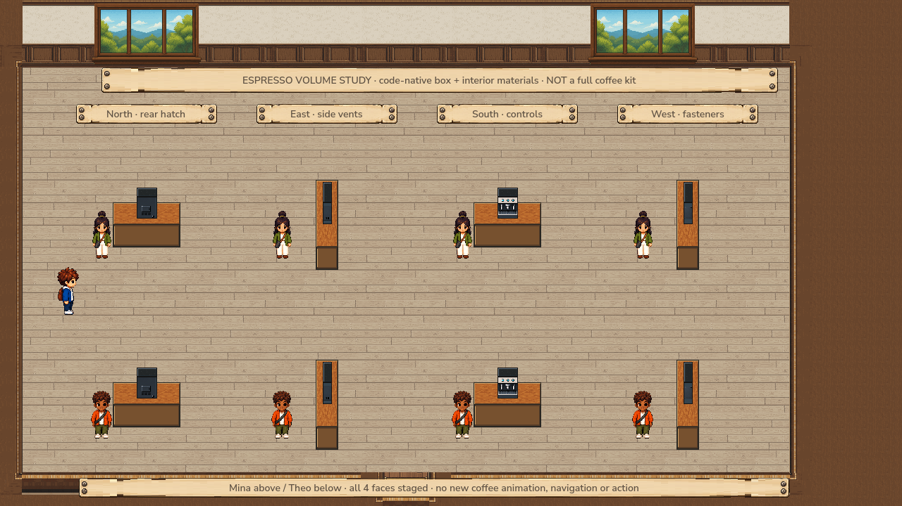

# Exact espresso volume: opaque-interior material feasibility

2026-09-04. **Geometry/material reuse prototype, not an accepted appliance or four-direction coffee kit.** No new ImageGen request, source repaint, silhouette extraction, worker call, save access or production registration occurred.

## Outcome

It is technically viable to place verified generated **face-interior rectangles** inside a code-built fixed-camera espresso volume. The box has exact29×13 or13×29 floor dimensions and a constant31px rise. It no longer inherits the generated top-plane distortion. Registered top/housing/face layers reconstruct the rendered whole exactly, with no checkerboard or alpha seam.

The artwork is **not ready to enable**. South controls and the north hatch remain readable, but the narrow west face loses the distinct two-fastener identity at native scale. East vents reduce to a few dark pixels. Raw material colors are also substantially denser than the staged coffee palette. These are real native-scale limitations, not test failures to waive. The code-built volume can be reused for a later approved material pass; the current source-preserving face candidates stay staged.



## Source boundaries and what was actually reused

The parent retained eight failed E/W source attempts: one initial plus three targeted retries for each direction. **This task did not reset or extend that cap.** E-v2 and W-v2 are opaque checkerboard **whole-kit failures**. Only a rectangle completely inside each machine's metal face is used here. Their exterior pixels, top faces, silhouette, grinder, mug and plant are never sampled. V3's invalid silhouette is not used.

Northv2 and Southv4 are existing true-alpha kit candidates. Their fully interior metal pixels unexpectedly retain source alpha253–254. The first strict255 check rejected those two rectangles. The parent authorized the same kind of mechanical opacity normalization used by existing export pipelines: require **every chosen interior pixel alpha≥250**, retain RGB exactly and set those material pixels to255. No source file changes and no exterior extraction are involved. E/W interior alpha is already255.

| Service side | Preserved source | Interior crop `(x,y,w,h)` | Native face material | Remaining socket padding `(x,y)` | Minimum source alpha | Native opaque colors |
|---|---|---|---|---|---:|---:|
| North | `coffee-service-north-v2.png` | `(214,326,318,360)` | 26×29 | `(1,0)` | 253 | 129 |
| East | `coffee-service-east-v2.png` | `(283,295,204,384)` | 11×21 | `(0,8)` | 255 | 76 |
| South | `coffee-service-south-v4.png` | `(250,326,336,354)` | 27×28 | `(0,1)` | 253 | 452 |
| West | `coffee-service-west-v2.png` | `(293,326,221,357)` | 11×18 | `(0,11)` | 255 | 111 |

Sources and their adjacent prompts remain under [`game/assets/source/overnight-20260904/kits/`](../../game/assets/source/overnight-20260904/kits/). Exact SHA-256 values, crop coordinates, original alpha, normalization factor and native size are recorded in [`results-headless.json`](../../game/tests/output/modular-espresso/results-headless.json) and the native manifest. Each material uses **one uniform scalar**, rounded to nearest output pixels, with nearest sampling. A short E/W material sits on visible code-authored housing padding; it is not stretched taller. All output RGB is drawn from the chosen source rectangle and matches the expected crop/resize exactly.

No palette simplification was silently introduced. That is why these tiny materials retain up to452 colors; a restrained approved palette remains a future normalization/design decision. No alpha test is used to claim a rectangle contains the entire machine or the right hidden geometry.

## Exact volume and registration contract

[`modular_espresso_geometry.gd`](../../game/tools/modular_espresso_geometry.gd) has separate explicit N/E/S/W floor definitions. There is no image rotation or mirroring. All four sides share fixed upper-left edge lighting and the existing **32×32 isotropic charcoal powdercoat tile**, tiled at native scale on the exact roof. The top comes from geometry, not the source's malformed top drawing.

| Geometry | North / South | East / West |
|---|---|---|
| Floor | `Rect(-14,-6,29,13)` | `Rect(-6,-14,13,29)` |
| Rise | 31 | 31 |
| Raised top | `Rect(-14,-37,29,13)` | `Rect(-6,-45,13,29)` |
| Visible vertical face | `Rect(-14,-24,29,31)` | `Rect(-6,-16,13,31)` |
| Inset face socket | 27×29 | 11×29 |
| Full ink rectangle | `Rect(-14,-37,29,44)` | `Rect(-6,-45,13,60)` |
| Near physical contact | Y+7 exclusive | Y+15 exclusive |

All machine layers retain **64×96 canvas / floor anchor(32,72)**. Odd dimensions have a disclosed geometric center **(+0.5,+0.5)** relative to the integer anchor, avoiding fractional runtime transforms. This is an integer-pixel registration convention, not a claim of an exactly centered odd rectangle about(0,0).

The exact machine floor is attached at **(0,-32)** relative to the counter's physical floor pivot. That is the counter elevation; the appliance's31px rise is separate. Every machine floor fits inside the corresponding counter's **actual inset wood**. N/S counter and E/W counter retain96×32 and32×96 floor rectangles respectively. No table geometry, room geometry or interaction cell was changed to make the machine fit.

Layers `Top`, `Housing`, `Face` share one origin and relative depth0. Whole assembly depth is its counter's floor pivot. Exported components are original geometry/material pieces, not an alpha-cut imitation of a new side view.

## Native evidence and actual limitations

The capture uses the approved `TownRoom`, unchanged exact soft-oak counter and native48×80 Founder/Mina/Theo locomotion sources. It does not instantiate GameMain, WorkerClient or personal state. The four columns are N/E/S/W; Mina is above, Theo below. All actor poses are existing standing/walking art; captions explicitly deny any new pouring or reaching animation.

Inspected at native1280×720: `native-four-views.png`, `service-approach.png`, `behind.png`, `in-front.png` and all four walk-segment midpoints. All four isolated appliance4× exports were inspected as well. No claim is made to continuous movie playback or individual inspection of every saved detail crop.

| Severity | Native evidence | Finding | Disposition |
|---|---|---|---|
| P1 | `native-four-views.png`, west upper appliance `(970,259,13,60)`; `west-appliance-4x.png` | Two fasteners collapse into barely perceptible pixels. At native size this is a generic narrow casing, not a reliable distinct side-detail cue. | Retain exact geometry, **do not approve the material**. A future hand-authored/approved simplified native face or bounded new asset in another authorized batch would need to preserve the actual side identity. No further retries in the exhausted batch. |
| P1 | East upper appliance `(458,259,13,60)` and `east-appliance-4x.png` | Vent detail survives as a small dark cluster;8px material padding makes the side quieter but visibly simpler than the front. | Keep as a geometry/material feasibility candidate only. Do not enlarge or nonuniformly stretch its face to fake equal detail density. |
| P1 | `south-appliance-4x.png`, `results-headless.json` | South controls are legible, but452 material colors and fine original gradients exceed the restrained staged-kit palette. | Future palette normalization needs explicit before/after RGB/contrast review. Source bytes remain preserved in this study. |
| P1 | `service-approach.png`, north actor around `(208,304)` | Centered north machine hides most of the standing actor; expected because the machine is opaque and the actor stands behind it. | Retain physical floor sorting. Any future coffee interaction needs appropriate feedback and authored hand action, not transparent machines or wrong depth. |
| P1 | All counters, and empty space around the appliances | Counter body finishing and E/W grinder/mug/plant are not supplied by this espresso-only volume. | Do not describe these four machine boxes as the full coffee station or activate a catalogue family. |
| P2 | `behind.png` and all walk midpoints | Source-based depth and registration agree in tested scripted states. | Reuse the implementation approach. Actual AStar, editor, input, walls/corners and complete composition remain separate admission gates. |

At the north service cell the opaque combined assembly hides **769 Mina pixels** and **846 Theo pixels**. At E/S/W service cells it hides zero actor pixels. Across sampled room states, **169,001 actual opaque actor/assembly pixel comparisons** match the expected layer order with **zero mismatches**. Source files retain their original hashes after export.

Provisional espresso-only score: **pixel coherence2, perspective3, silhouette/readability1, layering/anchors3, direction consistency2, placement2**, mean **2.17**. Readability1 deliberately blocks acceptance despite correct volume. The direction score covers explicit machine geometry and separate selected face interiors, **not** a recovered four-direction toolkit. No user aesthetic approval or production readiness is inferred.

## Files and verification

- New helper: [`modular_espresso_geometry.gd`](../../game/tools/modular_espresso_geometry.gd).
- New headless suite: [`test_modular_espresso_geometry.gd`](../../game/tests/test_modular_espresso_geometry.gd), **110 checks,0 failures**.
- New native exporter/showroom: [`capture_modular_espresso.gd`](../../game/tools/capture_modular_espresso.gd), **2,853 checks,0 failures**.
- **68 PNGs total**:16 native room scenes,24 room detail crops,4 isolated appliance4× crops,4 counter assembly PNGs, and20 staged fixture PNGs.
- Staged exports: [`modular-espresso-v1/`](../../game/tests/fixtures/furniture-calibration/modular-espresso-v1/) contains each side's full64×96 `top`, `housing`, `face`, `whole`, plus the smaller `face-material` rectangle. All registered layers reconstruct their whole **byte-exactly**; each whole's alpha bounds equal the specified exact geometry and has no partial alpha or hidden-RGB padding.
- Native manifest: [`manifest.json`](../../game/tests/output/modular-espresso/manifest.json), also copied beside exports with explicit `runtime_approved:false`.
- Movie: [`room-comparison.avi`](../../game/tests/output/modular-espresso/room-comparison.avi), ffprobe verified **1280×720,30FPS,133 frames** (132 scripted plus one final lifecycle frame).
- Renderer exited0 and was released to the broad regression task. No renderer remains held by this task.

```sh
STARTUP_VALLEY_NO_WORKER=1 godot --headless --path game --script res://tests/test_modular_espresso_geometry.gd
STARTUP_VALLEY_NO_WORKER=1 godot --path game --fixed-fps 30 --write-movie res://tests/output/modular-espresso/room-comparison.avi --script res://tools/capture_modular_espresso.gd
```

**Frozen partial proof, not a complete coffee replacement.** Original sources, North/South kit exports, production geometry/catalogue and worker/save boundaries are unchanged. No image generation, provider call, commit or push was performed.
