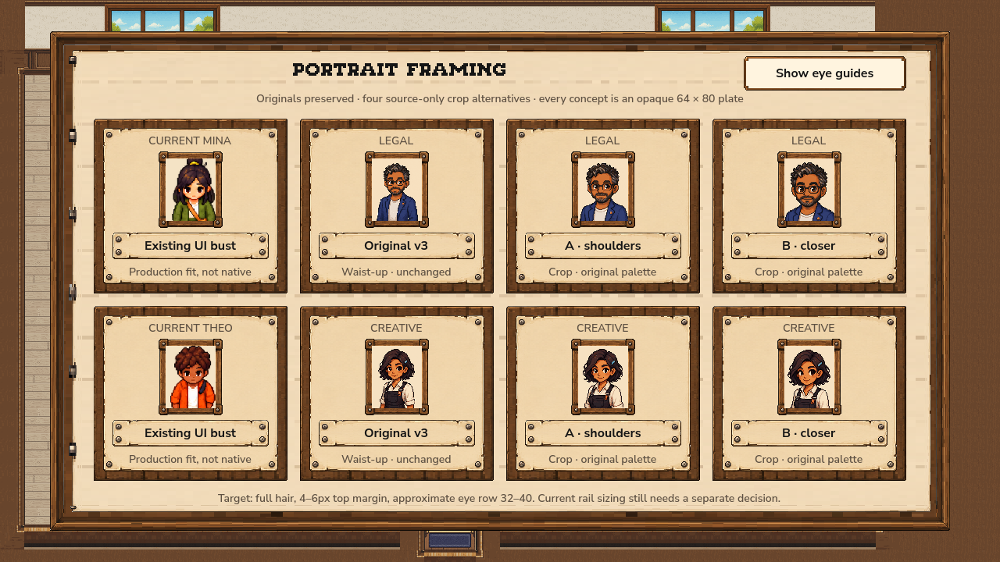

# Specialist portrait framing: preserved-source A/B study

Reviewed **2026-09-04 09:08 UTC**. This is a separate follow-up to the frozen [waist-up portrait review](SPECIALIST_PORTRAIT_REVIEW.md). The originalv3 source masters, native plates, review and page are unchanged. **No new ImageGen request, production UI change or employee registration.**

## Recommendation

Prefer **Legal B** and **Creative B** as the next native portrait specimens. Legal B fixes the most obvious issue: the colleague no longer appears much farther from the camera than Mina/Theo. His glasses, curls and beard are clearer, while the indigo lapel and white shirt remain visible. Creative B is a smaller but useful improvement: the face and bob occupy more of the frame while retaining the clip, collar and overall straps.

These are **recommended framing specimens**, not newly hireable employees or an already-approved rail migration. Keep the original waist-up versions for larger illustrations. Do not enlarge the B exports at runtime or discard A/v3 alternatives.



## Intended framing and exact recipes

Native target: **64×80 opaque plate**, full hair visible, approximately **4–6px top clearance**, and an approximate pupil/eye line between **rows32 and40**. This range accommodates distinct adult faces rather than stretching them to an identical anatomy. Source hair envelopes and eye lines are **manually observed approximate landmarks**, not automatic face segmentation or exact anatomical measurements.

The four source rectangles are exact4:5, so each uniformly fits64×80 with **no extra padding and no independent-axis scaling**. Every crop is inside its retained1122×1402 master and contains its recorded hair envelope. The builder uses nearest-neighbor sampling, no dithering, and the **unchanged originalv3 native portrait's32-color palette**. All outputs use exactly32 colors drawn exclusively from that palette. No new background, hidden pixels, matte keying or repaint was introduced; the preexisting opaque parchment remains.

| Variant | Exact source crop `(x,y,w,h)` | Uniform scale | Approx. hair top | Approx. eye row | Approx. hair width |
|---|---|---:|---:|---:|---:|
| Legal A, shoulders | `(112,32,896,1120)` | 1/14 | 5.57 | 36.29 | 42.86 |
| **Legal B, closer** | **`(160,48,800,1000)`** | **0.08** | **4.96** | **39.36** | **48.00** |
| Creative A, shoulders | `(48,8,1024,1280)` | 1/16 | 4.00 | 32.00 | 52.00 |
| **Creative B, closer** | **`(80,0,960,1200)`** | **1/15** | **4.80** | **34.67** | **55.47** |

Single recipe authority: [`specialist-portrait-crops.json`](specialist-portrait-crops.json). It references the originalv3 source and original palette paths. Builder: [`build_specialist_portrait_crops.mjs`](../tools/build_specialist_portrait_crops.mjs). Each output was generated twice and compared by SHA-256, and all protected masters/originalv3 native PNGs retained their original hashes.

New files are isolated under [`overnight-crops-v1/`](../../game/tests/fixtures/character-concepts/overnight-crops-v1/):

- `lawyer-a.png`, `lawyer-b.png`, `creative-a.png`, `creative-b.png`:64×80 opaque32-color plates.
- Corresponding `-4x.png`: nearest enlargements for inspection only.
- [`manifest.json`](../../game/tests/fixtures/character-concepts/overnight-crops-v1/manifest.json): crops, source/palette/output hashes, exact factor, original-protection results and explicit non-production status.

Recommended native hashes:

- Legal B: `79883ec9388f20343be46033741aabc25c239e594c19df3657b3a8e369615cb0`.
- Creative B: `1dbf6040ebe60c8dfbb558142e8781d51d025c127905db5fe82cf4033f49416b`.

## Actual notebook comparison

The new dev page reuses the original review's production `NotebookSkin` material helpers and shared font roles. Each plate uses the same82×98 portrait frame with a64×80 opening at scale1 and nearest filtering. The page shows current cast, originalv3, A and B side-by-side: legal row above, creative row below. The two cast references retain the documented current COVERED fit method rather than pretending their large atlas busts are native64×80 art.

Native candidate openings:

- Legalv3 `(476,203,64,80)`, A `(740,203,64,80)`, B `(1004,203,64,80)`.
- Creativev3 `(476,443,64,80)`, A `(740,443,64,80)`, B `(1004,443,64,80)`.

Each of all six concept plates is compared pixel-for-pixel to its actual viewport rectangle before and after diagnostic guides are toggled. **All5,120 pixels match**: no cropping, filtering, border coverage, mutation or fractional display scaling. The optional guide overlay draws only two UI lines at rows32/40. It is never baked into an exported portrait, and an actual second mouse click restores exact original plate pixels.

### Native review findings

| Variant / evidence | Observation | Disposition |
|---|---|---|
| Legalv3 | Much more torso than the cast; face/glasses appear small. | Preserve for waist-up use, not the preferred compact portrait. |
| Legal A | A meaningful improvement, with more lapel/shirt remaining. Still reads a little farther away than the cast. | Retain as the gentler framing alternative. |
| **Legal B**, `lawyer-b-4x.png` | Strongest face/eye/glasses readability. Full salt-and-pepper hair remains separated from the frame; the pin and shirt survive near the lower edge. | **Preferred compact legal specimen.** Lower jacket/waist is intentionally outside the crop, not missing/painted-away source content. |
| Creativev3 | Already legible, but more of the overall bib and sleeves compete with the small face. | Preserve original; difference is less severe than legal. |
| Creative A | Keeps more clothing detail; slightly larger face and clear clip. | Usable alternate if outfit presentation is prioritized. |
| **Creative B**, `creative-b-4x.png` | Best match to the cast's closer composition; full bob remains inside the opening and eyes sit comfortably in the target band. | **Preferred compact creative specimen.** It does not attempt to manufacture a more chibi face or redraw the pose. |

At native1280×720, labels and controls remain readable without zooming. All three full-page states and all four A/B4× card crops were visually inspected, in addition to the four isolated4× crop inputs. The viewer is not claiming every scaled detail reveals the same apparent expression: uniform point sampling can alter which small eye/mouth highlights survive. No source expression was redrawn to compensate.

## Unchanged limitations

- Both are **opaque portrait plates**, not recovered cutouts. The original slightly varying parchment colors remain.
- No world movement/work poses, character backend, hire button, role capability, portrait registry or actual employee was added.
- The current rail still has a66×74 opening. A64×80 plate cannot be placed there at exact1× without an explicit later frame/fit/nameplate-height decision. This review does **not** make that production UI change.
- Distinct head proportions, adult facial detail and the current cast's existing source/cropping style still deserve one coherent portrait specification. The B crops improve framing; they do not claim perfect style identity.
- A later broader portrait pass must inspect the header and small chat avatar as well as the rail. This notebook comparison is not a substitute for those actual production contexts.

## Verification

- Mechanical builder: **20 checks,0 failures**, four twice-exported alternatives and unchanged source/v3 hashes.
- [`capture_specialist_portrait_crops.gd`](../../game/tools/capture_specialist_portrait_crops.gd), headless: **198 checks,0 failures**. Exact source/target dimensions, fixed palette, opaque plates, intended approximate landmarks, native/frame bounds, actual text metrics and source protection.
- Same script rendered: **234 checks,0 failures**, exact viewport pixel equality, actual guide-button input and restoration.
- New isolated page: [`specialist_portrait_crop_page.gd`](../../game/tools/specialist_portrait_crop_page.gd). One initially overlong dev metadata label was shortened before capture; font sizes were not reduced and no production copy was changed.
- Evidence: **19 PNGs** = three1280×720 native states, eight native card crops and eight nearest4× card crops. [`Native manifest`](../../game/tests/output/specialist-portrait-crops/manifest.json) records all paths and results.
- The graphical process exited0; renderer was released. No process remains held by this task.

```sh
node dev/tools/build_specialist_portrait_crops.mjs
STARTUP_VALLEY_NO_WORKER=1 godot --headless --path game --script res://tools/capture_specialist_portrait_crops.gd
STARTUP_VALLEY_NO_WORKER=1 godot --path game --script res://tools/capture_specialist_portrait_crops.gd
```

**Study frozen.** Originalv3 evidence remains intact. No new ImageGen call, provider/worker/save access, production/rail change, registration, commit or push occurred.
