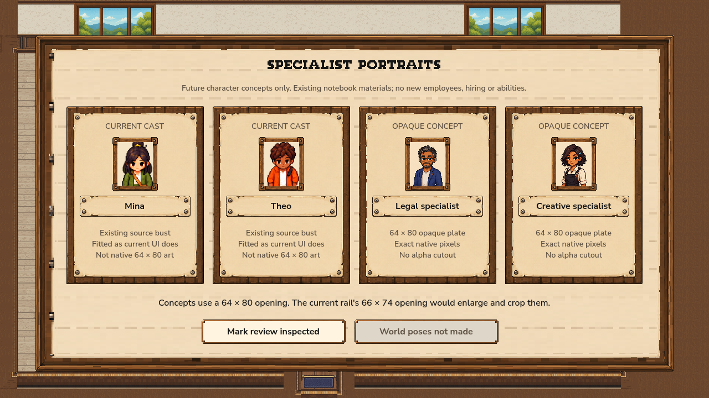

# Future specialist portraits: native notebook review

2026-09-04. **Concept plates only; no new employee, hiring, backend ability or world sprite.** No ImageGen call or source correction was made during this review. The two64×80 portraits remain intentionally **opaque parchment plates**, not transparent cutouts.

## Result

Both concepts are readable inside the actual notebook portrait frames at exact1×. The legal specialist's glasses, salt-and-pepper hair, indigo jacket and white shirt remain identifiable. The creative specialist's dark bob, hair clip, rolled sleeves and dark overalls also survive native normalization. The warm plates sit comfortably against the wood/parchment materials without visible checkerboard, halo or frame overlap.

The comparison also exposes a real composition gap: **the legal specialist's head is much smaller than the current cast's framed heads**, because more torso remains in the concept. The creative portrait is closer, but still uses a more waist-up composition than the existing cropped busts. The current rail geometry cannot accept these64×80 plates at exact1× without an explicit frame/fit change. Keep the concepts for visual development, not direct registration.



## Inputs and provenance

- Existing builder, unchanged: [`build_specialist_portraits.sh`](../tools/build_specialist_portraits.sh).
- Native sources: [`lawyer-portrait-v3.png`](../../game/tests/fixtures/character-concepts/overnight-v1/lawyer-portrait-v3.png) and [`creative-portrait-v3.png`](../../game/tests/fixtures/character-concepts/overnight-v1/creative-portrait-v3.png), each **64×80,32 colors,5,120 opaque pixels,zero transparent or partial-alpha pixels**.
- Original masters:1122×1402 RGB, retained under [`overnight-20260904/characters/`](../../game/assets/source/overnight-20260904/characters/) with all initial/retry prompts and failed outputs.
- Each series had an initial opaque-checkerboard result and an unsuccessful first alpha-extraction retry. **V3 is the second targeted retry**, explicitly changing the request to an opaque parchment background. It is not successful transparency extraction and does not reset the series' retry history.
- Uniform nearest-neighbor normalization fits64×80 with integer output rounding; a32-color export follows. No person masking, repaint, nonuniform stretch or alpha removal occurred here.
- Re-running the existing builder preserved both masters, both native PNGs, both4× PNGs and the two comparison sheets **byte-for-byte**. [`rebuild-results.json`](../../game/tests/output/specialist-portrait-review/rebuild-results.json) records all hashes.

Source SHA-256:

- Lawyer: `e28952e8aec785883b324f53b18a9dd87fbdc3b5ce35ee9ca16dbe777e64a365`.
- Creative: `874f98df78449889b5af81326200e307fa73e7db1df4774b7085df36d01eeaab`.

V3 did not meet the prompt's **literal single-color#F4E3C5** background exactly. Lawyer native corners are#F7E0BF/#F7E1C0; creative corners are#F6E1C1/#F7E1C1. The tiny variation is recorded, not silently painted away. At native size it reads as a calm parchment plate, not a transparency grid. This does not make it a portable cutout for arbitrary backgrounds.

## Real framing and typography

The isolated page uses production `NotebookSkin` wood, outer frame, notebook, parchment, portrait frame and nameplate surfaces plus the approved shared typography: NotJam Slab22 for the controlled heading, Nunito16 for functional/name copy and Nunito14 metadata. It does not modify those shared resources or the production UI.

New plates use an **82×98 frame** with the real9px border, leaving an exact **64×80 opening**. `STRETCH_KEEP_CENTERED`, scale1 and nearest filtering preserve every plate pixel. Native viewport comparisons check **all5,120 pixels of each concept** against the exported PNG in each of the three full-page captures. Every pixel matches, so there is no candidate cropping, filtering, border coverage or translucent blending.

Mina and Theo use the current `CharacterArt.bust_portrait` atlas sources and the production `STRETCH_KEEP_ASPECT_COVERED` fit method. Their source regions are **112×165.92** and **112×171.36**, not new64×80 native portraits. This page uses the same64×80 comparison opening for all four people and labels this distinction. It is not claiming that its overall card dimensions are the unchanged live rail.

The current rail's84×92 portrait frame has a **66×74 interior**. Applying COVERED to a64×80 plate scales by**66/64 =1.03125** and makes the full image82.5px high, cropping8.5px in total. At unscaled1× the existing opening would still be6px too short. A future safe rail contract could use an84×98 frame with a66×80 opening and centered64×80 plate, but would also need the nameplate/card height moved down consistently. No such production change was made.

## Native findings

| Priority | Evidence / native coordinates | Finding | Proposed next step |
|---|---|---|---|
| P1 | Legal plate `Rect(740,257,64,80)` compared with Mina `Rect(212,257,64,80)` and Theo `Rect(476,257,64,80)` | Legal head occupies appreciably less of the opening; glasses and beard become small details while the jacket takes much of the area. It feels more distant than the current cast. | Try a separately named, source-preserving **head-and-shoulders crop/export** from the retained master before considering any character redesign. Preserve the current waist-up concept. Do not solve this through arbitrary runtime enlargement. |
| P1 | Creative plate `Rect(1004,257,64,80)` and `creative-card-4x.png` | Strong bob/clip/overall identity; face reads better relative to the legal concept, but torso framing and more detailed facial treatment are not identical to the current cast. | Prefer this as the clearer initial concept. Review a consistent portrait framing/eye-line specification across all future employees before registration. |
| P1 | `job_panel.gd` rail portrait frame and source fit; page's explanatory footer | Live rail opening is incompatible with exact1×64×80 plates. Blind replacement would enlarge/crop them. | Adopt an explicit native portrait/frame contract and verify every rail/header/chat use. Keep this review's82×98 test frame out of production until that UI migration is requested. |
| P2 | `mira-card-4x.png`, upper portrait opening | Existing COVERED fitting cuts into Mina's hair/bun and both old busts have larger faces than the waist-up concepts. This is preserved comparison behavior, not a newly generated cutout defect. | Normalize the existing cast's portrait composition as part of the same future framing pass; do not force all new portraits to imitate accidental cropping. |
| P2 | Both concept corners / recorded corner values | Background is opaque, close to parchment, but neither literally flat nor exactly the requested hex. | Reuse only as a framed opaque plate. If a cutout is later required, it remains a separate missing asset; do not key the parchment color or claim recovered alpha. |
| P2 | All11 captures | Shared frame/name/card materials and readable font roles are coherent; no label/control overlap or clipped candidate plate. | Reuse the shared UI materials. No new portrait-specific border batch is needed. |
| Missing functionality | Disabled “World poses not made” specimen control | No locomotion, seated/typing art, role backend or hiring entry exists for these concepts. | Keep catalogue status **concept portrait only**. Do not infer a complete employee from a portrait. |

The plate's warm skin/cream/charcoal and restrained blue accents fit the existing notebook palette. They are not an exact brand-color swatch contract. Creative's overall silhouette is closer to the current game's expressive character language; legal's mature face is distinct and usable as a concept, but its smaller framing is the first correction to assess. Neither is a new production portrait approval.

## Verification and evidence

- New reusable dev page: [`specialist_portrait_review_page.gd`](../../game/tools/specialist_portrait_review_page.gd).
- New deterministic check/capture entry point: [`capture_specialist_portrait_review.gd`](../../game/tools/capture_specialist_portrait_review.gd).
- **143 headless checks,0 failures:** source/native dimensions,32-color opacity, uniform normalization, true production material references, font roles, full candidate plate geometry, text metrics, parent/screen containment and control bounds.
- **292 rendered checks,0 failures:** the same checks plus exact viewport pixel equality, actual keyboard focus, actual disabled-button click rejection and exactly one local review-button click. The button changes only this dev page's memory; no employee/action dispatch exists.
- **9 rebuild checks,0 failures:** [`check_specialist_portrait_rebuild.mjs`](../tools/check_specialist_portrait_rebuild.mjs).
- **11 PNGs:** three1280×720 native pages, four native card crops and four nearest4× card crops, all listed in [`manifest.json`](../../game/tests/output/specialist-portrait-review/manifest.json).
- Inspected all three full pages and all four4× card views, as well as both native plate4× inputs. The4× body text is intentionally enlarged antialiased Nunito from a native screenshot, not a claim that text becomes a pixel font.
- [`keyboard-focus.png`](../../game/tests/output/specialist-portrait-review/keyboard-focus.png) shows the actual shared focus edge; [`inspected-local-only.png`](../../game/tests/output/specialist-portrait-review/inspected-local-only.png) confirms the local-only action and unchanged portrait pixels.
- Renderer exited0 and was released to the floor-material task. No renderer remains held.

```sh
node dev/tools/check_specialist_portrait_rebuild.mjs
STARTUP_VALLEY_NO_WORKER=1 godot --headless --path game --script res://tools/capture_specialist_portrait_review.gd
STARTUP_VALLEY_NO_WORKER=1 godot --path game --script res://tools/capture_specialist_portrait_review.gd
```

**Review frozen.** No employee registration, hiring change, real save access, worker/provider call, image request, production asset/UI change, commit or push occurred.
