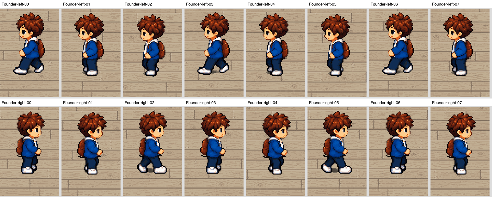
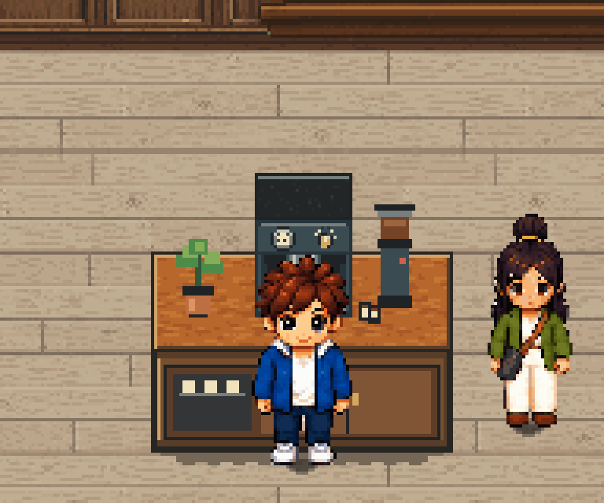

# Asset audit status — November 15, 2026

The asset-quality agent is actively repairing the remaining character blink
defects. This page distinguishes generated pixels, runtime composition fixes
and open findings. A reviewed PNG does not prove every animation using it is
correct. See [the generation and review workflow](ASSET_WORKFLOW.md).

## Confirmed open findings

| Finding | Evidence and action | Status |
| --- | --- | --- |
| Mina's standing blink paints pale bars through her bangs while her pupils stay open | The previous correction touched only `mira-seated.png`; the front idle closed cell in `mira-locomotion.png` still needs a narrow eye correction. Audit all facings and poses in Godot. | Repair in progress |
| Founder's front closed eyes read as dark blocks | Actual timed Godot captures exposed a two-pixel-high closed-eye block; align its lid treatment with the other characters while preserving his identity and remaining frames. | Repair in progress |
| Blinks look like prolonged face flicker | Standing Founder, employees, seated idle and story guests alternate two cells at 1.5 fps, leaving eyes closed about 667 ms every 1.33 s. Replace this with a short, infrequent blink and verify rendered timing. | Repair in progress |
| Full visual consistency of future maps | New shared-world manifests and a map gate require matching camera, scale, material treatment, modular props and actual-engine review. Existing snapshots are explicitly not visual approvals. | Framework under validation |

## Reported furniture consistency issue

The owner reports that chairs, desks and phone booths feel inconsistently
sized/scaled. A separate furniture-quality audit is comparing the actual
Godot-rendered families beside the same reference characters, with native
scale, canvas padding, ground pivots, perspective and occupied poses recorded.
Current map visual approvals stay pending that assessment. Do not treat an
existing geometry contract as proof that these proportions look coherent.

The [native furniture audit](FURNITURE_SCALE_AUDIT.md) now confirms mixed ground
registration, inconsistent usable seat proportions, and an oversized booth
with an inadequate one-cell footprint. Its 39 fixture checks validate capture
and measurements, **not visual quality**. Corrections are in progress: the
standalone café pair/booth and the occupied office-chair family have separate
owners. The booth correction must preserve saved furniture and ownership.

## Generated art already integrated

Six accepted OpenAI image-generation treatments produced **seven changed
runtime PNGs**. These are bounded overlays on existing art, not seven entirely
regenerated assets. Original generation outputs, prompts, transforms and
hash-bound reviews are retained in the repository.

| Original problem | Generated change | Review / visual evidence |
| --- | --- | --- |
| Side-walk legs appeared stuck | Founder lower-body walk overlay | [Review](../dev/art-catalogue/runtime-reviews/founder-side-walk-v2.json), [rendered frames](web/assets/playtest-polish-founder-walk.png) |
| Same side-walk issue | Mina lower-body walk overlay | [Review](../dev/art-catalogue/runtime-reviews/mira-side-walk-v2.json), [rendered frames](web/assets/playtest-polish-Mina-walk.png) |
| Same side-walk issue | Theo lower-body walk overlay | [Review](../dev/art-catalogue/runtime-reviews/theo-side-walk-v2.json), [rendered frames](web/assets/playtest-polish-theo-contact.png) |
| Same side-walk issue | Creative lower-body walk overlay | [Review](../dev/art-catalogue/runtime-reviews/creative-side-walk-v2.json), [rendered frames](web/assets/playtest-polish-creative-contact.png) |
| Pale marks through Mina's seated bangs | Seated closed-eye overlay; 86 changed pixels | [Review](../dev/art-catalogue/runtime-reviews/mira-seated-blink-v2.json), [rendered frames](web/assets/playtest-polish-Mina-blink.png). **Standing blink and timing remain open above.** |
| Coffee machine front was hard to recognize | South-facing espresso panel; recomposed panel and whole-machine PNGs | [Review](../dev/art-catalogue/runtime-reviews/coffee-south-front-v2.json), [native detail](web/assets/coffee-front-review/south-front-detail.png). Other facings were not regenerated. |

## Fixed through code or placement

| Finding | Change |
| --- | --- |
| Chair back disappeared behind north-facing seated characters | Facing-specific lower-body/chair/head depth composition. [Decision and evidence](decisions/2026-11-15-seated-chair-depth.md). |
| Creative used the wrong portrait | Correct character crop/selection; no new generated PNG. |
| Mina arrival could overlap furniture | Navigation and painted-bounds placement checks, deterministic clear-floor search, and a safe portrait-introduction fallback. |
| Theo hover paper covered his name/face | Derive callout bounds from the actual rendered target, protect the actor/nameplate and other world UI; 57 native regression checks passed. |
| Cursor lifecycle and stale hover feedback | Clear native cursor ownership and hover state at the relevant transitions; no generated cursor artwork in this change. |

The frozen inventory contains 804 legacy runtime PNGs. That count is **not**
804 artistic approvals. Defects can still exist in unchanged legacy images.
Keep this list current when a reported issue is reproduced, repaired and
verified, and retain the evidence for the exact accepted scope.
