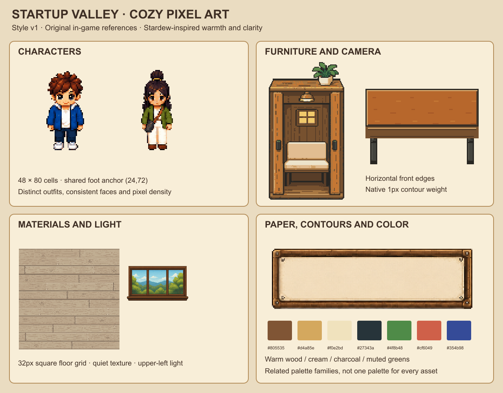
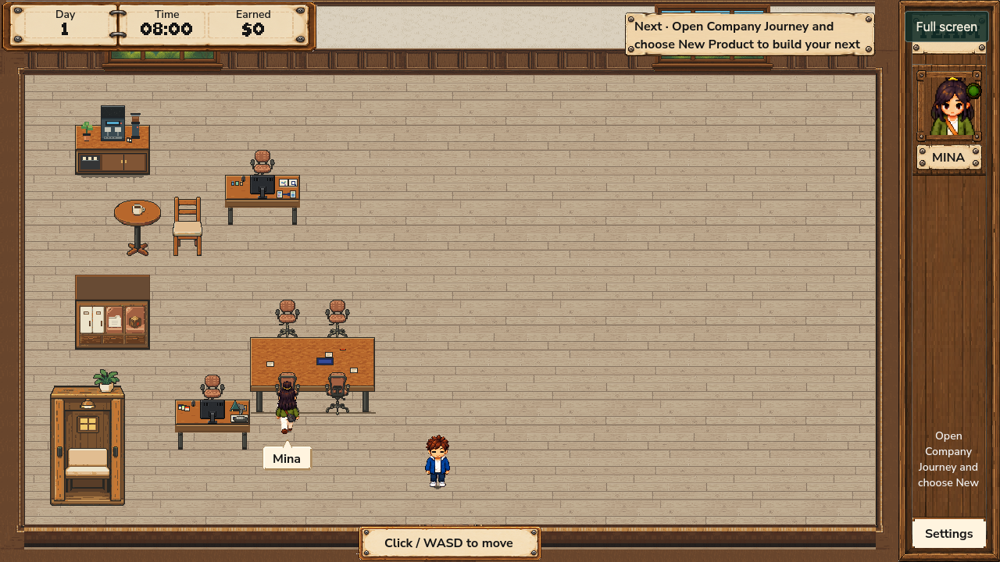

# Asset generation and placement workflow

The goal is a dependable art pipeline, not a claim that a script can judge
beauty. Geometry and provenance checks prevent common mistakes. A current
in-game visual review catches wrong-looking faces, furniture, animation and
camera angles that can pass those checks.

The existing [office specification](../game/assets/runtime/office/ASSET_SPEC.md),
[character registry](../game/character_art.gd),
[directional art catalogue](../dev/art-catalogue/README.md) and its validators
remain authoritative. The current runtime gate connects that work to builds;
it does not replace it with another art catalogue.

## One shared visual language

Every new asset follows
[`startup-valley-cozy-pixel-v1`](../dev/art-catalogue/style-profile.json) and the
[shared generation brief](../dev/art-catalogue/prompts/shared-style-template.md).
Attach the board below plus the specific existing asset/geometry reference to
each image-generation request. Keep its actual prompt, profile ID and reference
hashes with the result. The board is an arrangement of our own accepted art,
not a collection of copied Stardew sprites or a new generated style proposal.



Stardew Valley is the design inspiration for warmth, expressive characters,
clear everyday objects and a lived-in setting. The common rendering rules are
our fixed elevated camera, native pixel density, upper-left lighting, warm dark
contours and coordinated material ramps. Wood, metal, paper, plants and each
character can have different palettes while sharing that treatment. The board's
enlargements are inspection views, not different runtime scales.

The frozen reference PNGs include unchanged front-idle crops of Founder and
Mina, the accepted phone booth, registered desk layers, oak floor, window and
paper frame. Their source paths, crop recipes and hashes are recorded in the
profile. Updating this visual language is a deliberate profile revision, not
something an individual asset silently redefines. The optional dev-only board
builder is `dev/tools/build_style_reference_board.mjs` (requires Sharp; accepts
`SHARP_MODULE` for an existing installation).

Reviews must include the exact `style_profile` ID/hash, board hash and reference
image hashes, plus a completed `style` check. `application: generation_reference`
means the canonical board was actually supplied when generating; its retained
prompt must name the profile. For existing outputs made before this profile,
use `retrospective_review` and assess them against the board now. Never rewrite
history by claiming the board was supplied to an earlier generation. The
legacy inventory still carries no inferred authorship or aesthetic approval.

## One camera and one scale

`office-square-grid-v1` uses 32×32 floor cells, screen-aligned room axes,
vertical screen-space height, upper-left lighting, unit runtime scale and
nearest filtering. It is not diamond isometric. Draw each supported cardinal
facing separately; rotate logical footprints, never the finished raster.

Define these before generating art:

| Contract | What to record and check |
| --- | --- |
| Canvas and scale | Exact PNG size, native pixel density and reference actor beside the object. Transparent padding is not physical size. |
| Anchor | One registered ground pivot shared by every facing and layer. For a centered Godot sprite, offset = canvas / 2 − pivot. |
| Footprint | Occupied cells, walkable approach cells and visual bounds are separate quantities. Test wall/corner placement and real navigation. |
| Layers | Name and order rear structure, actor, foreground, equipment and effects. Do not bake characters or environment into props. |
| Animation | Exact frame grid, facing order, stable foot line and unchanged identity. Distinct frames alone do not prove alternating feet: inspect moving silhouettes. |
| Interaction | Only implemented actions get a pointer/glow. Decorative service sockets do not imply a working coffee action. |

For furniture, extend `game/data/furniture_catalog.json` or the existing
furnishing library and add the family to
[`runtime-contracts.json`](../dev/art-catalogue/runtime-contracts.json).
Do not independently recenter layers, silently change the camera model, or
hand-edit packed TileMap data.

## Candidate to accepted runtime asset

1. **Brief.** Record camera, dimensions, pivot, footprint, required layers,
   supported facings, reference assets and intended action. Use a real existing
   character and adjacent furniture as references.
2. **Generate or author.** Preserve the original output, exact prompt,
   generation/output identifier and references. Record retries and rejections.
   Use `openai_imagegen`, `code_native`, `manual`, `licensed` or
   `legacy_unknown` truthfully. Unknown history stays unknown.
3. **Normalize reproducibly.** Record the exporter and every crop, nearest
   resize, palette reduction and bounded overlay. Preserve originals.
   Rebuild the runtime result from retained inputs; measure hashes and geometry.
4. **Mechanical checks.** Run the applicable existing export/geometry/pose
   suites, then `npm run assets:check`. It checks every runtime PNG against a
   frozen legacy hash or current review, validates import settings, and checks
   explicit family geometry against the renderer's real catalogue.
5. **In-game review.** Capture native scale and a nearest enlarged detail in
   the actual room, all supported facings, front/behind actor crossings,
   seated/standing and animation transitions when applicable. Review wall and
   crowded placement too. Watch a walk cycle; a contact sheet is supplementary.
   Save a small inspected screenshot set and the test result as tracked evidence.
   Use Godot's native scene or the isolated browser asset preview below. Preview
   permits pending art reviews but still requires mechanical checks and never
   replaces the normal `dist` build.
6. **Accept the exact bytes.** Generate a review candidate, fill in the actual
   evidence, source and binding hashes, name the reviewer and explicitly assess
   style, camera, scale, anchor, layering, animation, placement and readability.
   `not_applicable` needs a reason. Only then set `status: approved`.
7. **Build and playtest.** Run `npm run assets:check -- --godot` after Godot
   import, export the browser build, and verify its actual placement and input.
   A changed binding or evidence file invalidates its active review.

```sh
node scripts/validate-assets.mjs --candidate game/assets/runtime/path.png \
  > dev/art-catalogue/runtime-reviews/my-asset-v2.json
npm run assets:check
GODOT_BIN=/path/to/godot npm run assets:check -- --godot
npm run assets:test
# Before approval, build and serve an isolated candidate on the next port:
npm run build:web -- --asset-preview
npm run dev:web -- --asset-preview
```

The [review schema](../contracts/asset-review.schema.json) documents the format.
The generator only creates a candidate. It cannot promote itself or rewrite
the baseline. Keep active approved records current; archive superseded records
outside `runtime-reviews/` so they remain history rather than active assertions.

## What is enforced today

- All 804 existing runtime PNGs are recorded in a frozen
  [`runtime-baseline.json`](../dev/art-catalogue/runtime-baseline.json).
  This is a migration inventory, **not 804 new visual approvals**. Existing
  defects remain audit work. New or modified art requires a current review.
- Every runtime image retains lossless import, no mipmaps and no size-limit
  scaling. Missing, added or changed files cannot slip through silently.
- Review sources, exact outputs, placement/animation bindings, in-game evidence
  and test reports must exist in the repository and match SHA-256 hashes.
  Claiming ImageGen provenance additionally requires its real prompt and
  generation/output identifier. A hash proves identity, not authorship itself.
- The coffee pilot enforces four facings, full canvas, shared pivot and sprite
  offsets, exact content bounds, binary alpha, semantic layer order, footprints,
  clearances, service gaze, interaction capability and existing manifest hashes.
- The desk contract locks the separate chair, desk, keyboard, mouse and monitor
  layers, native rectangles and depths, work cells, per-character seat anchors,
  and the exact seated-pose capability. Characters remain separate 48×80 frames.
- `--godot` runs the existing projection, actual-room coffee, reviewed workstation
  and seat-transition suites. Extend this list as family coverage grows.

The gate can prevent accidental drift. It cannot prove an honest visual review
occurred, discover all artistic defects, or prevent someone editing both an
asset and its checks. PR review remains part of acceptance. Do not update the
legacy baseline just to make a changed image pass; add a real review instead.

## Coffee machine audit — November 15, 2026



1. **Native room — readable location, weak object identity.** At the top-left
   coffee counter, the machine is a flat charcoal rectangle with a pale control
   grid. Its group heads, cup space and drip tray do not read clearly at the
   actual game scale. It can be mistaken for another office device. The user's
   quality concern is valid even if all geometric checks pass.
2. **Source and registration — coherent mechanical contract.** The active
   `coffee-station-v1` is code-native art exported by
   `game/tools/coffee_station_geometry.gd`, not the older ImageGen coffee
   experiments. It uses 192×256 canvases, pivot (96,192), ten layers per facing
   and offset (0,−64). The default station faces south at grid (4,6).
3. **Next art revision — needed, not falsely approved.** Keep that footprint
   and counter registration; redesign the appliance to show a recognizable
   espresso-machine silhouette, cup recess and warmer material detail. Review
   it beside Mina at native size, then verify all four independently authored
   facings. The current contract records `needs_redesign`; this audit does not
   claim a replacement machine has been generated or accepted.

This fresh screenshot is the current pre-story-polish browser build. It proves
the visible concern, not every possible placement or animation. The current
machine is intentionally noninteractive; making coffee a story activity is a
separate game feature, not something an art manifest should silently enable.

## Seated characters: separate assets, separate behavior

The current workstation already has separate desk, chair and actor assets.
For the default south-facing Mina desk, `DeskRear` and `DeskFront` use 192×224
canvases; `ChairWhole` uses 96×160; the keyboard, mouse and monitor are separate
layers. Mina's idle/typing art consists of 48×80 cells. Her registered seated
offset is (0,12), with separate upper/lower character depths (3,0). The monitor
uses depth 4 and the chair −33, relative to the prop. These values are preserved
in the new seating contract rather than inferred from transparent padding.

The existing `test_reviewed_workstation_production.gd` checks that each accepted
facing has actual seated/typing art; `test_seat_transition.gd` checks the seated
handoff and that presentation does not move the physical navigation anchor.
Both run through `assets:check -- --godot`. That proves the assembly contract,
not that a particular UI button starts a work state. If an assignment leaves
Mina standing, verify the dispatched work event, route arrival and avatar state
separately before altering correctly registered chair art.

Initial framework verification on November 15: 13 new Node regressions passed;
the full tooling suite passed 45/45. Existing Godot suites passed 797 projection,
409 coffee, 273 workstation-admission and 4,729 seat-transition checks. The
projection fixture was corrected to exclude office-level-2 expansion furniture
from its level-1 test room; it previously occupied the test placement bay and
then dereferenced a missing prop. These counts certify those runs, not later
image revisions or new browser behavior.
