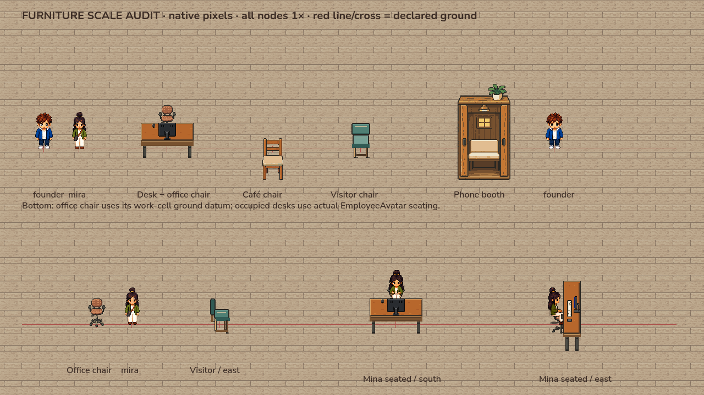
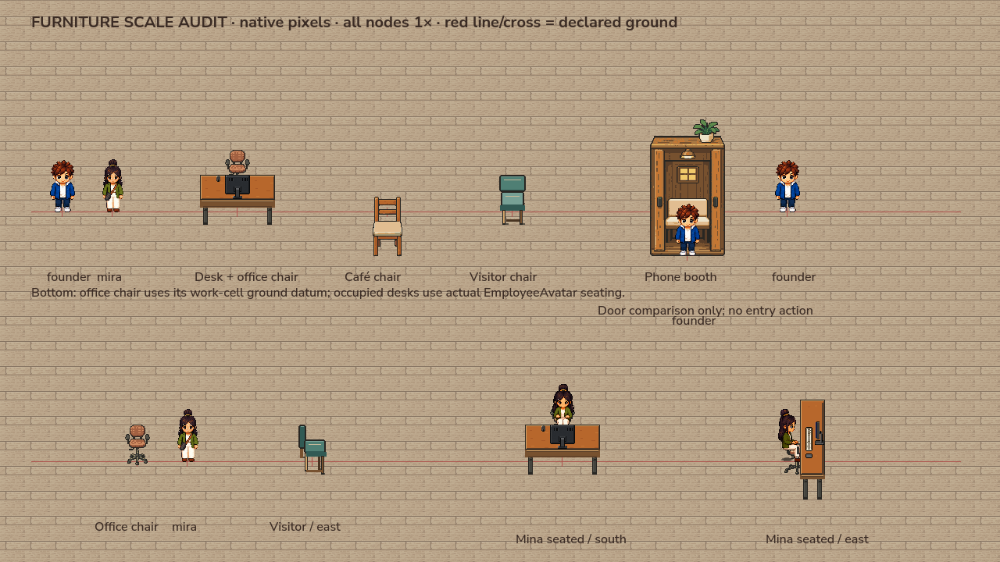
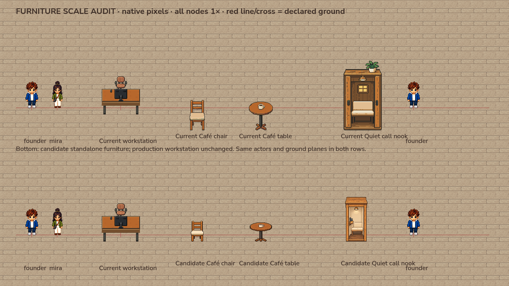
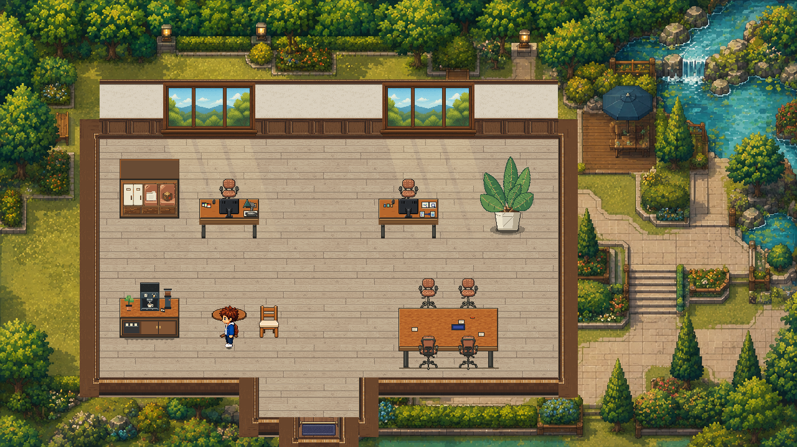
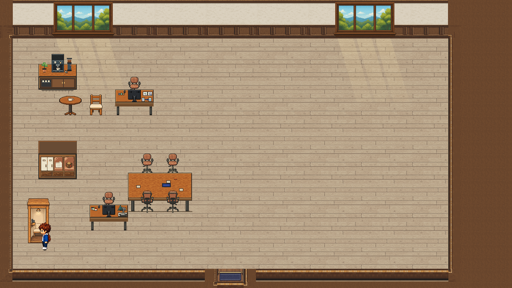

# Furniture scale and registration audit

**Initial finding: corrections required.** The desk,
office chair, café seating and phone booth do not currently read as one
consistently proportioned set. All render at unit scale. The problems are in
their authored pixels and ground registration, not a Godot zoom setting.
The original evidence below is retained. The standalone café pair and booth
have since received the bounded repair described at the end; this does not
approve the separate workstation-chair family or outdoor scenery.



This is a real Godot 4.7.2 render at 1280×720 using production catalogue
profiles, `TownRoom._apply_profile`, established Founder/Mina art and actual
`EmployeeAvatar` seated presentation. Red lines/crosses mark declared ground.
The lower isolated office chair uses its workstation **work-cell** ground,
because it sits behind the desk's anchor. No prop bitmap was resized. This is
an audit fixture, not a playable layout or new art approval.

## Measured evidence

| Asset, south view | Painted extent | Registration observation |
| --- | --- | --- |
| Founder / Mina, front idle | 32×67 / 27×68 px | Foot pixels end at the actor's declared ground. Frame is 48×80, not physical body size. |
| Desk body | 96×64 px | Occupies three 32px cells; body ends at ground +16. The 192×224 canvas is mostly padding. |
| Attached office chair | 32×52 px | Relative to its work-cell ground, ink spans approximately −48..+4 vertically. The narrow seat/back reads smaller than the other chairs. |
| Visitor chair | 34×64 px | Ink spans −48..+16; explicit seat surface is 30×20 at (−15,−27). Source geometry declares contact points and separate layers. |
| Café chair | 38×76 px | Ink spans −20..+56 relative to its declared ground. Its seat and base are substantially below the shared datum. |
| Café table | 60×72 px | Ink spans −16..+56. The tabletop/pedestal use the same displaced legacy ground convention as the café chair. |
| Phone booth | 96×175 px | Ink spans −119..+56; only **one** occupied 32px cell is registered despite its broad physical enclosure. |

Exact canvases, source hashes, occupied cells and per-layer registered ink
bounds are in [measured-geometry.json](web/assets/furniture-scale-audit/measured-geometry.json).
The renderer explicitly resets scale to `(1,1)`, rotation to zero, and filtering
to nearest. Comparing 192×224 and 96×144 source canvases would therefore be
misleading: compare their painted surfaces and semantic anchors instead.



The added Founder stands at the booth's **painted front-floor** line. This is a
size comparison, not an implemented booth-entry action. The enclosure's width
matches an entire three-cell desk, while its opening leaves excessive headroom
around the established character. The booth reads more like a large wardrobe
than a compact one-person pod. The
[actual legacy-office capture](web/assets/furniture-scale-audit/legacy-office-context.png)
confirms that this discrepancy is visible in the game, not just in the lineup.
That context image comes from an explicitly seeded compatibility save.

## Diagnosis

1. **Different ground conventions.** A centered sprite at offset `(0,−48)`
   places a 192×224 image's nominal pivot at source `(96,160)`. Café/booth art
   extends to source y=216, giving the +56px result. The visitor-chair source
   uses its own documented ground pivot and contacts ending near +16. About
   40px of the apparent downward displacement is registration drift. Moving
   the old image alone would not repair its proportions or collision.
2. **Different anthropometry.** The small task-chair seat/back, larger café
   chair, and wardrobe-sized booth were judged individually. The task chair's
   caster width is not its usable seat width. Conversely, the visitor chair's
   total height includes projected floor depth and cannot be treated as a
   64px vertical backrest. The painted-height ratios (booth 2.57× Mina, café
   chair 1.12×) are warning signs, **not physical height measurements**.
3. **Footprint and enclosure disagree.** The booth's broad base cannot be
   represented by its one-cell collision. A repaired booth needs an explicit
   multi-cell floor, doorway/front plane and safe placement migration.
4. **Material and detail density differ.** The booth's carved frame and broad
   upholstery, very small textured task chair, and flatter visitor chair
   belong to related warm material families but use noticeably different
   detail scales. A family-native redraw should simplify texture to readable
   clusters, preserve warm contours and align seat thicknesses. Matching only
   brown/cream colors is insufficient.
5. **The existing style board is not a scale chart.** It deliberately mixes
   2× and 3× inspection zoom. Its booth reference demonstrates material,
   silhouette language and camera cues; it does not certify relative size.

## Proposed common landmarks

These are **candidate art-direction targets**, not silently accepted new
geometry. Confirm them together in the same native fixture before admission.
Use the unchanged 67–68px standing character and 32px logical grid. Keep
vertical rise separate from projected floor depth: for each contact plane,
`surface_y = floor_y − rise`. Do not derive rise from the total PNG height.

| Landmark | Candidate target / tolerance |
| --- | --- |
| Shared floor datum | Explicit ground pivot plus front/back foot-contact points; contacts stay inside declared occupied cells, allowing a 2px outline tolerance. |
| Chair usable seat | 28–32px wide; 18–22px projected depth; seat rise 20–24px over its corresponding floor plane. |
| Chair back | Rise 38–44px over its own rear contact plane, not over the front-most foot. Task/café/visitor variants may differ in shape, not occupant scale. |
| Desktop / café tabletop | Rise 30–34px; target 32. Keep 8–14px vertical clearance above the seat surface. Preserve current desk work-cell and Mina seated hand/hip relationships pending a separate chair review. |
| One-person booth floor | Candidate 64×32px, two adjacent cells, instead of one cell under a 96px enclosure. No scale-node workaround. |
| Booth clear opening | 34–40px wide and 82–90px **vertical clearance at the front floor plane**. Compare Founder inside that plane, not against the whole projected silhouette. |
| Booth structural rise | 92–100px; add the actual projected floor depth to derive total painted height. Decorative roof/plant pixels may extend another 8–12px, separately declared. |

## Smallest coherent correction

First redraw the **standalone café chair/table pair and phone booth**. Keep the
desk and occupied task-chair behavior intact for this increment; the task
chair remains a separately documented visual inconsistency to address with
the seated-pose owner, not a reason to damage working seating anchors.

- Café chair: target roughly 32×64px registered silhouette, near
  `[-16,−48,32,64]`, using the seat/contact landmarks above. Preserve its
  warm wooden frame and cream seat. Register the actual floor under it.
- Café table: target roughly 56×60px registered silhouette, near
  `[-28,−44,56,60]`, with a 32px tabletop rise. Keep the pedestal base inside
  one occupied cell and a restrained 56px overhanging top.
- Booth: design the 64×32 floor and 92–100px structure together. An example
  two-cell registration is occupied `[-1,0],[0,0]`, floor
  `[-48,−16,64,32]`; its geometric center is 16px left of the selected grid
  anchor. At 92px rise, the roof back is y=−108 and front-floor contact y=16,
  giving about 124px body height before optional top decoration. The front
  opening starts around y=−68 for 84px clearance. Retain separate structural,
  interior and shadow responsibilities; do not bake a character into it.

Generate semantic redraws with the OpenAI image model after the target sheet
is agreed. Supply **both** the material/style board and a separate same-scale
calibration image with actor, chair, desk and booth landmarks. Retain prompts,
original outputs and deterministic normalization steps. Never silently change
the old style-profile hashes; if its material references change, create a
deliberate profile revision and review the affected assets.

Before registering the larger booth footprint, validate all shipped default
placements and old saved arrangements. Retain a valid old anchor where the new
footprint fits; otherwise move only that item to owned storage with a clear
recovery notice. Do not reset an entire decorated office or silently overlap
another item. Test near-wall, aisle, founder-adjacent, retry and reload cases.

## Enforced scale contract to add with the repair

Each admitted family should declare `ground_pivot`, projected `floor_polygon`,
`contact_points`, `seat_surface`, `desktop_surface`, `opening_clearance` where
applicable, and an approved same-scale reference hash. Checks should compare
those semantic landmarks with occupied cells and the shared ranges above,
while keeping transparent padding out of the measurement. A changed image,
landmark, actor reference or scale board invalidates its review.

Require a real same-scene native render with standing and occupied references
for every changed family; support only independently authored, reviewed
facings. Test routes around the true floor footprint and front/behind depth.
Mechanical bounds alone cannot prove that painted surfaces match declared
landmarks: the inspected comparison remains mandatory.

## Reproduction and status

```sh
STARTUP_VALLEY_SCALE_OUTPUT=/private/tmp/startup-valley-furniture-scale \
  /path/to/Godot --path game --script res://tests/test_furniture_scale_audit.gd
```

The retained [native report](web/assets/furniture-scale-audit/scale-report.json)
records **39 mechanical fixture checks, zero failures**. Those checks prove
native rendering/registration and real seated metadata, not visual acceptance.
South and east desk/visitor views were inspected; the active café/booth assets
only declare south. No runtime art, catalogue, save state, style-profile hash
or map approval was changed by this audit. Starter/courtyard map approvals
remain pending the furniture correction and fresh scene review. The separate
final three-run demo acceptance is still required.

## Standalone repair — November 15, 2026



The upper row is the original registration; the lower row uses the corrected
standalone pieces at the **same native scale and ground plane**. Existing
characters and workstation are unchanged in this comparison. The café chair
and table are simple wood/cream starter objects. The call nook is a modest
wooden later reward, rather than free starter equipment.

The first generated imports were still too tall above their actual contact
planes. The initial total-height targets were therefore revised after native
inspection: chair **32×52**, table **56×48**, booth **56×112** painted pixels.
This is deliberate semantic calibration, not a claim that the original rough
32×64/56×60/64×124 targets were met. A total PNG height combines vertical rise,
projected depth and ornament; it is not an anthropometric measurement.

| Final measured registration | Result |
| --- | --- |
| Chair | Ground pivot (48,128) in a96×160 canvas; painted bounds[-16,-36,32,52]. Seat about30px wide,20px above corresponding rear/front foot planes; back44px above its rear feet. |
| Table | Same canvas/pivot; painted bounds[-28,-32,56,48]. Tabletop32px above its projected floor plane, leaving12px over the chair seat. Its top overhangs a one-cell base. |
| Call nook | Pivot(80,160) in128×192; painted bounds[-44,-96,56,112]. Clear opening40×86px at the front floor plane; structural front rise94px. Occupies two cells[-1,0],[0,0], with both front cells reserved as clearance. |

The chair's visible cushion includes its front thickness; its projected top
is shallower than the earlier speculative18–22px target. The final contract
records actual surface/contact landmarks, with separate checks for rise,
width, ground registration and collision. It does not invent pixel geometry
to fit the original estimate.




These are real Godot component renders, not full-demo acceptance. The still
ornate exterior and older workstation chair visible in them are outside this
repair's approval. The furniture route fixture traverses behind and in front
of the café pair and booth through real `PlayerAvatar` navigation. The
[runtime report](web/assets/furniture-scale-v1/room-report.json) records21
passing checks; the [same-scale report](web/assets/furniture-scale-v1/calibration-report.json)
records33. The [doorway view](web/assets/furniture-scale-v1/doorway-calibration.png)
puts Founder at the booth's painted front-floor plane solely for measurement;
the booth remains a noninteractive decoration.

The three OpenAI image-model outputs, exact prompts and generation IDs are
retained in `game/assets/source/furniture-scale-v1/`. The deterministic
`game/tools/import_furniture_scale.gd` importer crops explicit source bounds,
resamples with nearest neighbor, bins alpha at0.5, and preserves sampled RGB.
Old runtime images and canonical material references remain intact. The
[review manifest](../dev/art-catalogue/runtime-reviews/furniture-scale-v1.json)
binds the new PNGs, import recipe, semantic contract and inspected evidence.

`scripts/validate-furniture-scale.mjs` checks exact native pixels/profile
bindings, canvas/pivot, no scale/rotation workaround, footprint contacts and
declared seat/table/door heights. Four regression tests reject drift. This
cannot prove beauty or that a human labeled the pixels honestly; actual
same-scene inspection remains required for every changed family.

Registration revision1 preserves old item IDs and every valid arrangement.
If a corrected object's expanded footprint would cover an existing founder,
only that object is placed in owned storage; other furniture stays put.
Layout revision advances once so stale edits cannot overwrite the result.
Tests cover exact reopen, stale commands, old receipt replay and interrupted
transaction rollback. Two copied **real schema18 compatibility saves** kept
all32/35 owned items, all9/8 placements and exact player coordinates:
[migration evidence](web/assets/furniture-scale-v1/legacy-save-migration.json).

The new-company library is three modest pieces. First release adds a small
bookshelf, visitor chair and coat stand; three releases or two hires add six
useful workspace items. Six releases plus office level2 unlock the remaining
library, including the call nook. Existing owners retain everything. Rewards
stay in storage and are returned immediately with release/hire/expansion
responses, rather than being automatically crammed into the room.

The adapted production-worker renovation journey also passes in **headless
Godot**: edit, full restart, lost committed acknowledgement and final restart.
All9 mutations are durable, source hashes stayed identical across the run,
and every worker/relay exited. The
[retained summary](web/assets/furniture-scale-v1/headless-worker-ui.json)
records its fingerprint and exact command. This run found the real pre-hire
`arrival-mina`/`mira` transport identity mismatch, now fixed at the client
boundary without removing Mina's collision protection. Subsequent verification
uses headless Godot only; no further native windows are needed.
