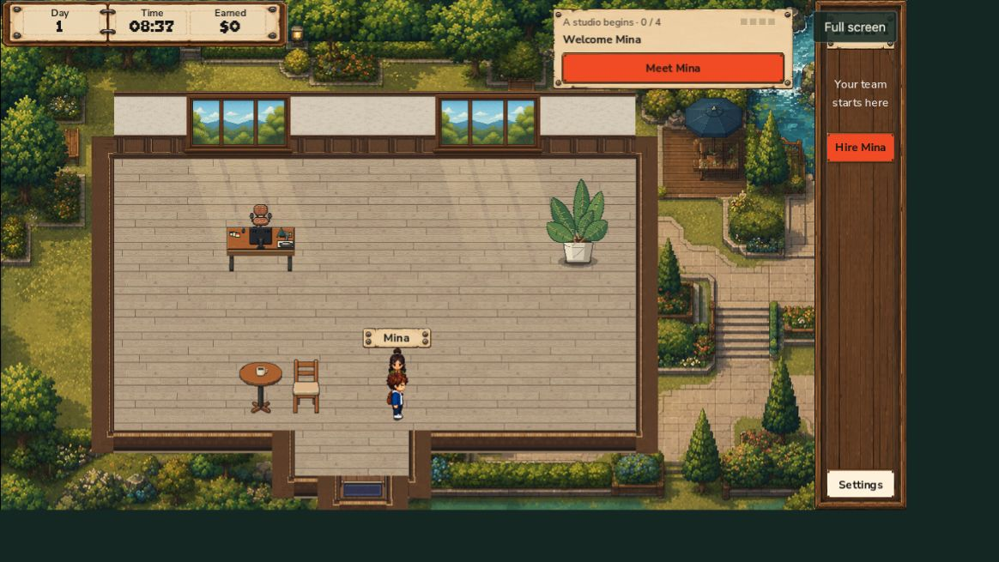

# Starter studio composition audit

The current garden and office do not read as one place. The office itself has
clear floor edges and recognizable furniture, but it covers the center of a
different, fully landscaped scene. Replace that composition with a modest yard
derived from the studio's real doorway, floor grid and boundary.

1. **Playable arrival, before inviting Mina — needs correction.** The player,
   Mina and the work desk are readable, and the current goal has a prominent
   action. The outdoor paths and entrance do not describe a coherent route.

This is the parent agent's actual in-app capture from build
`b5d7da90f647ea26` / source checkpoint `3cd6e71`, inspected and retained
byte-for-byte. [Evidence hashes](web/assets/world-composition/before-evidence.json)
bind the screenshot and the source composition. It is **before-change evidence**,
not approval of the replacement map.

## Findings, in order of impact

| Priority | Visible evidence in step 1 | Correction |
| --- | --- | --- |
| 1 — spatial connection | The bottom-center door protrudes into the garden border. The substantial stone route is on the right, disconnected from this doorway; hedge/water pixels continue along the lower boundary. | Establish a continuous threshold, small apron and short path centered on the actual door. Give the building a consistent ground contact edge. |
| 1 — misleading routes | The right-side stairs, raised terrace and umbrella invite exploration, but this yard is scenery outside the authored office navigation. | Remove unused destination cues. A path meeting a playable threshold must lead to legal navigation or an explicit story travel trigger; a closed boundary must look closed. |
| 1 — unrelated geometry | The cutaway office has screen-aligned floor and wall edges, while the background introduces stairs, retaining walls and several ground levels without a shared connection. | Keep this starter yard on one readable ground plane. Align paving, walls, corners and the doorway to the same 32px grid and camera. Add elevation only with complete visible and navigable transitions. |
| 2 — attention and setting | Dense trees, bright water, flowers, terrace furniture and ornamental masonry surround a nearly empty studio. The setting reads as an established landscaped estate rather than a humble beginning. | Use a quiet pocket yard, restrained foliage groups and one simple boundary. Let the teammates and first work area carry the scene; save destination landmarks for places the player can visit. |
| 2 — material density | The finely textured garden has many bright, small clusters beside broad office surfaces and compact character silhouettes. | Reuse the canonical foliage/wood/stone ramps and native contour density. Reduce decorative variety rather than shrinking a detailed painting. Preserve quiet space around actors, entry and objective. |

The implementation explains these visible seams: `office_layout_starter.json`
selects `exterior: campus`; `OfficeArchitecture.configure()` loads
`campus-surround.png`, and `_draw()` paints that whole image at `(0,0)` before
drawing the separately authored office cells. The background already contains
its own lawn, paths, stairs, water and terrace. Its central lawn was not composed
around this building footprint.

## Replacement acceptance

- Build the yard from registered terrain, boundary and foliage modules using
  the canonical elevated camera, 32px grid, unit scale and nearest sampling.
  Preserve independent room, actor and furniture layers.
- Inspect all four building edges and the entrance at native scale: no path
  disappearing beneath a wall, severed hedge, unexplained water strip, doubled
  retaining edge or unmatched corner. The threshold meets its path exactly.
- Show one clear home silhouette, one entrance and quiet circulation. The
  initial scene should feel like a small studio with room to grow; no decorative
  stairs or landmark should compete with Mina or imply an unavailable area.
- Walk to the exit and return through production gameplay. Check boundary
  collisions, hover targeting, foreground depth and save/reload at the threshold.
  Repeat after the compact-to-full-office transition.
- Retain actual-engine arrival, doorway/depth and return views at 1280×720 and
  1024×576, plus a current in-app view. Confirm the objective and team rail do not
  conceal the only route cue. Update the map review only after inspecting these.

This single scaled JPEG cannot prove collision, motion, exact pixel filtering,
keyboard/touch access or screen-reader support. Dense detail and competing route
cues are visible perceptual risks, not a WCAG compliance verdict. The parent
separately observed startup, movement and Mina's introduction without console
warnings; the complete web journey remains to be rerun after the world changes.
