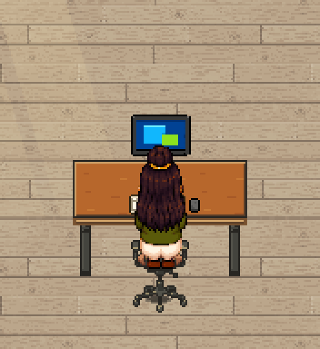
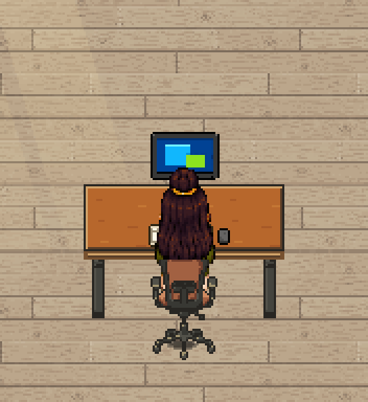
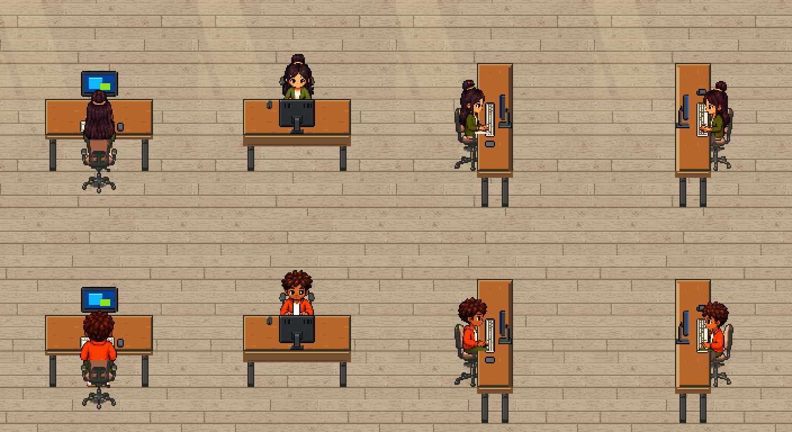

# Keep the north chair back in front of the seated lap

The reported disappearing chair back was a composition defect. Actual room
captures showed Mina's north-facing lower-body sprite painting over the brown
backrest. The chair image itself contained the correct pixels. Theo used the
same incorrect ordering. South, east and west already composed correctly.




## Decision

Change only the north workstation's lower-body depth from **0 to −3**, relative
to the desk anchor. Keep the chair at **−2**, desk rear/front at **−1/+1**, and
upper body at **+3**. The body-region cuts, face/eye art, texture sampling,
physical navigation positions, seat offsets and chair image are unchanged.

Raising the whole chair to +1 was tested and rejected: the empty chair then
painted over the desk apron. Moving the lower body instead preserves that
overlap. Production validation now admits the reviewed north backrest between
the two body layers; it previously assumed every chair was behind the lap.

| Facing | Chair / lower / upper order | Required visual result |
| --- | --- | --- |
| North | Lower −3; chair −2; upper +3 | Backrest covers lap; head and hair remain in front |
| South | Chair −33; lower 0; upper +3 | Far backrest stays behind person; side rails remain visible |
| East | Rear −5; lower −4; near arm −3; upper +2 | Rear rail behind person; near arm covers lap |
| West | Rear −5; lower −4; near arm −3; upper +2 | Same occlusion roles, using separately authored west art |

Do not generalize the north fix to all facings. A south-facing backrest in
front of the upper body would cross the face. A chair may be a whole sprite or
split rear/near-arm sprites according to its camera-facing geometry.

## Verification

`test_seated_chair_composition.gd` loads the actual production scene and
catalogue. It samples real texture alpha and scene draw order for Mina and
Theo in two idle and four typing frames in all four directions (48 poses).
It protects visible near-chair pixels, the opaque head pixels, desk/lap
occlusion and empty-chair/desk overlap. It restores the old north lower-body
depth as a negative control and verifies the defect reappears. Another negative
control detects the rejected raised-whole-chair workaround.

The headless run passes 234 checks and the rendered run passes 282 checks;
existing seat-transition and reviewed
workstation suites pass 4,729 and 273 checks respectively. North Mina's first
idle frame retains 461 chair/body-overlap pixels in front of the lap; Theo
retains 470. No opaque head pixel is obscured in any sampled frame.

Run the visual regression with a real renderer to retain room captures:

```sh
godot --path game --script res://tests/test_seated_chair_composition.gd -- --capture
```

The ordinary headless test runs in `npm run assets:check -- --godot`. The
retained [test report](../web/assets/seated-chair-review/results.json), native
room captures and nearest-neighbor 3× details are in
[`docs/web/assets/seated-chair-review`](../web/assets/seated-chair-review).
These are native Godot acceptance captures, not a claim that an exported
browser build has already been retested.



The contact sheet uses nearest-neighbor enlargement of native room pixels;
columns are north, south, east and west. The first idle/typing frame and empty
chair were visually inspected for each direction. Both idle frames and all
four typing frames are covered by the pixel-ownership checks. The rendered
run exits successfully but reports two pre-existing ImageTexture teardown
warnings; it reports no composition failures.

All runtime PNGs are unchanged. The existing coffee and Mina-blink reviews
reference the shared furniture catalogue; their binding hashes are refreshed
for this reviewed depth-only change. The coffee profiles and south-facing
Mina-blink composition are unchanged.
