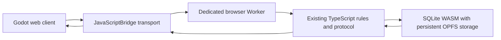

# Architecture decision: retain Godot and the authoritative harness

Research date: November 15, 2026. Repository: [zhast/startup-valley](https://github.com/zhast/startup-valley). This replaces the generic recommendation made before the repository was known.

## Existing design

The project pins **Godot 4.7.2**, uses GDScript and Compatibility rendering, and launches a **Node 22.19+ TypeScript worker** over stdio JSONL. The worker and SQLite own simulation, employees, clock, products, reviews, and saves. Godot owns rendering, input, animation, menus, and read-only projections. Its [agent guide](../../AGENTS.md) requires an offline core and prohibits duplicating rules in GDScript.

A browser cannot start the native child process used by [WorkerClient](../../game/worker_client.gd). Static Godot export provides only the presentation half of this port.

## Implemented target

Keep native Node/stdio working. Introduce platform adapters around transport, SQLite creation, migrations, authored data, and platform services. Reuse the game rules and SQL. Adapting the original stdio-only boundary is a deliberate web-target change; worker authority and the protocol remain intact.

| Option | Assessment |
| --- | --- |
| Godot + browser Worker + SQLite WASM | Best fit for the existing code and offline core; requires defined platform adapters |
| Godot export alone | Useful graphics smoke test, insufficient for working gameplay |
| Godot + hosted Node backend | Adds connectivity, accounts, hosting, and per-player isolation; conflicts with the current no-remote-v0 direction |
| Rewrite in Phaser/React | Requires rebuilding authored Godot behavior; no evidence currently justifies it |

Phaser has an official React/Vite integration and PixiJS is a capable renderer. They are reasonable new-project options, not automatic improvements for this existing game. [Phaser template](https://github.com/phaserjs/template-react-ts) · [PixiJS](https://pixijs.com/8.x/guides/getting-started/intro)

## Browser runtime and persistence

The implementation uses SQLite WASM's **OPFS SAH-pool VFS** inside one dedicated Worker. Its synchronous database surface fits the current SQL stores without requiring COOP/COEP. A Web Lock enforces one owner per origin; a second tab reports contention. Exclusive SQLite locking is enabled before the existing WAL migration. Initialization preserves existing pool data on failure. See the [runtime implementation notes](../../web/README.md). [SQLite persistence](https://sqlite.org/wasm/doc/trunk/persistence.md#vfs-opfs-sahpool) · [SQLite OO API](https://sqlite.org/wasm/doc/trunk/api-oo1.md)

Do not introduce a parallel JSON save model. Keep Node keychain, process, Pi, and provider modules out of the browser bundle. Optional provider features should report unavailable capabilities in the initial web target; the core tycoon must remain playable without them.

Retain JSON Schema contracts, request IDs, deduplication, transactions, and durable save acknowledgments. Individual Godot scenes should not invent browser-specific calls. Detailed module seams and parity tests are in the [runtime plan](browser-runtime-plan.md).

## Godot and assets

Start with a single-threaded export and the existing Compatibility renderer. Godot's browser target needs WebAssembly/WebGL 2. [Godot web export](https://docs.godotengine.org/en/stable/tutorials/export/exporting_for_web.html)

Preserve the 1280×720 design viewport, 32px logical grid, 48×80 character frames, and authored foot anchors until browser comparison suggests changes. Do not repack assets to fit a generic template. Include layout/catalog JSON read through FileAccess in the PCK.

The custom shell handles startup, loading, errors, and display controls only. It uses Godot's export placeholders and public Engine initialization/start APIs. Initialization is separate from starting game scripts so a cancelled download cannot launch a hidden game later. [Custom HTML shell](https://docs.godotengine.org/en/stable/tutorials/platform/web/customizing_html5_shell.html)

## Acceptance and shipping

The first milestone is the same native/browser command sequence producing the same persisted state: bootstrap, hiring, start a product, advance days, release, and furnish. Then test reload recovery, worker failure, duplicate requests, storage denial, and second-tab contention.

Measure real download size, startup time, memory, and frame pacing. Preserve fonts initially and optimize only with text-coverage tests. Ship loader, WASM, PCK, and worker code as one release. Establish persistence across updates before introducing PWA caching.

The root web tests verify tooling and shell behavior; the separate `web/` suite exercises the actual bundled Worker and SQLite in Chrome. See the [verification record](verification.md) for game-level checks. Mobile gameplay remains a separate acceptance target.
