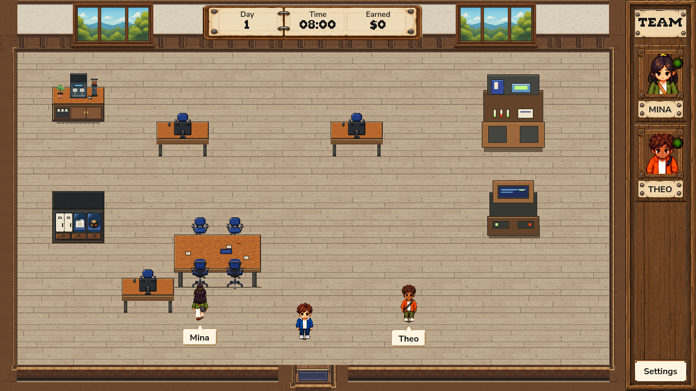
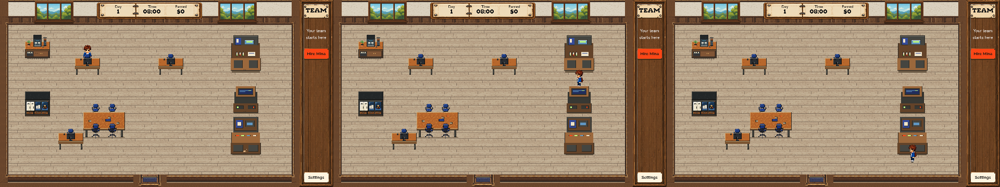

# Existing asset quality audit

Reviewed November 15, 2026 at source commit `c4d1829df5ce2924ef68964bf16b7c1c369e0e46`. Scope: runtime PNG metadata and import settings, character frame bounds, architecture seams, representative sprites, and committed in-game art captures. This is not a claim that every animation or browser viewport has been playtested.

## Decision

**Keep the current runtime artwork for the first web port.** The inspected art is usable, the frame and layer contracts are deliberate, and no blocking raster defect was established. Regenerating the sheets now would introduce identity, alignment, and occlusion risk without a demonstrated improvement.

No PNGs, import settings, scene bindings, or gameplay files were changed. Two stale asset-guide statements were corrected: the character list now includes Creative, and the office contract now acknowledges the reviewed four-direction workstation set rather than claiming that only south facings ship.

## Evidence and checks

| Check | Result |
| --- | --- |
| Runtime PNG decoding | All **804 PNGs** opened successfully: 661 office, 117 UI, 22 character, 4 effects. |
| Import settings | Every PNG has a sidecar with lossless compression, mipmaps disabled, and no size limit. |
| Character geometry | All 22 sheets are composed of **48×80** cells. Locomotion sheets are 288×320; seated/directional desk sheets are 288×80; research sheets are 192×80; legacy work sheets are 384×320. |
| Character transparency | All character sheets use binary alpha. All painted bottoms remain at or above the established 72px foot line. |
| Frame gutters | 21 sheets have clear outer cell borders. One legacy Theo work pose touches a right cell edge; see the bounded follow-up below. |
| Architecture seams | All five floor themes match their opposite X/Y edges exactly; all five wall themes match X edges exactly. |
| Window matte | All five window themes use binary alpha, with the required transparent outer padding. |
| Rendering setup | Player/employee sprites, architecture, props, and UI explicitly use nearest filtering in their corresponding scripts. |

The semitransparent runtime files are effects/shadows and selected UI components; partial alpha alone is not a defect. Fully transparent insert layers occur in modular furniture where that facing has no visible insert, plus the intentionally transparent UI texture. They were not deleted or “fixed” as missing art.

The source guides document registered layers and fixed anchors. Preserve those contracts during the web port: [character guide](../../game/assets/runtime/characters/README.md), [office contract](../../game/assets/runtime/office/ASSET_SPEC.md), [architecture manifest](../../game/assets/runtime/office/architecture/manifest.json), and [reviewed pose registry](../../game/character_art.gd).

## Visual sample

Inspected the Founder, Mina, Theo, and Creative locomotion sheets; Mina seated/east-facing desk poses; Theo research/work poses; the workstation layer atlas; and the floor kit. Their silhouettes, outfit colors, and native scales are consistent with the warm wood/paper office treatment. The quieter floor palette leaves the characters readable. Furniture is more simply shaded than the characters, but the sampled room evidence did not establish a functional readability problem that would justify replacing its registered layers.

The images below are **existing committed art evidence**, not new captures of the current browser port. The original files live under `game/tests/output/art-completion-furnishing-20260908-final3/polish-audit/` at the audited commit. They were fetched individually, rather than restoring the large generated-output folder.

## Bounded follow-ups

1. **Fresh browser scale review.** Once the game runs in-browser, capture the same room at 1280×720 and a smaller target viewport. Check text size, integer scaling, camera motion, and sprite sharpness before changing source art.
2. **Legacy Theo thinking-frame edge.** `characters/theo-work.png`, zero-based column 7 / row 1, paints through local X=47. That warrants a close view if the legacy pose is used. The reviewed workstation registry reuses seated poses for thinking; no active clipping was demonstrated. Do not re-render the whole sheet merely to add a gutter.
3. **Second-room architecture is the useful new-art task.** The latest source design notes explicitly identify it as missing. Define its logical footprint, entrances, wall/corner/window modules, and collision/navigation requirements first. Reuse the existing 32px material language and export separable modules instead of generating a furnished screenshot. [Current design backlog](../../docs/TYCOON_DESIGN.md)

New art should be reviewed as a candidate at native scale before being bound. Existing PNGs and their import/UID metadata remain untouched by this audit.
