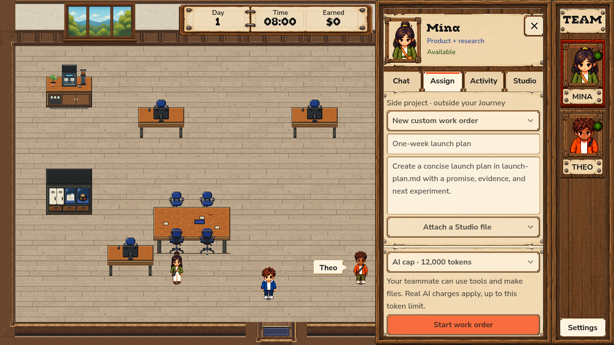
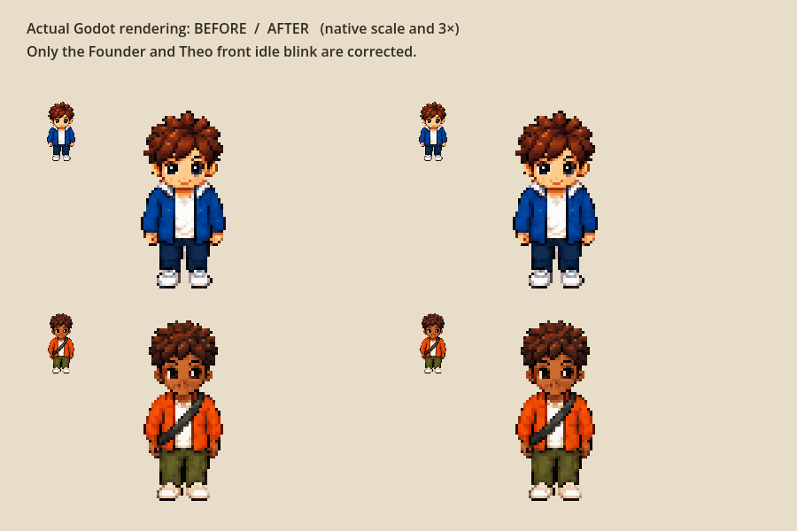
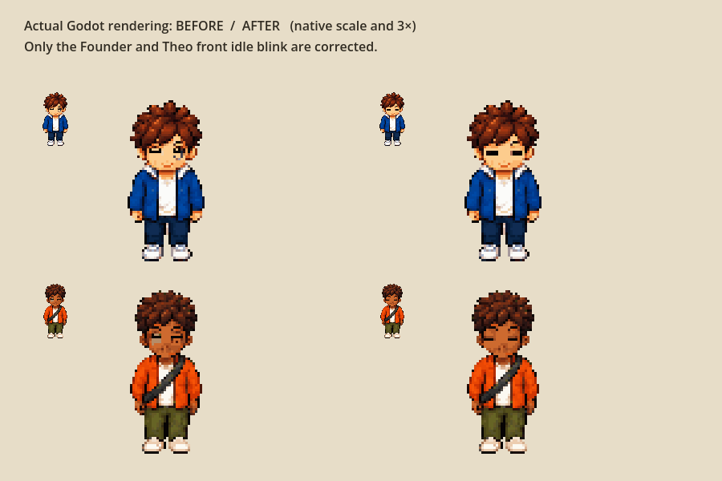
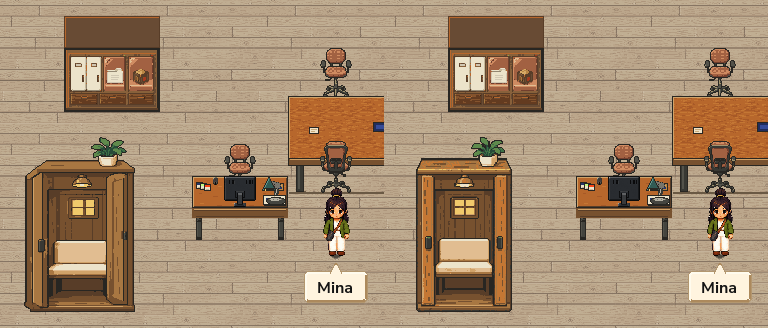

# Existing asset quality audit

Reviewed November 15, 2026 at source commit `c4d1829df5ce2924ef68964bf16b7c1c369e0e46`. Scope: runtime PNG metadata and import settings, character frame bounds, architecture seams, representative sprites, and committed in-game art captures. This is not a claim that every animation or browser viewport has been playtested.

## Decision

**Keep the existing art direction and registered frame/layer contracts.** The initial review found usable assets. A subsequent focused review of the user’s eye concern identified two specific blink defects; the bounded corrections below now replace those pixels. Whole-sheet regeneration was rejected because it changed unrelated pixels.

The initial audit changed only two stale asset-guide statements. The follow-up changes two locomotion PNGs and one phone-booth PNG, retains reviewed native sources, and adds a reproducible eye-overlay step; import settings, scene bindings and gameplay rules remain unchanged.

## Evidence and checks

| Check | Result |
| --- | --- |
| Runtime PNG decoding | All **804 PNGs** opened successfully: 661 office, 117 UI, 22 character, 4 effects. |
| Import settings | Every PNG has a sidecar with lossless compression, mipmaps disabled, and no size limit. |
| Character geometry | All 22 sheets are composed of **48×80** cells. Locomotion sheets are 288×320; seated/directional desk sheets are 288×80; research sheets are 192×80; legacy work sheets are 384×320. |
| Character transparency | All character sheets use binary alpha. All painted bottoms remain at or above the established 72px foot line. |
| Frame gutters | 21 sheets have clear outer cell borders. One legacy Theo work pose touches a right cell edge; see the bounded follow-up below. |
| Architecture seams | All five floor themes match their opposite X/Y edges exactly; all five wall themes match X edges exactly. |
| Window matte | All five window themes use binary alpha, with the required transparent outer padding. |
| Rendering setup | Player/employee sprites, architecture, props, and UI explicitly use nearest filtering in their corresponding scripts. |

The semitransparent runtime files are effects/shadows and selected UI components; partial alpha alone is not a defect. Fully transparent insert layers occur in modular furniture where that facing has no visible insert, plus the intentionally transparent UI texture. They were not deleted or “fixed” as missing art.

The source guides document registered layers and fixed anchors. Preserve those contracts during the web port: [character guide](../../game/assets/runtime/characters/README.md), [office contract](../../game/assets/runtime/office/ASSET_SPEC.md), [architecture manifest](../../game/assets/runtime/office/architecture/manifest.json), and [reviewed pose registry](../../game/character_art.gd).

## Visual sample

Inspected the Founder, Mina, Theo, and Creative locomotion sheets; Mina seated/east-facing desk poses; Theo research/work poses; the workstation layer atlas; and the floor kit. Their silhouettes, outfit colors, and native scales are consistent with the warm wood/paper office treatment. The quieter floor palette leaves the characters readable. Furniture is more simply shaded than the characters, but the sampled room evidence did not establish a functional readability problem that would justify replacing its registered layers.

The images below are **existing committed art evidence**, not new captures of the current browser port. The original files live under `game/tests/output/art-completion-furnishing-20260908-final3/polish-audit/` at the audited commit. They were fetched individually, rather than restoring the large generated-output folder.

## Bounded follow-ups

1. **Fresh browser scale review.** Once the game runs in-browser, capture the same room at 1280×720 and a smaller target viewport. Check text size, integer scaling, camera motion, and sprite sharpness before changing source art.
2. **Legacy Theo thinking-frame edge.** `characters/theo-work.png`, zero-based column 7 / row 1, paints through local X=47. That warrants a close view if the legacy pose is used. The reviewed workstation registry reuses seated poses for thinking; no active clipping was demonstrated. Do not re-render the whole sheet merely to add a gutter.
3. **Second-room architecture is the useful new-art task.** The latest source design notes explicitly identify it as missing. Define its logical footprint, entrances, wall/corner/window modules, and collision/navigation requirements first. Reuse the existing 32px material language and export separable modules instead of generating a furnished screenshot. [Current design backlog](../../docs/TYCOON_DESIGN.md)

New art should be reviewed as a candidate at native scale before being bound. The initial metadata audit did not change PNGs; the later eye correction is documented below.

## Focused eye correction follow-up — November 15, 2026

The Founder’s front-idle blink closed one eye while leaving the other open.
Theo’s equivalent frame left a pale gray patch over one eye. Both defects are
visible in the enlarged original-frame comparison and were confirmed in the
native-scale rendering. Mina and Creative were not changed.

The built-in imagegen tool produced candidate eye treatments using the original
atlases as edit targets. Full candidates also changed unrelated body/pose pixels,
so they were not installed. Only two small eye rectangles in each affected
frame were retained, normalized to the native grid and mapped back to the
original character’s skin/ink palette. The reviewed overlays are the source of
truth for these final pixel edits:

| Asset | Changed pixels | Preserved contract |
| --- | ---: | --- |
| Founder locomotion | 49 | 288×320 atlas; only column 1 / row 0 |
| Theo locomotion | 69 | 288×320 atlas; only column 1 / row 0 |

Decoded comparisons confirm unchanged alpha at every pixel, unchanged pixels
outside the eye rectangles, identical remaining 23 frames, unchanged visible
palette, and unchanged silhouettes/foot anchors. The existing source-export
script applies the overlays after normalization so a rebuild retains the fix.
[Overlay manifest](../../game/assets/source/web-eye-polish/manifest.json) ·
[Founder prompt](assets/asset-audit/prompts/founder-eyes-v1.md) ·
[Theo prompt](assets/asset-audit/prompts/theo-eyes-v1.md)

The following captures come from a **live Godot 4.7.2 OpenGL animation fixture**,
with the worker disabled. Left is original; right is corrected. Each shows
native 1× and enlarged 3× sprites. The fixture alternated the actual idle atlas
frames; it did not alter animation timings in the game.

The standalone `test_locomotion_export.gd` suite reports four pre-existing
failures on the original source images: the Founder and Mina palette counts,
and the Founder back-row frame-1 top anchor and corresponding row jitter
check. A baseline run against retained original images reproduces those four;
they are separate from these blink edits. Import checks, alpha, the corrected
frame’s registration and the other measured silhouette checks pass.

## Furniture perspective correction — November 15, 2026

Fresh browser captures confirmed a visible camera mismatch: the phone booth
showed a prominent left side and sloping roof edge beside the straight-front
desk and bookcase. The misplaced team rail also hid furniture during the first
capture; that separate UI defect was not treated as an art problem.

The built-in imagegen tool produced one replacement using the existing booth,
desk, archive and actual room as references. The selected result centers the
front and reduces the lateral yaw. It retains the wooden frame, cream seat,
small window, lamp and roof plant. Uniform normalization and the original
14-color palette keep it consistent with the surrounding furniture.

The replacement was rendered inside the actual Godot 4.7.2 GameMain room using
isolated offline fixture state. The comparison below contains native-scale
crops of the same scene, before on the left and after on the right. Only the
booth texture was swapped for this capture.

The native 192×224 canvas and ground contact (96,216) remain fixed. The new
painted bounds [48,41,96,175] fit within the registered [40,41,111,175]
envelope. Occupancy, clearance, scene offset, south-facing capability and the
single layer’s depth order are unchanged; no simulation migration is needed.
The narrower front removes the old projected side rather than stretching the
object. The bookshelf and desk art were retained.

[Generation prompt](assets/asset-audit/prompts/phone-booth-camera-v1.md) ·
[Reviewed native source](../../game/assets/source/web-furniture-polish/phone-booth-south.png) ·
[Normalization and contract](../../game/assets/source/web-furniture-polish/manifest.json)
