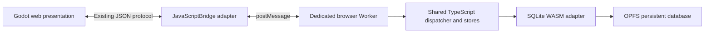

# Browser runtime implementation plan

Research date: November 15, 2026. Target: the existing `zhast/startup-valley` Godot 4.7.2/GDScript presentation layer and Node/TypeScript/SQLite harness.

**Status: proposed, not implemented.** The web scaffold has tested export preflight, staging, binary-header validation, and local HTTP serving. It does not yet port the Node harness, connect the Godot client to a browser Worker, or prove browser save persistence. A successful Godot export alone would not make the current game playable.

## Preserve the existing ownership model

Godot owns rendering, input, animation, menus, and read-only projections. The harness owns the simulation and durable state. The repository explicitly requires an offline core, SQLite authority, and no duplicate tycoon rules in GDScript. Native v0 uses stdio JSONL and forbids an unauthenticated HTTP listener or a remote cloud instance. [Repository requirements](https://github.com/zhast/startup-valley/blob/main/AGENTS.md) · [Current architecture](https://github.com/zhast/startup-valley/blob/main/docs/GAME_ARCHITECTURE.md)

The browser target should preserve that logical boundary with a platform-specific transport:

Native builds retain Godot → stdio JSONL → Node → native SQLite. Document the browser transport as an intentional extension of the native v0 rule before implementing it; do not describe a browser Worker as a Node subprocess.

An authenticated server could retain more Node-specific code immediately, but would add connectivity requirements, identity, per-player authorization, operational storage, and deployment. It conflicts with the current offline/no-remote baseline. Prefer the browser Worker unless a measured incompatibility makes that approach unsuitable.

## Concrete source seams

| Source evidence | Existing behavior | Proposed adaptation |
| --- | --- | --- |
| [`game/worker_client.gd`, `start()`](https://github.com/zhast/startup-valley/blob/main/game/worker_client.gd#L58) | Resolves a Node script, opens `OS.execute_with_pipe`, reads stdio, and tracks pending request IDs | Keep the native path. Add a web transport that delivers the same serialized envelopes to a dedicated Worker and feeds replies into the existing response handling. |
| [`harness/src/main.ts`, runtime construction](https://github.com/zhast/startup-valley/blob/main/harness/src/main.ts#L71) | Creates disk directories, SQLite, credential store, and Pi adapter at module startup | Create separate native and browser entry points. The browser entry must never import this native bootstrap or credential/provider modules. |
| [`main.ts`, `dispatch()`](https://github.com/zhast/startup-valley/blob/main/harness/src/main.ts#L98) | Routes both offline game actions and optional AI operations | Extract the existing offline dispatch into a shared module with explicit dependencies. Both transports call it; do not copy its switch into a second implementation. |
| [`main.ts`, request loop](https://github.com/zhast/startup-valley/blob/main/harness/src/main.ts#L363) | Validates envelopes and deduplicates request IDs by method/parameter fingerprint | Reuse the validation, ID collision rules, bounded in-flight/result cache, and error envelopes across transports. |
| [`harness/src/tycoon.ts`](https://github.com/zhast/startup-valley/blob/main/harness/src/tycoon.ts) and [`journey.ts`](https://github.com/zhast/startup-valley/blob/main/harness/src/journey.ts) | Existing rules and SQL use a type-only `DatabaseSync` import | Keep the rules and SQL. Type them against a small database interface supported by both native SQLite and SQLite WASM. |
| [`database.ts`, constructor](https://github.com/zhast/startup-valley/blob/main/harness/src/database.ts#L114) | Opens native SQLite, reads migrations from disk, seeds data, connects stores, and recovers interrupted work | Inject the connection, ordered migration text, and platform dependencies. Share migration/seed/recovery logic. |
| [`furnishing.ts`, `FurnishingGeometry`](https://github.com/zhast/startup-valley/blob/main/harness/src/furnishing.ts#L63) | Reads authored room/catalog JSON from disk; operations use a synchronous SHA-256 fingerprint | Bundle the same authored JSON and inject it. Supply a compatible hash implementation; preserve canonicalization and operation fingerprints. |
| [`harness/src/validation.ts`](https://github.com/zhast/startup-valley/blob/main/harness/src/validation.ts) | Loads JSON Schemas with filesystem APIs and uses `createRequire` for formats | Bundle the schemas and use browser-compatible module imports. Preserve schema IDs, references, strict validation, and error semantics. |

The relevant stores use a small synchronous SQL surface: `exec`, `prepare().get()`, `prepare().all()`, and `prepare().run()`. Furnishing checks `run().changes`. Implement that adapter accurately, including parameter binding, undefined for missing rows, object-shaped rows, transaction errors, and statement finalization. Keep integer money arithmetic and deterministic seed behavior unchanged. SQLite's synchronous object-oriented API can run alongside the shared stores inside the dedicated Worker. [SQLite WASM object-oriented API](https://sqlite.org/wasm/doc/trunk/api-oo1.md)

Replace the platform boundary, not the database model. Converting every table into a new IndexedDB document representation would create unnecessary migration and behavioral work.

## Persistence profile

Use the official SQLite WASM distribution with the OPFS `opfs-sahpool` VFS as the initial candidate. It operates in a Worker without COOP/COEP headers, but does not transparently support simultaneous owners. Its initialization can fail when another browsing context owns the same pool. The existing initial migration enables WAL; SQLite's browser documentation requires exclusive locking before using WAL with OPFS. [SQLite persistence and SAH pool documentation](https://sqlite.org/wasm/doc/trunk/persistence.md)

Implementation requirements:

1. Pin a tested SQLite WASM release. Start one database owner Worker and one connection per save.
2. Open a stable pool directory and logical database name. Do not include a release hash in the save identity.
3. Set exclusive locking immediately after opening, before the shared migrations enable WAL. Verify the resulting journal mode and transaction behavior against the chosen SQLite release. Alternatively, deliberately extract platform journal configuration while preserving shared schema migrations; do not silently discard migration statements.
4. When another tab owns the save, show a recoverable “already open in another tab” state. Never respond by changing the filename, clearing the pool, or creating an empty replacement save.
5. Treat denied storage, unavailable OPFS, quota exhaustion, and initialization failure as explicit states. Do not silently claim a durable save while using memory-only storage.
6. Provide a deliberate database export/import path after validating the save format and migration policy. Make a recoverable backup before importing or resetting a company.
7. Keep database reset, backup, and optional artifact storage behind platform adapters. Browser code cannot reuse filesystem directory renames or native keychain operations.

The real acceptance check is committed gameplay surviving page reload and browser restart. A save-success animation or a resolved in-memory write is insufficient evidence.

## Transport and capability behavior

Use `postMessage` between the page bridge and the dedicated Worker; Workers provide a separate execution context without direct DOM access. [Web Workers](https://developer.mozilla.org/en-US/docs/Web/API/Web_Workers_API/Using_web_workers)

Preserve the existing request IDs, response/event kinds, JSON Schema validation, payload bounds, and duplicate-request behavior. Keep all game writes serialized by the worker's authoritative dispatcher. Godot should wait for readiness and bootstrap before enabling actions that require state. On Worker failure, reject outstanding requests, clear stale busy indicators, and recover through the same durable state rules rather than manufacturing successful replies.

Keep optional provider functionality explicitly unavailable in the first browser target. Do not bundle Pi, native keyring, provider tokens, local authentication-file access, or unrestricted tools. `health` and capability responses can report that limitation; offline tycoon operations must remain usable. Do not enable `STARTUP_VALLEY_FAKE_PROVIDER` or invent fake AI completions as a substitute.

For the page/Godot connection, expose a narrow named bridge and keep callback references alive for their required lifetime. Avoid evaluating arbitrary strings or exposing SQL directly to the UI. [Godot JavaScriptBridge](https://docs.godotengine.org/en/stable/classes/class_javascriptbridge.html)

## Implementation sequence and acceptance gates

1. **Establish the native baseline.** Build the unchanged harness and run its required offline tests. Inspect current save fixtures. Record the editor version and representative scene. No paid-provider tests are needed.
2. **Extract shared seams without behavior changes.** Introduce the SQL/platform interfaces and shared offline dispatcher. Keep native stdio behavior and existing tests passing before adding a web runtime.
3. **Build a browser harness spike.** Bundle schemas, migrations, and authored data; initialize SQLite WASM in one Worker; prove health, bootstrap, and persistent reopen without involving Godot yet.
4. **Run parity fixtures.** Replay the same validated requests on native and browser databases: hiring, project start, development days, release, later sales, research/upgrades, furnishing, and save/reopen. Compare resulting state and relevant rows. Normalize only non-gameplay timestamps/UUIDs or inject deterministic sources; do not normalize away money, review scores, seed state, or transactions.
5. **Connect Godot's web transport.** Reuse the current presentation, signal handling, and protocol contracts. Complete one real loop on an existing map before introducing new art or UI systems.
6. **Test failure and durability behavior.** Cover malformed envelopes, reused IDs with different parameters, retries, duplicate day-end/release, Worker termination during a transaction, restart recovery, storage denial, quota failure, second-tab ownership, old-save migration, and reset rollback.
7. **Verify the shipped browser artifact.** Test actual target browsers, cold loading, focus, sound gestures, resize/full screen, hidden-tab behavior, and reload persistence on the final stable origin. Capture payload size and frame pacing before choosing optimizations.

Start from existing suites such as `tycoon.test.ts`, `journey.test.ts`, `database.test.ts`, `product-protocol.test.ts`, `furnishing-protocol.test.ts`, `validation.test.ts`, and `lifecycle.test.ts`. Preserve native acceptance coverage while adding browser-specific cases. [Harness tests](https://github.com/zhast/startup-valley/tree/main/harness/test)

The first completed milestone is **the existing game loop behaving identically in a browser with durable SQLite saves and no provider calls**. The export tooling is supporting infrastructure for that milestone, not evidence that it is already achieved.
