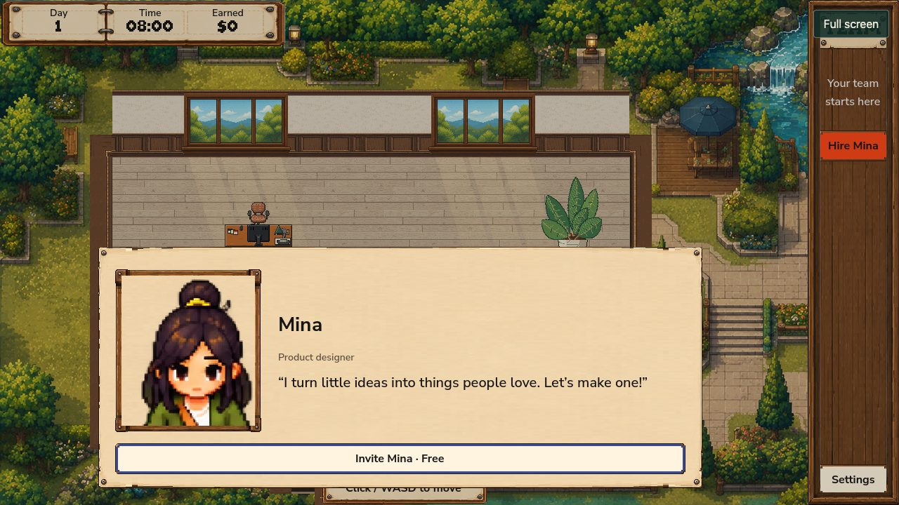
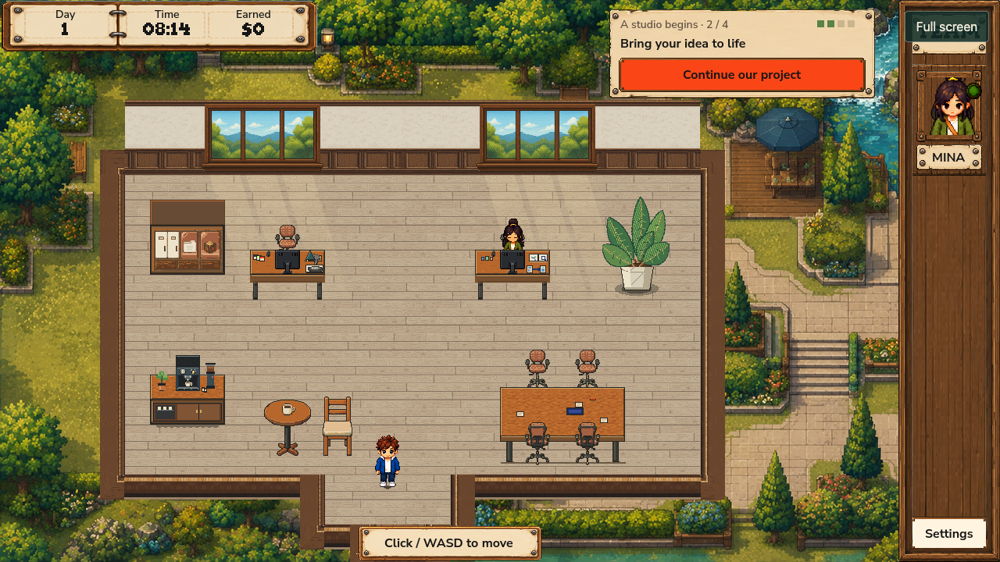
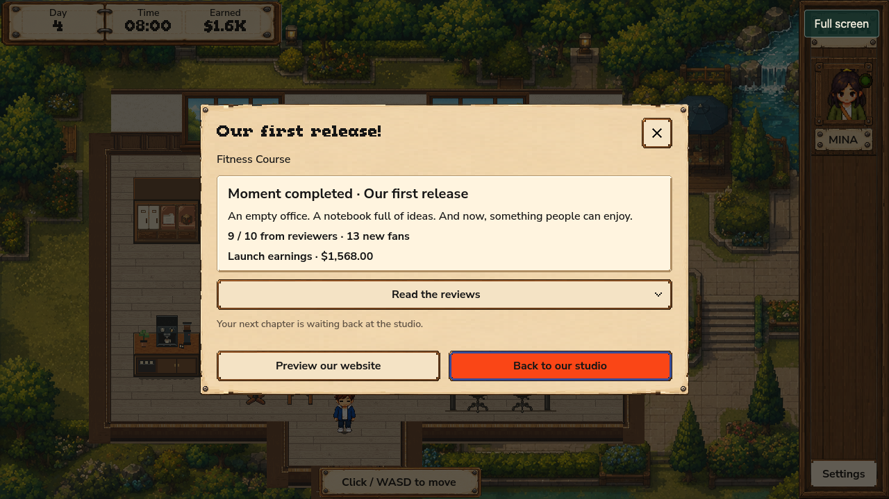

# Compact office acceptance — 2026-11-15

The release-reviewed Godot 4.7.2 export built at `2026-11-15T22:54:04.023Z`
completed the first project through actual canvas input in the existing isolated
Chrome session. No game state or worker requests were injected. Exact build,
screenshot hashes, observed responses and coverage limits are in
[compact-final-evidence.json](compact-final-evidence.json).

- The bottom Mina introduction presents one line, her role and the free invite.
  Welcome opens the first idea directly, with Founder and Mina assigned.
- The website preview opens from project progress and returns correctly.
- Three end-day actions advance progress through 33%, 67% and 100%. Release
  earns $1,568 and 13 reputation; the office goal advances to 4/4.
- Mina reaches her compact-office desk. The 24-frame seated capture shows clean
  eyelid changes without the former forehead stripe or chair crossing her face.
  Timed left/right Founder captures show distinct passing and extended poses.
- Repeated and interrupted drawer opening produced 59 frames. The rail portrait
  remained unchanged in every frame; the moving drawer border stays behind it.
- Introduction and goal layout fit at 1280×720, 1024×768 and 844×390 landscape.
  Text is small at phone scale; this is not a touch-input/mobile acceptance.
- Observed JavaScript/Godot errors: zero. Observed provider work: none. Real
  autosave responses report success.

The session stopped at Settings when testing switched to integrated Godot
checks. Reload, furniture movement, second-tab exclusion and hardware-cursor
decoding were not repeated on this exact export. Their earlier evidence is
documented separately; it is not presented as current-build coverage.

`tests/browser/playtest.mjs` now follows the new introduction and website route,
and derives tabletop selection and relocation expectations from the saved
furniture grid. It passes `node --check`; the updated complete browser script
has not been executed on this build.

