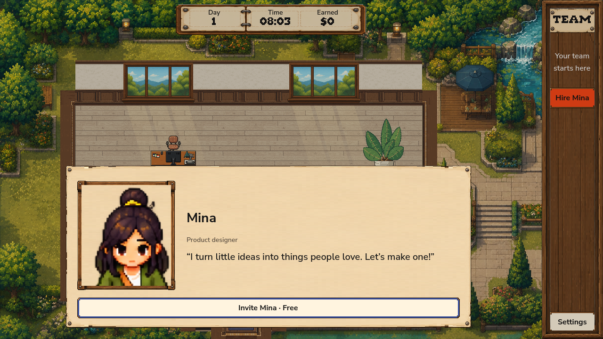
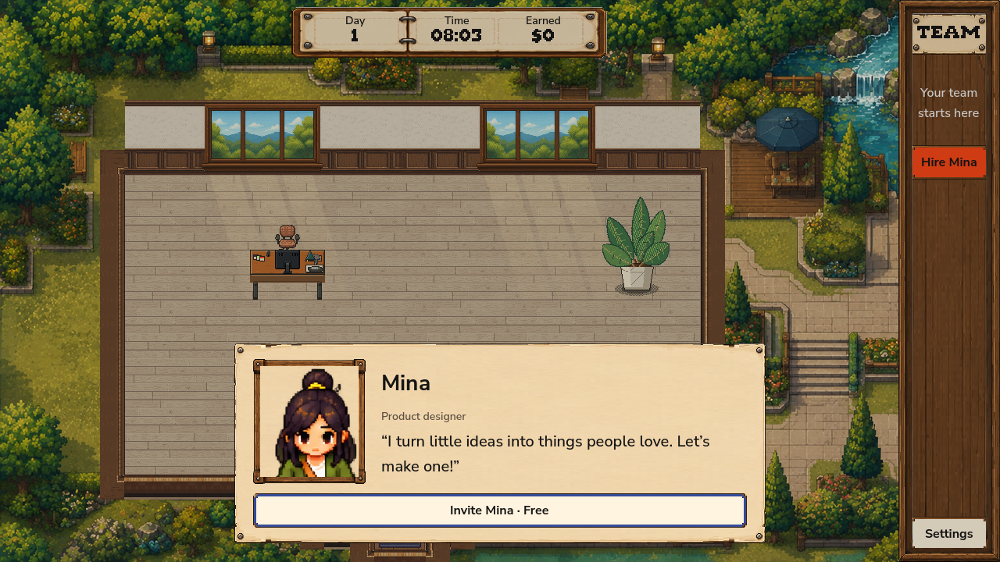

# Compact character invitation

Mina's invitation now occupies **680×256** logical pixels instead of 860×344.
Its center is the actual game canvas center (640 at a 1280-wide canvas), replacing
the old fixed center of 570. A shared safe rectangle and Control anchors keep
the card centered and 24px above the bottom. Containers size the portrait,
name, role, short dialogue and action; the empty header reserves no space.

The portrait frame is 144×160, with a readable 126×142 image area. Mina's name,
role and invitation remain visible together. The same layout also fits the
welcome and longer Theo conversation.

Before, from actual GameMain with the production worker:

After, from the same actual input journey:

`test_story_dialogue_layout.gd` passes 250 checks at 1280×720, 1440×900 and 1024×576:
horizontal centering, safe bounds, content-sized height, portrait readability,
no internal scrolling, clipped labels or overlapping controls, and one actual
pointer-driven invitation request. It also verifies that `show_release(result)`
shows one “For the studio: …” line only for nonempty newly granted items and
does not repeat it when an old release is reopened. The existing story
conversation test and `run_all.gd` pass.

Actual GameMain movement, invitation, hire, reload, project start and sustained
Mina seating passed 126 assertions. Concurrent furniture/WorkerClient changes
correctly invalidated that run's aggregate runtime fingerprint; this is
component evidence, not final frozen-source acceptance. The surrounding garden
in these captures is still the separately audited old composition. Browser
comparison remains the parent agent's task because this subagent has no in-app
browser binding.

[Exact evidence and source hashes](assets/compact-invitation/evidence.json)
include the three rendered size checks. No screenshot is adopted as a golden
that would prevent future improvements.
