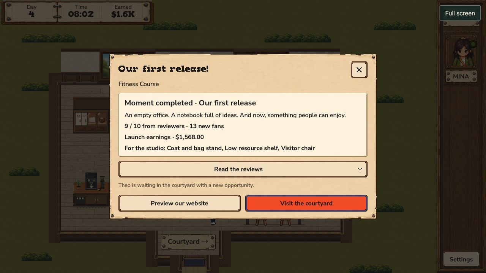

# Demo acceptance — November 15, 2026

The offline story-led prototype is accepted for this local demo. The current
starter office, expanded office and courtyard have passed their scoped visual
reviews. A fresh final-build browser playthrough reached the first release,
Theo's opportunity, return and successful reload. Normal-release startup and
the packaged archive also passed. The tested runtime source is published;
the root agent will publish this final evidence/handoff checkpoint before
closing the active goal. No owner setup or approval step is required.

## Release identity

| Field | Verified value |
| --- | --- |
| Build | `d23a483542544696` |
| Engine | `4.7.2.stable.official.ed1daf0bf` |
| Built | `2026-11-15T23:47:31.703Z` |
| Asset mode | Release; three current maps reviewed |
| Runtime fingerprint | `5e8afa18aa826a0883d0af6506aa47c96e9d405c7766fe86befe7d474c882ebd` |
| Normal local preview | `http://127.0.0.1:5177/` |
| Served payload verification | All **16** HTTP payloads match SHA256; **71,041,780 bytes** in total |
| Published source checkpoint | Local `87e6bf8` → remote `a581b9c0bc3022b2ecd268e3e95dfb7a45fa7d87`, verified tree `ae045213571618a52828841ba59415f800422fff` |

The [served-release record](assets/world-final/served-release.json) records
normal-origin verification at `2026-11-15T23:48:02.464Z`. The admitted release
has the same gameplay payload as the visually reviewed candidate with this
build ID. The older normal build `b5d7da90f647ea26` has been replaced.
HTTP integrity establishes which bytes are served; live browser play is
separate evidence.

## Actual browser play

The parent agent used the existing background Codex in-app browser on a
disposable save. A fresh second loop on final build `d23a483542544696`
exercised:

1. New Company/reset, walking to Mina and her compact portrait invitation.
2. Mina's free hire and a Fitness / Course project staffed by the team.
3. Three day advances with visible **33% → 67% → 100%** development.
4. Release on **Day4**, with **9/10**, **13 new fans**, **$1,568 launch
   earnings**, and three named furniture rewards: Coat and bag stand,
   Low resource shelf, Visitor chair.
5. Courtyard travel, Theo's Market Day Kit acceptance, and return to the studio.

6. Reloaded the final build: **Day4**, the displayed **$1.6k** earned total,
   Mina and the accepted Market Day Kit persisted in the starter office.
7. Opened the actual normal release on disposable origin **5181**, chose
   Continue and Meet Mina, and confirmed her compact portrait invitation.

The browser warning/error list was empty. These final checks were observed
directly, not inferred from the earlier candidate sessions.
The [earlier browser report](in-app-playtest.md) separately records reload,
Theo's $300 hire/office expansion, next-project start and one clean Mina
panel open/Escape-close on its named pre-final candidate.

Current final-build images:

- [Starter studio](assets/world-final/starter-d23a4835.jpg) and
  [Mina invitation](assets/world-final/mina-invitation-d23a4835.jpg).
- [Mina seated in the working studio](assets/world-final/starter-seated-d23a4835.jpg).
- [First release and earned furniture](assets/world-final/release-d23a4835.jpg).
- [Theo's courtyard conversation](assets/world-final/theo-d23a4835.jpg).
- [Courtyard foreground/gate](assets/world-final/courtyard-front-d23a4835.jpg),
  [northwest depth](assets/world-final/courtyard-northwest-d23a4835.jpg) and
  [expanded office](assets/world-final/full-office-d23a4835.jpg).
- [Final-build reload](assets/world-final/reloaded-d23a4835.jpg),
  [normal-release invitation](assets/world-final/normal-release-invitation-d23a4835.jpg)
  and [empty browser warning/error record](assets/world-final/browser-errors.json).

These are observed outcomes, not fixed rewards guaranteed for every project.
Static frames do not prove every intervening animation or input timing.

## Automated and independent evidence

| Evidence | Result and exact scope |
| --- | --- |
| Full release asset gate with Godot | **809 runtime PNGs validated, 18 reviewed artifacts**, no gate errors/warnings; all three map reviews accepted. The legacy snapshot is explicitly not blanket visual approval. |
| Engine tests invoked by the full asset gate | **7,259 checks**, zero failures: projection 797, coffee 409, workstation 273, seat transition 4,729, chair composition 234, collaboration 712, blink 105. |
| Root web/tooling suite | **75 passed**, zero failures/skips. |
| Earlier shared worker regression and offline evaluation | **168 passed, 2 opt-in skips**; **8/8 provider-free fixtures**. Retained prior checkpoint logs; the audited final visual delta leaves the shared worker unchanged. |
| Three clean production-worker journeys | **914 checks / 26 phases**, runtime `f06f9176745b08fd17ed36b2302f6251789249e8e23ad17e6c549a67092ac3f9`, before the visual fence delta. |
| Independent final fence review | Exact seven-file delta to the final runtime; **752 fence checks, 17 map tests, 9 actual component route checks**, plus a separate geometric probe. |
| Earlier compatibility/input evidence | **109 checks / 5 phases** on earlier runtime `4b0a5102524cad47cd1e809bfa79e614d5516b1b441919a0f1aa63b5b85bbc3e`: touch 16, seeded legacy 29, seeded expansion 64. |

Full logs: [asset/engine gate](assets/world-final/assets-headless.log),
[web/tooling](assets/world-final/tooling.log),
[prior worker regression](assets/world-final/prior-harness.log),
[prior offline evaluation](assets/world-final/prior-offline-eval.log),
[clean journeys](assets/final-headless/README.md), and
[independent fence review](assets/yard-fence-v1/independent-review/README.md).

Durable prior worker regression evidence is also retained separately:
[four-phase real-worker renovation](assets/furniture-scale-v1/headless-worker-ui.json)
records nine mutations, restart, delayed acknowledgements and a lost committed
reply with exact final revision and all workers stopped. The
[copied schema 18 save migration report](assets/furniture-scale-v1/legacy-save-migration.json)
records two existing saves retaining all 32/35 owned items, all 9/8 placements
and player positions, with one revision increment and exact reopen. These are
earlier checkpoint reports, not newly claimed reruns on the final release.

The clean journeys use actual engine input, production GameMain and a real
offline Node worker with separate disposable saves. They cover hiring,
development, release, courtyard edge save/reload, accepting Theo's brief,
return, matching next-project start and New Company/reset restart. Each
accepted worker exits after ordinary shutdown. Runtime files remain identical
within their recorded run even where Git checkpoint metadata changes.

The final fence delta adds five fence files, renderer initialization and
declared gate metadata. Independent comparison finds all 170 selected
worker/web/protocol/navigation/actor files unchanged; existing courtyard
floor, paving, props and interaction data are deeply equal. No collision,
save state or travel rule was added. This scoped delta validation plus actual
final-build browser play bridges the earlier clean-journey evidence; it is
**not a claim that three complete headless journeys ran again on the fence
runtime**. The earlier 109 checks remain separately labeled and are not
silently added to the final-runtime totals.

The retained asset log includes the known macOS system certificate diagnostic
during headless startup; each named suite still exits with zero test failures.
This is recorded rather than described as an entirely empty engine log.

## Visual acceptance and boundaries

The original cute prototype now shares native 32px lawn/paving, restrained
planting and a connected low wooden boundary. The fence has a registered
two-cell Studio opening, coherent front/rear depth and no new walkable exit.
The starter/full office and courtyard reviews bind actual final-build
in-app images. Root performed live review; an independent agent inspected
the provided front/northwest frames and tested geometry.

See [the shared-yard decision](../decisions/2026-11-15-shared-yard-and-connected-fence.md),
[asset status](../ASSET_STATUS.md), and the
[current capture manifest](assets/world-final/capture-manifest.json).
The old estate background, repeated hedge stamps, porous boundary and sealed
return fence remain rejected historical iterations. Their screenshots are
not acceptance evidence for the final composition.

All new engine tests ran headless. Current visual checks used the existing
background in-app browser, with no OS control or new native demo windows.
Keyboard tests exercise dialogs plus documented pointer world interactions,
not keyboard-only traversal. Touch is injected engine input, not a physical
phone test. No complete accessibility, cross-browser, all-platform or frame
latency claim is made.

## Packaging and final publication

| Finalization item | Verified result |
| --- | --- |
| Final return/reload | Day4, displayed $1.6k earned, Mina and accepted Market Day Kit restored in the starter office |
| Normal-release startup smoke on disposable origin 5181 | Continue → Meet Mina → compact portrait invitation; no browser warning/error entries |
| ZIP | [startup-valley-d23a483542544696.zip](../../.build/releases/startup-valley-d23a483542544696.zip), 39,510,491 bytes; includes four screenshots |
| Archive integrity | `packageDemo` completed and `unzip -tq` passed; [packager log](assets/world-final/package.log) and [SHA256 sidecar](../../.build/releases/startup-valley-d23a483542544696.zip.sha256) retained |
| ZIP SHA256 | `cb604fcb3530796d05bffac932ca3a216115f2a26df915de217f6d889071cd1a` |
| Published runtime source | Remote `a581b9c0bc3022b2ecd268e3e95dfb7a45fa7d87`; verified source tree above |
| Final evidence/handoff checkpoint | Retained with this report; use current Git history for its exact commit. No new runtime change or owner action required. |

The packager accepts original JPEG or PNG evidence without re-encoding.
The ZIP is a local generated artifact, not a public deployment. Website/public hosting
remain deferred and are not required for this local demo. The game is an
offline simulation; optional provider work is outside this acceptance scope.
