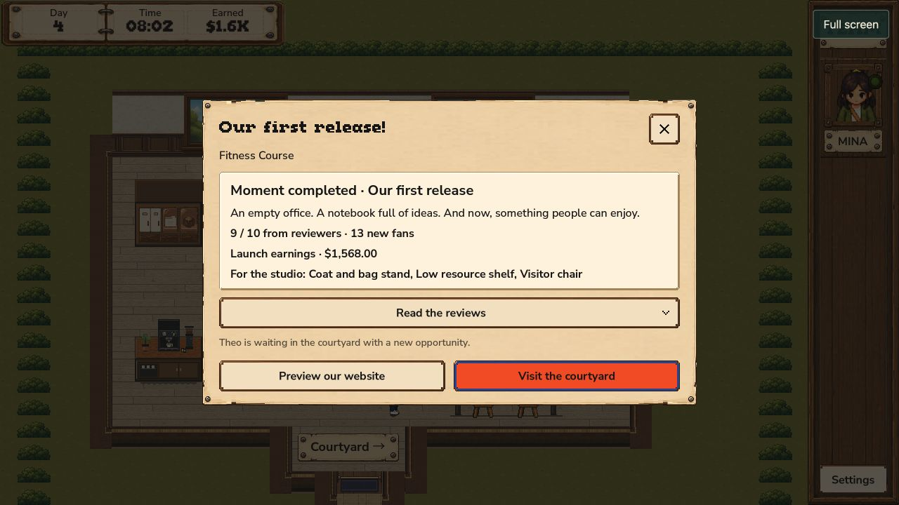

# In-app browser playtest — November 15, 2026

This records actual play in Codex's existing in-app browser on disposable
candidate builds. It is **gameplay evidence, not final map/art approval or a
public deployment**. No windowed Godot run or OS-level control was used for
this browser session. Subsequent visual QA stays in this background in-app
browser; engine tests use `--headless`.

## Builds and scope

| Build | Observed scope |
| --- | --- |
| `c44018e9a5d119bf` | Fresh company through first release, courtyard meeting, accepted Market Day Kit and return to the studio. |
| `01f5a4ee41e4e3a0` | Reload of that company, later hire/office expansion, next project start, courtyard revisit and one Mina panel open/close check. |
| Normal preview `b5d7da90f647ea26` | Still served on port 5177 while candidate world approval is pending; candidate observations must not be attributed to this older build. |

Build identities and action outcomes were recorded by the parent agent
operating the in-app browser. The nine original JPEGs below are retained
without re-encoding. Their filenames identify the candidate build prefix;
they do not independently encode the complete build manifest or every action.

## Observed journey

1. Started a fresh company, walked to Mina and opened her compact portrait
   invitation. Her role, introduction and free invite button were visible.
2. Invited Mina and started a **Fitness / Course** project. The studio view
   showed Mina seated at her desk; the objective supplied the next action.
3. Advanced three workdays and released on **Day4**. This project received
   **9/10**, **13 new fans** and **$1,568 launch earnings**. Its summary named
   the newly earned **Coat and bag stand, Low resource shelf, Visitor chair**.
4. Followed the courtyard action, met Theo, accepted the **Market Day Kit**
   opportunity and returned. The studio objective changed to making the kit.
5. Reloaded candidate `01f5a4ee41e4e3a0`. Day4, Mina, the company and accepted
   story objective remained. This demonstrates the observed browser reload;
   exhaustive field-by-field persistence is covered separately by worker and
   headless journey assertions.
6. Hired Theo for **$300**, which expanded the office. Opened the prefilled
   **Reselling / Template Pack** planning flow and started that project. The
   progress panel showed **Day0 of2**, and Theo appeared in the team rail.
7. Returned to the courtyard. Travel and the story objective continued to
   work, but the sparse yard composition was not accepted as finished art.
8. Clicked Mina in the right team rail and observed the short portrait panel
   slide open. Escape closed it; the final frame showed no residual panel
   paint. The browser warning/error list was empty at that check. This is one
   observed open/close, not proof of every animation cycle or click timing.

## Retained screenshots

| Screenshot | What it substantiates |
| --- | --- |
| [Compact Mina invitation](assets/in-app-playtest/compact-invitation-c44018e9.jpg) | Day1 portrait, role, short introduction and one free-invite action. |
| [Office while working](assets/in-app-playtest/office-seated-c44018e9.jpg) | Actual candidate office/furniture composition and Mina's seated state at that instant. |
| [First release and rewards](assets/in-app-playtest/release-rewards-c44018e9.jpg) | Day4 results, three named furnishing rewards and the courtyard next action. |
| [Returned studio](assets/in-app-playtest/return-saved-c44018e9.jpg) | Accepted Market Day objective after returning; Mina and studio remain present. |
| [Reloaded studio](assets/in-app-playtest/studio-reloaded-01f5a4ee.jpg) | Day4 company/Mina/story visible after the candidate reload. |
| [Expanded office](assets/in-app-playtest/expanded-office-01f5a4ee.jpg) | Theo and Mina in the larger office/team rail after the later hire. |
| [Next project underway](assets/in-app-playtest/next-project-01f5a4ee.jpg) | Reselling Template Pack in development, Day0 of2. |
| [Mina panel open](assets/in-app-playtest/mina-panel-01f5a4ee.jpg) | Short portrait panel opened from the team rail. |
| [Mina panel closed](assets/in-app-playtest/mina-panel-closed-01f5a4ee.jpg) | Clean final office frame after Escape; no residual panel paint visible. |

The release image records the completed first loop:

Additional original working captures, including courtyard variants, are in
`/private/tmp/startup-valley-iab-review/`. That temporary directory is not a
durable handoff artifact. The nine repository images are the retained subset;
no finished-yard claim depends on a temporary image.

## Found issues, changes and remaining limits

- The later-hire welcome still said “Let’s find our first idea” after the
  studio had already shipped. Local checkpoint `75618b0` changes it to
  “Let’s make our next idea” when saved release history is nonempty. Its
  focused headless dialogue suite passed **248 checks** including both
  labels, bounds and a real pointer activation into planning. The browser
  images above predate this copy fix; do not use them as its visual proof.
- The yard needs coherent connected fence modules and a restrained, readable
  village composition. Navigation worked during this session, but it does
  not establish artistic approval. Final browser review and hash-bound map
  admission remain pending after the replacement terrain settles.
- Still screenshots do not establish all blink/walk frames, input latency,
  cross-browser behavior, physical touch-device support or accessibility.
  Existing component checks and [headless functional evidence](assets/final-headless/README.md)
  cover distinct scopes; neither substitutes for current browser visual
  review. That corpus separately labels 914 clean-journey checks on the
  copy-fix runtime and 109 touch/compatibility checks on the previous runtime.
  Both are before the connected-fence change.
- The recorded browser flow starts the second project; it does not claim a
  second release or completion of all later management progression. Public
  hosting, website polish and deployment are deferred.

Next: review the finished yard in the background in-app browser, refresh the
admitted normal export and verify its served identity, then package that exact
build and record final acceptance. See [the development handoff](../DEMO_HANDOFF.md).
