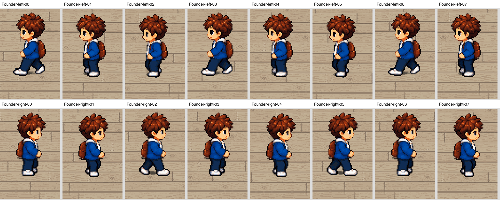
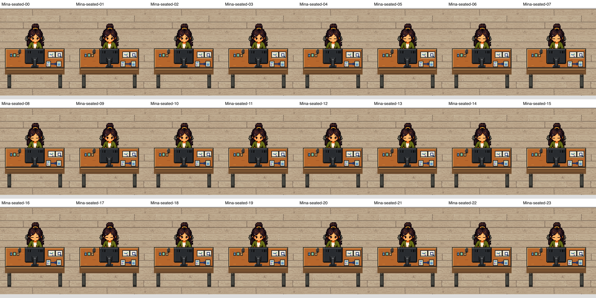
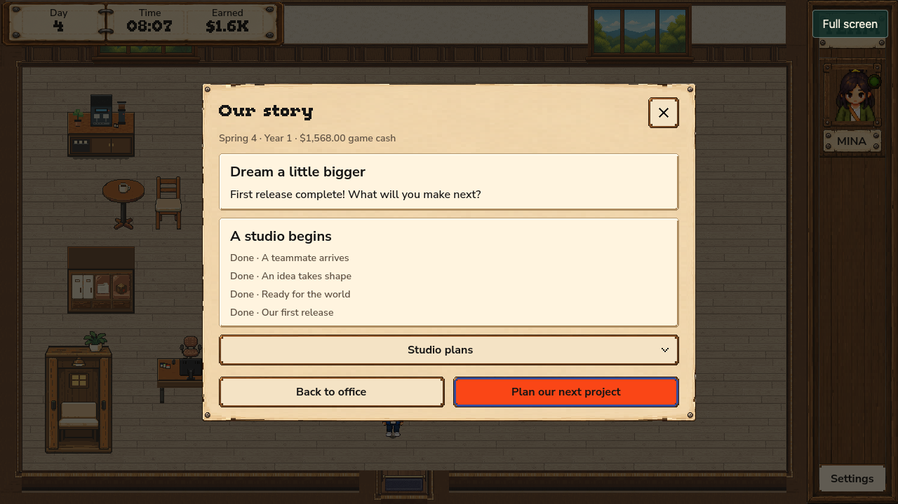

# Browser polish acceptance — November 15, 2026

The actual Godot export passed its first-company story loop in isolated Chrome:
meet Mina, plan the default Fitness Course together, finish three days, release,
and reload. The real worker returned **$1,568 earned, 13 reputation**, and the
reloaded story retained **4/4 moments complete**. No provider work was requested.

The permanent `tests/browser/playtest.mjs` now follows the story interface and
also passed furniture movement, saved player position, OPFS reload, second-tab
protection, and actual browser cursor-image/hotspot checks. Both browser runs
reported no JavaScript or Godot errors.

## Reviewed visuals

- Founder and Mina now show distinct passing and stride poses when walking
  sideways. The captures use real movement, not injected atlas columns.
- Mina's seated blink closes her eyelids without the pale stripe through her
  bangs. She remains seated while assigned to the project; release restores
  normal idle movement.
- The drawer's frame no longer crosses Mina's rail portrait. Across **97 rendered
  frames**, including an interrupted open/close, the sampled portrait region
  remained unchanged.
- The gold click spark is centered at the input point: **0 px error at 1×** and
  less than **1 screen pixel** at the two fractional scales tested. It no longer
  jumps to a navigation-cell center.
- The real browser uses 32×32 warm arrow/hand images. Hotspots are **(0,0)** and
  **(10,0)** respectively, both on opaque visible tips. The desk highlights
  while its hand cursor is active.

Exact build hashes, screenshot hashes, metrics and coverage are retained in
[playtest-polish-evidence.json](playtest-polish-evidence.json). That report binds
three approved reviews: Founder locomotion, Mina locomotion, and Mina seated
blink. **Theo and Creative were not rendered in this browser run**. Their
subsequent native-room review passed 16 captured frames with no fixture failures;
both side-walk revisions are approved separately in
[playtest-polish-native-motion.json](playtest-polish-native-motion.json).

This verifies the candidate preview built at `2026-11-15T22:41:50.715Z`, not later
UI revisions. The subsequently revised desk captions and any new introduction
layout need a fresh smoke test. Physical touch, controller input, Safari and
Firefox were not covered. The full temporary capture sets are under
`/private/tmp/startup-valley-polish/` and
`/private/tmp/startup-valley-playtest-polish/`.
